# UT1 · Virtualización e hipervisores

<p class="ut-meta">12 h · Sesiones 1 a 6 · RA1 CE a</p>

Esta es la primera unidad del módulo y la que sostiene todas las demás. Todo lo que se despliega en el curso (las VPC con SDN (redes definidas por software) de la UT2, los cortafuegos y proxies de la UT3, los clústeres de contenedores, los pipelines de Jenkins) corre sobre máquinas virtuales, y esas máquinas virtuales corren sobre un hipervisor que hay que saber instalar, configurar y, sobre todo, entender. La unidad monta un Proxmox VE propio, construye una plantilla con cloud-init (el servicio que configura una VM en su primer arranque) de la que saldrán decenas de VM en las próximas semanas y mide qué aguanta y qué no aguanta el laboratorio. En la UT2 ese mismo Proxmox recibe redes definidas por software para construir una VPC como la de cualquier nube pública.

## Sesión 1 · Presentación e instalación del hipervisor

<p class="ut-meta" markdown>2 de octubre · Teoría y práctica · <span class="dur" tabindex="0" aria-label="Presentación del módulo, evaluación y laboratorio · 20 min&#10;Qué es virtualizar y para qué sirve · 15 min&#10;Tipos de hipervisor · 10 min&#10;A1.1 Instalar Proxmox VE · 65 min" data-dur="Presentación del módulo, evaluación y laboratorio · 20 min&#10;Qué es virtualizar y para qué sirve · 15 min&#10;Tipos de hipervisor · 10 min&#10;A1.1 Instalar Proxmox VE · 65 min">:material-school:<i class="dur-barra" style="--teoria:41%"></i>:material-flask:</span></p>

Al acabar la sesión hay un Proxmox VE instalado dentro de una VM del portátil y su consola web abierta en el puerto 8006. Los primeros 20 minutos son la presentación del [módulo y su evaluación](../modulo.md) y del [laboratorio](../laboratorio.md); después se explica qué es virtualizar, qué tipos de hipervisor hay y por qué el curso usa Proxmox, que son los dos apartados que siguen. Los requisitos hardware no se explican en clase, pero la hoja de práctica manda leerlos antes de crear la VM exterior: el punto de la virtualización anidada es el que más disgustos da.

### Qué es virtualizar y para qué sirve

Este apartado pone el vocabulario mínimo: qué es una máquina virtual, quién la fabrica y por qué las empresas las usan en lugar de un servidor por aplicación. Sin esto, las tablas de tipos de hipervisor y de VM frente a contenedor que vienen después no se leen bien.

Virtualizar es ejecutar varios sistemas operativos independientes sobre un mismo hardware físico. Un software llamado hipervisor reparte CPU, memoria, disco y red entre las máquinas virtuales (VM) y las mantiene aisladas entre sí. Cada VM cree que tiene un ordenador para ella sola: una BIOS o UEFI, una CPU con sus registros, una controladora de disco, una tarjeta de red. Nada de eso existe físicamente; es el hipervisor el que lo fabrica y el que decide en cada instante qué VM usa el núcleo físico número 3 o quién escribe en el disco.

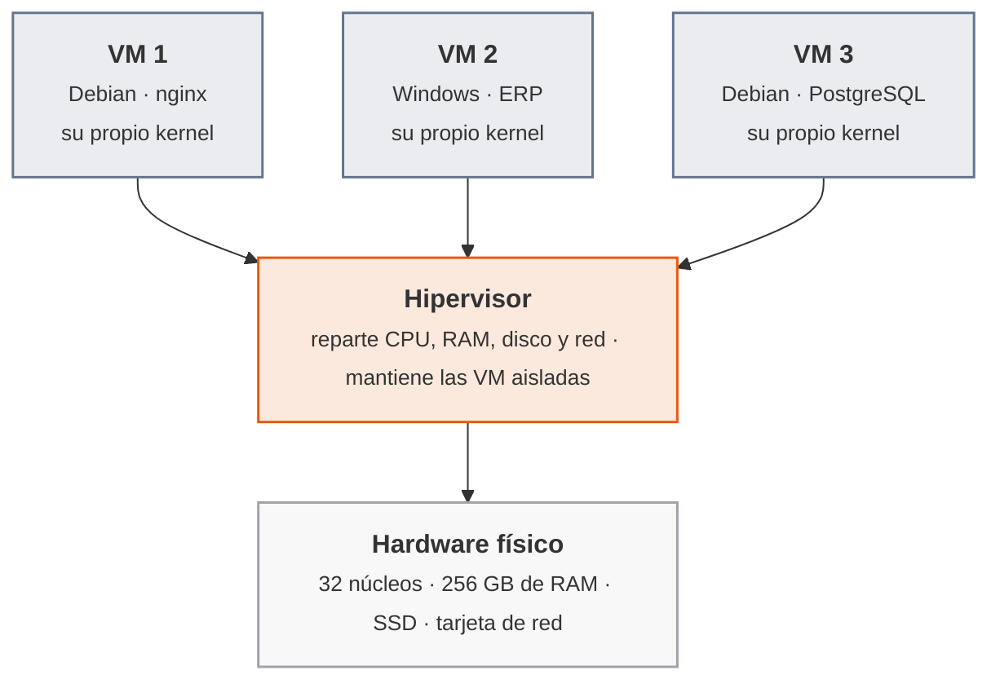

<p class="pie" markdown>Cada VM se cree sola en el ordenador. Lo que ve (BIOS, CPU, disco, tarjeta de red) lo fabrica el hipervisor.</p>


Se virtualiza por cinco razones que aparecen en cualquier empresa:

- Consolidación. Un servidor físico de 2024 tiene 32 o 64 núcleos y 256 GB de RAM; ninguna aplicación normal los usa. Con virtualización, ese servidor aloja decenas de VM en lugar de una sola aplicación, y la factura de electricidad y de rack se divide entre todas.
- Aislamiento. Si una VM falla, se cuelga o se compromete, las demás siguen. El hipervisor es la frontera de seguridad.
- Snapshots y clonado. Se guarda el estado de una VM y se vuelve a él en segundos. Antes de una actualización arriesgada, snapshot; si sale mal, rollback y a otra cosa.
- Portabilidad. Una VM se mueve entre hosts sin reinstalar, incluso encendida (migración en vivo). El hardware físico se cambia sin que el servicio se entere.
- Base de la nube. Toda nube pública es, por debajo, hipervisores gestionados a gran escala. Una instancia EC2 de AWS es una VM sobre KVM (Nitro); una VM de Azure corre sobre Hyper-V. Lanzar instancias en la nube en la UT4 es hacer con una API lo mismo que aquí se hace con `qm create`.

#### VM frente a contenedor

Con Docker ya conocido de antes, conviene aclarar desde el principio qué relación hay entre lo que se hace en esta unidad y los contenedores del título del módulo.

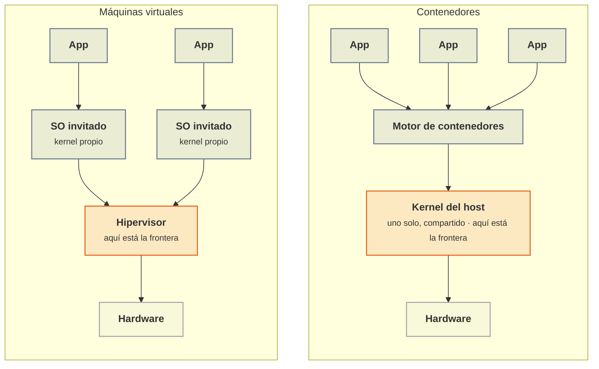

<p class="pie" markdown>La frontera de aislamiento está en sitios distintos: en la VM es el hipervisor; en el contenedor, el kernel que todos comparten.</p>


|  | Máquina virtual | Contenedor |
|----|----|----|
| Qué virtualiza | Hardware completo (CPU, disco, red) | Solo el espacio de usuario; comparte el kernel del host |
| Sistema operativo | Cada VM lleva el suyo, con su propio kernel | Usa el kernel del host |
| Arranque | Segundos a minutos | Milisegundos |
| Tamaño | GB | MB |
| Aislamiento | Fuerte (hipervisor, CPU en modo invitado) | Medio (namespaces, cgroups, seccomp) |
| Caso típico | Servidores completos, distintos SO, seguridad, hipervisor anidado | Aplicaciones, microservicios, CI/CD |

En este curso los contenedores se ejecutan dentro de máquinas virtuales: el hipervisor da la infraestructura y los contenedores dan la aplicación. Es exactamente lo que hace cualquier proveedor cloud con un clúster de Kubernetes gestionado: los nodos son VM. Un contenedor no puede ejecutar otro kernel ni otro sistema operativo, y un proceso que escape de un contenedor está en el kernel del host; un proceso que escape de una VM (cosa muchísimo más rara) está en el hipervisor. Esa diferencia de aislamiento es la razón de que los proveedores no mezclen contenedores de clientes distintos sobre el mismo kernel.

### Tipos de hipervisor

Este apartado clasifica los hipervisores en dos familias y explica por qué el curso usa Proxmox VE. Importa porque en el laboratorio conviven los dos tipos a la vez: uno en el portátil y otro, Proxmox, dentro de él.

<figure markdown="span">
  { width="640" }
  <figcaption>Hipervisor de tipo 1 (bare metal) frente a tipo 2 (hosted). Fuente: Scsami, CC0, vía Wikimedia Commons.</figcaption>
</figure>

|  | Tipo 1 (bare metal) | Tipo 2 (hosted) |
|----|----|----|
| Dónde se instala | Directamente sobre el hardware | Sobre un sistema operativo de escritorio |
| Rendimiento | Alto | Menor (hay un SO por medio) |
| Uso | Servidores, centros de datos, nube | Pruebas, desarrollo, laboratorio |
| Ejemplos | Proxmox VE (KVM), VMware ESXi, Microsoft Hyper-V, Xen | VirtualBox, VMware Workstation, Parallels |

!!! examen "La trampa de la clasificación"
    KVM es un módulo del kernel de Linux, así que un Debian de escritorio con KVM y virt-manager es
    técnicamente de tipo 1: el kernel que gestiona las VM es el mismo que gestiona el hardware, aunque
    se use como si fuera de tipo 2. Lo que distingue de verdad a un hipervisor de producción no es la
    etiqueta sino que el sistema anfitrión esté dedicado y recortado a esa función, con una capa de
    gestión encima. Eso es Proxmox VE.

En el módulo se usa Proxmox VE: libre (AGPLv3), basado en Debian, con KVM para VM y LXC para contenedores de sistema, y con una consola web completa. Es lo más parecido a una nube privada que se puede montar en un aula, y desde que Broadcom cambió el licenciamiento de VMware en 2024 es también lo que muchas pymes y centros educativos han adoptado en producción. Proxmox VE 8 está construido sobre Debian 12 (bookworm) y Proxmox VE 9 sobre Debian 13 (trixie); en el laboratorio del curso se instala la 9, pero todo lo que hay en estos apuntes vale para las dos salvo donde se indique.

### Requisitos hardware

!!! consulta "Material de consulta"
    Esto no se explica en clase: lo necesitas para la hoja de práctica de esta sesión.

Antes de instalar nada, esta lista dice qué tiene que tener el equipo y qué hay que activar en el hipervisor exterior. El punto de la virtualización anidada es el que más disgustos da en la sesión 1: si se salta, Proxmox se instala igual pero sus VM van a paso de tortuga.

- CPU con extensiones de virtualización: Intel VT-x o AMD-V. Sin ellas KVM no funciona. Se comprueba con `egrep -c '(vmx|svm)' /proc/cpuinfo` (debe dar más de 0). Si da 0 en un equipo moderno, la causa casi siempre es que está desactivado en la BIOS/UEFI.
- VT-d / AMD-Vi (IOMMU) para pasar dispositivos físicos a una VM (passthrough). Opcional.
- Virtualización anidada: para instalar Proxmox dentro de una VM (lo que se hace en el laboratorio) hay que activarla en el hipervisor exterior. En un host Linux con KVM, `options kvm-intel nested=1` (o `kvm-amd`) en `/etc/modprobe.d/kvm.conf` y se comprueba con `cat /sys/module/kvm_intel/parameters/nested`. En VirtualBox, "Enable Nested VT-x/AMD-V" en la pestaña de procesador o `VBoxManage modifyvm pve --nested-hw-virt on`. En VMware Workstation, "Virtualize Intel VT-x/EPT or AMD-V/RVI". Si el hipervisor exterior es otro Proxmox, la VM debe tener tipo de CPU `host`. Sin esto, el Proxmox anidado instala pero al arrancar una VM dirá que KVM no está disponible y la ejecutará en emulación pura (TCG), a una velocidad diez o veinte veces menor.

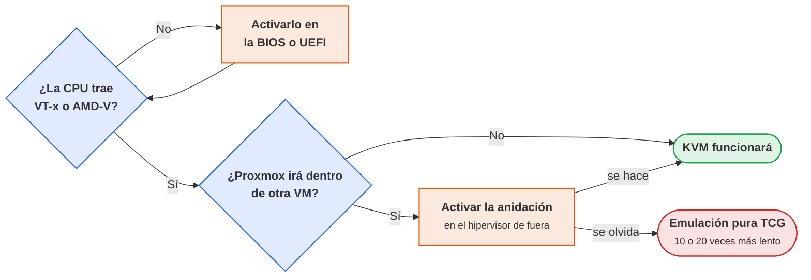

<p class="pie" markdown>El camino que hay que recorrer antes de instalar. Saltarse el último paso es lo que más disgustos da en la sesión 1.</p>

- RAM: el hipervisor consume poco (un Proxmox recién instalado usa alrededor de 1 GB), pero cada VM necesita la suya. Regla de aula: 2 GB por VM de servidor. Con ZFS hay que sumar lo que reserve la caché ARC (la caché de lectura de ZFS en RAM; el instalador de Proxmox la limita al 10 % de la RAM, con máximo de 16 GB, desde la 8.1).
- Almacenamiento: SSD. Proxmox usa por defecto LVM-thin (aprovisionamiento ligero: solo ocupa lo escrito). Un disco mecánico con cuatro VM haciendo E/S aleatoria a la vez es la experiencia más frustrante que puede dar un laboratorio.
- Red: una interfaz basta para empezar; dos permiten separar gestión y tráfico de VM, y tres o cuatro son lo normal en un servidor de producción (gestión, VM, almacenamiento, migración o corosync).

### A1.1 Instalar Proxmox VE (sesión 1)

<span class="et et-obj">Objetivo</span> Al terminar tienes un Proxmox VE 9 instalado dentro de una VM de tu portátil y entras en su consola web en el puerto 8006.

<span class="et et-pre">Antes de empezar</span>

- VirtualBox o VMware Workstation instalado en tu equipo, con 16 GB de RAM y al menos 80 GB libres en un SSD.
- La ISO de Proxmox VE 9 (la última 9.x de la web de Proxmox, alrededor de 1,5 GB). Descárgala antes de clase si puedes: la red del aula se resiente cuando la bajan treinta personas a la vez.
- Lo explicado al principio de la sesión: [qué es virtualizar](#que-es-virtualizar-y-para-que-sirve) y [tipos de hipervisor](#tipos-de-hipervisor). Los [requisitos hardware](#requisitos-hardware) no se explican en clase: lee ese apartado antes del paso 2, sobre todo el punto de la virtualización anidada.

<span class="et et-pas">Pasos</span>

1. Comprueba que la CPU de tu equipo tiene activadas las extensiones de virtualización, como se indica en [Requisitos hardware](#requisitos-hardware). Si no lo están, actívalas en la BIOS/UEFI antes de seguir: sin ellas no hay práctica.

    *Pista:* en Windows lo dice la pestaña Rendimiento del Administrador de tareas («Virtualización: habilitado»).

2. Crea la VM exterior: tipo Linux Debian 64 bits, 4 vCPU, 12 GB de RAM, 60 GB de disco, red en modo puente (bridged) y virtualización anidada activada.

    *Pista:* la anidada es una opción del hipervisor exterior, distinta en cada uno (están en [Requisitos hardware](#requisitos-hardware)). Si se olvida, Proxmox se instala igual y el fallo no se ve hasta el paso 5.

3. Instala Proxmox VE desde la ISO con el disco y el sistema de ficheros que propone (ext4 con LVM-thin), y anota el nombre de host, la IP de gestión y la puerta de enlace.

    *Pista:* el instalador pide el nombre de host completo, con dominio: `pve.lab`, por ejemplo.

4. Entra en la consola web desde el navegador de tu portátil, en el puerto 8006, como `root` con el realm `Linux PAM`.

5. Desde la shell del nodo, comprueba cuántas CPU ve Proxmox y si tiene activa la virtualización anidada (el parámetro `nested` de [Requisitos hardware](#requisitos-hardware)).

<span class="et et-com">Comprobación</span> La consola web muestra el nodo con su CPU, su RAM y los almacenes `local` y `local-lvm`; `nproc` devuelve 4 y el fichero `nested` devuelve `Y` (o `1`). Si devuelve `N`, revisa el paso 2 antes de la sesión 2: es el error más habitual de la unidad y está descrito en [Errores frecuentes](#errores-frecuentes-en-el-laboratorio).

<span class="et et-ent">Entrega</span> Una página en el documento de la unidad con la captura del panel principal, la IP y el nombre de host, y la respuesta a tres preguntas: ¿qué tipo de hipervisor es Proxmox? ¿Y el que has usado para alojarlo? ¿Qué devuelve `cat /sys/module/kvm_intel/parameters/nested` (o `kvm_amd`) dentro de tu Proxmox, y qué significa?

<span class="et et-ext">Si te sobra tiempo</span> Averigua con `pveversion -v` qué kernel y qué versión de QEMU lleva tu Proxmox, y compara su `/etc/network/interfaces` con el ejemplo del [apartado de red](#red): localiza el `vmbr0` y la tarjeta física que tiene como puerto.

## Sesión 2 · Configuración inicial de Proxmox

<p class="ut-meta" markdown>7 de octubre · Teoría y práctica · <span class="dur" tabindex="0" aria-label="Proxmox VE · 25 min&#10;A1.2 Configuración inicial · 85 min" data-dur="Proxmox VE · 25 min&#10;A1.2 Configuración inicial · 85 min">:material-school:<i class="dur-barra" style="--teoria:23%"></i>:material-flask:</span></p>

Al acabar la sesión el Proxmox está actualizado, con un usuario administrador que no es root, un segundo bridge interno y las herramientas de medida instaladas. La explicación recorre las cuatro piezas de Proxmox que toca la hoja: cómo está construido, dónde guarda los discos, cómo conecta las VM a la red y quién puede hacer qué. Las modalidades de red más allá del bridge simple (VLAN, NAT, bond) se dejan para la sesión 5.

### Proxmox VE

Este apartado recorre las cuatro piezas de Proxmox que se tocan en las sesiones 1 y 2: cómo está construido, dónde guarda los discos, cómo conecta las VM a la red y quién puede hacer qué. Cada una lleva sus órdenes de terminal; la web hace lo mismo con clics, pero saber la orden es lo que permite automatizarlo en la UT5.

#### Arquitectura

Debian + kernel Linux con KVM/QEMU (máquinas virtuales) + LXC (contenedores de sistema) + un servicio de gestión (`pve`) con API REST, consola web en el puerto 8006 y herramientas de línea de comandos. Toda la configuración vive en `/etc/pve`, que no es un directorio normal sino un sistema de ficheros propio de Proxmox; la descripción de cada VM, por ejemplo, está en `/etc/pve/qemu-server/<ID>.conf`. Cómo se comparte ese directorio entre los nodos de un clúster está en [Clúster y migración en vivo](../ampliacion.md#cluster-y-migracion-en-vivo).

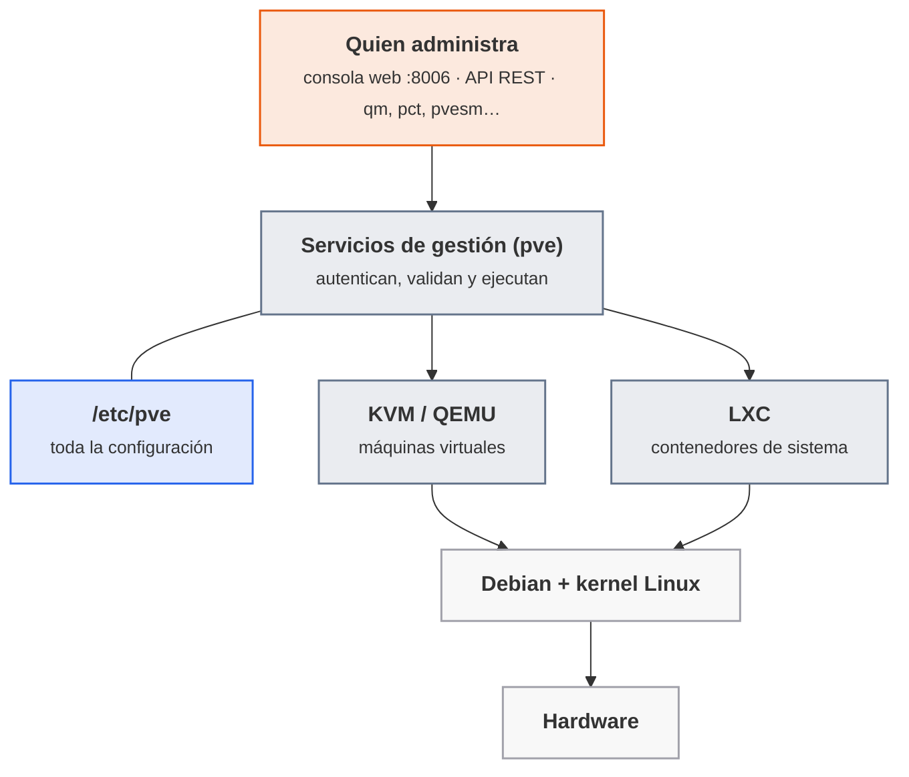

<p class="pie" markdown>Da igual pulsar en la web, llamar a la API o escribir `qm`: las tres puertas acaban en los mismos servicios y en la misma configuración.</p>


| Herramienta | Para qué |
|-----------------|--------------------------------------------------------|
| `qm` | Máquinas virtuales: crear, arrancar, clonar, snapshots, migrar |
| `pct` | Contenedores LXC |
| `pvesm` | Almacenamiento: listar, añadir, ver ocupación |
| `pveum` | Usuarios, grupos, roles y permisos |
| `vzdump` | Copias de seguridad |
| `pveam` | Descargar plantillas de contenedor |
| `pvecm` | Clúster: crear, añadir nodos, ver quórum |
| `pveperf` | Medida rápida de CPU y disco del host |

Puertos que conviene tener en la cabeza: 8006 (web y API), 22 (SSH) y 5900 a 5999 (consolas VNC). Los de la otra consola remota (SPICE), el clúster y las migraciones están también en [Clúster y migración en vivo](../ampliacion.md#cluster-y-migracion-en-vivo).

#### Almacenamiento

Cada almacén tiene un tipo y un contenido permitido (imágenes de disco, ISOs, plantillas de contenedor, backups, snippets). La instalación por defecto crea dos:

- `local` (tipo directorio, en `/var/lib/vz`): ISOs, plantillas de contenedor, backups y snippets. Puede alojar también discos de VM en formato qcow2 o raw como ficheros en `/var/lib/vz/images/<vmid>/`.
- `local-lvm` (tipo LVM-thin, sobre el volumen `pve/data`): discos de VM y contenedores como volúmenes lógicos de bloques. Aprovisionamiento ligero y snapshots.

Y otros que se añaden según el caso:

- ZFS: si hay discos de sobra. Snapshots instantáneos, compresión transparente (lz4), sumas de verificación de cada bloque, replicación integrada entre nodos (`pvesr`) y RAID por software sin controladora. A cambio, RAM para la caché ARC y una cierta penalización de escritura por el copy-on-write.
- NFS, SMB o iSCSI: almacenamiento compartido entre varios nodos, requisito para migrar en vivo sin copiar el disco y para la alta disponibilidad.
- Ceph: almacenamiento distribuido integrado en Proxmox; a partir de tres nodos.
- Proxmox Backup Server: destino de backups deduplicados (más abajo).

Cómo elegir, con lo que pesa cada opción:

| | LVM-thin | ZFS | Directorio (ext4/xfs) |
|---|---|---|---|
| Formato de disco de VM | raw (volumen de bloques) | raw (zvol) | qcow2 o raw (fichero) |
| Snapshots | Sí, de bloques, rápidos | Sí, instantáneos | Solo con qcow2 |
| Thin provisioning | Sí | Sí | Sí con qcow2 (crece bajo demanda) |
| Clones enlazados | Sí | Sí | Sí con qcow2 |
| Integridad de datos | La del disco | Checksums, autocorrección con redundancia | La del sistema de ficheros |
| Coste en RAM | Ninguno | ARC (GB) | Ninguno |
| Cuándo | Un solo disco, laboratorio, lo simple | Varios discos, datos que importan, replicación | Almacén compartido NFS, ISOs, backups |

Sobre los formatos: **raw** es una imagen byte a byte del disco, sin cabecera, lo más rápido y lo que usan LVM y ZFS; **qcow2** (QEMU Copy On Write v2) es un formato de fichero con metadatos que permite crecer bajo demanda, snapshots internos, compresión y una imagen base de la que cuelgan otras (así se hacen los clones enlazados en un directorio). Con qcow2 se paga una capa de indirección (tablas L1/L2) y una fragmentación que se nota con el tiempo; en un directorio sobre SSD la diferencia con raw es de un 5 a un 10 % en E/S aleatoria, aceptable para laboratorio. Las imágenes cloud se distribuyen en qcow2 porque es lo compacto; al importarlas a LVM-thin Proxmox las convierte a raw automáticamente.

El **thin provisioning** merece un aviso serio. Un almacén de 200 GB puede tener asignados 10 discos de 50 GB (500 GB "prometidos") porque solo ocupan lo escrito. Mientras las VM estén medio vacías, perfecto. El día que dos de ellas se llenen a la vez y el pool llegue al 100 %, LVM-thin no puede atender las escrituras: las VM reciben errores de E/S, sus sistemas de ficheros pasan a solo lectura o se corrompen, y no se puede ni borrar un snapshot para hacer sitio porque borrar también necesita metadatos. En ZFS el comportamiento es similar cuando el pool se llena, agravado por el copy-on-write. Conviene vigilarlo con `lvs` (columnas `Data%` y `Meta%`) o `zpool list`, y activar el descarte de bloques (`discard=on` en el disco de la VM y `fstrim` periódico dentro del invitado, que Debian ya trae como temporizador de systemd) para que el espacio que la VM libera vuelva al pool. Sin descarte, un pool thin solo crece.

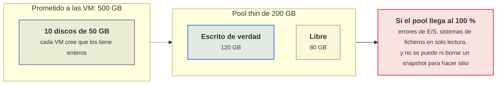

<p class="pie" markdown>Sobreasignar es normal y es la gracia del thin provisioning. Lo que no es opcional es vigilar `Data%` y activar el descarte.</p>


```bash
# Ocupación real del pool thin y de cada disco
lvs pve/data
lvs -o lv_name,lv_size,data_percent pve
# Descarte desde el host, a través del agente QEMU
qm guest cmd 110 fstrim
```

#### Red

Proxmox no conecta las VM directamente a la tarjeta física: crea un bridge Linux (`vmbr0`) que actúa como un switch virtual. La tarjeta física se conecta al bridge y las VM se conectan al bridge con interfaces `tap` (una por tarjeta virtual: `tap110i0` es la net0 de la VM 110). La configuración está en `/etc/network/interfaces` y la aplica `ifupdown2` sin reiniciar con `ifreload -a`; la web hace eso mismo al pulsar "Apply Configuration".

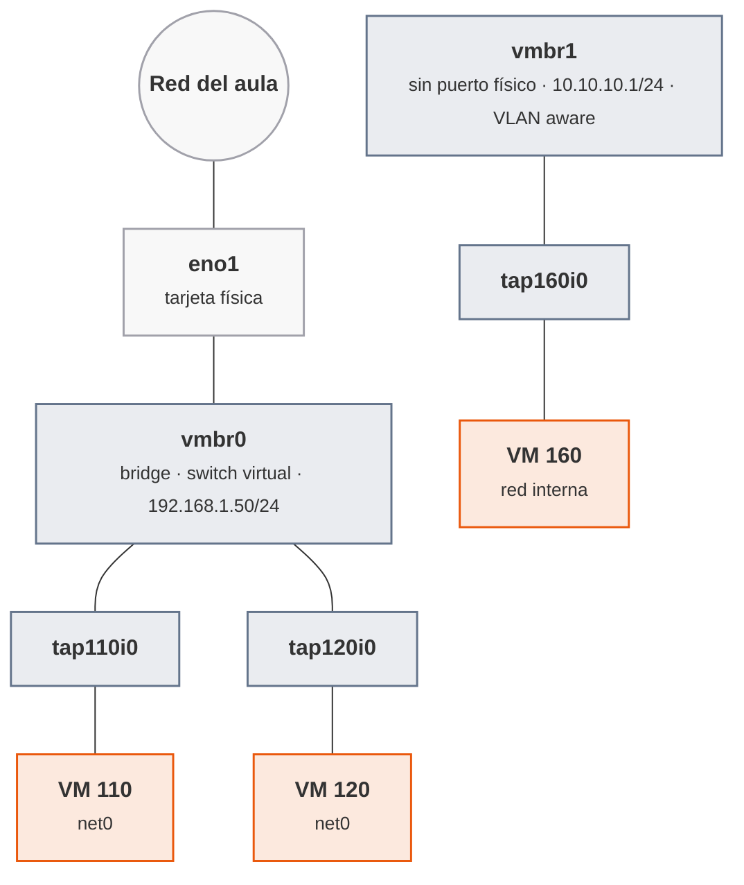

<p class="pie" markdown>Una interfaz `tap` por tarjeta virtual. `vmbr1` no tiene puerto físico: lo que se conecta ahí no sale del host, que es justo lo que se busca para una red interna.</p>


```text
auto lo
iface lo inet loopback

iface eno1 inet manual

auto vmbr0
iface vmbr0 inet static
    address 192.168.1.50/24
    gateway 192.168.1.1
    bridge-ports eno1
    bridge-stp off
    bridge-fd 0

auto vmbr1
iface vmbr1 inet static
    address 10.10.10.1/24
    bridge-ports none
    bridge-stp off
    bridge-fd 0
    bridge-vlan-aware yes
    bridge-vids 2-4094
```

#### Usuarios y permisos

Los usuarios pertenecen a un realm (`pam` = usuarios Linux del host, `pve` = usuarios propios de Proxmox, almacenados en `/etc/pve/user.cfg`; también se pueden enganchar directorios externos: LDAP, Active Directory y OpenID Connect). Los permisos se asignan como un rol (conjunto de privilegios: `Administrator`, `PVEAdmin`, `PVEVMAdmin`, `PVEVMUser`, `PVEAuditor`, `PVEDatastoreUser`...) sobre una ruta del árbol de objetos (`/`, `/vms/100`, `/storage/local`, `/nodes/pve1`), con o sin propagación a los hijos. Buena práctica: no trabajar como `root@pam`; crear un usuario administrador en el realm `pve` y reservar root para lo que solo root puede hacer (algunas operaciones del nodo y la consola del host). Los tokens de API (claves con las que un programa habla con Proxmox sin contraseña), que se usan con OpenTofu en la UT5, se crean sobre un usuario y heredan o restringen sus permisos.


<p class="pie" markdown>Un permiso son siempre tres cosas: quién, qué puede hacer y sobre qué parte del árbol. El token de la UT5 sale de ahí.</p>


```bash
pveum user add admin@pve --password 'CambiaEsto' --comment "Administrador del laboratorio"
pveum acl modify / --users admin@pve --roles Administrator
pveum user list
pveum acl list
```

### A1.2 Configuración inicial (sesión 2)

<span class="et et-obj">Objetivo</span> Un Proxmox actualizado, con un usuario administrador que no es root, un segundo bridge interno y las herramientas de medida instaladas.

<span class="et et-pre">Antes de empezar</span>

- El Proxmox de A1.1 arrancado y accesible en el puerto 8006, con `nested` en `Y`.
- Lo explicado al principio de la sesión: [arquitectura y herramientas](#arquitectura), [almacenamiento](#almacenamiento), [red](#red) y [usuarios y permisos](#usuarios-y-permisos).

<span class="et et-pas">Pasos</span>

1. Cambia los repositorios de Proxmox a `No-Subscription` y desactiva los dos `enterprise` (`pve-enterprise` y el de `ceph`) desde nodo > Updates > Repositories. Mira desde la shell cómo han quedado.

    *Pista:* en Proxmox VE 9 son ficheros en `/etc/apt/sources.list.d/*.sources`.

2. Actualiza el nodo. Si entra un kernel nuevo (un paquete `proxmox-kernel-...`), reinicia antes de seguir.

3. Anota qué contenido admite cada almacén, `local` y `local-lvm`, y el tamaño del pool thin con su ocupación de datos y de metadatos, con las órdenes de [Almacenamiento](#almacenamiento).

4. Crea el usuario `admin` en el realm `pve`, con el rol `Administrator` sobre `/`, como en [Usuarios y permisos](#usuarios-y-permisos), y desde ahora trabaja con él.

    *Pista:* al entrar en la web con `admin`, el realm es `Proxmox VE authentication server`, no `Linux PAM`.

5. Crea en nodo > Network el segundo bridge, `vmbr1`, con `10.10.10.1/24` y sin puerto físico.

    *Pista:* en la web, el cambio no se aplica hasta pulsar Apply Configuration.

6. Instala en el host las herramientas de medida (`stress-ng`, `fio`, `iperf3` y `sysstat`) y deja preparado el material de la sesión 3, que son dos descargas largas: la imagen cloud de Debian 13 en `/root` y el paquete `libguestfs-tools`, que trae `virt-customize`. Hecho hoy, la sesión 3 empieza directamente por la plantilla.

    *Pista:* la imagen es `debian-13-genericcloud-amd64.qcow2`, de `https://cloud.debian.org/images/cloud/trixie/latest/`. Si tu Proxmox es 8, la de bookworm (`debian-12-genericcloud-amd64.qcow2`).

<span class="et et-com">Comprobación</span> `apt update` termina sin errores 401; `pveum user list` muestra `admin@pve`; `ip -br addr` muestra `vmbr0` con la IP del aula y `vmbr1` con `10.10.10.1/24`; `fio --version` responde; `ls -lh /root/debian-13-genericcloud-amd64.qcow2` muestra la imagen entera y `virt-customize --version` contesta.

<span class="et et-ent">Entrega</span> Captura de `/etc/network/interfaces` y de la lista de usuarios (`pveum user list`), el tamaño del pool thin y la salida de `virt-customize --version`, en el documento de la unidad.

<span class="et et-ext">Si te sobra tiempo</span> Crea un segundo usuario con rol `PVEAuditor` sobre `/`, entra con él y anota qué puede ver y qué no puede tocar.

## Sesión 3 · Primera VM y plantilla

<p class="ut-meta" markdown>14 de octubre · Teoría y práctica · <span class="dur" tabindex="0" aria-label="Máquinas virtuales en Proxmox · 20 min&#10;A1.3 Plantilla cloud-init y clonado · 90 min" data-dur="Máquinas virtuales en Proxmox · 20 min&#10;A1.3 Plantilla cloud-init y clonado · 90 min">:material-school:<i class="dur-barra" style="--teoria:18%"></i>:material-flask:</span></p>

Al acabar la sesión hay una plantilla cloud-init (VM 9000) de la que salen `web01`, `app01` y `mon01`, las tres con IP y acceso SSH desde el nodo y desde el puesto del alumno; las dos últimas, con Docker instalado, las usa Mantenimiento al día siguiente. La explicación cubre cloud-init, las plantillas y la diferencia entre clon completo y enlazado. Los parámetros de `qm create` y los tipos de CPU están aquí para entender cada opción de la hoja; snapshots y backups, que cierran el ciclo de vida de una VM, se ven en la sesión 4.

### Máquinas virtuales en Proxmox

Con el hipervisor listo, aquí están las cuatro primeras etapas del ciclo de vida de una VM: crearla con los parámetros correctos, elegir la CPU que expone, configurarla sola con cloud-init y convertirla en plantilla para clonarla. Snapshots y backups lo cierran en la sesión 4. Es el apartado más largo y el de consulta más frecuente durante el curso; la A1.3 sigue este mismo orden.

#### Crear una VM: los parámetros que importan

- ID (100 en adelante, único en el clúster) y nombre. Conviene reservar un rango para plantillas (9000 en adelante es la costumbre).
- ISO de instalación o imagen de disco importada (plantilla).
- Disco: bus `scsi` con controladora `VirtIO SCSI single`, formato raw sobre `local-lvm`, `discard=on` y `ssd=1` si el almacén es SSD (el invitado lo trata como SSD y hace TRIM). Tamaño en GB; con thin, se puede ser generoso en tamaño pero siendo consciente de lo que suma.
- CPU: número de núcleos (`cores`) y sockets (se deja 1 socket) y tipo, que tiene sección propia más abajo.
- Memoria: fija o con ballooning. Con ballooning, `--memory` es el máximo y `--balloon` el mínimo hasta el que el host puede reclamar la RAM que la VM no usa.
- Red: modelo virtio, bridge y, si procede, etiqueta VLAN y cortafuegos de Proxmox activado.
- Firmware y máquina (el tipo de BIOS y de placa base que QEMU emula): SeaBIOS con i440fx por defecto; OVMF (UEFI) con q35 para passthrough de PCIe, Secure Boot o Windows 11 (que además exige un TPM virtual, un chip de seguridad emulado).
- Agente QEMU: tiene que estar instalado dentro de la VM (`apt install qemu-guest-agent`, o dentro de la propia imagen antes de crear la plantilla, que es lo que se hace en este curso) y activado en la VM (`--agent enabled=1`) para que Proxmox vea su IP, pueda apagarla limpiamente, congelar el sistema de ficheros durante un backup y ejecutar `fstrim`.

```bash
qm create 190 --name prueba --memory 2048 --balloon 1024 --cores 2 --cpu x86-64-v2-AES \
  --scsihw virtio-scsi-single --scsi0 local-lvm:20,discard=on,ssd=1 \
  --net0 virtio,bridge=vmbr1 --ostype l26 --agent enabled=1
qm config 190
```

El ejemplo usa un ID del rango de pruebas (150 a 199) y `vmbr1` sin etiqueta VLAN, donde el host tiene la `10.10.10.1`; con esa misma VM se sigue en el diagrama de cloud-init de más abajo.

#### Tipos de CPU y su efecto en la migración

Cuando el kernel invitado ejecuta `cpuid`, KVM le responde con lo que Proxmox haya configurado, no necesariamente con la CPU real. Esa respuesta determina qué instrucciones cree tener disponibles el invitado (AVX, AES-NI, SSE4.2...), y los compiladores y las bibliotecas eligen rutas de código en función de ella.

| Tipo | Qué expone | Ventaja | Inconveniente |
|---|---|---|---|
| `host` | Todas las banderas de la CPU física | Máximo rendimiento; necesario para virtualización anidada y para algunas cargas (AVX-512, compilación) | La VM solo puede migrar en vivo a un host con exactamente la misma CPU; si cambia de máquina, el invitado puede caer con "illegal instruction" |
| `x86-64-v2-AES` | Nivel de microarquitectura v2 (instrucciones SSE hasta SSE4.2) más AES-NI, el cifrado por hardware | Por defecto para VM nuevas desde Proxmox VE 8; funciona en cualquier CPU desde 2010 y migra entre hosts distintos | Sin AVX/AVX2: cargas numéricas o de cifrado moderno van más lentas |
| `x86-64-v3`, `x86-64-v4` | v2 más AVX y AVX2 (v3); más AVX-512 (v4) | Buen compromiso en un clúster homogéneo moderno | Exige que todos los nodos tengan esas banderas |
| `kvm64` | Un Pentium 4 con extensiones mínimas | Corre en cualquier sitio; era el valor por defecto hasta la 7 | Muy pobre: sin SSE4, sin AES-NI; muchas distribuciones actuales lo rechazan porque exigen x86-64-v2 |
| Modelos con nombre (`EPYC-Rome`, `Skylake-Server`...) | Las banderas de esa familia concreta | Reproducible y portable dentro de una gama | Hay que saber qué hardware hay debajo |

En el laboratorio, anidado y con un solo nodo, `host` es lo razonable para el Proxmox interior (así puede virtualizar a su vez) y `x86-64-v2-AES` para las VM creadas dentro, que es lo que pone Proxmox cuando no se indica otra cosa. En una empresa con un clúster de nodos comprados en años distintos, se elige el mínimo común denominador (a menudo v2 o v3) o se define un modelo de CPU propio en `/etc/pve/virtual-guest/cpu-models.conf` para toda la organización. Cambiar el tipo de CPU exige apagar y encender la VM; un reinicio desde dentro no basta.

#### cloud-init

<figure markdown="span">
  { width="160" }
  <figcaption>cloud-init. Fuente: dominio público, vía Wikimedia Commons.</figcaption>
</figure>

**cloud-init** es el estándar para configurar una VM en el primer arranque: usuario, contraseña o clave SSH, nombre de host, red, paquetes, comandos. Lo usan todas las nubes (AWS, Azure, GCP, OpenStack) y todas las imágenes cloud de Debian, Ubuntu, Rocky o Fedora lo llevan instalado y activado. Es un servicio que arranca antes que la red, busca una fuente de datos (*datasource*), lee de ella la configuración y la aplica en cuatro etapas: `init-local` (configura la red a partir de `network-config`), `init` (con red: usuarios, claves SSH, redimensionado del disco), `modules:config` y `modules:final` (paquetes, `runcmd`, mensaje de fin). Todo se registra en `/var/log/cloud-init.log` (detallado) y `/var/log/cloud-init-output.log` (salida de los comandos).

Proxmox lo integra con el datasource **NoCloud**: genera al vuelo una imagen ISO de unos 4 MB con etiqueta `cidata` que contiene tres ficheros (`user-data`, `meta-data` y `network-config`), la conecta a la VM como un CD-ROM (`ide2: local-lvm:vm-110-cloudinit`) y cloud-init la encuentra al arrancar buscando un volumen con esa etiqueta. Cada vez que se cambia un parámetro cloud-init en la VM (`--ciuser`, `--ipconfig0`, `--sshkeys`, `--nameserver`), Proxmox regenera la ISO en el siguiente arranque. Se puede ver exactamente lo que va a recibir la VM sin arrancarla:

```bash
qm cloudinit dump 110 user
qm cloudinit dump 110 network
qm cloudinit dump 110 meta
```

El `user-data` que genera Proxmox es deliberadamente corto (hostname, usuario, contraseña cifrada, claves SSH, `package_upgrade` si se marca). Si hace falta más (instalar el agente QEMU, crear varios usuarios, ejecutar comandos), se escribe un fichero YAML propio en el almacén `local` como snippet (un fichero auxiliar que Proxmox guarda junto a las ISO) y se referencia con `--cicustom "user=local:snippets/web.yaml"`; en ese caso Proxmox deja de generar el `user-data` y usa ese tal cual, pero sigue generando la red. Es lo que se hace en la UT5 desde OpenTofu.

```yaml
#cloud-config
hostname: web01
users:
  - name: ops
    groups: [sudo]
    shell: /bin/bash
    sudo: ALL=(ALL) NOPASSWD:ALL
    ssh_authorized_keys:
      - ssh-ed25519 AAAAC3NzaC1lZDI1NTE5AAAA... ops@portatil
package_update: true
packages:
  - qemu-guest-agent
runcmd:
  - systemctl enable --now qemu-guest-agent
```

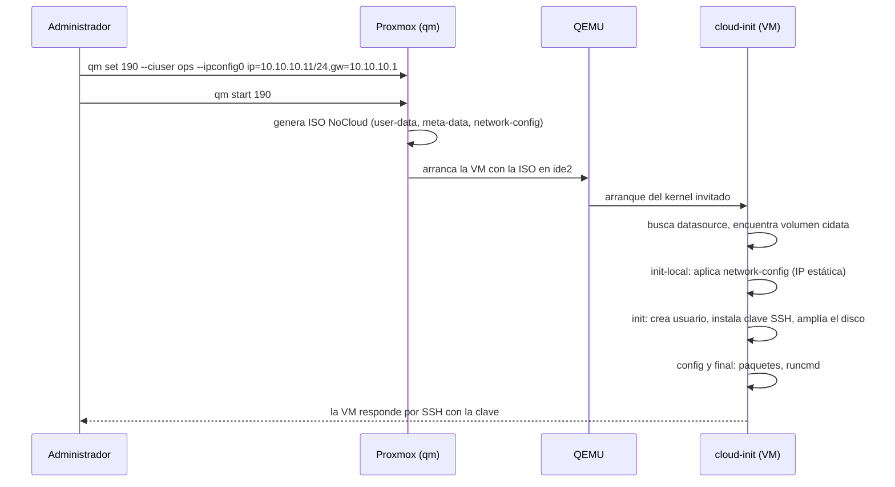

<p class="pie" markdown>Todo el trabajo lo hace la VM en su primer arranque; Proxmox solo le engancha el volumen `cidata` y la enciende. Por eso cuando falla se depura dentro de la VM, no en el host.</p>

Cómo depurarlo cuando no funciona, que ocurre con frecuencia:

```bash
# Dentro de la VM (por la consola noVNC de Proxmox si no hay SSH)
cloud-init status --long        # done / running / error, y con --long el detalle
cloud-init query -a | head -50  # qué datasource encontró y qué metadatos leyó
grep -iE "warn|error|traceback" /var/log/cloud-init.log
cat /var/log/cloud-init-output.log
# Forzar que se vuelva a ejecutar como si fuera el primer arranque
cloud-init clean --logs && reboot
```

Dos detalles que ahorran horas. Primero: cloud-init guarda en `/var/lib/cloud/instance` que ya se ejecutó para esa instancia (identificada por el `instance-id` del `meta-data`); si se clona una VM ya arrancada en lugar de una plantilla limpia, el clon cree que ya está configurado y no aplica nada. Por eso la plantilla nunca se arranca. Segundo: el disco de la imagen cloud es pequeño (2 GB en Debian) y cloud-init lo amplía al tamaño del volumen en el primer arranque (`growpart` + `resizefs`), pero solo si se le ha dado ese tamaño antes de arrancar (`qm disk resize 110 scsi0 +18G`, o `qm resize` en versiones anteriores).

#### Plantillas y clonado

Flujo de trabajo de aula (y de producción):

1. Descargar una imagen cloud de Debian o Ubuntu (formato qcow2).
2. Crear una VM con esa imagen como disco y añadir el disco cloud-init.
3. Convertirla en plantilla (`qm template`): ya no se puede arrancar, solo clonar. Internamente Proxmox marca el disco base como solo lectura.
4. Clonar: **linked clone** (rápido, comparte el disco base con la plantilla y solo escribe las diferencias en un volumen propio; para pruebas y aulas) o **full clone** (independiente, copia completa del disco; para producción y para poder borrar la plantilla o moverlo a otro almacén).
5. Cada clon recibe su configuración por cloud-init: IP, usuario, clave.

Así, crear una VM nueva pasa de 20 minutos de instalación a 20 segundos. Un linked clone sobre LVM-thin tarda menos de un segundo porque no copia nada; un full clone de 20 GB tarda lo que tarde el disco en copiar lo que hay escrito (unos segundos en SSD para una imagen de 2 GB reales). El precio del linked clone es la dependencia: no se puede borrar la plantilla mientras exista un clon, y todos los clones leen de los mismos bloques base, lo que en disco mecánico se nota.

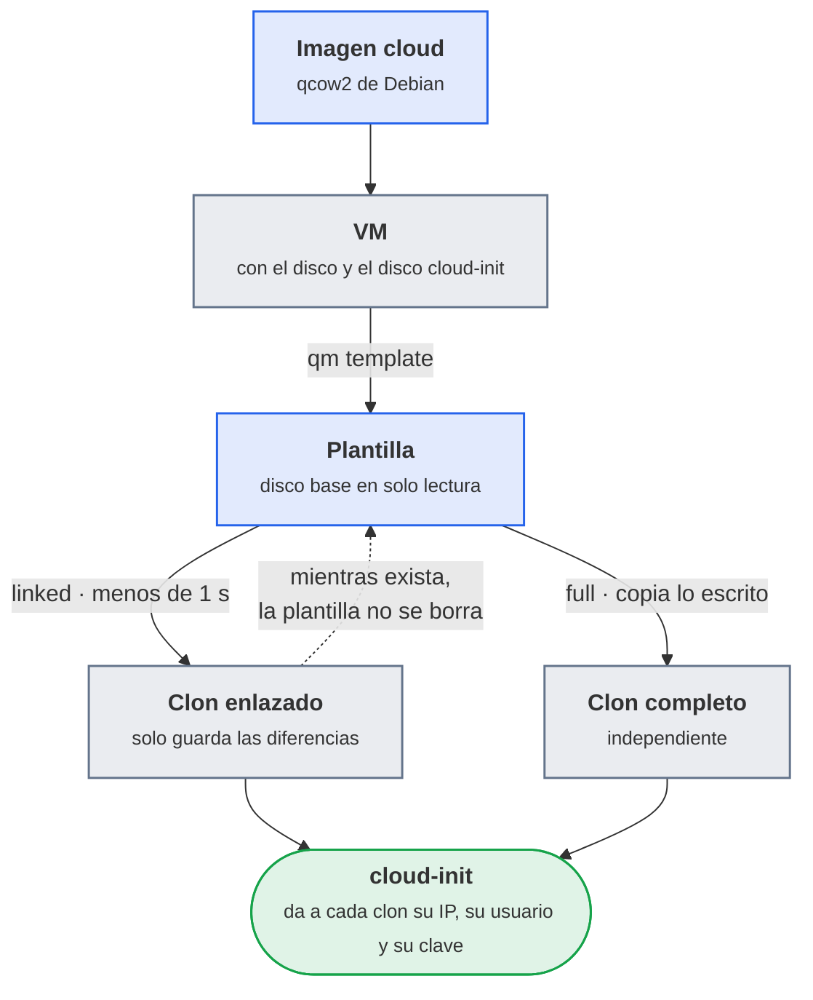

<p class="pie" markdown>De 20 minutos de instalación a 20 segundos. El clon enlazado es más rápido pero queda atado a la plantilla.</p>


### A1.3 Plantilla cloud-init y clonado (sesión 3)

<span class="et et-obj">Objetivo</span> Una plantilla cloud-init (VM 9000) con el agente QEMU y el de métricas ya dentro, de la que salen `web01`, `app01` y `mon01`, las tres con IP y acceso SSH desde el nodo y desde tu puesto, y `app01` y `mon01` con Docker instalado, listas para Mantenimiento mañana.

<span class="et et-pre">Antes de empezar</span>

- Proxmox actualizado, `vmbr1` creado y usuario `admin` (A1.2).
- La imagen cloud de Debian 13 en `/root` y `libguestfs-tools` instalado, del paso 6 de la A1.2. Si no lo dejaste hecho, hazlo ahora: el resto de la hoja depende de eso.
- Un terminal en tu puesto con `ssh` y `scp` (en Windows, PowerShell ya los trae): a las VM se entra desde el nodo Proxmox y desde tu puesto, que es desde donde trabaja Mantenimiento a partir de mañana.
- Lo explicado al principio de la sesión: [cloud-init](#cloud-init) y [plantillas y clonado](#plantillas-y-clonado). Para los parámetros del `qm create`, [crear una VM](#crear-una-vm-los-parametros-que-importan) y [tipos de CPU](#tipos-de-cpu-y-su-efecto-en-la-migracion).

<span class="et et-pas">Pasos</span>

1. Mete dentro de la imagen, antes de importarla, el agente QEMU (`qemu-guest-agent`) y el de métricas (`prometheus-node-exporter`), para que los traiga en marcha toda VM que salga de la plantilla, aunque nazca sin Internet.

    *Pista:* `virt-customize -a <imagen> --install <paquetes>` lo hace sin arrancarla, con `LIBGUESTFS_BACKEND=direct` exportado antes. Tarda unos minutos: mientras, haz el paso 2.

2. Junta en un fichero del nodo las dos claves públicas que van a entrar en las VM, la de tu puesto y la del propio nodo, una por línea.

    *Pista:* si alguna no existe, créala con `ssh-keygen -t ed25519`, sin contraseña. La del puesto se copia al nodo, por ejemplo como `/root/puesto.pub`.

3. Crea la VM 9000, `debian-tpl`, con los parámetros de [Crear una VM](#crear-una-vm-los-parametros-que-importan) salvo tres: 2 GB sin ballooning, la red en `vmbr0`, que es la que heredan los clones, y la imagen importada como disco. Añádele el disco cloud-init y la consola serie.

    *Pista:* créala sin disco e impórtalo después; lo demás, con el arranque desde ese disco, va en la segunda orden:

    ```bash
    qm set 9000 --scsi0 local-lvm:0,import-from=/root/debian-13-genericcloud-amd64.qcow2,discard=on,ssd=1
    qm set 9000 --ide2 local-lvm:cloudinit --boot order=scsi0 --agent enabled=1 --serial0 socket --vga serial0
    ```

4. Configura cloud-init en la 9000 (usuario `ops`, las claves del paso 2 e IP por DHCP), amplía su disco a 20 GB y conviértela en plantilla sin haberla arrancado nunca. Antes, comprueba con `qm cloudinit dump` que el `user-data` lleva las dos claves, cada una en una sola línea.

    *Pista:* el orden importa por los dos detalles del final de [cloud-init](#cloud-init).

5. Clona `web01` (ID 110, clon completo, 1 GB), saca su IP con el agente QEMU y entra por SSH como `ops` desde el nodo: cloud-init tiene que haber terminado y los dos agentes, estar activos.

    *Pista:* si el agente aún no responde, la IP sale en la consola de la VM (`qm terminal 110`, de la que se sale con Ctrl+O).

6. Clona `app01` (ID 120, 2 GB) y `mon01` (ID 103, 3 GB), completas y con la red de la plantilla (el porqué de cada ID y cada RAM, en las [convenciones del laboratorio](../laboratorio.md#convenciones)), e instala en las dos Docker Engine con el plugin compose, usable por `ops` sin `sudo`. Entra en las dos a la vez **desde tu puesto**, que es como entra Mantenimiento mañana, y no levantes ningún servicio: eso lo hace Mantenimiento en su sesión 4.

    *Pista:* el script oficial de `https://get.docker.com` instala Docker y compose en Debian 13. El grupo `docker` no se aplica hasta que sales y vuelves a entrar por SSH.

<span class="et et-com">Comprobación</span> `qm list` muestra 9000 como plantilla y las VM 110, 120 y 103 con 1024, 2048 y 3072 MB; entras por SSH como `ops` sin contraseña en `web01` desde el host y en `app01` y `mon01` desde tu puesto; `qm guest cmd 110 network-get-interfaces` responde sin haber instalado nada dentro; `cloud-init status --long` dice `done` y los dos agentes están `active`; en `app01` y en `mon01`, `docker --version` y `docker compose version` responden con el usuario `ops` y sin `sudo`.

<span class="et et-ent">Entrega</span> Salida de `qm list`, de `cloud-init status --long` dentro de `web01` y de `docker compose version` en `app01` y en `mon01`, más una explicación de dos o tres líneas, a partir de [Plantillas y clonado](#plantillas-y-clonado), de en qué se diferencian un clon completo y uno enlazado y de lo que ocupa cada uno. Anota las IP de `app01` y `mon01`: las necesitas mañana en 5169.

<span class="et et-ext">Si te sobra tiempo</span> Comprueba con números esa diferencia: mira `lvs pve`, saca de la plantilla un clon enlazado, `web02` (ID 150, 1 GB), y vuelve a mirarlo. Compara de qué depende el volumen de `web02` y de qué el de `web01`, y lo que ocupa cada uno. Practica también con los snippets de cloud-init, que es como se personaliza una VM cuando no se puede tocar la imagen: activa el contenido `snippets` en `local` (Datacenter > Storage > local > Edit), guarda el YAML del [apartado de cloud-init](#cloud-init) en `/var/lib/vz/snippets/web.yaml`, clona una VM con `--cicustom "user=local:snippets/web.yaml"` y comprueba qué ha hecho el fichero en el primer arranque. Ten en cuenta que el `packages:` de ese YAML solo funciona si la VM tiene salida a Internet; por eso el agente de esta plantilla va dentro de la imagen y no aquí. Rompe algo a propósito: clona una VM, quítale la red que hereda de la plantilla (`qm set <ID> --delete ipconfig0`) y depúrala con `cloud-init status --long` y `/var/log/cloud-init.log`.

## Sesión 4 · VM vs LXC, snapshots y límites

<p class="ut-meta" markdown>16 de octubre · Teoría y práctica · <span class="dur" tabindex="0" aria-label="Cómo funciona KVM/QEMU por debajo · 15 min&#10;LXC frente a VM, con números · 5 min&#10;Snapshots · 5 min&#10;A1.4 VM frente a LXC, snapshots · 85 min" data-dur="Cómo funciona KVM/QEMU por debajo · 15 min&#10;LXC frente a VM, con números · 5 min&#10;Snapshots · 5 min&#10;A1.4 VM frente a LXC, snapshots · 85 min">:material-school:<i class="dur-barra" style="--teoria:23%"></i>:material-flask:</span></p>

Al acabar la sesión hay una tabla con medidas propias de VM frente a LXC, un snapshot de `web01` al que se ha vuelto y un backup restaurado como VM 151. La explicación va en tres partes: qué hacen KVM y QEMU por debajo y por qué virtio es más rápido que el hardware emulado; qué es un contenedor LXC y en qué se diferencia de una VM, con números; y qué es un snapshot en LVM-thin y qué no es. El apartado de backups con vzdump no se explica, pero el último paso de la hoja lo usa.

### Cómo funciona KVM/QEMU por debajo

Saber qué ocurre por debajo de un «Create VM» permite interpretar un problema de rendimiento en lugar de ir probando opciones. Al arrancar una VM en Proxmox ocurren tres cosas a la vez.

**KVM (Kernel-based Virtual Machine)** son dos módulos del kernel de Linux: `kvm.ko`, genérico, y `kvm_intel.ko` o `kvm_amd.ko`, específicos de cada fabricante. KVM no emula nada: usa las extensiones de virtualización de la CPU (Intel VT-x, AMD-V) para ejecutar el código del sistema operativo invitado directamente en el procesador físico, a velocidad nativa. Mientras el invitado ejecuta código corriente no hay nadie por medio, y esa es la razón de que una VM rinda casi como la máquina física. La CPU solo abandona el modo invitado cuando ocurre algo que el hipervisor tiene que atender, casi siempre un acceso a un dispositivo o una interrupción: a esa salida se la llama *VM exit*, KVM resuelve lo que haya que resolver y devuelve el control a la VM (*VM entry*). Cada VM exit cuesta del orden de un microsegundo, así que el rendimiento de una VM se juega en cuántos se producen. El modo que la CPU reserva al hipervisor y la traducción de memoria del invitado por hardware están en [Dentro de KVM y QEMU](../ampliacion.md#dentro-de-kvm-y-qemu).

**QEMU** es un proceso de usuario ordinario, uno por VM: en el host se ve con `ps aux | grep kvm` como `/usr/bin/kvm -id 110 -name web01 ...`, y eso es lo que mira la hoja A1.4. QEMU pide a KVM que cree la VM, lanza un hilo por cada vCPU y se queda esperando: mientras la VM ejecuta código corriente, el proceso no hace nada. Cuando llega un VM exit que KVM no puede resolver solo (casi siempre una entrada o salida), el control sube hasta QEMU, que es quien emula los dispositivos: la placa base (i440fx o q35), la controladora SATA, la tarjeta de red, la tarjeta gráfica, el reloj y el firmware (SeaBIOS u OVMF para UEFI). Ahí está el coste que hay que retener: cada acceso del invitado a un dispositivo emulado obliga a salir de la VM y a subir hasta un proceso de usuario. Es justo eso lo que elimina virtio, el apartado que viene a continuación, y lo que en un Proxmox anidado se paga dos veces, porque cada salida atraviesa dos hipervisores.

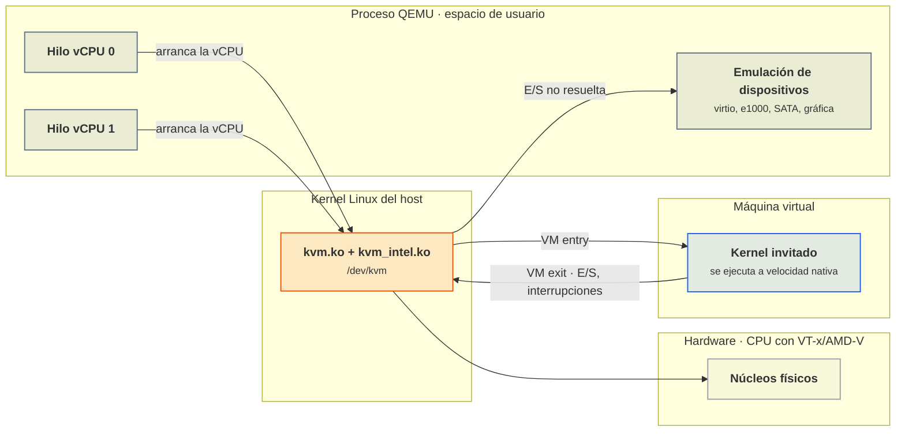

<p class="pie" markdown>En naranja la pieza que hace el trabajo de verdad: el módulo del kernel. Cada **VM exit** es una vuelta a él, y de ahí que virtio importe tanto.</p>

La tercera pieza es la **capa de gestión de Proxmox** (`pve-manager`, `pvedaemon`, `pveproxy`, `pvestatd`), que traduce lo que se pide en la web o con `qm` en la línea de comandos de QEMU adecuada y en operaciones sobre el almacenamiento. El fichero `/etc/pve/qemu-server/101.conf` es la descripción de la VM; QEMU nunca lo lee, lo lee Proxmox para construir la orden.

#### Paravirtualización y virtio

Si QEMU puede emular cualquier tarjeta, ¿por qué no se usa siempre la e1000 que reconoce cualquier sistema? Porque emular hardware real es lento. Un driver de e1000 escribe en decenas de registros por paquete y cada escritura es un VM exit. Con 10 Gbit/s de tráfico, la CPU del host se pasaría el día saliendo y entrando de la VM.

La alternativa es la **paravirtualización**: el sistema invitado sabe que está virtualizado y usa un driver diseñado para hablar con el hipervisor en lugar de fingir que hay hardware. El estándar en KVM es **virtio** (una especificación abierta, publicada por el consorcio OASIS). Un dispositivo virtio no tiene registros que emular; tiene colas (*virtqueues*) en memoria compartida entre invitado y QEMU. El invitado encola descriptores de paquetes o de bloques, avisa una vez ("kick") y QEMU procesa el lote. El número de VM exits por operación baja de decenas a uno, o a cero cuando se combina con vhost (el procesado se hace en el kernel del host sin pasar por QEMU).

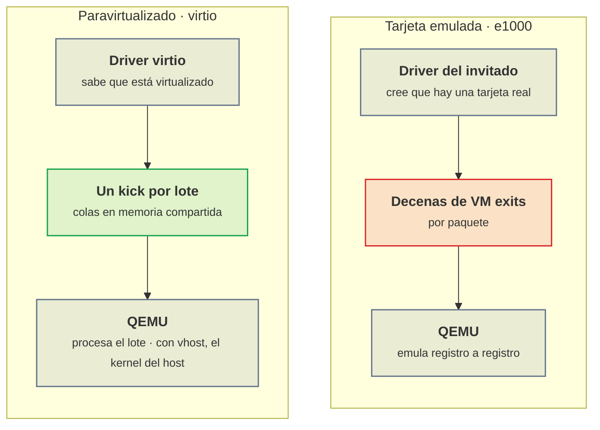

<p class="pie" markdown>La diferencia no es el hardware sino cuántas veces hay que salir de la VM. Por eso virtio es el ajuste por defecto en Proxmox.</p>


Por eso en Proxmox las opciones por defecto son las que son y no hay que cambiarlas:

- **Disco: VirtIO SCSI** (`scsihw: virtio-scsi-pci` o mejor `virtio-scsi-single`, que da un hilo de E/S por disco). Frente a IDE o SATA emulados, multiplica el rendimiento de E/S varias veces y añade soporte de descarte de bloques (TRIM), imprescindible con thin provisioning (asignar a las VM más disco del que hay, contando con que no lo llenen). Existe también `virtio-blk` (bus `virtio0`), algo más antiguo; SCSI es hoy el recomendado porque admite muchos discos por controladora y comandos SCSI reales.
- **Red: virtio (`virtio-net`)**. Es el único modelo que llega a las velocidades de la red física. Se usa `e1000` o `rtl8139` solo con sistemas antiguos sin drivers virtio.
- **Memoria: virtio-balloon**, para el ballooning que se ve más adelante.
- **Consola y agente: virtio-serial**, por donde habla el agente QEMU.

Linux lleva los drivers virtio en el kernel desde hace más de una década, así que cualquier imagen cloud de Debian o Ubuntu arranca con ellos sin hacer nada.

!!! ojo "\"He instalado Windows y no ve el disco\""
    Windows no trae los drivers virtio. Hay que cargarlos desde la ISO `virtio-win` durante la propia
    instalación, en el paso en el que el instalador pide dónde instalar. Es la pregunta más repetida
    en los foros de Proxmox.

### LXC frente a VM, con números

Proxmox ofrece contenedores de sistema LXC junto a las VM. Un contenedor LXC no es un contenedor Docker: ejecuta un sistema operativo completo desde `init` (systemd, sshd, cron), no un solo proceso, pero sin kernel propio. Comparte el kernel del host con aislamiento por namespaces y cgroups, igual que Docker, y Proxmox lo gestiona como si fuera una VM ligera (consola, snapshots, backups, migración en frío).

```bash
pveam update
pveam available --section system | grep debian
pveam download local debian-12-standard_12.7-1_amd64.tar.zst
pct create 170 local:vztmpl/debian-12-standard_12.7-1_amd64.tar.zst \
  --hostname ct01 --memory 512 --cores 1 --rootfs local-lvm:4 \
  --net0 name=eth0,bridge=vmbr0,ip=dhcp --unprivileged 1 --features nesting=1
pct start 170
pct enter 170
```

Medidas de referencia tomadas sobre un portátil con SSD NVMe y un Proxmox anidado. Sirven para comparar el orden de magnitud, no para copiarlas: cada laboratorio da números distintos, y por eso se vuelven a tomar en la actividad A1.4.

| | VM Debian (2 vCPU, 2 GB, virtio) | LXC Debian (1 núcleo, 512 MB) |
|---|---|---|
| Arranque hasta prompt SSH | 12 a 18 s | menos de 2 s |
| RAM usada en el host en reposo | 350 a 450 MB (RAM tocada por el invitado más QEMU) | 25 a 40 MB |
| Espacio en disco tras instalar | 1,3 GB (imagen cloud desplegada) | 450 MB |
| `uname -r` | El kernel de la imagen cloud (6.1 en Debian 12, 6.12 en Debian 13) | El kernel del host Proxmox (6.x de Proxmox) |
| Sobrecarga de CPU | 2 a 5 % en cargas normales, más en E/S intensa | Prácticamente cero |
| Densidad en un host de 32 GB | 10 a 12 VM de 2 GB | 60 o más contenedores de 512 MB |

Por qué no se usa para todo:

- Comparten kernel: menor aislamiento; un fallo del kernel afecta a todos, y un contenedor privilegiado con acceso a `/dev` es root en el host. Conviene usar siempre `unprivileged 1` salvo que haya un motivo claro para no hacerlo.
- No ejecutan otro kernel ni otro sistema operativo: nada de Windows, nada de FreeBSD, nada de módulos de kernel propios, nada de hipervisor anidado.
- Docker dentro de LXC funciona (con `nesting=1` y `keyctl=1`) pero es una configuración que Proxmox desaconseja oficialmente en producción; Docker se ejecuta en una VM.
- No hay migración en vivo de contenedores; se migran apagados (o con un reinicio muy corto).

La regla práctica: servicios de infraestructura pequeños y Linux (DNS, un proxy, un Pi-hole, un runner de Jenkins) en LXC; todo lo que sea plataforma de contenedores, cargas con kernel propio o algo que necesite migración en vivo, en VM. En este módulo casi todo va en VM precisamente porque encima se ejecutan Docker y clústeres.

### Snapshots

Un snapshot es una foto del disco (y opcionalmente la RAM, si la VM está encendida y se marca "include RAM") en un momento. Se vuelve a ella con un clic o con `qm rollback 110 antes-nginx`.

!!! ojo "Un snapshot no es una copia de seguridad"
    Vive en el mismo disco y en el mismo almacén que la VM. Si muere el SSD, mueren los dos. Para eso
    están `vzdump` y Proxmox Backup Server, que copian a otro sitio.

Cómo se hace depende del almacén:

- En **LVM-thin**, el snapshot es un volumen lógico nuevo (`snap_vm-110-disk-0_antes-nginx`) que comparte todos los bloques con el disco original. A partir de ese momento cada escritura de la VM sobre un bloque compartido se hace en un bloque nuevo (copy-on-write a nivel de bloque del pool). El snapshot ocupa cero al crearse y va creciendo con lo que la VM modifique. La lista está en `lvs pve`.
- En **ZFS** es igual pero a nivel de sistema de ficheros: `zfs list -t snapshot`. Crear y destruir es instantáneo.
- En un **directorio con qcow2**, el snapshot es interno al fichero: qcow2 guarda una tabla de snapshots y hace copy-on-write de sus propios clústeres. `qemu-img snapshot -l vm-110-disk-0.qcow2` los lista. Con raw en un directorio no hay snapshots.

En cualquiera de los tres, cada snapshot activo añade una capa de indirección a las lecturas y escrituras. Tres o cuatro no se notan; veinte encadenados durante meses sí, y además consumen espacio del pool que nadie ve en el disco de la VM. La costumbre correcta es snapshot antes de una operación arriesgada y borrarlo (o consolidarlo) en cuanto se confirma que todo va bien. El agente QEMU permite congelar el sistema de ficheros del invitado un instante mientras se hace el snapshot, de modo que sea consistente; sin agente, el snapshot equivale a un corte de corriente y el invitado tendrá que revisar el sistema de ficheros al restaurar.

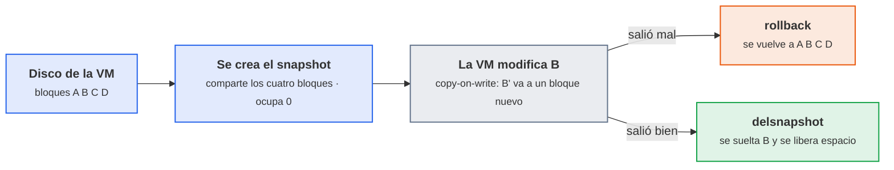

<p class="pie" markdown>El snapshot no copia nada al crearse: crece con lo que la VM cambie después. Vive en el mismo disco que la VM, así que no es una copia de seguridad.</p>


```bash
qm snapshot 110 antes-nginx --description "Antes de instalar nginx"
qm listsnapshot 110
qm rollback 110 antes-nginx
qm delsnapshot 110 antes-nginx
```

### Backups con vzdump y Proxmox Backup Server

!!! consulta "Material de consulta"
    Esto no se explica en clase: lo necesitas para la hoja de práctica de esta sesión.

`vzdump` es la herramienta de copia de seguridad integrada: copia completa de la VM (configuración y discos) a otro almacén, programable desde Datacenter > Backup. Tres modos: `stop` (apaga la VM, copia, la enciende; el único con consistencia total garantizada), `suspend` (la pausa mientras copia) y `snapshot` (el habitual: hace un snapshot temporal, copia desde él mientras la VM sigue funcionando y lo borra al terminar; con el agente QEMU congela el sistema de ficheros para que sea consistente). El resultado es un fichero `.vma.zst` (VM) o `.tar.zst` (contenedor) en el directorio `dump` del almacén elegido, por ejemplo `/var/lib/vz/dump/vzdump-qemu-101-2026_10_16-10_30_00.vma.zst`. Se restaura con `qmrestore` o desde la web, con la posibilidad de cambiar el ID y el almacén de destino.

```bash
vzdump 110 --storage local --mode snapshot --compress zstd --notes-template "{{guestname}}"
ls -lh /var/lib/vz/dump/
qmrestore /var/lib/vz/dump/vzdump-qemu-110-*.vma.zst 151 --storage local-lvm
```

Cada copia de vzdump a fichero es completa, así que con muchas VM y retención larga el disco se acaba pronto. **Proxmox Backup Server** (PBS) es un producto aparte, también libre, que guarda cada trozo de disco una sola vez y solo lee lo cambiado desde la copia anterior; cómo lo hace está en [Proxmox Backup Server](../ampliacion.md#proxmox-backup-server).

!!! empresa "Lo que se encuentra fuera del aula"
    En una empresa con Proxmox, PBS es la opción normal. En el laboratorio del curso no se monta, pero
    conviene saber que existe y que "backup a `local`" es lo mínimo, no lo correcto: una copia en
    el mismo servidor que el original no protege de que se estropee ese servidor.


### A1.4 VM frente a LXC, snapshots (sesión 4)

<span class="et et-obj">Objetivo</span> Una tabla con tus medidas de VM frente a LXC, un snapshot de `web01` al que has vuelto y un backup restaurado como VM 151.

<span class="et et-pre">Antes de empezar</span>

- `web01` funcionando con agente QEMU y acceso SSH (A1.3).
- Lo explicado al principio de la sesión: [KVM/QEMU y virtio](#como-funciona-kvmqemu-por-debajo), [LXC frente a VM](#lxc-frente-a-vm-con-numeros) y [snapshots](#snapshots). Para el paso del backup, [vzdump](#backups-con-vzdump-y-proxmox-backup-server) es material de consulta.

<span class="et et-pas">Pasos</span>

1. Mide `web01` desde apagada: la RAM usada en el host antes y después de arrancarla, su tiempo de arranque y su `uname -r`.

    *Pista:* en la VM, el tiempo de arranque es lo que tarda en contestar por SSH; dentro, `systemd-analyze` lo desglosa.

2. Crea el contenedor `ct01` (ID 170, no privilegiado, 512 MB) como en [LXC frente a VM](#lxc-frente-a-vm-con-numeros) y toma las mismas medidas. Compara su `uname -r` con el de la VM y con el del host.

    *Pista:* si el nombre de la plantilla de Debian ha cambiado, usa el que muestre `pveam available`.

3. Haz un snapshot de `web01` llamado `antes-nginx`, mirando `lvs pve` antes y después. Instala nginx dentro, vuelve al snapshot y comprueba si nginx sigue.

    *Pista:* tras el rollback, `web01` queda apagada.

4. Haz un backup de `web01` a `local` en modo snapshot, apunta lo que ocupa y lo que tarda, y restáuralo como VM 151 con las órdenes de [vzdump](#backups-con-vzdump-y-proxmox-backup-server).

    *Pista:* arranca la 151 con `web01` apagada: tienen la misma MAC y en el mismo bridge se pisarían.

<span class="et et-com">Comprobación</span> Tienes tiempo de arranque, RAM en el host y `uname -r` para la VM y para el LXC (el LXC muestra el kernel del host); tras el rollback, nginx no está en `web01`; en `lvs pve` apareció `snap_vm-110-disk-0_antes-nginx` al crear el snapshot; `qm list` muestra la 151 y arranca.

<span class="et et-ent">Entrega</span> Tabla comparativa VM/LXC con tus medidas y capturas; capturas de `lvs pve` antes y después del snapshot con una explicación del volumen que apareció; tamaño y tiempo del backup.

<span class="et et-ext">Si te sobra tiempo</span> Borra el snapshot (`qm delsnapshot 110 antes-nginx`) y comprueba en `lvs pve` que el volumen desaparece. Con `web01` encendida, `ps aux | grep 'kvm -id 110'` en el host te enseña la línea de QEMU completa que Proxmox ha construido desde `/etc/pve/qemu-server/110.conf`: localiza en ella el disco virtio-scsi, la tarjeta virtio-net y el tipo de CPU.

## Sesión 5 · Redes en el hipervisor

<p class="ut-meta" markdown>21 de octubre · Teoría y práctica · <span class="dur" tabindex="0" aria-label="Modalidades de red: bridge, NAT, VLAN y bond · 20 min&#10;A1.5 Redes: VLAN · 90 min" data-dur="Modalidades de red: bridge, NAT, VLAN y bond · 20 min&#10;A1.5 Redes: VLAN · 90 min">:material-school:<i class="dur-barra" style="--teoria:18%"></i>:material-flask:</span></p>

Al acabar la sesión hay tres VM en `vmbr1` repartidas en dos VLAN que solo se ven dentro de su VLAN, y las primeras medidas de CPU, disco y red del laboratorio. La explicación recorre las modalidades de red del hipervisor (bridge simple, bridge sin interfaz física, NAT, VLAN-aware y bond) y qué resuelve cada una; el bridge básico y el fichero `/etc/network/interfaces` están en el apartado [Red](#red) de la sesión 2. Las herramientas de medida no se explican en clase: conviene leer el apartado de capacidades y limitaciones antes del paso 4 de la hoja, porque esa tabla es el borrador de la práctica evaluable.

### Modalidades de red: bridge, NAT, VLAN y bond

Modalidades que aparecen en el curso:

- **Bridge simple** (`vmbr0` con `eno1` como puerto): las VM están en la misma red que el host y reciben IP del router del aula. Es la opción con la que se instala Proxmox y la que da acceso inmediato a las VM desde el portátil.
- **Bridge sin interfaz física** (`bridge-ports none`): red interna solo entre VM y el host. Es la base de las VPC. Las VM no salen a Internet salvo que alguien enrute por ellas.
- **NAT**: el bridge interno más `ip_forward` y una regla de masquerade en el host, que hace de router. Es cómodo cuando el aula solo da una IP y hacen falta muchas VM con salida a Internet sin exponerlas. Se configura con `post-up` en el bridge; la documentación de Proxmox trae el ejemplo exacto. En la UT2 esto lo sustituye una zona SDN con NAT integrado.
- **VLAN-aware bridge** (`bridge-vlan-aware yes`): un solo bridge transporta varias VLAN; cada VM indica su etiqueta (tag) en la tarjeta virtual y el bridge etiqueta y desetiqueta por ella. El puerto físico debe ser un trunk en el switch del aula si las VLAN tienen que salir del host; para redes internas no hace falta. Es la forma de tener tres redes aisladas con un solo bridge, que es lo que se monta en la actividad A1.5.
- **Bond**: varias tarjetas físicas agrupadas en una interfaz `bond0`, para tener redundancia o sumar ancho de banda; es `bond0`, no las tarjetas, lo que se pone como puerto del bridge. La VM de Proxmox del laboratorio tiene una sola tarjeta, así que aquí no se monta: los modos y un fichero de ejemplo están en [Bond: modos y configuración](../ampliacion.md#bond-modos-y-configuracion).

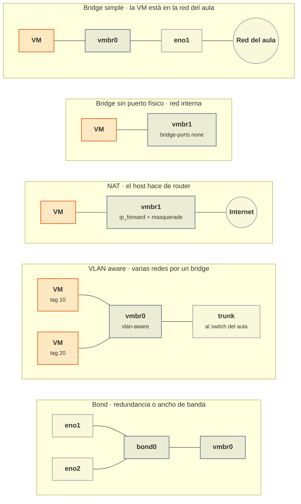

<p class="pie" markdown>Las cinco conviven en el mismo host. En la A1.5 se monta la cuarta; en la UT2 la tercera la sustituye una zona SDN.</p>

!!! ojo "Cambiar la red del host a distancia"
    Un error en `/etc/network/interfaces` deja sin acceso al Proxmox. En un laboratorio anidado queda la consola de la VM exterior y no pasa nada; en un servidor real, los cambios se hacen desde la web (que valida y aplica con `ifreload`) o se deja programado un `sleep 120 && ifreload -a` con la configuración antigua a mano. Y antes de tocar `vmbr0`, conviene comprobar qué interfaz física es la buena con `ip -br link` y `ethtool eno1`.

### Capacidades y limitaciones, y cómo medirlas

!!! consulta "Material de consulta"
    Esto no se explica en clase: lo necesitas para la hoja de práctica de esta sesión.

El criterio de evaluación pide conocer las capacidades y limitaciones del hipervisor, y eso no se aprende leyendo: se mide. Primero va la tabla de qué permite hacer un hipervisor y dónde está el riesgo de cada cosa, y después las herramientas con las que tomar las medidas propias para la práctica evaluable.

| Capacidad | Qué permite | Límite o riesgo |
|----|----|----|
| Sobreasignación de CPU | Dar más vCPU en total que núcleos físicos (4:1 es habitual en cargas de oficina) | Si todas trabajan a la vez, se degrada todo; el *steal time* (tiempo que la vCPU esperó a que el host le diera un núcleo) dentro de las VM lo delata |
| Ballooning de RAM | Recuperar memoria no usada (Proxmox empieza a reclamarla cuando el host pasa del 80 %) | Nunca sobreasignar más de lo físico + swap; el invitado necesita el driver virtio-balloon, y la RAM reclamada sale de su caché de disco, así que rinde peor |
| Hotplug | Añadir disco, red, CPU o RAM en caliente | Depende del SO invitado; RAM requiere `numa=1` y que el invitado reconozca los módulos añadidos; la CPU en caliente solo con `vcpus` menor que `cores` |
| Virtualización anidada | Hipervisor dentro de VM | Rendimiento reducido (cada VM exit del hipervisor interior es un VM exit del exterior); solo laboratorio |
| Passthrough (IOMMU) | Dar una tarjeta gráfica, una controladora o una tarjeta de red a una VM | El dispositivo deja de estar disponible para el host y la VM ya no puede migrar en vivo |
| LXC | Contenedores de sistema muy ligeros | Comparten kernel: menor aislamiento; no ejecutan otro kernel |
| Snapshots | Volver atrás en segundos | Muchos snapshots encadenados frenan el disco y llenan el pool |
| Thin provisioning | Prometer más disco del que hay | Pool lleno = VM corruptas; hay que vigilar y descartar |

Hay otra forma de ahorrar memoria, la fusión de páginas iguales entre VM, que en el laboratorio no se toca; está en [Fusión de páginas iguales](../ampliacion.md#fusion-de-paginas-iguales).

Regla de oro: medir antes de sobreasignar. Un hipervisor de aula con 32 GB no debe albergar 20 VM de 2 GB "porque no se usan todas a la vez". Tarde o temprano se usan, y lo que ocurre entonces (el kernel del host mata la VM que más memoria tiene, sin avisar, con el OOM killer) es mucho peor que haber puesto 12.

La práctica evaluable pide precisamente una tabla como la de arriba, pero con las medidas del laboratorio propio. Herramientas, todas en los repositorios de Debian (`apt install stress-ng fio iperf3 sysstat`; `stress-ng` carga la CPU, `fio` mide el disco, `iperf3` la red y `sysstat` trae `iostat` y `sar` para observar el host):

```bash
# Inventario del host
nproc; lscpu | grep -E "Model name|Thread|Core|Socket|Flags" | cut -c1-120
free -h                              # RAM total, usada, disponible (no "free")
pvesm status                         # almacenes y ocupación
lvs pve/data                         # % de datos y metadatos del pool thin
cat /sys/module/kvm_intel/parameters/nested   # Y si la anidada está activa

# CPU: cuántos núcleos reales hay detrás de las vCPU
pveperf                              # BOGOMIPS, REGEX/SECOND, FSYNCS/SECOND del host
stress-ng --cpu 4 --timeout 60s --metrics-brief   # dentro de una VM; repetir en dos VM a la vez
top                                  # dentro de la VM, columna "st" (steal): CPU que el host no le dio

# Disco: latencia y IOPS reales (dentro de la VM, sobre el disco virtio)
fio --name=rand4k --ioengine=libaio --rw=randrw --rwmixread=70 --bs=4k --size=1G \
    --numjobs=1 --iodepth=32 --direct=1 --runtime=60 --time_based --group_reporting
fio --name=seq1m --ioengine=libaio --rw=write --bs=1M --size=2G --direct=1 --group_reporting

# Red: ancho de banda entre dos VM del mismo bridge y entre VM y host
iperf3 -s                            # en una VM, por ejemplo app01
iperf3 -c IP-de-app01 -t 30 -P 4     # desde la otra

# Memoria: cuánto libera el ballooning
qm monitor 110   # y dentro: info balloon
```

Conviene anotar no solo el resultado sino la condición: "fio 4k aleatorio 70/30 en web01 con app01 en reposo: 18 000 IOPS; con app01 ejecutando el mismo fio: 9 500 IOPS cada una". Ese segundo número es el límite del hipervisor; el primero es solo lo que hace un SSD. Lo mismo con iperf3: entre dos VM del mismo bridge aparecen 10 a 20 Gbit/s aunque la tarjeta física sea de 1 Gbit/s, porque el tráfico nunca sale del host; hacia fuera, lo que dé la tarjeta.

### A1.5 Redes: VLAN (sesión 5)

<span class="et et-obj">Objetivo</span> Tres VM en `vmbr1` repartidas en dos VLAN que solo se ven dentro de su VLAN, y las primeras medidas de CPU, disco y red de tu laboratorio.

<span class="et et-pre">Antes de empezar</span>

- Plantilla 9000 y `vmbr1` (A1.2 y A1.3); `web01` y `app01` funcionando en `vmbr0`; `stress-ng`, `fio` e `iperf3` instalados en el host.
- Lo explicado al principio de la sesión: [red](#red) y [modalidades de red](#modalidades-de-red-bridge-nat-vlan-y-bond) (bridge simple, VLAN-aware, bond y NAT). Para las medidas, [capacidades y limitaciones](#capacidades-y-limitaciones-y-como-medirlas) es material de consulta: lee los comandos de ese apartado antes del paso 4.

!!! ojo "Haz la cuenta de RAM antes de encender"
    El Proxmox tiene 12 GB y se queda con cerca de 2; `web01` (1 GB), `app01` (2 GB) y `mon01` (3 GB) ya suman 6. Tres clones con los 2 GB que heredan de la plantilla pasarían de los 10 disponibles: por eso las VM de prueba van con 512 MB y se apagan en cuanto termina la comprobación de VLAN. `app01` y `mon01` siguen encendidas toda la sesión, porque las usa Mantenimiento. Si vas justo, apaga la VM 151, `ct01` y `web02`, que ya no hacen falta.

<span class="et et-pas">Pasos</span>

1. Haz `vmbr1` VLAN aware desde nodo > Network.

2. Clona de la plantilla tres VM de prueba, enlazadas y con 512 MB, con la tarjeta en `vmbr1` e IP fija por cloud-init: `vlan10a` (160, `192.168.10.11/24`) y `vlan10b` (161, `192.168.10.12/24`) con la etiqueta 10, y `vlan20a` (162, `192.168.20.11/24`) con la 20. `vlan10a` lleva además lo que pide la práctica evaluable: ballooning con un mínimo de 256 MB y puerta de enlace `192.168.10.1`, aunque hoy nadie tenga esa dirección.

    *Pista:* la etiqueta va en la propia tarjeta (`--net0 virtio,bridge=vmbr1,tag=10`). En `vmbr1` no hay DHCP y el host no llega a esas VLAN, así que solo se entra por la consola: ponles una contraseña con `--cipassword` (por ejemplo, `lab`).

3. Comprueba desde la consola de `vlan10a` y de `vlan20a` que cada VM solo ve a las de su VLAN, y localiza en el host en qué VLAN ha puesto el bridge cada interfaz `tap`. Después apaga las tres, porque el paso 4 necesita esa RAM; si no vas a hacer «Si te sobra tiempo», destrúyelas.

    *Pista:* `qm terminal 160` abre la consola serie, de la que se sale con Ctrl+O. En el host, `bridge vlan show`.

4. Mide CPU, disco y red en `web01` y `app01`, que están en `vmbr0` y pueden instalar paquetes, con las órdenes de [capacidades y limitaciones](#capacidades-y-limitaciones-y-como-medirlas): CPU y disco, primero en `web01` sola y después con `app01` haciendo lo mismo a la vez; la red, entre las dos. Anota junto a cada número la condición en que lo tomaste.

    *Pista:* las herramientas hay que instalarlas también dentro de cada VM. A `stress-ng`, tantos `--cpu` como vCPU tiene la VM, que son 2.

<span class="et et-com">Comprobación</span> `qm config 160` muestra `balloon: 256` y la puerta de enlace en `ipconfig0`; el ping funciona entre `192.168.10.11` y `192.168.10.12` y falla hacia `192.168.20.11`; `bridge vlan show` coloca cada `tap` en su VLAN; las tres VM de prueba aparecen como `stopped` en `qm list` al empezar las medidas, y `app01` y `mon01` siguen encendidas; tienes un valor de bogo ops/s, de IOPS y de Gbit/s con y sin carga simultánea.

<span class="et et-ent">Entrega</span> Esquema (Mermaid o dibujo) de las tres VM, el bridge y las VLAN; capturas de ping y de `bridge vlan show`; y una tabla con las medidas de CPU, disco y red indicando la condición de cada una. Esa tabla es el borrador de la que pide la práctica evaluable.

<span class="et et-ext">Si te sobra tiempo</span> Vuelve a encender las tres VM de prueba y mide con `iperf3` el ancho de banda entre las dos VM de la VLAN 10: para instalarlo necesitan Internet, así que añade a cada una una segunda tarjeta temporal en `vmbr0` (`qm set 160 --net1 virtio,bridge=vmbr0`, dentro `sudo dhclient` sobre la interfaz nueva que muestre `ip -br link`), instala, quita la tarjeta (`qm set 160 --delete net1`) y mide entre `192.168.10.11` y `192.168.10.12`. Cambia `vlan20a` a tag 10 (`qm set 162 --net0 virtio,bridge=vmbr1,tag=10`) y comprueba que ahora sí responde al ping desde `vlan10a`. Al terminar, vuelve a apagar las tres o bórralas con `qm destroy`.

## Sesión 6 · Práctica evaluable

<p class="ut-meta" markdown>23 de octubre · Práctica evaluable · <span class="dur" tabindex="0" aria-label="Explicación · 10 min&#10;Trabajo en la práctica · 100 min" data-dur="Explicación · 10 min&#10;Trabajo en la práctica · 100 min">:material-school:<i class="dur-barra" style="--teoria:9%"></i>:material-flask:</span></p>

Se realiza sobre el Proxmox montado en las sesiones anteriores. Los primeros 10 minutos son para aclarar el enunciado; el resto es tiempo de trabajo. La tabla de capacidades y limitaciones no pide medidas nuevas: sale de las que ya tomaste en las hojas con las herramientas del apartado [capacidades y limitaciones](#capacidades-y-limitaciones-y-como-medirlas) de la sesión 5, cada una con la condición en que se tomó.

**Antes del enunciado, la RAM.** Apaga lo que no hace falta hoy: `web01`, la VM 151 restaurada, el contenedor `ct01` y, si siguen encendidas, `web02` y las VM de la VLAN. `app01` y `mon01` siguen encendidas, porque las usa Mantenimiento. Quedan unos 2 GB del propio Proxmox, los 5 GB de esas dos VM y los 3 GB de `app-eval`: 10 de los 12 GB.

**Después, el camino de entrada.** Una VM en la VLAN 30 de `vmbr1` no tiene DHCP, ni salida a Internet, ni camino hacia el host, porque la `10.10.10.1` del host en `vmbr1` va sin etiquetar. Crea primero en el host la interfaz VLAN `vmbr1.30`, con `192.168.30.1/24`: en la web es Create > Linux VLAN, sobre `vmbr1` y con tag 30. Esa dirección es la puerta de entrada por SSH a la VM, que lleva una IP fija de esa misma red por cloud-init. El agente QEMU no hay que instalarlo: viene dentro de la plantilla desde la A1.3, que es justo lo que salva esta práctica, porque sin Internet no se puede instalar nada en el primer arranque.

**Enunciado.** Despliega desde la plantilla propia una VM llamada `app-eval`, con un ID libre del rango de pruebas de dev (150 a 199), 2 vCPU, 3 GB de RAM con ballooning (mínimo 1 GB), disco de 20 GB, red en `vmbr1` con VLAN 30, IP fija por cloud-init en `192.168.30.0/24` con puerta de enlace `192.168.30.1`, usuario `ops` con clave SSH y agente QEMU funcionando.

<span class="et et-ent">Entrega</span> Un informe (máximo 3 páginas) con:

- [ ] Configuración del hipervisor, reutilizando la entrega de la A1.2 (pasos 1, 4 y 5 de la A1.2): repositorios sin `pve-enterprise`, `pveum user list` con `admin@pve` y `/etc/network/interfaces`, ahora con `vmbr1.30`.
- [ ] Comandos o capturas del proceso: creación de `vmbr1.30` en el host, clonado, `qm set` y `qm cloudinit dump` (las mismas órdenes que los pasos 4 y 6 de la A1.3 y el paso 2 de la A1.5).
- [ ] Evidencia de que la VM cumple lo pedido: `qm config <ID de la VM>` (`qm` no acepta nombres de VM, solo ID; el ID sale de `qm list`), `free -h` y `nproc` dentro de la VM, `lsblk`, IP en la VLAN 30 visible en la web de Proxmox gracias al agente, acceso SSH como `ops` desde el host a través de `192.168.30.1`.
- [ ] Una tabla de capacidades y limitaciones del hipervisor del laboratorio (CPU, RAM, disco, red, anidada) con una medida real de cada una y la condición en que se tomó: CPU, disco y red del paso 4 de la A1.5, RAM de los pasos 1 y 2 de la A1.4 y anidada del paso 5 de la A1.1.

| Criterio (RA1 a) | Peso |
|----|----|
| Hipervisor instalado y configurado correctamente (repos, usuario, red) | 30 % |
| VM cumple la especificación y se demuestra | 40 % |
| Tabla de capacidades y limitaciones con medidas reales | 30 % |

Cuando hayas entregado, destruye las VM de prueba de la unidad, que ya no hacen falta y dejan libre el rango 150 a 199 para las unidades siguientes: `app-eval`, la 151 restaurada, `web02` (150) si la creaste y el contenedor `ct01` (170). `web01`, `app01` y `mon01` se quedan.

## Errores frecuentes en el laboratorio

**"KVM virtualisation configured, but not available" al arrancar la primera VM en el Proxmox anidado.** La virtualización anidada no está activada en el hipervisor exterior, o la VM exterior no tiene CPU `host`. Se comprueba con `cat /sys/module/kvm_intel/parameters/nested` en el Proxmox: si dice `N`, el problema está fuera. Como parche para salir del paso, `kvm: 0` en la configuración de la VM la ejecuta en emulación (lentísima); no es una solución.

**Proxmox no actualiza: "401 Unauthorized" en `apt update`.** Sigue activo el repositorio `pve-enterprise`, que exige suscripción. Hay que desactivarlo y añadir `pve-no-subscription` (en la web: nodo > Updates > Repositories). En Proxmox VE 9 los repositorios están en formato deb822 en `/etc/apt/sources.list.d/*.sources`; en la 8, en `*.list`. Mientras esté el enterprise, `apt` fallará aunque el resto esté bien.

**La VM clonada no coge IP o no acepta la clave SSH.** Por orden de probabilidad: (1) el disco cloud-init no está en la VM (`qm config 110 | grep cloudinit`); (2) la plantilla se arrancó antes de convertirla y el clon cree que ya está inicializado (`cloud-init clean --logs` dentro y reiniciar, y rehacer la plantilla bien); (3) la clave de ese origen no está en el fichero que se pasó a `--sshkeys` (por ejemplo, entra desde el nodo y no desde el puesto porque faltó `/root/puesto.pub`), o se pegó con saltos de línea o sin el `ssh-ed25519` inicial (`qm cloudinit dump 110 user` lo muestra); (4) `--ipconfig0` no se puso y la imagen no usa DHCP por defecto en esa interfaz. `cloud-init status --long` y `/var/log/cloud-init.log` en la consola noVNC resuelven el 90 %.

**El clon arranca pero el disco sigue teniendo 2 GB.** El `resize` se hizo después del primer arranque o no se hizo. `growpart` y `resizefs` solo actúan en el primer arranque; después, `qm disk resize 110 scsi0 +18G` y dentro `growpart /dev/sda 1 && resize2fs /dev/sda1` a mano.

**"TASK ERROR: storage 'local-lvm' does not support content type 'iso'"** o al revés con imágenes. Cada almacén admite unos contenidos: las ISO y plantillas van a `local`, los discos a `local-lvm`. Se cambia en Datacenter > Storage, pero lo normal es usar cada uno para lo suyo.

**El pool thin se llena y las VM se quedan en solo lectura.** `lvs pve/data` con `Data%` cerca de 100. Liberar: borrar snapshots viejos, backups dejados en `local-lvm` por error, VM de prueba. Luego `fstrim` en todas las VM con `discard=on`. Y a partir de ahí, dimensionar: la suma de discos asignados no debería pasar del doble del pool en un laboratorio.

**El agente QEMU aparece como "not running" aunque está instalado.** Falta `--agent enabled=1` en la VM (se añade y se apaga y enciende la VM, no basta un reinicio) o dentro el servicio no está activo (`systemctl status qemu-guest-agent`). Las imágenes cloud de Debian no lo traen instalado de origen; por eso en A1.3 se añade a la imagen con `virt-customize` antes de importarla, y todas las VM clonadas de la plantilla 9000 lo llevan.

**Las VM en VLAN 10 y 20 se ven entre sí.** El bridge no es VLAN-aware (falta `bridge-vlan-aware yes` y aplicar la configuración) o las VM se conectaron sin `tag`. `bridge vlan show` en el host muestra en qué VLAN está cada `tap`.

**Ping entre VM de la red interna funciona pero no salen a Internet.** Es lo esperado en un bridge sin puerto físico. O se pone NAT en el host (`ip_forward` y `MASQUERADE` hacia `vmbr0`), o se espera a la UT2 y se hace con SDN.

**Rendimiento de disco pésimo en la VM (cientos de IOPS).** Disco en bus IDE o SATA en lugar de VirtIO SCSI, o caché de disco en `writethrough` sobre disco mecánico, o el host anidado con disco de VirtualBox en formato dinámico sobre un disco lento. Conviene comprobar `qm config` y medir con `fio` en el host y en la VM para localizar la capa que frena.

**"illegal instruction" en un programa dentro de la VM tras moverla de portátil.** La VM tenía CPU `host` en un equipo con AVX y ahora corre en uno sin él. Hay que cambiar a `x86-64-v2-AES` y apagar y encender.

Los enlaces para ampliar y los apartados que van más allá de lo que se hace en clase están en [Para ampliar](../ampliacion.md#ut1-virtualizacion-e-hipervisores).
