# UT1 · Virtualización e hipervisores

<p class="ut-meta">12 h · Sesiones 1 a 6 · RA1 CE a</p>

Esta es la primera unidad del módulo y la que sostiene todas las demás. Todo lo que se despliega en el curso corre sobre máquinas virtuales: las redes de la UT2, el cortafuegos y los proxies de la UT3, el servicio en Docker que vigila la otra asignatura, los pipelines de Jenkins de la UT6. Y esas máquinas virtuales corren sobre un hipervisor, el software que reparte un equipo físico entre todas ellas, que hay que saber instalar, configurar y, sobre todo, entender. La unidad monta un Proxmox VE propio en cada puesto, construye una plantilla con cloud-init (el servicio que configura una VM en su primer arranque) de la que saldrán decenas de VM en las próximas semanas y mide qué aguanta y qué no aguanta el laboratorio. En la UT2 ese mismo Proxmox recibe redes definidas por software para construir una VPC, la red privada que ofrece cualquier nube pública.

## Sesión 1 · Presentación e instalación del hipervisor

<p class="ut-meta" markdown>2 de octubre · Teoría y práctica · <span class="dur" tabindex="0" aria-label="Presentación del módulo, evaluación y laboratorio · 20 min&#10;Qué es virtualizar y para qué sirve · 15 min&#10;Tipos de hipervisor · 10 min&#10;A1.1 Instalar Proxmox VE · 65 min" data-dur="Presentación del módulo, evaluación y laboratorio · 20 min&#10;Qué es virtualizar y para qué sirve · 15 min&#10;Tipos de hipervisor · 10 min&#10;A1.1 Instalar Proxmox VE · 65 min">:material-school:<i class="dur-barra" style="--teoria:41%"></i>:material-flask:</span></p>

Todo el módulo necesita un laboratorio de muchas máquinas: un servidor web, otro de aplicación, una base de datos, la monitorización, varios routers y, más adelante, un cortafuegos y un servidor de integración continua. Comprar una máquina física para cada una es imposible en un aula, y además cada alumno necesita las suyas para poder romperlas sin afectar a nadie. La solución es la de cualquier empresa: un solo equipo que reparte su hardware entre muchas máquinas virtuales gracias a un hipervisor. Después de 20 minutos de presentación del [módulo y su evaluación](../modulo.md) y del [laboratorio](../laboratorio.md), esta sesión monta ese hipervisor, y la teoría va en el orden en que se toman las decisiones: qué es virtualizar y en qué se diferencia de los contenedores que ya se conocen, qué tipos de hipervisor hay y por qué el curso usa Proxmox VE, y qué tiene que tener el equipo para instalarlo. Este último apartado no se explica en clase, pero la hoja manda leerlo antes de crear la VM exterior, porque su punto más delicado, la virtualización anidada, es el que más disgustos da. Al acabar, hay un Proxmox VE instalado dentro de una VM del portátil y su consola web abierta en el puerto 8006.

### Qué es virtualizar y para qué sirve

**El problema: un servidor por aplicación.** Durante años, cada aplicación de una empresa tenía su propio servidor físico. Era la forma sencilla de aislarlas (si una se cuelga o se actualiza mal, las demás ni se enteran) y de dar a cada una el sistema operativo que pedía. El precio era una sala llena de máquinas casi siempre ociosas, cada una con su consumo eléctrico, su hueco en el armario y su garantía, y semanas de espera cada vez que hacía falta un servidor nuevo.

**Qué es virtualizar.** Virtualizar es ejecutar varios sistemas operativos independientes sobre un mismo hardware físico. Un software llamado **hipervisor** reparte la CPU, la memoria, el disco y la red entre las **máquinas virtuales** (VM) y las mantiene aisladas entre sí. Cada VM cree que tiene un ordenador para ella sola: una BIOS o UEFI, una o varias CPU (las *vCPU*, CPU virtuales que el hipervisor reparte entre los núcleos físicos), una controladora de disco, una tarjeta de red. Nada de eso existe físicamente; es el hipervisor el que lo fabrica y el que decide en cada instante qué VM usa el núcleo físico número 3 o quién escribe en el disco. Así se conserva el aislamiento de un servidor por aplicación sin pagar una máquina por cada una.

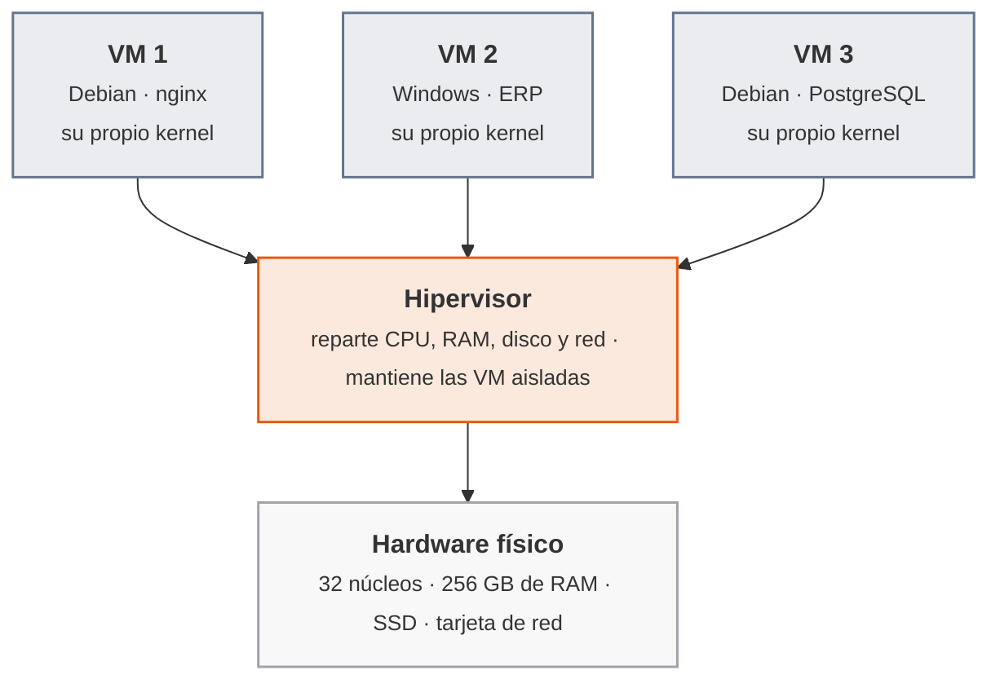

<p class="pie" markdown>Cada VM se cree sola en el ordenador. Lo que ve (BIOS, CPU, disco, tarjeta de red) lo fabrica el hipervisor.</p>


**De dónde sale.** La idea es casi tan vieja como la informática comercial: a principios de los años setenta, IBM ya repartía sus grandes ordenadores entre muchos usuarios, cada uno con su propio sistema, porque una máquina así era demasiado cara para dedicarla a una sola tarea. En los PC llegó mucho más tarde. Los procesadores x86 no estaban pensados para ello, y las primeras soluciones, como VMware en 1999, tenían que reescribir sobre la marcha, por software, las instrucciones delicadas de cada VM. En 2005 y 2006 Intel y AMD añadieron a sus procesadores unas extensiones de virtualización (VT-x y AMD-V) que hacen ese trabajo en el propio hardware, y sobre ellas está construido el hipervisor que usa el curso.

**Para qué se usa.** Se virtualiza por cinco razones que aparecen en cualquier empresa, y las cinco salen en el curso:

- **Consolidación.** Un servidor actual tiene 32 o 64 núcleos y 256 GB de RAM, y ninguna aplicación normal los usa. Con virtualización, ese servidor aloja decenas de VM en lugar de una sola aplicación, y la factura de electricidad y de armario se divide entre todas. Es lo que hace el laboratorio: un solo Proxmox por puesto, con todas las máquinas del curso dentro.
- **Aislamiento.** Si una VM falla, se cuelga o se compromete, las demás siguen. El hipervisor es la frontera de seguridad.
- **Snapshots y clonado.** Se guarda el estado de una VM y se vuelve a él en segundos, y se sacan copias idénticas de una VM ya preparada. Antes de una actualización arriesgada, snapshot; si sale mal, se vuelve atrás y a otra cosa. El clonado se hace en la sesión 3 y los snapshots en la 4.
- **Portabilidad.** Una VM se mueve entre servidores sin reinstalar, incluso encendida (*migración en vivo*), así que el hardware se cambia sin que el servicio se entere. En el laboratorio no se monta, porque hacen falta varios servidores; está en [Clúster y migración en vivo](../ampliacion.md#cluster-y-migracion-en-vivo).
- **Base de la nube.** Toda nube pública es, por debajo, hipervisores gestionados a gran escala: una instancia actual de Amazon EC2 es una VM sobre Nitro, un hipervisor basado en KVM, y una de Azure corre sobre Hyper-V. Lanzar instancias en la nube en la UT4 es hacer con una API lo mismo que aquí se hace con `qm create`.

#### VM frente a contenedor

**Por qué la comparación.** El título del módulo habla de contenedores y Docker ya se conoce de antes, así que conviene aclarar desde el principio qué relación hay entre lo que se hace en esta unidad y los contenedores. Un contenedor no es una VM pequeña: es un proceso normal del host al que el kernel aísla con dos mecanismos propios, los *namespaces*, que deciden qué ve el proceso (sus propios procesos, su red, su sistema de ficheros), y los *cgroups*, que deciden cuánto puede gastar. No hay hardware fabricado ni un segundo sistema operativo: todos los contenedores de un host usan el mismo kernel.

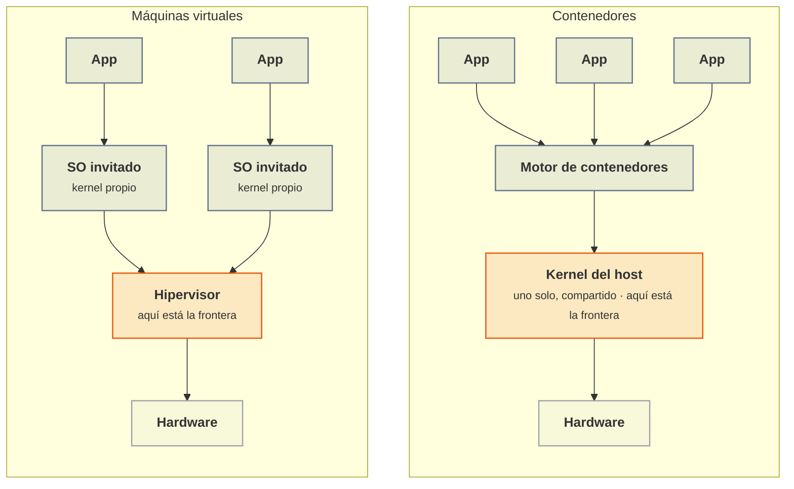

<p class="pie" markdown>La frontera de aislamiento está en sitios distintos: en la VM es el hipervisor; en el contenedor, el kernel que todos comparten.</p>


**En qué se diferencian.** Casi todo sale de esa diferencia de partida, fabricar un ordenador entero o aislar un proceso:

|  | Máquina virtual | Contenedor |
|----|----|----|
| Qué virtualiza | Hardware completo (CPU, disco, red) | Solo el espacio de usuario; comparte el kernel del host |
| Sistema operativo | Cada VM lleva el suyo, con su propio kernel | Usa el kernel del host |
| Arranque | Segundos a minutos | Milisegundos |
| Tamaño | GB | MB |
| Aislamiento | Fuerte (la CPU ejecuta la VM en un modo invitado que vigila el hipervisor) | Medio (namespaces y cgroups sobre un kernel compartido) |
| Caso típico | Servidores completos, distintos SO, seguridad, hipervisor anidado | Aplicaciones, microservicios, CI/CD |

**Por qué el curso usa los dos.** En este curso los contenedores se ejecutan dentro de máquinas virtuales: el hipervisor da la infraestructura y los contenedores dan la aplicación. Es exactamente lo que hace cualquier proveedor cloud con un clúster gestionado de Kubernetes, el orquestador de contenedores más extendido: los nodos que ejecutan los contenedores son VM. La razón está en la frontera de aislamiento. Un contenedor no puede ejecutar otro kernel ni otro sistema operativo, y un proceso que escape de un contenedor está en el kernel del host, al lado de todo lo demás que corre en él; un proceso que escape de una VM (cosa muchísimo más rara) está en el hipervisor. Esa diferencia es la razón de que los proveedores no mezclen contenedores de clientes distintos sobre el mismo kernel.

### Tipos de hipervisor

**Dos formas de colocar el hipervisor.** Un hipervisor puede instalarse directamente sobre el hardware, haciendo él mismo de sistema operativo de la máquina (tipo 1, *bare metal*), o como un programa más dentro de un sistema operativo de escritorio (tipo 2, *hosted*). La diferencia está en quién manda sobre el hardware: en el tipo 1, el propio hipervisor; en el tipo 2, el sistema de escritorio, al que el hipervisor pide los recursos como cualquier otra aplicación.

<figure markdown="span">
  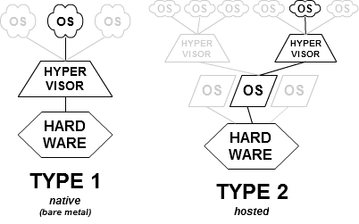{ width="640" }
  <figcaption>Hipervisor de tipo 1 (bare metal) frente a tipo 2 (hosted). Fuente: Scsami, CC0, vía Wikimedia Commons.</figcaption>
</figure>

|  | Tipo 1 (bare metal) | Tipo 2 (hosted) |
|----|----|----|
| Dónde se instala | Directamente sobre el hardware | Sobre un sistema operativo de escritorio |
| Rendimiento | Alto | Menor (hay un SO por medio) |
| Uso | Servidores, centros de datos, nube | Pruebas, desarrollo, laboratorio |
| Ejemplos | Proxmox VE (KVM), VMware ESXi, Microsoft Hyper-V, Xen | VirtualBox, VMware Workstation, Parallels |

**En el laboratorio conviven los dos.** El VirtualBox o el VMware Workstation del portátil es de tipo 2, y dentro de él va Proxmox VE, que es de tipo 1. No es lo normal en una empresa, pero permite que cada alumno tenga su hipervisor completo y lo pueda romper sin afectar a nadie. El precio es tener un hipervisor dentro de otro, la *virtualización anidada*, que tiene su punto en los [requisitos hardware](#requisitos-hardware).

!!! examen "La trampa de la clasificación"
    KVM es un módulo del kernel de Linux, así que un Debian de escritorio con KVM y virt-manager (una
    aplicación gráfica para crear VM) es técnicamente de tipo 1: el kernel que gestiona las VM es el mismo que gestiona el hardware, aunque
    se use como si fuera de tipo 2. Lo que distingue de verdad a un hipervisor de producción no es la
    etiqueta sino que el sistema anfitrión esté dedicado y recortado a esa función, con una capa de
    gestión encima. Eso es Proxmox VE.

**Por qué Proxmox VE.** Proxmox VE lo publicó en 2008 una empresa austriaca como un Debian con todo lo necesario para virtualizar ya integrado: KVM, el hipervisor que lleva dentro el kernel de Linux y que se estudia en la sesión 4, para las VM; LXC para *contenedores de sistema*, que se comportan como una máquina Linux completa pero comparten el kernel del host; y una consola web para manejarlo todo. Es libre (licencia AGPLv3) y es lo más parecido a una nube privada que se puede montar en un aula. Desde que Broadcom compró VMware y cambió su licenciamiento en 2024, es también lo que muchas pymes y centros educativos han adoptado en producción. Proxmox VE 8 está construido sobre Debian 12 (bookworm) y Proxmox VE 9 sobre Debian 13 (trixie); en el laboratorio del curso se instala la 9, pero todo lo que hay en estos apuntes vale para las dos salvo donde se indique.

### Requisitos hardware

!!! consulta "Material de consulta"
    Esto no se explica en clase: lo necesitas para la hoja de práctica de esta sesión.

Antes de instalar nada conviene saber qué tiene que tener el equipo y qué hay que activar en el hipervisor exterior. El punto de la virtualización anidada es el que más disgustos da en la sesión 1: si se salta, Proxmox se instala igual, pero sus VM no arrancan con KVM y el fallo no se nota hasta que se crea la primera, en la sesión 3.

**La CPU: las extensiones de virtualización.** El hipervisor del curso, KVM, no imita la CPU: ejecuta el código de cada VM directamente en el procesador físico, y para eso necesita las extensiones de virtualización del procesador, **Intel VT-x** o **AMD-V**, que le añaden un modo de ejecución reservado a las VM (cómo se usa se ve en la sesión 4). Sin ellas, KVM no funciona. En Linux se comprueba con `grep -Ec '(vmx|svm)' /proc/cpuinfo`, que tiene que dar más de 0 (`vmx` es la bandera de Intel y `svm` la de AMD); en Windows, en la pestaña Rendimiento del Administrador de tareas. Si no aparecen en un equipo moderno, casi siempre es que están desactivadas en la BIOS/UEFI.

**Opcional: ceder un dispositivo físico.** Otra extensión, VT-d en Intel y AMD-Vi en AMD (la IOMMU, la unidad que controla a qué memoria puede llegar cada dispositivo), permite dar a una VM una tarjeta gráfica o de red física entera (*passthrough*). En el curso no se usa.

**Un hipervisor dentro de otro: la virtualización anidada.** Las extensiones son del procesador físico, y por defecto un hipervisor no se las enseña a sus VM: les da una CPU virtual sin ellas. Para instalar Proxmox dentro de una VM, como en el laboratorio, el hipervisor exterior tiene que pasárselas, y cada uno lo activa a su manera:

- En un host Linux con KVM viene activada por defecto desde el kernel 4.20. Se comprueba con `cat /sys/module/kvm_intel/parameters/nested` (o `kvm_amd`), y si dijera `N` se activa con `options kvm-intel nested=1` (o `kvm-amd`) en `/etc/modprobe.d/kvm.conf`. Si el hipervisor exterior es otro Proxmox, la VM debe tener además el tipo de CPU `host`.
- En VirtualBox, «Enable Nested VT-x/AMD-V» en la pestaña de procesador, o `VBoxManage modifyvm pve --nested-hw-virt on`.
- En VMware Workstation, «Virtualize Intel VT-x/EPT or AMD-V/RVI» en la configuración del procesador.
- En Windows hay una trampa: con Hyper-V activo (o algo que lo usa por debajo, como WSL2 o la integridad de memoria de Windows 11), VirtualBox y VMware Workstation se ejecutan encima de él y no pueden ofrecer la anidada. Hay que desactivarlo.

Sin la anidada, el Proxmox de dentro se instala sin quejarse, pero al arrancar una VM dirá que KVM no está disponible. Lo único que le queda entonces es la emulación pura (TCG), en la que QEMU traduce cada instrucción por software, a una velocidad diez o veinte veces menor.


<p class="pie" markdown>El camino que hay que recorrer antes de instalar. Saltarse el último paso es lo que más disgustos da en la sesión 1.</p>

**Cómo se comprueba desde dentro.** Ya instalado, la prueba de que la anidación funciona es que el procesador que ve el nodo tiene la bandera `vmx` o `svm` y que el módulo de KVM ha cargado. El fichero `/sys/module/kvm_intel/parameters/nested` (o `kvm_amd`) resume las dos cosas: solo existe si el módulo ha cargado, cosa que solo ocurre si el procesador trae la bandera, y su valor dice si ese KVM, a su vez, pasaría las extensiones a sus propias VM.

**Memoria, disco y red.**

- RAM: el hipervisor consume poco (un Proxmox recién instalado usa alrededor de 1 GB), pero cada VM necesita la suya: en el laboratorio, entre 512 MB y 3 GB según lo que corra, más unos 2 GB que se reservan para el propio Proxmox. La cuenta completa está en el [presupuesto de memoria](../laboratorio.md#presupuesto-de-memoria). Con ZFS hay que sumar lo que reserve la caché ARC (la caché de lectura de ZFS en RAM; el instalador de Proxmox la limita al 10 % de la RAM, con máximo de 16 GB, desde la 8.1).
- Almacenamiento: SSD. Proxmox usa por defecto LVM-thin (aprovisionamiento ligero: cada disco solo ocupa lo que se ha escrito en él; se explica en la sesión 2). Un disco mecánico con cuatro VM haciendo E/S aleatoria a la vez es la experiencia más frustrante que puede dar un laboratorio.
- Red: una interfaz basta para empezar; dos permiten separar la gestión del tráfico de las VM, y tres o cuatro son lo normal en un servidor de producción (gestión, VM, almacenamiento y migraciones). En el laboratorio, la VM de Proxmox va en modo puente (*bridged*), para que el nodo y sus VM sean una máquina más de la red del aula. Eso obliga a que el hipervisor exterior deje pasar tramas con direcciones MAC que no son la de su VM, sino las de las VM de dentro: en VirtualBox, el adaptador puente necesita el modo promiscuo en «Permitir todo». Por la misma razón conviene que el puesto vaya por cable, porque un puente sobre Wi-Fi suele dar problemas con esas direcciones.

### A1.1 Instalar Proxmox VE (sesión 1)

<span class="et et-obj">Objetivo</span> Al terminar tienes un Proxmox VE 9 instalado dentro de una VM de tu portátil, entras en su consola web en el puerto 8006 y has comprobado desde dentro que su KVM tiene la CPU que necesita. Es el hipervisor sobre el que vas a construir todo el curso, y esa última comprobación es la que asegura que sus VM irán a la velocidad del procesador y no emuladas.

<span class="et et-pre">Antes de empezar</span>

- VirtualBox o VMware Workstation instalado en tu equipo, con 16 GB de RAM y al menos 80 GB libres en un SSD.
- La ISO de Proxmox VE 9 (la última 9.x de la web de Proxmox, alrededor de 1,5 GB). Descárgala antes de clase si puedes: la red del aula se resiente cuando la bajan treinta personas a la vez.
- Lo explicado al principio de la sesión: [qué es virtualizar](#que-es-virtualizar-y-para-que-sirve), [VM frente a contenedor](#vm-frente-a-contenedor) y [tipos de hipervisor](#tipos-de-hipervisor). Los [requisitos hardware](#requisitos-hardware) no se explican en clase: lee ese apartado antes del paso 2, sobre todo el punto de la virtualización anidada.

<span class="et et-pas">Pasos</span>

Vas a montar el laboratorio de fuera adentro, comprobando cada capa antes de poner la siguiente encima: primero tu equipo, después la VM exterior que alojará Proxmox, luego Proxmox dentro de ella con su consola web y, al final, desde dentro de Proxmox, la prueba de que la capa exterior le pasa la virtualización. Ese último paso es el que más importa: si la anidación falla, nada protesta hasta la sesión 3, cuando arranca la primera VM.

1. **Comprueba que tu CPU puede virtualizar.** Sin las extensiones VT-x o AMD-V activas en tu equipo no hay KVM en ningún nivel, así que es lo primero que se mira. Compruébalo como se indica en [Requisitos hardware](#requisitos-hardware) y, si están desactivadas, actívalas en la BIOS/UEFI antes de seguir: sin ellas no hay práctica.

    *Pista:* en Windows lo dice la pestaña Rendimiento del Administrador de tareas («Virtualización: habilitado»). Mira también que no esté activo Hyper-V, que deja a VirtualBox y a VMware sin anidada.

2. **Crea la VM exterior con la anidación activada.** Es la máquina que va a alojar todo el laboratorio: tipo Linux Debian 64 bits, 4 vCPU, 12 GB de RAM, 60 GB de disco, red en modo puente (bridged) y virtualización anidada activada. La memoria es la que necesitan las VM de las próximas semanas (la cuenta está en el [presupuesto de memoria](../laboratorio.md#presupuesto-de-memoria)); el modo puente pone a Proxmox, y después a sus VM, en la red del aula, que es desde donde vas a entrar en ellas; y la anidación es lo que dejará a Proxmox usar KVM.

    *Pista:* la anidación es una opción del hipervisor exterior, distinta en cada uno, y en VirtualBox el adaptador puente necesita además el modo promiscuo; las dos están en [Requisitos hardware](#requisitos-hardware). Si se olvidan, Proxmox se instala igual y el fallo no se ve hasta el paso 5 o hasta la sesión 3.

3. **Instala Proxmox VE.** Hazlo desde la ISO, con el disco y el sistema de ficheros que propone el instalador (ext4 con LVM-thin, el almacenamiento que se estudia en la sesión 2). Anota el nombre de host, la IP de gestión y la puerta de enlace que le das: esa IP es la dirección del nodo durante todo el curso, la de su consola web y la de su SSH.

    *Pista:* el instalador pide el nombre de host completo, con dominio: `pve.lab`, por ejemplo.

4. **Entra en la consola web.** Desde el navegador de tu portátil, en el puerto 8006, como `root` y con el realm `Linux PAM`, el de los usuarios del sistema, porque de momento el único que existe es su root. Llegar hasta aquí demuestra que el nodo es alcanzable desde tu puesto, que es desde donde vas a administrarlo.

    *Pista:* la consola va por HTTPS con un certificado autofirmado, así que el navegador avisa; al entrar, Proxmox avisa además de que no hay suscripción. Las dos cosas son normales en el laboratorio.

5. **Comprueba desde dentro que KVM tiene su CPU.** Desde la shell del nodo, comprueba cuántas CPU ve Proxmox y si su KVM ha podido cargar con las extensiones de virtualización, con el fichero `nested` que se explica al final de [Requisitos hardware](#requisitos-hardware). Es la prueba de que la anidación del paso 2 funciona, y la medida que pide la práctica evaluable para la fila de la anidada.

<span class="et et-com">Comprobación</span> La consola web muestra el nodo con su CPU, su RAM y los almacenes `local` y `local-lvm`; `nproc` devuelve 4 y el fichero `nested` existe y devuelve `Y` (o `1`). Si no existe, el módulo de KVM no ha cargado porque la VM exterior no le pasa las extensiones: revisa el paso 2 antes de la sesión 2. Es el error más habitual de la unidad y está descrito en [Errores frecuentes](#errores-frecuentes-en-el-laboratorio).

<span class="et et-ent">Entrega</span> Una página en el documento de la unidad con la captura del panel principal, la IP y el nombre de host, y la respuesta a tres preguntas: ¿qué tipo de hipervisor es Proxmox? ¿Y el que has usado para alojarlo? ¿Qué devuelve `cat /sys/module/kvm_intel/parameters/nested` (o `kvm_amd`) dentro de tu Proxmox, y qué significa?

<span class="et et-ext">Si te sobra tiempo</span> Averigua con `pveversion -v` qué kernel y qué versión de QEMU lleva tu Proxmox, y compara su `/etc/network/interfaces` con el ejemplo del [apartado de red](#red): localiza el `vmbr0` y la tarjeta física que tiene como puerto.

## Sesión 2 · Configuración inicial de Proxmox

<p class="ut-meta" markdown>7 de octubre · Teoría y práctica · <span class="dur" tabindex="0" aria-label="Proxmox VE · 25 min&#10;A1.2 Configuración inicial · 85 min" data-dur="Proxmox VE · 25 min&#10;A1.2 Configuración inicial · 85 min">:material-school:<i class="dur-barra" style="--teoria:23%"></i>:material-flask:</span></p>

La sesión 1 dejó un Proxmox recién instalado, y recién instalado todavía no sirve para trabajar: sus repositorios apuntan a uno de pago, así que no se actualiza; solo tiene el usuario root; no se sabe dónde va a guardar los discos de las VM; y su única red es la del aula. Esta sesión lo deja listo para que en la sesión 3 nazcan las primeras VM. La teoría empieza por cómo está construido Proxmox, porque todo lo demás son piezas de esa arquitectura, y sigue con las cuatro que toca la hoja: de dónde se actualiza, dónde guarda los discos, cómo conecta las VM a la red y quién puede hacer qué. Las formas de red más allá del bridge simple (VLAN, NAT, bond) se dejan para la sesión 5. Al acabar, el Proxmox está actualizado, con un usuario administrador que no es root, un segundo bridge interno y las herramientas de medida instaladas.

### Proxmox VE

#### Arquitectura

**Una distribución, no un programa.** Proxmox VE no es una aplicación más: es un Debian completo al que se le han añadido el hipervisor (KVM, con QEMU para los dispositivos de cada VM, que se estudian en la sesión 4), las herramientas de contenedores de sistema LXC y una capa de gestión propia. Esa capa son unos servicios del sistema (`pvedaemon`, `pveproxy`, `pvestatd`...) que reciben las peticiones, comprueban quién las hace y las ejecutan, y se puede usar por tres puertas: la consola web del puerto 8006, una API REST (una interfaz por HTTP con la que un programa hace lo mismo que la web) y las órdenes de terminal del nodo.

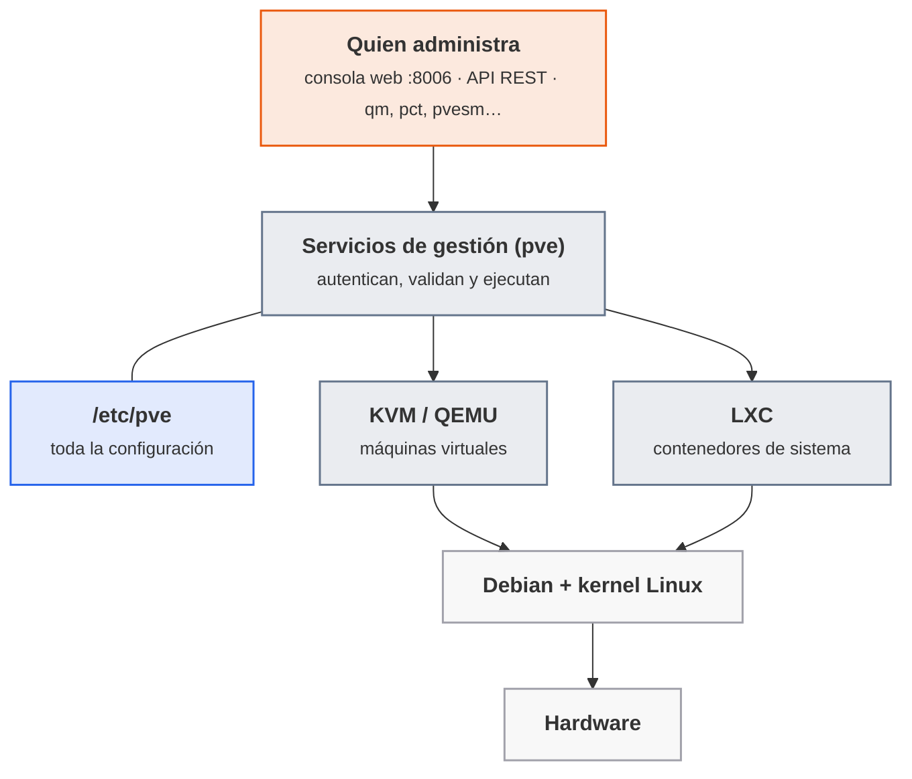

<p class="pie" markdown>Da igual pulsar en la web, llamar a la API o escribir `qm`: las tres puertas acaban en los mismos servicios y en la misma configuración.</p>

**Dónde vive la configuración.** Toda la configuración está en `/etc/pve`, que no es un directorio normal sino un sistema de ficheros propio de Proxmox, guardado en una base de datos y pensado para compartirse entre los nodos de un clúster; cómo lo hace está en [Clúster y migración en vivo](../ampliacion.md#cluster-y-migracion-en-vivo). Cada VM, por ejemplo, es un fichero de texto de pocas líneas, `/etc/pve/qemu-server/<ID>.conf`, que es lo que enseña `qm config <ID>`.

**Por qué importan las órdenes.** La web es la forma más cómoda de empezar, pero lo que se hace con clics no se puede repetir ni revisar. Cada clic tiene su orden equivalente, y son esas órdenes las que permiten automatizar: la UT2 escribe scripts que crean un entorno entero con ellas, y la UT5 lo declara con OpenTofu a través de la API. Las de uso diario:

| Herramienta | Para qué | En el curso |
|---|---|---|
| `qm` | Máquinas virtuales: crear, arrancar, clonar, snapshots, migrar | Desde la sesión 3, en casi todas las hojas |
| `pct` | Contenedores LXC | El contenedor `ct01` de la A1.4 |
| `pvesm` | Almacenamiento: listar, añadir, ver ocupación | La revisión de almacenes de la A1.2 y las medidas de la sesión 5 |
| `pveum` | Usuarios, grupos, roles y permisos | `admin@pve` en la A1.2 y los usuarios con token de la UT2 y la UT5 |
| `vzdump` | Copias de seguridad | La copia de `web01` en la A1.4 |
| `pveam` | Descargar plantillas de contenedor | La plantilla de `ct01` en la A1.4 |
| `pvecm` | Clúster: crear, añadir nodos, ver quórum | No se usa: el laboratorio tiene un solo nodo |
| `pveperf` | Medida rápida de CPU y disco del host | Las medidas de la sesión 5 |

Puertos que conviene tener en la cabeza: 8006 (web y API), 22 (SSH) y 5900 a 5999 (consolas VNC). Los de la otra consola remota (SPICE), el clúster y las migraciones están también en [Clúster y migración en vivo](../ampliacion.md#cluster-y-migracion-en-vivo).

#### Repositorios y actualizaciones

**El problema: un Proxmox recién instalado no se actualiza.** Proxmox se actualiza con `apt`, como cualquier Debian, pero sus paquetes propios (el kernel, QEMU, LXC, la consola web) no salen de los repositorios de Debian sino de los de Proxmox. El que queda activado tras la instalación es `pve-enterprise`, reservado a quien paga una suscripción, y lo mismo pasa con el de Ceph, el almacenamiento distribuido que aparece más abajo. Sin una clave de suscripción, `apt update` falla con un error 401 (no autorizado) y el nodo se queda sin parches de seguridad.

**Qué repositorios hay.** Proxmox publica sus paquetes en tres: `pve-enterprise`, con los paquetes más probados, para quien tiene suscripción; `pve-no-subscription`, gratuito, que recibe los mismos paquetes antes y con menos pruebas, y que su propia documentación recomienda para pruebas y uso no productivo; y `pvetest`, para probar lo que todavía no ha salido. El laboratorio usa `pve-no-subscription`, que es lo que corresponde a un aula; una empresa con Proxmox en producción paga la suscripción, que además le da soporte. El aviso de «No valid subscription» que sale al entrar en la web es parte de la misma historia: avisa, pero no impide nada.

**Dónde se cambian.** En Proxmox VE 9 cada repositorio es un fichero `.sources` de `/etc/apt/sources.list.d/`, escrito en el formato de bloques de apt llamado deb822: `pve-enterprise.sources` y `ceph.sources` vienen de la instalación, y el de `pve-no-subscription` va en `proxmox.sources`. En la 8 eran líneas en ficheros `.list`. La web los gestiona en nodo > Updates > Repositories, que los añade, activa y desactiva sin editar nada a mano.

**Por qué se reinicia si entra un kernel.** Una actualización puede traer un kernel nuevo (un paquete `proxmox-kernel-...`). El nodo sigue funcionando con el antiguo hasta que se reinicia, y con él los módulos de KVM que usan las VM. Conviene reiniciar justo después de actualizar, con el nodo todavía vacío, y no en mitad de una sesión con VM encendidas.

#### Almacenamiento

**El problema: dónde van los discos.** Una VM necesita un disco, y las ISO de instalación, las plantillas y las copias de seguridad necesitan sitio. Proxmox no lo resuelve con carpetas fijas: lo organiza en **almacenes** (*storages*). Cada almacén tiene un tipo, que dice cómo y dónde guarda (como ficheros de un directorio, como volúmenes de un disco, en otro servidor por la red), y una lista de contenidos que admite (imágenes de disco, ISO, plantillas de contenedor, copias de seguridad, *snippets*). Si una orden intenta dejar algo en un almacén que no lo admite, falla, y es uno de los errores típicos de la primera semana.

**Los dos de la instalación.** La instalación por defecto crea dos, uno para ficheros y otro para discos:

- `local` (tipo directorio, en `/var/lib/vz`): ISO, plantillas de contenedor y copias de seguridad, y también *snippets* (ficheros auxiliares, como los de cloud-init de la sesión 3) si se le activa ese contenido. Si se le activa el de discos, puede alojar también discos de VM en formato qcow2 o raw, como ficheros en `/var/lib/vz/images/<vmid>/`.
- `local-lvm` (tipo LVM-thin, sobre el volumen `pve/data`): discos de VM y de contenedores. LVM es el gestor de volúmenes de Linux, que reparte un disco en volúmenes lógicos; *thin* quiere decir que esos volúmenes se crean con su tamaño nominal, pero solo toman espacio del conjunto común (el *pool*) a medida que se escribe en ellos. Admite snapshots.

La separación tiene sentido: una ISO o una copia son ficheros, y lo natural es guardarlas en un directorio; el disco de una VM rinde más como volumen de bloques, sin un sistema de ficheros del host por medio.

**Otros almacenes.** Según el caso, se añaden otros:

- ZFS (un sistema de ficheros que gestiona él mismo los discos): si hay discos de sobra. Snapshots instantáneos, compresión transparente (lz4), sumas de verificación de cada bloque, replicación integrada entre nodos (`pvesr`) y RAID por software sin controladora. A cambio, RAM para la caché ARC y una cierta penalización de escritura por el *copy-on-write*: al modificar un bloque, ZFS escribe la versión nueva en otro sitio en lugar de sobrescribir la antigua.
- NFS, SMB o iSCSI: almacenamiento compartido entre varios nodos, requisito para migrar en vivo sin copiar el disco y para la alta disponibilidad.
- Ceph: almacenamiento distribuido integrado en Proxmox; a partir de tres nodos.
- Proxmox Backup Server: destino de backups deduplicados (sesión 4).

**Cómo se elige.** Con lo que pesa cada opción; el laboratorio, con un solo disco, usa la primera columna:

| | LVM-thin | ZFS | Directorio (ext4/xfs) |
|---|---|---|---|
| Formato de disco de VM | raw (volumen de bloques) | raw (zvol) | qcow2 o raw (fichero) |
| Snapshots | Sí, de bloques, rápidos | Sí, instantáneos | Solo con qcow2 |
| Thin provisioning | Sí | Sí | Sí con qcow2 (crece bajo demanda) |
| Clones enlazados | Sí | Sí | Sí con qcow2 |
| Integridad de datos | La del disco | Checksums, autocorrección con redundancia | La del sistema de ficheros |
| Coste en RAM | Ninguno | ARC (GB) | Ninguno |
| Cuándo | Un solo disco, laboratorio, lo simple | Varios discos, datos que importan, replicación | Almacén compartido NFS, ISOs, backups |

**raw y qcow2.** Son los dos formatos de disco de VM. **raw** es una imagen byte a byte del disco, sin cabecera: lo más rápido, y lo que usan LVM y ZFS. **qcow2** (*QEMU Copy On Write*, versión 2) es un formato de fichero con metadatos que permite crecer bajo demanda, snapshots internos, compresión y una imagen base de la que cuelgan otras (así se hacen los clones enlazados en un directorio). Con qcow2 se paga una capa de traducción entre la posición en el disco virtual y la posición en el fichero, y una fragmentación que se nota con el tiempo; en un directorio sobre SSD la diferencia con raw es de un 5 a un 10 % en E/S aleatoria, aceptable para laboratorio. Las imágenes cloud se distribuyen en qcow2 porque es lo compacto; al importarlas a LVM-thin, Proxmox las convierte a raw automáticamente.

**El aviso: el thin provisioning.** Prometer más disco del que hay merece un aviso serio. Un almacén de 200 GB puede tener asignados 10 discos de 50 GB (500 GB "prometidos") porque solo ocupan lo escrito. Mientras las VM estén medio vacías, perfecto. El día que dos de ellas se llenen a la vez y el pool llegue al 100 %, LVM-thin no puede atender las escrituras: las VM reciben errores de E/S, sus sistemas de ficheros pasan a solo lectura o se corrompen, y no se puede ni borrar un snapshot para hacer sitio porque borrar también necesita metadatos. En ZFS el comportamiento es similar cuando el pool se llena, agravado por el copy-on-write. Por eso se vigila con `lvs`, en sus columnas `Data%` (los datos) y `Meta%` (el espacio donde el pool apunta qué bloque es de qué volumen, que también puede llenarse), o con `zpool list` en ZFS.

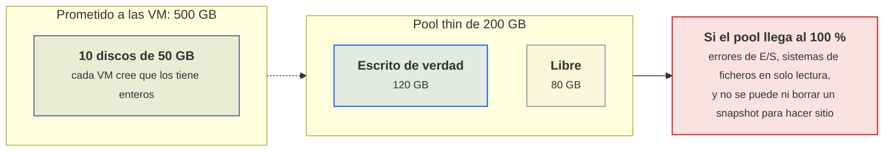

<p class="pie" markdown>Sobreasignar es normal y es la gracia del thin provisioning. Lo que no es opcional es vigilar `Data%` y activar el descarte.</p>

**Por qué un pool thin solo crece.** Cuando dentro de una VM se borra un fichero, su sistema de ficheros marca esos bloques como libres, pero el pool no se entera: para él siguen escritos. El **descarte** (*discard*, o TRIM en los SSD) es el aviso con el que el invitado le dice al disco qué bloques ya no usa, y con él el pool los recupera. Hacen falta dos cosas: `discard=on` en el disco de la VM, para que el aviso llegue hasta el pool, y `fstrim` periódico dentro del invitado, que es quien lo envía (Debian ya lo trae como temporizador de systemd). Sin descarte, un pool thin solo crece.

```bash
# Ocupación real del pool thin y de cada disco
lvs pve/data
lvs -o lv_name,lv_size,data_percent pve
# Descarte desde el host, a través del agente QEMU
qm guest cmd 110 fstrim
```

#### Red

**El problema: una tarjeta física para muchas VM.** Cada VM necesita su tarjeta de red conectada a alguna red, pero el host tiene una sola tarjeta física y no se la puede dar entera a cada VM. Proxmox lo resuelve como se resolvería con máquinas físicas, con un switch: crea un **bridge** de Linux (`vmbr0`), que es un switch virtual dentro del kernel del host, y le conecta la tarjeta física como si fuera el cable que va al switch del aula.

**Cómo se conectan las VM.** Cada tarjeta virtual de una VM aparece en el host como una interfaz `tap`, que es su otro extremo (`tap110i0` es la `net0` de la VM 110), y Proxmox la conecta al bridge como un puerto más. Así las VM quedan en la misma red que el host, cada una con su propia MAC, y reciben IP del DHCP del aula como cualquier otra máquina. La IP del host tampoco va en la tarjeta física, sino en el bridge: una vez la tarjeta es un puerto del switch, solo hace de cable, y el host se conecta a su propio switch como uno más.

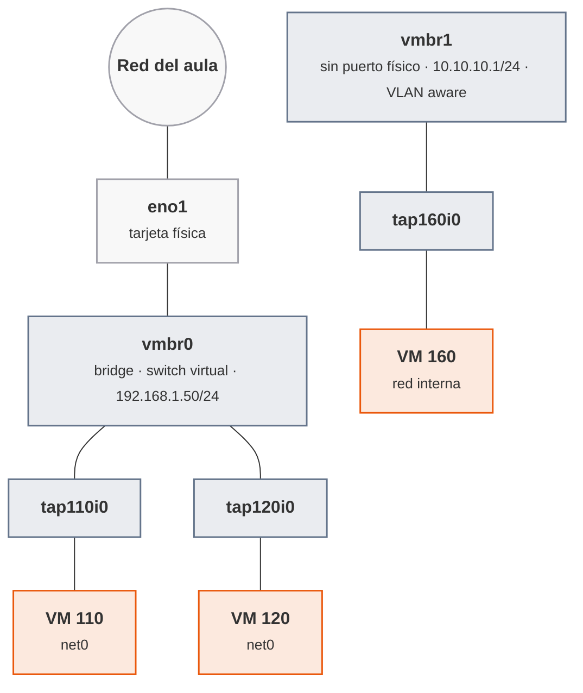

<p class="pie" markdown>Una interfaz `tap` por tarjeta virtual. `vmbr1` no tiene puerto físico: lo que se conecta ahí no sale del host, que es justo lo que se busca para una red interna.</p>

**El fichero.** La configuración está en `/etc/network/interfaces` y la aplica `ifupdown2` sin reiniciar, con `ifreload -a`; la web hace eso mismo al pulsar «Apply Configuration». Así queda con los dos bridges del laboratorio:

```text
auto lo
iface lo inet loopback

iface eno1 inet manual

auto vmbr0
iface vmbr0 inet static
    address 192.168.1.50/24
    gateway 192.168.1.1
    bridge-ports eno1
    bridge-stp off
    bridge-fd 0

auto vmbr1
iface vmbr1 inet static
    address 10.10.10.1/24
    bridge-ports none
    bridge-stp off
    bridge-fd 0
    bridge-vlan-aware yes
    bridge-vids 2-4094
```

En cada bridge, `bridge-ports` dice qué tarjeta física tiene enchufada (`none`, ninguna), y `bridge-stp off` y `bridge-fd 0` desactivan el protocolo con el que los switches evitan los bucles (STP) y la espera que impone antes de dejar pasar tráfico por un puerto nuevo. Con un solo bridge no hay bucle posible, y así la tarjeta de una VM que arranca transmite desde el primer momento.

**Para qué sirve `vmbr1`.** Es un bridge sin tarjeta física: lo que se conecta a él solo llega a las otras VM del mismo bridge y al host, que tiene la `10.10.10.1`, y no sale a la red del aula. Es el sitio de las redes de prueba del curso, empezando por las VLAN de la sesión 5. Las dos últimas líneas del ejemplo, `bridge-vlan-aware` y `bridge-vids`, lo preparan para separar varias redes por etiquetas (VLAN): no se ponen al crearlo, las añade la sesión 5, donde se explican.

#### Usuarios y permisos

**Por qué no trabajar como root.** Tras la instalación solo existe `root@pam`, el root de Linux del nodo. Su contraseña abre también el SSH y la consola del sistema, con él se puede hacer todo sin ningún límite y, si varias personas lo comparten, nadie sabe después quién hizo qué. La buena práctica es la de cualquier sistema: un usuario administrador con nombre propio para el trabajo diario, y root reservado para lo que solo root puede hacer (algunas operaciones del nodo y la consola del host).

**De dónde salen los usuarios: el realm.** Cada usuario pertenece a un *realm*, que dice dónde se comprueba su contraseña: `pam` son los usuarios Linux del host y `pve` son usuarios propios de Proxmox, guardados en `/etc/pve/user.cfg`, que no existen para el sistema operativo y no pueden entrar por SSH. También se pueden enganchar directorios externos: LDAP, Active Directory y OpenID Connect. Por eso, al entrar en la web, hay que elegir el realm del usuario.

**Qué puede hacer cada uno.** Un permiso son siempre tres cosas juntas: quién (un usuario o un grupo), qué puede hacer (un rol, que es un conjunto de privilegios: `Administrator`, `PVEAdmin`, `PVEVMAdmin`, `PVEVMUser`, `PVEAuditor`, `PVEDatastoreUser`...) y sobre qué parte del árbol de objetos (`/`, `/vms/100`, `/storage/local`, `/nodes/pve1`), con o sin propagación a los hijos.

**Los tokens.** Un token de API es una clave con la que un programa habla con Proxmox sin contraseña. Se crea sobre un usuario y hereda o recorta sus permisos, así que un programa nunca puede más que el usuario del que cuelga. Se usan en la UT2, con `curl`, y en la UT5, con OpenTofu.

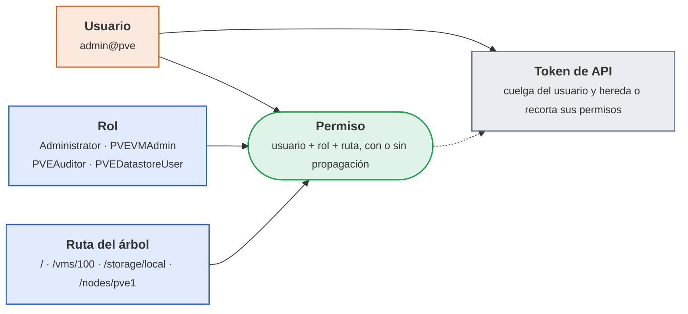

<p class="pie" markdown>Un permiso son siempre tres cosas: quién, qué puede hacer y sobre qué parte del árbol. El token de la UT5 sale de ahí.</p>


```bash
pveum user add admin@pve --password 'CambiaEsto' --comment "Administrador del laboratorio"
pveum acl modify / --users admin@pve --roles Administrator
pveum user list
pveum acl list
```

### A1.2 Configuración inicial (sesión 2)

<span class="et et-obj">Objetivo</span> Un Proxmox actualizado, con un usuario administrador que no es root, un segundo bridge interno y las herramientas de medida instaladas. Es lo que necesita el nodo para que en la sesión 3 empiecen a nacer VM: parches de seguridad, un usuario para el trabajo diario, una red interna para las pruebas y el material de la plantilla ya descargado.

<span class="et et-pre">Antes de empezar</span>

- El Proxmox de A1.1 arrancado y accesible en el puerto 8006, con `nested` en `Y`.
- Lo explicado al principio de la sesión: [arquitectura y herramientas](#arquitectura), [repositorios](#repositorios-y-actualizaciones), [almacenamiento](#almacenamiento), [red](#red) y [usuarios y permisos](#usuarios-y-permisos).

<span class="et et-pas">Pasos</span>

Vas a dejar el nodo listo en el orden en que cada cosa hace falta. Primero los repositorios y la actualización, porque todo lo demás instala paquetes y un kernel nuevo obliga a reiniciar, mejor ahora que con VM encendidas. Después miras cómo guarda los discos, antes de crear el primero. Luego creas el usuario con el que trabajarás desde hoy y la red interna de las pruebas. Al final dejas en marcha lo que más tarda, las descargas de la sesión 3.

1. **Cambia a los repositorios sin suscripción.** Activa `No-Subscription` y desactiva los dos `enterprise` (`pve-enterprise` y el de `ceph`) desde nodo > Updates > Repositories, y mira desde la shell cómo han quedado los ficheros. Sin este paso el nodo no se actualiza nunca, por lo que se explica en [Repositorios y actualizaciones](#repositorios-y-actualizaciones).

2. **Actualiza el nodo.** Con los repositorios buenos, actualiza todo el sistema: es lo que deja al nodo con sus parches de seguridad al día antes de que nazca la primera VM. Si entra un kernel nuevo (un paquete `proxmox-kernel-...`), reinicia antes de seguir, por lo que se explica al final de [Repositorios y actualizaciones](#repositorios-y-actualizaciones).

3. **Mira dónde guarda los discos.** Anota qué contenido admite cada almacén, `local` y `local-lvm`, y el tamaño del pool thin con su ocupación de datos y de metadatos, con las órdenes de [Almacenamiento](#almacenamiento). Lo primero te dice dónde puede ir cada cosa que crees a partir de ahora; lo segundo, con el nodo vacío, es la referencia con la que verás crecer el pool cuando lleguen la plantilla, los clones y los snapshots.

4. **Crea tu usuario de trabajo.** Crea el usuario `admin` en el realm `pve`, con el rol `Administrator` sobre `/`, como en [Usuarios y permisos](#usuarios-y-permisos), y desde ahora trabaja con él. Entrar con él en la web es la prueba de que el usuario y su permiso están bien; root queda para lo que solo puede hacer root, como la shell del nodo.

    *Pista:* al entrar en la web con `admin`, el realm es `Proxmox VE authentication server`, no `Linux PAM`.

5. **Crea la red interna.** Crea en nodo > Network el segundo bridge, `vmbr1`, con `10.10.10.1/24` y sin puerto físico. Es la red de [Red](#red) que no sale del host, donde la sesión 5 montará sus VLAN de prueba.

    *Pista:* en la web, el cambio no se aplica hasta pulsar Apply Configuration.

6. **Deja preparado lo que más tarda.** Instala en el host las herramientas de medida (`stress-ng`, `fio`, `iperf3` y `sysstat`), que usa la sesión 5, y deja descargado el material de la sesión 3: la imagen cloud de Debian 13 en `/root` y el paquete `libguestfs-tools`, que trae `virt-customize`. Son dos descargas largas que, con treinta puestos a la vez, saturan la red del aula; hechas hoy, la sesión 3 empieza directamente por la plantilla.

    *Pista:* la imagen es `debian-13-genericcloud-amd64.qcow2`, de `https://cloud.debian.org/images/cloud/trixie/latest/`. Si tu Proxmox es 8, la de bookworm (`debian-12-genericcloud-amd64.qcow2`).

<span class="et et-com">Comprobación</span> `apt update` termina sin errores 401; `pveum user list` muestra `admin@pve`; `ip -br addr` muestra `vmbr0` con la IP del aula y `vmbr1` con `10.10.10.1/24`; `fio --version` responde; `ls -lh /root/debian-13-genericcloud-amd64.qcow2` muestra la imagen entera y `virt-customize --version` contesta.

<span class="et et-ent">Entrega</span> Captura de `/etc/network/interfaces` y de la lista de usuarios (`pveum user list`), el tamaño del pool thin y la salida de `virt-customize --version`, en el documento de la unidad.

<span class="et et-ext">Si te sobra tiempo</span> Crea un segundo usuario con rol `PVEAuditor` sobre `/`, entra con él y anota qué puede ver y qué no puede tocar.

## Sesión 3 · Primera VM y plantilla

<p class="ut-meta" markdown>14 de octubre · Teoría y práctica · <span class="dur" tabindex="0" aria-label="Máquinas virtuales en Proxmox · 20 min&#10;A1.3 Plantilla cloud-init y clonado · 90 min" data-dur="Máquinas virtuales en Proxmox · 20 min&#10;A1.3 Plantilla cloud-init y clonado · 90 min">:material-school:<i class="dur-barra" style="--teoria:18%"></i>:material-flask:</span></p>

Con el Proxmox preparado, toca crear máquinas. Instalar cada una desde la ISO, como se hizo con el propio Proxmox, cuesta veinte minutos de preguntas del instalador, y el curso va a necesitar decenas de VM: hoy tres, y la otra asignatura empieza a usar dos de ellas mañana. La solución es la de cualquier nube: partir de una imagen con el sistema ya instalado, convertirla en plantilla y sacar de ella copias que se configuran solas en su primer arranque. La teoría sigue el orden en que se construye: qué se decide al crear una VM (sus parámetros y la CPU que ve), de dónde sale su disco (la imagen cloud y lo que se le añade antes de usarla), cómo se personaliza cada copia (cloud-init) y cómo se hacen las copias (plantillas y clones). Snapshots y copias de seguridad, que cierran el ciclo de vida de una VM, son de la sesión 4. La hoja construye la plantilla 9000 y saca de ella `web01`, `app01` y `mon01`, las tres con IP y acceso SSH desde el nodo y desde el puesto del alumno; las dos últimas, con Docker instalado, las usa Mantenimiento al día siguiente.

### Máquinas virtuales en Proxmox

#### Crear una VM: los parámetros que importan

**Qué se decide al crear una VM.** Para Proxmox, una VM es una lista de piezas de hardware virtual escrita en su fichero de configuración. Casi todas tienen un valor por defecto razonable; estas son las que cambian algo, cada una con su porqué:

- **ID y nombre.** El ID es un número único en el clúster, de 100 en adelante, y es lo que usan todas las órdenes, que no aceptan nombres. Conviene reservar rangos: 9000 en adelante para plantillas es la costumbre, y el laboratorio reparte el resto por entorno y zona en sus [convenciones](../laboratorio.md#convenciones).
- **Origen del disco.** Una ISO de instalación, o una imagen de disco ya instalada que se importa, que es lo que hace el curso con la plantilla.
- **Disco.** Bus `scsi` con controladora `VirtIO SCSI single`, formato raw sobre `local-lvm`, `discard=on` para que el descarte llegue al pool thin y `ssd=1` si el almacén es SSD, para que el invitado lo trate como tal. *VirtIO* son dispositivos pensados para máquinas virtuales, mucho más rápidos que imitar hardware real; el porqué se ve en la sesión 4. Con thin, se puede ser generoso en tamaño, pero siendo consciente de lo que suma.
- **CPU.** Número de núcleos (`cores`), un solo socket y el tipo, que tiene apartado propio más abajo.
- **Memoria.** Fija o con *ballooning*: un driver dentro del invitado que, cuando el host necesita memoria, la reserva dentro de la VM y se la devuelve al host, como un globo que se hincha. Con ballooning, `--memory` es el máximo y `--balloon` el mínimo hasta el que el host puede reclamar. En el curso las VM van con memoria fija, y el ballooning se ensaya en la A1.5 y se pide en la práctica evaluable.
- **Red.** Modelo virtio, el bridge al que se conecta y, si procede, la etiqueta VLAN y el cortafuegos de Proxmox.
- **Firmware y máquina** (el tipo de BIOS y de placa base que imita QEMU): SeaBIOS con i440fx por defecto; OVMF (UEFI) con q35 para passthrough de PCIe, Secure Boot o Windows 11 (que además exige un TPM virtual, un chip de seguridad emulado).
- **Agente QEMU.** Es un servicio dentro de la VM por el que Proxmox le pregunta su IP, la apaga limpiamente, congela su sistema de ficheros durante una copia y le manda ejecutar `fstrim`. Hacen falta las dos mitades: el agente instalado dentro (en el curso va dentro de la imagen de la plantilla, como se explica más abajo) y activado en la VM (`--agent enabled=1`), que es lo que crea el canal por el que hablan.

```bash
qm create 190 --name prueba --memory 2048 --balloon 1024 --cores 2 --cpu x86-64-v2-AES \
  --scsihw virtio-scsi-single --scsi0 local-lvm:20,discard=on,ssd=1 \
  --net0 virtio,bridge=vmbr1 --ostype l26 --agent enabled=1
qm config 190
```

El ejemplo usa un ID del rango de pruebas (150 a 199) y `vmbr1` sin etiqueta VLAN, donde el host tiene la `10.10.10.1`; con esa misma VM se sigue en el diagrama de cloud-init de más abajo.

#### Tipos de CPU y su efecto en la migración

**Qué CPU ve la VM.** Un programa no sabe de antemano en qué procesador corre: se lo pregunta con la instrucción `cpuid`, que responde el modelo y una lista de *banderas*, una por cada capacidad del procesador (AVX para cálculo vectorial, AES-NI para cifrado por hardware, SSE4.2...). Dentro de una VM quien responde es KVM, y no con la CPU real, sino con lo que Proxmox le haya configurado. Esa respuesta decide qué instrucciones cree tener el invitado, y los compiladores y las bibliotecas eligen su forma de trabajar en función de ella.

**Por qué no enseñar siempre la CPU real.** Porque una VM puede cambiar de máquina. Si un programa ha visto una bandera y la usa, y la VM pasa a un servidor cuyo procesador no la tiene, el programa muere con «illegal instruction». El tipo de CPU es un compromiso entre rendimiento (enseñar todo lo que tiene el procesador) y portabilidad (enseñar solo lo que tienen todos los servidores por los que puede pasar la VM):

| Tipo | Qué expone | Ventaja | Inconveniente |
|---|---|---|---|
| `host` | Todas las banderas de la CPU física | Máximo rendimiento; necesario para virtualización anidada y para algunas cargas (AVX-512, compilación) | La VM solo puede migrar en vivo a un host con exactamente la misma CPU; si cambia de máquina, el invitado puede caer con "illegal instruction" |
| `x86-64-v2-AES` | Nivel de microarquitectura v2 (instrucciones SSE hasta SSE4.2) más AES-NI, el cifrado por hardware | Por defecto para VM nuevas desde Proxmox VE 8; funciona en cualquier CPU desde 2010 y migra entre hosts distintos | Sin AVX/AVX2: cargas numéricas o de cifrado moderno van más lentas |
| `x86-64-v3`, `x86-64-v4` | v2 más AVX y AVX2 (v3); más AVX-512 (v4) | Buen compromiso en un clúster homogéneo moderno | Exige que todos los nodos tengan esas banderas |
| `kvm64` | Un Pentium 4 con extensiones mínimas | Corre en cualquier sitio; era el valor por defecto hasta la 7 | Muy pobre: sin SSE4, sin AES-NI; muchas distribuciones actuales lo rechazan porque exigen x86-64-v2 |
| Modelos con nombre (`EPYC-Rome`, `Skylake-Server`...) | Las banderas de esa familia concreta | Reproducible y portable dentro de una gama | Hay que saber qué hardware hay debajo |

**En el curso.** En el laboratorio, anidado y con un solo nodo, `host` es lo razonable para el Proxmox interior cuando el hipervisor exterior es otro Proxmox (así puede virtualizar a su vez), y `x86-64-v2-AES` para las VM creadas dentro, que es lo que pone Proxmox cuando no se indica otra cosa. En una empresa con un clúster de nodos comprados en años distintos se elige el mínimo común denominador (a menudo v2 o v3) o se define un modelo de CPU propio en `/etc/pve/virtual-guest/cpu-models.conf` para toda la organización. Cambiar el tipo de CPU exige apagar y encender la VM, y un reinicio desde dentro no basta: la CPU queda fijada cuando arranca el proceso que ejecuta la VM en el host (sesión 4), y reiniciar el invitado no relanza ese proceso.

#### Imágenes cloud y cómo se preparan

**Por qué no se instala desde la ISO.** Instalar desde la ISO, como se hizo con el propio Proxmox, cuesta veinte minutos de preguntas y deja una máquina con decisiones tomadas a mano: su nombre, su usuario, su contraseña. Para una plantilla se quiere justo lo contrario, un sistema ya instalado pero sin nada propio, que cada copia complete en su primer arranque.

**Qué es una imagen cloud.** Es un disco con el sistema operativo ya instalado, genérico (sin usuarios, sin claves, sin nombre de máquina), pequeño (unos pocos GB, que crecen hasta el tamaño del disco que se le dé) y con cloud-init dentro, esperando su configuración. Las distribuciones las publican para las nubes públicas, y sirven igual para Proxmox. Debian publica varias variantes: `generic`, que funciona en cualquier entorno con cloud-init, incluso en hardware físico; `genericcloud`, igual pero con menos drivers de hardware en el kernel y más pequeña, que es la que usa el curso; y `nocloud`, sin cloud-init, que arranca directamente con root y solo sirve para pruebas. Vienen en qcow2, y al importarlas a `local-lvm` Proxmox las convierte a raw.

**Lo que le falta y cómo se añade.** La imagen de Debian no trae dos cosas que el curso quiere en todas las VM. Una es el agente QEMU, sin el que Proxmox no ve la IP de la VM. La otra es **node_exporter** (paquete `prometheus-node-exporter`), un pequeño servicio que publica en el puerto 9100 las métricas de la máquina (CPU, memoria, disco, red) para que las recoja Prometheus, el sistema de monitorización del curso: Mantenimiento lo usa desde el primer día en `app01` y `mon01`, y la UT7 de este módulo, en todas las VM. Se podrían instalar en el primer arranque con cloud-init, pero solo en una VM con salida a Internet, y en el curso hay VM que nacen sin ella: las de las VLAN de la sesión 5, la de la práctica evaluable y muchas de las zonas de la VPC de las unidades siguientes. Por eso se meten dentro de la imagen antes de importarla, con `virt-customize`, del paquete `libguestfs-tools`. Esta herramienta modifica una imagen de disco sin arrancarla: la abre con una pequeña máquina auxiliar propia y ejecuta dentro el gestor de paquetes de la imagen, como si se instalara en el sistema ya en marcha.

```bash
virt-customize -a debian-13-genericcloud-amd64.qcow2 --install qemu-guest-agent,prometheus-node-exporter
```

Lo que se instala así queda en la imagen y, por tanto, en la plantilla y en cada VM que salga de ella, con sus servicios en marcha desde el primer arranque.

#### cloud-init

<figure markdown="span">
  { width="160" }
  <figcaption>cloud-init. Fuente: dominio público, vía Wikimedia Commons.</figcaption>
</figure>

**El problema: copias idénticas.** Un clon es una copia exacta del disco de la plantilla. Si nadie hace nada, todas las copias arrancan con el mismo nombre de máquina, sin un usuario con el que entrar y sin su propia configuración de red. Hay que dar a cada una su identidad (nombre, usuario, claves SSH, IP) y ampliar su disco, y nadie quiere entrar por consola en cada VM para hacerlo.

**Qué es y de dónde sale.** **cloud-init** es el estándar para configurar una VM en su primer arranque: usuario, contraseña o clave SSH, nombre de host, red, paquetes, comandos. Nació en Canonical, la empresa de Ubuntu, para configurar las imágenes de Ubuntu en la nube de Amazon, y se generalizó después: hoy lo usan todas las nubes (AWS, Azure, GCP, OpenStack) y lo llevan instalado y activado todas las imágenes cloud de Debian, Ubuntu, Rocky o Fedora.

**Cómo funciona.** Es un servicio que arranca muy pronto, antes que la red. Busca una *fuente de datos* (*datasource*), el sitio donde la nube le deja la configuración de esa máquina concreta, y lee de ella tres ficheros: `user-data`, con lo que hay que hacer (usuarios, claves, paquetes, comandos); `meta-data`, con la identidad de la instancia, sobre todo su `instance-id`; y `network-config`, con la red. Después lo aplica en cuatro etapas: `init-local` (configura la red a partir de `network-config`), `init` (ya con red: usuarios, claves SSH, redimensionado del disco), `modules:config` y `modules:final` (paquetes, `runcmd`, mensaje de fin). Todo queda registrado en `/var/log/cloud-init.log` (detallado) y `/var/log/cloud-init-output.log` (salida de los comandos). Al terminar, cloud-init apunta en el disco el `instance-id` que ha configurado, y en los arranques siguientes no repite lo que se hace una vez por instancia, salvo que el `instance-id` cambie.

**Cómo se lo da Proxmox.** Proxmox usa el datasource **NoCloud**, el pensado para cuando no hay una nube detrás: genera al vuelo una imagen ISO de unos 4 MB con etiqueta `cidata` que contiene los tres ficheros, la conecta a la VM como un CD-ROM (`ide2: local-lvm:vm-110-cloudinit`) y cloud-init la encuentra al arrancar buscando un volumen con esa etiqueta. Los datos salen de los parámetros cloud-init de la VM (`--ciuser`, `--sshkeys`, `--ipconfig0`, `--nameserver`...), y cada vez que se cambia uno, Proxmox regenera la ISO en el siguiente arranque. Se puede ver exactamente lo que va a recibir la VM sin arrancarla:

```bash
qm cloudinit dump 110 user
qm cloudinit dump 110 network
qm cloudinit dump 110 meta
```

Tres detalles de lo que genera Proxmox explican cosas que se ven en las hojas:

- El `user-data` es deliberadamente corto: nombre de host (el nombre de la VM), usuario, contraseña cifrada, claves SSH y `package_upgrade: true`, que actualiza todos los paquetes en el primer arranque. Esto último va activado salvo que se desactive con `--ciupgrade 0`. Necesita salida a Internet y alarga unos minutos el primer arranque; en una VM sin Internet ese paso falla, aunque el usuario, las claves y la red ya estén aplicados.
- El `instance-id` lo calcula Proxmox a partir del contenido del `user-data` y del `network-config`, así que cada clon, que tiene otro nombre, es para cloud-init una instancia nueva.
- La red de cada tarjeta solo se configura si tiene su `--ipconfigN`: para una tarjeta sin él, Proxmox no le pasa a cloud-init ninguna configuración.

**Más de lo que da Proxmox: los snippets.** Si hace falta más (instalar paquetes, crear varios usuarios, ejecutar comandos), se escribe un fichero YAML propio en el almacén `local` como *snippet* (un fichero auxiliar que Proxmox guarda junto a las ISO) y se referencia con `--cicustom "user=local:snippets/web.yaml"`. Proxmox deja entonces de generar el `user-data` y usa ese tal cual, pero sigue generando la red. La primera línea, `#cloud-config`, no es un comentario cualquiera: es la que le dice a cloud-init que el fichero es configuración y no un script. En el curso no hace falta para nada obligatorio: se practica en «Si te sobra tiempo» de la A1.3, y en la UT5 OpenTofu rellena los mismos parámetros de Proxmox, no un snippet.

```yaml
#cloud-config
hostname: web01
users:
  - name: ops
    groups: [sudo]
    shell: /bin/bash
    sudo: ALL=(ALL) NOPASSWD:ALL
    ssh_authorized_keys:
      - ssh-ed25519 AAAAC3NzaC1lZDI1NTE5AAAA... ops@portatil
package_update: true
packages:
  - qemu-guest-agent
runcmd:
  - systemctl enable --now qemu-guest-agent
```

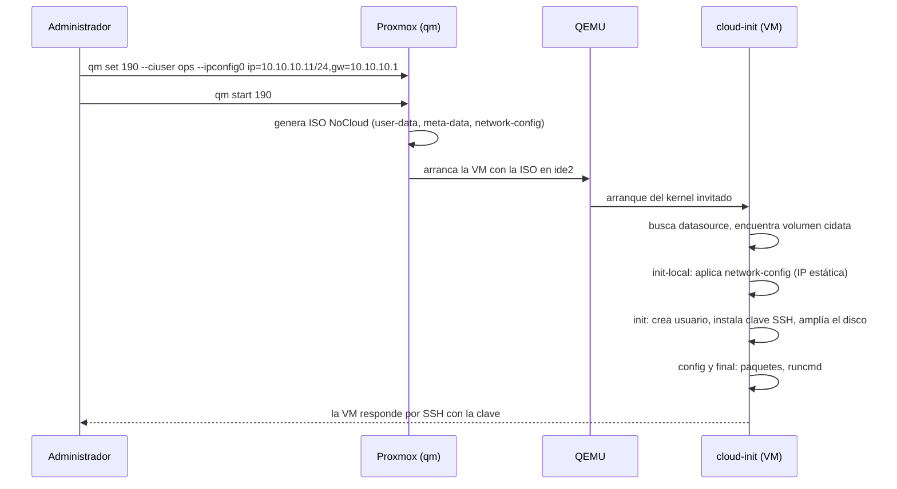

<p class="pie" markdown>Todo el trabajo lo hace la VM en su primer arranque; Proxmox solo le engancha el volumen `cidata` y la enciende. Por eso cuando falla se depura dentro de la VM, no en el host.</p>

**Cuando falla.** Que no funcione a la primera es frecuente, y se depura dentro de la VM:

```bash
# Dentro de la VM (por la consola noVNC de Proxmox si no hay SSH)
cloud-init status --long        # done / running / error, y con --long el detalle
cloud-init query -a | head -50  # qué datasource encontró y qué metadatos leyó
grep -iE "warn|error|traceback" /var/log/cloud-init.log
cat /var/log/cloud-init-output.log
# Forzar que se vuelva a ejecutar como si fuera el primer arranque
cloud-init clean --logs && reboot
```

**Dos detalles que ahorran horas.**

- **La plantilla no se arranca nunca.** El primer arranque genera cosas que deberían ser únicas de cada máquina, como su identificador (`/etc/machine-id`), y las deja grabadas en el disco que van a copiar todos los clones. cloud-init sí se repite en cada clon, porque su `instance-id` es otro, pero el identificador de máquina no lo regenera nadie: los clones nacerían con el mismo y, como el cliente DHCP de las imágenes de Debian se identifica con él, podrían recibir todos la misma IP.
- **El tamaño del disco se da en la plantilla.** El disco de la imagen cloud es pequeño, y cloud-init amplía la partición y el sistema de ficheros hasta el tamaño del disco en cada arranque (`growpart` y `resizefs`). Si el disco se amplía en la plantilla antes de convertirla (`qm disk resize 9000 scsi0 20G`, o `qm resize` en versiones anteriores), todos los clones nacen con ese tamaño; si no, habría que ampliar cada clon y reiniciarlo.

#### Plantillas y clonado

**Qué es una plantilla.** Una VM convertida con `qm template` deja de poder arrancarse: solo se puede clonar. Internamente, Proxmox marca su disco como base de solo lectura (en LVM-thin pasa a llamarse `base-9000-disk-0`), y eso es lo que permite que los clones cuelguen de él sin miedo a que cambie.

**El flujo completo.** Es el mismo en el aula y en producción, y es el orden de la A1.3:

1. Descargar una imagen cloud de Debian o Ubuntu (formato qcow2) y meterle lo que le falte con `virt-customize`.
2. Crear una VM con esa imagen como disco y añadirle el disco cloud-init.
3. Darle la configuración cloud-init común a todas las copias y ampliar su disco.
4. Convertirla en plantilla (`qm template`), sin haberla arrancado nunca.
5. Clonar: **linked clone** (rápido, comparte el disco base con la plantilla y solo escribe las diferencias en un volumen propio; para pruebas y aulas) o **full clone** (independiente, copia completa del disco; para producción y para poder borrar la plantilla o mover el clon a otro almacén).
6. Ajustar en cada clon lo que cambie (memoria, red, IP) y arrancarlo: cloud-init hace el resto.

**Qué hereda un clon.** El clon copia la configuración entera de la VM, parámetros de cloud-init incluidos, así que nace con el usuario, las claves y la red de la plantilla, y con su propio nombre. Solo hay que cambiar lo que sea distinto. Lo que más se cambia es la memoria, y `qm clone` no la admite: por eso cada clonado del curso va seguido de un `qm set <ID> --memory`.

**Enlazado o completo.** Con una plantilla, crear una VM nueva pasa de 20 minutos de instalación a 20 segundos. Un linked clone sobre LVM-thin tarda menos de un segundo porque no copia nada; un full clone de 20 GB tarda lo que tarde el disco en copiar lo que hay escrito (unos segundos en SSD para unos pocos GB reales). El precio del linked clone es la dependencia: no se puede borrar la plantilla mientras exista un clon, y todos los clones leen de los mismos bloques base, lo que en disco mecánico se nota. En el curso, las VM que viven todo el año (`web01`, `app01`, `mon01`) son completas, para que no dependan de la plantilla aunque haya que rehacerla; las de prueba, que duran una sesión, son enlazadas.


<p class="pie" markdown>De 20 minutos de instalación a 20 segundos. El clon enlazado es más rápido pero queda atado a la plantilla.</p>


### A1.3 Plantilla cloud-init y clonado (sesión 3)

<span class="et et-obj">Objetivo</span> Una plantilla cloud-init (VM 9000) con el agente QEMU y el de métricas ya dentro, de la que salen `web01`, `app01` y `mon01`, las tres con IP y acceso SSH desde el nodo y desde tu puesto, y `app01` y `mon01` con Docker instalado, listas para Mantenimiento mañana. Desde hoy, crear una VM del laboratorio es clonar y ajustar, y las dos asignaturas trabajan sobre las mismas máquinas.

<span class="et et-pre">Antes de empezar</span>

- Proxmox actualizado, `vmbr1` creado y usuario `admin` (A1.2).
- La imagen cloud de Debian 13 en `/root` y `libguestfs-tools` instalado, del paso 6 de la A1.2. Si no lo dejaste hecho, hazlo ahora: el resto de la hoja depende de eso.
- Un terminal en tu puesto con `ssh` y `scp` (en Windows, PowerShell ya los trae): a las VM se entra desde el nodo Proxmox y desde tu puesto, que es desde donde trabaja Mantenimiento a partir de mañana.
- Lo explicado al principio de la sesión: [imágenes cloud](#imagenes-cloud-y-como-se-preparan), [cloud-init](#cloud-init) y [plantillas y clonado](#plantillas-y-clonado). Para los parámetros del `qm create`, [crear una VM](#crear-una-vm-los-parametros-que-importan) y [tipos de CPU](#tipos-de-cpu-y-su-efecto-en-la-migracion).

<span class="et et-pas">Pasos</span>

Vas a construir la plantilla en el orden en que se usa cada pieza: primero preparas lo que llevará dentro (los paquetes de la imagen y las claves de acceso), después creas la VM 9000 con esa imagen como disco, le das la configuración de cloud-init y la congelas como plantilla. Solo entonces clonas, y no las tres de golpe: primero `web01`, para probar la plantilla, y después las dos que necesita Mantenimiento. Un fallo de la plantilla se arregla una vez; si lo descubres con tres clones hechos, te toca arreglarlo cuatro veces.

1. **Prepara la imagen con los dos agentes.** Mete dentro de la imagen, antes de importarla, el agente QEMU (`qemu-guest-agent`) y el de métricas (`prometheus-node-exporter`), como se explica en [Imágenes cloud y cómo se preparan](#imagenes-cloud-y-como-se-preparan). Así los traerá en marcha toda VM que salga de la plantilla, aunque nazca sin Internet.

    *Pista:* exporta antes `LIBGUESTFS_BACKEND=direct`. Tarda unos minutos: mientras, haz el paso 2.

2. **Reúne las claves que abrirán las VM.** Junta en un fichero del nodo las dos claves públicas que van a entrar en las VM, la de tu puesto y la del propio nodo, una por línea. Las VM no tendrán contraseña, así que solo entrará quien tenga una de esas claves: la del nodo te sirve para administrarlas desde Proxmox, y la de tu puesto es la que usará Mantenimiento desde mañana.

    *Pista:* si alguna no existe, créala con `ssh-keygen -t ed25519`, sin contraseña. La del puesto se copia al nodo, por ejemplo como `/root/puesto.pub`.

3. **Crea la VM 9000 con la imagen como disco.** Crea la VM 9000, `debian-tpl`, con los parámetros de [Crear una VM](#crear-una-vm-los-parametros-que-importan) salvo tres: 2 GB sin ballooning, la red en `vmbr0`, que es la que heredan los clones y la que les da IP del aula, y la imagen importada como disco. Añádele el disco cloud-init, por donde le llegará la configuración, y la consola serie, que es la que usan las imágenes cloud y la que te dejará ver arrancar a los clones aunque falle su red.

    *Pista:* créala sin disco e impórtalo después; lo demás, con el arranque desde ese disco, va en la segunda orden:

    ```bash
    qm set 9000 --scsi0 local-lvm:0,import-from=/root/debian-13-genericcloud-amd64.qcow2,discard=on,ssd=1
    qm set 9000 --ide2 local-lvm:cloudinit --boot order=scsi0 --agent enabled=1 --serial0 socket --vga serial0
    ```

4. **Dale la configuración común y congélala.** Configura cloud-init en la 9000 con lo que tendrán todas las VM: el usuario `ops`, las claves del paso 2 e IP por DHCP. Amplía su disco a 20 GB y conviértela en plantilla sin haberla arrancado nunca; el porqué de las dos cosas está en los dos detalles del final de [cloud-init](#cloud-init). Antes de convertirla, comprueba con `qm cloudinit dump` que el `user-data` lleva las dos claves, cada una en una sola línea: una clave mal pegada deja fuera de todos los clones a quien la usa.

5. **Prueba la plantilla con `web01`.** Clona `web01` (ID 110, clon completo, 1 GB), saca su IP con el agente QEMU y entra por SSH como `ops` desde el nodo. Antes de clonar nada más, comprueba que la plantilla ha hecho su trabajo: cloud-init ha terminado y los dos agentes están activos. Ten paciencia con el primer arranque: cloud-init actualiza los paquetes y tarda unos minutos en terminar.

    *Pista:* si el agente aún no responde, la IP sale en la consola de la VM (`qm terminal 110`, de la que se sale con Ctrl+O).

6. **Clona las dos VM de Mantenimiento.** Clona `app01` (ID 120, 2 GB) y `mon01` (ID 103, 3 GB), completas y con la red de la plantilla (el porqué de cada ID y cada RAM, en las [convenciones del laboratorio](../laboratorio.md#convenciones)), e instala en las dos Docker Engine con el plugin compose, usable por `ops` sin `sudo`, porque Mantenimiento despliega allí sus pilas con Docker Compose. Entra en las dos **desde tu puesto**, que es como entra Mantenimiento mañana: si la clave del puesto no ha llegado a las VM, es hoy cuando tienes que saberlo. No levantes ningún servicio: los compose son de Mantenimiento, que los despliega en su sesión 4.

    *Pista:* espera a que cloud-init termine (`cloud-init status --wait`), que mientras actualiza tiene ocupado apt; después, el script oficial de `https://get.docker.com` instala Docker y compose en Debian 13. El grupo `docker` no se aplica hasta que sales y vuelves a entrar por SSH.

<span class="et et-com">Comprobación</span> `qm list` muestra 9000 como plantilla y las VM 110, 120 y 103 con 1024, 2048 y 3072 MB; entras por SSH como `ops` sin contraseña en `web01` desde el host y en `app01` y `mon01` desde tu puesto; `qm guest cmd 110 network-get-interfaces` responde sin haber instalado nada dentro; `cloud-init status --long` dice `done` y los dos agentes están `active`; en `app01` y en `mon01`, `docker --version` y `docker compose version` responden con el usuario `ops` y sin `sudo`.

<span class="et et-ent">Entrega</span> Salida de `qm list`, de `cloud-init status --long` dentro de `web01` y de `docker compose version` en `app01` y en `mon01`, más una explicación de dos o tres líneas, a partir de [Plantillas y clonado](#plantillas-y-clonado), de en qué se diferencian un clon completo y uno enlazado y de lo que ocupa cada uno. Anota las IP de `app01` y `mon01`: las necesitas mañana en 5169.

<span class="et et-ext">Si te sobra tiempo</span> Comprueba con números esa diferencia: mira `lvs pve`, saca de la plantilla un clon enlazado, `web02` (ID 150, 1 GB), y vuelve a mirarlo. Compara de qué depende el volumen de `web02` y de qué el de `web01`, y lo que ocupa cada uno. Practica también con los snippets de cloud-init, que es como se personaliza una VM cuando no se puede tocar la imagen: activa el contenido `snippets` en `local` (Datacenter > Storage > local > Edit), guarda el YAML del [apartado de cloud-init](#cloud-init) en `/var/lib/vz/snippets/web.yaml`, clona una VM con `--cicustom "user=local:snippets/web.yaml"` y comprueba qué ha hecho el fichero en el primer arranque. Ten en cuenta que el `packages:` de ese YAML solo funciona si la VM tiene salida a Internet; por eso el agente de esta plantilla va dentro de la imagen y no aquí. Rompe algo a propósito: clona una VM, quítale la red que hereda de la plantilla (`qm set <ID> --delete ipconfig0`) y depúrala con `cloud-init status --long` y `/var/log/cloud-init.log`.

## Sesión 4 · VM vs LXC, snapshots y límites

<p class="ut-meta" markdown>16 de octubre · Teoría y práctica · <span class="dur" tabindex="0" aria-label="Cómo funciona KVM/QEMU por debajo · 15 min&#10;LXC frente a VM, con números · 5 min&#10;Snapshots · 5 min&#10;A1.4 VM frente a LXC, snapshots · 85 min" data-dur="Cómo funciona KVM/QEMU por debajo · 15 min&#10;LXC frente a VM, con números · 5 min&#10;Snapshots · 5 min&#10;A1.4 VM frente a LXC, snapshots · 85 min">:material-school:<i class="dur-barra" style="--teoria:23%"></i>:material-flask:</span></p>

Desde la sesión 3 hay VM funcionando, y con ellas aparecen dos preguntas que no se pueden contestar sin saber qué hay debajo. La primera es de coste: por qué una VM tarda quince segundos en arrancar y se queda con cientos de megas del host, y cuándo bastaría con algo más ligero. La segunda es de seguridad: qué hacer cuando un cambio sale mal, o cuando se pierde el disco. La teoría responde en ese orden: qué son KVM y QEMU y por qué virtio es más rápido que el hardware imitado, que explica lo que cuesta una VM; qué es un contenedor LXC y cuánto se ahorra con él, con números; y qué es un snapshot y por qué no es una copia de seguridad. Las copias con vzdump no se explican en clase, pero el último paso de la hoja las usa. Al acabar, hay una tabla con medidas propias de VM frente a LXC, un snapshot de `web01` al que se ha vuelto y un backup restaurado como VM 151.

### Cómo funciona KVM/QEMU por debajo

**Lo que hay debajo de una VM.** Saber qué ocurre por debajo de un «Start» permite interpretar un problema de rendimiento en lugar de ir probando opciones. Una VM en marcha son tres piezas que trabajan juntas: KVM, en el kernel, que ejecuta su código; QEMU, un proceso del host, que le fabrica los dispositivos; y la capa de gestión de Proxmox, que pone de acuerdo a las dos.

**KVM: la CPU.** Durante años, virtualizar un PC fue difícil porque el procesador x86 no avisaba de todo lo que un sistema invitado intentaba hacer con el hardware, y el hipervisor tenía que vigilarlo por software. Las extensiones VT-x y AMD-V de los [requisitos hardware](#requisitos-hardware) lo resolvieron en el propio procesador, con un modo de ejecución reservado a las VM, y **KVM** (*Kernel-based Virtual Machine*) es la forma en que Linux las aprovecha. Entró en el kernel en 2007 y son dos módulos: `kvm.ko`, genérico, y `kvm_intel.ko` o `kvm_amd.ko`, de cada fabricante. KVM no emula nada: ejecuta el código del sistema operativo invitado directamente en el procesador físico, a velocidad nativa. Mientras el invitado ejecuta código corriente no hay nadie por medio, y esa es la razón de que una VM rinda casi como la máquina física. La CPU solo abandona el modo invitado cuando ocurre algo que el hipervisor tiene que atender, casi siempre un acceso a un dispositivo o una interrupción: a esa salida se la llama *VM exit*, KVM resuelve lo que haya que resolver y devuelve el control a la VM (*VM entry*). Cada VM exit cuesta del orden de un microsegundo, así que el rendimiento de una VM se juega en cuántos se producen. El modo que la CPU reserva al hipervisor y la traducción de memoria del invitado por hardware están en [Dentro de KVM y QEMU](../ampliacion.md#dentro-de-kvm-y-qemu).

**QEMU: los dispositivos.** KVM solo se ocupa de la CPU y la memoria; el resto del ordenador lo pone **QEMU**, un emulador libre que existía desde 2003 y que sabía imitar un PC entero por software (es la emulación pura, TCG, de los requisitos hardware). Con KVM debajo, QEMU deja la CPU en manos del hardware y se queda con los dispositivos. Es un proceso de usuario ordinario, uno por VM: en el host se ve con `ps aux | grep kvm` como `/usr/bin/kvm -id 110 -name web01 ...`, y eso es lo que mira el «Si te sobra tiempo» de la A1.4. QEMU pide a KVM que cree la VM, lanza un hilo por cada vCPU y se queda esperando: mientras la VM ejecuta código corriente, el proceso no hace nada. Cuando llega un VM exit que KVM no puede resolver solo (casi siempre una entrada o salida), el control sube hasta QEMU, que es quien emula los dispositivos: la placa base (i440fx o q35), la controladora SATA, la tarjeta de red, la tarjeta gráfica, el reloj y el firmware (SeaBIOS u OVMF para UEFI). Ahí está el coste que hay que retener: cada acceso del invitado a un dispositivo emulado obliga a salir de la VM y a subir hasta un proceso de usuario. Es justo eso lo que elimina virtio, el apartado que viene a continuación, y lo que en un Proxmox anidado se paga dos veces, porque cada salida atraviesa dos hipervisores.

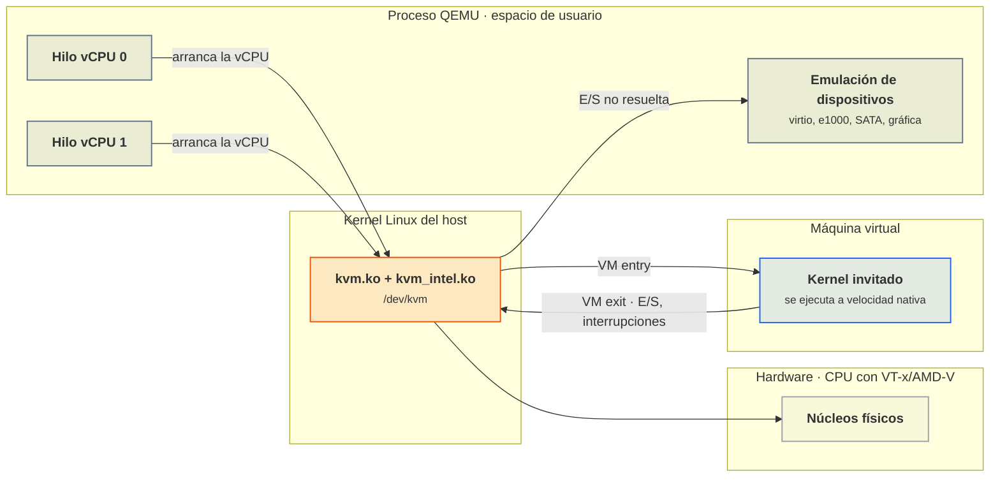

<p class="pie" markdown>En naranja la pieza que hace el trabajo de verdad: el módulo del kernel. Cada **VM exit** es una vuelta a él, y de ahí que virtio importe tanto.</p>

**La capa de gestión.** La tercera pieza son los servicios de Proxmox de la sesión 2 (`pvedaemon`, `pveproxy`, `pvestatd`, del paquete `pve-manager`), que traducen lo que se pide en la web o con `qm` en la línea de órdenes de QEMU adecuada y en operaciones sobre el almacenamiento. El fichero `/etc/pve/qemu-server/110.conf` es la descripción de la VM; QEMU nunca lo lee, lo lee Proxmox para construir la orden con la que lanza QEMU. Por eso un cambio como el tipo de CPU queda pendiente en una VM encendida hasta que se apaga y se vuelve a encender: hasta entonces sigue corriendo el mismo proceso, con la orden antigua. Solo lo que admite conexión en caliente, como un disco o una tarjeta de red, se aplica al momento.

#### Paravirtualización y virtio

**El problema: imitar hardware real es caro.** Si QEMU puede emular cualquier tarjeta, ¿por qué no se usa siempre la e1000, una tarjeta de red de Intel que reconoce cualquier sistema? Porque emular hardware real es lento. El driver de una e1000 escribe en decenas de registros por cada paquete, y en una VM cada una de esas escrituras es un VM exit. Con 10 Gbit/s de tráfico, la CPU del host se pasaría el día saliendo y entrando de la VM.

**La solución: que el invitado sepa que es una VM.** La alternativa es la **paravirtualización**: el sistema invitado sabe que está virtualizado y usa un driver diseñado para hablar con el hipervisor en lugar de fingir que hay hardware. La idea la popularizó Xen en 2003; el estándar en KVM es **virtio**, que nació dentro del propio Linux para servir a cualquier hipervisor y hoy es una especificación abierta, publicada por el consorcio OASIS. Un dispositivo virtio no tiene registros que emular; tiene colas (*virtqueues*) en memoria compartida entre invitado y QEMU. El invitado encola descriptores de paquetes o de bloques, avisa una vez ("kick") y QEMU procesa el lote. El número de VM exits por operación baja de decenas a uno, o a cero cuando se combina con vhost (el procesado se hace en el kernel del host sin pasar por QEMU).

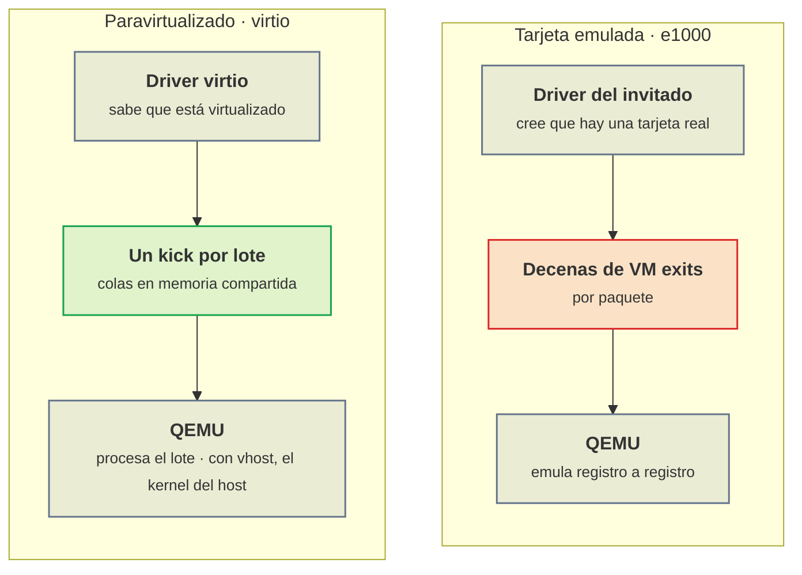

<p class="pie" markdown>La diferencia no es el hardware sino cuántas veces hay que salir de la VM. Por eso virtio es el ajuste por defecto en Proxmox.</p>


**En Proxmox, virtio en todo.** Por eso en Proxmox las opciones por defecto son las que son y no hay que cambiarlas:

- **Disco: VirtIO SCSI** (`scsihw: virtio-scsi-pci` o mejor `virtio-scsi-single`, que da un hilo de E/S por disco). Frente a IDE o SATA emulados, multiplica el rendimiento de E/S varias veces y añade el descarte de bloques (TRIM) que necesita el thin provisioning de la sesión 2. Existe también `virtio-blk` (bus `virtio0`), algo más antiguo; SCSI es hoy el recomendado porque admite muchos discos por controladora y comandos SCSI reales.
- **Red: virtio (`virtio-net`)**. Es el único modelo que llega a las velocidades de la red física. Se usa `e1000` o `rtl8139` solo con sistemas antiguos sin drivers virtio.
- **Memoria: virtio-balloon**, el driver del ballooning de la sesión 3.
- **Consola y agente: virtio-serial**, el canal por el que habla el agente QEMU.

Linux lleva los drivers virtio en el kernel desde hace más de una década, así que cualquier imagen cloud de Debian o Ubuntu arranca con ellos sin hacer nada.

!!! ojo "\"He instalado Windows y no ve el disco\""
    Windows no trae los drivers virtio. Hay que cargarlos desde la ISO `virtio-win` durante la propia
    instalación, en el paso en el que el instalador pide dónde instalar. Es la pregunta más repetida
    en los foros de Proxmox.

### LXC frente a VM, con números

**Un contenedor que se comporta como una máquina.** Proxmox ofrece contenedores de sistema LXC junto a las VM. LXC (*Linux Containers*) apareció en 2008 como un conjunto de herramientas para crear contenedores con los namespaces y los cgroups de la sesión 1, y las primeras versiones de Docker, en 2013, se apoyaban en él. Pero un contenedor LXC no es un contenedor Docker. Uno de Docker ejecuta una aplicación, normalmente un solo proceso; uno LXC ejecuta un sistema operativo completo desde `init` (systemd, sshd, cron), solo que sin kernel propio. Comparte el del host, con el mismo aislamiento que Docker, y Proxmox lo gestiona como si fuera una VM ligera: consola, snapshots, backups, migración en frío.

**Cómo se crea.** Se descarga una plantilla de sistema (un archivo comprimido con el sistema de ficheros de una distribución mínima) y se crea el contenedor a partir de ella:

```bash
pveam update
pveam available --section system | grep debian
pveam download local debian-12-standard_12.7-1_amd64.tar.zst
pct create 170 local:vztmpl/debian-12-standard_12.7-1_amd64.tar.zst \
  --hostname ct01 --memory 512 --cores 1 --rootfs local-lvm:4 \
  --net0 name=eth0,bridge=vmbr0,ip=dhcp --unprivileged 1 --features nesting=1
pct start 170
pct enter 170
```

Dos opciones de esa orden merecen explicación. `--unprivileged 1` hace que el root de dentro del contenedor sea, para el host, un usuario cualquiera sin privilegios: si algo escapa del contenedor, escapa sin poder. `--features nesting=1` deja al contenedor crear sus propios namespaces dentro, que es lo que necesita el systemd de las distribuciones actuales para funcionar bien.

**Los números.** Medidas de referencia tomadas sobre un portátil con SSD NVMe y un Proxmox anidado. Sirven para comparar el orden de magnitud, no para copiarlas: cada laboratorio da números distintos, y por eso se vuelven a tomar en la actividad A1.4.

| | VM Debian (2 vCPU, 2 GB, virtio) | LXC Debian (1 núcleo, 512 MB) |
|---|---|---|
| Arranque hasta prompt SSH | 12 a 18 s | menos de 2 s |
| RAM usada en el host en reposo | 350 a 450 MB (RAM tocada por el invitado más QEMU) | 25 a 40 MB |
| Espacio en disco tras instalar | 1,3 GB (imagen cloud desplegada) | 450 MB |
| `uname -r` | El kernel de la imagen cloud (6.1 en Debian 12, 6.12 en Debian 13) | El kernel del host Proxmox (6.x de Proxmox) |
| Sobrecarga de CPU | 2 a 5 % en cargas normales, más en E/S intensa | Prácticamente cero |
| Densidad en un host de 32 GB | 10 a 12 VM de 2 GB | 60 o más contenedores de 512 MB |

Las diferencias salen de lo que cada uno tiene que hacer. La VM arranca su firmware y su propio kernel antes de llegar a `init`; el contenedor arranca `init` como un proceso más sobre un kernel que ya está en marcha. La VM tiene en memoria su kernel, sus cachés y el proceso QEMU; el contenedor, solo sus procesos. Y `uname -r` dice de quién es el kernel que responde: la VM tiene el suyo, el contenedor ve el del host.

**Por qué no se usa para todo.**

- Comparten kernel: menor aislamiento; un fallo del kernel afecta a todos, y un contenedor privilegiado con acceso a `/dev` es root en el host. Conviene usar siempre `unprivileged 1` salvo que haya un motivo claro para no hacerlo.
- No ejecutan otro kernel ni otro sistema operativo: nada de Windows, nada de FreeBSD, nada de módulos de kernel propios, nada de hipervisor anidado.
- Docker dentro de LXC funciona (con `nesting=1` y `keyctl=1`) pero es una configuración que Proxmox desaconseja oficialmente en producción; Docker se ejecuta en una VM.
- No hay migración en vivo de contenedores; se migran apagados (o con un reinicio muy corto).

**La regla práctica.** Servicios de infraestructura pequeños y Linux (DNS, un proxy, un Pi-hole, un runner de Jenkins) en LXC; todo lo que sea plataforma de contenedores, cargas con kernel propio o algo que necesite migración en vivo, en VM. En este módulo casi todo va en VM precisamente porque encima se ejecuta Docker.

### Snapshots

**El problema.** Antes de una operación arriesgada (una actualización, un cambio de configuración que no se sabe cómo acabará) se quiere un camino de vuelta que se recorra en segundos. Reinstalar o restaurar una copia de seguridad cuesta mucho más.

**Qué es.** Un snapshot es una foto del disco de una VM en un momento, y opcionalmente de su RAM, si la VM está encendida y se marca «include RAM». Se vuelve a ella con un clic o con `qm rollback 110 antes-nginx`. Sin la RAM, la VM vuelve apagada, con el disco tal como estaba en el momento de la foto; con ella, vuelve encendida y en el mismo punto en que estaba.

!!! ojo "Un snapshot no es una copia de seguridad"
    Vive en el mismo disco y en el mismo almacén que la VM. Si muere el SSD, mueren los dos. Para eso
    están `vzdump` y Proxmox Backup Server, que copian a otro sitio.

**Cómo lo hace sin copiar nada.** La técnica es el *copy-on-write* que se vio con ZFS en la sesión 2: al crear el snapshot no se copia ningún dato, y a partir de ese momento cada bloque que la VM modifica se escribe en un sitio nuevo, mientras el original se conserva para el snapshot. Cómo se hace en concreto depende del almacén:

- En **LVM-thin**, el snapshot es un volumen lógico nuevo (`snap_vm-110-disk-0_antes-nginx`) que comparte todos los bloques con el disco original. A partir de ese momento cada escritura de la VM sobre un bloque compartido se hace en un bloque nuevo (copy-on-write a nivel de bloque del pool). El snapshot ocupa cero al crearse y va creciendo con lo que la VM modifique. La lista está en `lvs pve`.
- En **ZFS** es igual pero a nivel de sistema de ficheros: `zfs list -t snapshot`. Crear y destruir es instantáneo.
- En un **directorio con qcow2**, el snapshot es interno al fichero: qcow2 guarda una tabla de snapshots y hace copy-on-write de sus propios clústeres. `qemu-img snapshot -l vm-110-disk-0.qcow2` los lista. Con raw en un directorio no hay snapshots.

**Lo que cuesta.** En cualquiera de los tres, cada snapshot activo añade una capa de indirección a las lecturas y escrituras. Tres o cuatro no se notan; veinte encadenados durante meses sí, y además consumen espacio del pool que nadie ve en el disco de la VM. La costumbre correcta es snapshot antes de una operación arriesgada y borrarlo (o consolidarlo) en cuanto se confirma que todo va bien. El agente QEMU permite congelar el sistema de ficheros del invitado un instante mientras se hace el snapshot, de modo que sea consistente; sin agente, el snapshot equivale a un corte de corriente y el invitado tendrá que revisar el sistema de ficheros al restaurar.

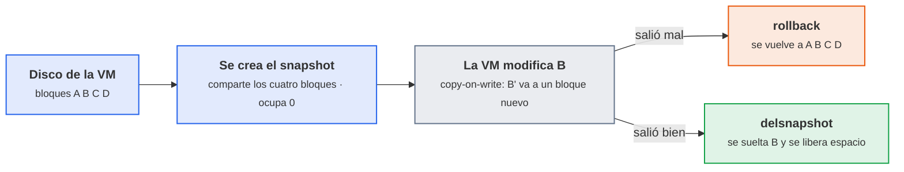

<p class="pie" markdown>El snapshot no copia nada al crearse: crece con lo que la VM cambie después. Vive en el mismo disco que la VM, así que no es una copia de seguridad.</p>


```bash
qm snapshot 110 antes-nginx --description "Antes de instalar nginx"
qm listsnapshot 110
qm rollback 110 antes-nginx
qm delsnapshot 110 antes-nginx
```

### Backups con vzdump y Proxmox Backup Server

!!! consulta "Material de consulta"
    Esto no se explica en clase: lo necesitas para la hoja de práctica de esta sesión.

**Lo que no resuelve un snapshot.** Un snapshot vive en el mismo disco que la VM, así que no protege de perder ese disco, ni de borrar la VM por error. Para eso hace falta una copia completa guardada en otro sitio, y en Proxmox la herramienta integrada es `vzdump`.

**Cómo funciona vzdump.** Copia la VM entera (configuración y discos) a otro almacén, y se puede programar desde Datacenter > Backup. Tiene tres modos, que se diferencian en cuánto molestan a la VM: `stop` (apaga la VM, copia y la enciende; el único con consistencia total garantizada), `suspend` (la pausa mientras copia) y `snapshot` (el habitual: hace un snapshot temporal, copia desde él mientras la VM sigue funcionando y lo borra al terminar; con el agente QEMU congela el sistema de ficheros para que sea consistente). El resultado es un fichero `.vma.zst` (el formato de archivo de VM de Proxmox, comprimido) o `.tar.zst` (contenedor) en el directorio `dump` del almacén elegido, por ejemplo `/var/lib/vz/dump/vzdump-qemu-110-2026_10_16-10_30_00.vma.zst`. Se restaura con `qmrestore` o desde la web, con la posibilidad de cambiar el ID y el almacén de destino. La copia guarda también la configuración, MAC de la tarjeta incluida, así que la VM restaurada es un gemelo de la original.

```bash
vzdump 110 --storage local --mode snapshot --compress zstd --notes-template "{{guestname}}"
ls -lh /var/lib/vz/dump/
qmrestore /var/lib/vz/dump/vzdump-qemu-110-*.vma.zst 151 --storage local-lvm
```

**Cuando las copias crecen.** Cada copia de vzdump a fichero es completa, así que con muchas VM y retención larga el disco se acaba pronto. **Proxmox Backup Server** (PBS) es un producto aparte, también libre, que guarda cada trozo de disco una sola vez y solo lee lo cambiado desde la copia anterior; cómo lo hace está en [Proxmox Backup Server](../ampliacion.md#proxmox-backup-server).

!!! empresa "Lo que se encuentra fuera del aula"
    En una empresa con Proxmox, PBS es la opción normal. En el laboratorio del curso no se monta, pero
    conviene saber que existe y que "backup a `local`" es lo mínimo, no lo correcto: una copia en
    el mismo servidor que el original no protege de que se estropee ese servidor.


### A1.4 VM frente a LXC, snapshots (sesión 4)

<span class="et et-obj">Objetivo</span> Una tabla con tus medidas de VM frente a LXC, un snapshot de `web01` al que has vuelto y un backup restaurado como VM 151. Con la tabla pones números propios a la diferencia entre una VM y un contenedor, que la práctica evaluable te va a pedir; con el snapshot y el backup pruebas las dos formas de volver atrás y lo que protege cada una.

<span class="et et-pre">Antes de empezar</span>

- `web01` funcionando con agente QEMU y acceso SSH (A1.3).
- Lo explicado al principio de la sesión: [KVM/QEMU y virtio](#como-funciona-kvmqemu-por-debajo), [LXC frente a VM](#lxc-frente-a-vm-con-numeros) y [snapshots](#snapshots). Para el paso del backup, [vzdump](#backups-con-vzdump-y-proxmox-backup-server) es material de consulta.

<span class="et et-pas">Pasos</span>

La hoja tiene dos mitades. En la primera mides una VM y un contenedor con las mismas medidas, para que la comparación valga: primero `web01`, que ya existe, y después `ct01`, que creas hoy. En la segunda proteges `web01` de las dos formas de la teoría, de la más rápida a la más segura: un snapshot, que te devuelve atrás en segundos pero vive en el mismo disco, y un backup, que tarda más pero sobrevive a perder ese disco.

1. **Mide la VM.** Mide `web01` desde apagada: la RAM usada en el host antes y después de arrancarla, su tiempo de arranque y su `uname -r`. Son las tres filas de [LXC frente a VM](#lxc-frente-a-vm-con-numeros) que mejor muestran lo que cuesta tener un kernel propio.

    *Pista:* en la VM, el tiempo de arranque es lo que tarda en contestar por SSH; dentro, `systemd-analyze` lo desglosa.

2. **Mide un contenedor igual.** Crea el contenedor `ct01` (ID 170, no privilegiado, 512 MB) como en [LXC frente a VM](#lxc-frente-a-vm-con-numeros) y toma las mismas medidas. Compara su `uname -r` con el de la VM y con el del host: es la prueba directa de quién tiene kernel propio y quién no.

    *Pista:* si el nombre de la plantilla de Debian ha cambiado, usa el que muestre `pveam available`.

3. **Vuelve atrás con un snapshot.** Haz un snapshot de `web01` llamado `antes-nginx`, mirando `lvs pve` antes y después: el volumen que aparece es el que tendrás que explicar en la entrega con lo visto en [Snapshots](#snapshots). Instala nginx dentro, vuelve al snapshot y comprueba si nginx sigue. Es el uso normal de un snapshot: una red de seguridad justo antes de un cambio.

    *Pista:* tras el rollback, `web01` queda apagada.

4. **Haz una copia que sobreviva al disco.** Haz un backup de `web01` a `local` en modo snapshot, apunta lo que ocupa y lo que tarda, y restáuralo como VM 151 con las órdenes de [vzdump](#backups-con-vzdump-y-proxmox-backup-server). Restaurar es la mitad que importa: de una copia que nunca se ha restaurado no se sabe si sirve.

    *Pista:* arranca la 151 con `web01` apagada: tienen la misma MAC y en el mismo bridge se pisarían.

<span class="et et-com">Comprobación</span> Tienes tiempo de arranque, RAM en el host y `uname -r` para la VM y para el LXC (el LXC muestra el kernel del host); tras el rollback, nginx no está en `web01`; en `lvs pve` apareció `snap_vm-110-disk-0_antes-nginx` al crear el snapshot; `qm list` muestra la 151 y arranca.

<span class="et et-ent">Entrega</span> Tabla comparativa VM/LXC con tus medidas y capturas; capturas de `lvs pve` antes y después del snapshot con una explicación del volumen que apareció; tamaño y tiempo del backup.

<span class="et et-ext">Si te sobra tiempo</span> Borra el snapshot (`qm delsnapshot 110 antes-nginx`) y comprueba en `lvs pve` que el volumen desaparece. Con `web01` encendida, `ps aux | grep 'kvm -id 110'` en el host te enseña la línea de QEMU completa que Proxmox ha construido desde `/etc/pve/qemu-server/110.conf`: localiza en ella el disco virtio-scsi, la tarjeta virtio-net y el tipo de CPU.

## Sesión 5 · Redes en el hipervisor

<p class="ut-meta" markdown>21 de octubre · Teoría y práctica · <span class="dur" tabindex="0" aria-label="Modalidades de red: bridge, NAT, VLAN y bond · 20 min&#10;A1.5 Redes: VLAN · 90 min" data-dur="Modalidades de red: bridge, NAT, VLAN y bond · 20 min&#10;A1.5 Redes: VLAN · 90 min">:material-school:<i class="dur-barra" style="--teoria:18%"></i>:material-flask:</span></p>

Hasta ahora cada VM ha ido a una de dos redes: la del aula, por `vmbr0`, o la interna del host, por `vmbr1`. Una plataforma de verdad necesita bastantes más, separadas entre sí, y esta sesión repasa todas las formas que tiene el hipervisor de conectar VM y qué resuelve cada una, desde el bridge de la sesión 2 hasta las que agrupan tarjetas o hacen de router. Después explica a fondo la que monta la hoja, la VLAN, que es la forma habitual de llevar muchas redes aisladas por un mismo bridge o un mismo cable, y que la UT3 vuelve a usar para separar a dos clientes; la VPC de la UT2 separa sus zonas de otra forma, con el SDN de Proxmox. La segunda mitad de la hoja es de otro tipo: medir con herramientas propias qué aguanta el laboratorio, porque el criterio de evaluación de la unidad pide conocer las capacidades y limitaciones del hipervisor, y eso no se aprende leyendo. Ese apartado no se explica en clase: conviene leerlo antes del paso 4 de la hoja, porque la tabla que sale de él es el borrador de la práctica evaluable. Al acabar, hay tres VM en `vmbr1` repartidas en dos VLAN que solo se ven dentro de su VLAN, y las primeras medidas de CPU, disco y red del laboratorio.

### Modalidades de red: bridge, NAT, VLAN y bond

**Cinco formas de conectar una VM.** Todas se construyen con el bridge de [Red](#red), y se diferencian en adónde llega lo que se conecta a él:

- **Bridge simple** (`vmbr0` con `eno1` como puerto): las VM están en la misma red que el host y reciben IP del router del aula. Es la opción con la que se instala Proxmox y la que da acceso inmediato a las VM desde el portátil; en el curso, la de `web01`, `app01` y `mon01` hasta que pasan a la VPC.
- **Bridge sin interfaz física** (`bridge-ports none`): red interna solo entre VM y el host. Es la base de las VPC. Las VM no salen a Internet salvo que alguien enrute por ellas.
- **NAT**: el bridge interno más dos cosas en el host, que pasa a hacer de router: `ip_forward`, que le deja reenviar paquetes de una red a otra, y una regla de *masquerade*, que cambia la dirección de origen de lo que sale de las VM por la suya, para que las respuestas vuelvan a él. Es cómodo cuando el aula solo da una IP y hacen falta muchas VM con salida a Internet sin exponerlas. Se configura con `post-up` en el bridge; la documentación de Proxmox trae el ejemplo exacto. En la UT2 ese papel de router lo hace una VM en cada entorno.
- **VLAN-aware bridge** (`bridge-vlan-aware yes`): un solo bridge transporta varias redes separadas por etiquetas; cada VM indica la suya (*tag*) en la tarjeta virtual. Es la forma de tener varias redes aisladas con un solo bridge, lo que se monta en la actividad A1.5, y se explica en el apartado siguiente.
- **Bond**: varias tarjetas físicas agrupadas en una interfaz `bond0`, para tener redundancia o sumar ancho de banda; es `bond0`, no las tarjetas, lo que se pone como puerto del bridge. La VM de Proxmox del laboratorio tiene una sola tarjeta, así que aquí no se monta: los modos y un fichero de ejemplo están en [Bond: modos y configuración](../ampliacion.md#bond-modos-y-configuracion).

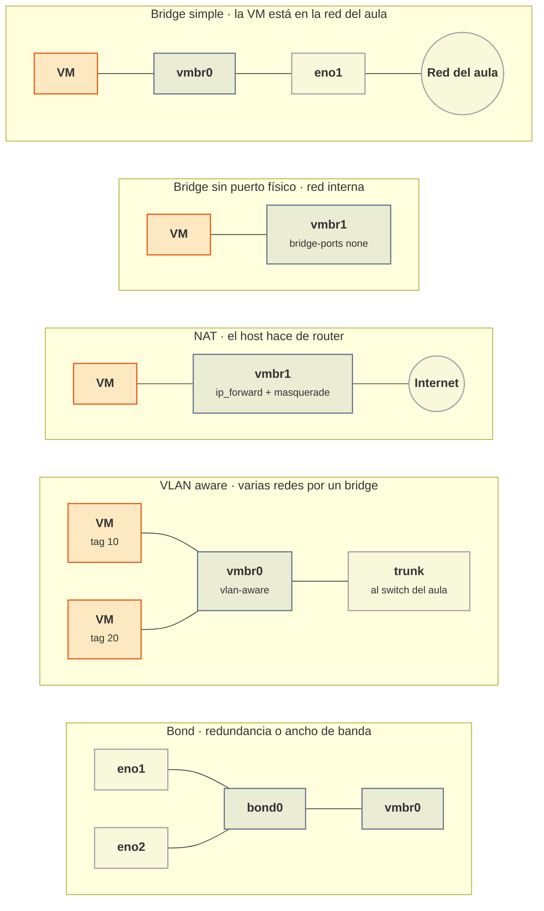

<p class="pie" markdown>Las cinco conviven en el mismo host. En la A1.5 se monta la cuarta; en la UT2, el papel de router de la tercera lo hace una VM de cada entorno.</p>

!!! ojo "Cambiar la red del host a distancia"
    Un error en `/etc/network/interfaces` deja sin acceso al Proxmox. En un laboratorio anidado queda la consola de la VM exterior y no pasa nada; en un servidor real, los cambios se hacen desde la web (que valida y aplica con `ifreload`) o se deja programado un `sleep 120 && ifreload -a` con la configuración antigua a mano. Y antes de tocar `vmbr0`, conviene comprobar qué interfaz física es la buena con `ip -br link` y `ethtool eno1`.

#### VLAN: varias redes en un mismo bridge

**El problema.** Con bridges sin tarjeta física se pueden hacer redes aisladas, pero cada red nueva es un bridge nuevo, y un bridge no puede salir del host sin una tarjeta física propia. En una empresa pasa lo mismo con los switches: no se compra un switch, ni se tira un cable, por cada red. La solución estándar es la **VLAN** (red local virtual, definida en el estándar IEEE 802.1Q): un mismo switch, o un mismo bridge, separa varias redes como si fueran switches distintos.

**Cómo funciona.** A cada trama Ethernet se le puede añadir una etiqueta con un número de VLAN, del 1 al 4094. El switch solo entrega una trama a los puertos de su misma VLAN, así que dos máquinas en VLAN distintas no se ven aunque estén en el mismo switch: para hablar, tendrían que pasar por un router. Los puertos son de dos tipos. Uno de **acceso** pertenece a una sola VLAN y sus tramas viajan sin etiqueta, así que la máquina conectada no sabe nada de VLAN. Uno **troncal** (*trunk*) lleva varias VLAN a la vez, cada trama con su etiqueta, y es el que une un switch con otro.

**Cómo lo hace un bridge de Proxmox.** Con `bridge-vlan-aware yes`, el bridge se comporta como uno de esos switches. La etiqueta que se pone en la tarjeta de una VM (`tag=10`) convierte su interfaz `tap` en un puerto de acceso de la VLAN 10: el bridge quita la etiqueta a lo que entrega a la VM y se la pone a lo que la VM envía, así que la VM no sabe en qué VLAN está. La línea `bridge-vids 2-4094` dice qué VLAN admite el bridge en sus puertos. Si las VLAN tuvieran que salir del host, la tarjeta física haría de puerto troncal, y el puerto del switch del aula al que va conectada tendría que estar configurado igual; en un bridge sin tarjeta física, como `vmbr1`, no hace falta nada más. En el host, `bridge vlan show` lista cada puerto con sus VLAN: un puerto de acceso aparece con una sola VLAN, marcada como `PVID` (la que se asigna a lo que entra sin etiqueta) y `Egress Untagged` (lo que sale, sale sin ella).

**Y el host.** La IP que el host tiene en el bridge, la `10.10.10.1` de `vmbr1`, va sin etiqueta, en la VLAN por defecto del bridge, que es la 1. Por eso el host no llega a las VM de la VLAN 10 ni de la 20, que es justo el aislamiento que se busca. Cuando el host necesita un pie en una VLAN, se le crea una interfaz VLAN sobre el bridge con una IP de esa red: `vmbr1.30` sería la del host en la VLAN 30, y es lo primero que monta la práctica evaluable.

### Capacidades y limitaciones, y cómo medirlas

!!! consulta "Material de consulta"
    Esto no se explica en clase: lo necesitas para la hoja de práctica de esta sesión.

**Por qué se mide.** El criterio de evaluación pide conocer las capacidades y limitaciones del hipervisor, y eso no se aprende leyendo: se mide. Casi todo lo que ofrece un hipervisor consiste en prometer más de lo que hay (más vCPU que núcleos, más memoria, más disco), y su límite no es un número del manual, sino el punto en que esa promesa deja de cumplirse porque todas las VM piden a la vez. Primero va la tabla de qué permite hacer un hipervisor y dónde está el riesgo de cada cosa, y después las herramientas con las que tomar las medidas propias para la práctica evaluable.

| Capacidad | Qué permite | Límite o riesgo |
|----|----|----|
| Sobreasignación de CPU | Dar más vCPU en total que núcleos físicos (4:1 es habitual en cargas de oficina) | Si todas trabajan a la vez, se degrada todo; el *steal time* (tiempo que la vCPU esperó a que el host le diera un núcleo) dentro de las VM lo delata |
| Ballooning de RAM | Recuperar memoria no usada (Proxmox empieza a reclamarla cuando el host pasa del 80 %) | Nunca sobreasignar más de lo físico + swap; el invitado necesita el driver virtio-balloon, y la RAM reclamada sale de su caché de disco, así que rinde peor |
| Hotplug | Añadir disco, red, CPU o RAM en caliente | Depende del SO invitado; RAM requiere `numa=1` y que el invitado reconozca los módulos añadidos; la CPU en caliente solo con `vcpus` menor que `cores` |
| Virtualización anidada | Hipervisor dentro de VM | Rendimiento reducido (cada VM exit del hipervisor interior es un VM exit del exterior); solo laboratorio |
| Passthrough (IOMMU) | Dar una tarjeta gráfica, una controladora o una tarjeta de red a una VM | El dispositivo deja de estar disponible para el host y la VM ya no puede migrar en vivo |
| LXC | Contenedores de sistema muy ligeros | Comparten kernel: menor aislamiento; no ejecutan otro kernel |
| Snapshots | Volver atrás en segundos | Muchos snapshots encadenados frenan el disco y llenan el pool |
| Thin provisioning | Prometer más disco del que hay | Pool lleno = VM corruptas; hay que vigilar y descartar |

Hay otra forma de ahorrar memoria, la fusión de páginas iguales entre VM, que en el laboratorio no se toca; está en [Fusión de páginas iguales](../ampliacion.md#fusion-de-paginas-iguales).

**Regla de oro: medir antes de sobreasignar.** Un hipervisor de aula con 32 GB no debe albergar 20 VM de 2 GB "porque no se usan todas a la vez". Tarde o temprano se usan, y lo que ocurre entonces es mucho peor que haber puesto 12: el host se queda sin memoria y su OOM killer (el mecanismo del kernel que mata procesos cuando se agota la memoria) mata, sin avisar, la VM que más ocupa.

**Las herramientas.** La práctica evaluable pide precisamente una tabla como la de arriba, pero con las medidas del laboratorio propio. Todas las herramientas están en los repositorios de Debian (`apt install stress-ng fio iperf3 sysstat`), y cada una mide una cosa:

- `stress-ng` carga la CPU y cuenta el trabajo hecho en *bogo ops/s*, una unidad propia que solo sirve para compararla consigo misma: la misma prueba en la misma VM, con y sin otra VM trabajando a la vez.
- `fio` mide el disco. La prueba de bloques de 4 KB en posiciones al azar, con un 70 % de lecturas, imita a una base de datos, que es el peor caso para un disco; la de bloques de 1 MB seguidos imita la copia de ficheros grandes, el mejor. `--direct=1` se salta la caché de memoria del invitado, que si no daría la velocidad de la RAM y no la del disco, y las cifras que importan son las IOPS (operaciones por segundo) y la latencia.
- `iperf3` mide la red entre dos máquinas: en una se arranca como servidor y en la otra como cliente.
- `sysstat` trae `iostat` y `sar`, para observar el host mientras las VM trabajan.

```bash
# Inventario del host
nproc; lscpu | grep -E "Model name|Thread|Core|Socket|Flags" | cut -c1-120
free -h                              # RAM total, usada, disponible (no "free")
pvesm status                         # almacenes y ocupación
lvs pve/data                         # % de datos y metadatos del pool thin
cat /sys/module/kvm_intel/parameters/nested   # Y si la anidada está activa

# CPU: cuántos núcleos reales hay detrás de las vCPU
pveperf                              # BOGOMIPS, REGEX/SECOND, FSYNCS/SECOND del host
stress-ng --cpu 2 --timeout 60s --metrics-brief   # dentro de una VM, uno por vCPU; repetir en dos VM a la vez
top                                  # dentro de la VM, columna "st" (steal): CPU que el host no le dio

# Disco: latencia y IOPS reales (dentro de la VM, sobre el disco virtio)
fio --name=rand4k --ioengine=libaio --rw=randrw --rwmixread=70 --bs=4k --size=1G \
    --numjobs=1 --iodepth=32 --direct=1 --runtime=60 --time_based --group_reporting
fio --name=seq1m --ioengine=libaio --rw=write --bs=1M --size=2G --direct=1 --group_reporting

# Red: ancho de banda entre dos VM del mismo bridge y entre VM y host
iperf3 -s                            # en una VM, por ejemplo app01
iperf3 -c IP-de-app01 -t 30 -P 4     # desde la otra

# Memoria: cuánto libera el ballooning
qm monitor 110   # y dentro: info balloon
```

**Cómo se anota.** Conviene anotar no solo el resultado sino la condición: "fio 4k aleatorio 70/30 en web01 con app01 en reposo: 18 000 IOPS; con app01 ejecutando el mismo fio: 9 500 IOPS cada una". Ese segundo número es el límite del hipervisor; el primero es solo lo que hace un SSD. Lo mismo con iperf3: entre dos VM del mismo bridge suelen salir varios Gbit/s aunque la tarjeta física sea de 1 Gbit/s, porque el tráfico nunca sale del host; hacia fuera, lo que dé la tarjeta.

### A1.5 Redes: VLAN (sesión 5)

<span class="et et-obj">Objetivo</span> Tres VM en `vmbr1` repartidas en dos VLAN que solo se ven dentro de su VLAN, y las primeras medidas de CPU, disco y red de tu laboratorio. Las VLAN son la forma de separar redes que la UT3 usará para aislar a dos clientes, y las medidas son el borrador de la tabla de capacidades de la práctica evaluable.

<span class="et et-pre">Antes de empezar</span>

- Plantilla 9000 y `vmbr1` (A1.2 y A1.3); `web01` y `app01` funcionando en `vmbr0`; `stress-ng`, `fio` e `iperf3` instalados en el host.
- Lo explicado al principio de la sesión: [red](#red), [modalidades de red](#modalidades-de-red-bridge-nat-vlan-y-bond) (bridge simple, VLAN-aware, bond y NAT) y [VLAN en un bridge](#vlan-varias-redes-en-un-mismo-bridge). Para las medidas, [capacidades y limitaciones](#capacidades-y-limitaciones-y-como-medirlas) es material de consulta: lee ese apartado antes del paso 4.

!!! ojo "Haz la cuenta de RAM antes de encender"
    El Proxmox tiene 12 GB y se queda con cerca de 2; `web01` (1 GB), `app01` (2 GB) y `mon01` (3 GB) ya suman 6. Tres clones con los 2 GB que heredan de la plantilla pasarían de los 10 disponibles: por eso las VM de prueba van con 512 MB y se apagan en cuanto termina la comprobación de VLAN. `app01` y `mon01` siguen encendidas toda la sesión, porque las usa Mantenimiento. Si vas justo, apaga la VM 151, `ct01` y `web02`, que ya no hacen falta.

<span class="et et-pas">Pasos</span>

La hoja tiene dos partes independientes. En la primera montas el aislamiento por VLAN en el orden en que lo atraviesa una trama: primero el bridge que entiende de etiquetas, después las VM con su etiqueta y al final la prueba de quién ve a quién, desde las VM y desde el host. En la segunda mides el laboratorio. Entre una y otra apagas las VM de prueba, porque la memoria no da para todo a la vez, y las medidas se toman en `web01` y `app01`, que tienen Internet para instalar las herramientas.

1. **Haz que `vmbr1` entienda de etiquetas.** Hazlo VLAN aware desde nodo > Network. Sin esto, el bridge pasa por alto las etiquetas de las tarjetas y todas las VM se verían entre sí, como se explica en [VLAN: varias redes en un mismo bridge](#vlan-varias-redes-en-un-mismo-bridge).

2. **Clona las VM de prueba en sus VLAN.** Clona de la plantilla tres VM de prueba, enlazadas porque solo viven esta sesión y con 512 MB porque la memoria no da para más, con la tarjeta en `vmbr1` e IP fija por cloud-init, porque en esa red no hay DHCP: `vlan10a` (160, `192.168.10.11/24`) y `vlan10b` (161, `192.168.10.12/24`) con la etiqueta 10, y `vlan20a` (162, `192.168.20.11/24`) con la 20. `vlan10a` lleva además, para que lo ensayes hoy, lo que pide la práctica evaluable: ballooning con un mínimo de 256 MB y puerta de enlace `192.168.10.1`, aunque hoy nadie tenga esa dirección.

    *Pista:* la etiqueta va en la propia tarjeta (`--net0 virtio,bridge=vmbr1,tag=10`). El host no llega a esas VLAN, así que solo se entra por la consola: ponles una contraseña con `--cipassword` (por ejemplo, `lab`).

3. **Comprueba quién ve a quién.** Desde la consola de `vlan10a` y de `vlan20a`, comprueba que cada VM solo ve a las de su VLAN: el ping que llega demuestra que la red funciona, y el que falla, que está aislada. Después localiza en el host en qué VLAN ha puesto el bridge cada interfaz `tap`, que es la misma comprobación vista desde dentro del switch. Al terminar, apaga las tres, porque el paso 4 necesita esa RAM; si no vas a hacer «Si te sobra tiempo», destrúyelas.

    *Pista:* `qm terminal 160` abre la consola serie, de la que se sale con Ctrl+O. En el host, `bridge vlan show`.

4. **Mide el laboratorio.** Mide CPU, disco y red en `web01` y `app01`, que están en `vmbr0` y pueden instalar paquetes, con las herramientas de [capacidades y limitaciones](#capacidades-y-limitaciones-y-como-medirlas): CPU y disco, primero en `web01` sola y después con `app01` haciendo lo mismo a la vez; la red, entre las dos. El número que importa es el que sale cuando las dos compiten, porque es el límite del hipervisor; por eso anota junto a cada número la condición en que lo tomaste.

    *Pista:* las herramientas hay que instalarlas también dentro de cada VM, no solo en el host.

<span class="et et-com">Comprobación</span> `qm config 160` muestra `balloon: 256` y la puerta de enlace en `ipconfig0`; el ping funciona entre `192.168.10.11` y `192.168.10.12` y falla hacia `192.168.20.11`; `bridge vlan show` coloca cada `tap` en su VLAN; las tres VM de prueba aparecen como `stopped` en `qm list` al empezar las medidas, y `app01` y `mon01` siguen encendidas; tienes un valor de bogo ops/s, de IOPS y de Gbit/s con y sin carga simultánea.

<span class="et et-ent">Entrega</span> Esquema (Mermaid o dibujo) de las tres VM, el bridge y las VLAN; capturas de ping y de `bridge vlan show`; y una tabla con las medidas de CPU, disco y red indicando la condición de cada una. Esa tabla es el borrador de la que pide la práctica evaluable.

<span class="et et-ext">Si te sobra tiempo</span> Vuelve a encender las tres VM de prueba y mide con `iperf3` el ancho de banda entre las dos VM de la VLAN 10: para instalarlo necesitan Internet, así que añade a cada una una segunda tarjeta temporal en `vmbr0` (`qm set 160 --net1 virtio,bridge=vmbr0`, dentro `sudo dhclient` sobre la interfaz nueva que muestre `ip -br link`), instala, quita la tarjeta (`qm set 160 --delete net1`) y mide entre `192.168.10.11` y `192.168.10.12`. Cambia `vlan20a` a tag 10 (`qm set 162 --net0 virtio,bridge=vmbr1,tag=10`) y comprueba que ahora sí responde al ping desde `vlan10a`. Al terminar, vuelve a apagar las tres o bórralas con `qm destroy`.

## Sesión 6 · Práctica evaluable

<p class="ut-meta" markdown>23 de octubre · Práctica evaluable · <span class="dur" tabindex="0" aria-label="Explicación · 10 min&#10;Trabajo en la práctica · 100 min" data-dur="Explicación · 10 min&#10;Trabajo en la práctica · 100 min">:material-school:<i class="dur-barra" style="--teoria:9%"></i>:material-flask:</span></p>

Esta sesión no tiene teoría nueva: demuestras que sabes hacer sin hoja lo que has hecho en las cinco anteriores, sobre el Proxmox que montaste en ellas. El criterio de la unidad (RA1 a) tiene dos mitades, y el informe recoge las dos: un hipervisor instalado y configurado, con una VM desplegada exactamente como se pide, y el conocimiento de sus capacidades y limitaciones, demostrado con medidas propias. Los primeros 10 minutos son para aclarar el enunciado; el resto es tiempo de trabajo. La tabla de capacidades y limitaciones no pide medidas nuevas: sale de las que ya tomaste en las hojas con las herramientas del apartado [capacidades y limitaciones](#capacidades-y-limitaciones-y-como-medirlas) de la sesión 5, cada una con la condición en que se tomó.

El orden de lo que sigue no es casual: primero haces sitio en la memoria, porque `app-eval` no cabe con todo encendido; después abres el camino para llegar a ella, porque en su VLAN no hay nada; y solo entonces la despliegas.

**Antes del enunciado, la RAM.** Apaga lo que no hace falta hoy: `web01`, la VM 151 restaurada, el contenedor `ct01` y, si siguen encendidas, `web02` y las VM de la VLAN. `app01` y `mon01` siguen encendidas, porque las usa Mantenimiento. Quedan unos 2 GB del propio Proxmox, los 5 GB de esas dos VM y los 3 GB de `app-eval`: 10 de los 12 GB.

**Después, el camino de entrada.** Una VM en la VLAN 30 de `vmbr1` no tiene DHCP, ni salida a Internet, ni camino hacia el host, porque la `10.10.10.1` del host en `vmbr1` va sin etiquetar (por qué, en [VLAN: varias redes en un mismo bridge](#vlan-varias-redes-en-un-mismo-bridge)). Crea primero en el host la interfaz VLAN `vmbr1.30`, con `192.168.30.1/24`: en la web es Create > Linux VLAN, sobre `vmbr1` y con tag 30. Esa dirección es la puerta de entrada por SSH a la VM, que lleva una IP fija de esa misma red por cloud-init. El agente QEMU no hay que instalarlo: viene dentro de la plantilla desde la A1.3, que es justo lo que salva esta práctica, porque sin Internet no se puede instalar nada en el primer arranque. Por la misma razón, la actualización de paquetes que cloud-init hace en ese primer arranque solo puede fallar: puedes desactivarla con la opción que explica [cloud-init](#cloud-init) o, si la dejas, no te extrañe ver ese fallo en su registro aunque la VM esté bien.

**Enunciado.** Despliega desde la plantilla propia una VM llamada `app-eval`, con un ID libre del rango de pruebas de dev (150 a 199), 2 vCPU, 3 GB de RAM con ballooning (mínimo 1 GB), disco de 20 GB, red en `vmbr1` con VLAN 30, IP fija por cloud-init en `192.168.30.0/24` con puerta de enlace `192.168.30.1`, usuario `ops` con clave SSH y agente QEMU funcionando.

<span class="et et-ent">Entrega</span> Un informe (máximo 3 páginas) con:

- [ ] Configuración del hipervisor, reutilizando la entrega de la A1.2 (pasos 1, 4 y 5 de la A1.2): repositorios sin `pve-enterprise`, `pveum user list` con `admin@pve` y `/etc/network/interfaces`, ahora con `vmbr1.30`.
- [ ] Comandos o capturas del proceso: creación de `vmbr1.30` en el host, clonado, `qm set` y `qm cloudinit dump` (las mismas órdenes que los pasos 4 y 6 de la A1.3 y el paso 2 de la A1.5).
- [ ] Evidencia de que la VM cumple lo pedido: `qm config <ID de la VM>` (`qm` no acepta nombres de VM, solo ID; el ID sale de `qm list`), `free -h` y `nproc` dentro de la VM, `lsblk`, IP en la VLAN 30 visible en la web de Proxmox gracias al agente, acceso SSH como `ops` desde el host a través de `192.168.30.1`.
- [ ] Una tabla de capacidades y limitaciones del hipervisor del laboratorio (CPU, RAM, disco, red, anidada) con una medida real de cada una y la condición en que se tomó: CPU, disco y red del paso 4 de la A1.5, RAM de los pasos 1 y 2 de la A1.4 y anidada del paso 5 de la A1.1.

| Criterio (RA1 a) | Peso |
|----|----|
| Hipervisor instalado y configurado correctamente (repos, usuario, red) | 30 % |
| VM cumple la especificación y se demuestra | 40 % |
| Tabla de capacidades y limitaciones con medidas reales | 30 % |

Cuando hayas entregado, destruye las VM de prueba de la unidad, que ya no hacen falta y dejan libre el rango 150 a 199 para las unidades siguientes: `app-eval`, la 151 restaurada, `web02` (150) si la creaste y el contenedor `ct01` (170). `web01`, `app01` y `mon01` se quedan.

## Errores frecuentes en el laboratorio

**"KVM virtualisation configured, but not available" al arrancar la primera VM en el Proxmox anidado.** La virtualización anidada no está activada en el hipervisor exterior, la VM exterior no tiene CPU `host` (si el exterior es otro Proxmox) o Hyper-V está activo en el Windows del puesto. Se comprueba en la shell del Proxmox: si `grep -Ec '(vmx|svm)' /proc/cpuinfo` da 0 y no existe `/sys/module/kvm_intel` (o `kvm_amd`), el módulo de KVM no ha podido cargar porque la CPU que ve no trae las extensiones, y el problema está fuera. Como parche para salir del paso, `kvm: 0` en la configuración de la VM la ejecuta en emulación (lentísima); no es una solución.

**Las VM de `vmbr0` no reciben IP del aula, aunque el Proxmox sí la tiene.** El hipervisor exterior descarta las tramas dirigidas a direcciones MAC que no son la de su propia VM, que son justo las de las VM de dentro. En VirtualBox se arregla poniendo en «Permitir todo» el modo promiscuo del adaptador puente de la VM de Proxmox, y reiniciando el nodo si no basta. Si el puesto va por Wi-Fi, el puente puede no dejar pasar esas direcciones de ninguna forma, y hay que ir por cable.

**Proxmox no actualiza: "401 Unauthorized" en `apt update`.** Sigue activo el repositorio `pve-enterprise`, o el de Ceph, que también es enterprise: los dos exigen suscripción. Hay que desactivarlos y añadir `pve-no-subscription` (en la web: nodo > Updates > Repositories). En Proxmox VE 9 los repositorios están en formato deb822 en `/etc/apt/sources.list.d/*.sources`; en la 8, en `*.list`. Mientras esté el enterprise, `apt` fallará aunque el resto esté bien.

**La VM clonada no coge IP o no acepta la clave SSH.** Por orden de probabilidad: (1) el disco cloud-init no está en la VM (`qm config 110 | grep cloudinit`); (2) la clave de ese origen no está en el fichero que se pasó a `--sshkeys` (por ejemplo, entra desde el nodo y no desde el puesto porque faltó `/root/puesto.pub`), o se pegó con saltos de línea o sin el `ssh-ed25519` inicial (`qm cloudinit dump 110 user` lo muestra); (3) falta `--ipconfig0`: sin él, Proxmox no le pasa a cloud-init ninguna configuración de red para esa tarjeta; (4) la plantilla se arrancó antes de convertirla, y los clones comparten el identificador de máquina de aquel arranque, así que pueden pedir y recibir la misma IP: hay que rehacer la plantilla desde la imagen, sin arrancarla. `cloud-init status --long` y `/var/log/cloud-init.log` en la consola noVNC resuelven el 90 %.

**El clon arranca con el disco del tamaño de la imagen.** No se amplió el disco de la plantilla antes de convertirla, ni el del clon. Se amplía con `qm disk resize 110 scsi0 20G` y basta con reiniciar la VM, porque cloud-init amplía la partición y el sistema de ficheros en cada arranque. Sin reiniciar, dentro: `sudo growpart /dev/sda 1 && sudo resize2fs /dev/sda1`.

**"TASK ERROR: storage 'local-lvm' does not support content type 'iso'"** o al revés con imágenes. Cada almacén admite unos contenidos: las ISO y plantillas van a `local`, los discos a `local-lvm`. Se cambia en Datacenter > Storage, pero lo normal es usar cada uno para lo suyo.

**El pool thin se llena y las VM se quedan en solo lectura.** `lvs pve/data` con `Data%` cerca de 100. Liberar: borrar snapshots viejos, backups dejados en `local-lvm` por error, VM de prueba. Luego `fstrim` en todas las VM con `discard=on`. Y a partir de ahí, dimensionar: la suma de discos asignados no debería pasar del doble del pool en un laboratorio.

**El agente QEMU aparece como "not running" aunque está instalado.** Falta `--agent enabled=1` en la VM (se añade y se apaga y enciende la VM, no basta un reinicio) o dentro el servicio no está activo (`systemctl status qemu-guest-agent`). Las imágenes cloud de Debian no lo traen instalado de origen; por eso en A1.3 se añade a la imagen con `virt-customize` antes de importarla, y todas las VM clonadas de la plantilla 9000 lo llevan.

**Las VM en VLAN 10 y 20 se ven entre sí.** El bridge no es VLAN-aware (falta `bridge-vlan-aware yes` y aplicar la configuración) o las VM se conectaron sin `tag`. `bridge vlan show` en el host muestra en qué VLAN está cada `tap`.

**Ping entre VM de la red interna funciona pero no salen a Internet.** Es lo esperado en un bridge sin puerto físico. O se pone NAT en el host (`ip_forward` y `MASQUERADE` hacia `vmbr0`), o se espera a la UT2, donde la salida la da la VM router de cada entorno.

**Rendimiento de disco pésimo en la VM (cientos de IOPS).** Disco en bus IDE o SATA en lugar de VirtIO SCSI, o caché de disco en `writethrough` sobre disco mecánico, o el host anidado con disco de VirtualBox en formato dinámico sobre un disco lento. Conviene comprobar `qm config` y medir con `fio` en el host y en la VM para localizar la capa que frena.

**"illegal instruction" en un programa dentro de la VM tras moverla de portátil.** La VM tenía CPU `host` en un equipo con AVX y ahora corre en uno sin él. Hay que cambiar a `x86-64-v2-AES` y apagar y encender.

Los enlaces para ampliar y los apartados que van más allá de lo que se hace en clase están en [Para ampliar](../ampliacion.md#ut1-virtualizacion-e-hipervisores).
