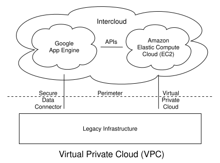
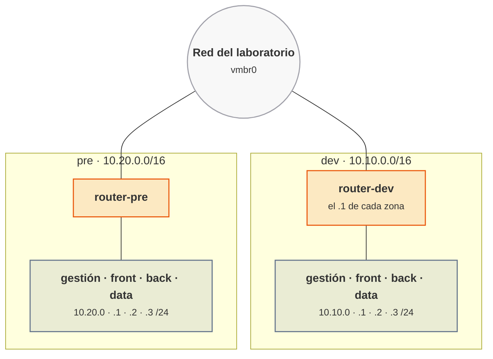
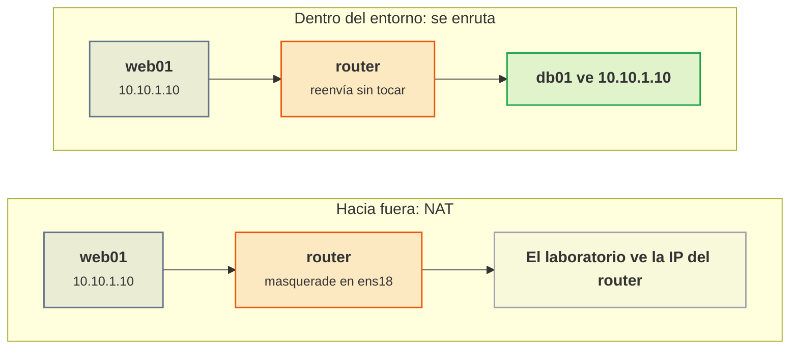
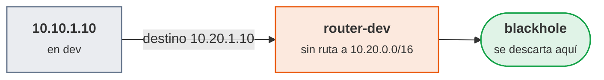

# UT2 · Nubes privadas virtuales (VPC)

<p class="ut-meta">8 h · Sesiones 11 a 14 · RA1 CE b, c</p>

La UT1 dejó un Proxmox funcionando, la plantilla Debian con cloud-init (ID 9000) y sus bridges, los switches virtuales del nodo. Todas las VM clonadas hasta ahora cuelgan de `vmbr0`, la red del laboratorio, y se ven con cualquier equipo de esa red. Un servicio de verdad no se monta así: sus piezas no deberían compartir red (si alguien entra en el servidor web, no debería tener la base de datos a un paso) y lo que se ensaya no debería poder tocar lo que está en marcha. Por eso las empresas trabajan con tres **entornos**: *dev* (desarrollo), donde se construye y se prueba; *pre* (preproducción), una copia de producción donde se ensaya cada cambio; y *pro* (producción), donde corre el servicio de los clientes.

Esta unidad construye la red de esos tres entornos. Cada uno es una VPC: un bloque de direcciones propio, partido en cuatro subredes (gestión, front, back y data), con su router, su DHCP y su DNS, y aislado de los otros dos. Se hace en el orden de una empresa: el plano y la red de dev en el SDN de Proxmox; después el router que reparte direcciones y nombres, con las pruebas que demuestran que funciona; y al final pre y pro, aislados de dev y creados con un script. `app01` y `mon01` se quedan de momento en la red del laboratorio, porque Mantenimiento las usa a diario; esta unidad les deja reservadas su dirección y su nombre, y llegan a la VPC el 27 de noviembre, ya detrás del cortafuegos de la unidad de seguridad por capas (UT3).

## Sesión 11 · Diseño y VPC dev con SDN

<p class="ut-meta" markdown>11 de noviembre · Teoría y práctica · <span class="dur" tabindex="0" aria-label="Qué es una VPC · 5 min&#10;Diseño de direccionamiento · 5 min&#10;SDN en Proxmox · 10 min&#10;A2.1 Diseño y VPC dev con SDN · 90 min" data-dur="Qué es una VPC · 5 min&#10;Diseño de direccionamiento · 5 min&#10;SDN en Proxmox · 10 min&#10;A2.1 Diseño y VPC dev con SDN · 90 min">:material-school:<i class="dur-barra" style="--teoria:18%"></i>:material-flask:</span></p>

Antes de crear una sola red hay que decidir cómo será, porque el direccionamiento es lo más caro de cambiar después. Esta sesión hace las dos cosas en ese orden: primero qué es una VPC y cómo se reparten las direcciones entre entornos y zonas; después el SDN de Proxmox, la herramienta que convierte ese plano en redes. La hoja completa un plano propio de los tres entornos y monta la red de dev con sus dos primeras VM.

### Qué es una VPC

**Para qué sirve.** Una **VPC** (nube privada virtual) es una red privada y aislada, definida por software, dentro de una infraestructura que se comparte con otros. En una nube pública es el primer recurso que se crea: dentro van las subredes, las máquinas y las bases de datos. En el laboratorio, lo que se comparte es el nodo Proxmox, y quienes necesitan redes separadas son los tres entornos.

<figure markdown="span">
  { width="640" }
  <figcaption>Esquema de una VPC con subredes. Fuente: Sam Johnston, CC BY-SA 3.0, vía Wikimedia Commons.</figcaption>
</figure>

**Zonas: una subred por papel.** Dentro de la VPC, cada capa del servicio va en su propia subred, que en el curso se llama **zona**: *front* para el proxy que recibe las peticiones, *back* para la aplicación, *data* para la base de datos y *gestión* para lo que administra y vigila. Separarlas permite poner reglas entre ellas, porque el tráfico de una zona a otra tiene que pasar por el router. Esas reglas las pone el cortafuegos que sustituye al router el 25 de noviembre, en la unidad de seguridad por capas.

**Pública o privada.** Una subred es pública si tiene ruta directa a Internet en los dos sentidos (proxies, balanceadores) y privada si solo sale por NAT o no sale. En el laboratorio, front es la «pública» de cada entorno; back, data y gestión, privadas.

**Los nombres en cada proveedor.** La misma idea recibe estos nombres:

| Concepto | Proxmox SDN | AWS | Azure | GCP |
|---|---|---|---|---|
| Red privada aislada | Zona + VNet | VPC | Virtual Network (VNet) | VPC network |
| Subred | Subnet | Subnet | Subnet | Subnet |
| Salida NAT | VM router | NAT Gateway | NAT Gateway | Cloud NAT |
| DNS interno | dnsmasq en el router | Route 53 Resolver | Azure DNS privado | Cloud DNS |
| Reglas por máquina | Firewall de Proxmox | Security Group | Grupo de seguridad de red | Firewall rules |
| Unión de dos VPC | Ruta en el router | VPC Peering | VNet Peering | VPC Peering |

**La buena práctica.** Los tres entornos se diseñan juntos, aunque solo dev llegue al final del curso con el servicio entero, porque su direccionamiento tiene que encajar.

### Diseño de direccionamiento

**Para qué sirve.** Cambiar un rango cuando ya hay máquinas, DNS y reglas que lo usan obliga a cambiarlo todo a la vez. Por eso el plano se hace antes. Se decide en dos pasos: de qué rango salen los bloques y cómo se reparten entre entornos y zonas.

#### Rangos privados y solapamiento

**Qué rangos se usan.** Dentro de una organización se usan los tres rangos privados, que nunca se enrutan en Internet: `10.0.0.0/8`, `172.16.0.0/12` y `192.168.0.0/16`.

**El problema: el solapamiento.** Dos redes que hoy están separadas pueden tener que unirse mañana (dev con pre, la empresa con un proveedor por VPN). Si las dos usan `192.168.1.0/24`, una máquina no sabe si `192.168.1.10` es de su lado o del otro, y el paquete no sale. Por eso:

- Un bloque distinto por entorno, sin solapar: `10.10.0.0/16` dev, `10.20.0.0/16` pre y `10.30.0.0/16` pro. Los huecos entre medias quedan para crecer.
- Nunca `192.168.0.0/24`, `192.168.1.0/24`, `10.0.0.0/24` ni `172.16.0.0/24`.

!!! truco "Los cuatro rangos que no hay que usar nunca"
    Son los que trae por defecto cualquier router doméstico. El día que alguien se conecte desde casa a la
    VPN de la empresa, su red y la de destino serán la misma y no habrá arreglo limpio.

#### El reparto del curso

**El tamaño.** Un /16 por entorno da 256 subredes /24, de sobra para crecer; el espacio privado no cuesta dinero y renumerar sí. Un /24 por zona da 254 equipos y se lee de un vistazo: en `10.10.2.37` se ve que es dev (10.10), back (.2) y un servidor fijo (.37). El segundo octeto es el entorno y el tercero, la zona: gestión el 0, front el 1, back el 2 y data el 3.

| Entorno | Bloque | Gestión | Front | Back | Data |
|---|---|---|---|---|---|
| dev | 10.10.0.0/16 | 10.10.0.0/24 | 10.10.1.0/24 | 10.10.2.0/24 | 10.10.3.0/24 |
| pre | 10.20.0.0/16 | 10.20.0.0/24 | 10.20.1.0/24 | 10.20.2.0/24 | 10.20.3.0/24 |
| pro | 10.30.0.0/16 | 10.30.0.0/24 | 10.30.1.0/24 | 10.30.2.0/24 | 10.30.3.0/24 |

**Dentro de cada /24.** La misma convención en todas las subredes:

- `.1`: el router del entorno, que hace también de DNS y de DHCP.
- `.2` a `.9`: reservadas para servicios de red.
- `.10` a `.99`: servidores con IP fija (el DHCP les da siempre la misma, reservada por su MAC).
- `.100` a `.199`: rango DHCP dinámico.
- `.200` a `.254`: pruebas y direcciones que no son de una máquina, como la de un balanceador.

**El número de la VM.** La centena es el entorno (1 dev, 2 pre, 3 pro) y la decena, la zona, con el mismo dígito que el tercer octeto. Así `120` es `app01` de dev, en back, con la `10.10.2.10`, y el router de cada entorno es el 100, el 200 y el 300. La tabla completa está en las [convenciones del laboratorio](../laboratorio.md#convenciones).



<p class="pie" markdown>Entre dev y pre no hay ninguna línea, y eso es el aislamiento: no hay una regla que lo prohíba, es que no existe el camino.</p>

**La buena práctica.** La convención vale más que el rango concreto: es lo que permite saber qué es una dirección sin buscarla.

### SDN en Proxmox

**Para qué sirve.** Cada VNet de la VPC es un bridge en el nodo, como los de la UT1, pero hacer doce a mano en `/etc/network/interfaces` no escala y nadie lleva la cuenta de las direcciones. El **SDN** (red definida por software) de Proxmox describe la red una sola vez, en Datacenter → SDN, y crea los bridges y el reparto de direcciones.

**Tres objetos, de lo general a lo particular.**

- **Zona**: el tipo de red. El laboratorio tiene una sola, `lab`, de tipo Simple: bridges aislados dentro de un nodo, que es lo que corresponde a un laboratorio de un solo nodo.
- **VNet**: una red virtual. Al crear una VM aparece en la lista de bridges como un `vmbrN` más.
- **Subnet**: el rango de la VNet, con gateway y rango DHCP opcionales.

El registro de qué IP tiene cada VM es el **IPAM**, que viene de serie (`pve`) y se consulta en Datacenter → SDN → IPAM.

#### Una VNet por zona, una subred por VNet

**Dos significados de «zona».** En el SDN, zona es el tipo de red (`lab`); en la VPC, cada una de las cuatro partes de un entorno. Las cuatro VNets de dev van todas en la zona `lab` del SDN.

**Por qué una VNet por zona.** Una VNet es un bridge, un único cable virtual. Si dos subredes compartieran VNet, a una máquina le bastaría cambiarse la IP para hablar con la otra sin pasar por el router, y ningún cortafuegos podría filtrar. Con una VNet por zona, el tráfico entre zonas pasa siempre por el router.

| VNet | Subred | Zona |
|---|---|---|
| `devmgmt` | 10.10.0.0/24 | gestión |
| `devfront` | 10.10.1.0/24 | front |
| `devback` | 10.10.2.0/24 | back |
| `devdata` | 10.10.3.0/24 | data |

**El nombre.** Entorno y zona juntos, sin guiones (`prefront`, `proback`...), porque el ID de una VNet admite como máximo ocho caracteres alfanuméricos.

#### VLAN 802.1Q frente a VXLAN

Fuera del laboratorio, con varios nodos, las zonas del SDN son de tipo VLAN (si los switches son propios) o VXLAN (si no lo son). En el curso no se usan. Lo único práctico que conviene saber: con VXLAN, la MTU de las VM baja a 1450, y si se olvida, los ping pequeños funcionan y las transferencias grandes se cuelgan.

#### Qué hace Apply por debajo

**Escribir no es aplicar.** Lo que se crea en Datacenter → SDN queda pendiente hasta que se pulsa **Apply**. Entonces cada nodo escribe sus bridges en `/etc/network/interfaces.d/sdn` y los levanta sin reiniciar la red. Para la VNet `devfront` queda así:

```text
auto devfront
iface devfront
        address 10.10.1.1/24
        bridge_ports none
        bridge_stp off
        bridge_fd 0
        alias dev front
```

La línea `address` solo está si la subnet tiene gateway: es el `.1` que el nodo se pone para hacer de router. Si Apply dice que todo va bien y no aparece ningún bridge, falta la línea `source /etc/network/interfaces.d/*` en `/etc/network/interfaces`.

#### DHCP e IPAM integrados

**Para qué sirve.** Una VNet recién creada no da direcciones. Si la zona lleva `DHCP: dnsmasq`, Proxmox arranca un dnsmasq para la zona (`dnsmasq@lab`) que entrega a cada VM la IP que el IPAM le ha reservado. Necesita el paquete en el nodo, con su servicio genérico parado para que no compita:

```bash
apt install dnsmasq
systemctl disable --now dnsmasq
```

**Por qué es provisional.** Así el nodo, que es el hipervisor de todo, hace también de router de los entornos, y no hay nombres DNS propios. El 13 de noviembre lo sustituye una VM router, `router-dev`, y ese día hay que quitar el gateway y el rango DHCP de las subredes del SDN, porque el `.1` de una subred solo puede estar en un sitio.

### A2.1 Diseño y VPC dev con SDN (sesión 11)

<span class="et et-obj">Objetivo</span> Al terminar tienes el plano de los tres entornos, con una tabla de direccionamiento propia y justificada, y las cuatro VNets de dev funcionando en el SDN con dos VM que reciben IP de su subred. El plano es el primer punto de la memoria de la evaluable. El laboratorio se monta con los rangos del curso, que comparten las dos asignaturas, y estas cuatro VNets son las que usa dev hasta el final del curso.

<span class="et et-pre">Antes de empezar</span>

- El nodo de la UT1 con la plantilla 9000, la consola web como `root@pam` y su Shell, y la VM `puesto` con `git`.
- `web01` (110), `app01` y `mon01` existen desde la A1.3, en `vmbr0`. Hoy `web01` pasa a la VPC; `app01` y `mon01` se quedan donde están hasta el 27 de noviembre.
- Los rangos de dev que se montan hoy son los de las [convenciones del laboratorio](../laboratorio.md#convenciones), no los de tu plano.
- Explicado en esta sesión: [qué es una VPC](#que-es-una-vpc), [el diseño de direccionamiento](#diseno-de-direccionamiento) y [el SDN de Proxmox](#sdn-en-proxmox).

<span class="et et-pas">Pasos</span>

Primero el papel y después la consola, porque la red se construye a partir del plano. En el nodo vas de lo general a lo particular: la zona, las VNets con su subred, el Apply y, al final, las VM.

1. **Completa el plano de los tres entornos.** Rellena estas dos tablas con un bloque privado distinto del ejemplo y escribe debajo, en una línea, por qué ese (mira [rangos privados y solapamiento](#rangos-privados-y-solapamiento)). Añade la convención de IP dentro de cada /24 (puedes adoptar la del curso) y un esquema de los tres entornos sin ninguna línea entre ellos, como el de [el reparto del curso](#el-reparto-del-curso).

    | Entorno | Bloque | Gestión | Front | Back | Data | ID de VM |
    |---|---|---|---|---|---|---|
    | dev | | | | | | 100 a 199 |
    | pre | | | | | | |
    | pro | | | | | | |

    | Red | Máscara | Direcciones | Hosts útiles | Broadcast | Por qué este tamaño |
    |---|---|---|---|---|---|
    | El bloque de un entorno | | | | | |
    | La subred de una zona | | | | | |

    Se comprueba: las dos tablas están completas y cada tamaño lleva su cálculo.

2. **Comprueba que nada se solapa.** En la Shell del nodo, saca la primera y la última dirección de cada bloque tuyo y de las dos redes del nodo, y ponlas en orden: si un rango empieza antes de que acabe otro, se solapan.

    ```bash
    apt install -y ipcalc
    ipcalc <tu bloque de dev>      # repite con pre y pro
    ip -br a show vmbr0; ip -br a show vmbr9
    ```

    Se comprueba: ningún rango de tu plano cae dentro de otro ni dentro de `vmbr0` o `vmbr9`.

3. **Prepara el nodo y crea la zona `lab`.** El DHCP del SDN necesita dnsmasq instalado y su servicio genérico parado. Después creas la zona Simple de los tres entornos.

    ```bash
    apt install -y dnsmasq
    systemctl disable --now dnsmasq
    pvesh create /cluster/sdn/zones --zone lab --type simple --dhcp dnsmasq --ipam pve
    ```

    Se comprueba: la zona `lab` aparece en Datacenter → SDN → Zones (todavía como pendiente).

4. **Crea las cuatro VNets de dev y aplica.** Cada VNet con su /24, gateway en el `.1` y rango DHCP de `.100` a `.199`. El bucle hace las cuatro y la última orden es el Apply:

    ```bash
    for FILA in mgmt:0:gestion front:1:front back:2:back data:3:data; do
      IFS=: read -r ZONA OCT ALIAS <<< "$FILA"
      pvesh create /cluster/sdn/vnets --vnet dev$ZONA --zone lab --alias "dev $ALIAS"
      pvesh create /cluster/sdn/vnets/dev$ZONA/subnets --subnet 10.10.$OCT.0/24 --type subnet \
        --gateway 10.10.$OCT.1 --dhcp-range start-address=10.10.$OCT.100,end-address=10.10.$OCT.199
    done
    pvesh set /cluster/sdn
    ```

    Se comprueba: `ip -br link show type bridge` lista `devmgmt`, `devfront`, `devback` y `devdata`; `cat /etc/network/interfaces.d/sdn` las define; `systemctl status dnsmasq@lab` está en marcha. Ese fichero es evidencia de la evaluable.

5. **Conecta las dos primeras VM.** `web01` cambia de bridge sin clonarse otra vez: apágala, en su pestaña Hardware edita `net0` y pon Bridge `devfront` (así conserva su MAC), y arráncala. `db01` nace hoy de la plantilla:

    ```bash
    qm clone 9000 130 --name db01 --full
    qm set 130 --memory 2048 --net0 virtio,bridge=devdata --ipconfig0 ip=dhcp
    qm start 130
    ```

    Busca en Datacenter → SDN → IPAM la IP de cada una y entra desde el nodo, que hoy es el `.1` de cada subred:

    ```bash
    ssh ops@<IP de web01>      # y lo mismo con db01
    ip a; ip r
    ```

    Se comprueba: la IP coincide con la del IPAM y la ruta por defecto apunta al `.1` de su subred.

<span class="et et-com">Comprobación</span> Tus bloques no se solapan entre sí ni con `vmbr9` ni con `vmbr0`, y cada tamaño está justificado. `ip -br link show type bridge` lista las cuatro VNets: `devfront` y `devdata` en `UP`, y `devmgmt` y `devback` en `DOWN` mientras no tengan nada conectado, que es lo normal. `web01` tiene una IP de `10.10.1.100` a `10.10.1.199` con gateway `10.10.1.1`, `db01` una de `10.10.3.100` a `10.10.3.199` con gateway `10.10.3.1`, y cada VM hace `ping` a su `.1`. Que `web01` alcance a `db01` llega el 13 de noviembre, con el router.

<span class="et et-ent">Para practicar</span> Crea en el puesto `entregas-5166`, el repositorio Git donde guardas el trabajo de las hojas de esta asignatura, con una carpeta por hoja dentro de `ut2/`. Guarda en `ut2/a21` tu plano (las dos tablas, la línea que justifica el bloque, la convención y el esquema), una captura del SDN aplicado con las cuatro VNets, el contenido de `/etc/network/interfaces.d/sdn` y la salida de `ip a` de las dos VM. El plano y el fichero del SDN son los puntos 1 y 2 de la memoria de la evaluable. El repositorio es local de momento: el 13 de noviembre lo llevas al puesto de administración, y recibe su remoto cuando exista la Gitea de Mantenimiento en `mon01`.

<span class="et et-ext">Si te sobra tiempo</span> Marca SNAT en la subnet de `devfront`, aplica, y comprueba desde `web01` que `ping -c 3 deb.debian.org` sale a Internet sin ninguna VM router. Antes del 13 de noviembre vuelve a quitarlo.

## Sesión 12 · Router de dev y comunicación entre zonas

<p class="ut-meta" markdown>13 de noviembre · Teoría y práctica · <span class="dur" tabindex="0" aria-label="Servicios de red: enrutado, NAT, DHCP y DNS · 15 min&#10;Cómo se prueba una red · 5 min&#10;A2.2 Router de dev y comunicación entre zonas · 90 min" data-dur="Servicios de red: enrutado, NAT, DHCP y DNS · 15 min&#10;Cómo se prueba una red · 5 min&#10;A2.2 Router de dev y comunicación entre zonas · 90 min">:material-school:<i class="dur-barra" style="--teoria:18%"></i>:material-flask:</span></p>

Con el DHCP del SDN, `web01` y `db01` tienen dirección, pero se la da el nodo, puede cambiar y no tiene nombre. Un entorno necesita una máquina suya que encamine entre zonas, saque el tráfico a Internet, dé a cada servidor siempre la misma IP y resuelva los nombres: el router del entorno, `router-dev`. Y una vez montado, hay que demostrar con pruebas escritas que las zonas se comunican. La teoría va en ese orden: primero los servicios del router, después cómo se prueba una red.

### Servicios de red: enrutado, NAT, DHCP y DNS

**Para qué sirve.** Una VNet es un cable. Para que sea una red utilizable hacen falta cuatro servicios: enrutar entre subredes, hacer NAT al salir a Internet, repartir direcciones (DHCP) y resolver nombres (DNS). Desde hoy los cuatro los hace una VM por entorno.

#### Router de entorno

**Por qué una VM y no el nodo.** Si el nodo fuera el router, un error en su red afectaría a la vez a todos los entornos. Una VM por entorno se puede reiniciar o sustituir sin tocar nada más. El 25 de noviembre su sitio lo ocupa un cortafuegos, OPNsense, con las mismas direcciones.

**Una pata en cada VNet.** El router es un clon de la plantilla con cinco tarjetas. Dentro de la VM se llaman `ens18`, `ens19`... en el orden de `net0`, `net1`...:

| Tarjeta | Red | Dirección |
|---|---|---|
| `ens18` (`net0`) | `vmbr0`, exterior | por DHCP de la red del laboratorio |
| `ens19` (`net1`) | `devmgmt` | `10.10.0.1/24` |
| `ens20` (`net2`) | `devfront` | `10.10.1.1/24` |
| `ens21` (`net3`) | `devback` | `10.10.2.1/24` |
| `ens22` (`net4`) | `devdata` | `10.10.3.1/24` |

**El reenvío IP.** Linux, por defecto, descarta los paquetes que no son para él. Para que reenvíe de una red a otra se activa el reenvío IP, de forma persistente:

```bash
# /etc/sysctl.d/99-router.conf
net.ipv4.ip_forward = 1
```

```bash
sysctl --system
sysctl net.ipv4.ip_forward   # debe devolver 1
```

Con eso el router ya encamina entre sus cuatro redes sin añadir ninguna ruta, porque está conectado a todas.

**La buena práctica.** El `.1` de cada subred solo puede estar en el router: antes de arrancarlo se quitan el gateway y el DHCP del SDN, o habrá dos `.1` y dos DHCP en la misma red.

#### Enrutar frente a hacer NAT

**Dos operaciones distintas.** Enrutar es reenviar el paquete sin tocarlo: `db01` ve la IP real de `web01`. NAT es reescribir la dirección de origen al pasar por el router, para que las respuestas vuelvan a él.

**Dónde se hace cada una.** Dentro del entorno se enruta, nunca NAT: si no, los registros de `db01` dirían que todo viene del router y ningún cortafuegos podría distinguir front de back. NAT solo en el borde, hacia fuera, porque la red del laboratorio no sabe volver a `10.10.0.0/16`.



<p class="pie" markdown>Dentro se enruta y se conserva la IP real; solo al salir por `ens18` se traduce.</p>

**El NAT de salida, con nftables**, el cortafuegos de Linux que trae Debian. `masquerade` usa la IP que tenga `ens18` en ese momento:

```bash
nft add table ip nat
nft add chain ip nat postrouting '{ type nat hook postrouting priority 100 ; }'
nft add rule ip nat postrouting oifname "ens18" masquerade
```

Las órdenes `nft` cambian la memoria y un reinicio las borra. Para que duren se guardan en `/etc/nftables.conf`, con `flush ruleset` al principio para que cada recarga no duplique la regla:

```bash
{ echo 'flush ruleset'; nft list ruleset; } > /etc/nftables.conf
systemctl enable nftables
```

#### dnsmasq: DHCP y DNS en uno

**Para qué sirve.** dnsmasq es un servidor DHCP y DNS en un solo programa pequeño; es lo que llevan casi todos los routers domésticos y el propio SDN de Proxmox. Se instala en el router con `apt install dnsmasq` y su configuración va en `/etc/dnsmasq.d/`. Este es el fichero de dev:

```ini
# /etc/dnsmasq.d/dev.conf
# Escuchar solo en las patas internas, nunca en la exterior
interface=ens19
interface=ens20
interface=ens21
interface=ens22
bind-interfaces

# DNS: dominio interno; lo que no es de dev.lab va a DNS públicos
domain=dev.lab
local=/dev.lab/
expand-hosts
no-resolv
server=1.1.1.1
server=9.9.9.9
dhcp-authoritative

# DHCP: un rango por subred, cada uno con su etiqueta y su router
dhcp-range=set:mgmt,10.10.0.100,10.10.0.199,12h
dhcp-option=tag:mgmt,option:router,10.10.0.1
dhcp-range=set:front,10.10.1.100,10.10.1.199,12h
dhcp-option=tag:front,option:router,10.10.1.1
dhcp-range=set:back,10.10.2.100,10.10.2.199,12h
dhcp-option=tag:back,option:router,10.10.2.1
dhcp-range=set:data,10.10.3.100,10.10.3.199,12h
dhcp-option=tag:data,option:router,10.10.3.1
# Opciones comunes: DNS y dominio de búsqueda para todos
dhcp-option=option:dns-server,10.10.0.1
dhcp-option=option:domain-search,dev.lab

# Reservas por MAC: siempre la misma IP y nombre
dhcp-host=bc:24:11:aa:bb:cc,web01,10.10.1.10
dhcp-host=bc:24:11:aa:bb:dd,app01,10.10.2.10
dhcp-host=bc:24:11:aa:bb:ee,db01,10.10.3.10
dhcp-host=bc:24:11:aa:bb:ff,mon01,10.10.0.20

# Registros DNS que no son máquinas con DHCP
address=/api.dev.lab/10.10.1.10
host-record=lb.dev.lab,10.10.1.200

# Logs (en producción se quitan)
log-dhcp
log-queries
```

**Las partes importantes.**

- `interface=` y `bind-interfaces`: solo atiende en las cuatro patas internas, nunca a la red del laboratorio.
- `dhcp-range=set:front,...` y `dhcp-option=tag:front,...`: cada subred recibe su rango y su router (`.1`). dnsmasq elige el rango por la tarjeta por la que llega la petición.
- `dns-server` y `domain-search`: todas las VM usan `10.10.0.1` como DNS, y el dominio de búsqueda permite escribir `db01` a secas.
- `dhcp-host`: la reserva por MAC. La IP va fuera del rango dinámico (`.10`, no `.100`) y la VM queda dada de alta en el DNS con su nombre. Las de `app01` y `mon01` se preparan hoy para cuando lleguen a la VPC.
- `local=/dev.lab/` y `no-resolv`: dnsmasq responde él mismo por `dev.lab` y manda el resto solo a los dos `server=`.
- `address` y `host-record`: nombres extra. `api.dev.lab` es el nombre del servicio y apunta a `web01`.

**Ponerlo en marcha.**

```bash
dnsmasq --test          # "syntax check OK"
systemctl restart dnsmasq
journalctl -u dnsmasq -f
```

Las concesiones activas están en `/var/lib/misc/dnsmasq.leases`. En el journal se ve cada VM pedir dirección en cuatro fases (Discover, Offer, Request y Ack); si se queda en Discover, dnsmasq no escucha en esa tarjeta.

**Del lado de las VM no hay que hacer nada:** los clones de la plantilla 9000 piden IP por DHCP en cada arranque y reciben el DNS y el dominio. Solo las patas del router llevan IP fija, puesta en su pestaña Cloud-Init, y el router usa como DNS `1.1.1.1`, porque la primera vez que arranca su dnsmasq aún no existe.

**La buena práctica.** Servidores con reserva por MAC y nombre en el DNS: la IP no cambia aunque se reinstale el sistema, y nadie toca `/etc/hosts`.

### Cómo se prueba una red

**Para qué sirve.** Una red que «funciona» sin pruebas escritas no vale: dentro de un mes nadie recordará qué se comprobó ni desde dónde. Probar es hacer una pregunta concreta con la herramienta que la contesta, desde un origen conocido, y dejarlo escrito; la evaluable pide cinco pruebas así.

#### Desde dónde se prueba: el puesto de administración

**El problema.** Con `router-dev`, el nodo ya no tiene dirección en ninguna subred de dev. Hace falta una máquina fija en gestión desde la que se llegue a todas las zonas.

**El bastión.** Es el **puesto de administración**, `admin01` (VM 105): una tarjeta en la red del laboratorio y otra en `devmgmt` con la `10.10.0.50`. Es la única máquina con un pie en cada lado, y por eso todo se administra a través de ella. Guarda además las herramientas y los repositorios, empezando por `entregas-5166`.

**Su ruta.** La ruta por defecto de `admin01` sigue por la red del laboratorio; para llegar a front, back y data necesita una ruta a todo `10.10.0.0/16` a través de `router-dev`. Se pone con una unidad de systemd para que sobreviva al reinicio y no dependa de cloud-init:

```ini
# /etc/systemd/system/ruta-lab.service, en admin01
[Unit]
Description=Ruta al resto de dev por router-dev
After=network-online.target
Wants=network-online.target

[Service]
Type=oneshot
RemainAfterExit=yes
ExecStart=/sbin/ip route replace 10.10.0.0/16 via 10.10.0.1 dev ens19

[Install]
WantedBy=multi-user.target
```

`ens19` es la tarjeta de gestión. El mismo patrón sirve para cualquier ruta que tenga que sobrevivir al reinicio.

**Entrar y saltar.** Se entra en `admin01` con `ssh -A`, que le presta la clave del puesto sin copiarla, y desde ahí a cualquier VM por su IP interna. La clave tiene que estar cargada en el agente (`ssh-add -l`).

#### Qué demuestra cada herramienta

| Pregunta | Herramienta | Qué demuestra |
|---|---|---|
| ¿Hay camino? | `ping` | Ida y vuelta, y el destino responde |
| ¿Por dónde pasa? | `traceroute` | Los routers del camino, uno por línea |
| ¿El puerto responde? | `nc -zv host puerto`, `nmap` | El servicio escucha y se llega a él |
| ¿Qué escucha en la máquina? | `ss -tlnp` | Puertos y direcciones en escucha, desde dentro |
| ¿Resuelve el nombre? | `dig nombre @10.10.0.1` | El DNS del router responde |
| ¿Qué pasa por el cable? | `tcpdump -ni ens22 port 5432` | Los paquetes reales, con sus IP |
| ¿Hay aislamiento? | `nmap -sn`, `ping` y `ip r` del router | Nadie contesta y el router no tiene camino |

Lo justo para leerlas:

- `ping` sin respuesta no demuestra casi nada: puede ser ruta, cortafuegos o máquina apagada.
- `ss -tlnp` con `127.0.0.1:5432` significa que solo escucha en local: es el motivo número uno de «el puerto está abierto pero desde fuera no conecta».
- `dig` correcto da `status: NOERROR` con una respuesta; `NXDOMAIN` es que el nombre no existe. El `@10.10.0.1` obliga a preguntar al router.
- `tcpdump` se lanza en el router, antes de la prueba. Un handshake completo son tres líneas: `[S]`, `[S.]` y `[.]`.
- `nmap -sn` con `0 hosts up` solo dice que nadie contestó. Lo que demuestra que no hay camino es la tabla de rutas del router, junto con un `ping` y un `traceroute` que no pasan.

En la unidad de seguridad por capas y en Mantenimiento se vuelve a usar `nmap` y `tcpdump` remitiendo a este apartado.

#### La plantilla de pruebas

Cada prueba de la memoria se escribe así. El resultado esperado se escribe **antes** de lanzar la orden; si se escribe después, se acaba copiando lo obtenido.

```text
Prueba 3 · Resolución DNS interna
Fecha: 2026-11-13 11:40   Origen: web01 (10.10.1.10)   Destino: router-dev (10.10.0.1)
Comando: dig db01.dev.lab @10.10.0.1 +short
Esperado: 10.10.3.10
Obtenido: 10.10.3.10
Evidencia: captura dig-db01.png
```

### A2.2 Router de dev y comunicación entre zonas (sesión 12)

<span class="et et-obj">Objetivo</span> Al terminar, `router-dev` reparte IP, gateway y DNS a las VM de dev en lugar del SDN, con reserva por MAC para `web01` y `db01` y `api.dev.lab` resolviendo, y tienes demostrado con `ping`, `traceroute`, `nc` y una captura de `tcpdump` que `web01` (front) llega a `db01` (data) con las IP reales. Es la evidencia del criterio de comunicación entre zonas y tres de las cinco pruebas de la memoria. Las reservas de `dev.conf` las copia el cortafuegos que sustituye a `router-dev` el 25 de noviembre, y el puesto de administración es desde hoy la máquina desde la que administras todo el laboratorio.

<span class="et et-pre">Antes de empezar</span>

- La zona `lab` y las cuatro VNets de la A2.1, con `web01` en `devfront` y `db01` en `devdata`.
- `router-dev` (100) y el puesto de administración (105) clonados y **apagados**, con la preparación de casa de abajo.
- Cinco máquinas: el nodo, `router-dev`, el puesto de administración, `web01` y `db01`.
- Explicado en esta sesión: [los servicios de red](#servicios-de-red-enrutado-nat-dhcp-y-dns) y [cómo se prueba una red](#como-se-prueba-una-red).

!!! truco "Preparación antes de la sesión: los dos clones, sin arrancar"
    En la Shell del nodo. Las dos VM se quedan **apagadas**, porque `router-dev` lleva el `.1` de cada
    subred, que hasta el paso 1 sigue siendo del nodo. El orden de las tarjetas da los nombres `ens18` a
    `ens22` que usa `dev.conf`.

    ```bash
    qm clone 9000 100 --name router-dev --full
    qm set 100 --memory 512 --nameserver 1.1.1.1 --tags dev \
      --net0 virtio,bridge=vmbr0    --ipconfig0 ip=dhcp \
      --net1 virtio,bridge=devmgmt  --ipconfig1 ip=10.10.0.1/24 \
      --net2 virtio,bridge=devfront --ipconfig2 ip=10.10.1.1/24 \
      --net3 virtio,bridge=devback  --ipconfig3 ip=10.10.2.1/24 \
      --net4 virtio,bridge=devdata  --ipconfig4 ip=10.10.3.1/24
    qm clone 9000 105 --name admin01 --full
    qm set 105 --memory 1024 --cores 1 \
      --net0 virtio,bridge=vmbr0   --ipconfig0 ip=dhcp \
      --net1 virtio,bridge=devmgmt --ipconfig1 ip=10.10.0.50/24
    ```

<span class="et et-pas">Pasos</span>

El orden lo marca el `.1`: primero lo dejas libre en el SDN y arrancas el router que lo ocupa; lo conviertes en router y pones en marcha el puesto de administración, desde el que haces lo demás. Después das direcciones y nombres con dnsmasq, demuestras que front llega a data y pasas tres pruebas a la plantilla.

1. **Deja libre el `.1` y arranca el router.** El gateway y el DHCP de dev pasan al router. En Datacenter → SDN → VNets, edita la subnet de cada una de las cuatro VNets de dev: borra el Gateway, quita el rango de la pestaña DHCP Ranges y desmarca SNAT. Después aplica y, solo entonces, arranca el router:

    ```bash
    pvesh set /cluster/sdn            # el Apply
    grep -E 'gateway|dhcp-range' /etc/pve/sdn/subnets.cfg   # no debe salir nada
    qm start 100
    ```

    Se comprueba: en el Summary de la VM 100 aparece la IP de `ens18` en la red del laboratorio. Entra desde el puesto con `ssh ops@<IP de router-dev en vmbr0>`.

2. **Conviértelo en router.** En `router-dev`, con `sudo -i`: crea `/etc/sysctl.d/99-router.conf` y aplica el reenvío, y después el NAT y su persistencia, tal cual en [router de entorno](#router-de-entorno) y [enrutar frente a hacer NAT](#enrutar-frente-a-hacer-nat).

    ```bash
    echo 'net.ipv4.ip_forward = 1' > /etc/sysctl.d/99-router.conf
    sysctl --system
    nft add table ip nat
    nft add chain ip nat postrouting '{ type nat hook postrouting priority 100 ; }'
    nft add rule ip nat postrouting oifname "ens18" masquerade
    { echo 'flush ruleset'; nft list ruleset; } > /etc/nftables.conf
    systemctl enable nftables
    ```

    Se comprueba: `sysctl net.ipv4.ip_forward` devuelve 1 y `nft list ruleset` muestra la regla `masquerade`.

3. **Pon en marcha el puesto de administración.** Arráncalo (`qm start 105`), entra por su IP en `vmbr0` y crea la unidad `ruta-lab.service` copiando el fichero de [desde dónde se prueba](#desde-donde-se-prueba-el-puesto-de-administracion). Antes, confirma con `ip -br a` que la tarjeta de gestión es `ens19`.

    ```bash
    sudo nano /etc/systemd/system/ruta-lab.service     # pega el fichero
    sudo systemctl daemon-reload
    sudo systemctl enable --now ruta-lab.service
    sudo apt install -y git
    ```

    Después, desde el puesto, lleva tu repositorio y entra con el agente. Desde hoy trabajas siempre así:

    ```bash
    scp -r entregas-5166 ops@<IP de admin01 en vmbr0>:
    ssh -A ops@<IP de admin01 en vmbr0>
    ```

    Se comprueba: `ip r` en `admin01` muestra `10.10.0.0/16 via 10.10.0.1 dev ens19`, y `ping` llega a Internet y a los cuatro `.1`.

4. **Dale a dev direcciones y nombres.** Saca en el nodo las MAC de las cuatro VM que llevan reserva (`web01` 110, `app01` 120, `db01` 130, `mon01` 103):

    ```bash
    for ID in 110 120 130 103; do qm config $ID | grep ^net0; done
    ```

    En `router-dev`, instala dnsmasq, crea `/etc/dnsmasq.d/dev.conf` copiando el de [dnsmasq: DHCP y DNS en uno](#dnsmasq-dhcp-y-dns-en-uno) y cambia solo las cuatro MAC de las líneas `dhcp-host`. Arráncalo con el journal abierto y reinicia las dos VM desde el nodo:

    ```bash
    apt install -y dnsmasq
    nano /etc/dnsmasq.d/dev.conf
    dnsmasq --test && systemctl restart dnsmasq
    journalctl -u dnsmasq -f            # en el router
    qm reboot 110; qm reboot 130        # en el nodo
    ```

    Termina con estas consultas desde `web01` (instala antes `bind9-dnsutils`):

    ```bash
    dig db01.dev.lab @10.10.0.1
    dig db01 @10.10.0.1 +search
    dig api.dev.lab @10.10.0.1
    dig deb.debian.org @10.10.0.1
    ```

    Se comprueba: en el journal ves las cuatro fases de cada VM y por qué tarjeta llegan; cada VM recibe su IP reservada; los cuatro `dig` responden. `app01` y `mon01` no resuelven todavía: sus reservas son para el 27 de noviembre.

5. **Demuestra que front llega a data por el 5432.** Abre tres terminales en `admin01`. La captura, primero, porque solo enseña lo que pasa mientras escucha:

    ```bash
    # en db01
    sudo apt install -y netcat-openbsd && nc -l -p 5432
    # en router-dev
    tcpdump -ni ens22 port 5432
    # en web01
    sudo apt install -y traceroute netcat-openbsd
    ping -c 3 db01.dev.lab
    traceroute db01.dev.lab
    nc -zv db01.dev.lab 5432
    ```

    Copia de la captura las tres líneas del handshake y escribe debajo quién inicia, quién responde y con qué IP de origen llega el paquete a `db01`, y qué demuestra esa IP.

    Se comprueba: `nc` dice `succeeded` y la captura muestra el handshake completo.

6. **Documenta tres pruebas de la evaluable.** Rellena la [plantilla de pruebas](#la-plantilla-de-pruebas) para la conectividad dentro del entorno y la captura de tráfico, con lo del paso 5, y para la resolución DNS, con el `dig db01.dev.lab @10.10.0.1` del paso 4.

    Se comprueba: cada plantilla tiene fecha, origen, destino, comando, esperado (escrito antes) y obtenido.

<span class="et et-com">Comprobación</span> Ninguna subred del SDN conserva gateway ni rango DHCP. El `ip route` del puesto de administración muestra `10.10.0.0/16 via 10.10.0.1 dev ens19` además de la ruta por defecto. `web01` tiene `10.10.1.10` y `db01` `10.10.3.10`, y en `/var/lib/misc/dnsmasq.leases` hay una línea por VM. `dig` con `@10.10.0.1` devuelve `NOERROR` para `dev.lab` y para nombres externos. El `traceroute` de `web01` a `db01` muestra un solo salto intermedio, `10.10.1.1`; `nc -zv` dice `succeeded`; la captura en `ens22` muestra origen `10.10.1.10` y destino `10.10.3.10`.

<span class="et et-ent">Para practicar</span> Guarda en `ut2/a22` del repositorio `dev.conf` comentado, `/etc/nftables.conf`, el intercambio DHCP de una VM sacado de `journalctl -u dnsmasq`, la salida de los `dig` del paso 4, el `ip route` del puesto de administración, la captura del handshake con tu explicación, el `traceroute` y las tres plantillas de prueba. `dev.conf` y las tres plantillas son los puntos 3 y 5 de la memoria de la evaluable.

<span class="et et-ext">Si te sobra tiempo</span> Provoca el fallo más típico de un router recién montado: `sysctl -w net.ipv4.ip_forward=0` en `router-dev` y repite desde `web01` el `ping` y el `traceroute` a `db01` mientras capturas con `tcpdump -ni ens20 icmp`. Anota qué cambia. Vuelve a activarlo con `sysctl --system` y confirma con un `ping`.

## Sesión 13 · pre y pro con un script; aislamiento

<p class="ut-meta" markdown>18 de noviembre · Teoría y práctica · <span class="dur" tabindex="0" aria-label="Aislamiento y separación · 5 min&#10;Demostración: crear un entorno con un script · 20 min&#10;A2.3 pre, pro y aislamiento · 85 min" data-dur="Aislamiento y separación · 5 min&#10;Demostración: crear un entorno con un script · 20 min&#10;A2.3 pre, pro y aislamiento · 85 min">:material-school:<i class="dur-barra" style="--teoria:23%"></i>:material-flask:</span></p>

Hasta aquí solo existe dev. Tener tres entornos sirve para que lo que pase en uno no afecte a los otros, y eso hay que construirlo y demostrarlo. Montar pre y pro a clics costaría una tarde por entorno y cada uno saldría distinto; por eso se crean con un script que da siempre el mismo resultado, aunque se lance dos veces. La teoría explica primero el aislamiento y después cómo se habla con Proxmox sin la consola web; en clase se hace una demostración con el script. La hoja lo usa para crear pre y pro, deja pre funcionando como dev y demuestra que desde dev no se llega a ninguno de los dos. En diciembre, la unidad de infraestructura como código (UT5) hace lo mismo con OpenTofu, que llama a esta misma API.

### Aislamiento y separación

**Por construcción, no por prohibición.** Cada entorno tiene su bloque, sus VNets y su router, y ningún router tiene ruta hacia el bloque de otro entorno. Un paquete de dev hacia `10.20.1.10` sale por la ruta por defecto a la red del laboratorio, donde nadie sabe qué es `10.20.0.0/16`, y se pierde. Lo que dev no alcanza, no lo puede romper. Cuando haga falta unir dos entornos se añade esa ruta concreta, a propósito (en nube pública, *peering*).

**La ruta blackhole.** Ese «se pierde» depende de que nadie en la red del laboratorio sepa llegar a `10.20.0.0/16`, y eso no lo controla quien monta el entorno: además, con el NAT de salida, un paquete de dev podría acabar entrando en pre si algo de fuera lo encaminara. Por eso cada router descarta en silencio los bloques de los otros entornos con una **ruta blackhole**:

```bash
ip route add blackhole 10.20.0.0/16      # en router-dev, y lo mismo con 10.30.0.0/16
```

Gana a la ruta por defecto porque es más específica. En la A2.3 se ponen en una unidad de systemd, como la ruta del puesto de administración.



<p class="pie" markdown>El aislamiento sale de que no hay ruta; el blackhole asegura que el paquete muere en el propio router.</p>

**Por qué pro se queda en red.** En el curso pro no tiene servicio: sus VNets y su router bastan para probar que dev no lo alcanza. `router-pro` se crea pero no se configura, y su VM de prueba lleva IP fija; al terminar las pruebas, las dos se destruyen.

**Y dentro de cada entorno.** Las zonas se ven todavía completas, porque el router reenvía todo. Las reglas entre ellas (front con back solo por el 28080, back con data solo por el 5432, gestión a todo por el 22) las pone el cortafuegos el 25 de noviembre.

### Automatizar con la CLI y la API

**Para qué sirve.** Todo lo que hace la consola web pasa por la API de Proxmox, y en la Shell del nodo hay órdenes que la usan directamente. El script de la demostración solo necesita dos:

- `qm`, para las VM: `qm clone 9000 210 --name web01 --full` clona la plantilla, `qm set` cambia hardware y cloud-init (lo mismo que las pestañas Hardware y Cloud-Init), `qm start`, `qm stop`, `qm destroy`, y `qm status 210`, que falla si la VM no existe.
- `pvesh`, para el SDN, que no tiene orden propia: `pvesh get` lee, `pvesh create` crea y `pvesh set /cluster/sdn` es el Apply. Es lo que usaste en la A2.1.

**Idempotente.** Un script es **idempotente** si ejecutarlo dos veces deja lo mismo que ejecutarlo una, sin errores ni duplicados. Se consigue preguntando antes de actuar: si `qm status` dice que la VM existe, no se clona.

**La buena práctica.** Un script de infraestructura que no es idempotente es peligroso, porque nadie se atreve a relanzarlo cuando falla a medias.

#### La API REST con token: la antesala de OpenTofu

**Desde fuera hay que identificarse.** `qm` y `pvesh` funcionan porque los ejecuta root en el nodo. Desde fuera (el puesto de administración, OpenTofu) se llama a `https://<nodo>:8006/api2/json/` con un **token de API**, nunca con la contraseña de root: el token tiene solo los permisos de su usuario y se revoca sin cambiar ninguna contraseña.

```bash
pveum user add cli@pve --comment "Practicas de la API"
pveum acl modify /sdn --users cli@pve --roles PVESDNAdmin
pveum user token add cli@pve lab --privsep 0    # imprime el secreto una sola vez
```

```bash
export PVE_TOKEN='PVEAPIToken=cli@pve!lab=<secreto>'
curl -sk -H "Authorization: $PVE_TOKEN" \
     https://<IP del nodo>:8006/api2/json/cluster/sdn/vnets | jq .
```

`-k` acepta el certificado autofirmado del nodo; OpenTofu tiene la opción equivalente. Comillas simples en el token, porque el `!` dentro de comillas dobles lo interpreta `bash`.

**La buena práctica.** El secreto va en un gestor de contraseñas o en un `.env` fuera del repositorio; nunca en el script ni en Git.

### Demostración: crear un entorno con un script

**Qué se busca.** Crear pre o pro es siempre lo mismo con otro prefijo: cuatro VNets con su subred, un router con una pata en cada una y una VM de prueba en front. El profesor explica y ejecuta el script al principio de la sesión; la hoja lo usa tal cual, así que los dos scripts están aquí íntegros.

**Qué se hace en clase y qué se observa.**

1. **Se lee el script.** Cuatro bloques: la red, el router, la VM de prueba y el arranque. Delante de cada creación hay una pregunta (`pvesh get`, `qm status`): eso lo hace idempotente.
2. **Se ejecuta contra pro.** Aparecen `promgmt`, `profront`, `proback` y `prodata`, el Apply, y las VM 300 (`router-pro`) y 310 (`web01`).
3. **Se ejecuta otra vez.** Seis líneas «ya existe, no se toca», sin Apply, y código de salida 0: es la prueba de idempotencia que pide la evaluable.
4. **Se destruye dos veces.** `destruye-entorno.sh pro` borra la 310 y la 300; la segunda vez no encuentra nada y termina con 0. Las VNets de pro se quedan.
5. **Se llama a la API desde fuera.** Con `cli@pve` y su token, desde el puesto de administración y contra la IP del nodo en la red del laboratorio, un `curl` lee las VNets. Después se borra el usuario y el mismo `curl` devuelve `401`.

El script de creación solo admite pre y pro: dev se montó a mano y no se toca.

```bash
#!/bin/bash
# crea-entorno.sh pre|pro
# Crea la red de un entorno, su router y su web01 de prueba. Lo que ya existe no se toca.
set -euo pipefail
ENV=${1:?Uso: $0 pre|pro}
TPL=9000
case $ENV in
  pre) BASE=200; NET=10.20 ;;
  pro) BASE=300; NET=10.30 ;;
  *) echo "entorno no válido: $ENV (dev se montó a mano y no se toca)" >&2; exit 1 ;;
esac

# 1. La red: una VNet por zona, con su /24 sin gateway ni DHCP, que los pone el router
NUEVAS=0
for FILA in mgmt:0:gestion front:1:front back:2:back data:3:data; do
  IFS=: read -r ZONA OCT ALIAS <<< "$FILA"
  VNET=$ENV$ZONA                     # premgmt, prefront...: caben en 8 caracteres
  if pvesh get /cluster/sdn/vnets/$VNET >/dev/null 2>&1; then
    echo "VNet $VNET ya existe, no se toca"
  else
    pvesh create /cluster/sdn/vnets --vnet $VNET --zone lab --alias "$ENV $ALIAS"
    pvesh create /cluster/sdn/vnets/$VNET/subnets --subnet $NET.$OCT.0/24 --type subnet
    NUEVAS=$((NUEVAS+1))
  fi
done
if [ $NUEVAS -gt 0 ]; then
  pvesh set /cluster/sdn             # el Apply, solo si hay algo nuevo
  sleep 10                           # el Apply termina en segundo plano
fi

# 2. El router (ID BASE): net0 a la red del laboratorio por DHCP y el .1 en cada VNet
if qm status $BASE >/dev/null 2>&1; then
  echo "router-$ENV ($BASE) ya existe, no se toca"
else
  qm clone $TPL $BASE --name router-$ENV --full
  qm set $BASE --memory 512 --nameserver 1.1.1.1 --tags $ENV \
    --net0 virtio,bridge=vmbr0       --ipconfig0 ip=dhcp \
    --net1 virtio,bridge=${ENV}mgmt  --ipconfig1 ip=$NET.0.1/24 \
    --net2 virtio,bridge=${ENV}front --ipconfig2 ip=$NET.1.1/24 \
    --net3 virtio,bridge=${ENV}back  --ipconfig3 ip=$NET.2.1/24 \
    --net4 virtio,bridge=${ENV}data  --ipconfig4 ip=$NET.3.1/24
fi

# 3. La web01 de prueba (ID BASE+10), en front: por DHCP en pre;
#    con IP fija en pro, cuyo router no reparte direcciones
WEB=$((BASE+10))
if qm status $WEB >/dev/null 2>&1; then
  echo "web01 ($WEB) ya existe, no se toca"
else
  if [ "$ENV" = pre ]; then IPC=ip=dhcp; else IPC=ip=$NET.1.10/24,gw=$NET.1.1; fi
  qm clone $TPL $WEB --name web01 --full
  qm set $WEB --memory 512 --tags $ENV --searchdomain $ENV.lab \
    --net0 virtio,bridge=${ENV}front --ipconfig0 $IPC
fi

# 4. Arrancar lo que esté parado
for ID in $BASE $WEB; do
  [ "$(qm status $ID | awk '{print $2}')" = running ] || qm start $ID
done
```

Y el de destrucción, que borra las VM en orden inverso y tampoco falla si ya no hay nada:

```bash
#!/bin/bash
# destruye-entorno.sh pre|pro
# Para y borra las VM de un entorno, en orden inverso. La red se queda.
set -euo pipefail
ENV=${1:?Uso: $0 pre|pro}
case $ENV in
  pre) BASE=200 ;;
  pro) BASE=300 ;;
  *) echo "entorno no válido: $ENV" >&2; exit 1 ;;
esac
for ID in $((BASE+10)) $BASE; do
  if qm status $ID >/dev/null 2>&1; then
    qm stop $ID --timeout 30 || true
    qm destroy $ID --purge
  fi
done
```

**Las decisiones que importan.**

- `set -euo pipefail` corta al primer error: un script de infraestructura que sigue tras un fallo deja las cosas a medias.
- La pregunta antes de cada creación (`pvesh get`, `qm status`) es lo que da la idempotencia, en los dos scripts.
- Las subredes van sin gateway ni DHCP: el `.1` es del router, como en dev desde `router-dev`.
- La destrucción deja la red: pro se queda como red vacía y pre conserva sus VNets para enero.

### A2.3 pre, pro y aislamiento (sesión 13)

<span class="et et-obj">Objetivo</span> Al terminar tienes pre montado como dev (VNets y router con reenvío, NAT y dnsmasq) y pro como red, los dos creados con el script de la demostración, y pruebas documentadas de que desde dev no se alcanza nada de pre ni de pro. Es el criterio de VPC diferenciadas por entorno y aisladas, y el de los scripts idempotentes, de la evaluable. `router-pre` y sus VNets se usan en enero, cuando se despliegan en pre las máquinas del servicio.

<span class="et et-pre">Antes de empezar</span>

- dev completo de la A2.2: las cuatro VNets, `router-dev` con dnsmasq y NAT, `web01`, `db01` y el puesto de administración con tu repositorio `entregas-5166`.
- pre es `10.20.0.0/16` con la franja de ID 200, y pro, `10.30.0.0/16` con la 300 ([convenciones del laboratorio](../laboratorio.md#convenciones)).
- Hoy se encienden dos routers y dos VM de prueba a 512 MB: para dejar memoria, apaga `db01` (130) al empezar (`qm shutdown 130`). No hace falta hasta la evaluable.
- Explicado en esta sesión: [aislamiento y separación](#aislamiento-y-separacion) y [la demostración del script](#demostracion-crear-un-entorno-con-un-script). De la sesión 12: [dnsmasq](#dnsmasq-dhcp-y-dns-en-uno), [qué demuestra cada herramienta](#que-demuestra-cada-herramienta) y [la plantilla de pruebas](#la-plantilla-de-pruebas).

<span class="et et-pas">Pasos</span>

Primero creas, después configuras y al final aíslas y pruebas: las pruebas de aislamiento solo demuestran algo si al otro lado hay máquinas que podrían contestar. Terminas destruyendo las VM de pro, que es a la vez la prueba de idempotencia del segundo script.

1. **Crea pre y pro con el script.** En la Shell del nodo, copia los dos scripts de [la demostración](#demostracion-crear-un-entorno-con-un-script) en `/root` y ejecuta el de creación dos veces por entorno, guardando cada salida y su código:

    ```bash
    nano /root/crea-entorno.sh; nano /root/destruye-entorno.sh
    chmod +x /root/*-entorno.sh; cd /root
    ./crea-entorno.sh pre > crea-pre-1.log 2>&1; echo "código: $?" >> crea-pre-1.log
    ./crea-entorno.sh pre > crea-pre-2.log 2>&1; echo "código: $?" >> crea-pre-2.log
    ./crea-entorno.sh pro > crea-pro-1.log 2>&1; echo "código: $?" >> crea-pro-1.log
    ./crea-entorno.sh pro > crea-pro-2.log 2>&1; echo "código: $?" >> crea-pro-2.log
    ```

    Los clones completos tardan varios minutos; mientras corre `pro` puedes empezar el paso 2 en `router-pre`.

    Se comprueba: las ocho VNets nuevas en Datacenter → SDN y las VM 200, 210, 300 y 310 en marcha.

2. **Deja pre funcionando como dev.** Entra en `router-pre` por su IP en `vmbr0` (Summary de la VM 200) y repite con `sudo -i` el bloque del paso 2 de la A2.2 (reenvío y NAT). Después crea `pre.conf` a partir de `dev.conf`: pega el contenido de `dev.conf` en `/tmp/dev.conf` (fuera de `/etc/dnsmasq.d/`, porque dnsmasq lee todos los ficheros de esa carpeta) y transfórmalo:

    ```bash
    apt install -y dnsmasq
    nano /tmp/dev.conf                  # pega el dev.conf de router-dev
    sed -e 's/10\.10\./10.20./g' -e 's/dev\.lab/pre.lab/g' -e '/^dhcp-host/d' \
        /tmp/dev.conf > /etc/dnsmasq.d/pre.conf
    dnsmasq --test && systemctl restart dnsmasq
    journalctl -u dnsmasq -f
    ```

    La 210 arrancó cuando nadie repartía direcciones: reiníciala desde el nodo (`qm reboot 210`) y apunta del journal el intercambio DHCP y la IP que recibe. `router-pro` no se configura.

    Se comprueba: la 210 tiene una IP de `10.20.1.100` a `10.20.1.199`.

3. **Cierra el paso con rutas blackhole.** Crea en `router-dev` y en `router-pre` la unidad `/etc/systemd/system/blackhole.service`, con el patrón de `ruta-lab.service` y una línea `ExecStart` por bloque ajeno. La de `router-dev`:

    ```ini
    [Unit]
    Description=Rutas blackhole hacia los otros entornos
    After=network-online.target
    Wants=network-online.target

    [Service]
    Type=oneshot
    RemainAfterExit=yes
    ExecStart=/sbin/ip route replace blackhole 10.20.0.0/16
    ExecStart=/sbin/ip route replace blackhole 10.30.0.0/16

    [Install]
    WantedBy=multi-user.target
    ```

    En `router-pre` los bloques son `10.10.0.0/16` y `10.30.0.0/16`. Actívala con `systemctl daemon-reload && systemctl enable --now blackhole.service`.

    Se comprueba: `ip r` en cada router muestra sus dos líneas `blackhole`.

4. **Lanza las pruebas de aislamiento desde dev.** Desde la `web01` de dev, guardando cada salida:

    ```bash
    sudo apt install -y nmap
    nmap -sn 10.20.1.0/24;  nmap -sn 10.30.1.0/24
    ping -c 3 10.20.1.1;    ping -c 3 10.30.1.1
    ping -c 3 <IP de la 210>; ping -c 3 10.30.1.10
    traceroute 10.20.1.1
    ```

    Y en `router-dev`, `ip r`.

    Se comprueba: tienes las siete salidas y el `ip r` guardados.

5. **Explica qué demuestra cada salida.** Escribe en tres o cuatro líneas por qué un `0 hosts up` o un `ping` sin respuesta no bastan por sí solos y cuál de tus salidas demuestra de verdad que no hay camino. Después rellena la [plantilla de pruebas](#la-plantilla-de-pruebas) para el aislamiento entre entornos y para la concesión DHCP de la 210.

    Se comprueba: las dos plantillas tienen esperado y obtenido, y tu explicación cita una salida concreta.

6. **Destruye las VM de pro.** Ejecuta el script de destrucción dos veces; la segunda es su prueba de idempotencia:

    ```bash
    ./destruye-entorno.sh pro > destruye-1.log 2>&1; echo "código: $?" >> destruye-1.log
    ./destruye-entorno.sh pro > destruye-2.log 2>&1; echo "código: $?" >> destruye-2.log
    ```

    **`destruye-entorno.sh pre` no se ejecuta**: se llevaría `router-pre`, que se usa en enero, y la 210, cuyo intercambio DHCP es evidencia de la evaluable.

    Se comprueba: la 300 y la 310 ya no están en el árbol de recursos, y las cuatro VNets de pro sí.

<span class="et et-com">Comprobación</span> La segunda ejecución de `crea-entorno.sh` imprime «ya existe, no se toca» seis veces para cada entorno y termina con código 0; la `web01` de pre tiene una IP de `10.20.1.0/24` dada por `router-pre`; ningún `ping` ni `traceroute` desde dev llega a pre ni a pro; en `router-dev` y en `router-pre`, `ip r` muestra los dos blackhole; la segunda ejecución de `destruye-entorno.sh pro` termina con código 0 sin salida, y en el árbol de recursos ya no están la 300 ni la 310, pero las cuatro VNets de pro sí.

<span class="et et-ent">Para practicar</span> Guarda en `ut2/a23` del repositorio los dos scripts, los seis `.log` con sus códigos de salida, `pre.conf`, el `ip r` de `router-dev` y de `router-pre`, las salidas del paso 4, lo que escribiste en el paso 5 y las dos plantillas de prueba: la memoria de la evaluable los usa tal cual.

<span class="et et-ext">Si te sobra tiempo</span> Quita el blackhole de `router-dev` (`ip route del blackhole 10.20.0.0/16`), repite el `ping` a `10.20.1.1` y captura con `tcpdump -ni ens18 icmp`: el paquete sale con NAT a la red del laboratorio. Vuelve a ponerlo con `systemctl restart blackhole.service`.

## Sesión 14 · Práctica evaluable

<p class="ut-meta" markdown>20 de noviembre · Práctica evaluable · <span class="dur" tabindex="0" aria-label="Explicación · 10 min&#10;Trabajo en la práctica · 100 min" data-dur="Explicación · 10 min&#10;Trabajo en la práctica · 100 min">:material-school:<i class="dur-barra" style="--teoria:9%"></i>:material-flask:</span></p>

Hoy cierras la memoria de la unidad. Demuestra los dos criterios: que las VPC están creadas, diferenciadas por entorno y aisladas, y que las direcciones, los nombres y la comunicación entre zonas son correctos. No pide nada nuevo: cada punto sale de un paso de las hojas A2.1 a A2.3, indicado entre paréntesis. Los diez primeros minutos son para dudas. Empieza por la lista de comprobación de abajo, porque lo que falle hay que rehacerlo antes de escribir; después reúne las evidencias y redacta. Enciende `db01` al empezar (`qm start 130`), que está apagada desde la A2.3.

Entrega una memoria (máximo 6 páginas, PDF) con:

1. Esquema de red de los tres entornos y tabla de direccionamiento con la justificación de tamaños (A2.1, paso 1).
2. Configuración del SDN: `/etc/network/interfaces.d/sdn` (A2.1, paso 4) y las VNets de pre y pro (A2.3, paso 1).
3. Configuración de dnsmasq de un entorno, comentada (A2.2, paso 4).
4. Scripts de creación y destrucción, con la salida de la segunda ejecución consecutiva de cada uno (A2.3, pasos 1 y 6): enlace a `ut2/a23` de tu repositorio de entregas, o anexo.
5. Cinco pruebas documentadas con la plantilla: conectividad dentro del entorno, captura de tráfico y resolución DNS (A2.2, paso 6), y aislamiento entre entornos y concesión DHCP (A2.3, paso 5).

Checklist antes de entregar:

- [ ] Los tres bloques de tu plano no se solapan entre sí ni con las redes del nodo (A2.1, paso 2).
- [ ] `ip -br link show type bridge` en el nodo lista las doce VNets: las de dev y pre en `UP`, y las de pro en `DOWN`, porque desde la A2.3 no tienen ninguna VM conectada (A2.1, paso 4, y A2.3, paso 1).
- [ ] Cada VM de dev recibe IP, gateway, DNS y dominio de búsqueda por DHCP (A2.2, paso 4).
- [ ] El `web01` de dev resuelve y alcanza `db01.dev.lab` por el 5432 (A2.2, paso 5).
- [ ] Desde dev no se alcanza ningún router ni VM de pre (A2.3, pasos 3 y 4).
- [ ] Los dos scripts se ejecutan dos veces seguidas sin errores (A2.3, pasos 1 y 6).

| Criterio | RA1 | Peso | Sale de |
|---|---|---|---|
| VPC creadas, diferenciadas por entorno y aisladas | b | 35 % | A2.1 y A2.3 |
| IP, DNS y comunicación entre zonas correctas | c | 35 % | A2.2 |
| Pruebas documentadas con evidencias | b, c | 20 % | A2.2, paso 6, y A2.3, paso 5 |
| Scripts funcionales e idempotentes, que crean la red y las VM de un entorno | b | 10 % | A2.3, pasos 1 y 6 |

Cuando la memoria esté entregada, destruye la VM de prueba de pre (210) desde la consola web, no con `destruye-entorno.sh pre`, que se llevaría también `router-pre`. pre se queda con su red y su router, y pro solo con su red. Así, en enero, OpenTofu crea las VM de pre sin choques de ID.

## Errores frecuentes en el laboratorio

- **Apply dice OK y no aparece ningún bridge.** Falta `source /etc/network/interfaces.d/*` en `/etc/network/interfaces`. Se comprueba con `cat /etc/network/interfaces.d/sdn`.
- **La VM no recibe IP.** Por orden: su `net0` está en la VNet correcta (pestaña Hardware), llega la petición al journal de dnsmasq, `dnsmasq --test` da OK, y dnsmasq escucha en la tarjeta de esa subred. Casi siempre es una VM en `vmbr0` en vez de en la VNet.
- **Unas veces el gateway es el nodo y otras el router.** Quedan el gateway o el DHCP del SDN en alguna subnet. Hay que borrar los dos de las cuatro subnets y aplicar.
- **Front llega a back por ping pero no a un puerto.** Es el servicio: `ss -tlnp` en el destino. Si escucha en `127.0.0.1`, solo acepta conexiones locales (PostgreSQL viene así por defecto).
- **`dig` resuelve pero la aplicación no.** La aplicación usa el `/etc/resolv.conf` de la VM: si no apunta a `10.10.0.1`, el DHCP no está enviando `option:dns-server`.
- **El puesto de administración llega a `10.10.0.1` pero no a las otras zonas.** Falta la ruta: `ip r` en `admin01` y `systemctl status ruta-lab.service`. Si la unidad falla, casi siempre es el nombre de la tarjeta (`ip -br a`).
- **`Permission denied (publickey)` al saltar desde el puesto de administración.** La clave no está en el agente del puesto: `ssh-add -l`.
- **Un ping de dev al router de pre responde.** Falta el blackhole (`ip r` en `router-dev`, `systemctl status blackhole.service`) o el router de dev tiene por error una pata en una VNet de pre.
- **El script falla la segunda vez con `VM 310 already exists`.** No es idempotente: falta la comprobación con `qm status` antes de clonar.
- **El token devuelve `401 authentication failure`.** La cabecera es `Authorization: PVEAPIToken=usuario@realm!nombre=secreto`, entre comillas simples.

Los enlaces para ampliar están en [Para ampliar](../ampliacion.md#ut2-nubes-privadas-virtuales-vpc).
