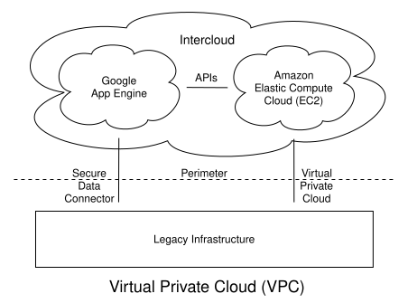
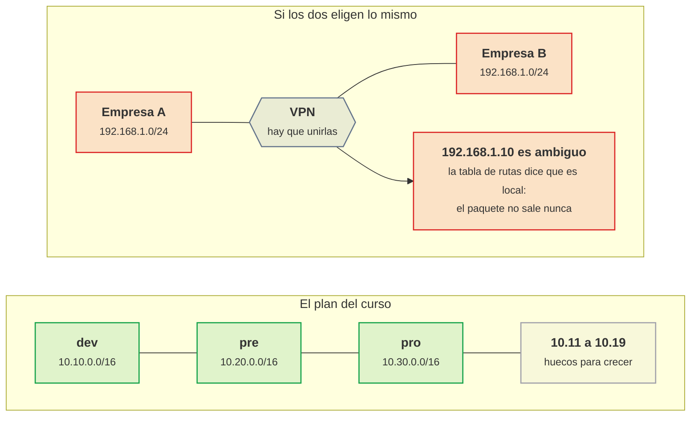
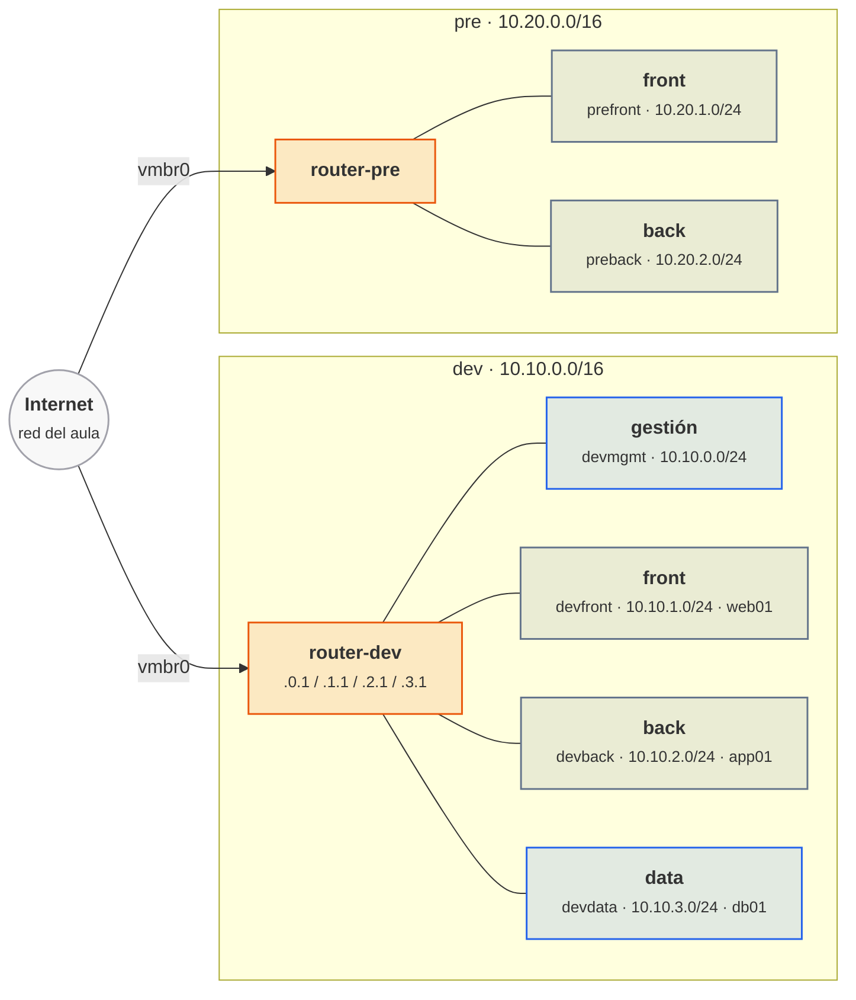
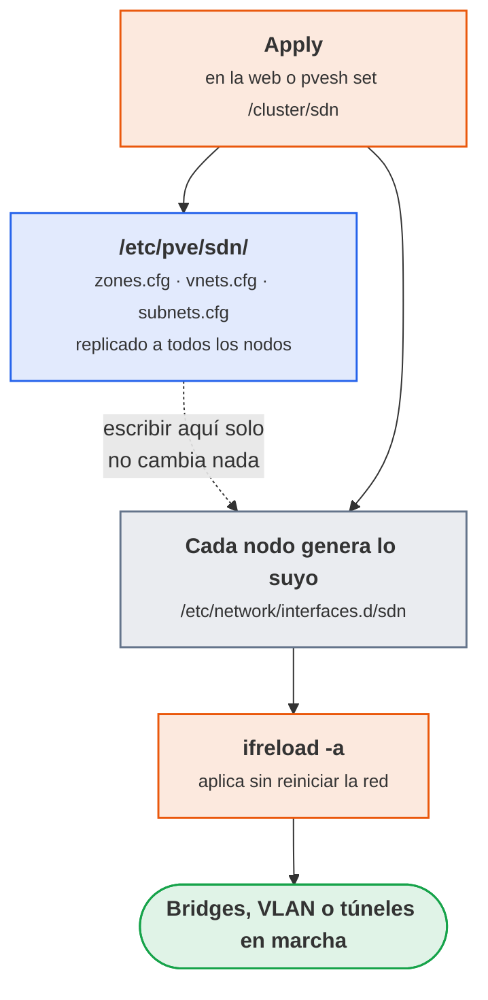
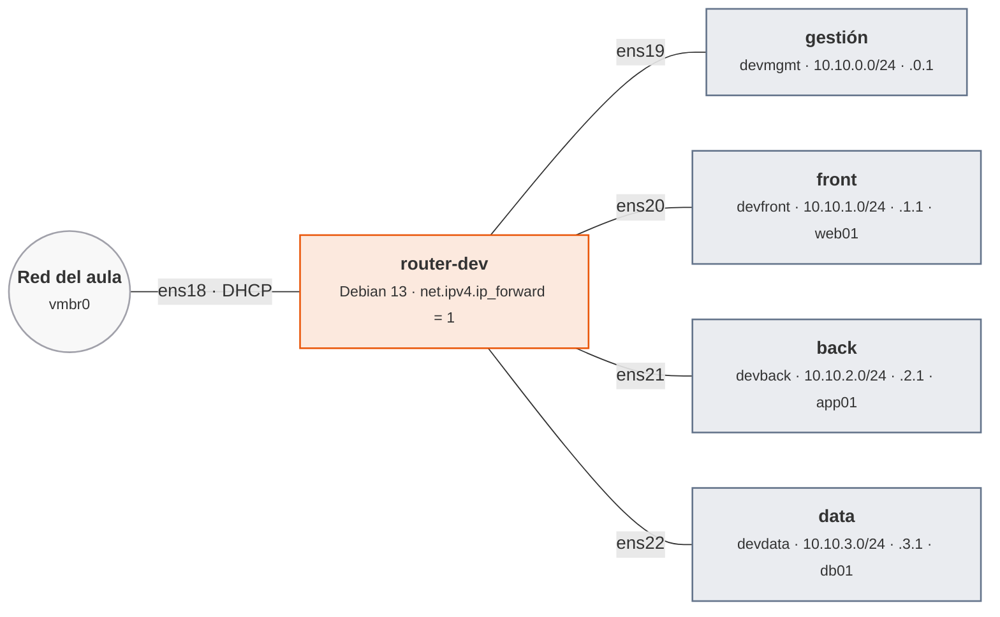
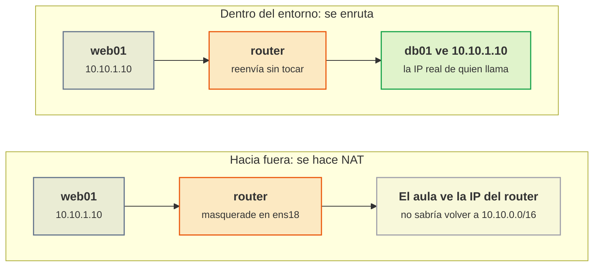
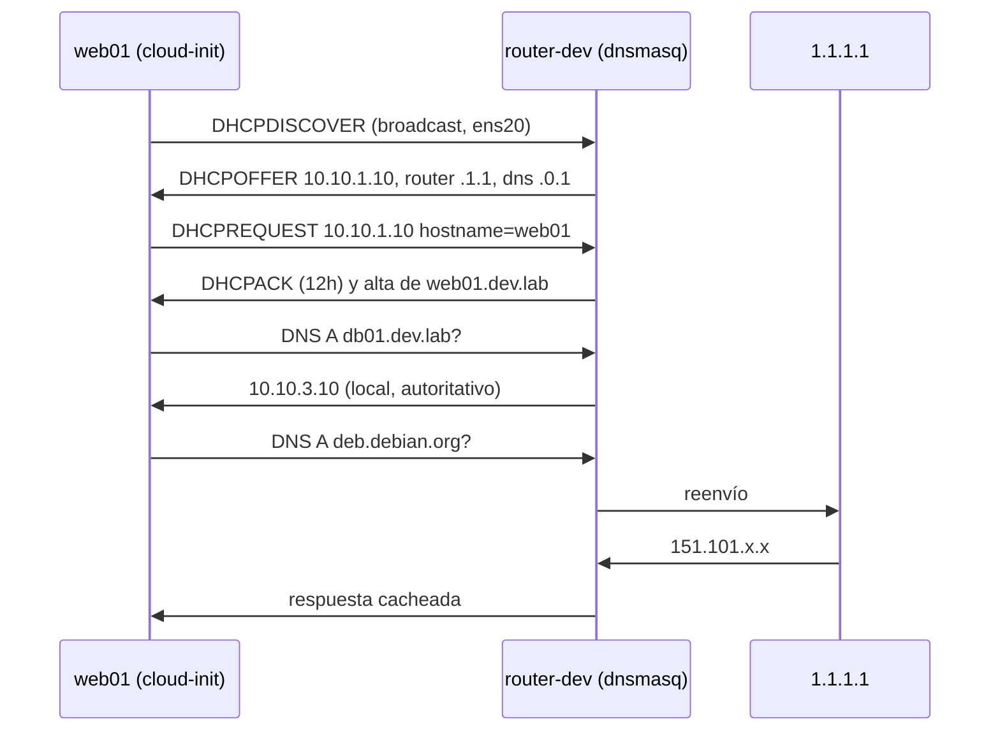
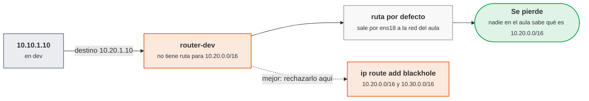
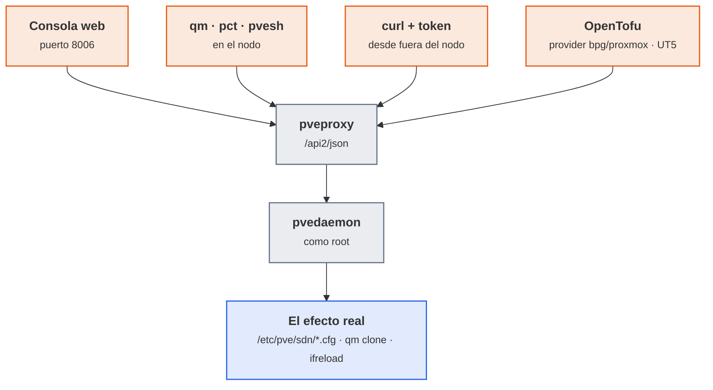

# UT2 · Nubes privadas virtuales (VPC)

<p class="ut-meta">14 h · Sesiones 7 a 13 · RA1 CE b, c</p>

La UT1 dejó un Proxmox funcionando, una plantilla Debian con cloud-init (ID 9000; cloud-init es lo que configura nombre, red y usuario en el primer arranque de cada clon) y un par de bridges (los switches virtuales del nodo). Hasta ahora las máquinas clonadas caían todas en la misma red, la del aula, y eso vale para probar pero no para lo que viene. En esta unidad se construye la red de verdad: tres entornos (dev, pre, pro) separados, cada uno con sus subredes por capa, su router, su DHCP y su DNS interno, y con la garantía de que lo que pasa en dev no puede tocar pro. Todo lo que se monta aquí es el suelo sobre el que la UT3 pone cortafuegos, DMZ y proxy inverso, y lo que en la UT5 se vuelve a crear desde cero con OpenTofu sin pasar por la consola web. Por eso la última sesión de contenido es la de la CLI y la API: si se sabe hacerlo a mano con `pvesh` (el cliente de la API de Proxmox que va en el propio nodo), el provider de Terraform deja de ser magia.

## Sesión 7 · Diseño de la VPC dev

<p class="ut-meta" markdown>28 de octubre · Teoría y práctica · <span class="dur" tabindex="0" aria-label="Qué es una VPC · 10 min&#10;Diseño de direccionamiento · 15 min&#10;A2.1 Diseño · 85 min" data-dur="Qué es una VPC · 10 min&#10;Diseño de direccionamiento · 15 min&#10;A2.1 Diseño · 85 min">:material-school:<i class="dur-barra" style="--teoria:23%"></i>:material-flask:</span></p>

Al acabar esta sesión queda el plano de los tres entornos en papel, con una tabla de direccionamiento propia. Para la hoja hacen falta los dos apartados que siguen: qué es una VPC y qué piezas tiene, y cómo se calcula y se elige el direccionamiento, con la numeración de las VM.

### Qué es una VPC

Antes de crear nada en Proxmox conviene saber qué se está imitando. Todo lo que se monta en esta unidad tiene un nombre y un equivalente en cualquier nube pública, y quien entienda las piezas aquí no tendrá que volver a aprenderlas en la UT4.

Una Virtual Private Cloud es una red privada, aislada y definida por software dentro de una infraestructura que se comparte con otros. En nube pública (AWS, Azure, Google Cloud) es el primer recurso que se crea: dentro de ella van las subredes, las instancias, los balanceadores y las bases de datos gestionadas. En una nube privada como Proxmox u OpenStack el concepto es idéntico aunque el nombre cambie (SDN, red definida por software; red de proyecto; red de tenant, es decir, de cliente). La idea de fondo es que el rango de direcciones, cómo se trocea y qué sale a Internet y qué no lo decide quien diseña la red, y nadie de fuera de la VPC puede alcanzar sus máquinas salvo que se le abra la puerta.

<figure markdown="span">
  { width="640" }
  <figcaption>Esquema de una VPC con subredes. Fuente: Sam Johnston, CC BY-SA 3.0, vía Wikimedia Commons.</figcaption>
</figure>

Los componentes son siempre los mismos, cambie el proveedor que cambie. En la tabla salen siglas (CIDR, NAT, SNAT, EVPN) que se explican con calma en los apartados siguientes; de momento basta con la columna del medio:

| Componente | Qué es | Equivalente en Proxmox |
|---|---|---|
| Bloque CIDR | Rango de IP de toda la VPC (p. ej. 10.10.0.0/16) | Conjunto de subnets de una VNet |
| Subred | Trozo del bloque, normalmente por capa o zona (10.10.1.0/24) | VNet + Subnet en SDN |
| Zona de disponibilidad | Centro de datos independiente dentro de una región | Nodo del clúster |
| Tabla de rutas | Hacia dónde sale cada subred | Router virtual (VM) o zona EVPN |
| Gateway de Internet / NAT | Salida a Internet de subredes públicas o privadas | VM con NAT / firewall, o SNAT del SDN |
| DNS interno | Nombres para las máquinas de la VPC | dnsmasq / Pi-hole |
| Grupos de seguridad | Reglas de tráfico por instancia | Firewall de Proxmox (nivel VM) o del router |

Una subred es pública cuando tiene ruta directa a Internet en los dos sentidos: ahí van balanceadores, proxies inversos, bastiones. Una subred es privada cuando solo sale por NAT (puede descargar paquetes, nadie puede entrar) o directamente no sale (la base de datos no tiene ninguna razón para hablar con Internet). En el laboratorio, front será la subred "pública" de cada entorno y back la privada; la de gestión es privada y además solo accesible desde una red concreta.

Para situarse de cara a la UT4, la misma idea recibe estos nombres en cada sitio:

| Concepto | Proxmox SDN | AWS | Azure | GCP |
|---|---|---|---|---|
| Red privada aislada | Zona + VNet | VPC | Virtual Network (VNet) | VPC network |
| Subred | Subnet | Subnet (ligada a una AZ) | Subnet | Subnet (ligada a una región) |
| Zona de disponibilidad | Nodo | Availability Zone | Availability Zone | Zone |
| Salida NAT | VM router / SNAT | NAT Gateway | NAT Gateway | Cloud NAT |
| DNS interno | dnsmasq | Route 53 Resolver | Azure DNS privado | Cloud DNS |
| Reglas por instancia | Firewall de Proxmox | Security Group | NSG (grupo de seguridad de red) | Firewall rules |
| Unión de dos VPC | Ruta en el router | VPC Peering / Transit Gateway | VNet Peering | VPC Peering |

### Diseño de direccionamiento

Antes de crear nada se dibuja. Esto no es una frase de manual: cambiar un rango de IP cuando ya hay veinte máquinas, un DNS y reglas de firewall que lo referencian cuesta una tarde entera y algún disgusto. Cinco minutos de papel ahorran eso.

#### Repaso rápido de CIDR y subnetting

Una dirección IPv4 son 32 bits. La notación CIDR `10.10.1.0/24` dice que los 24 primeros bits identifican la red y los 8 restantes al host. Con eso se calcula todo lo demás:

- Máscara: 24 bits a uno, `255.255.255.0`.
- Direcciones en la red: 2^(32-24) = 256.
- Hosts utilizables: 256 menos la dirección de red (`10.10.1.0`) y la de broadcast (`10.10.1.255`), 254.
- Primera y última IP de host: `10.10.1.1` y `10.10.1.254`.

El mismo cálculo con otros prefijos habituales:

| Prefijo | Máscara | Direcciones | Hosts útiles | Ejemplo | Broadcast |
|---|---|---|---|---|---|
| /16 | 255.255.0.0 | 65 536 | 65 534 | 10.10.0.0/16 | 10.10.255.255 |
| /22 | 255.255.252.0 | 1 024 | 1 022 | 10.10.4.0/22 | 10.10.7.255 |
| /24 | 255.255.255.0 | 256 | 254 | 10.10.1.0/24 | 10.10.1.255 |
| /26 | 255.255.255.192 | 64 | 62 | 10.10.1.64/26 | 10.10.1.127 |
| /28 | 255.255.255.240 | 16 | 14 | 10.10.1.16/28 | 10.10.1.31 |
| /30 | 255.255.255.252 | 4 | 2 | 10.10.9.0/30 | 10.10.9.3 |

Conviene fijarse en el /22: `10.10.4.0/22` cubre desde `10.10.4.0` hasta `10.10.7.255`, es decir, cuatro /24 seguidos. El truco para no equivocarse es que la dirección de red tiene que ser múltiplo del tamaño del bloque en el octeto que se parte: un /22 solo puede empezar en .0, .4, .8, .12... del tercer octeto. `10.10.5.0/22` no es una red válida (su red real sería `10.10.4.0/22`) y Proxmox lo rechaza al crear la subnet. En AWS y Azure, además, el proveedor se reserva las cinco primeras direcciones de cada subred (red, router, DNS, futuro y broadcast), así que un /28 allí se queda en 11 hosts.

Una herramienta que conviene tener a mano es `ipcalc` (paquete `ipcalc` en Debian) o `sipcalc`:

```bash
$ ipcalc 10.10.4.0/22
Address:   10.10.4.0            00001010.00001010.000001 00.00000000
Netmask:   255.255.252.0 = 22   11111111.11111111.111111 00.00000000
Network:   10.10.4.0/22         00001010.00001010.000001 00.00000000
HostMin:   10.10.4.1
HostMax:   10.10.7.254
Broadcast: 10.10.7.255
Hosts/Net: 1022                  Class A, Private Internet
```

#### RFC 1918 y el problema del solapamiento

La [RFC 1918](https://www.rfc-editor.org/rfc/rfc1918) reserva tres rangos que nunca se enrutan en Internet y que cualquiera puede usar dentro de casa: `10.0.0.0/8` (16 millones de direcciones), `172.16.0.0/12` (de 172.16.0.0 a 172.31.255.255, un millón) y `192.168.0.0/16` (65 536). Además existe `100.64.0.0/10` ([RFC 6598](https://www.rfc-editor.org/rfc/rfc6598)), pensado para el CGNAT de los operadores (el NAT a gran escala que hacen los proveedores de fibra), que algunas empresas usan para redes de tránsito precisamente porque nadie lo pone en una oficina.

El error clásico es elegir el rango sin pensar en el futuro. Dos redes que hoy están separadas pueden tener que hablarse mañana: dev con pre para promocionar una imagen, la VPC de la empresa con la del proveedor por VPN, una nube privada con AWS por peering. Si las dos usan `192.168.1.0/24` (y lo usan, es la red por defecto de medio mundo), una máquina de un lado que quiera hablar con `192.168.1.10` del otro lado no tiene forma de saber a cuál se refiere: la tabla de rutas le dice que esa red es local y el paquete nunca sale. La solución en ese momento es NAT doble (traducir un lado a un rango ficticio), y quien lo haya tenido que mantener no lo repite. Por eso:

- Un bloque distinto por entorno, sin solapar. En el curso: `10.10.0.0/16` para dev, `10.20.0.0/16` para pre, `10.30.0.0/16` para pro. Los huecos entre medias (10.11 a 10.19) quedan para crecer.
- Dentro de cada entorno, una subred por capa: front (expuesta), back (aplicación), data (bases de datos) y gestión (acceso administrativo, monitorización).
- Evitar `192.168.0.0/24`, `192.168.1.0/24`, `10.0.0.0/24` y `172.16.0.0/24`.

!!! truco "Los cuatro rangos que no hay que usar nunca"
    Son los que trae por defecto cualquier router doméstico y casi cualquier VPN de teletrabajo. El día que
    alguien se conecte desde casa a la VPN de la empresa, su router y la red de destino serán la misma red y
    no habrá arreglo limpio. Elegir un bloque raro dentro de `10.0.0.0/8` evita ese problema.



<p class="pie" markdown>Elegir el rango es una decisión de dentro de cinco años. El día que haya que unir dos redes, o no se solapan o toca NAT doble.</p>

#### Por qué /16 por entorno y /24 por subred

Un /16 son 65 534 direcciones y en dev habrá seis máquinas. Parece un desperdicio, pero el espacio privado no cuesta dinero y lo que sí cuesta es renumerar. Con un /16 hay 256 subredes /24 posibles por entorno, así que se puede dar una a cada capa, otra a cada zona de disponibilidad (front-a, front-b), otra a cada cliente si el entorno se vuelve multi-tenant (varios clientes sobre el mismo hardware), y aún sobran doscientas. Un /24 por subred da 254 hosts, más que suficiente para una capa, y tiene la ventaja de que se lee de un vistazo: en `10.10.2.37` se ve que es dev (10.10), back (.2) y un servidor fijo (.37) sin mirar ninguna tabla. Ese "se lee de un vistazo" es lo que salva al leer una captura de tcpdump a las cinco de la tarde.

Ejemplo usado en el curso (la A2.1 pide inventar uno propio):

| Entorno | Bloque | Gestión | Front | Back | Data |
|---|---|---|---|---|---|
| dev | 10.10.0.0/16 | 10.10.0.0/24 | 10.10.1.0/24 | 10.10.2.0/24 | 10.10.3.0/24 |
| pre | 10.20.0.0/16 | 10.20.0.0/24 | 10.20.1.0/24 | 10.20.2.0/24 | 10.20.3.0/24 |
| pro | 10.30.0.0/16 | 10.30.0.0/24 | 10.30.1.0/24 | 10.30.2.0/24 | 10.30.3.0/24 |

Convención dentro de cada /24: `.1` el router del entorno, que además hace de DNS y de DHCP, `.2` a `.9` reservadas y sin usar, `.10` a `.99` servidores con IP fija (reservada por MAC en DHCP), `.100` a `.199` rango DHCP dinámico para máquinas de usar y tirar, `.200` a `.254` pruebas, balanceadores e IP virtuales. Conviene escribirla en la memoria y respetarla: la convención vale más que el rango concreto.

El número de la VM es otra convención que conviene fijar desde el primer día, porque dice de un vistazo dónde vive la máquina: la centena es el entorno (1 dev, 2 pre, 3 pro) y la decena es la zona, con el mismo dígito que el tercer octeto de su subred (0 gestión, 1 front, 2 back, 3 data). Así `120` es `app01` de dev, en back, con la `10.10.2.10`, y `230` es `db01` de pre, en data, con la `10.20.3.10`. El router de cada entorno se queda con el primer número de la franja de gestión: 100, 200 y 300. Los nombres cortos se repiten en los tres entornos a propósito; lo que los distingue es el dominio y el ID. La tabla completa de máquinas y números está en las [convenciones del laboratorio](../laboratorio.md#convenciones).



<p class="pie" markdown>Entre dev y pre no hay ninguna línea, y eso es justo el aislamiento: no es una regla que prohíbe, es que no existe el camino.</p>

### A2.1 Diseño (sesión 7)

<span class="et et-obj">Objetivo</span> Tener el plano de los tres entornos en papel, con una tabla de direccionamiento propia justificada.

<span class="et et-pre">Antes de empezar</span> Explicado en esta sesión: [qué es una VPC](#que-es-una-vpc) y [CIDR y RFC 1918](#diseno-de-direccionamiento).

<span class="et et-pas">Pasos</span>

1. Dibuja los tres entornos (dev, pre, pro) con sus subredes, su router y sus servicios de red, como el esquema del apartado de diseño pero con tus nombres.
2. Rellena tu tabla de direccionamiento (entorno, bloque, gestión, front, back, data) con un bloque de RFC 1918 distinto del ejemplo, y escribe en una línea por qué ese. Es solo el ejercicio de diseño: el laboratorio se monta con los rangos del ejemplo, que son los que usan las dos asignaturas.
3. Justifica cada tamaño con su máscara, direcciones, hosts útiles y broadcast, y añade la convención de IP dentro de cada /24 y el rango de ID de VM por entorno, las dos del apartado de diseño.
4. Comprueba con `ipcalc` en el nodo que ningún bloque se solapa, ni entre entornos ni con la red del aula, que es la de `vmbr0`.
5. Crea en tu equipo del aula `entregas-5166`, el repositorio Git de entregas de esta asignatura, con una carpeta por hoja dentro de `ut2/` (la de hoy, `ut2/a21`). De momento es local: el 6 de noviembre, en la A2.4, pasa al puesto de administración, y el 17 de noviembre recibe su remoto en el Gitea que monta la A2.6 de Mantenimiento.

<span class="et et-com">Comprobación</span> Ningún bloque se solapa entre sí ni con la red del aula, cada tamaño está justificado con el cálculo de hosts y `git -C entregas-5166 status` responde.

<span class="et et-ent">Entrega</span> En `ut2/a21` de `entregas-5166`: el esquema y la tabla de direccionamiento con las justificaciones.

## Sesión 8 · Crear la VPC dev con SDN

<p class="ut-meta" markdown>30 de octubre · Teoría y práctica · <span class="dur" tabindex="0" aria-label="SDN en Proxmox · 15 min&#10;A2.2 Crear la VPC dev con SDN · 95 min" data-dur="SDN en Proxmox · 15 min&#10;A2.2 Crear la VPC dev con SDN · 95 min">:material-school:<i class="dur-barra" style="--teoria:14%"></i>:material-flask:</span></p>

Al acabar esta sesión quedan creadas en el SDN las cuatro VNets de dev (`devmgmt`, `devfront`, `devback` y `devdata`), con dos VM de zonas distintas que reciben IP de su subred. Para la hoja hace falta el apartado que sigue: qué son zona, VNet y subnet en el SDN de Proxmox, y por qué una VNet por zona.

### SDN en Proxmox

Con el plano en papel toca construirlo. Este apartado crea la red de cada entorno desde la consola de Proxmox y explica qué pasa por debajo al pulsar Apply, porque cuando el SDN falla (y falla) hay que saber dónde mirar.

Proxmox VE incorpora desde la versión 8 un módulo de redes definidas por software, en Datacenter → SDN, que sustituye al trabajo manual de crear bridges en cada nodo. La jerarquía tiene tres niveles y conviene tenerla clara porque el provider de OpenTofu usa exactamente los mismos objetos:

- Zona: define el tipo de red y en qué nodos existe. Es el "cómo se transporta el tráfico".
- VNet: una red virtual dentro de la zona. Al crear una VM aparece en el desplegable de bridges como si fuera un `vmbrN` más. Es el "cable" al que se conecta la máquina.
- Subnet: un rango CIDR dentro de la VNet, con gateway opcional, rango DHCP opcional y SNAT opcional.

Además hay dos objetos transversales: IPAM (el registro de qué IP está asignada a quién; el que viene de serie se llama `pve` y guarda el estado en `/etc/pve/priv/ipam.db`) y DNS (integración con un servidor PowerDNS externo para que el IPAM registre nombres automáticamente; en el laboratorio del curso no se usa y el DNS lo resuelve dnsmasq).

#### Una VNet por zona, una subred por VNet

Proxmox admite varias subredes dentro de la misma VNet, pero no conviene aprovecharlo. Una VNet es un bridge, es decir, un único dominio de capa 2: dos subredes en el mismo bridge comparten el mismo cable virtual, sus máquinas se alcanzan por ARP y no hay forma de poner un cortafuegos en medio, porque para filtrar entre dos redes el tráfico tiene que pasar por un router y para eso las redes tienen que colgar de bridges distintos. Si las cuatro zonas de dev vivieran en una sola VNet, la UT3 no tendría dónde filtrar.

Por eso cada entorno tiene cuatro VNets, una por zona, y cada VNet una sola subred:

| VNet | Subred | Zona | Papel que tendrá en la UT3 |
|---|---|---|---|
| `devmgmt` | 10.10.0.0/24 | gestión | Red de administración |
| `devfront` | 10.10.1.0/24 | front | DMZ externa |
| `devback` | 10.10.2.0/24 | back | DMZ interna |
| `devdata` | 10.10.3.0/24 | data | Zona interna |

El nombre se forma juntando el entorno y la zona, sin guiones: `devmgmt`, `devfront`, `devback`, `devdata`, y lo mismo en los otros dos entornos (`prefront`, `preback`, `proback`, `prodata`...). No es una manía de estilo: el ID de una VNet, igual que el de una zona, admite como máximo ocho caracteres alfanuméricos, así que un nombre como `vdev-front`, con diez caracteres y un guion, Proxmox lo rechaza al crearlo.

#### Tipos de zona y cuándo usar cada uno

| Zona | Cómo funciona | Alcance | Cuándo |
|---|---|---|---|
| Simple | Crea un bridge Linux sin interfaz física por cada VNet. Aislado. Puede hacer SNAT hacia fuera. | Un nodo (las VM de otro nodo no ven la red) | Laboratorio de un solo nodo, redes de pruebas, lo que se usa en la A2.2 |
| VLAN | Cada VNet es un tag 802.1Q sobre un bridge físico existente (vmbr0). El switch físico tiene que dejar pasar esas VLAN. | Todo el clúster, si el switch está configurado | Empresa pequeña con switches gestionables; lo más habitual en producción on-premise |
| QinQ | VLAN dentro de VLAN (802.1ad). Una VLAN de servicio por zona y VLAN de cliente por VNet. | Clúster | Proveedores que necesitan más de 4094 segmentos o aislar clientes que a su vez usan VLAN |
| VXLAN | Encapsula tramas Ethernet en UDP (puerto 4789) entre los nodos. No necesita nada del switch físico. | Clúster (túnel entre las IP de los nodos) | Clúster de varios nodos sin control sobre la red física; nube |
| EVPN | VXLAN más BGP (el protocolo de enrutado de Internet, aquí hablado por el software FRR) para anunciar MAC e IP entre nodos, con enrutado distribuido: cada nodo es gateway de sus VM. | Clúster, y puede salir a routers externos | Cuando se quiere que el SDN enrute entre VNets sin una VM router; es lo más parecido a una VPC de nube |

Elegir bien la zona es la decisión más importante de esta unidad y la que menos se puede deshacer, porque cambiar de zona implica recrear las VNets. El criterio habitual: Simple en un laboratorio de un solo nodo y sin control del switch, que es el caso del curso; en una empresa con dos o tres nodos y switches propios, VLAN, que es lo que el equipo de redes ya entiende; VXLAN cuando los nodos están en sitios distintos o la red física no es propia; EVPN solo cuando de verdad haga falta que el enrutado sea distribuido, porque añade BGP y FRR a la ecuación y eso se depura peor.

#### VLAN 802.1Q frente a VXLAN

Los dos tipos de zona que se usan fuera del laboratorio llevan varias redes por el mismo cable de dos maneras distintas: la VLAN etiqueta la trama Ethernet y necesita que cada switch del camino conozca la etiqueta; VXLAN envuelve la trama entera dentro de un paquete UDP/IP, atraviesa routers y no exige nada al switch. La comparación completa (tamaño del identificador, coste de proceso y cuándo se elige cada una) está en [VLAN frente a VXLAN](../ampliacion.md#vlan-frente-a-vxlan). Del lado práctico solo hay que retener una consecuencia: esa envoltura añade unos 50 bytes, así que con VXLAN la MTU (el tamaño máximo de paquete que admite una interfaz) de las VM baja a 1450 si la red física va a 1500.

!!! ojo "Si se olvida la MTU, el fallo no parece de red"
    Los ping pequeños funcionan y las transferencias grandes se cuelgan sin dar error. Es el síntoma más
    engañoso de la unidad: parece el disco, parece la aplicación, y es la MTU. Ante una transferencia que se
    para, conviene probar primero `ping -M do -s 1400`.

#### Qué hace Apply por debajo

La configuración del SDN se escribe en `/etc/pve/sdn/` (ficheros `zones.cfg`, `vnets.cfg`, `subnets.cfg`), que está en el sistema de ficheros del clúster y por tanto se replica a todos los nodos. Pero escribir ahí no cambia nada en la red. Al pulsar Apply (o `pvesh set /cluster/sdn`), cada nodo genera el fichero `/etc/network/interfaces.d/sdn` con los bridges, VLAN o túneles VXLAN que le tocan y ejecuta `ifreload -a` (de ifupdown2, la herramienta que gestiona las interfaces de red en Proxmox), que aplica los cambios sin reiniciar la red.



<p class="pie" markdown>La configuración vive en el clúster; la red de verdad la levanta cada nodo al aplicar.</p>

Un ejemplo de lo que aparece para una zona Simple con la VNet `devfront`; las otras tres salen igual, cada una con su nombre y su alias:

```text
auto devfront
iface devfront
        bridge_ports none
        bridge_stp off
        bridge_fd 0
        mtu 1500
        alias dev front
```

Si en `/etc/network/interfaces` no está la línea `source /etc/network/interfaces.d/*` (viene en instalaciones nuevas, pero no siempre en las actualizadas desde versiones antiguas), Apply dirá que todo va bien y no habrá ningún bridge. Es la primera cosa que se comprueba cuando "el SDN no hace nada".

#### DHCP e IPAM integrados

Desde Proxmox 8.1 una zona puede llevar `DHCP: dnsmasq`. Proxmox arranca entonces una instancia de dnsmasq por zona (unidad `dnsmasq@<zona>.service`, configuración en `/etc/dnsmasq.d/<zona>/`) que escucha en las VNets de esa zona y entrega las IP que el IPAM ha reservado para cada VM. Con una zona Simple y la subnet de `devfront` con gateway `10.10.1.1` y rango DHCP `10.10.1.100-10.10.1.199`, al crear una VM conectada a `devfront` el IPAM le asigna una IP del rango, la ata a su MAC y dnsmasq la sirve. El gateway `.1` lo pone Proxmox en el propio bridge del nodo, así que el nodo es el router de esa subred; si además se marca SNAT en la subnet, el nodo hace masquerade hacia su interfaz de salida y las VM tienen Internet sin ninguna VM router.

Para que funcione hace falta el paquete `dnsmasq` instalado en el nodo pero con la unidad genérica deshabilitada, porque si no compite con las instancias por zona:

```bash
apt install dnsmasq
systemctl disable --now dnsmasq
```

Es cómodo y para probar es perfecto. La razón por la que en la A2.3 se sustituye por una VM router propia es didáctica y práctica a la vez: el DHCP del SDN no hace DNS con nombres propios ni deja tocar opciones finas, y en la UT3 el router de entorno es donde van a vivir las reglas de firewall entre capas. Ese relevo tiene un paso obligatorio: al montar el router hay que quitar el gateway y el rango DHCP de las subredes del SDN, porque el `.1` de una subred solo puede estar en un sitio. Entender qué hace el SDN por debajo (un bridge, un dnsmasq, una regla de nftables) es lo que permite arreglarlo cuando falla.

#### Alternativa sin SDN

Lo que existía antes del SDN sigue funcionando y es lo mismo hecho a mano: en `/etc/network/interfaces` un bridge sin `bridge-ports` (sin interfaz física, por tanto aislado dentro del nodo) por cada zona, `vmbr10` para gestión, `vmbr11` para front, `vmbr12` para back y `vmbr13` para data, y una VM router con una pata en cada uno de ellos y otra en `vmbr0` que hace DHCP, DNS y NAT. Si el SDN da guerra, esto es el plan B y es equivalente para la práctica evaluable.

### A2.2 Crear la VPC dev con SDN (sesión 8)

<span class="et et-obj">Objetivo</span> Tener las cuatro VNets de dev funcionando en el SDN, una por zona, con dos VM de zonas distintas que reciben IP de su subred.

<span class="et et-pre">Antes de empezar</span>

- El nodo de la UT1 con la plantilla 9000, la consola web como `root@pam` y una sesión SSH contra él.
- Los rangos de dev son los de las [convenciones del laboratorio](../laboratorio.md#convenciones), no los de tu tabla de la A2.1.
- `web01` (110), `app01` y `mon01` existen desde la A1.3, en `vmbr0`. Hoy `web01` pasa a la VPC; `app01` y `mon01` se quedan, porque Mantenimiento las usa a diario: las traslada la A3.3 el 27 de noviembre, ya con cortafuegos.
- Explicado en esta sesión: [zonas, VNets y subnets del SDN](#sdn-en-proxmox) y [una VNet por zona](#una-vnet-por-zona-una-subred-por-vnet).

<span class="et et-pas">Pasos</span>

1. Prepara el nodo para el DHCP del SDN como dice [DHCP e IPAM integrados](#dhcp-e-ipam-integrados): el paquete `dnsmasq` instalado y su unidad genérica deshabilitada.
2. Crea en Datacenter → SDN una zona Simple con ID `lab`, DHCP `dnsmasq` e IPAM `pve`.
3. Crea en la zona `lab` las cuatro VNets de dev, una por zona: `devmgmt`, `devfront`, `devback` y `devdata`, con los alias `dev gestion`, `dev front`, `dev back` y `dev data`.
4. Dale a cada VNet una sola subred: el /24 de su zona, con gateway en el `.1` y rango DHCP de `.100` a `.199`. Hoy los sirve el nodo; en la sesión 9 pasan al router del entorno.
5. Aplica la configuración y comprueba en el nodo que existen los cuatro bridges, que [Apply](#que-hace-apply-por-debajo) los ha escrito en `/etc/network/interfaces.d/sdn` y que `dnsmasq@lab` está en marcha.
6. Conecta a la VPC sus dos primeras VM de servicio, las dos con IP por DHCP: `web01` (110) a `devfront`, y `db01` (130), que nace hoy de la plantilla con 2 GB, a `devdata`. Busca en Datacenter → SDN → IPAM la IP que ha recibido cada una, entra por SSH desde el nodo y guarda su `ip a` y su `ip r`.

    *Pista:* `web01` no se clona otra vez: apágala, cámbiale el bridge con `qm set` y arráncala. Desde el nodo entras con `ssh ops@<IP>`, porque hoy es el `.1` de cada subred y su clave va en la plantilla.

<span class="et et-com">Comprobación</span> `ip -br link show type bridge` lista las cuatro VNets: `devfront` y `devdata`, que ya tienen una VM conectada, en `UP`, y `devmgmt` y `devback` en `DOWN` mientras no se les conecte nada, que es lo normal en un bridge vacío; `web01` tiene una IP del rango `10.10.1.100` a `10.10.1.199` con gateway `10.10.1.1`, y `db01` una de `10.10.3.100` a `10.10.3.199` con gateway `10.10.3.1`, cada una de su propia subred; el IPAM lista las dos VM con su MAC e IP; cada VM hace `ping` a su `.1`. Que `web01` alcance a `db01` no es cosa de hoy: eso lo hace el router del entorno de la sesión 9. Si una VM no coge IP, `journalctl -u dnsmasq@lab -f` en el nodo mientras la reinicias enseña el DORA o su ausencia.

<span class="et et-ent">Entrega</span> En `ut2/a22` de tu repositorio: una captura del SDN aplicado con las cuatro VNets, el contenido de `/etc/network/interfaces.d/sdn` y la salida de `ip a` de las dos VM.

<span class="et et-ext">Si te sobra tiempo</span> Marca SNAT en la subnet de `devfront`, aplica, y comprueba desde `web01` que `ping -c 3 deb.debian.org` sale a Internet sin ninguna VM router.

## Sesión 9 · DHCP y DNS propios

<p class="ut-meta" markdown>4 de noviembre · Teoría y práctica · <span class="dur" tabindex="0" aria-label="Servicios de red: enrutado, NAT, DHCP y DNS · 20 min&#10;A2.3 DHCP y DNS propios · 90 min" data-dur="Servicios de red: enrutado, NAT, DHCP y DNS · 20 min&#10;A2.3 DHCP y DNS propios · 90 min">:material-school:<i class="dur-barra" style="--teoria:18%"></i>:material-flask:</span></p>

Al acabar esta sesión la VM `router-dev` reparte IP, gateway y DNS a las máquinas de dev con dnsmasq, con reservas por MAC y nombres propios, y el gateway y el DHCP del SDN quedan retirados. La teoría de hoy es el router de entorno (por qué una VM con una pata en cada VNet y el reenvío IP), la diferencia entre enrutar y hacer NAT, que es lo que da salida a Internet a las VM, y el fichero de dnsmasq línea a línea.

### Servicios de red: enrutado, NAT, DHCP y DNS

Una VNet recién creada es un cable al que se conectan máquinas y nada más: nadie reparte direcciones, nadie resuelve nombres y nadie saca el tráfico a Internet. Este apartado monta la VM que hace esas tres cosas para cada entorno y separa de paso dos ideas que se confunden siempre, enrutar y hacer NAT. Es el apartado con más configuración de la unidad; la A2.4 y la A2.5 salen de aquí.

#### Router de entorno

Una VM Debian 13 clonada de la plantilla, con una interfaz por VNet y otra hacia el exterior. Cada pata cuelga de un bridge distinto, y eso es justo lo que permite filtrar entre zonas: si dos subredes compartieran bridge, el tráfico entre ellas no pasaría por el router y no habría dónde poner una regla. En Proxmox las interfaces virtio (las tarjetas de red paravirtualizadas, las más rápidas para una VM) aparecen en la VM como `ens18`, `ens19`, `ens20`... en el orden de `net0`, `net1`, `net2`. Convención del curso: `ens18` exterior (vmbr0, IP del aula por DHCP), `ens19` gestión (`devmgmt`, `.0.1`), `ens20` front (`devfront`, `.1.1`), `ens21` back (`devback`, `.2.1`) y `ens22` data (`devdata`, `.3.1`).

El router es el `.1` de las cuatro subredes, y es el único: por eso, antes de que dnsmasq entre en juego, hay que quitar el gateway y el rango DHCP que el SDN puso en cada subred en la sesión 8. Si se dejan, en cada red hay dos máquinas que dicen ser el `.1` (el nodo y el router) y dos servidores DHCP repartiendo; las VM cogen una oferta u otra según quién conteste antes y la red se vuelve impredecible.



<p class="pie" markdown>Una pata por VNet, en el orden de `net0`, `net1`, `net2`… Sin el reenvío activado, el router acepta lo suyo y tira el resto: front y back no se hablan.</p>


Lo primero es activar el reenvío IP, que en Debian viene apagado. Sin esto la VM acepta paquetes dirigidos a ella y descarta los demás, así que front y back no se hablan aunque el router tenga pata en las dos:

```bash
# /etc/sysctl.d/99-router.conf
net.ipv4.ip_forward = 1
```

```bash
sysctl --system
sysctl net.ipv4.ip_forward   # debe devolver 1
```

Con el reenvío activo, el router ya encamina entre sus cuatro redes porque todas son redes directamente conectadas: cuando `web01` (10.10.1.10) manda un paquete a `db01` (10.10.3.10), su tabla de rutas dice que 10.10.3.0/24 no es local y lo envía al gateway 10.10.1.1; el router mira su tabla, ve que 10.10.3.0/24 está en `ens22` y lo reenvía. No hace falta añadir ninguna ruta estática. Sí hará falta en la UT3, con un firewall entre medias, y en la UT4, al conectar con la nube.

#### Enrutar frente a hacer NAT

Son dos cosas distintas y se confunden mucho. Enrutar es reenviar el paquete sin tocarlo: la IP de origen que ve `db01` es la de `web01`, y `db01` puede responder porque tiene ruta de vuelta. NAT es reescribir la IP de origen (SNAT / masquerade) o de destino (DNAT) al pasar por el router.

Dentro de un entorno se enruta, nunca se hace NAT: las capas tienen que ver la IP real de quien las llama, si no los logs de la base de datos dirán que todas las conexiones vienen del router y el firewall de la UT3 no podrá distinguir front de back. NAT se hace en el borde, hacia fuera, por dos razones: la red del aula (o Internet) no sabe volver a 10.10.0.0/16, y no conviene que desde fuera se sepa cómo es la red por dentro. En nube pública es lo mismo: dentro de la VPC todo se enruta, y solo el NAT Gateway o el Internet Gateway traducen.



<p class="pie" markdown>Si se hace NAT dentro, los registros de `db01` dirán que todas las conexiones vienen del router y en la UT3 no habrá forma de distinguir front de back.</p>


NAT de salida con nftables, que es lo que trae Debian 13 (iptables sigue existiendo, pero es una capa de compatibilidad sobre nftables y en la UT3 todo se hace con `nft`):

```bash
nft add table ip nat
nft add chain ip nat postrouting '{ type nat hook postrouting priority 100 ; }'
nft add rule ip nat postrouting oifname "ens18" masquerade
```

`masquerade` es un SNAT que usa la IP que tenga la interfaz de salida en ese momento, útil cuando `ens18` la recibe por DHCP. Para que sobreviva al reinicio se vuelca a `/etc/nftables.conf` con `nft list ruleset > /etc/nftables.conf` y se habilita `systemctl enable nftables`. En la UT3 este fichero crecerá con las reglas de filtrado.

#### dnsmasq: DHCP y DNS en uno

dnsmasq es un servidor DHCP y un DNS cacheador en un solo binario de medio megabyte, y es lo que hay dentro de casi todos los routers domésticos, de OpenWrt, de libvirt y del propio SDN de Proxmox. Para una VPC de laboratorio es la herramienta correcta: hace DHCP con opciones por subred, sirve nombres para las máquinas internas y reenvía el resto a un DNS público. En una empresa grande lo sustituyen un servidor DHCP dedicado y un DNS propio o gestionado, pero los conceptos son los mismos.

Se instala con `apt install dnsmasq` en la VM router y toda la configuración va en `/etc/dnsmasq.d/`. El fichero del entorno dev, comentado línea a línea. Conviene fijarse sobre todo en tres bloques: las interfaces en las que escucha, los rangos DHCP con su etiqueta por subred y las reservas por MAC; el resto son opciones de DNS que se explican justo después:

```ini
# /etc/dnsmasq.d/dev.conf
# Escuchar solo en las patas internas, nunca en la exterior
interface=ens19
interface=ens20
interface=ens21
interface=ens22
bind-interfaces

# DNS: dominio interno y resolución de nombres
domain=dev.lab
local=/dev.lab/
expand-hosts
no-resolv
server=1.1.1.1
server=9.9.9.9
dhcp-authoritative

# DHCP: un rango por subred, cada uno con su etiqueta (tag)
dhcp-range=set:mgmt,10.10.0.100,10.10.0.199,12h
dhcp-option=tag:mgmt,option:router,10.10.0.1
dhcp-range=set:front,10.10.1.100,10.10.1.199,12h
dhcp-option=tag:front,option:router,10.10.1.1
dhcp-range=set:back,10.10.2.100,10.10.2.199,12h
dhcp-option=tag:back,option:router,10.10.2.1
dhcp-range=set:data,10.10.3.100,10.10.3.199,12h
dhcp-option=tag:data,option:router,10.10.3.1
# Opciones comunes: DNS y dominio de búsqueda para todos
dhcp-option=option:dns-server,10.10.0.1
dhcp-option=option:domain-search,dev.lab

# Reservas por MAC: siempre la misma IP y nombre
dhcp-host=bc:24:11:aa:bb:cc,web01,10.10.1.10
dhcp-host=bc:24:11:aa:bb:dd,app01,10.10.2.10
dhcp-host=bc:24:11:aa:bb:ee,db01,10.10.3.10
dhcp-host=bc:24:11:aa:bb:ff,mon01,10.10.0.20

# Registros DNS que no son máquinas con DHCP
address=/api.dev.lab/10.10.1.10
host-record=lb.dev.lab,10.10.1.200

# Logs (quitar en producción; en clase interesa dejarlos)
log-dhcp
log-queries
```

Cosas que conviene entender de ese fichero:

- Los tags. `dhcp-range=set:front,...` etiqueta con `front` a cualquier cliente que reciba IP de ese rango, y `dhcp-option=tag:front,...` aplica esa opción solo a los etiquetados. Así cada subred recibe su propio router (`.1`) aunque el DNS sea el mismo para todas. dnsmasq elige el rango por la interfaz de llegada de la petición DHCP, por eso da igual que las cuatro subredes estén en el mismo fichero.
- Las reservas (`dhcp-host`). La MAC de una VM de Proxmox se ve en el hardware de la VM o con `qm config 110 | grep net0`. El prefijo `bc:24:11`, los tres primeros bytes de la MAC, identifica al fabricante y es el que usa Proxmox por defecto. Al reservar, la IP queda fuera del rango dinámico (`.10`, no `.100`) para que no haya conflicto, y de regalo dnsmasq crea el registro DNS `web01.dev.lab` con esa IP.
- `expand-hosts` y `domain`. Cuando un cliente manda su nombre de host en la petición DHCP (cloud-init lo hace), dnsmasq lo registra en DNS; con `expand-hosts` le añade el dominio, así `web01` es también `web01.dev.lab`. Sin esa línea solo respondería al nombre corto.
- `local=/dev.lab/` dice que dnsmasq es autoritativo para ese dominio y no reenvía preguntas sobre él a los `server=`. Sin esta línea, preguntar por `noexiste.dev.lab` acabaría en Cloudflare, con la latencia y la fuga de información que eso supone.
- `no-resolv` evita que dnsmasq lea `/etc/resolv.conf` del propio router, que en Debian con DHCP en `ens18` apunta al DNS del aula. Aquí interesa el control explícito.
- `dhcp-authoritative` hace que dnsmasq responda con NAK a clientes que piden renovar una IP que no le consta, lo que acelera mucho la recuperación cuando se reinicia el router y las VM tienen concesiones viejas.

Se comprueba la sintaxis y se aplica con:

```bash
dnsmasq --test          # "syntax check OK"
systemctl restart dnsmasq
journalctl -u dnsmasq -f
```

Las concesiones activas están en `/var/lib/misc/dnsmasq.leases` (una línea por cliente: expiración en epoch, o segundos desde 1970, MAC, IP, nombre, client-id). Es el primer sitio al que mirar cuando "esta VM no tiene IP". Con `log-dhcp` el diálogo completo queda en el journal:

```text
dnsmasq-dhcp[612]: DHCPDISCOVER(ens20) bc:24:11:aa:bb:cc
dnsmasq-dhcp[612]: DHCPOFFER(ens20) 10.10.1.10 bc:24:11:aa:bb:cc
dnsmasq-dhcp[612]: DHCPREQUEST(ens20) 10.10.1.10 bc:24:11:aa:bb:cc
dnsmasq-dhcp[612]: DHCPACK(ens20) 10.10.1.10 bc:24:11:aa:bb:cc web01
```

Las cuatro fases (Discover, Offer, Request, Ack; DORA) son el protocolo DHCP entero. Si aparece Discover sin Offer, dnsmasq no tiene rango para esa interfaz o no escucha en ella. Si aparece Offer sin Request, el cliente no ha recibido la oferta (normalmente un firewall o un bridge mal conectado). Si aparece un NAK, la IP que pide el cliente no cuadra con el rango.



<p class="pie" markdown>El router del entorno responde lo suyo y reenvía el resto: `db01.dev.lab` sale de su propia tabla y `deb.debian.org` va a 1.1.1.1 y se queda en la caché.</p>

Del lado de las VM, la plantilla 9000 de la UT1 lleva cloud-init, así que `qm set 110 --ipconfig0 ip=dhcp` basta para que la máquina pida IP en el arranque, ponga su nombre de host (el `--name` del clon) en la petición y reciba DNS y dominio de búsqueda. El resultado es que `web01` resuelve `db01.dev.lab` y `db01` a secas sin que nadie haya tocado `/etc/hosts`. Si hace falta IP fija sin DHCP (el propio router, por ejemplo), `--ipconfig1 ip=10.10.1.1/24` y `--nameserver 10.10.0.1 --searchdomain dev.lab`.

### A2.3 DHCP y DNS propios (sesión 9)

<span class="et et-obj">Objetivo</span> Que la VM `router-dev`, con una pata en cada VNet y dnsmasq, reparta IP, gateway y DNS a las VM de dev en lugar del SDN, con reserva por MAC para `web01` y `db01` y el nombre `api.dev.lab` resolviendo.

<span class="et et-pre">Antes de empezar</span>

- La zona `lab` y las cuatro VNets de la A2.2 aplicadas, con `web01` en `devfront` y `db01` en `devdata` funcionando.
- Los rangos de dev del curso a mano: aquí se usan el `.1` de cada subred y las IP fijas del rango `.10` a `.99`.
- Explicado en esta sesión: [el router de entorno](#router-de-entorno), [enrutar frente a hacer NAT](#enrutar-frente-a-hacer-nat) y [dnsmasq](#dnsmasq-dhcp-y-dns-en-uno).

<span class="et et-pas">Pasos</span>

1. Retira del SDN el gateway y el DHCP, que desde hoy hace el router: deja las cuatro subnets de dev sin rango DHCP, sin gateway y sin SNAT, y aplica. Si queda alguno, habrá dos `.1` o dos DHCP en la misma red.
2. Crea `router-dev` (ID 100, 512 MB, DNS `1.1.1.1`) con cinco tarjetas en este orden: `net0` en `vmbr0` por DHCP y `net1` a `net4` en `devmgmt`, `devfront`, `devback` y `devdata`, cada una con el `.1` de su subred fijo. Ese orden da en la VM los nombres `ens18` a `ens22` que usa `dev.conf`.

    *Pista:* cada `--netN` va con su `--ipconfigN`, por ejemplo `--net2 virtio,bridge=devfront --ipconfig2 ip=10.10.1.1/24`.

3. Activa en el router el reenvío IP y el NAT de salida por `ens18`, los dos persistentes, como en [router de entorno](#router-de-entorno) y [enrutar frente a hacer NAT](#enrutar-frente-a-hacer-nat).

    *Pista:* entras desde el nodo por SSH a la IP que el DHCP del aula le da en `ens18`.

4. Monta dnsmasq en el router con el `dev.conf` de [dnsmasq: DHCP y DNS en uno](#dnsmasq-dhcp-y-dns-en-uno), tal cual salvo las MAC de las cuatro reservas, y arráncalo con la sintaxis comprobada y el journal abierto. Las reservas son cuatro, no dos: `app01` (`10.10.2.10`, en back) y `mon01` (`10.10.0.20`, en gestión) siguen en el bridge del aula, pero la A3.3 las traslada a esta VPC el 27 de noviembre con su misma MAC y una sola tarjeta, y al llegar tienen que recibir su IP y seguir llamándose igual.

    *Pista:* la MAC de cada VM está en la línea `net0` de `qm config <ID>`, en el nodo: `web01` es la 110, `app01` la 120, `db01` la 130 y `mon01` la 103.

5. Reinicia `web01` y `db01` y sigue en el journal del router el DORA de cada una: qué IP le ofrece y por qué interfaz llega su petición.
6. Comprueba desde `web01` que tiene su IP reservada y el DNS y el dominio de búsqueda del router, que `dig` contra `10.10.0.1` resuelve `db01.dev.lab`, `db01` a secas, `api.dev.lab` y un nombre de Internet, y que sale a Internet por el NAT.

    *Pista:* el nodo ya no es el `.1` de front: entra saltando por el router, con `ssh -J ops@<IP de aula de router-dev> ops@10.10.1.10`. `dig` está en `bind9-dnsutils`.

<span class="et et-com">Comprobación</span> `web01` tiene `10.10.1.10` y `db01` tiene `10.10.3.10`, no una del rango dinámico; ninguna subred del SDN conserva gateway ni rango DHCP, así que el `.1` es solo el router; `dig` con `@10.10.0.1` devuelve `NOERROR` y flag `aa` para `dev.lab`; los nombres externos resuelven y el `ping` a Internet responde; en `/var/lib/misc/dnsmasq.leases` hay una línea por VM. Si el DISCOVER no aparece en el journal, revisa que la VM cuelga de su VNet y que dnsmasq escucha ahí (`ss -ulnp | grep :67`).

<span class="et et-ent">Entrega</span> En `ut2/a23` del repositorio: `dev.conf` comentado, `/etc/nftables.conf`, el extracto de `journalctl -u dnsmasq` con el DORA de una VM y la salida de los `dig` del paso 6.

<span class="et et-ext">Si te sobra tiempo</span> Quita `dhcp-authoritative`, reinicia el router y mide cuánto tarda `web01` en recuperar su IP.

## Sesión 10 · Comunicación entre zonas

<p class="ut-meta" markdown>6 de noviembre · Teoría y práctica · <span class="dur" tabindex="0" aria-label="Cómo se prueba una red · 15 min&#10;A2.4 Comunicación entre zonas · 95 min" data-dur="Cómo se prueba una red · 15 min&#10;A2.4 Comunicación entre zonas · 95 min">:material-school:<i class="dur-barra" style="--teoria:14%"></i>:material-flask:</span></p>

Al acabar esta sesión queda demostrado con `ping`, `traceroute`, `nc` y una captura de `tcpdump` que `web01` llega a `db01` a través del router con las IP reales a ambos lados, y queda claro qué pasa cuando el router deja de reenviar. La teoría de hoy es cómo se prueba una red: qué demuestra cada herramienta, cómo se leen sus salidas y la plantilla con la que se documenta cada prueba. La diferencia entre enrutar y hacer NAT se vio en la sesión 9.

### Cómo se prueba una red

Una red que "funciona" sin pruebas escritas no vale en esta asignatura ni en una empresa. Cada prueba se documenta con fecha, origen, destino, comando, resultado esperado y resultado obtenido, y la evaluable pide cinco. La tabla resume qué herramienta demuestra qué; después va cómo leer lo que devuelven, que es la parte que nadie enseña. Este es el apartado que explica a fondo `nmap` y `tcpdump` en las dos asignaturas: cuando vuelven a salir, en la UT3 de aquí o en la de Mantenimiento, se repasan remitiendo a él.

| Prueba | Herramienta | Qué demuestra |
|---|---|---|
| Conectividad | `ping`, `traceroute` | Hay ruta en los dos sentidos y el destino responde |
| Puertos abiertos | `nmap -sT -p- host`, `ss -tlnp` | Qué servicios escuchan (desde fuera y desde dentro) |
| Resolución | `dig web01.dev.lab @10.10.0.1` | DNS interno correcto |
| DHCP | `journalctl -u dnsmasq`, `ip a` | Concesiones entregadas y recibidas |
| Aislamiento | `nmap -sn 10.20.1.0/24` desde dev, y la tabla de rutas del router | Debe no encontrar nada, y el router no tiene camino hacia ese bloque |
| Tráfico real | `tcpdump -i ens22 port 5432` | Qué pasa de verdad por el cable |

`ping` manda ICMP echo y espera la respuesta. Que responda demuestra ruta de ida, ruta de vuelta y que el destino no filtra ICMP. Que no responda no demuestra casi nada: puede ser ruta, firewall, o que el destino está apagado. `Destination Host Unreachable` desde la IP propia significa que no hay ARP (el protocolo que traduce una IP a una MAC dentro de la misma subred), es decir, el destino está (o debería estar) en la misma subred y no contesta; desde la IP del router significa que el router no tiene ruta. Un `100% packet loss` sin más mensaje suele ser un firewall que descarta en silencio.

`traceroute` (o `tracepath`, que viene instalado en Debian sin paquetes extra) enseña por qué routers pasa el paquete usando el TTL (el contador de saltos que cada router resta al paquete). En el laboratorio, de `web01` a `db01` debe salir exactamente un salto intermedio, `10.10.1.1`. Si salen asteriscos desde el primer salto, el router no reenvía (falta `ip_forward`) o tira el paquete a propósito con una ruta blackhole: un router que no reenvía un paquete tampoco contesta como salto intermedio, así que ni siquiera aparece su dirección.

`ss -tlnp` (sockets TCP en escucha, numérico, con proceso) se ejecuta en la máquina destino y dice qué está escuchando y en qué dirección. `0.0.0.0:5432` escucha en todas; `127.0.0.1:5432` solo en local, y ese es el motivo número uno de "el puerto está abierto pero desde fuera no conecta". `nmap -sT -p- host` desde otra máquina hace la comprobación complementaria: `open` es que el servicio contesta, `closed` es que la máquina responde con RST (el paquete TCP de rechazo: hay ruta, no hay servicio), `filtered` es que no responde nada (firewall o sin ruta).

Para la prueba de aislamiento se usa `nmap -sn`, que solo descubre hosts sin escanear puertos; el resultado esperado desde dev contra `10.20.1.0/24` es `0 hosts up`. Se barre un /24 y no el /16 entero porque cada dirección que no contesta agota su tiempo de espera, y con 65 536 direcciones el barrido se alarga muchos minutos sin demostrar nada más. Cuidado con leerlo como prueba: un `0 hosts up` solo dice que nadie contestó a las sondas, y sale igual si no hay camino que si lo hay y algo las descarta en silencio. Lo que demuestra que no hay camino es la tabla de rutas del router (`ip r`, con la ruta blackhole hacia ese bloque) junto con un `ping` y un `traceroute` que no pasan de dev; por eso la prueba se documenta con las tres salidas y el motivo se anota en la memoria. Aparte, cuando origen y destino están en la misma red, nmap lanzado como root pregunta por ARP en vez de mandar sondas IP; en el laboratorio no ocurre, porque dev y pre no comparten ningún bridge.

`dig` es la herramienta para DNS; `nslookup` sirve, pero `dig` enseña más. Lo que importa de su salida:

```text
$ dig web01.dev.lab @10.10.0.1
;; ->>HEADER<<- opcode: QUERY, status: NOERROR, id: 41977
;; flags: qr aa rd ra; QUERY: 1, ANSWER: 1, AUTHORITY: 0, ADDITIONAL: 1
;; ANSWER SECTION:
web01.dev.lab.          0       IN      A       10.10.1.10
;; Query time: 0 msec
;; SERVER: 10.10.0.1#53(10.10.0.1)
```

`status: NOERROR` con una ANSWER es el resultado correcto. `NXDOMAIN` es que el servidor conoce el dominio y el nombre no existe (falta el `dhcp-host` o el `address`). `SERVFAIL` o timeout es que el servidor no responde o no tiene a quién reenviar. El flag `aa` (authoritative answer) confirma que dnsmasq responde por sí mismo gracias a `local=/dev.lab/`. Y `@10.10.0.1` fuerza el servidor: sin él, `dig` usa el de `/etc/resolv.conf`, y si ese es otro la prueba no demuestra nada sobre el dnsmasq del router.

`tcpdump` es la prueba definitiva porque no interpreta, muestra. Se ejecuta en el router, que es por donde pasa todo, con `-n` para que no resuelva nombres (más rápido y no ensucia el DNS que se está probando) e `-i` con la interfaz de la capa que interesa:

```text
# tcpdump -ni ens22 port 5432
14:02:11.301 IP 10.10.1.10.51234 > 10.10.3.10.5432: Flags [S], seq 1092, win 64240, length 0
14:02:11.301 IP 10.10.3.10.5432 > 10.10.1.10.51234: Flags [S.], seq 887, ack 1093, win 65160, length 0
14:02:11.302 IP 10.10.1.10.51234 > 10.10.3.10.5432: Flags [.], ack 1, win 502, length 0
```

Eso es un handshake TCP completo (SYN, SYN-ACK, ACK) y demuestra que `web01` llega a `db01` y `db01` responde, con las IP reales a ambos lados (no hay NAT dentro del entorno). Si solo aparecen `[S]` repetidos sin `[S.]`, el paquete llega a `db01` y `db01` no responde: puerto cerrado con firewall, o `db01` no tiene ruta de vuelta (gateway mal). Si no aparece nada en `ens22` pero sí en `ens20`, el router recibe y no reenvía. Para guardar la captura y abrirla en Wireshark, `-w captura.pcap`.

Para dejar constancia en la memoria, una plantilla que rellenar por cada prueba:

```text
Prueba 3 · Resolución DNS interna
Fecha: 2026-11-04 11:40   Origen: web01 (10.10.1.10)   Destino: router-dev (10.10.0.1)
Comando: dig db01.dev.lab @10.10.0.1 +short
Esperado: 10.10.3.10
Obtenido: 10.10.3.10
Evidencia: captura dig-db01.png
```

### A2.4 Comunicación entre zonas (sesión 10)

<span class="et et-obj">Objetivo</span> Demostrar con `ping`, `traceroute`, `nc` y una captura de `tcpdump` que `web01` (front) llega a `db01` (data) a través del router, con las IP reales a ambos lados, y qué pasa cuando el router deja de reenviar. De camino queda creado el puesto de administración, la máquina de la subred de gestión desde la que se alcanzan las cuatro zonas y que se usa el resto del curso.

<span class="et et-pre">Antes de empezar</span>

- `router-dev` de la A2.3 funcionando, con `web01` en front (`10.10.1.10`) y `db01` en data (`10.10.3.10`).
- El puesto de administración nace hoy y se queda el resto del curso (el cortafuegos en la UT3, `tofu` en la UT5). Es la única VM con pata en el aula y en gestión: un bastión, la máquina que más se vigila. Su clon lo puedes dejar hecho antes de clase.
- Cinco máquinas: el nodo, el puesto de administración, `web01`, `db01` y el router.
- Explicado en esta sesión: [cómo se prueba una red](#como-se-prueba-una-red). De la sesión 9: el reenvío IP del [router de entorno](#router-de-entorno) y [enrutar frente a hacer NAT](#enrutar-frente-a-hacer-nat).

<span class="et et-pas">Pasos</span>

1. Crea el puesto de administración, `admin01` (ID 105, 1 GB, un núcleo), con `net0` en `vmbr0` por DHCP y `net1` en `devmgmt` con la `10.10.0.50/24`. Dale una ruta persistente a `10.10.0.0/16` por `10.10.0.1` en una unidad de systemd llamada `ruta-lab.service`, y comprueba que llega a Internet y a los cuatro `.1`.

    *Pista:* la ruta no va en los ficheros de red, que reescribe cloud-init. La unidad va después de `network-online.target`, se instala en `multi-user.target` y lleva en `[Service]` estas tres líneas (mira antes con `ip -br a` que la tarjeta de gestión es `ens19`):

    ```ini
    Type=oneshot
    RemainAfterExit=yes
    ExecStart=/sbin/ip route replace 10.10.0.0/16 via 10.10.0.1 dev ens19
    ```

2. Lleva `entregas-5166` desde tu equipo del aula al puesto de administración, con `git` instalado allí: desde hoy el repositorio de entregas vive en esta VM.
3. Demuestra que `web01` llega a `db01` por el 5432 a través del router: deja algo escuchando en ese puerto de `db01`, captura en la pata de data del router y lanza desde `web01` un `ping`, un `traceroute` y un `nc -zv` contra `db01.dev.lab`.

    *Pista:* entra en el puesto de administración con `ssh -A`, que le presta tu clave para saltar desde él a `web01`, `db01` y el router por su IP interna. Como servidor basta `nc -l -p 5432`, de `netcat-openbsd`.

4. Copia de la captura las tres líneas del handshake (`[S]`, `[S.]`, `[.]`) y escribe debajo, en tres líneas, quién inicia, quién responde y con qué IP de origen llega el paquete a `db01`.
5. Desactiva el reenvío en el router y repite desde `web01` el `ping` y el `traceroute`: anota qué cambia y qué enseña una captura ICMP en la pata de front del router. Después vuelve a activarlo y confirma con un `ping`.

    *Pista:* `sysctl -w` cambia el valor en caliente, sin tocar el fichero de la A2.3.

6. Rellena la plantilla del apartado de pruebas para tres de las cinco pruebas de la evaluable: la conectividad intra-entorno (paso 3), la captura de tráfico (paso 4) y la resolución DNS, esta última con la salida de `dig db01.dev.lab @10.10.0.1` que entregaste en la A2.3.

<span class="et et-com">Comprobación</span> El puesto de administración responde a los cuatro `.1` y su `ip route` muestra `10.10.0.0/16 via 10.10.0.1 dev ens19` además de la ruta por defecto hacia el aula; el `traceroute` de `web01` a `db01` muestra un solo salto intermedio, `10.10.1.1`; `nc -zv` dice `succeeded`; la captura en `ens22` muestra origen `10.10.1.10` y destino `10.10.3.10`, sin NAT; con `ip_forward=0` el ping falla y el traceroute solo da asteriscos.

<span class="et et-ent">Entrega</span> En `ut2/a24` del repositorio: el `ip route` del puesto de administración con los cuatro `ping` del paso 1, la captura del handshake con tu explicación, los dos `traceroute` (con y sin reenvío) y las tres plantillas de prueba.

<span class="et et-ext">Si te sobra tiempo</span> Instala PostgreSQL en `db01` con `listen_addresses = '*'`, conecta desde `web01` con `psql -h db01.dev.lab -U postgres` y mira en `/var/log/postgresql/` desde qué IP dice que viene la conexión.

## Sesión 11 · Segundo y tercer entorno; aislamiento

<p class="ut-meta" markdown>11 de noviembre · Práctica · <span class="dur" tabindex="0" aria-label="Aislamiento y separación · 5 min&#10;A2.5 pre, pro y aislamiento · 105 min" data-dur="Aislamiento y separación · 5 min&#10;A2.5 pre, pro y aislamiento · 105 min">:material-school:<i class="dur-barra" style="--teoria:5%"></i>:material-flask:</span></p>

Sesión de práctica: al acabar queda pre montado como dev, pro con sus VNets y su router, y demostrado que desde dev no se llega a ninguno de los dos. Los cinco minutos de explicación son el apartado de aislamiento: por qué dev no llega a pre sin que nadie lo prohíba y qué añade una ruta blackhole. La plantilla y la lectura de `nmap -sn` están en [cómo se prueba una red](#como-se-prueba-una-red), de la sesión 10.

### Aislamiento y separación

El aislamiento entre entornos se consigue por construcción, no por prohibición. Cada entorno tiene su bloque, sus cuatro VNets y su router, y en ningún router hay una ruta hacia el bloque de otro entorno. Un paquete de `10.10.1.10` con destino `10.20.1.10` llega a router-dev, que no tiene ruta para 10.20.0.0/16 y lo manda por la ruta por defecto hacia `ens18`, la red del aula, donde nadie sabe qué es 10.20.0.0/16 y se pierde. Y aunque llegara a router-pre por algún camino, router-pre no tiene ruta de vuelta hacia 10.10.0.0/16. Lo que dev no puede alcanzar, no puede romper. Cuando haga falta unir entornos a propósito, se añade esa ruta concreta, en un solo sentido y filtrada: en la UT5, gestión llegará a pre para desplegar en él y pre solo podrá responder. En nube pública eso se llama peering.



<p class="pie" markdown>El aislamiento sale de que no hay ruta, no de que haya una regla. Lo que dev no alcanza, no lo puede romper.</p>

Ese «se pierde» depende de que nadie en el aula sepa llegar a 10.20.0.0/16, y eso no lo controla quien monta el entorno. Por eso cada router rechaza los bloques de los otros entornos antes de la ruta por defecto con una **ruta blackhole**: en router-dev, `ip route add blackhole 10.20.0.0/16` y `ip route add blackhole 10.30.0.0/16`. Es más específica que la ruta por defecto, así que gana, y el router tira esos paquetes en silencio, sin reenviarlos ni contestar. Una línea por bloque; en la A2.5 se dejan en una unidad de systemd para que sobrevivan al reinicio.

!!! ojo "Sin blackhole, el NAT de salida puede romper el aislamiento"
    Si los tres routers hacen masquerade hacia `vmbr0` y los tres están en la misma red del aula, un paquete de dev hacia `10.20.1.10` sale con la IP de router-dev al aula y, si algo en el aula enrutara 10.20.0.0/16 hacia router-pre, volvería a entrar. En el aula no ocurre, pero en una empresa donde el core conoce esas redes ocurre siempre, y es la prueba de aislamiento que falla en la evaluable.

Separar clientes que comparten hardware (multi-tenant) sigue el mismo planteamiento, con una red por cliente; se trata a fondo en la [separación de clientes de la UT3](ut3-seguridad-por-capas.md#separacion-de-clientes).

Dentro de un entorno, las capas están en subredes distintas precisamente para poder filtrar entre ellas: front habla con back solo por el 8080, back con data solo por el 5432, gestión llega a todo por el 22 y nadie más llega a gestión. En esta unidad las capas se ven completas (el router reenvía todo); en la UT3 esas reglas las pone el cortafuegos que ocupa el sitio del router y se añade la DMZ. Si ahora las capas estuvieran en un único /24, o en varias subredes dentro de la misma VNet, en la UT3 no habría dónde filtrar: el tráfico entre ellas no pasaría por el router.

### A2.5 pre, pro y aislamiento (sesión 11)

<span class="et et-obj">Objetivo</span> Tener pre montado como dev (VNets y router con reenvío, NAT y dnsmasq), las VNets y el router de pro, y demostrar con pruebas documentadas que desde dev no se alcanza nada de pre ni de pro.

<span class="et et-pre">Antes de empezar</span>

- dev completo: las cuatro VNets, `router-dev` con dnsmasq y NAT, `web01` y `db01`.
- pre es `10.20.0.0/16` con la franja de ID 200, y pro, `10.30.0.0/16` con la 300 ([convenciones del laboratorio](../laboratorio.md#convenciones)).
- Hoy se encienden dos routers y dos VM de prueba, todos a 512 MB: para dejar memoria, apaga `db01` (130) al empezar. No hace falta hasta la evaluable.
- Explicado en esta sesión: [aislamiento y separación](#aislamiento-y-separacion). De la sesión 10: `nmap -sn` en [cómo se prueba una red](#como-se-prueba-una-red).

<span class="et et-pas">Pasos</span>

1. Monta la red de pre y la de pro: con `pvesh`, las cuatro VNets de cada entorno en la zona `lab` (`premgmt`, `prefront`, `preback`, `predata` y sus cuatro de `pro`), con una subred cada una sin gateway ni rango DHCP, porque de eso se encarga el router, y aplicadas; después, `router-pre` (200) y `router-pro` (300), como `router-dev` en el paso 2 de la A2.3.

    *Pista:* son las órdenes de [pvesh](#pvesh-la-api-desde-el-nodo) sin `--gateway` ni `--dhcp-range`, en un bucle sobre `mgmt front back data`. Los routers salen de la plantilla 9000, no de `router-dev`, que les pasaría `dev.conf` y las rutas de dev.

2. Configura `router-pre` como `router-dev`: el reenvío y el NAT del paso 3 de la A2.3, y un `pre.conf` sacado del `dev.conf` del apartado [dnsmasq](#dnsmasq-dhcp-y-dns-en-uno), con el dominio y el prefijo de pre y sin las cuatro reservas, que son de máquinas de dev. `router-pro` no se configura hoy: la VM de pro del paso 4 lleva IP fija.

    *Pista:* un `sed` saca `pre.conf` de una copia de `dev.conf`, que no puede quedarse en `/etc/dnsmasq.d/`: dnsmasq lee todos los ficheros de esa carpeta.

3. Pon las rutas blackhole en una unidad de systemd `blackhole.service` en cada router, para que sobrevivan al reinicio: en `router-dev`, hacia `10.20.0.0/16` y `10.30.0.0/16`; en `router-pre`, hacia `10.10.0.0/16` y `10.30.0.0/16`.

    *Pista:* es el patrón de `ruta-lab.service` (A2.4, paso 1), con una línea `ExecStart=/sbin/ip route replace blackhole <bloque>` por bloque.

4. Crea en front la `web01` de prueba de cada entorno, a 512 MB: la 210 de pre, por DHCP, y la 310 de pro, con la `10.30.1.10/24` y gateway `10.30.1.1` fijos, porque `router-pro` no reparte direcciones. Apunta la IP que coge la 210 en el DORA del journal de `router-pre`.
5. Guarda las salidas de las pruebas de aislamiento desde la `web01` de dev: `nmap -sn` contra `10.20.1.0/24` y `10.30.1.0/24`, `ping` a `10.20.1.1`, a `10.30.1.1` y a la 210, y `traceroute` a `10.20.1.1`, más el `ip r` de `router-dev`. Después destruye la 310, para que la A2.6 encuentre pro sin ninguna VM; la 210 se queda hasta la evaluable, porque su DORA es evidencia de la memoria.
6. Escribe en tres o cuatro líneas por qué un `0 hosts up` o un `ping` sin respuesta no bastan por sí solos y cuál de tus salidas demuestra de verdad que no hay camino. Después rellena la plantilla del apartado de pruebas para el aislamiento inter-entorno y para la concesión DHCP, con el DORA de la 210.

<span class="et et-com">Comprobación</span> `ip -br link show type bridge` en el nodo muestra las doce VNets en `UP` (`dev*`, `pre*` y `pro*`); la `web01` de pre tiene una IP de `10.20.1.0/24` dada por `router-pre`; ningún `ping` ni `traceroute` desde dev llega a pre ni a pro; en `router-dev` y en `router-pre`, `ip r` muestra los dos blackhole; al terminar, `qm list` ya no tiene la 310.

<span class="et et-ent">Entrega</span> En `ut2/a25` del repositorio: `pre.conf`, el `ip r` de `router-dev` y de `router-pre`, las salidas del paso 5, lo que escribiste en el paso 6 y las dos plantillas de prueba.

<span class="et et-ext">Si te sobra tiempo</span> Quita el blackhole de `router-dev` (`ip route del blackhole 10.20.0.0/16`), repite el `ping` a `10.20.1.1` y captura con `tcpdump -ni ens18 icmp`: el paquete sale masqueradeado al aula. Vuelve a ponerlo con `systemctl restart blackhole.service`. Después, configura `router-pro` como `router-pre` (pasos 2 y 3, con `pro` y `10.30`).

## Sesión 12 · Automatizar con la CLI de Proxmox

<p class="ut-meta" markdown>13 de noviembre · Teoría y práctica · <span class="dur" tabindex="0" aria-label="Automatizar con la CLI y la API · 20 min&#10;A2.6 Script de creación · 90 min" data-dur="Automatizar con la CLI y la API · 20 min&#10;A2.6 Script de creación · 90 min">:material-school:<i class="dur-barra" style="--teoria:18%"></i>:material-flask:</span></p>

Al acabar esta sesión quedan dos scripts que crean y destruyen un entorno completo sin fallar aunque se ejecuten dos veces, y una llamada a la API reproducida desde fuera del nodo con el token de un usuario de prácticas, que se borra al terminar. La teoría de hoy son `qm`, `pct` y `pvesh`, y la API REST con token, que es exactamente lo que el provider de OpenTofu hará solo en la UT5.

### Automatizar con la CLI y la API

Todo lo que hace la consola web de Proxmox pasa por la misma API REST (una API que se llama por HTTP, con rutas como las de una web, y responde en JSON), y hay tres formas de llamarla desde la línea de comandos: `qm` para VM, `pct` para contenedores LXC (contenedores de sistema completo, más ligeros que una VM y distintos de los de Docker) y `pvesh` para cualquier ruta de la API (incluido el SDN, para el que no hay comando dedicado). Cuando en la UT5 aparezca un `resource "proxmox_virtual_environment_vm"`, el provider hará exactamente las llamadas que aquí se hacen con `pvesh` y `curl`. Conocerlas permite leer los errores del provider.

#### qm y pct

Script de creación de un entorno, idempotente (ejecutarlo dos veces no da error ni duplica nada) y con el nombre del entorno como argumento. Lo que hace es clonar tres VM de la plantilla, conectar cada una a la VNet de su zona y arrancarlas; conviene fijarse en la comprobación con `qm status` antes de clonar, que es lo que lo hace idempotente:

```bash
#!/bin/bash
# crea-entorno.sh dev|pre|pro
set -euo pipefail
ENV=${1:?Uso: $0 dev|pre|pro}
TPL=9000
case $ENV in
  dev) BASE=100; NET=10.10 ;;
  pre) BASE=200; NET=10.20 ;;
  pro) BASE=300; NET=10.30 ;;
  *) echo "entorno desconocido: $ENV" >&2; exit 1 ;;
esac

# host : decena del ID : zona, que es también el final del nombre de la VNet
for FILA in web01:10:front app01:20:back db01:30:data; do
  HOST=${FILA%%:*}; RESTO=${FILA#*:}
  DEC=${RESTO%%:*}; ZONA=${RESTO#*:}
  ID=$((BASE+DEC))
  BR=$ENV$ZONA                   # devfront, devback, devdata, prefront...
  if qm status $ID >/dev/null 2>&1; then
    echo "$HOST ($ID) ya existe, no se toca"
  else
    qm clone $TPL $ID --name $HOST --full
    qm set $ID --memory 512 --net0 virtio,bridge=$BR --ipconfig0 ip=dhcp \
               --searchdomain $ENV.lab --tags $ENV
  fi
  [ "$(qm status $ID | awk '{print $2}')" = running ] || qm start $ID
done
```

Y el de destrucción, que para y borra en orden inverso y tampoco falla si ya no hay nada:

```bash
#!/bin/bash
# destruye-entorno.sh dev|pre|pro
set -euo pipefail
ENV=${1:?Uso: $0 dev|pre|pro}
case $ENV in dev) BASE=100 ;; pre) BASE=200 ;; pro) BASE=300 ;; *) exit 1 ;; esac
for ID in $((BASE+30)) $((BASE+20)) $((BASE+10)); do
  if qm status $ID >/dev/null 2>&1; then
    qm stop $ID --timeout 30 || true
    qm destroy $ID --purge
  fi
done
```

`--full` hace un clon completo en vez de enlazado: más lento y más disco, pero la VM no depende de la plantilla y se puede migrar. `--purge` borra también las referencias en backups y en el firewall. `set -euo pipefail` corta al primer error, y la comprobación con `qm status` antes de clonar es lo que da la idempotencia. `--memory 512` es lo justo para arrancar: son VM de prueba, y tres más con la memoria de la plantilla no caben junto a lo que ya está encendido. `NET`, el prefijo del bloque, todavía no se usa: lo necesita la ampliación de la A2.6 que crea también la red. Los ID siguen la [convención de la sesión 7](#por-que-16-por-entorno-y-24-por-subred): la centena es el entorno y la decena, la zona.

`pct` es equivalente para contenedores LXC (`pct create`, `pct set --net0 name=eth0,bridge=devback,ip=dhcp`, `pct start`). En este módulo se trabaja sobre VM porque los contenedores de aplicación van dentro con Docker, pero para un dnsmasq o un proxy un LXC gasta la décima parte de RAM y arranca en un segundo.

#### pvesh: la API desde el nodo

`pvesh` recorre la API como si fuera un sistema de ficheros: `get` lee, `create` es POST, `set` es PUT y `delete` es DELETE. Lo que hace la A2.2 en la consola web, en cuatro líneas:

```bash
pvesh create /cluster/sdn/zones --zone lab --type simple --dhcp dnsmasq --ipam pve
pvesh create /cluster/sdn/vnets --vnet devfront --zone lab --alias "dev front"
pvesh create /cluster/sdn/vnets/devfront/subnets --subnet 10.10.1.0/24 --type subnet \
      --gateway 10.10.1.1 --dhcp-range start-address=10.10.1.100,end-address=10.10.1.199
pvesh create /cluster/sdn/vnets --vnet devback --zone lab --alias "dev back"
pvesh create /cluster/sdn/vnets/devback/subnets --subnet 10.10.2.0/24 --type subnet \
      --gateway 10.10.2.1 --dhcp-range start-address=10.10.2.100,end-address=10.10.2.199
pvesh set /cluster/sdn        # el Apply
```

Las otras dos VNets de dev, `devmgmt` y `devdata`, salen igual cambiando el nombre y el tercer octeto.

Y para inspeccionar, `pvesh get /cluster/sdn/vnets --output-format json`, `pvesh get /nodes/pve1/qemu`, `pvesh get /cluster/resources --type vm`. `pvesh usage /cluster/sdn/zones -v` muestra todos los parámetros que acepta cada ruta, que es la documentación de la API en el propio nodo. La referencia completa y navegable está en el [API Viewer](https://pve.proxmox.com/pve-docs/api-viewer/).

#### La API REST con token: la antesala de OpenTofu

`pvesh` funciona porque lo ejecuta root en el nodo. Desde fuera (el puesto de administración, OpenTofu en la UT5) hay que autenticarse contra `https://nodo:8006/api2/json/` y la forma correcta es un token de API, no la contraseña de root. Un token se crea para un usuario, tiene su propio secreto y se puede revocar sin cambiar la contraseña. Primero un usuario con lo justo para lo que va a hacer: para leer y crear VNets basta el rol `PVESDNAdmin` sobre `/sdn`, la parte de la API que gestiona el SDN. En el laboratorio es un usuario de prácticas, `cli@pve`, que la A2.6 borra al terminar; el que usa OpenTofu, `terraform@pve`, se crea en la UT5 con los permisos que necesita allí.

```bash
pveum user add cli@pve --comment "Practicas de la API"
pveum acl modify /sdn --users cli@pve --roles PVESDNAdmin
pveum user token add cli@pve lab --privsep 0
```

El último comando imprime el secreto una sola vez. `--privsep 0` hace que el token herede los permisos del usuario; con `1` (el valor por defecto) el token tiene sus propios ACL (listas de permisos) y hay que asignárselos aparte. El secreto se guarda en un gestor de contraseñas o en un fichero `.env` fuera del repositorio; nunca en el script y nunca en Git. Con eso, la misma llamada que hacía `pvesh` desde cualquier sitio con `curl`:

```bash
export PVE_TOKEN='PVEAPIToken=cli@pve!lab=4f3a1c2e-...-9b7d'
curl -sk -H "Authorization: $PVE_TOKEN" \
     https://192.168.1.50:8006/api2/json/cluster/sdn/vnets | jq .

curl -sk -H "Authorization: $PVE_TOKEN" -X POST \
     -d 'zone=lab&type=simple' \
     https://192.168.1.50:8006/api2/json/cluster/sdn/zones
```

`-k` salta la verificación del certificado autofirmado del nodo; en la UT5 se hace bien con el certificado del clúster o con `insecure = true` explícito en el provider. El equivalente en OpenTofu, para comparar:

```hcl
provider "proxmox" {
  endpoint  = "https://192.168.1.50:8006/"
  api_token = var.pve_token          # en la UT5, el token de terraform@pve
  insecure  = true
}

resource "proxmox_virtual_environment_sdn_zone_simple" "lab" {
  id   = "lab"
  dhcp = "dnsmasq"
}
```

Es la misma llamada, con un token del mismo formato, contra la misma ruta. Cuando en la UT5 el `tofu apply` falle con un `403` o un `400 Parameter verification failed`, la forma de depurarlo es reproducirlo con `curl` como aquí.



<p class="pie" markdown>Las cuatro puertas de arriba acaban en la misma API. Por eso lo que aquí se aprende a mano es lo que OpenTofu automatiza en la UT5.</p>

### A2.6 Script de creación (sesión 12)

<span class="et et-obj">Objetivo</span> Dos scripts, `crea-entorno.sh` y `destruye-entorno.sh`, que dado el nombre del entorno crean o borran su red y sus tres VM y se pueden ejecutar dos veces seguidas sin error, y una lectura y una creación reproducidas con `curl` desde el puesto de administración con el token de un usuario de prácticas, que borras al terminar.

<span class="et et-pre">Antes de empezar</span>

- pre y la red de pro de la A2.5. Las pruebas de hoy se hacen contra `pro`, que tiene sus VNets y ninguna VM desde que la A2.5 destruyó la 310: si los ID que crea el script (310, 320 y 330) estuvieran ocupados, los respetaría y la creación no se probaría de verdad.
- `db01` sigue apagada, como en la A2.5, porque hoy se encienden tres VM de prueba más.
- Tu repositorio `entregas-5166` en el puesto de administración (A2.4, paso 2).
- Explicado en esta sesión: [qm y pct](#qm-y-pct), [pvesh](#pvesh-la-api-desde-el-nodo) y [la API REST con token](#la-api-rest-con-token-la-antesala-de-opentofu).

<span class="et et-pas">Pasos</span>

1. En el nodo, crea `crea-entorno.sh` y `destruye-entorno.sh` copiando tal cual los dos scripts de [qm y pct](#qm-y-pct), que ya siguen la convención de ID del curso.
2. Amplía `crea-entorno.sh` para que, justo después del `case` y antes de clonar, cree la zona `lab` y las cuatro VNets del entorno con su subred si no existen, y aplique el SDN. Las subredes van sin gateway ni rango DHCP, como en la A2.5.

    *Pista:* `pvesh get` de una ruta que no existe termina con error, como `qm status`: es la condición del `if`. `$NET`, el prefijo del bloque, ya lo define el `case`.

3. Ejecuta dos veces cada script contra `pro`, guardando la salida de cada ejecución en `crea-1.log`, `crea-2.log`, `destruye-1.log` y `destruye-2.log`, y apunta el código de salida de la segunda destrucción. Al terminar, comprueba con `qm list` que no queda ninguna VM de la franja 310 a 330.

    **`destruye-entorno.sh dev` no se ejecuta nunca**: borraría `web01`, `app01` y `db01`, y `app01` es la VM que Mantenimiento usa a diario desde el 15 de octubre. Tampoco `destruye-entorno.sh pre`, que se llevaría la `web01` de prueba de la A2.5, evidencia de la evaluable.

4. Crea en el nodo el usuario de prácticas `cli@pve` y su token `lab`, como en [la API REST con token](#la-api-rest-con-token-la-antesala-de-opentofu), y guarda el token en el puesto de administración, fuera del repositorio, en `~/.env-pve`: una línea `PVE_TOKEN='PVEAPIToken=cli@pve!lab=<secreto>'` que cargas con `source`.

    *Pista:* el secreto se imprime una sola vez. Escribe el fichero con un editor y con las comillas simples, que protegen el `!`.

5. Reproduce con `curl` desde el puesto de administración, contra la IP del nodo en el aula, la lectura de las VNets y la creación de una VNet de prueba `devtest` en la zona `lab`, con su Apply. Cuando la veas en la consola web, bórrala con el mismo token y vuelve a aplicar.

    *Pista:* el Apply es un `PUT` a `/cluster/sdn` y el borrado, un `DELETE` a la ruta de la VNet, como `pvesh set` y `pvesh delete`.

6. Borra `cli@pve`, que se lleva su token y sus permisos, comprueba que el mismo `curl` de lectura devuelve ahora 401 y borra `~/.env-pve`. Lleva a `ut2/a26` los dos scripts, los cuatro `.log`, las salidas de los `curl` y el 401, y comprueba antes del commit que `PVEAPIToken` no aparece en el repositorio.

    *Pista:* el nodo copia con `scp` al puesto de administración sin contraseña, porque su clave va en la plantilla.

<span class="et et-com">Comprobación</span> La segunda ejecución de `crea-entorno.sh` imprime "ya existe, no se toca" tres veces; la segunda de `destruye-entorno.sh` termina con código 0 sin salida; el `curl` de lectura devuelve JSON con las VNets de los tres entornos; `devtest` aparece y después desaparece de la consola web; ningún secreto está en el repositorio; después de borrar `cli@pve`, el mismo `curl` devuelve 401.

<span class="et et-ent">Entrega</span> En `ut2/a26` del repositorio: los dos scripts, los cuatro `.log`, las salidas de los `curl` y el 401 del paso 6. Este material va tal cual a la memoria de la evaluable.

<span class="et et-ext">Si te sobra tiempo</span> Haz que `crea-entorno.sh` cree también el router del entorno con sus patas e IP fijas.

## Sesión 13 · Práctica evaluable

<p class="ut-meta" markdown>18 de noviembre · Práctica evaluable · <span class="dur" tabindex="0" aria-label="Explicación · 10 min&#10;Trabajo en la práctica · 100 min" data-dur="Explicación · 10 min&#10;Trabajo en la práctica · 100 min">:material-school:<i class="dur-barra" style="--teoria:9%"></i>:material-flask:</span></p>

Sesión dedicada a cerrar la memoria de la práctica evaluable: esquema, direccionamiento, configuración, scripts y las cinco pruebas documentadas. Los diez primeros minutos son para aclarar dudas del enunciado. La memoria no pide nada nuevo: cada punto sale de un paso de las hojas A2.1 a A2.6, indicado entre paréntesis, y lo que falte se completa hoy repitiendo ese paso. Enciende `db01` al empezar (`qm start 130`), que está apagada desde la A2.5.

Entrega una memoria (máximo 6 páginas, PDF) con:

1. Esquema de red de los tres entornos y tabla de direccionamiento con la justificación de tamaños (A2.1, pasos 1 a 3).
2. Configuración del SDN: `/etc/network/interfaces.d/sdn` (A2.2, paso 5) y las VNets de pre y pro (A2.5, paso 1).
3. Configuración de dnsmasq de un entorno, comentada (A2.3, paso 4).
4. Scripts de creación y destrucción, con la salida de la segunda ejecución consecutiva (A2.6, pasos 1 a 3): enlace a `ut2/a26` de tu repositorio de entregas, o anexo.
5. Cinco pruebas documentadas con la plantilla: conectividad intra-entorno, captura de tráfico y resolución DNS (A2.4, paso 6), y aislamiento inter-entorno y concesión DHCP (A2.5, paso 6).

Checklist antes de entregar:

- [ ] Los tres bloques no se solapan entre sí ni con la red del aula (A2.1, paso 4).
- [ ] `ip -br link show type bridge` en el nodo muestra las cuatro VNets de cada entorno en `UP` (A2.5, paso 1).
- [ ] Cada VM recibe IP, gateway, DNS y dominio de búsqueda por DHCP (A2.3, pasos 5 y 6).
- [ ] El `web01` de dev resuelve y alcanza `db01.dev.lab` por el 5432 (A2.4, paso 3).
- [ ] Desde dev no se alcanza ningún router ni VM de pre ni de pro (A2.5, pasos 3 y 5).
- [ ] Los scripts se ejecutan dos veces seguidas sin errores (A2.6, paso 3).
- [ ] Ningún token ni contraseña aparece en la memoria ni en el repositorio, y el usuario de prácticas ya no existe (A2.6, paso 6).

| Criterio | RA1 | Peso | Sale de |
|---|---|---|---|
| VPC creadas, diferenciadas por entorno y aisladas | b | 35 % | A2.2 y A2.5 |
| IP, DNS y comunicación entre zonas correctas | c | 35 % | A2.3 y A2.4 |
| Pruebas documentadas con evidencias | b, c | 20 % | A2.4, paso 6, y A2.5, paso 6 |
| Scripts funcionales e idempotentes, que crean la red y las VM de un entorno | b | 10 % | A2.6, pasos 1 a 3 |

Cuando la memoria esté entregada, destruye la VM de prueba de pre (210), cuyo DORA ya está en la memoria, y `router-pro` (300): pro se queda solo como red. Así la A5.3 crea pre sin choques de ID.

## Errores frecuentes en el laboratorio

- Apply del SDN dice OK y no aparece ningún bridge. Falta `source /etc/network/interfaces.d/*` en `/etc/network/interfaces`, o el nodo no usa ifupdown2. Se comprueba con `ip link show devfront` y con `cat /etc/network/interfaces.d/sdn`.
- La VM no recibe IP. Orden de comprobación: `qm config ID | grep net0` (¿está en el bridge correcto?), `journalctl -u dnsmasq` en el router (¿llega el DISCOVER?), `dnsmasq --test` (¿sintaxis?), y `ss -ulnp | grep :67` (¿escucha en la interfaz de esa subred?). El 80 % de las veces es una VM conectada a `vmbr0` en vez de a la VNet, o dnsmasq escuchando en `ens20` cuando la subred está en `ens21`.
- El DHCP del SDN y el dnsmasq del router compiten. Si queda activo el DHCP de la zona y además el router responde, las VM reciben dos ofertas y cogen la primera que llega; unas veces el gateway es el nodo y otras el router. Al pasar a la A2.3 hay que borrar el rango DHCP **y el gateway** de las cuatro subnets del SDN y aplicar: mientras la subnet tenga gateway, el nodo mantiene el `.1` en su bridge y hay dos máquinas con la misma IP.
- front llega a back por ping pero no a un puerto. `ip_forward` está bien (el ping cruza), así que es el servicio: `ss -tlnp` en el destino, y comprobar si escucha en `127.0.0.1` o en `0.0.0.0`. PostgreSQL trae `listen_addresses = 'localhost'` por defecto.
- ping funciona y las transferencias grandes se cuelgan. MTU. Ocurre con zonas VXLAN sin ajustar la MTU de las VM a 1450. Se confirma con `ping -M do -s 1472 destino` (fragmentación prohibida, 1500 bytes totales): si falla, hay que bajar la MTU.
- `dig` resuelve pero la aplicación no. La aplicación usa el `/etc/resolv.conf` de la VM, no el servidor pasado a `dig` con `@`. Conviene mirar `resolvectl status` o `cat /etc/resolv.conf`: si cloud-init dejó el DNS del aula, el DHCP no está enviando `option:dns-server`.
- `nmap -sn` contra otro entorno dice `0 hosts up` pero un ping al router de pre responde. Un `0 hosts up` solo dice que nadie contestó a las sondas, y no descarta que haya camino; el ping sí demuestra que hay una ruta que no debería existir. Hay que revisar si el router de dev tiene pata en la VNet de pre por error o si falta el blackhole (`ip r` en `router-dev`, y `systemctl status blackhole.service` si ha desaparecido tras un reinicio).
- El script de creación falla la segunda vez con `VM 110 already exists`. No es idempotente: falta la comprobación con `qm status` antes de clonar. En la evaluable se ejecuta dos veces delante del profesor.
- `qm clone` falla con `linked clone feature is not supported` o el clon tarda una eternidad. Sin `--full` sobre almacenamiento que no soporta snapshots (directorio, NFS sin qcow2) no se puede clonar enlazado; con `--full` se copia todo lo escrito. La plantilla del curso es de 20 GB nominales con unos 3 GB escritos, y lo que alarga el clon completo es lo escrito, no el tamaño nominal: conviene no instalar nada en la plantilla que no necesiten todos los clones.
- El token de API devuelve `401 authentication failure`. La cabecera es exactamente `Authorization: PVEAPIToken=usuario@realm!nombre=secreto`, con `!` y `=` literales; en `bash` el `!` dentro de comillas dobles dispara la expansión del historial. Hay que usar comillas simples.

Los enlaces para ampliar y los apartados que van más allá de lo que se hace en clase están en [Para ampliar](../ampliacion.md#ut2-nubes-privadas-virtuales-vpc).
