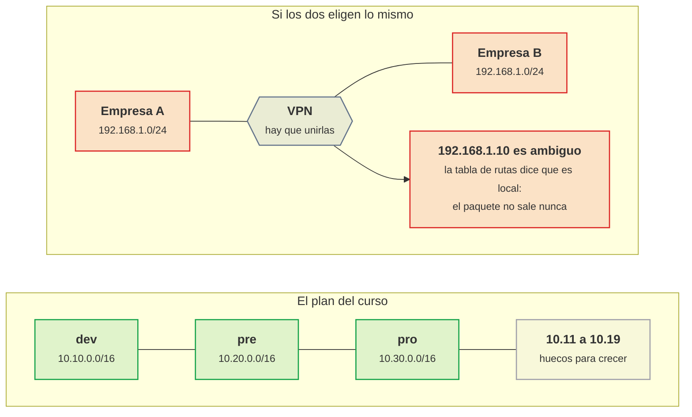
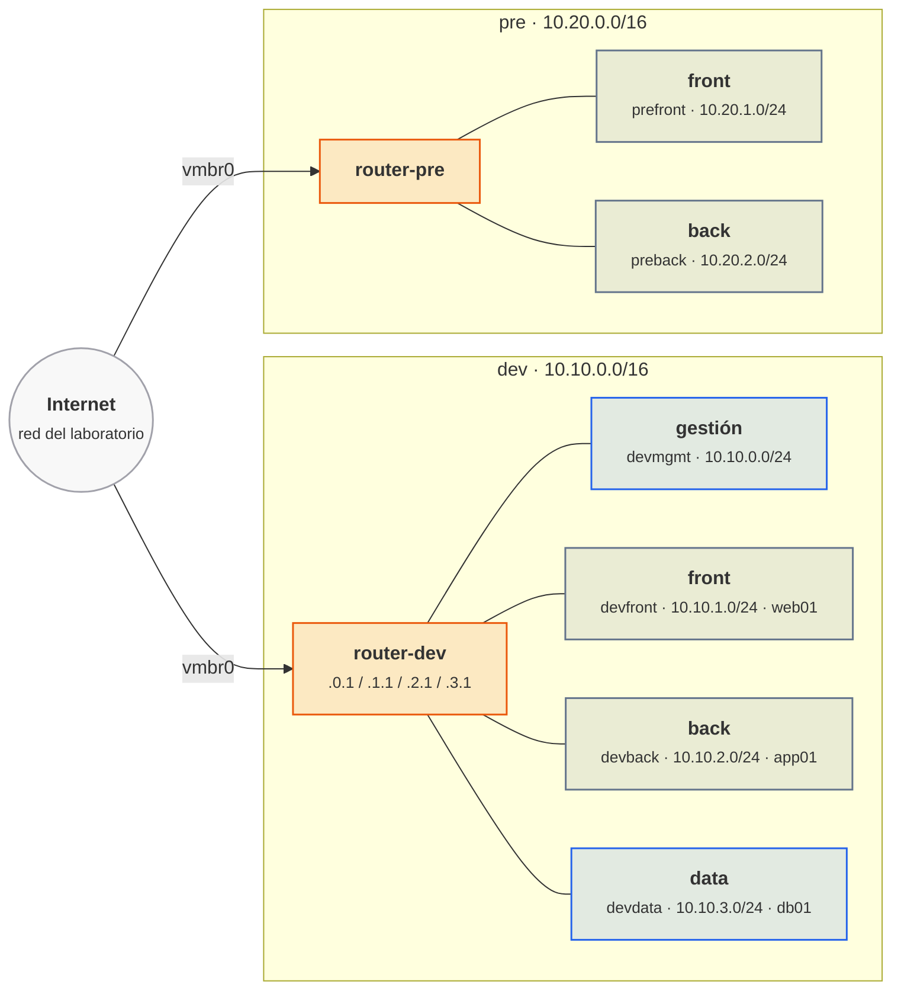
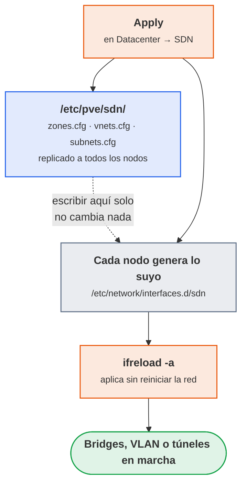
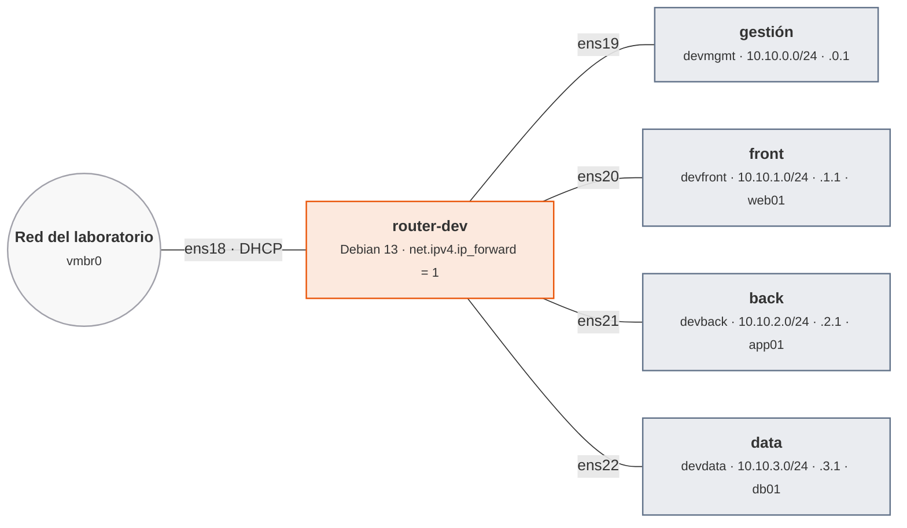
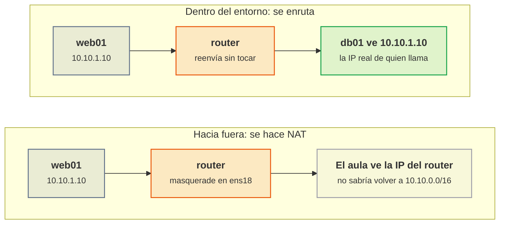
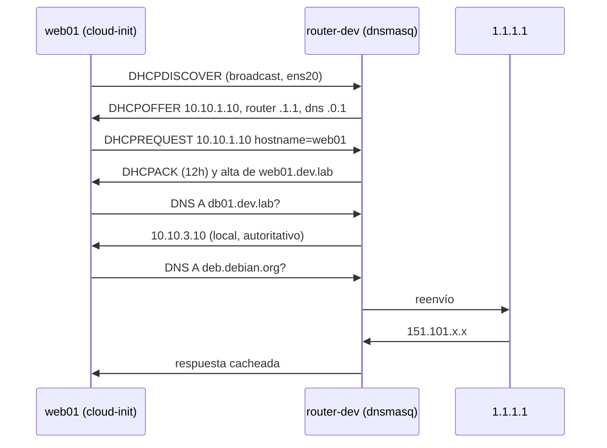
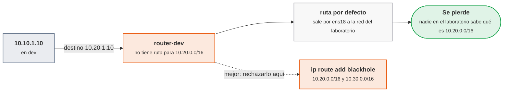
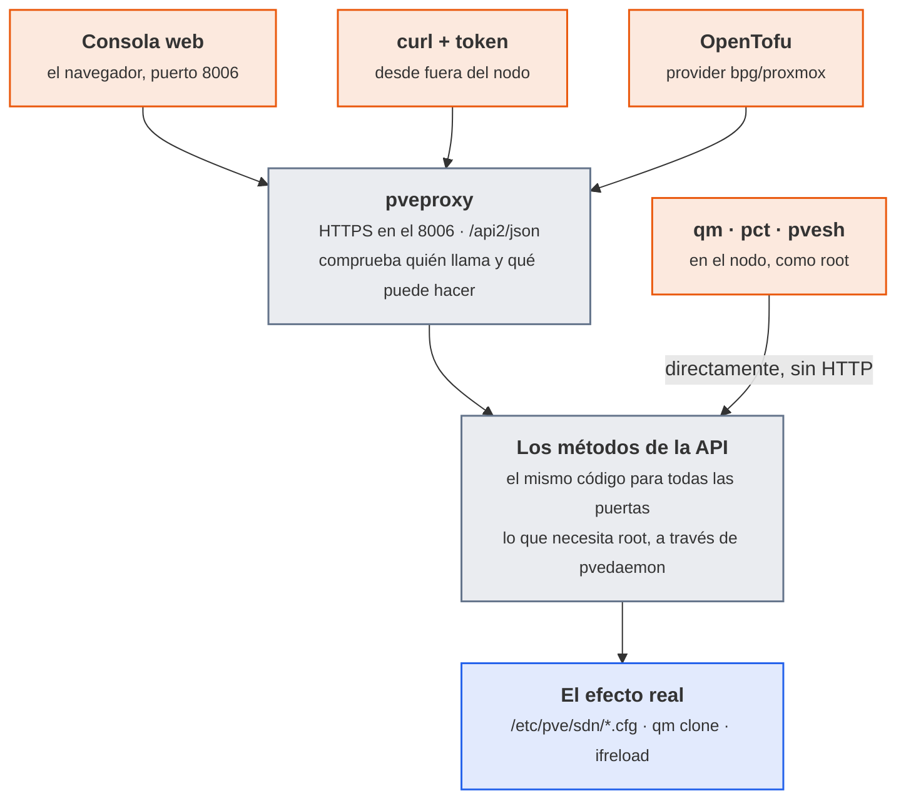

# UT2 · Nubes privadas virtuales (VPC)

<p class="ut-meta">8 h · Sesiones 11 a 14 · RA1 CE b, c</p>

La UT1 dejó un Proxmox funcionando, una plantilla Debian con cloud-init (ID 9000; cloud-init es lo que configura nombre, red y usuario en el primer arranque de cada clon) y sus bridges (los switches virtuales del nodo). Todas las VM clonadas hasta ahora cuelgan de `vmbr0`, la red del laboratorio: reciben la dirección que reparte el propio nodo y se ven con cualquier equipo de esa red. Para probar vale, pero un servicio de verdad no se monta así, por dos razones. La primera es que sus piezas no deberían compartir red: si alguien se hace con el servidor web, que es lo que se ve desde fuera, no debería tener la base de datos a un paso. La segunda es que lo que se ensaya no debería poder tocar lo que está en marcha. Por eso las empresas trabajan con varios **entornos**: *dev* (desarrollo), donde se construye y se prueba sin miedo a romper; *pre* (preproducción), una copia de producción donde se ensaya cada cambio antes de hacerlo de verdad; y *pro* (producción), donde corre el servicio que usan los clientes.

Esta unidad construye la red de esos tres entornos. Cada uno es una VPC, una red privada definida por software: un bloque de direcciones propio, partido en cuatro subredes (gestión, front, back y data), con su router, su DHCP y su DNS, y aislado de los otros dos, de forma que lo que pase en dev no pueda alcanzar pre ni pro. Se hace en el orden en que se haría en una empresa: primero el plano en papel y la red de dev en el SDN de Proxmox; después el router que reparte direcciones y nombres, con las pruebas que demuestran que funciona; y al final pre y pro, aislados de dev y creados con un script que habla con Proxmox, para poder repetirlos sin clics. `app01` y `mon01` se quedan de momento en la red del laboratorio, porque Mantenimiento las usa a diario, y esta unidad les deja reservadas su dirección y su nombre. Llegan a la VPC el 27 de noviembre, ya detrás del cortafuegos que monta la unidad de seguridad por capas (UT3).

## Sesión 11 · Diseño y VPC dev con SDN

<p class="ut-meta" markdown>11 de noviembre · Teoría y práctica · <span class="dur" tabindex="0" aria-label="Qué es una VPC · 5 min&#10;Diseño de direccionamiento · 10 min&#10;SDN en Proxmox · 10 min&#10;A2.1 Diseño y VPC dev con SDN · 85 min" data-dur="Qué es una VPC · 5 min&#10;Diseño de direccionamiento · 10 min&#10;SDN en Proxmox · 10 min&#10;A2.1 Diseño y VPC dev con SDN · 85 min">:material-school:<i class="dur-barra" style="--teoria:23%"></i>:material-flask:</span></p>

Antes de crear una sola red en Proxmox hay que decidir cómo será, porque el direccionamiento es lo más caro de cambiar después; y una vez decidido, hay que construirlo de forma que se pueda repetir para los tres entornos. Esta sesión hace las dos cosas, en ese orden. La teoría empieza por lo que se quiere imitar, la VPC de una nube pública, y por sus piezas, porque todas tienen equivalente en el laboratorio. Después baja al direccionamiento en el orden en que se decide: qué rangos se pueden usar sin chocar con nadie y cómo se reparten entre entornos y zonas, con una convención para las direcciones y otra para los números de VM. Por último presenta el SDN de Proxmox, la herramienta que convierte ese plano en redes: sus tres objetos, por qué cada zona lleva su propia VNet, qué pasa al aplicar y el DHCP que trae de serie. En clase se explica lo que decide la hoja; el repaso de CIDR y subnetting (que ya se trae del ciclo), la tabla de tipos de zona, la comparación de VLAN y VXLAN y la alternativa sin SDN son de consulta y se leen antes de clase. La hoja completa un plano propio de los tres entornos y monta la red de dev con las dos primeras VM.

### Qué es una VPC

**El problema que resuelve.** En una nube pública, miles de clientes comparten los mismos centros de datos, los mismos switches y los mismos cables. Cada uno necesita una red que se comporte como si fuera solo suya: con sus propias direcciones, que nadie de fuera pueda alcanzar y que pueda dividir como quiera. Eso no se puede hacer recableando cada vez que un cliente crea o borra una red: se hace con software. Una **VPC** (*Virtual Private Cloud*, nube privada virtual) es justo eso, una red privada y aislada, definida por software, dentro de una infraestructura que se comparte con otros. AWS presentó con ese nombre su servicio de redes privadas en 2009, y hoy es el primer recurso que se crea en cualquier nube: dentro de ella van las subredes, las máquinas, los balanceadores y las bases de datos gestionadas.

**Lo mismo en una nube privada.** En una nube privada como Proxmox u OpenStack (la plataforma libre más extendida para montarlas) el concepto es idéntico aunque cambie el nombre: SDN (red definida por software), red de proyecto, red de *tenant* (es decir, de cliente). La idea de fondo es la misma en todas: el rango de direcciones, cómo se trocea y qué sale a Internet lo decide quien diseña la red, y nadie de fuera de la VPC puede alcanzar sus máquinas salvo que se le abra la puerta. En el laboratorio, lo que se comparte es el nodo Proxmox, y quienes necesitan redes separadas son los tres entornos. Todo lo que se monta en esta unidad tiene así un nombre y un equivalente en cualquier nube pública, y quien entienda aquí las piezas las reconocerá en cualquier proveedor.

<figure markdown="span">
  { width="640" }
  <figcaption>Esquema de una VPC con subredes. Fuente: Sam Johnston, CC BY-SA 3.0, vía Wikimedia Commons.</figcaption>
</figure>

**Las piezas.** Son siempre las mismas, cambie el proveedor que cambie. En la tabla salen siglas (CIDR, NAT, SNAT, EVPN) que se explican cuando se usan, en esta sesión y en las siguientes; de momento basta con la columna del medio:

| Componente | Qué es | Equivalente en Proxmox |
|---|---|---|
| Bloque CIDR | Rango de IP de toda la VPC (p. ej. 10.10.0.0/16) | El rango del entorno, repartido entre las subnets de sus VNets |
| Subred | Trozo del bloque, normalmente por capa o zona (10.10.1.0/24) | VNet + Subnet en SDN |
| Zona de disponibilidad | Centro de datos independiente dentro de una región | Nodo del clúster |
| Tabla de rutas | Hacia dónde sale cada subred | Router virtual (VM) o zona EVPN |
| Gateway de Internet / NAT | Salida a Internet de subredes públicas o privadas | VM con NAT / firewall, o SNAT del SDN |
| DNS interno | Nombres para las máquinas de la VPC | dnsmasq en el router del entorno |
| Grupos de seguridad | Reglas de tráfico por instancia | Firewall de Proxmox (nivel VM) o del router |

El laboratorio tiene un solo nodo, así que no hay zonas de disponibilidad que repartir; qué son y cómo se simulan con uno o con dos nodos está en [Zonas de disponibilidad](../ampliacion.md#zonas-de-disponibilidad).

**Zonas: una subred por papel.** Dentro de la VPC, las máquinas no van todas juntas. Una aplicación web típica tiene tres capas: el servidor web o proxy que recibe las peticiones de fuera, la aplicación que las procesa y la base de datos que guarda los datos. Cada capa necesita una exposición distinta (el proxy tiene que verse desde Internet; la base de datos, solo desde la aplicación), y por eso cada una va en su propia subred, que en el curso se llama **zona**: *front* para el proxy, *back* para la aplicación y *data* para la base de datos, más una cuarta, *gestión*, para lo que administra y vigila (el puesto de administración y la monitorización). Separarlas en subredes es lo que permite poner reglas entre ellas, porque el tráfico de una zona a otra tiene que pasar por el router, que es donde se puede filtrar. El cortafuegos que pone esas reglas sustituye al router el 25 de noviembre, al empezar la unidad de seguridad por capas.

**Subredes públicas y privadas.** Una subred es pública cuando tiene ruta directa a Internet en los dos sentidos: ahí van balanceadores, proxies inversos y bastiones (las máquinas por las que se entra a administrar). Una subred es privada cuando solo sale por NAT (puede descargar paquetes, nadie puede entrar) o directamente no sale (la base de datos no tiene ninguna razón para hablar con Internet). En el laboratorio, front será la subred «pública» de cada entorno; back y data, las privadas; y gestión, privada y además solo accesible desde una red concreta.

**Los nombres en cada proveedor.** La misma idea recibe estos nombres en cada sitio:

| Concepto | Proxmox SDN | AWS | Azure | GCP |
|---|---|---|---|---|
| Red privada aislada | Zona + VNet | VPC | Virtual Network (VNet) | VPC network |
| Subred | Subnet | Subnet (ligada a una AZ) | Subnet | Subnet (ligada a una región) |
| Zona de disponibilidad | Nodo | Availability Zone | Availability Zone | Zone |
| Salida NAT | VM router / SNAT | NAT Gateway | NAT Gateway | Cloud NAT |
| DNS interno | dnsmasq | Route 53 Resolver | Azure DNS privado | Cloud DNS |
| Reglas por instancia | Firewall de Proxmox | Security Group | NSG (grupo de seguridad de red) | Firewall rules |
| Unión de dos VPC | Ruta en el router | VPC Peering / Transit Gateway | VNet Peering | VPC Peering |

**Lo que se monta en el curso.** Cada entorno del laboratorio es una VPC con sus cuatro zonas y su router. Solo dev llega al final del curso, con el servicio entero; pre recibe sus máquinas en enero y vive hasta marzo, para ensayar los despliegues; y pro se queda en red, sin servicio, porque para lo que se usa en el curso, demostrar que un entorno no alcanza a otro, no le hace falta más. Los tres se diseñan hoy juntos porque su direccionamiento tiene que encajar.

### Diseño de direccionamiento

**Por qué se dibuja antes.** Cambiar un rango de IP cuando ya hay veinte máquinas, un DNS y reglas de cortafuegos que lo referencian cuesta una tarde entera y algún disgusto, porque hay que cambiarlo todo a la vez y cualquier olvido deja algo sin conexión. Cinco minutos de papel ahorran eso. El direccionamiento se decide en tres pasos, que son los tres apartados siguientes: saber calcular qué cabe en cada bloque, elegir de qué rango se sacan los bloques para no chocar con nadie, y repartirlos entre entornos y zonas con una convención que se lea de un vistazo.

#### Repaso rápido de CIDR y subnetting

**De dónde sale la notación.** Hasta 1993, las direcciones IPv4 se repartían en clases de tamaño fijo (A, B y C: redes de unos 16 millones, de 65 536 o de 256 direcciones), y una organización que necesitaba dos mil direcciones recibía una clase B entera y desperdiciaba el resto. CIDR (*Classless Inter-Domain Routing*, enrutado entre dominios sin clases) permite cortar la red por cualquier bit; se introdujo precisamente para dejar de malgastar direcciones y para que las tablas de rutas de Internet no crecieran sin control. Hoy toda red se escribe así.

**Cómo se lee.** Una dirección IPv4 son 32 bits. La notación CIDR `10.10.1.0/24` dice que los 24 primeros bits identifican la red y los 8 restantes al host. Con eso se calcula todo lo demás:

- Máscara: 24 bits a uno, `255.255.255.0`.
- Direcciones en la red: 2^(32-24) = 256.
- Hosts utilizables: 256 menos la dirección de red (`10.10.1.0`) y la de broadcast (`10.10.1.255`), 254.
- Primera y última IP de host: `10.10.1.1` y `10.10.1.254`.

El mismo cálculo con otros prefijos habituales:

| Prefijo | Máscara | Direcciones | Hosts útiles | Ejemplo | Broadcast |
|---|---|---|---|---|---|
| /16 | 255.255.0.0 | 65 536 | 65 534 | 10.10.0.0/16 | 10.10.255.255 |
| /22 | 255.255.252.0 | 1 024 | 1 022 | 10.10.4.0/22 | 10.10.7.255 |
| /24 | 255.255.255.0 | 256 | 254 | 10.10.1.0/24 | 10.10.1.255 |
| /26 | 255.255.255.192 | 64 | 62 | 10.10.1.64/26 | 10.10.1.127 |
| /28 | 255.255.255.240 | 16 | 14 | 10.10.1.16/28 | 10.10.1.31 |
| /30 | 255.255.255.252 | 4 | 2 | 10.10.9.0/30 | 10.10.9.3 |

**Dónde puede empezar un bloque.** Conviene fijarse en el /22: `10.10.4.0/22` cubre desde `10.10.4.0` hasta `10.10.7.255`, es decir, cuatro /24 seguidos. El truco para no equivocarse es que la dirección de red tiene que ser múltiplo del tamaño del bloque en el octeto que se parte: un /22 solo puede empezar en .0, .4, .8, .12... del tercer octeto. `10.10.5.0/22` no es una red válida (su red real sería `10.10.4.0/22`) y Proxmox lo rechaza al crear la subnet. En AWS y Azure, además, el proveedor se reserva cinco direcciones de cada subred, las cuatro primeras y la última, así que un /28 allí se queda en 11 hosts.

**Para no calcular de cabeza.** Una herramienta que conviene tener a mano es `ipcalc` (paquete `ipcalc` en Debian) o `sipcalc`. Da de un bloque su máscara, su primera y su última dirección y el número de hosts, que es justo lo que la A2.1 pide para justificar cada tamaño:

```bash
$ ipcalc 10.10.4.0/22
Address:   10.10.4.0            00001010.00001010.000001 00.00000000
Netmask:   255.255.252.0 = 22   11111111.11111111.111111 00.00000000
Network:   10.10.4.0/22         00001010.00001010.000001 00.00000000
HostMin:   10.10.4.1
HostMax:   10.10.7.254
Broadcast: 10.10.7.255
Hosts/Net: 1022                  Class A, Private Internet
```

#### RFC 1918 y el problema del solapamiento

**Qué rangos se pueden usar.** Las direcciones públicas de Internet son únicas en el mundo y las reparten unos registros regionales; dentro de una organización no hacen falta, porque esas máquinas no se anuncian a Internet. La [RFC 1918](https://www.rfc-editor.org/rfc/rfc1918) (las RFC son los documentos que fijan los estándares de Internet), de 1996, reservó para ese uso tres rangos que nunca se enrutan en Internet y que cualquiera puede usar dentro de su red: `10.0.0.0/8` (16 millones de direcciones), `172.16.0.0/12` (de 172.16.0.0 a 172.31.255.255, un millón) y `192.168.0.0/16` (65 536). Junto con el NAT, la traducción de direcciones que hace el router al salir a Internet, son lo que ha permitido estirar las direcciones IPv4 mucho más allá de lo que daban de sí. Además existe `100.64.0.0/10` ([RFC 6598](https://www.rfc-editor.org/rfc/rfc6598)), pensado para el CGNAT de los operadores (el NAT a gran escala que hacen los proveedores de fibra), que algunas empresas usan para redes de tránsito precisamente porque nadie lo pone en una oficina.

**El problema: el solapamiento.** El error clásico es elegir el rango sin pensar en el futuro. Dos redes que hoy están separadas pueden tener que hablarse mañana: dev con pre para promocionar una imagen, la VPC de la empresa con la del proveedor por VPN, una nube privada con AWS por peering. Si las dos usan `192.168.1.0/24` (y lo usan, es la red por defecto de medio mundo), una máquina de un lado que quiera hablar con `192.168.1.10` del otro lado no tiene forma de saber a cuál se refiere: la tabla de rutas le dice que esa red es local y el paquete nunca sale. La solución en ese momento es NAT doble (traducir un lado a un rango ficticio), y quien lo haya tenido que mantener no lo repite. Por eso:

- Un bloque distinto por entorno, sin solapar. En el curso: `10.10.0.0/16` para dev, `10.20.0.0/16` para pre, `10.30.0.0/16` para pro. Los huecos entre medias (10.11 a 10.19) quedan para crecer.
- Dentro de cada entorno, una subred por zona: front, back, data y gestión.
- Evitar `192.168.0.0/24`, `192.168.1.0/24`, `10.0.0.0/24` y `172.16.0.0/24`.

!!! truco "Los cuatro rangos que no hay que usar nunca"
    Son los que trae por defecto cualquier router doméstico y casi cualquier VPN de teletrabajo. El día que
    alguien se conecte desde casa a la VPN de la empresa, su router y la red de destino serán la misma red y
    no habrá arreglo limpio. Elegir un bloque raro dentro de `10.0.0.0/8` evita ese problema.



<p class="pie" markdown>Elegir el rango es una decisión de dentro de cinco años. El día que haya que unir dos redes, o no se solapan o toca NAT doble.</p>

#### Por qué /16 por entorno y /24 por subred

**El tamaño del bloque.** Un /16 son 65 534 hosts útiles y en dev habrá seis máquinas. Parece un desperdicio, pero el espacio privado no cuesta dinero y lo que sí cuesta es renumerar. Con un /16 hay 256 subredes /24 posibles por entorno, así que se puede dar una a cada zona, otra a cada zona de disponibilidad (front-a, front-b), otra a cada cliente si el entorno se vuelve multi-tenant (varios clientes sobre el mismo hardware), y aún sobran doscientas. Un /24 por subred da 254 hosts, más que suficiente para una zona, y tiene la ventaja de que se lee de un vistazo: en `10.10.2.37` se ve que es dev (10.10), back (.2) y un servidor fijo (.37) sin mirar ninguna tabla. Ese «se lee de un vistazo» es lo que salva al leer una captura de tráfico a las cinco de la tarde.

**El reparto del curso.** Este es el ejemplo usado en el curso (la A2.1 pide inventar uno propio). El segundo octeto es el entorno y el tercero, la zona: front, back y data llevan el 1, el 2 y el 3, en el orden en que las recorre una petición, y gestión, que no es de ninguna capa, se queda el 0.

| Entorno | Bloque | Gestión | Front | Back | Data |
|---|---|---|---|---|---|
| dev | 10.10.0.0/16 | 10.10.0.0/24 | 10.10.1.0/24 | 10.10.2.0/24 | 10.10.3.0/24 |
| pre | 10.20.0.0/16 | 10.20.0.0/24 | 10.20.1.0/24 | 10.20.2.0/24 | 10.20.3.0/24 |
| pro | 10.30.0.0/16 | 10.30.0.0/24 | 10.30.1.0/24 | 10.30.2.0/24 | 10.30.3.0/24 |

**Dentro de cada /24.** Una convención de direcciones que se repite en todas las subredes: `.1` el router del entorno, que además hace de DNS y de DHCP; `.2` a `.9` reservadas para servicios de red, que en esta unidad no se usan; `.10` a `.99` servidores con IP fija (el DHCP les da siempre la misma, reservada por su MAC); `.100` a `.199` rango DHCP dinámico para máquinas de usar y tirar; `.200` a `.254` pruebas de un rato y direcciones que no son de una máquina concreta, como la de un balanceador. Conviene escribirla en la memoria y respetarla: la convención vale más que el rango concreto, porque es lo que permite saber qué es una dirección sin buscarla.

**El número de la VM.** Proxmox identifica cada VM por un número, que es el que se ve en el árbol de recursos de la consola y el que usan los scripts y OpenTofu. Conviene fijar su convención desde el primer día, porque un número que dice dónde vive la máquina hace que un ID equivocado salte a la vista: la centena es el entorno (1 dev, 2 pre, 3 pro) y la decena es la zona, con el mismo dígito que el tercer octeto de su subred (0 gestión, 1 front, 2 back, 3 data). Así `120` es `app01` de dev, en back, con la `10.10.2.10`, y `230` es `db01` de pre, en data, con la `10.20.3.10`. El router de cada entorno se queda con el primer número de la franja de gestión: 100, 200 y 300. Los nombres cortos se repiten en los tres entornos a propósito; lo que los distingue es el dominio y el ID. La tabla completa de máquinas y números está en las [convenciones del laboratorio](../laboratorio.md#convenciones).



<p class="pie" markdown>Entre dev y pre no hay ninguna línea, y eso es justo el aislamiento: no es una regla que prohíbe, es que no existe el camino.</p>

### SDN en Proxmox

**El problema.** Con el plano hecho, toca construir la red de dev. Una VNet de la VPC no es más que un bridge en el nodo, como los que en la UT1 se crearon a mano en `/etc/network/interfaces`. Eso sirve para una red, pero no para doce (cuatro zonas por tres entornos), y hacerlo así tiene dos pegas. Cada bridge se escribe en el fichero de red de un nodo, y en un clúster hay que repetirlo idéntico en todos, nodo a nodo; y nada lleva la cuenta de qué direcciones están dadas ni a quién. Un **SDN** (*Software-Defined Network*, red definida por software) resuelve las dos: la red se describe una sola vez, en un sitio central, y el software crea en cada nodo los bridges, las VLAN o los túneles que hagan falta y lleva el registro de las direcciones. Proxmox lo trae instalado de serie desde la versión 8.1, en Datacenter → SDN.

**Tres objetos, de lo general a lo particular.** La jerarquía tiene tres niveles y conviene tenerla clara:

- Zona: define el tipo de red y en qué nodos existe. Es el «cómo se transporta el tráfico».
- VNet: una red virtual dentro de la zona. Al crear una VM aparece en el desplegable de bridges como si fuera un `vmbrN` más. Es el «cable» al que se conecta la máquina.
- Subnet: un rango CIDR dentro de la VNet, con gateway opcional, rango DHCP opcional y SNAT opcional.

**Y dos servicios alrededor.** Además hay dos objetos transversales: IPAM (gestión de direcciones IP: el registro de qué IP está asignada a quién; el que viene de serie se llama `pve` y guarda el estado en `/etc/pve/priv/ipam.db`) y DNS (integración con un servidor PowerDNS externo para que el IPAM registre nombres automáticamente; en el laboratorio del curso no se usa, porque los nombres los resuelve el router del entorno con dnsmasq).

Los apartados que siguen deciden cómo se usan esos objetos en el curso: cuántas VNets, de qué tipo de zona, qué ocurre al aplicar y quién reparte las direcciones.

#### Una VNet por zona, una subred por VNet

**Dos significados de «zona».** En el SDN, la zona es el tipo de red: el laboratorio tiene una sola, `lab`, de tipo Simple. En el diseño de la VPC, zona es cada una de las cuatro partes de un entorno: gestión, front, back y data. El título de este apartado habla de las segundas: las cuatro VNets de dev, una por zona del diseño, van todas dentro de la misma zona del SDN.

**Por qué no una sola VNet con cuatro subredes.** Proxmox admite varias subredes dentro de la misma VNet, pero no conviene aprovecharlo. Una VNet es un bridge, es decir, un único dominio de capa 2 (el trozo de red en el que las máquinas se encuentran directamente por su MAC, sin pasar por ningún router). Dos subredes en el mismo bridge comparten el mismo cable virtual: a una máquina le basta con ponerse una dirección de la otra subred para hablar con sus vecinas sin pasar por el router, y entonces ningún cortafuegos puede garantizar nada. Para filtrar entre dos redes, el tráfico tiene que pasar obligatoriamente por un router, y para eso cada red tiene que colgar de su propio bridge. Si las cuatro zonas de dev vivieran en una sola VNet, no habría dónde filtrar entre ellas.

Por eso cada entorno tiene cuatro VNets, una por zona, y cada VNet una sola subred. En dev quedan así:

| VNet | Subred | Zona |
|---|---|---|
| `devmgmt` | 10.10.0.0/24 | gestión |
| `devfront` | 10.10.1.0/24 | front |
| `devback` | 10.10.2.0/24 | back |
| `devdata` | 10.10.3.0/24 | data |

**El nombre.** Se forma juntando el entorno y la zona, sin guiones: `devmgmt`, `devfront`, `devback`, `devdata`, y lo mismo en los otros dos entornos (`prefront`, `preback`, `proback`, `prodata`...). No es una manía de estilo: el ID de una VNet, igual que el de una zona, admite como máximo ocho caracteres alfanuméricos, así que un nombre como `vdev-front`, con diez caracteres y un guion, Proxmox lo rechaza al crearlo.

#### Tipos de zona y cuándo usar cada uno

**Qué decide el tipo de zona.** En un solo nodo, cualquier VNet acaba siendo un bridge y el tipo de zona apenas se nota. La diferencia aparece con varios nodos: una VM del nodo 1 y otra del nodo 2 conectadas a la misma VNet tienen que verse, y su tráfico tiene que viajar entre los nodos por la red física, mezclado con el de las demás VNets sin confundirse con él. Cada tipo de zona resuelve ese transporte de una manera:

| Zona | Cómo funciona | Alcance | Cuándo |
|---|---|---|---|
| Simple | Crea un bridge Linux sin interfaz física por cada VNet. Aislado. Puede hacer SNAT hacia fuera. | Un nodo (las VM de otro nodo no ven la red) | Laboratorio de un solo nodo, redes de pruebas, lo que se usa en la A2.1 |
| VLAN | Cada VNet es un tag 802.1Q sobre un bridge físico existente (vmbr0). El switch físico tiene que dejar pasar esas VLAN. | Todo el clúster, si el switch está configurado | Empresa pequeña con switches gestionables; lo más habitual en producción on-premise |
| QinQ | VLAN dentro de VLAN (802.1ad). Una VLAN de servicio por zona y VLAN de cliente por VNet. | Clúster | Proveedores que necesitan más de 4094 segmentos o aislar clientes que a su vez usan VLAN |
| VXLAN | Encapsula tramas Ethernet en UDP (puerto 4789) entre los nodos. No necesita nada del switch físico. | Clúster (túnel entre las IP de los nodos) | Clúster de varios nodos sin control sobre la red física; nube |
| EVPN | VXLAN más BGP (el protocolo de enrutado de Internet, aquí hablado por el software FRR) para anunciar MAC e IP entre nodos, con enrutado distribuido: cada nodo es gateway de sus VM. | Clúster, y puede salir a routers externos | Cuando se quiere que el SDN enrute entre VNets sin una VM router; es lo más parecido a una VPC de nube |

**El criterio.** Elegir bien la zona es la decisión más importante de esta unidad y la que menos se puede deshacer, porque cambiar de zona implica recrear las VNets. El criterio habitual: Simple en un laboratorio de un solo nodo y sin control del switch, que es el caso del curso; en una empresa con dos o tres nodos y switches propios, VLAN, que es lo que el equipo de redes ya entiende; VXLAN cuando los nodos están en sitios distintos o la red física no es propia; EVPN solo cuando de verdad haga falta que el enrutado sea distribuido, porque añade BGP y FRR a la ecuación y eso se depura peor.

#### VLAN 802.1Q frente a VXLAN

Los dos tipos de zona que se usan fuera del laboratorio llevan varias redes por el mismo cable de dos maneras distintas: la VLAN, la misma de las modalidades de red de la UT1, etiqueta la trama Ethernet y necesita que cada switch del camino conozca la etiqueta; VXLAN envuelve la trama entera dentro de un paquete UDP/IP, atraviesa routers y no exige nada al switch. La comparación completa (tamaño del identificador, coste de proceso y cuándo se elige cada una) está en [VLAN frente a VXLAN](../ampliacion.md#vlan-frente-a-vxlan). Del lado práctico solo hay que retener una consecuencia: esa envoltura añade unos 50 bytes, así que con VXLAN la MTU (el tamaño máximo de paquete que admite una interfaz) de las VM baja a 1450 si la red física va a 1500.

!!! ojo "Si se olvida la MTU, el fallo no parece de red"
    Los ping pequeños funcionan y las transferencias grandes se cuelgan sin dar error. Es el síntoma más
    engañoso de la unidad: parece el disco, parece la aplicación, y es la MTU. Ante una transferencia que se
    para, conviene comparar dos ping con la fragmentación prohibida: `ping -M do -s 1400`, que cabe aunque
    haya cabecera de VXLAN, y `ping -M do -s 1472`, que es un paquete de 1500 bytes justos. Si el primero
    llega y el segundo no, es la MTU.

#### Qué hace Apply por debajo

**Escribir no es aplicar.** La configuración del SDN se escribe en `/etc/pve/sdn/` (ficheros `zones.cfg`, `vnets.cfg`, `subnets.cfg`), que está en el sistema de ficheros del clúster y por tanto se replica a todos los nodos. Pero escribir ahí no cambia nada en la red: hasta que se aplica, la consola muestra los cambios como pendientes, y así se pueden preparar varios y aplicarlos juntos. Al pulsar Apply (en `Datacenter → SDN`), cada nodo genera el fichero `/etc/network/interfaces.d/sdn` con los bridges, VLAN o túneles VXLAN que le tocan y ejecuta `ifreload -a` (de ifupdown2, la herramienta que gestiona las interfaces de red en Proxmox), que aplica los cambios sin reiniciar la red.



<p class="pie" markdown>La configuración vive en el clúster; la red de verdad la levanta cada nodo al aplicar.</p>

**Lo que queda en el nodo.** Un ejemplo de lo que aparece para una zona Simple con la VNet `devfront`; las otras tres salen igual, cada una con su nombre y su alias:

```text
auto devfront
iface devfront
        bridge_ports none
        bridge_stp off
        bridge_fd 0
        mtu 1500
        alias dev front
```

Si la subnet lleva gateway, como en la A2.1, el bloque tiene además una línea `address 10.10.1.1/24`: es el `.1` que el nodo se pone en ese bridge para hacer de router de la subred, y es lo que hay que quitar cuando el entorno tiene su propio router.

**Si Apply no hace nada.** Si en `/etc/network/interfaces` no está la línea `source /etc/network/interfaces.d/*` (viene en instalaciones nuevas, pero no siempre en las actualizadas desde versiones antiguas), Apply dirá que todo va bien y no habrá ningún bridge. Es la primera cosa que se comprueba cuando "el SDN no hace nada".

#### DHCP e IPAM integrados

**Qué aporta.** Una VNet recién creada es solo un cable: las VM que se conectan a ella no reciben dirección de nadie. Desde Proxmox 8.1, una zona puede llevar `DHCP: dnsmasq`. Proxmox arranca entonces una instancia de dnsmasq por zona (unidad `dnsmasq@<zona>.service`, configuración en `/etc/dnsmasq.d/<zona>/`) que escucha en las VNets de esa zona y entrega las IP que el IPAM ha reservado para cada VM. Con una zona Simple y la subnet de `devfront` con gateway `10.10.1.1` y rango DHCP `10.10.1.100-10.10.1.199`, al conectar una VM a `devfront` (al crearla o al cambiarle el bridge) el IPAM le reserva una IP libre del rango y la ata a su MAC, y cuando la VM arranca, dnsmasq se la sirve. El gateway `.1` lo pone Proxmox en el propio bridge del nodo, así que el nodo es el router de esa subred; si además se marca SNAT en la subnet, el nodo cambia la dirección de origen de las VM por la suya al salir, que es lo que se llama NAT de origen, y las VM tienen Internet sin ninguna VM router.

**Lo que necesita el nodo.** Para que funcione hace falta el paquete `dnsmasq` instalado en el nodo pero con la unidad genérica deshabilitada, porque si no compite con las instancias por zona:

```bash
apt install dnsmasq
systemctl disable --now dnsmasq
```

**Por qué es provisional.** Es cómodo, y para probar es perfecto, pero se queda corto para un entorno de verdad, por razones prácticas y didácticas a la vez: el DHCP del SDN no hace DNS con nombres propios ni deja tocar opciones finas; con él, el nodo, que es el hipervisor de todo el laboratorio, hace además de router de los entornos; y el router del entorno es donde van a vivir las reglas de cortafuegos entre zonas. Por eso, el 13 de noviembre, se sustituye por una VM router propia, `router-dev`. Ese relevo tiene un paso obligatorio: al montar el router hay que quitar el gateway y el rango DHCP de las subredes del SDN, porque el `.1` de una subred solo puede estar en un sitio. Entender qué hace el SDN por debajo (un bridge con el `.1`, un dnsmasq por zona y una regla de NAT) es lo que permite arreglarlo cuando falla.

#### Alternativa sin SDN

Lo que existía antes del SDN sigue funcionando y es lo mismo hecho a mano: en `/etc/network/interfaces` un bridge sin `bridge-ports` (sin interfaz física, por tanto aislado dentro del nodo) por cada zona, `vmbr10` para gestión, `vmbr11` para front, `vmbr12` para back y `vmbr13` para data, y una VM router con una pata en cada uno de ellos y otra en `vmbr0` que hace DHCP, DNS y NAT. Si el SDN da guerra, esto es el plan B y es equivalente para la práctica evaluable.

### A2.1 Diseño y VPC dev con SDN (sesión 11)

<span class="et et-obj">Objetivo</span> Al terminar tienes dos cosas. La primera es el plano de los tres entornos, con una tabla de direccionamiento propia y justificada: es el ejercicio de diseño que pide el criterio de evaluación y el primer punto de la memoria de la práctica evaluable. La segunda son las cuatro VNets de dev funcionando en el SDN, una por zona, con dos VM de zonas distintas que reciben IP de su subred. El plano es tuyo, pero el laboratorio se monta con los rangos del curso, que son los que comparten las dos asignaturas; las decisiones son las mismas. Estas cuatro VNets son las que usa dev hasta el final del curso: a ellas se conectan después el router del entorno, el cortafuegos y, el 27 de noviembre, `app01` y `mon01`.

<span class="et et-pre">Antes de empezar</span>

- El nodo de la UT1 con la plantilla 9000, la consola web como `root@pam` y su Shell, con `ipcalc` instalado; y la VM `puesto` con `git`.
- `web01` (110), `app01` y `mon01` existen desde la A1.3, en `vmbr0`. Hoy `web01` pasa a la VPC; `app01` y `mon01` se quedan, porque Mantenimiento las usa a diario: las traslada la unidad de seguridad por capas el 27 de noviembre, ya con cortafuegos.
- Los rangos de dev que se montan hoy son los de las [convenciones del laboratorio](../laboratorio.md#convenciones), no los de tu plano.
- Explicado en esta sesión: [qué es una VPC](#que-es-una-vpc), [el diseño de direccionamiento](#diseno-de-direccionamiento) y [el SDN de Proxmox](#sdn-en-proxmox), con [una VNet por zona](#una-vnet-por-zona-una-subred-por-vnet), [qué hace Apply](#que-hace-apply-por-debajo) y [el DHCP integrado](#dhcp-e-ipam-integrados). De consulta: el [repaso de CIDR](#repaso-rapido-de-cidr-y-subnetting) y [los tipos de zona](#tipos-de-zona-y-cuando-usar-cada-uno).

<span class="et et-pas">Pasos</span>

La primera parte es de papel y la segunda de consola, y van en ese orden porque la red se construye a partir del plano. Primero completas tu plano y compruebas que no choca con nada. Después construyes dev en el orden de los objetos del SDN, de lo general a lo particular: preparas el nodo, creas la zona, dentro de ella las VNets con su subred, y aplicas, porque hasta ese momento nada existe en la red. Solo entonces conectas las dos VM y compruebas que cada una ha recibido una dirección de su propia subred.

1. **Completa el plano de los tres entornos.** Parte de estas dos tablas, que tienen la estructura del curso y dejan en blanco lo que decides tú. Rellena la primera con un bloque de la RFC 1918 distinto del ejemplo y escribe debajo, en una línea, por qué ese, como explica [el problema del solapamiento](#rfc-1918-y-el-problema-del-solapamiento). En la segunda, justifica cada tamaño con su cálculo. Añade la convención de IP dentro de cada /24 (puedes adoptar la del curso) y un esquema de los tres entornos: vale el de [Por qué /16 por entorno y /24 por subred](#por-que-16-por-entorno-y-24-por-subred) con tus rangos y con pro añadido, sin ninguna línea entre entornos.

    | Entorno | Bloque | Gestión | Front | Back | Data | ID de VM |
    |---|---|---|---|---|---|---|
    | dev | | | | | | 100 a 199 |
    | pre | | | | | | |
    | pro | | | | | | |

    | Red | Máscara | Direcciones | Hosts útiles | Broadcast | Por qué este tamaño |
    |---|---|---|---|---|---|
    | El bloque de un entorno | | | | | |
    | La subred de una zona | | | | | |

2. **Comprueba que nada se solapa.** Con `ipcalc` en el nodo, comprueba que ninguno de tus bloques se solapa con otro, ni entre entornos ni con las redes que ya tiene el nodo: la del aula (`vmbr9`) y la del laboratorio (`vmbr0`). Un solapamiento no da error al crear nada: aparece semanas después, como una máquina a la que no se llega.

    *Pista:* `ipcalc` no compara bloques; te da la primera y la última dirección de cada uno, y el solapamiento se ve al ponerlos en orden.

3. **Prepara el nodo y crea la zona `lab`.** El DHCP del SDN arranca un dnsmasq propio por zona, así que el paquete tiene que estar instalado en el nodo y su servicio genérico, parado, como dice [DHCP e IPAM integrados](#dhcp-e-ipam-integrados). Después, en Datacenter → SDN, crea una zona Simple con ID `lab`, DHCP `dnsmasq` e IPAM `pve`: Simple, porque el laboratorio es un solo nodo sin control del switch. Es la zona de los tres entornos durante todo el curso.

4. **Crea las cuatro VNets de dev y aplica.** En la zona `lab`, una VNet por zona del diseño: `devmgmt`, `devfront`, `devback` y `devdata`, con los alias `dev gestion`, `dev front`, `dev back` y `dev data`, y en cada una una sola subred, el /24 de su zona, con gateway en el `.1` y rango DHCP de `.100` a `.199`. Los nombres y rangos no se eligen: son los de las [convenciones del laboratorio](../laboratorio.md#convenciones). Aplica y comprueba en el nodo las tres cosas que tiene que haber dejado [Apply](#que-hace-apply-por-debajo): los cuatro bridges, su definición en `/etc/network/interfaces.d/sdn` y `dnsmasq@lab` en marcha. Ese fichero es una de las evidencias de la memoria de la evaluable.

5. **Conecta las dos primeras VM.** Conecta a la VPC sus dos primeras VM de servicio, las dos con IP por DHCP: `web01` (110) a `devfront`, y `db01` (130), que nace hoy de la plantilla con 2 GB, a `devdata`. Busca en Datacenter → SDN → IPAM la IP que ha recibido cada una, entra por SSH desde el nodo y guarda su `ip a` y su `ip r`: tienen que coincidir con lo que dice el IPAM, y la ruta por defecto, apuntar al `.1` de su subred.

    *Pista:* `web01` no se clona otra vez: apágala, cambia el Bridge de su `net0` en la pestaña Hardware y arráncala. Desde el nodo entras con `ssh ops@<IP>`, porque hoy es el `.1` de cada subred y su clave va en la plantilla.

<span class="et et-com">Comprobación</span> Ninguno de tus bloques se solapa entre sí ni con `vmbr9` ni con `vmbr0`, y cada tamaño está justificado con el cálculo de hosts. `ip -br link show type bridge` lista las cuatro VNets: `devfront` y `devdata`, que ya tienen una VM conectada, en `UP`, y `devmgmt` y `devback` en `DOWN` mientras no se les conecte nada, que es lo normal en un bridge vacío. `web01` tiene una IP del rango `10.10.1.100` a `10.10.1.199` con gateway `10.10.1.1`, y `db01` una de `10.10.3.100` a `10.10.3.199` con gateway `10.10.3.1`; el IPAM lista las dos VM con su MAC e IP, y cada VM hace `ping` a su `.1`. Que `web01` alcance a `db01` no es cosa de hoy: eso lo hace el router del entorno, que llega el 13 de noviembre.

<span class="et et-ent">Para practicar</span> Crea en el puesto `entregas-5166`, el repositorio Git donde guardas el trabajo de las hojas de esta asignatura, con una carpeta por hoja dentro de `ut2/`. Guarda en `ut2/a21` tu plano (las dos tablas, la línea que justifica el bloque, la convención y el esquema), una captura del SDN aplicado con las cuatro VNets, el contenido de `/etc/network/interfaces.d/sdn` y la salida de `ip a` de las dos VM. El plano y el fichero del SDN son los puntos 1 y 2 de la memoria de la evaluable. El repositorio es local de momento: el 13 de noviembre lo llevas al puesto de administración, y recibe su remoto cuando exista la Gitea de Mantenimiento en `mon01`.

<span class="et et-ext">Si te sobra tiempo</span> Marca SNAT en la subnet de `devfront`, aplica, y comprueba desde `web01` que `ping -c 3 deb.debian.org` sale a Internet sin ninguna VM router. Si una VM no coge IP, `journalctl -u dnsmasq@lab -f` en el nodo mientras la reinicias enseña el intercambio DHCP o su ausencia.

## Sesión 12 · Router de dev y comunicación entre zonas

<p class="ut-meta" markdown>13 de noviembre · Teoría y práctica · <span class="dur" tabindex="0" aria-label="Servicios de red: enrutado, NAT, DHCP y DNS · 15 min&#10;Cómo se prueba una red · 10 min&#10;A2.2 Router de dev y comunicación entre zonas · 85 min" data-dur="Servicios de red: enrutado, NAT, DHCP y DNS · 15 min&#10;Cómo se prueba una red · 10 min&#10;A2.2 Router de dev y comunicación entre zonas · 85 min">:material-school:<i class="dur-barra" style="--teoria:23%"></i>:material-flask:</span></p>

Con el DHCP del SDN, `web01` y `db01` tienen dirección, pero se la da el nodo: una cualquiera del rango, que puede cambiar, sin un nombre que la resuelva y con el propio hipervisor haciendo de router de las subredes. Un entorno de verdad necesita una máquina suya que haga cuatro trabajos: encaminar el tráfico entre las cuatro zonas, sacarlo a Internet, dar a cada servidor siempre la misma dirección y resolver los nombres de todos. Es el router del entorno, `router-dev`. Y una vez montado, «parece funcionar» no es una prueba: el criterio de evaluación pide demostrar con evidencias que las zonas se comunican como deben. Esta sesión hace las dos cosas, en ese orden. La teoría empieza por los servicios de red en el orden en que se montan: la VM con una pata en cada VNet y el reenvío IP, que la convierte en router; la diferencia entre enrutar y hacer NAT, que decide qué tráfico se traduce y cuál no; y dnsmasq, que reparte direcciones y nombres. Después pasa a las pruebas: desde dónde se prueba (el puesto de administración, porque desde que `router-dev` es el `.1` de cada subred el nodo ya no tiene dirección en ninguna), qué demuestra cada herramienta y la plantilla con la que cada prueba queda escrita. En clase se explican las piezas y el porqué; el comentario línea a línea de `dev.conf` y la lectura detallada de las salidas de cada herramienta son de consulta: se leen antes de clase y se vuelve a ellos durante la hoja. La hoja monta `router-dev` y el puesto de administración, y demuestra la comunicación entre front y data.

### Servicios de red: enrutado, NAT, DHCP y DNS

**Cuatro servicios en una máquina.** Una VNet es un cable. Lo que la convierte en una red utilizable son cuatro servicios: alguien que encamine el tráfico entre subredes, alguien que lo traduzca al salir a Internet, alguien que reparta direcciones (el DHCP) y alguien que convierta nombres en direcciones (el DNS). Con el SDN, el nodo hacía dos, el gateway y el DHCP. Desde hoy los cuatro los hace una VM por entorno, y este apartado la monta pieza a pieza. Es el apartado con más configuración de la unidad; la A2.2 y la A2.3 salen de aquí.

#### Router de entorno

**Por qué una VM y no el nodo.** El nodo podría seguir siendo el router de las subredes, como hasta ahora, pero entonces el hipervisor de todo el laboratorio sería también la puerta de cada entorno, y un error en su configuración de red afectaría a la vez a todos los entornos y al propio nodo. Una VM por entorno separa los papeles: se puede reiniciar, romper o sustituir sin tocar el nodo ni los otros entornos, y es lo que tiene una VPC de nube pública, un router propio por red. El 25 de noviembre, al empezar la unidad de seguridad por capas, su sitio lo ocupa un cortafuegos, OPNsense, con las mismas direcciones.

**Una pata en cada VNet.** El router es una VM Debian 13 clonada de la plantilla, con una interfaz por VNet y otra hacia el exterior. Cada pata cuelga de un bridge distinto, y eso es justo lo que permite filtrar entre zonas: el tráfico de una zona a otra solo puede ir de una pata a otra atravesando el router. En Proxmox las interfaces virtio (las tarjetas de red paravirtualizadas, las más rápidas para una VM) aparecen dentro de la VM como `ens18`, `ens19`, `ens20`... en el orden de `net0`, `net1`, `net2`. El número no es casual: Linux nombra cada tarjeta por la ranura PCI en la que la encuentra, y Proxmox pone `net0` en la ranura 18 de la placa virtual, `net1` en la 19, y así sucesivamente. Convención del curso: `ens18` exterior (vmbr0, IP de la red del laboratorio por DHCP), `ens19` gestión (`devmgmt`, `.0.1`), `ens20` front (`devfront`, `.1.1`), `ens21` back (`devback`, `.2.1`) y `ens22` data (`devdata`, `.3.1`).

**El `.1` solo puede estar en un sitio.** El router es el `.1` de las cuatro subredes, y es el único: por eso, antes de que dnsmasq entre en juego, hay que quitar el gateway y el rango DHCP que el SDN puso en cada subred. Si se dejan, en cada red hay dos máquinas que dicen ser el `.1` (el nodo y el router) y dos servidores DHCP repartiendo; las VM cogen una oferta u otra según quién conteste antes y la red se vuelve impredecible.



<p class="pie" markdown>Una pata por VNet, en el orden de `net0`, `net1`, `net2`… Sin el reenvío activado, el router acepta lo suyo y tira el resto: front y back no se hablan.</p>

**El reenvío IP.** Por defecto, un Linux se comporta como un equipo final, no como un router: acepta los paquetes dirigidos a una de sus direcciones y descarta los que van a otra máquina. Para que reenvíe de una red a otra hay que activar el reenvío IP, que en Debian viene apagado. Sin él, front y back no se hablan aunque el router tenga pata en las dos. El fichero de `/etc/sysctl.d/` hace que el cambio sobreviva al reinicio, y `sysctl --system` lo aplica en el momento:

```bash
# /etc/sysctl.d/99-router.conf
net.ipv4.ip_forward = 1
```

```bash
sysctl --system
sysctl net.ipv4.ip_forward   # debe devolver 1
```

**Cómo encamina.** Con el reenvío activo, el router ya encamina entre sus cuatro redes, porque todas son redes directamente conectadas: cuando `web01` (10.10.1.10) manda un paquete a `db01` (10.10.3.10), su tabla de rutas dice que 10.10.3.0/24 no es local y lo envía al gateway 10.10.1.1; el router mira su tabla, ve que 10.10.3.0/24 está en `ens22` y lo reenvía. No hace falta añadir ninguna ruta: un router conoce sin más las redes a las que está conectado. Las rutas estáticas aparecen cuando una máquina tiene que llegar a una red que no es la suya por un camino que no es su ruta por defecto.

#### Enrutar frente a hacer NAT

**Dos operaciones distintas.** Se confunden mucho. Enrutar es reenviar el paquete sin tocarlo: la IP de origen que ve `db01` es la de `web01`, y `db01` puede responder porque tiene ruta de vuelta. NAT (traducción de direcciones) es reescribir la IP de origen (SNAT, o su variante masquerade) o la de destino (DNAT) al pasar por el router. Nació a mediados de los noventa como remedio provisional al agotamiento de las direcciones IPv4, el mismo problema que llevó a la RFC 1918: dentro, direcciones privadas; en el borde, una sola pública que las representa a todas. Para que la respuesta vuelva, el router apunta cada conexión traducida en su tabla de seguimiento de conexiones (*conntrack*) y, cuando llega la respuesta, deshace el cambio y se la entrega a la VM que la pidió.

**Dónde se hace cada una.** Dentro de un entorno se enruta, nunca se hace NAT: las zonas tienen que ver la IP real de quien las llama; si no, los logs de la base de datos dirán que todas las conexiones vienen del router, y ningún cortafuegos podrá distinguir front de back. NAT se hace en el borde, hacia fuera, por dos razones: la red del laboratorio (o Internet) no sabe volver a 10.10.0.0/16, y no conviene que desde fuera se sepa cómo es la red por dentro. En nube pública es lo mismo: dentro de la VPC todo se enruta, y solo el NAT Gateway o el Internet Gateway traducen.



<p class="pie" markdown>Si se hace NAT dentro, los registros de `db01` dirán que todas las conexiones vienen del router, y ningún cortafuegos podrá distinguir front de back.</p>

**El NAT de salida, con nftables.** nftables es el cortafuegos del kernel de Linux y lo que trae Debian 13 (iptables sigue existiendo, pero en Debian es una capa de compatibilidad que traduce sus órdenes a nftables). Sus reglas se agrupan en tablas y cadenas, y cada cadena se engancha en un punto del recorrido del paquete por el kernel. El NAT de salida va en `postrouting`, el último punto antes de que el paquete salga, cuando ya se sabe por qué interfaz lo hace:

```bash
nft add table ip nat
nft add chain ip nat postrouting '{ type nat hook postrouting priority 100 ; }'
nft add rule ip nat postrouting oifname "ens18" masquerade
```

`masquerade` es un SNAT que usa la IP que tenga la interfaz de salida en ese momento, útil cuando `ens18` la recibe por DHCP.

**Que dure.** Las órdenes `nft` cambian las reglas en memoria, y un reinicio las borra. Para que duren se guardan en `/etc/nftables.conf`, que el servicio `nftables` carga en cada arranque. Lo más cómodo es volcar lo que hay en memoria, conservando al principio la línea `flush ruleset` del fichero que trae Debian, que vacía las reglas antes de cargar las del fichero (sin ella, cada recarga añade otra copia de la regla):

```bash
{ echo 'flush ruleset'; nft list ruleset; } > /etc/nftables.conf
systemctl enable nftables
```

#### dnsmasq: DHCP y DNS en uno

**Qué es y por qué este.** dnsmasq es un servidor DHCP y un DNS cacheador (guarda las respuestas que obtiene de otros servidores para no repetir la pregunta) en un solo binario de medio megabyte, y es lo que hay dentro de casi todos los routers domésticos, de OpenWrt, de libvirt y del propio SDN de Proxmox. Para una VPC de laboratorio es la herramienta correcta: hace DHCP con opciones por subred, sirve nombres para las máquinas internas y reenvía el resto a un DNS público. En una empresa grande lo sustituyen un servidor DHCP dedicado y un DNS propio o gestionado, pero los conceptos son los mismos.

**El fichero de dev.** Se instala con `apt install dnsmasq` en la VM router y toda la configuración va en `/etc/dnsmasq.d/`. Este es el fichero del entorno dev, comentado línea a línea. Conviene fijarse sobre todo en tres bloques: las interfaces en las que escucha, los rangos DHCP con su etiqueta por subred y las reservas por MAC; el resto son opciones de DNS que se explican justo después:

```ini
# /etc/dnsmasq.d/dev.conf
# Escuchar solo en las patas internas, nunca en la exterior
interface=ens19
interface=ens20
interface=ens21
interface=ens22
bind-interfaces

# DNS: dominio interno y resolución de nombres
domain=dev.lab
local=/dev.lab/
expand-hosts
no-resolv
server=1.1.1.1
server=9.9.9.9
dhcp-authoritative

# DHCP: un rango por subred, cada uno con su etiqueta (tag)
dhcp-range=set:mgmt,10.10.0.100,10.10.0.199,12h
dhcp-option=tag:mgmt,option:router,10.10.0.1
dhcp-range=set:front,10.10.1.100,10.10.1.199,12h
dhcp-option=tag:front,option:router,10.10.1.1
dhcp-range=set:back,10.10.2.100,10.10.2.199,12h
dhcp-option=tag:back,option:router,10.10.2.1
dhcp-range=set:data,10.10.3.100,10.10.3.199,12h
dhcp-option=tag:data,option:router,10.10.3.1
# Opciones comunes: DNS y dominio de búsqueda para todos
dhcp-option=option:dns-server,10.10.0.1
dhcp-option=option:domain-search,dev.lab

# Reservas por MAC: siempre la misma IP y nombre
dhcp-host=bc:24:11:aa:bb:cc,web01,10.10.1.10
dhcp-host=bc:24:11:aa:bb:dd,app01,10.10.2.10
dhcp-host=bc:24:11:aa:bb:ee,db01,10.10.3.10
dhcp-host=bc:24:11:aa:bb:ff,mon01,10.10.0.20

# Registros DNS que no son máquinas con DHCP
address=/api.dev.lab/10.10.1.10
host-record=lb.dev.lab,10.10.1.200

# Logs (quitar en producción; en clase interesa dejarlos)
log-dhcp
log-queries
```

**Qué hace cada bloque.**

- Las interfaces. `interface=` y `bind-interfaces` hacen que dnsmasq atienda solo en las cuatro patas internas. Si escuchara también en `ens18`, contestaría a las consultas de DNS de cualquier equipo de la red del laboratorio, que no tiene por qué ver los nombres de dev.
- Los tags. `dhcp-range=set:front,...` etiqueta con `front` a cualquier cliente que reciba IP de ese rango, y `dhcp-option=tag:front,...` aplica esa opción solo a los etiquetados. Así cada subred recibe su propio router (`.1`) aunque el DNS sea el mismo para todas. dnsmasq elige el rango por la interfaz de llegada de la petición DHCP, por eso da igual que las cuatro subredes estén en el mismo fichero.
- Las opciones comunes. El router va en la opción de cada tag, pero el DNS y el dominio de búsqueda son los mismos para todas las subredes: la `10.10.0.1`. Cualquier dirección del router serviría, porque es la misma máquina, y una sola hace que todas las VM tengan el mismo servidor en su configuración. El dominio de búsqueda es lo que permite escribir `db01` a secas: el cliente le añade `.dev.lab` antes de preguntar.
- Las reservas (`dhcp-host`). La MAC de una VM de Proxmox se ve en su pestaña Hardware, en la línea Network Device (net0). El prefijo `bc:24:11`, los tres primeros bytes de la MAC, identifica al fabricante y es el que usa Proxmox por defecto. Al reservar, la IP queda fuera del rango dinámico (`.10`, no `.100`) para que no haya conflicto. Cuando la VM recoge su concesión, dnsmasq da de alta además su nombre en el DNS con esa IP, y por eso los nombres de `app01` y `mon01` no resuelven todavía: sus reservas están para cuando lleguen a la VPC. El 25 de noviembre, el cortafuegos que sustituye a `router-dev` las copia de este fichero.
- `domain` y `expand-hosts`. `domain=dev.lab` hace dos cosas: se lo da a los clientes como su dominio y se lo añade a los nombres que llegan por DHCP, así que `web01` responde también como `web01.dev.lab`. `expand-hosts` hace lo mismo con los nombres que haya en el `/etc/hosts` del propio router, que sin esa línea solo responderían por su nombre corto.
- `local=/dev.lab/` dice que dnsmasq es autoritativo para ese dominio y no reenvía preguntas sobre él a los `server=`. Sin esta línea, preguntar por `noexiste.dev.lab` acabaría en Cloudflare, con la latencia y la fuga de información que eso supone.
- `no-resolv` evita que dnsmasq lea `/etc/resolv.conf` del propio router, que en Debian con DHCP en `ens18` apunta al DNS de la red del laboratorio. Aquí interesa el control explícito: lo que no es de `dev.lab` va solo a los dos `server=`, dos DNS públicos por si uno falla.
- Los registros sueltos. `address=/api.dev.lab/10.10.1.10` da un nombre más a una dirección que ya tiene otro: `api.dev.lab` es el nombre del servicio y apunta a `web01` porque el servicio se va a publicar a través de su nginx; responde además a cualquier nombre que acabe en `api.dev.lab`. `host-record` crea un registro suelto, con su resolución inversa: aquí, la dirección reservada para un balanceador.
- `dhcp-authoritative` le dice a dnsmasq que es el único servidor DHCP de esas redes. Importa cuando un cliente pide seguir con una concesión que dnsmasq no tiene apuntada, porque se la dio otro servidor (el del SDN, por ejemplo) o porque el router ha perdido su fichero de concesiones. Sin esa línea, dnsmasq la trata como ajena: si la petición llega a toda la red, como cuando el cliente arranca, no contesta, y el cliente espera hasta rendirse y empezar de cero; si llega dirigida a él, la rechaza. Con ella, la acepta en el acto si la dirección es válida para ese cliente, y solo la rechaza (con un NAK) si no lo es. Solo se pone cuando dnsmasq es de verdad el único servidor de la red: otra razón para retirar antes el del SDN.
- Los logs. `log-dhcp` y `log-queries` escriben en el journal cada fase del DHCP y cada consulta de DNS. En el laboratorio interesan para ver qué pasa; en producción se quitan, porque llenan el disco y dejan escrito qué consulta cada máquina.

**Ponerlo en marcha.** Se comprueba la sintaxis y se aplica con:

```bash
dnsmasq --test          # "syntax check OK"
systemctl restart dnsmasq
journalctl -u dnsmasq -f
```

**Dónde mirar cuando una VM no tiene IP.** Las concesiones activas están en `/var/lib/misc/dnsmasq.leases` (una línea por cliente: expiración en epoch, o segundos desde 1970, MAC, IP, nombre, client-id). Es el primer sitio al que mirar cuando "esta VM no tiene IP". Con `log-dhcp` el diálogo completo queda en el journal:

```text
dnsmasq-dhcp[612]: DHCPDISCOVER(ens20) bc:24:11:aa:bb:cc
dnsmasq-dhcp[612]: DHCPOFFER(ens20) 10.10.1.10 bc:24:11:aa:bb:cc
dnsmasq-dhcp[612]: DHCPREQUEST(ens20) 10.10.1.10 bc:24:11:aa:bb:cc
dnsmasq-dhcp[612]: DHCPACK(ens20) 10.10.1.10 bc:24:11:aa:bb:cc web01
```

Las cuatro fases (Discover, Offer, Request, Ack; DORA) son el intercambio con el que un cliente consigue su dirección: pregunta a toda la red quién reparte (Discover), un servidor le ofrece una dirección (Offer), el cliente la pide formalmente (Request) y el servidor la confirma (Ack). Si aparece Discover sin Offer, dnsmasq no tiene rango para esa interfaz o no escucha en ella. Si aparece Offer sin Request, el cliente no ha recibido la oferta (normalmente un firewall o un bridge mal conectado). Si aparece un NAK, la IP que pide el cliente no cuadra con el rango.



<p class="pie" markdown>El router del entorno responde lo suyo y reenvía el resto: `db01.dev.lab` sale de su propia tabla y `deb.debian.org` va a 1.1.1.1 y se queda en la caché.</p>

**Del lado de las VM.** No hay que hacer nada especial: los clones de la plantilla 9000 llevan `ip=dhcp` en cloud-init, así que en cada arranque piden dirección, mandan su nombre de host (el `--name` del clon) en la petición y reciben el DNS y el dominio de búsqueda. El resultado es que `web01` resuelve `db01.dev.lab` y `db01` a secas sin que nadie haya tocado `/etc/hosts`. Cuando una tarjeta necesita IP fija, como las patas internas del propio router, se le da en la pestaña Cloud-Init de la VM, en el IP Config de esa tarjeta (para `net2`, la pata de front, IPv4 estática `10.10.1.1/24`), y el DNS de la VM se fija en DNS servers, en la misma pestaña. En el router ese DNS es uno público, `1.1.1.1`, y no el suyo: la primera vez que arranca, su dnsmasq todavía no existe, y necesita resolver nombres para instalarlo.

### Cómo se prueba una red

**Funcionar no es estar demostrado.** Una red que "funciona" sin pruebas escritas no vale en esta asignatura ni en una empresa: dentro de un mes nadie recordará qué se comprobó, desde dónde ni con qué resultado. Probar una red es hacerle preguntas concretas (¿hay camino?, ¿escucha el servicio?, ¿resuelve el nombre?, ¿pasa el tráfico por donde debe?), cada una con la herramienta que la contesta, desde un origen conocido, y dejarlo escrito con fecha; la evaluable pide cinco pruebas así. Este es además el apartado que explica a fondo `nmap` y `tcpdump` en las dos asignaturas: cuando vuelven a salir, se repasan remitiendo a él.

#### Desde dónde se prueba: el puesto de administración

**El problema.** Mientras el SDN repartía las direcciones, a las VM de la VPC se entraba desde el nodo, porque era el `.1` de cada subred. Con `router-dev`, el nodo ya no tiene dirección en ninguna, y la única forma de llegar es saltar por la pata exterior del router. Sirve para un día, pero no como costumbre: el router es una pieza de red que se va a sustituir por un cortafuegos, y no es sitio para guardar herramientas ni repositorios. Hace falta una máquina fija, dentro de gestión, desde la que se llegue a todas las zonas.

**El bastión.** Es el **puesto de administración**, `admin01` (VM 105): una VM pequeña con dos tarjetas, una en la red del laboratorio y otra en gestión con la `10.10.0.50`. Es la única máquina con un pie en cada lado, así que todo lo que se administra pasa por ella. A una máquina así se le llama **bastión** (en inglés, *jump host*): es la puerta de entrada, y por eso la que más se vigila y la que menos cosas debe tener expuestas. En el curso guarda además las herramientas y las copias de trabajo de los repositorios, empezando hoy por `entregas-5166`.

**Su tabla de rutas.** Con dos tarjetas, `admin01` tiene dos caminos, y hay que decirle cuál usar para cada destino. La ruta por defecto va por la red del laboratorio, porque es por donde se entra en ella y por donde sale a Internet. La red de gestión, `10.10.0.0/24`, la conoce sin más, porque está conectada a ella. Pero front, back y data no lo están: sin nada más, los paquetes hacia `10.10.1.10` saldrían por la ruta por defecto hacia la red del laboratorio y se perderían. Hace falta una **ruta estática** que diga que todo el bloque de dev, `10.10.0.0/16`, se alcanza a través de `router-dev` por su pata de gestión, la `10.10.0.1`. Cuando dos rutas sirven para un mismo destino, gana la más específica: para `10.10.0.20` sigue mandando la de gestión (/24), que va directa, y para el resto del bloque, la nueva (/16). La ruta por defecto no se cambia al router porque entonces las respuestas a quien entra desde la red del laboratorio saldrían por otro camino, traducidas por el NAT del router, y la conexión se rompería.

**Por qué en una unidad de systemd.** La ruta se podría poner a mano con `ip route`, pero se perdería en el primer reinicio. Tampoco va en los ficheros de red de la VM, porque los escribe cloud-init y los puede regenerar. Lo robusto es una unidad de systemd de un solo disparo que la pone cada vez que la red está lista:

```ini
# /etc/systemd/system/ruta-lab.service, en admin01
[Unit]
Description=Ruta al resto de dev por router-dev
After=network-online.target
Wants=network-online.target

[Service]
Type=oneshot
RemainAfterExit=yes
ExecStart=/sbin/ip route replace 10.10.0.0/16 via 10.10.0.1 dev ens19

[Install]
WantedBy=multi-user.target
```

`Type=oneshot` dice que es una orden que se ejecuta y termina, no un servicio que se queda corriendo, y `RemainAfterExit=yes` hace que systemd la siga dando por activa después, así que `systemctl status` dice si se aplicó y `systemctl restart` la vuelve a ejecutar. `replace` en lugar de `add` hace que no falle si la ruta ya existe. `ens19` es la tarjeta de gestión, la segunda de la VM. El mismo patrón sirve para cualquier cosa de red que tenga que sobrevivir al reinicio sin depender de cloud-init.

**Entrar y saltar.** Desde el puesto del alumno se entra en `admin01` por su IP en la red del laboratorio, y desde ahí a cualquier VM por su IP interna. Para no copiar la clave privada al bastión, se entra con `ssh -A`, que le presta el agente de claves del puesto mientras dura la conexión: las VM ven la clave de siempre sin que salga del puesto. Para eso la clave tiene que estar cargada en el agente (`ssh-add -l` la lista). Es razonable en un bastión propio; en uno compartido, quien fuera root en él podría usar esa clave mientras la conexión siguiera abierta. La otra forma de saltar, `ssh -J`, no deja nada en el bastión ni necesita agente, y es la que usa el laboratorio cuando todo queda detrás del cortafuegos.

#### Qué demuestra cada herramienta

Cada herramienta contesta a una pregunta, y solo a esa. La tabla resume cuál; después va cómo leer lo que devuelven, que es la parte que nadie enseña.

| Prueba | Herramienta | Qué demuestra |
|---|---|---|
| Conectividad | `ping`, `traceroute` | Hay ruta en los dos sentidos y el destino responde |
| Puertos abiertos | `nmap -sT -p- host`, `ss -tlnp` | Qué servicios escuchan (desde fuera y desde dentro) |
| Resolución | `dig web01.dev.lab @10.10.0.1` | DNS interno correcto |
| DHCP | `journalctl -u dnsmasq`, `ip a` | Concesiones entregadas y recibidas |
| Aislamiento | `nmap -sn 10.20.1.0/24` desde dev, y la tabla de rutas del router | Debe no encontrar nada, y el router no tiene camino hacia ese bloque |
| Tráfico real | `tcpdump -i ens22 port 5432` | Qué pasa de verdad por el cable |

**ping: hay camino de ida y vuelta.** `ping` manda un eco ICMP (el protocolo de mensajes de control de IP, el que lleva los ecos, los avisos de destino inalcanzable y los de tiempo agotado) y espera la respuesta. Que responda demuestra ruta de ida, ruta de vuelta y que el destino no filtra ICMP. Que no responda no demuestra casi nada: puede ser ruta, firewall, o que el destino está apagado. `Destination Host Unreachable` desde la IP propia significa que no hay ARP (el protocolo que traduce una IP a una MAC dentro de la misma subred), es decir, el destino está (o debería estar) en la misma subred y no contesta; desde la IP del router significa que el router no tiene ruta. Un `100% packet loss` sin más mensaje suele ser un firewall que descarta en silencio.

**traceroute: por dónde pasa.** `traceroute` (o `tracepath`, que viene instalado en Debian sin paquetes extra) enseña por qué routers pasa el paquete. Lo consigue con el TTL, un contador de saltos que lleva cada paquete y que cada router resta en uno: cuando llega a cero, el router descarta el paquete y avisa al origen con un ICMP de tiempo agotado, y ese aviso revela su dirección. `traceroute` manda primero sondas que solo pueden dar un salto, después dos, y así hasta llegar al destino, de modo que cada router del camino se delata por turno. En el laboratorio, de `web01` a `db01` debe salir exactamente un salto intermedio, `10.10.1.1`. Si salen asteriscos desde el primer salto, el router no reenvía (falta `ip_forward`) o tira el paquete a propósito con una ruta blackhole (una ruta que descarta en silencio lo que va a una red): un router que no reenvía un paquete tampoco contesta como salto intermedio, así que ni siquiera aparece su dirección.

**ss y nmap: qué escucha, visto desde dentro y desde fuera.** `ss -tlnp` (sockets TCP en escucha, numérico, con proceso) se ejecuta en la máquina destino y dice qué está escuchando y en qué dirección. `0.0.0.0:5432` escucha en todas; `127.0.0.1:5432` solo en local, y ese es el motivo número uno de "el puerto está abierto pero desde fuera no conecta". `nmap -sT -p- host` desde otra máquina hace la comprobación complementaria: `open` es que el servicio contesta, `closed` es que la máquina responde con RST (el paquete TCP de rechazo: hay ruta, no hay servicio), `filtered` es que no responde nada (firewall o sin ruta).

**nmap -sn: la prueba de aislamiento y su límite.** Para la prueba de aislamiento se usa `nmap -sn`, que solo descubre hosts sin escanear puertos; el resultado esperado desde dev contra `10.20.1.0/24` es `0 hosts up`. Se barre un /24 y no el /16 entero porque cada dirección que no contesta agota su tiempo de espera, y con 65 536 direcciones el barrido se alarga muchos minutos sin demostrar nada más. Cuidado con leerlo como prueba: un `0 hosts up` solo dice que nadie contestó a las sondas, y sale igual si no hay camino que si lo hay y algo las descarta en silencio. Lo que demuestra que no hay camino es la tabla de rutas del router (`ip r`, con la ruta blackhole hacia ese bloque) junto con un `ping` y un `traceroute` que no pasan de dev; por eso la prueba se documenta con las tres salidas y el motivo se anota en la memoria. Aparte, cuando origen y destino están en la misma red, nmap lanzado como root pregunta por ARP en vez de mandar sondas IP; en el laboratorio no ocurre, porque dev y pre no comparten ningún bridge.

**dig: qué resuelve y quién lo resuelve.** `dig` es la herramienta para DNS; `nslookup` sirve, pero `dig` enseña más. Lo que importa de su salida:

```text
$ dig web01.dev.lab @10.10.0.1
;; ->>HEADER<<- opcode: QUERY, status: NOERROR, id: 41977
;; flags: qr aa rd ra; QUERY: 1, ANSWER: 1, AUTHORITY: 0, ADDITIONAL: 1
;; ANSWER SECTION:
web01.dev.lab.          0       IN      A       10.10.1.10
;; Query time: 0 msec
;; SERVER: 10.10.0.1#53(10.10.0.1)
```

`status: NOERROR` con una ANSWER es el resultado correcto. `NXDOMAIN` es que el servidor conoce el dominio y el nombre no existe (falta el `dhcp-host` o el `address`). `SERVFAIL` o timeout es que el servidor no responde o no tiene a quién reenviar. El flag `aa` (authoritative answer) confirma que dnsmasq responde por sí mismo gracias a `local=/dev.lab/`. Y `@10.10.0.1` fuerza el servidor: sin él, `dig` usa el de `/etc/resolv.conf`, y si ese es otro la prueba no demuestra nada sobre el dnsmasq del router.

**tcpdump: lo que pasa de verdad.** `tcpdump` es la prueba definitiva porque no interpreta, muestra. Se ejecuta en el router, que es por donde pasa todo, con `-n` para que no resuelva nombres (más rápido y no ensucia el DNS que se está probando) e `-i` con la interfaz de la zona que interesa:

```text
# tcpdump -ni ens22 port 5432
14:02:11.301 IP 10.10.1.10.51234 > 10.10.3.10.5432: Flags [S], seq 1092, win 64240, length 0
14:02:11.301 IP 10.10.3.10.5432 > 10.10.1.10.51234: Flags [S.], seq 887, ack 1093, win 65160, length 0
14:02:11.302 IP 10.10.1.10.51234 > 10.10.3.10.5432: Flags [.], ack 1, win 502, length 0
```

Eso es un handshake TCP completo (SYN, SYN-ACK, ACK) y demuestra que `web01` llega a `db01` y `db01` responde, con las IP reales a ambos lados (no hay NAT dentro del entorno). Si solo aparecen `[S]` repetidos sin `[S.]`, el paquete llega a `db01` y `db01` no responde: puerto cerrado con firewall, o `db01` no tiene ruta de vuelta (gateway mal). Si aparece `[R.]`, hay camino pero nadie escucha: es el `closed` de nmap. Si no aparece nada en `ens22` pero sí en `ens20`, el router recibe y no reenvía. Para guardar la captura y abrirla en Wireshark, `-w captura.pcap`.

#### La plantilla de pruebas

**Por qué una plantilla.** Una salida de terminal suelta no dice desde dónde se lanzó, cuándo ni qué se esperaba de ella. La plantilla obliga a escribir las tres cosas, y el resultado esperado se escribe antes de lanzar la orden: si se escribe después, se acaba copiando lo obtenido y la prueba deja de probar. Esta es la que se rellena por cada prueba de la memoria:

```text
Prueba 3 · Resolución DNS interna
Fecha: 2026-11-13 11:40   Origen: web01 (10.10.1.10)   Destino: router-dev (10.10.0.1)
Comando: dig db01.dev.lab @10.10.0.1 +short
Esperado: 10.10.3.10
Obtenido: 10.10.3.10
Evidencia: captura dig-db01.png
```

La fecha importa porque una red cambia: la misma prueba de aislamiento puede dar otro resultado antes y después de tocar un router. El origen importa porque lo que se alcanza depende de desde dónde se mire.

### A2.2 Router de dev y comunicación entre zonas (sesión 12)

<span class="et et-obj">Objetivo</span> Que la VM `router-dev`, con una pata en cada VNet y dnsmasq, reparta IP, gateway y DNS a las VM de dev en lugar del SDN, con reserva por MAC para `web01` y `db01` y el nombre `api.dev.lab` resolviendo; y demostrar con `ping`, `traceroute`, `nc` y una captura de `tcpdump` que `web01` (front) llega a `db01` (data) a través del router, con las IP reales a ambos lados. Es la evidencia del criterio de comunicación entre zonas y tres de las cinco pruebas de la memoria. Lo que dejas en `dev.conf` (reservas y nombres) es lo que copia el cortafuegos que sustituye a `router-dev` el 25 de noviembre, y el puesto de administración que nace hoy es la máquina desde la que se administra todo el laboratorio el resto del curso.

<span class="et et-pre">Antes de empezar</span>

- La zona `lab` y las cuatro VNets de la A2.1 aplicadas, con `web01` en `devfront` y `db01` en `devdata` funcionando.
- `router-dev` (100) y el puesto de administración (105) clonados y **apagados**, con la preparación de casa del bloque siguiente.
- Cinco máquinas: el nodo, `router-dev`, el puesto de administración, `web01` y `db01`.
- Explicado en esta sesión: [los servicios de red](#servicios-de-red-enrutado-nat-dhcp-y-dns), con [el router de entorno](#router-de-entorno), [enrutar frente a hacer NAT](#enrutar-frente-a-hacer-nat) y [dnsmasq](#dnsmasq-dhcp-y-dns-en-uno); y [cómo se prueba una red](#como-se-prueba-una-red), con [el puesto de administración](#desde-donde-se-prueba-el-puesto-de-administracion), [qué demuestra cada herramienta](#que-demuestra-cada-herramienta) y [la plantilla de pruebas](#la-plantilla-de-pruebas).

!!! truco "Preparación antes de la sesión: los dos clones, sin arrancar"
    Son unos quince minutos de clics en la consola web que no dependen de nadie: se traen hechos de casa.
    Las dos VM se quedan **apagadas**, porque `router-dev` lleva el `.1` de cada subred, que hasta el paso 1
    sigue siendo del nodo.

    1. `router-dev`: VM 100, clon completo de la 9000, 512 MB y DNS `1.1.1.1` en su pestaña Cloud-Init, con
       cinco tarjetas en este orden: `net0` en `vmbr0` por DHCP y `net1` a `net4` en `devmgmt`, `devfront`,
       `devback` y `devdata`, cada una con el `.1` de su subred fijo. Ese orden da en la VM los nombres `ens18`
       a `ens22` que usa `dev.conf`, y el DNS público es el que le deja instalar paquetes antes de tener el
       suyo. Las tarjetas se añaden en Hardware → Add → Network Device, una a una y en ese orden; la IP de
       cada una va en la pestaña Cloud-Init, en su IP Config (`net2` con `10.10.1.1/24`, por ejemplo).
    2. El puesto de administración, `admin01`: VM 105, clon completo de la 9000, 1 GB y un núcleo, con `net0`
       en `vmbr0` por DHCP y `net1` en `devmgmt` con la `10.10.0.50/24` fija y sin gateway.

<span class="et et-pas">Pasos</span>

El orden lo marca el `.1`. Primero lo dejas libre en el SDN y arrancas el router que lo ocupa; lo conviertes en router y pones en marcha a su lado el puesto de administración, desde el que haces todo lo demás. Después le das a dev direcciones y nombres con dnsmasq. Solo con todo eso funcionando demuestras que front llega a data, y al final pasas a la plantilla las tres pruebas que pide la evaluable.

1. **Deja libre el `.1` y arranca el router.** Desde hoy el gateway y el DHCP de dev son del router, así que retíralos del SDN: deja las cuatro subnets de dev sin rango DHCP, sin gateway y sin SNAT, aplica, y solo entonces arranca `router-dev`. Tiene que ser en este orden: si queda alguno, en cuanto arranque el router habrá dos `.1` o dos DHCP en la misma red.

    *Pista:* desde el puesto entras en `router-dev` por la IP que recibe en `vmbr0`, que ves en el Summary de la VM gracias al agente QEMU.

2. **Conviértelo en router.** Activa el reenvío IP y el NAT de salida por `ens18`, los dos persistentes, como en [router de entorno](#router-de-entorno) y [enrutar frente a hacer NAT](#enrutar-frente-a-hacer-nat). Con eso las cuatro zonas se alcanzan entre sí y salen a Internet, que es lo que necesitan las VM para instalar lo que usan los pasos siguientes.

3. **Pon en marcha el puesto de administración.** Arranca `admin01`, dale su ruta persistente a `10.10.0.0/16` por `10.10.0.1` con la unidad `ruta-lab.service` de [Desde dónde se prueba](#desde-donde-se-prueba-el-puesto-de-administracion) y comprueba que llega a Internet y a los cuatro `.1`: son los dos caminos de su tabla de rutas. Lleva allí tu repositorio `entregas-5166` desde el puesto, con `git` instalado: desde hoy vive en esta VM, que es donde generas las evidencias, y todo lo que sigue lo haces entrando en ella con `ssh -A`.

    *Pista:* antes de copiar la unidad, mira con `ip -br a` que la tarjeta de gestión es `ens19`. El repositorio se copia desde el puesto con `scp -r`, que lleva también la carpeta `.git`.

4. **Dale a dev direcciones y nombres.** Instala dnsmasq en el router con el `dev.conf` de [dnsmasq: DHCP y DNS en uno](#dnsmasq-dhcp-y-dns-en-uno), tal cual salvo las MAC de las cuatro reservas, y arráncalo con la sintaxis comprobada y el journal abierto. Reinicia `web01` y `db01` y sigue en el journal el DORA de cada una: la IP que recibe demuestra que la reserva funciona, y la interfaz por la que llega su petición, que dnsmasq elige el rango por la pata en la que oye al cliente. Termina comprobando desde `web01` que `dig` contra `10.10.0.1` resuelve `db01.dev.lab`, `db01` a secas, `api.dev.lab` y un nombre de Internet. Las reservas son cuatro, no dos: `app01` (`10.10.2.10`) y `mon01` (`10.10.0.20`) llegan a esta VPC el 27 de noviembre con su misma MAC, y al llegar tienen que recibir su IP y seguir llamándose igual.

    *Pista:* la MAC de cada VM está en la línea Network Device (net0) de su pestaña Hardware: `web01` es la 110, `app01` la 120, `db01` la 130 y `mon01` la 103. Para reiniciarlas, el botón Reboot de la consola web no necesita SSH. `dig` está en `bind9-dnsutils`.

5. **Demuestra que front llega a data por el 5432.** Deja algo escuchando en ese puerto de `db01`, captura en la pata de data del router y lanza desde `web01` un `ping`, un `traceroute` y un `nc -zv` contra `db01.dev.lab`. Cada herramienta contesta a una pregunta de [qué demuestra cada herramienta](#que-demuestra-cada-herramienta): si hay camino, por dónde pasa y si el puerto responde; la captura, qué viaja de verdad. Copia de la captura las tres líneas del handshake y escribe debajo quién inicia, quién responde y con qué IP de origen llega el paquete a `db01`: esa IP es la prueba de que dentro del entorno se enruta y no se hace NAT.

    *Pista:* la captura tiene que estar abierta antes de lanzar las pruebas, porque solo enseña lo que pasa mientras escucha. Como servidor basta `nc -l -p 5432`, de `netcat-openbsd`.

6. **Documenta tres pruebas de la evaluable.** Rellena la [plantilla de pruebas](#la-plantilla-de-pruebas) para tres de las cinco pruebas de la evaluable: la conectividad intra-entorno y la captura de tráfico, con lo del paso 5, y la resolución DNS, con la salida de `dig db01.dev.lab @10.10.0.1` del paso 4.

<span class="et et-com">Comprobación</span> Ninguna subred del SDN conserva gateway ni rango DHCP, así que el `.1` es solo el router. El `ip route` del puesto de administración muestra `10.10.0.0/16 via 10.10.0.1 dev ens19` además de la ruta por defecto hacia la red del laboratorio. `web01` tiene `10.10.1.10` y `db01` tiene `10.10.3.10`, no una del rango dinámico, y en `/var/lib/misc/dnsmasq.leases` hay una línea por VM. `dig` con `@10.10.0.1` devuelve `NOERROR` y flag `aa` para `dev.lab`, y los nombres externos resuelven. El `traceroute` de `web01` a `db01` muestra un solo salto intermedio, `10.10.1.1`; `nc -zv` dice `succeeded`; la captura en `ens22` muestra origen `10.10.1.10` y destino `10.10.3.10`, sin NAT.

<span class="et et-ent">Para practicar</span> Guarda en `ut2/a22` del repositorio `dev.conf` comentado, `/etc/nftables.conf`, el DORA de una VM sacado de `journalctl -u dnsmasq`, la salida de los `dig` del paso 4, el `ip route` del puesto de administración, la captura del handshake con tu explicación, el `traceroute` y las tres plantillas de prueba. `dev.conf` y las tres plantillas son los puntos 3 y 5 de la memoria de la evaluable.

<span class="et et-ext">Si te sobra tiempo</span> Provoca el fallo más típico de un router recién montado: desactiva el reenvío en `router-dev` con `sysctl -w`, que lo cambia en caliente sin tocar el fichero del paso 2, y repite desde `web01` el `ping` y el `traceroute` a `db01` mientras capturas ICMP en la pata de front del router. Anota qué cambia y qué enseña la captura; haberlo visto una vez hace que se reconozca a la primera. Después vuelve a activarlo y confirma con un `ping`.

## Sesión 13 · pre y pro con un script; aislamiento

<p class="ut-meta" markdown>18 de noviembre · Teoría y práctica · <span class="dur" tabindex="0" aria-label="Aislamiento y separación · 5 min&#10;Demostración: crear un entorno con un script · 20 min&#10;A2.3 pre, pro y aislamiento · 85 min" data-dur="Aislamiento y separación · 5 min&#10;Demostración: crear un entorno con un script · 20 min&#10;A2.3 pre, pro y aislamiento · 85 min">:material-school:<i class="dur-barra" style="--teoria:23%"></i>:material-flask:</span></p>

Hasta aquí solo existe dev. La razón de tener tres entornos es que lo que se haga en uno no pueda afectar a los otros, y eso hay que construirlo y después demostrarlo, no darlo por supuesto. Construir pre y pro a clics, como dev, costaría otra tarde por entorno, y cada repetición saldría un poco distinta; por eso se escriben una vez como un script que cualquiera puede ejecutar y que da siempre el mismo resultado, aunque se lance dos veces. La teoría empieza por el aislamiento: por qué dev no llega a pre sin que nadie lo prohíba y qué añade una ruta blackhole. Sigue con las formas de hablar con Proxmox sin la consola web, de la más concreta a la más general: `qm` y `pct` para las máquinas, `pvesh` para el resto de la API (el SDN incluido) y la API REST con un token, que es la única que funciona desde fuera del nodo; ese apartado es de consulta y se lee antes de clase. En clase, el profesor hace una demostración: explica el script que crea un entorno, lo ejecuta dos veces para enseñar que es idempotente y reproduce una llamada a la API con `curl` y un token. La hoja usa ese script para crear pre y pro, deja pre funcionando como dev, cierra el paso entre entornos y lo demuestra desde dev con las pruebas de [cómo se prueba una red](#como-se-prueba-una-red). Es la antesala de diciembre, cuando la unidad de infraestructura como código (UT5) describe las máquinas en ficheros y las crea con OpenTofu, que llama a esta misma API a través de un complemento para Proxmox, el provider.

### Aislamiento y separación

**Por construcción, no por prohibición.** El aislamiento entre entornos se consigue sin escribir ninguna regla. Cada entorno tiene su bloque, sus cuatro VNets y su router, y en ningún router hay una ruta hacia el bloque de otro entorno. Un paquete de `10.10.1.10` con destino `10.20.1.10` llega a router-dev, que no tiene ruta para 10.20.0.0/16 y lo manda por la ruta por defecto (`0.0.0.0/0`, la que se usa cuando ninguna otra coincide) hacia `ens18`, la red del laboratorio, donde nadie sabe qué es 10.20.0.0/16 y se pierde. Y aunque llegara a router-pre por algún camino, router-pre no tiene ruta de vuelta hacia 10.10.0.0/16. Lo que dev no puede alcanzar, no puede romper. Cuando haga falta unir entornos a propósito, se añade esa ruta concreta, en un solo sentido y filtrada. En nube pública eso se llama peering.



<p class="pie" markdown>El aislamiento sale de que no hay ruta, no de que haya una regla. Lo que dev no alcanza, no lo puede romper.</p>

**Lo que añade una ruta blackhole.** Ese «se pierde» depende de que nadie en la red del laboratorio sepa llegar a 10.20.0.0/16, y eso no lo controla quien monta el entorno. Por eso cada router rechaza los bloques de los otros entornos antes de que lleguen a la ruta por defecto, con una **ruta blackhole** (agujero negro): en router-dev, `ip route add blackhole 10.20.0.0/16` y `ip route add blackhole 10.30.0.0/16`. Funciona por la regla que ya se vio con la ruta del puesto de administración: cuando varias rutas sirven para un destino, gana la más específica, y un /16 lo es más que la ruta por defecto, que es un /0. El router tira esos paquetes en silencio, sin reenviarlos ni contestar. Es una línea por bloque; en la A2.3 se dejan en una unidad de systemd, con el mismo patrón que la del puesto de administración, para que sobrevivan al reinicio.

!!! ojo "Sin blackhole, el NAT de salida puede romper el aislamiento"
    Si los tres routers hacen masquerade hacia `vmbr0` y los tres están en la misma red del laboratorio, un paquete de dev hacia `10.20.1.10` sale con la IP de router-dev a esa red y, si algo en ella enrutara 10.20.0.0/16 hacia router-pre, volvería a entrar. En el laboratorio no ocurre, pero en una empresa donde el core conoce esas redes ocurre siempre, y es la prueba de aislamiento que falla en la evaluable.

**Por qué pro se queda en red.** En el curso pro no tiene servicio: sus VNets y su router bastan para probar que dev no lo alcanza, y lo dejan como un entorno vacío donde crear y destruir máquinas sin riesgo. Por eso `router-pro` se crea pero no se configura, y su VM de prueba lleva IP fija. Cuando las pruebas de aislamiento están hechas, las dos VM de pro se destruyen y pro se queda solo con sus VNets.

**Separar clientes.** Cuando varios clientes comparten hardware (multi-tenant), se sigue el mismo planteamiento, con una red por cliente.

**Y dentro de cada entorno.** Las zonas están en subredes distintas precisamente para poder filtrar entre ellas: front hablará con back solo por el 28080 de la API, back con data solo por el 5432, gestión llegará a todo por el 22 y nadie más llegará a gestión. Si las zonas estuvieran en un único /24, o en varias subredes dentro de la misma VNet, no habría dónde filtrar: el tráfico entre ellas no pasaría por el router. En esta unidad las zonas todavía se ven completas, porque el router reenvía todo. Esas reglas las pone el cortafuegos que ocupa el sitio del router el 25 de noviembre.

### Automatizar con la CLI y la API

**Una sola API debajo de todo.** Todo lo que hace la consola web de Proxmox pasa por la misma API REST (una API que se llama por HTTP, con rutas como las de una web, y responde en JSON). Las herramientas de la línea de comandos usan esos mismos métodos, ejecutados directamente en el nodo: `qm` para VM, `pct` para contenedores LXC (contenedores de sistema completo, más ligeros que una VM y distintos de los de Docker) y `pvesh` para cualquier ruta de la API, incluido el SDN, que no tiene comando propio. Cualquier herramienta que automatice Proxmox hace por debajo las mismas llamadas que aquí se hacen con `pvesh` y `curl`, y conocerlas permite leer sus errores.

#### qm y pct

**Las órdenes de una VM.** `qm` hace desde la Shell del nodo lo mismo que la consola web con una VM, con un subcomando por acción y el ID de la VM detrás: `qm clone 9000 210 --name web01 --full` clona la plantilla, `qm set 210 --memory 512 --net0 virtio,bridge=prefront --ipconfig0 ip=dhcp` cambia su hardware y su configuración de cloud-init (las mismas opciones que las pestañas Hardware y Cloud-Init), `qm start`, `qm stop` y `qm destroy` la arrancan, la paran y la borran, y `qm status 210` dice si está en marcha o parada, o termina con error si la VM no existe. `qm list` da la lista de todas.

**Idempotente.** Un script que crea infraestructura con esas órdenes es fácil de escribir; lo difícil es que se pueda ejecutar dos veces sin romper nada. **Idempotente** quiere decir que ejecutarlo dos veces deja lo mismo que ejecutarlo una, sin errores ni duplicados, y es lo que permite relanzarlo con tranquilidad cuando falla a medias: un script que falla o duplica las máquinas si se ejecuta dos veces es peligroso, porque nadie se atreve a relanzarlo. La forma de conseguirlo con órdenes sueltas es preguntar antes de actuar: comprobar con `qm status` si la VM existe y clonarla solo si no. Es lo que hace el script de la [demostración](#demostracion-crear-un-entorno-con-un-script).

**pct, para contenedores.** `pct` es equivalente para contenedores LXC (`pct create`, `pct set --net0 name=eth0,bridge=devback,ip=dhcp`, `pct start`). En este módulo se trabaja sobre VM porque los contenedores de aplicación van dentro con Docker, pero para un dnsmasq o un proxy un LXC gasta la décima parte de RAM y arranca en un segundo.

#### pvesh: la API desde el nodo

**Para lo que no tiene comando.** El SDN no tiene un `qm` propio: se maneja con `pvesh`, que recorre la API como si fuera un sistema de ficheros: `get` lee, `create` es POST, `set` es PUT y `delete` es DELETE. Se ejecuta como root en el propio nodo, así que no pide credenciales. Lo que hace la A2.1 en la consola web, para dos de las cuatro VNets:

```bash
pvesh create /cluster/sdn/zones --zone lab --type simple --dhcp dnsmasq --ipam pve
pvesh create /cluster/sdn/vnets --vnet devfront --zone lab --alias "dev front"
pvesh create /cluster/sdn/vnets/devfront/subnets --subnet 10.10.1.0/24 --type subnet \
      --gateway 10.10.1.1 --dhcp-range start-address=10.10.1.100,end-address=10.10.1.199
pvesh create /cluster/sdn/vnets --vnet devback --zone lab --alias "dev back"
pvesh create /cluster/sdn/vnets/devback/subnets --subnet 10.10.2.0/24 --type subnet \
      --gateway 10.10.2.1 --dhcp-range start-address=10.10.2.100,end-address=10.10.2.199
pvesh set /cluster/sdn        # el Apply
```

Las otras dos VNets de dev, `devmgmt` y `devdata`, salen igual cambiando el nombre y el tercer octeto. Es el bloque que el script de la demostración repite para pre y pro, sin gateway ni rango DHCP.

**Para inspeccionar.** `pvesh get /cluster/sdn/vnets --output-format json`, `pvesh get /nodes/pve1/qemu`, `pvesh get /cluster/resources --type vm`. `pvesh usage /cluster/sdn/zones -v` muestra todos los parámetros que acepta cada ruta, que es la documentación de la API en el propio nodo. La referencia completa y navegable está en el [API Viewer](https://pve.proxmox.com/pve-docs/api-viewer/).

#### La API REST con token: la antesala de OpenTofu

**Desde fuera hay que identificarse.** `pvesh` funciona porque lo ejecuta root en el nodo. Desde fuera, sea desde el puesto de administración o desde OpenTofu, hay que autenticarse contra `https://nodo:8006/api2/json/`, y la forma correcta es un token de API, no la contraseña de root. Con la contraseña de root, un script tendría todo el poder del nodo y, si el secreto se filtrara, habría que cambiar la contraseña de la que depende todo lo demás. Un token, en cambio, se crea para un usuario, tiene su propio secreto y se puede revocar sin cambiar ninguna contraseña.

**Un usuario con lo justo.** Primero, un usuario con los permisos justos para lo que va a hacer: para leer y crear VNets basta el rol `PVESDNAdmin` sobre `/sdn`, la parte de la API que gestiona el SDN. En el laboratorio es un usuario de prácticas, `cli@pve`, que la demostración crea y borra al terminar.

```bash
pveum user add cli@pve --comment "Practicas de la API"
pveum acl modify /sdn --users cli@pve --roles PVESDNAdmin
pveum user token add cli@pve lab --privsep 0
```

**El secreto.** El último comando imprime el secreto una sola vez. `--privsep 0` hace que el token herede los permisos del usuario; con `1` (el valor por defecto) el token tiene sus propios ACL (listas de permisos) y hay que asignárselos aparte. El secreto se guarda en un gestor de contraseñas o en un fichero `.env` fuera del repositorio; nunca en el script y nunca en Git.

**La llamada.** Con eso, la misma llamada que hacía `pvesh` se puede hacer desde cualquier sitio con `curl`. La cabecera `Authorization` lleva el usuario, el nombre del token y su secreto:

```bash
export PVE_TOKEN='PVEAPIToken=cli@pve!lab=4f3a1c2e-...-9b7d'
curl -sk -H "Authorization: $PVE_TOKEN" \
     https://192.168.100.150:8006/api2/json/cluster/sdn/vnets | jq .

curl -sk -H "Authorization: $PVE_TOKEN" -X POST \
     -d 'zone=lab&type=simple' \
     https://192.168.100.150:8006/api2/json/cluster/sdn/zones
```

La primera llamada lee las VNets; la segunda es la que creó la zona `lab` en la A2.1, y repetida ahora contestaría que ya existe. `-k` salta la verificación del certificado autofirmado del nodo; en el provider de OpenTofu el equivalente es `insecure = true`, escrito a la vista en el código para que se vea que la verificación está desactivada. Lo correcto fuera del laboratorio es que el cliente confíe en la CA del clúster (`/etc/pve/pve-root-ca.pem`). La segunda llamada, escrita en OpenTofu, para comparar:

```hcl
provider "proxmox" {
  endpoint  = "https://192.168.100.150:8006/"
  api_token = var.pve_token          # un token del mismo formato, desde una variable
  insecure  = true
}

resource "proxmox_virtual_environment_sdn_zone_simple" "lab" {
  id   = "lab"
  dhcp = "dnsmasq"
}
```

Es la misma llamada, con un token del mismo formato, contra la misma ruta. Por eso, cuando un `tofu apply` falle con un `403` o un `400 Parameter verification failed`, la forma de depurarlo es reproducirlo con `curl` como aquí.



<p class="pie" markdown>Las cuatro puertas acaban en los mismos métodos de la API: tres por HTTP, identificándose, y las órdenes del nodo directamente, como root. Por eso lo que aquí se aprende a mano es lo mismo que automatiza OpenTofu.</p>

### Demostración: crear un entorno con un script

**Qué se busca.** Crear pre o pro es siempre lo mismo con otro prefijo: cuatro VNets con su subred, un router con una pata en cada una y una máquina de prueba en front. El script de este apartado lo hace con las órdenes de los apartados anteriores (`pvesh` para la red, `qm` para las VM) y, sobre todo, lo hace de forma idempotente. El profesor lo explica y lo ejecuta en su laboratorio, proyectado, al principio de la sesión; la hoja lo usa tal cual, así que los dos scripts están aquí íntegros para copiarlos.

**Qué se hace, en este orden, y qué se observa.**

1. **Se lee el script de arriba abajo.** Tiene cuatro bloques, uno por cosa que crea (la red, el router, la VM de prueba) y uno final que arranca lo que esté parado. Delante de cada creación hay una pregunta: `pvesh get` para la VNet, `qm status` para la VM. Es la parte que hay que entender, porque es la que lo hace idempotente.
2. **Se ejecuta contra pro.** En la salida se ven las cuatro VNets creadas, el Apply y los dos clones, que son lo que más tarda. En la consola web aparecen `promgmt`, `profront`, `proback` y `prodata` en la zona `lab`, y las VM 300 (`router-pro`) y 310 (`web01`) arrancando.
3. **Se ejecuta otra vez, sin cambiar nada.** Ahora la salida son seis líneas «ya existe, no se toca» (cuatro VNets y dos VM), no hay Apply, y el código de salida es 0. Esa segunda ejecución es la prueba de idempotencia que pide la evaluable.
4. **Se destruye dos veces.** `destruye-entorno.sh pro` para y borra la 310 y la 300; la segunda vez no encuentra nada, no escribe nada y termina con 0. Las VNets de pro siguen en la consola: el script de destrucción no toca la red.
5. **Se llama a la API desde fuera.** Con el usuario de prácticas `cli@pve` y su token de [la API REST con token](#la-api-rest-con-token-la-antesala-de-opentofu), desde el puesto de administración y contra la IP del nodo en la red del laboratorio (`10.99.0.1`), un `curl` lee las VNets y devuelve en JSON las de los tres entornos. Después se borra el usuario, que se lleva su token y sus permisos, y el mismo `curl` devuelve `401`: un acceso se revoca sin cambiar ninguna contraseña.

El script de creación recibe el entorno como argumento. Solo admite pre y pro: dev se montó a mano en las sesiones anteriores y no se toca, porque el de destrucción, lanzado contra dev, se llevaría `router-dev` y `web01`.

```bash
#!/bin/bash
# crea-entorno.sh pre|pro
# Crea la red de un entorno, su router y su web01 de prueba. Lo que ya existe no se toca.
set -euo pipefail
ENV=${1:?Uso: $0 pre|pro}
TPL=9000
case $ENV in
  pre) BASE=200; NET=10.20 ;;
  pro) BASE=300; NET=10.30 ;;
  *) echo "entorno no válido: $ENV (dev se montó a mano y no se toca)" >&2; exit 1 ;;
esac

# 1. La red: una VNet por zona, con su /24 sin gateway ni DHCP, que los pone el router
NUEVAS=0
for FILA in mgmt:0:gestion front:1:front back:2:back data:3:data; do
  IFS=: read -r ZONA OCT ALIAS <<< "$FILA"
  VNET=$ENV$ZONA                     # premgmt, prefront...: caben en 8 caracteres
  if pvesh get /cluster/sdn/vnets/$VNET >/dev/null 2>&1; then
    echo "VNet $VNET ya existe, no se toca"
  else
    pvesh create /cluster/sdn/vnets --vnet $VNET --zone lab --alias "$ENV $ALIAS"
    pvesh create /cluster/sdn/vnets/$VNET/subnets --subnet $NET.$OCT.0/24 --type subnet
    NUEVAS=$((NUEVAS+1))
  fi
done
if [ $NUEVAS -gt 0 ]; then
  pvesh set /cluster/sdn             # el Apply, solo si hay algo nuevo
  sleep 10                           # el Apply termina en segundo plano
fi

# 2. El router (ID BASE): net0 a la red del laboratorio por DHCP y el .1 en cada VNet
if qm status $BASE >/dev/null 2>&1; then
  echo "router-$ENV ($BASE) ya existe, no se toca"
else
  qm clone $TPL $BASE --name router-$ENV --full
  qm set $BASE --memory 512 --nameserver 1.1.1.1 --tags $ENV \
    --net0 virtio,bridge=vmbr0       --ipconfig0 ip=dhcp \
    --net1 virtio,bridge=${ENV}mgmt  --ipconfig1 ip=$NET.0.1/24 \
    --net2 virtio,bridge=${ENV}front --ipconfig2 ip=$NET.1.1/24 \
    --net3 virtio,bridge=${ENV}back  --ipconfig3 ip=$NET.2.1/24 \
    --net4 virtio,bridge=${ENV}data  --ipconfig4 ip=$NET.3.1/24
fi

# 3. La web01 de prueba (ID BASE+10), en front: por DHCP en pre;
#    con IP fija en pro, cuyo router no reparte direcciones
WEB=$((BASE+10))
if qm status $WEB >/dev/null 2>&1; then
  echo "web01 ($WEB) ya existe, no se toca"
else
  if [ "$ENV" = pre ]; then IPC=ip=dhcp; else IPC=ip=$NET.1.10/24,gw=$NET.1.1; fi
  qm clone $TPL $WEB --name web01 --full
  qm set $WEB --memory 512 --tags $ENV --searchdomain $ENV.lab \
    --net0 virtio,bridge=${ENV}front --ipconfig0 $IPC
fi

# 4. Arrancar lo que esté parado
for ID in $BASE $WEB; do
  [ "$(qm status $ID | awk '{print $2}')" = running ] || qm start $ID
done
```

Y el de destrucción, que para y borra las VM en orden inverso al de creación y tampoco falla si ya no hay nada:

```bash
#!/bin/bash
# destruye-entorno.sh pre|pro
# Para y borra las VM de un entorno, en orden inverso. La red se queda.
set -euo pipefail
ENV=${1:?Uso: $0 pre|pro}
case $ENV in
  pre) BASE=200 ;;
  pro) BASE=300 ;;
  *) echo "entorno no válido: $ENV" >&2; exit 1 ;;
esac
for ID in $((BASE+10)) $BASE; do
  if qm status $ID >/dev/null 2>&1; then
    qm stop $ID --timeout 30 || true
    qm destroy $ID --purge
  fi
done
```

**Las decisiones de los dos scripts.**

- `set -euo pipefail` corta al primer error (`-e`), trata como error usar una variable sin definir (`-u`) y no deja que un fallo se esconda dentro de una tubería (`pipefail`): un script de infraestructura que sigue adelante después de un fallo deja las cosas a medias.
- La pregunta antes de cada creación (`pvesh get` de la VNet, `qm status` de la VM) es lo que da la idempotencia. `pvesh get` de una ruta que no existe termina con error, igual que `qm status` de una VM que no existe, y por eso los dos sirven de condición del `if`. En el de destrucción, la misma comprobación hace que la segunda ejecución no encuentre nada que borrar y termine bien.
- El Apply solo se lanza si se ha creado alguna VNet, y la espera que le sigue da tiempo a que los bridges existan antes de arrancar ninguna VM.
- Las subredes van sin gateway ni rango DHCP: el `.1` de cada una es del router del entorno, como en dev desde que llegó `router-dev`.
- El router sale igual que `router-dev`: cinco tarjetas en el orden de la convención (`ens18` exterior, `ens19` a `ens22` las cuatro zonas), el `.1` fijo en cada pata y un DNS público para poder instalar dnsmasq antes de tenerlo.
- `--full` hace un clon completo en vez de enlazado: más lento y más disco, pero la VM no depende de la plantilla y se puede migrar.
- `--memory 512` es lo justo para arrancar: son máquinas de prueba, y con más no caben junto a lo que ya está encendido.
- `--purge` quita además la VM de los trabajos de copia, de replicación y de alta disponibilidad que la mencionen, para que no quede ninguna referencia a un ID que se va a reutilizar.
- La destrucción deja la red. Las VNets no gastan memoria, pro se queda como red vacía para el resto del curso y pre conserva las suyas para enero; además, una VNet no se puede borrar mientras alguna VM la use.
- Los ID siguen la [convención de números de VM](#por-que-16-por-entorno-y-24-por-subred): la centena es el entorno, y el router se queda el primer número de la franja.

### A2.3 pre, pro y aislamiento (sesión 13)

<span class="et et-obj">Objetivo</span> Tener pre montado como dev (VNets y router con reenvío, NAT y dnsmasq) y pro como red, los dos creados con el script de la demostración, y demostrar con pruebas documentadas que desde dev no se alcanza nada de pre ni de pro. Es el criterio de VPC diferenciadas por entorno y aisladas, y el de los scripts idempotentes, de la evaluable. Lo que montas de pre no se tira: `router-pre` y sus VNets son los que se usan en enero, cuando se despliegan en pre las máquinas del servicio.

<span class="et et-pre">Antes de empezar</span>

- dev completo de la A2.2: las cuatro VNets, `router-dev` con dnsmasq y NAT, `web01`, `db01` y el puesto de administración con tu repositorio `entregas-5166`.
- pre es `10.20.0.0/16` con la franja de ID 200, y pro, `10.30.0.0/16` con la 300 ([convenciones del laboratorio](../laboratorio.md#convenciones)).
- Hoy se encienden dos routers y dos VM de prueba, todos a 512 MB: para dejar memoria, apaga `db01` (130) al empezar. No hace falta hasta la evaluable.
- Explicado en esta sesión: [aislamiento y separación](#aislamiento-y-separacion) y [la demostración del script](#demostracion-crear-un-entorno-con-un-script). De consulta: [qm y pct](#qm-y-pct) y [pvesh](#pvesh-la-api-desde-el-nodo). De la sesión 12: [dnsmasq](#dnsmasq-dhcp-y-dns-en-uno), `nmap -sn` en [qué demuestra cada herramienta](#que-demuestra-cada-herramienta) y [la plantilla de pruebas](#la-plantilla-de-pruebas).

<span class="et et-pas">Pasos</span>

Vas a crear primero, configurar después y aislar al final. El script levanta los dos entornos de una vez; luego dejas pre funcionando como dev y pones las rutas blackhole, y solo con máquinas al otro lado lanzas las pruebas de aislamiento, porque sin nadie que pudiera contestar no demostrarían nada. Al final destruyes las VM de pro con el otro script, que es a la vez su prueba de idempotencia.

1. **Crea pre y pro con el script.** Copia en el nodo los dos scripts de [la demostración](#demostracion-crear-un-entorno-con-un-script) tal cual y ejecuta `crea-entorno.sh` dos veces para `pre` y dos veces para `pro`, guardando la salida de cada ejecución en `crea-pre-1.log`, `crea-pre-2.log`, `crea-pro-1.log` y `crea-pro-2.log` y apuntando su código de salida. La primera ejecución demuestra que el script funciona; la segunda, que es idempotente. Al terminar tienes las ocho VNets nuevas y las VM 200, 210, 300 y 310 en marcha.

    *Pista:* los clones completos tardan varios minutos cada uno; mientras corre el de `pro`, ya puedes empezar el paso 2 en `router-pre`.

2. **Deja pre funcionando como dev.** Configura `router-pre` como `router-dev`: el reenvío y el NAT del paso 2 de la A2.2, y un `pre.conf` sacado del `dev.conf` de [dnsmasq](#dnsmasq-dhcp-y-dns-en-uno), con el dominio y el prefijo de pre y sin las cuatro reservas, que son de máquinas de dev. Después reinicia la 210 y apunta en el journal de `router-pre` el DORA y la IP que recibe: es la evidencia de la concesión DHCP que pide la memoria. `router-pro` no se configura: pro se queda en red, y su `web01` lleva IP fija.

    *Pista:* entras en `router-pre` por su IP en `vmbr0`, como en `router-dev`. Un `sed` saca `pre.conf` de una copia de `dev.conf`, que no puede quedarse en `/etc/dnsmasq.d/`: dnsmasq lee todos los ficheros de esa carpeta. La 210 arrancó cuando nadie repartía direcciones, y por eso hay que reiniciarla.

3. **Cierra el paso con rutas blackhole.** Pon las rutas blackhole de [aislamiento y separación](#aislamiento-y-separacion) en una unidad de systemd `blackhole.service` en cada router configurado, para que sobrevivan al reinicio: en `router-dev`, hacia `10.20.0.0/16` y `10.30.0.0/16`; en `router-pre`, hacia `10.10.0.0/16` y `10.30.0.0/16`. Sin ellas, el aislamiento dependería de que nadie en la red del laboratorio supiera llegar a esos bloques.

    *Pista:* es el patrón de `ruta-lab.service` (A2.2, paso 3), con una línea `ExecStart=/sbin/ip route replace blackhole <bloque>` por bloque.

4. **Lanza las pruebas de aislamiento desde dev.** Guarda las salidas de estas pruebas, lanzadas desde la `web01` de dev: `nmap -sn` contra `10.20.1.0/24` y `10.30.1.0/24`, `ping` a `10.20.1.1`, a `10.30.1.1`, a la 210 y a la 310, y `traceroute` a `10.20.1.1`, más el `ip r` de `router-dev`.

    *Pista:* `nmap` se instala en la `web01` de dev con `apt`, que sale por `router-dev`.

5. **Explica qué demuestra cada salida.** Escribe en tres o cuatro líneas por qué un `0 hosts up` o un `ping` sin respuesta no bastan por sí solos y cuál de tus salidas demuestra de verdad que no hay camino. Después rellena la [plantilla de pruebas](#la-plantilla-de-pruebas) para el aislamiento inter-entorno y para la concesión DHCP, con el DORA de la 210.

6. **Destruye las VM de pro.** Ejecuta `destruye-entorno.sh pro` dos veces, guardando la salida en `destruye-1.log` y `destruye-2.log` y apuntando el código de salida de la segunda: es la prueba de idempotencia del script de destrucción. pro se queda solo con sus VNets, que es lo que necesita el resto del curso.

    **`destruye-entorno.sh pre` no se ejecuta**: se llevaría `router-pre`, que se usa en enero, y la 210, cuyo DORA es evidencia de la evaluable.

<span class="et et-com">Comprobación</span> La segunda ejecución de `crea-entorno.sh` imprime «ya existe, no se toca» seis veces para cada entorno y termina con código 0; la `web01` de pre tiene una IP de `10.20.1.0/24` dada por `router-pre`; ningún `ping` ni `traceroute` desde dev llega a pre ni a pro; en `router-dev` y en `router-pre`, `ip r` muestra los dos blackhole; la segunda ejecución de `destruye-entorno.sh pro` termina con código 0 sin salida, y en el árbol de recursos ya no están la 300 ni la 310, pero las cuatro VNets de pro sí.

<span class="et et-ent">Para practicar</span> Guarda en `ut2/a23` del repositorio los dos scripts, los seis `.log` con sus códigos de salida, `pre.conf`, el `ip r` de `router-dev` y de `router-pre`, las salidas del paso 4, lo que escribiste en el paso 5 y las dos plantillas de prueba: la memoria de la evaluable los usa tal cual.

<span class="et et-ext">Si te sobra tiempo</span> Quita el blackhole de `router-dev` (`ip route del blackhole 10.20.0.0/16`), repite el `ping` a `10.20.1.1` y captura con `tcpdump -ni ens18 icmp`: el paquete sale masqueradeado a la red del laboratorio. Vuelve a ponerlo con `systemctl restart blackhole.service`.

## Sesión 14 · Práctica evaluable

<p class="ut-meta" markdown>20 de noviembre · Práctica evaluable · <span class="dur" tabindex="0" aria-label="Explicación · 10 min&#10;Trabajo en la práctica · 100 min" data-dur="Explicación · 10 min&#10;Trabajo en la práctica · 100 min">:material-school:<i class="dur-barra" style="--teoria:9%"></i>:material-flask:</span></p>

Hoy cierras la memoria de la unidad: esquema, direccionamiento, configuración, scripts y las cinco pruebas documentadas. La memoria demuestra los dos criterios de la unidad, que las VPC están creadas, diferenciadas por entorno y aisladas, y que las direcciones, los nombres y la comunicación entre zonas son correctos. No pide nada nuevo: cada punto sale de un paso de las hojas A2.1 a A2.3, indicado entre paréntesis. Los diez primeros minutos son para aclarar dudas del enunciado. Empieza por recorrer la lista de comprobación de abajo, porque lo que falle hay que rehacerlo repitiendo su paso antes de escribir nada; después reúne las evidencias punto por punto y redacta. Enciende `db01` al empezar (Start en la VM 130), que está apagada desde la A2.3.

Entrega una memoria (máximo 6 páginas, PDF) con:

1. Esquema de red de los tres entornos y tabla de direccionamiento con la justificación de tamaños (A2.1, paso 1).
2. Configuración del SDN: `/etc/network/interfaces.d/sdn` (A2.1, paso 4) y las VNets de pre y pro (A2.3, paso 1).
3. Configuración de dnsmasq de un entorno, comentada (A2.2, paso 4).
4. Scripts de creación y destrucción, con la salida de la segunda ejecución consecutiva de cada uno (A2.3, pasos 1 y 6): enlace a `ut2/a23` de tu repositorio de entregas, o anexo.
5. Cinco pruebas documentadas con la plantilla: conectividad intra-entorno, captura de tráfico y resolución DNS (A2.2, paso 6), y aislamiento inter-entorno y concesión DHCP (A2.3, paso 5).

Checklist antes de entregar:

- [ ] Los tres bloques de tu plano no se solapan entre sí ni con las redes del nodo (A2.1, paso 2).
- [ ] `ip -br link show type bridge` en el nodo lista las doce VNets: las de dev y pre en `UP`, y las de pro en `DOWN`, porque desde la A2.3 no tienen ninguna VM conectada (A2.1, paso 4, y A2.3, paso 1).
- [ ] Cada VM de dev recibe IP, gateway, DNS y dominio de búsqueda por DHCP (A2.2, paso 4).
- [ ] El `web01` de dev resuelve y alcanza `db01.dev.lab` por el 5432 (A2.2, paso 5).
- [ ] Desde dev no se alcanza ningún router ni VM de pre (A2.3, pasos 3 y 4).
- [ ] Los dos scripts se ejecutan dos veces seguidas sin errores (A2.3, pasos 1 y 6).

| Criterio | RA1 | Peso | Sale de |
|---|---|---|---|
| VPC creadas, diferenciadas por entorno y aisladas | b | 35 % | A2.1 y A2.3 |
| IP, DNS y comunicación entre zonas correctas | c | 35 % | A2.2 |
| Pruebas documentadas con evidencias | b, c | 20 % | A2.2, paso 6, y A2.3, paso 5 |
| Scripts funcionales e idempotentes, que crean la red y las VM de un entorno | b | 10 % | A2.3, pasos 1 y 6 |

Cuando la memoria esté entregada, destruye la VM de prueba de pre (210), cuyo DORA ya está en la memoria, desde la consola web y no con `destruye-entorno.sh pre`, que se llevaría también `router-pre`. pre se queda con su red y su router, y pro solo con su red. Así, en enero, OpenTofu crea las VM de pre sin choques de ID.

## Errores frecuentes en el laboratorio

- Apply del SDN dice OK y no aparece ningún bridge. Falta `source /etc/network/interfaces.d/*` en `/etc/network/interfaces`, o el nodo no usa ifupdown2. Se comprueba con `ip link show devfront` y con `cat /etc/network/interfaces.d/sdn`.
- La VM no recibe IP. Orden de comprobación: la pestaña Hardware de la VM (¿su net0 está en el bridge correcto?), `journalctl -u dnsmasq` en el router (¿llega el DISCOVER?), `dnsmasq --test` (¿sintaxis?), y `ss -ulnp | grep :67` (¿escucha en la interfaz de esa subred?). El 80 % de las veces es una VM conectada a `vmbr0` en vez de a la VNet, o dnsmasq escuchando en `ens20` cuando la subred está en `ens21`.
- El DHCP del SDN y el dnsmasq del router compiten. Si queda activo el DHCP de la zona y además el router responde, las VM reciben dos ofertas y cogen la primera que llega; unas veces el gateway es el nodo y otras el router. Al montar `router-dev` (A2.2) hay que borrar el rango DHCP **y el gateway** de las cuatro subnets del SDN y aplicar: mientras la subnet tenga gateway, el nodo mantiene el `.1` en su bridge y hay dos máquinas con la misma IP.
- front llega a back por ping pero no a un puerto. `ip_forward` está bien (el ping cruza), así que es el servicio: `ss -tlnp` en el destino, y comprobar si escucha en `127.0.0.1` o en `0.0.0.0`. PostgreSQL trae `listen_addresses = 'localhost'` por defecto.
- ping funciona y las transferencias grandes se cuelgan. MTU. Ocurre con zonas VXLAN sin ajustar la MTU de las VM a 1450. Se confirma con `ping -M do -s 1472 destino` (fragmentación prohibida, 1500 bytes totales): si falla, hay que bajar la MTU.
- `dig` resuelve pero la aplicación no. La aplicación usa el `/etc/resolv.conf` de la VM, no el servidor pasado a `dig` con `@`. Conviene mirar `resolvectl status` o `cat /etc/resolv.conf`: si cloud-init dejó el DNS de la red del laboratorio, el DHCP no está enviando `option:dns-server`.
- El puesto de administración llega a `10.10.0.1` pero no a los otros tres `.1` ni a las VM de front, back y data. Falta la ruta a `10.10.0.0/16`, o la unidad no se ha ejecutado tras un reinicio: `ip r` en `admin01` tiene que mostrarla, y `systemctl status ruta-lab.service`, decir `active (exited)`. Si la unidad falla, casi siempre es el nombre de la tarjeta: `ip -br a` dice cuál es la de gestión.
- Desde el puesto de administración no se puede saltar a ninguna VM (`Permission denied (publickey)`). Con `ssh -A`, el bastión solo presta la clave si está cargada en el agente del puesto: `ssh-add -l` tiene que listarla.
- `nmap -sn` contra otro entorno dice `0 hosts up` pero un ping al router de pre responde. Un `0 hosts up` solo dice que nadie contestó a las sondas, y no descarta que haya camino; el ping sí demuestra que hay una ruta que no debería existir. Hay que revisar si el router de dev tiene pata en la VNet de pre por error o si falta el blackhole (`ip r` en `router-dev`, y `systemctl status blackhole.service` si ha desaparecido tras un reinicio).
- El script de creación falla la segunda vez con `VM 310 already exists`. No es idempotente: falta la comprobación con `qm status` antes de clonar. En la evaluable se ejecuta dos veces delante del profesor.
- `qm clone` falla con `linked clone feature is not supported` o el clon tarda una eternidad. Sin `--full` sobre almacenamiento que no soporta snapshots (directorio, NFS sin qcow2) no se puede clonar enlazado; con `--full` se copia todo lo escrito. La plantilla del curso es de 20 GB nominales con unos 3 GB escritos, y lo que alarga el clon completo es lo escrito, no el tamaño nominal: conviene no instalar nada en la plantilla que no necesiten todos los clones.
- El token de API devuelve `401 authentication failure`. La cabecera es exactamente `Authorization: PVEAPIToken=usuario@realm!nombre=secreto`, con `!` y `=` literales; en `bash` el `!` dentro de comillas dobles dispara la expansión del historial. Hay que usar comillas simples.

Los enlaces para ampliar y los apartados que van más allá de lo que se hace en clase están en [Para ampliar](../ampliacion.md#ut2-nubes-privadas-virtuales-vpc).
