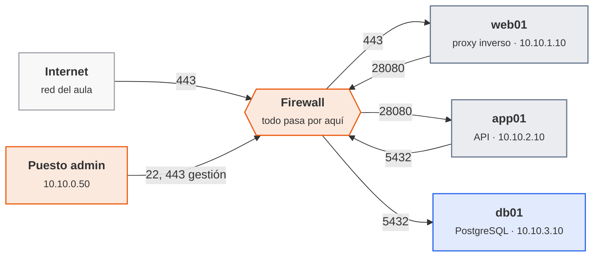
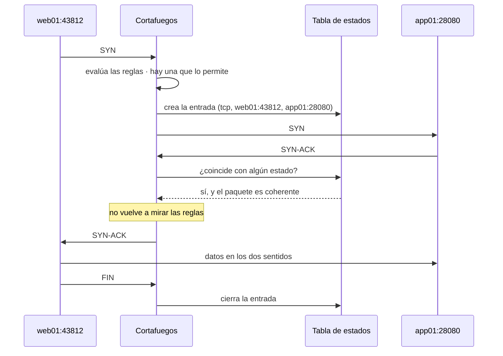
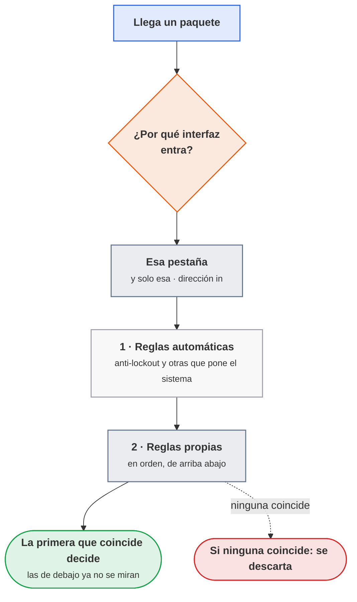
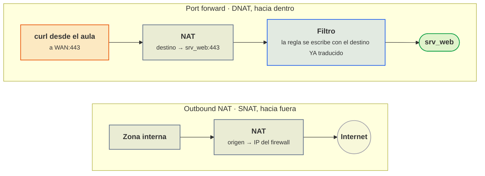
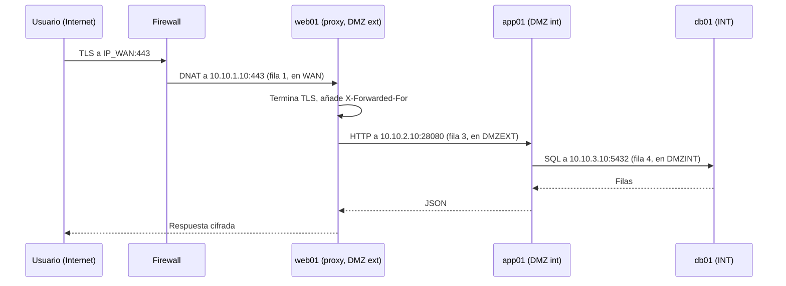

# UT3 · Seguridad por capas: DMZ externa, DMZ interna y zona interna

<p class="ut-meta">12 h · Sesiones 14 a 19 · RA1 CE d</p>

La UT2 dejó una VPC por entorno (dev, pre, pro) con cuatro VNets, una por zona (gestión, front, back y data), y un router con una pata en cada una, con el enrutado entre ellas funcionando. Funcionaba demasiado bien: en la A2.4 se comprobó con `nc` que web01, en front, llegaba al 5432 de db01, en data, y lo mismo vale para cualquier máquina de cualquier zona hacia cualquier puerto de otra. Si alguien entrase en el proxy, que es lo único que se ve desde fuera, tendría la base de datos al alcance sin ningún filtro por medio. En esta unidad ese router se sustituye por un cortafuegos, cada zona recibe su papel de seguridad y esa red abierta se convierte en una red por capas donde cada salto está justificado, permitido de forma explícita y registrado.

La unidad sigue el orden en que se haría en una empresa. Primero se pone el cortafuegos en el sitio del router sin que las máquinas lo noten; después se le enseña qué dejar pasar y se publica la web hacia fuera con un certificado de la CA del curso; luego cada pieza del servicio pasa a su zona, con una regla por salto y la documentación de cada regla, y dos clientes que comparten la infraestructura quedan separados. Al final se demuestra con nmap y tcpdump (un escáner de puertos y un capturador de tráfico) que el aislamiento es real, y con todo ello se escribe el informe de la práctica evaluable. Lo que se construye aquí no se tira: el cortafuegos, sus reglas y la CA del curso se usan hasta el final del curso, también en Mantenimiento.

## Sesión 14 · Modelo de seguridad por capas

<p class="ut-meta" markdown>20 de noviembre · Teoría y práctica · <span class="dur" tabindex="0" aria-label="Defensa en profundidad y zonas · 10 min&#10;DMZ con uno y con dos cortafuegos · 5 min&#10;Cortafuegos con estado · 10 min&#10;A3.1 Instalar el firewall · 85 min" data-dur="Defensa en profundidad y zonas · 10 min&#10;DMZ con uno y con dos cortafuegos · 5 min&#10;Cortafuegos con estado · 10 min&#10;A3.1 Instalar el firewall · 85 min">:material-school:<i class="dur-barra" style="--teoria:23%"></i>:material-flask:</span></p>

Hoy `router-dev` deja su sitio a un cortafuegos, y antes de tocar nada hay que tener claro para qué. Por eso la teoría va de lo general a lo concreto: primero el modelo de seguridad por capas, que dice por qué se separa la red en zonas y qué papel tiene cada una, y cómo encaja en las cuatro VNets que ya existen; después las dos formas de colocar el cortafuegos, con uno o con dos; y al final cómo decide un cortafuegos con estado qué paquete pasa, que es lo que determina cuántas reglas hacen falta y en qué dirección se escriben. Lo que viene detrás, OPNsense con su instalación y el relevo de `router-dev`, es material de consulta para la hoja, y la variante con nftables queda apuntada al final. La hoja no escribe todavía ninguna regla de paso entre zonas: pone el cortafuegos en el sitio del router sin que ninguna VM se quede sin red, con la IP .1 en cada zona, el DHCP y el DNS traspasados, la regla 0 que deja a todas las zonas preguntar al cortafuegos por nombres y por la hora, y la consola web accesible solo desde gestión. Desde ese momento todo lo que cruza de una zona a otra pasa por el cortafuegos, y lo que sale de las zonas de servicio se queda en él. Las reglas de paso empiezan en la sesión siguiente, el 25 de noviembre.

### Defensa en profundidad y zonas

**El problema: un solo control nunca basta.** Ningún control de seguridad es perfecto. El proxy tendrá una vulnerabilidad algún día, alguien subirá una imagen de contenedor con una librería vieja, un administrador reutilizará una contraseña. Si la seguridad de toda la red depende de que una de esas piezas no falle, un solo fallo basta para perderlo todo, que es justo lo que pasaba en la red abierta de la UT2.

**Qué es la defensa en profundidad.** Es el principio de poner varios controles en serie, asumiendo que cada uno fallará, de modo que cada capa que atraviesa un atacante le cuesta trabajo, le lleva tiempo y deja rastro en un log que alguien (o algo) está mirando. La idea y el nombre vienen de la estrategia militar: en lugar de una sola línea que tiene que pararlo todo, varias líneas sucesivas que frenan al atacante y dan tiempo a reaccionar.

**Cómo se aplica en una red: las zonas.** La forma clásica de organizarlo en red es agrupar las máquinas en zonas según lo expuestas que están y lo que guardan, y separar las zonas con un cortafuegos que solo deja pasar lo imprescindible de una a la siguiente. Lo que se ve desde Internet va en la zona más expuesta, porque es lo primero que caerá si algo cae, y lo más valioso, los datos, en la más profunda. A una zona expuesta de este tipo se le llama **DMZ**, zona desmilitarizada, otro término militar: una franja entre dos bandos que no es del todo de ninguno. En el curso hay dos DMZ, la externa y la interna, y detrás de ellas la zona interna:

| Zona | Qué aloja | Quién puede entrar | Hacia dónde sale |
|----|----|----|----|
| Exterior (WAN / Internet) | Usuarios, atacantes | Nadie | DMZ externa |
| DMZ externa | Lo que debe verse desde fuera: proxy inverso, balanceador, web estática, concentrador VPN | Internet, en puertos concretos (80/443) | DMZ interna, en puertos concretos |
| DMZ interna | Aplicación / API, colas, caché | DMZ externa | Zona interna, en puertos concretos |
| Zona interna | Bases de datos, almacenamiento, backups | DMZ interna y administradores | Nada hacia fuera, salvo actualizaciones puntuales |
| Gestión | Consola del firewall, SSH, Proxmox, monitorización | Administradores | Todas las zonas, solo en puertos de gestión |

Cada zona existe para proteger algo. La DMZ externa, para que el único que habla con Internet sea un proxy que no guarda nada de valor; la DMZ interna, para que la aplicación, que tiene la lógica del servicio y las credenciales de la base de datos, no hable nunca directamente con Internet; la zona interna, para que a los datos solo llegue la aplicación. La gestión va aparte porque desde ella se llega a todo: es la zona que más hay que proteger, y por eso las zonas de servicio solo entran en ella por excepciones escritas y justificadas, las de la [matriz de reglas](#matriz-de-reglas).

**Las cuatro reglas del juego.** Los principios que gobiernan las reglas son cuatro, y aparecen repetidos en cualquier auditoría:

- **Denegar por defecto**: todo lo que no está permitido expresamente se bloquea y se registra. La lista de reglas es una lista blanca, porque una lista negra solo bloquea lo que a alguien se le ocurrió prever.
- **Tráfico solo hacia dentro por saltos**: Internet nunca habla con la zona interna; la web nunca habla con la base de datos sin pasar por la aplicación. Cada zona solo inicia conexiones hacia la inmediatamente más profunda.
- **Mínima exposición**: un servicio en DMZ externa solo expone el puerto que necesita. La gestión (SSH, consola web, API de Proxmox) va por una red aparte que no es alcanzable desde ninguna zona de servicio.
- **Registro**: todo lo denegado, y todo lo permitido hacia zonas sensibles, queda en un log con marca de tiempo, regla que lo decidió, origen y destino. Sin registro, un ataque frenado no se distingue de uno que no ha ocurrido, y nadie se entera de que alguien lo está intentando.

La comparación con la red plana de `router-dev` es inmediata: allí una vulnerabilidad en el proxy daba acceso directo a la base de datos y al hipervisor; aquí cada capa que cae deja al atacante delante de otro filtro. El recorrido completo, capa por capa y con lo que frena cada una, está en [Qué frena cada capa](../ampliacion.md#que-frena-cada-capa).

#### Mapa sobre la VPC de la UT2

**No hay que rehacer la red.** Las cuatro VNets de dev ya están, y su diseño ya tomó la decisión que hace posible todo lo que viene: una VNet por zona, es decir, un bridge distinto por zona. Entre dos bridges distintos no hay más camino que una máquina con una pata en cada uno, y esa máquina es el único sitio por el que pasa el tráfico entre zonas: hasta hoy, `router-dev`; desde hoy, el cortafuegos. Si dos de estas subredes compartieran bridge, su tráfico no pasaría por el cortafuegos y no habría dónde filtrarlo.

**Lo que cambia es el papel de cada una.** La subred front pasa a ser la DMZ externa, back la DMZ interna, data la zona interna y gestión la red de administración. En el entorno dev del aula queda así:

| Zona | VNet en Proxmox | Red | Gateway (firewall) | Máquinas |
|----|----|----|----|----|
| DMZ externa | devfront | 10.10.1.0/24 | 10.10.1.1 | web01 (proxy) |
| DMZ interna | devback | 10.10.2.0/24 | 10.10.2.1 | app01 |
| Zona interna | devdata | 10.10.3.0/24 | 10.10.3.1 | db01 |
| Gestión | devmgmt | 10.10.0.0/24 | 10.10.0.1 | Puesto de administración, mon01 |
| Exterior | vmbr0 (bridge del aula) | La del aula | Router del aula | Todo lo demás |

La tabla tiene cinco zonas porque el exterior también cuenta: es la red del aula, por la que llega lo que viene de Internet, y el cortafuegos tiene una pata en ella igual que en las otras cuatro.



<p class="pie" markdown>Ningún salto entre capas es directo: todos vuelven a pasar por el cortafuegos, y por eso se puede filtrar cada uno por separado.</p>

**El cortafuegos hereda las direcciones del router.** El cortafuegos es el gateway de todas las zonas, con la IP .1 en cada una, así que ningún paquete cruza de una subred a otra sin pasar por él. Es el papel que hacía `router-dev`, y OPNsense lo hereda entero: sus cuatro direcciones `.1`, su DHCP con las mismas reservas y su DNS con los mismos nombres. Que sean exactamente las mismas no es casualidad: las VM de las zonas reciben por DHCP como puerta de enlace el `.1` de su zona y como DNS la 10.10.0.1, y si el cortafuegos ocupa esas direcciones, ninguna tiene que cambiar nada. `router-dev` se apaga cuando el relevo está hecho y se destruye al cerrar la evaluable de la unidad, el 9 de diciembre.

**Y añade un servicio: la hora.** Desde hoy las zonas de servicio dejan de salir a Internet, para que una máquina comprometida no pueda descargar herramientas ni sacar datos, así que tampoco llegan a los servidores de hora públicos. El cortafuegos pasa a ser su servidor de hora por NTP, el protocolo de sincronización de la hora. No es un detalle: con la hora mal, los logs de dos máquinas no se pueden cruzar, y un certificado puede parecer caducado o todavía no válido.

### DMZ con uno y con dos cortafuegos

**La pregunta.** Con las zonas decididas, queda dónde se pone el cortafuegos: uno solo con una interfaz por zona, o varios en serie. Las dos formas son clásicas y cada una tiene su coste.

**Un cortafuegos con una interfaz por zona.** Es el esquema de arriba: un solo equipo con cinco interfaces, una por zona. Es el diseño habitual en pymes y en laboratorios porque es barato y toda la política está en un sitio. Su punto débil es evidente: si el cortafuegos cae, o alguien lo configura mal, todas las capas caen a la vez.

<figure markdown="span">
  { width="560" }
  <figcaption>DMZ con un solo cortafuegos: una interfaz hacia Internet, otra hacia la DMZ y otra hacia la red interna. Fuente: Pbroks13, dominio público, vía Wikimedia Commons.</figcaption>
</figure>

**Dos cortafuegos en serie.** El diseño de dos cortafuegos pone uno de cara a Internet (el "front-end" o perimetral) que solo permite tráfico hacia la DMZ, y otro detrás (el "back-end") entre la DMZ y la red interna. Un atacante que comprometa el primero sigue teniendo el segundo por delante. Con dos firewalls también se reparte la carga: el perimetral absorbe el ruido de Internet y el interno solo ve tráfico ya filtrado.

<figure markdown="span">
  { width="560" }
  <figcaption>DMZ con dos cortafuegos: el perimetral protege la DMZ; el interno protege la red corporativa. Fuente: Pbroks13, dominio público, vía Wikimedia Commons.</figcaption>
</figure>

**Fabricantes distintos, y lo que cuesta.** Una recomendación clásica de las guías de seguridad perimetral es que los dos cortafuegos sean de fabricantes distintos. Una vulnerabilidad de ejecución remota en el software del firewall (las ha habido en todos los grandes fabricantes) afectaría a los dos si son iguales; con dos fabricantes, el atacante necesita dos exploits distintos. El coste es que operaciones tiene que administrar dos productos, dos ciclos de parches y la misma política en dos sintaxis, y por eso muchas empresas medianas acaban con un solo firewall bien mantenido en lugar de dos mal mantenidos. En la práctica, un cortafuegos único bien parcheado y revisado cada trimestre protege más que dos que nadie se atreve a tocar.

**La elección del curso.** En el laboratorio se monta el modelo de un cortafuegos con una interfaz por zona: es el caso típico de una empresa mediana, cuesta una sola VM de 1 GB en un laboratorio que va justo de memoria y deja toda la política en un sitio que se puede revisar de una vez. Quien quiera el de dos puede usar OPNsense como perimetral y un Debian con nftables como interno: fabricantes distintos, gratis, y con el material de [OPNsense](#opnsense) y de [la alternativa con nftables](#alternativa-nftables-en-una-vm-linux).

### Cortafuegos con estado

**Lo que hay que entender antes de la primera regla.** Antes de escribir la primera regla hay que entender cómo decide el cortafuegos qué paquete pasa, porque de eso depende cuántas reglas hacen falta y en qué dirección se escriben. La idea del apartado es una: el cortafuegos recuerda las conexiones que ya aceptó, así que solo hay que permitir el primer paquete de cada una.

**El problema de un filtro sin estado.** Los primeros cortafuegos, a finales de los años ochenta, eran filtros de paquetes sin estado (stateless). Un filtro así mira cada paquete de forma aislada, por su origen, su destino, su protocolo, su puerto y sus flags (los bits de la cabecera TCP que dicen qué tipo de paquete es). Una conexión TCP tiene paquetes en los dos sentidos, y un filtro así necesita una regla para cada uno. Para permitir que web01 abra una conexión a app01:28080 harían falta dos reglas, una para el SYN de ida (el primer paquete de una conexión TCP, el que pide abrirla) y otra para la respuesta de vuelta. Y la de vuelta tendría que permitir tráfico desde el puerto 28080 de app01 hacia cualquier puerto alto de web01, porque el cliente sale de un puerto que el sistema elige al azar en cada conexión (el puerto efímero). Eso es un agujero: cualquier cosa que se origine en app01 con puerto de origen 28080 pasaría.

**Cómo funciona uno con estado.** Un cortafuegos **con estado** (stateful), el tipo que se generalizó en los años noventa y que hoy usan todos, recuerda las conexiones. Cuando ve el SYN de web01:43812 hacia app01:28080 y una regla lo permite, crea una entrada en su **tabla de estados** con la tupla (protocolo, IP origen, puerto origen, IP destino, puerto destino) y el estado de la conexión. Cuando llega el SYN-ACK de vuelta (la respuesta con la que el servidor acepta la conexión), no evalúa las reglas: busca en la tabla, encuentra la entrada, comprueba que el paquete es coherente con el estado (números de secuencia, flags) y lo deja pasar. Lo mismo con todos los paquetes siguientes en ambas direcciones, hasta que ve el cierre (FIN, o RST si la conexión se corta de golpe) o la entrada expira por inactividad.



<p class="pie" markdown>Solo hay que permitir el **primer** paquete de cada conexión. Quien lo tiene claro escribe la mitad de reglas y entiende el error de «abre pero no responde».</p>

**Dónde está en Linux y en OPNsense.** En Linux este mecanismo se llama **conntrack** (de *connection tracking*, seguimiento de conexiones) y es un módulo del kernel (`nf_conntrack`) que usan tanto iptables (el antecesor de nftables) como nftables. En OPNsense lo hace `pf`, el filtro de paquetes sobre el que está construido, que nació en OpenBSD y que FreeBSD, la base de OPNsense, incorporó después; su tabla se ve en Firewall → Diagnostics → States. Los nombres de los estados que siguen son los de conntrack, que son los que se escriben en las reglas de nftables; pf usa otros nombres para lo mismo. De forma simplificada:

| Estado | Significado |
|----|----|
| `new` | Primer paquete de una conexión que no está en la tabla. Es el único que se evalúa contra las reglas. |
| `established` | Paquetes de una conexión ya aceptada, en cualquier dirección. |
| `related` | Conexión nueva que el kernel sabe que pertenece a otra existente: el canal de datos de FTP, o un ICMP "puerto inalcanzable" en respuesta a un UDP saliente. |
| `invalid` | Paquete que no encaja con ningún estado ni es un inicio válido (un ACK suelto, un SYN-ACK sin SYN previo). Se descarta siempre. |

Para UDP e ICMP, que no tienen conexión, conntrack crea "pseudo-estados" basados en la tupla y un temporizador: si una máquina envía una consulta DNS al puerto 53 de un servidor, la respuesta que llegue desde ese servidor y ese puerto en los 30 segundos siguientes (el valor por defecto en Linux) se considera `established`.

**Qué cambia al escribir reglas.** Solo hay que escribir la regla del primer paquete, en la dirección en que se inicia la conexión. Es lo que hace que la política "DMZ externa puede iniciar hacia DMZ interna:28080, pero DMZ interna no puede iniciar nada hacia DMZ externa" se escriba con una sola línea. Cómo se consigue depende de la herramienta:

- **En OPNsense no se escribe nada más.** Cada regla Pass crea su estado sola (es la opción por defecto de toda regla, *keep state*), y las respuestas encajan en él antes de llegar a ninguna regla. Por eso en las reglas del curso no aparece nunca una regla para el tráfico de vuelta.
- **En nftables hay que escribirlo.** Una regla genérica `ct state established,related accept` al principio de la cadena. De ahí sale un error clásico: si esa regla no está, o está después de un `drop`, la conexión abre (el SYN pasa) pero nunca responde, y en tcpdump aparecen SYN, SYN-ACK... y el SYN-ACK muriendo en el firewall.

La tabla de estados no es infinita y sus entradas caducan: cuántas caben, qué ocurre cuando se llena y cuánto vive una conexión inactiva está en [La tabla de estados por dentro](../ampliacion.md#la-tabla-de-estados-por-dentro).

### OPNsense

!!! consulta "Material de consulta"
    Esto no se explica en clase: es lo que necesitan la preparación de casa de la A3.1 y todos sus pasos.

Este apartado monta el cortafuegos del laboratorio: una VM con una pata en cada zona, la consola web solo accesible desde gestión, y el relevo de `router-dev` sin que ninguna máquina se quede sin red. Los menús cambian de una versión a otra (la 26.1 rebautizó el port forward como Destination NAT, y la 26.7 cambió la página de reglas por una nueva), así que más que los menús importan tres ideas, que valen para cualquier versión y para pfSense: las reglas se escriben con nombres (aliases), se evalúan en la interfaz por la que entra el paquete, y nada se aplica hasta pulsar Apply.

**Qué es y de dónde sale.** OPNsense es una distribución de cortafuegos basada en FreeBSD y en el filtro `pf`, con interfaz web y desarrollo abierto. Nació en 2015 como bifurcación de pfSense y las dos son funcionalmente muy parecidas: si en una empresa aparece pfSense, todo lo de esta sección aplica cambiando algún nombre de menú. Saca dos versiones al año, en enero y en julio, numeradas como año.mes (la 26.1 es la de enero de 2026 y la 26.7, la de julio), y en el curso se instala la última 26.x. Se usa OPNsense y no pfSense porque la interfaz es más limpia, parchea más rápido y su edición gratuita trae todo lo que el curso necesita.

<figure markdown="span">
  { width="640" }
  <figcaption>Panel de OPNsense con el estado de interfaces, servicios y tráfico. Fuente: Hagennos, CC BY-SA 4.0, vía Wikimedia Commons.</figcaption>
</figure>

#### Instalación en Proxmox

**Una VM normal, con una tarjeta por zona.** Se instala como una VM normal, con el ID 109 (el último de la franja de gestión de dev): imagen `dvd` o `vga` de la 26.x desde opnsense.org, 2 vCPU, 1 GB de RAM y 20 GB de disco, que es lo que le reserva el [presupuesto de memoria](../laboratorio.md#presupuesto-de-memoria) del laboratorio. Con la instalación base y sin plugins de inspección basta; si el instalador va justo, se le suben a 2 GB mientras dura y se vuelve a 1 GB al terminar. Lo que la distingue es el número de interfaces: una por zona, cinco en este caso, cada una conectada a su bridge o VNet de Proxmox, y todas con el modelo VirtIO (el dispositivo paravirtualizado de KVM, el más rápido en Proxmox).

**El orden de las tarjetas importa.** Dentro de la VM, FreeBSD llama a las tarjetas VirtIO `vtnet0`, `vtnet1`... en el orden en que aparecen en el bus PCI, y Proxmox las coloca en el bus según su número (`net0`, `net1`...). Así que el número que recibe cada tarjeta al crearla decide qué `vtnet` será dentro, y con eso qué zona queda detrás de cada interfaz de OPNsense. La tabla del curso, que es la que manda:

| Interfaz OPNsense | vtnet | Bridge / VNet Proxmox | IP |
|----|----|----|----|
| WAN | vtnet0 | vmbr0 (aula) | DHCP del aula o fija |
| DMZEXT | vtnet1 | devfront | 10.10.1.1/24 |
| DMZINT | vtnet2 | devback | 10.10.2.1/24 |
| INT | vtnet3 | devdata | 10.10.3.1/24 |
| MGMT | vtnet4 | devmgmt | 10.10.0.1/24 |

Conviene apuntar qué MAC corresponde a qué bridge antes de arrancar: el asistente de la consola pide asignar cada `vtnetN` a su papel, y la MAC es la única forma de saber cuál es cuál sin adivinar.

**Lo primero, cerrar la consola.** Tras la instalación, la interfaz web escucha en todas las interfaces, con la regla "anti-lockout" (la que impide cerrarse el acceso a la propia consola) activa en LAN. La consola web es la pieza más valiosa de la red, porque quien entra en ella cambia todas las reglas, así que lo primero es dejarla escuchando solo en MGMT (System → Settings → Administration, "Listen interfaces"). Si un error deja fuera, la consola de Proxmox de la VM tiene un menú de texto con la opción "Reset to factory defaults" y otra para reasignar interfaces; no hace falta reinstalar.

#### El relevo de router-dev

**El problema.** Hoy `router-dev` es el `.1` de las cuatro subredes, su servidor DHCP y su DNS, y el cortafuegos tiene que pasar a ser todo eso sin que ninguna VM se quede sin red. No pueden convivir: dos máquinas con la misma `.1` en la misma red se pisan (el ARP de esa dirección salta de una MAC a otra y el ping funciona a ratos), y dos servidores DHCP en la misma red reparten cada uno a su manera. Por eso el relevo se hace como un cambio de guardia, en tres tiempos:

1. **Preparar sin aplicar.** El cortafuegos recibe sus direcciones definitivas en las interfaces internas, pero con las interfaces apagadas, y una dirección provisional en gestión, la 10.10.0.2, para poder administrarlo mientras tanto. El DHCP y el DNS se copian de `router-dev`: los mismos rangos, las mismas reservas por MAC y los mismos nombres, porque son los que esperan las VM.
2. **Cambiar.** `router-dev` suelta sus direcciones internas y su dnsmasq, y en ese momento el cortafuegos activa las suyas y arranca sus servicios.
3. **Comprobar y retirar.** Solo cuando una VM ha renovado su concesión con el cortafuegos y conserva su IP se apaga `router-dev`, sin borrarlo, por si hubiera que deshacer.

Hay margen para hacerlo con calma: cada VM tiene una concesión de 12 horas, la de `dev.conf`, así que aunque el DHCP desaparezca un rato, ninguna pierde su IP.

**Quién hace el DHCP y quién el DNS.** OPNsense trae el mismo dnsmasq que `router-dev`, en Services → Dnsmasq DNS & DHCP, y es el que hace el DHCP: las reservas se trasladan una a una con la MAC, la IP y el nombre de `dev.conf`, y si cada rango lleva el dominio `dev.lab`, los nombres `<host>.dev.lab` salen solos de ellas. Pero en una instalación nueva el puerto 53, el del DNS, no lo atiende dnsmasq sino Unbound, el servidor DNS que OPNsense trae activado, y Unbound no sabe nada de las reservas. La documentación de OPNsense lo resuelve en su ejemplo "DHCPv4 with DNS registration": dnsmasq pasa a escuchar en el 53053 y Unbound le reenvía (Query Forwarding) las preguntas de los dominios locales. En el laboratorio basta un reenvío, el del dominio `lab`, que incluye `dev.lab` y los nombres de gestión (`mon01.lab` con sus alias, y los que añaden después las unidades de integración continua). El mismo ejemplo marca tres opciones de dnsmasq que el laboratorio necesita: "DHCP fqdn", que da a cada máquina su nombre con el dominio; "DHCP register firewall rules", que abre paso al DHCP en cada interfaz, porque si no lo cortaría la denegación por defecto; y "Do not forward to system defined DNS servers", para que la pregunta por un nombre del laboratorio que no existe termine en dnsmasq y no dé vueltas entre los dos servidores.

**Lo que deja pasar el primer día: la regla 0.** En cuanto se activan las interfaces internas, se aplica la denegación por defecto: todo lo que entra por una interfaz sin reglas se descarta, y eso incluye las preguntas al propio cortafuegos. El DHCP tiene sus reglas automáticas, pero el DNS y la hora no, así que sin una regla ninguna VM resolvería un nombre. Por eso la primera regla del curso, la 0, se escribe en el mismo momento del relevo. Va en un **grupo de interfaces**, `ZONAS`, que reúne las cuatro zonas, para escribirla una sola vez para todas; su destino es **This Firewall**, que en OPNsense quiere decir cualquier dirección del propio cortafuegos; y deja pasar el DNS (53) y la hora (123), más el ping, que es la primera herramienta de diagnóstico. Los dos puertos van en un alias, `p_infra` (un alias es un nombre que se da a una lista de puertos o de direcciones). Lo que la regla 0 no deja pasar es la consola web: el 443 del cortafuegos no está en `p_infra`.

**La excepción de estos días: gestión.** OPNsense crea al instalarse unas reglas que dejan salir de LAN (la futura MGMT) hacia cualquier sitio, y por eso, después del relevo, desde el puesto de administración se sigue llegando a todo. Esas reglas se sustituyen por las propias de gestión en la sesión siguiente, el 25 de noviembre.

### Alternativa: nftables en una VM Linux

**La misma idea sin OPNsense.** El mismo modelo de zonas se puede montar con un router Debian 13 con cinco interfaces y **nftables**, la herramienta con la que se escriben las reglas del cortafuegos del kernel de Linux, Netfilter. nftables entró en el kernel en 2014 para sustituir a iptables, y desde Debian 10 es lo que hay por debajo incluso cuando se usa la orden `iptables`; Docker y el firewall de Proxmox escriben sus reglas en ese mismo Netfilter. Se pierde la interfaz web y sus comodidades (aliases con resolución de nombres, vista de estados en directo) y se gana un fichero de texto de unas cuarenta líneas que se versiona en git como cualquier otro código.

**Cuándo se elige cada uno.** Se elige nftables cuando el cortafuegos tiene que quedar descrito en código desde el primer día, cuando no compensa mantener una VM más con su propio sistema operativo, o cuando quien lo administra ya trabaja en la línea de comandos. Se elige OPNsense cuando lo van a tocar varias personas, cuando hacen falta las herramientas de diagnóstico integradas o cuando interesa tener en la misma caja el proxy inverso, la VPN y la detección de intrusos. En el curso se usa OPNsense, así que esta alternativa no se explica en clase.

**Dónde está el material.** Cómo se lee un fichero de nftables (tablas, cadenas, hooks y políticas), el fichero `/etc/nftables.conf` completo del router del laboratorio, el recorrido de un paquete por los puntos donde el kernel puede filtrar y el orden en que se evalúan las cadenas están en [nftables: el fichero de reglas completo](../ampliacion.md#nftables-el-fichero-de-reglas-completo). La A3.1 remite a ese material, desde su «Antes de empezar», para quien quiera montar esta variante.

### A3.1 Instalar el firewall (sesión 14)

<span class="et et-obj">Objetivo</span> Un OPNsense con una pata en cada una de las cinco zonas, con la IP .1 en cada red, cuya consola web solo responde desde MGMT, y web01 y db01 usándolo como puerta de enlace, como DNS y como servidor de hora. Es la pieza sobre la que se construye el resto de la unidad: desde hoy, todo lo que cruza de una zona a otra pasa por un sitio donde se puede filtrar y registrar. Lo difícil no es instalarlo, que se trae hecho de casa, sino el relevo: que ocupe el sitio de `router-dev` sin que ninguna VM note el cambio.

<span class="et et-pre">Antes de empezar</span>

- La VPC dev de la UT2: las cuatro VNets, `router-dev` repartiendo IP y nombres, `web01` (10.10.1.10) en `devfront` y `db01` (10.10.3.10) en `devdata`. `app01` y `mon01` siguen en `vmbr0` hasta la A3.3, con sus reservas por MAC en `dev.conf` desde la A2.3.
- El puesto de administración (VM 105, 10.10.0.50, de la A2.4), con su ruta `10.10.0.0/16 via 10.10.0.1`: desde él administras el firewall toda la unidad. Entra con `ssh -A ops@<IP de aula de admin01>`, que le presta tu clave para saltar a `web01` y a `db01`.
- `router-dev` sigue siendo el `.1` de las cuatro subredes: hasta el relevo del paso 5, las interfaces internas del firewall se configuran sin activar y MGMT lleva una dirección provisional.
- La VM del firewall instalada y los paquetes de `web01` y `db01` puestos, con la preparación de casa del bloque siguiente.
- Explicado en clase: [el modelo de zonas](#defensa-en-profundidad-y-zonas), [el mapa sobre la VPC](#mapa-sobre-la-vpc-de-la-ut2) y [qué es un cortafuegos con estado](#cortafuegos-con-estado). De consulta, para la preparación y todos los pasos: [OPNsense](#opnsense), con su [instalación](#instalacion-en-proxmox) y [el relevo de router-dev](#el-relevo-de-router-dev). La variante con nftables en una VM Debian está en [Para ampliar](../ampliacion.md#nftables-el-fichero-de-reglas-completo).

!!! truco "Preparación antes de la sesión: la VM del firewall, instalada"
    Son unos veinte minutos de clics que no dependen de nadie: se traen hechos de casa.

    1. Sube a Proxmox la ISO `dvd` de OPNsense 26.x (desde casa, como la de la [A1.1](ut1-virtualizacion.md#a11-instalar-proxmox-ve-sesion-1): treinta descargas a la vez saturan el aula) y crea la VM 109 con los recursos de [Instalación en Proxmox](#instalacion-en-proxmox) y sus cinco NIC VirtIO en el orden exacto de aquella tabla, porque FreeBSD las numera por orden de bus PCI. Apunta la MAC de cada NIC: es la única forma de saber qué `vtnet` es cada zona.
    2. Instala con las opciones por defecto (usuario `installer`, contraseña `opnsense`), cambia la contraseña de root, retira la ISO y reinicia.
    3. Mientras `web01` y `db01` aún salen a Internet por `router-dev`, instala lo que usarán las hojas del 25 y el 27 de noviembre, porque tras el relevo ya no salen: `nginx nmap netcat-openbsd` en `web01` y `postgresql prometheus-postgres-exporter nmap netcat-openbsd` en `db01`.

<span class="et et-pas">Pasos</span>

Vas a sustituir `router-dev` por el cortafuegos en los tres tiempos del [relevo](#el-relevo-de-router-dev). En los cuatro primeros pasos lo preparas todo sin pisar a `router-dev`, que sigue siendo el `.1` de las cuatro redes: compruebas el punto de partida, asignas cada tarjeta a su zona, cierras la consola y copias el DHCP y el DNS. En el paso 5 haces el cambio en un solo movimiento y abres la regla 0 en ese mismo momento, y en el 6 compruebas que ninguna VM ha notado nada antes de apagar el router. Si vas justo de tiempo, lo que no puede quedarse a medias es el relevo: un cortafuegos preparado y sin activar no estorba a nadie, pero uno activado a medias deja las zonas sin red.

1. **Comprueba el punto de partida.** La VM 109 tiene que arrancar sin la ISO hasta el menú de OPNsense, con cada tarjeta en el bridge que dice la tabla de [Instalación en Proxmox](#instalacion-en-proxmox). Comprueba también que ninguna subnet del SDN conserva gateway ni rango DHCP, y si alguna los tiene, bórralos y aplica: un gateway olvidado en el SDN es un segundo `.1` en esa red, y en el relevo chocaría con el cortafuegos.

    *Pista:* si no traes la VM hecha, hazla ahora sin explorar menús: lo que no puede quedarse sin tiempo es el relevo del paso 5.

2. **Asigna cada tarjeta a su zona.** Es el primer tiempo del [relevo](#el-relevo-de-router-dev): preparar sin aplicar. Desde la consola de la VM, deja solo lo imprescindible para llegar a la web: WAN en `vtnet0` por DHCP, y LAN en `vtnet4` con la dirección provisional `10.10.0.2/24` y sin DHCP, porque en gestión `router-dev` sigue repartiendo direcciones. Desde la consola web, asigna `vtnet1` a `vtnet3` como DMZEXT, DMZINT e INT, con el `.1/24` de su zona, sin gateway (la única puerta de enlace del cortafuegos es la de la WAN) y **sin marcar "Enable interface"**, y renombra LAN a MGMT. Las internas quedan con su dirección definitiva pero apagadas: activarlas ahora sería poner un segundo `.1` en cada red.

    *Pista:* la 10.10.0.2 solo existe dentro de gestión: llega a ella con un túnel por el puesto de administración (`ssh -L 28443:10.10.0.2:443 ops@<IP de aula de admin01>`) y abre `https://localhost:28443`.

3. **Cierra la consola a todo lo que no sea gestión.** Deja la consola web escuchando solo en MGMT, como dice [Instalación en Proxmox](#instalacion-en-proxmox): desde cualquier otra zona, la consola del cortafuegos no tiene que existir. No desactives la regla anti-lockout: es la que te garantiza el acceso a la consola hasta que escribas las reglas propias de MGMT, el 25 de noviembre.

4. **Prepara el DHCP y el DNS sin aplicarlos.** Copia en el cortafuegos, con las interfaces internas aún apagadas, lo que hoy da `router-dev`: DHCP en las cuatro zonas, con el rango `.100` a `.199` y las cuatro reservas por MAC de tu `dev.conf` (`web01` 10.10.1.10, `app01` 10.10.2.10, `db01` 10.10.3.10 y `mon01` 10.10.0.20), y DNS con el dominio `dev.lab`, `api.dev.lab` en la 10.10.1.10 y `mon01.lab` (10.10.0.20) con los alias `grafana.lab`, `prometheus.lab` y `gitea.lab`. Las reservas de app01 y mon01 no se usan hasta el traslado del 27 de noviembre, pero tienen que estar ya, porque son las que les darán su IP en la VPC; y los nombres de `mon01.lab` son los que usa Mantenimiento desde ese día.

    *Pista:* es Services → Dnsmasq DNS & DHCP, con el reparto entre dnsmasq y Unbound de [El relevo de router-dev](#el-relevo-de-router-dev). Si dejas vacíos el router y el DNS de cada rango, anuncia la IP de la interfaz, que es el `.1`.

5. **Haz el relevo y abre lo mínimo.** En un solo movimiento: deja `router-dev` sin DHCP ni IP internas y, en el firewall, activa DMZEXT, DMZINT e INT, pasa MGMT a la 10.10.0.1 y arranca el DHCP, el DNS y el servidor de hora. Crea en seguida la [regla 0](#el-relevo-de-router-dev), porque desde que se activan las interfaces la denegación por defecto corta el DNS y la hora: en la pestaña de un grupo de interfaces `ZONAS` con las cuatro zonas, dos reglas Pass hacia This Firewall, una TCP/UDP a un alias de puertos `p_infra` (53 y 123) y otra ICMP Echo Request, con la descripción "0 DNS, hora y ping al cortafuegos".

    *Pista:* en `router-dev`, entrando por su IP del aula (`ens18`, que no se toca), basta parar `dnsmasq` y bajar `ens19` a `ens22`. Al cambiar la IP de MGMT, rehaz el túnel con la 10.10.0.1.

6. **Cierra el relevo y comprueba que nadie lo ha notado.** Es el tercer tiempo del [relevo](#el-relevo-de-router-dev). Antes de apagar nada, comprueba que `web01` renueva su concesión con el firewall y conserva la 10.10.1.10: es la prueba de que las reservas se han copiado bien. Pon `web01` y `db01` a tomar la hora del `.1` de su zona, que desde hoy es el único servidor de hora al que llegan, y apaga `router-dev` sin borrarlo: se queda así hasta la evaluable del 9 de diciembre, por si hubiera que deshacer el relevo. Por último, haz que el puesto de administración resuelva con el DNS del cortafuegos: no lo recibe por DHCP, porque en gestión tiene IP fija, y el que usa ahora no conoce los nombres del laboratorio.

    *Pista:* `networkctl renew ens18` fuerza la renovación, y la hora va en un fichero de `/etc/systemd/timesyncd.conf.d/` con `NTP=`. El DNS del puesto se cambia desde el nodo, con `qm set 105 --nameserver 10.10.0.1 --searchdomain lab` y un reinicio.

<span class="et et-com">Comprobación</span>

- Desde el puesto de gestión, `ping 10.10.0.1` responde y la consola web abre.
- Desde web01, `ping 10.10.1.1` y `dig db01.dev.lab` responden por la regla 0, pero `curl -k -m 3 https://10.10.1.1` falla por timeout: la regla 0 no deja pasar el 443 y la consola, además, solo escucha en MGMT.
- En Interfaces → Assignments la MAC de cada vtnet coincide con la que apuntaste para cada bridge.
- `ip route` en web01 y db01 muestra `default via 10.10.X.1`, y `timedatectl timesync-status` el `.1` de su zona como servidor.

<span class="et et-ent">Para practicar</span> Guarda en la carpeta `ut3/` de tu repositorio una captura de Interfaces → Assignments y la tabla de las cinco interfaces de [Instalación en Proxmox](#instalacion-en-proxmox), completada con la MAC real de cada NIC y la IP que le has puesto.

<span class="et et-ext">Si te sobra tiempo</span> Añade ya la sexta NIC del firewall, en `vmbr1` y sin tag, que necesitarás el 2 de diciembre para los clientes, y comprueba en Interfaces → Assignments que FreeBSD la ve como `vtnet5` después de reiniciar la VM.

## Sesión 15 · Reglas por zona y publicación de un servicio

<p class="ut-meta" markdown>25 de noviembre · Teoría y práctica · <span class="dur" tabindex="0" aria-label="Aliases · 5 min&#10;Reglas y orden de evaluación · 5 min&#10;NAT: port forward y outbound · 5 min&#10;Certificados · 10 min&#10;A3.2 Publicar la web · 85 min" data-dur="Aliases · 5 min&#10;Reglas y orden de evaluación · 5 min&#10;NAT: port forward y outbound · 5 min&#10;Certificados · 10 min&#10;A3.2 Publicar la web · 85 min">:material-school:<i class="dur-barra" style="--teoria:23%"></i>:material-flask:</span></p>

La A3.1 dejó el cortafuegos en el sitio de `router-dev`, pero sin reglas de paso: de las zonas de servicio solo salen las preguntas al propio cortafuegos (la regla 0), gestión llega a todas partes por las reglas de fábrica, y desde fuera no entra nada. Hoy el cortafuegos empieza a decidir, y el primer servicio se publica hacia el aula: la web de web01, con HTTPS y un certificado firmado por la CA del curso, que nace hoy y que usan después las dos asignaturas. La teoría va en el orden en que se necesita: primero los aliases, que son los nombres con los que se escriben las reglas; después dónde va cada regla y cuál gana cuando varias coinciden; luego el NAT, que es lo que permite llegar desde fuera a una máquina con dirección privada y lo que decidiría si las zonas salen a Internet; y al final los certificados, para que la web se pueda validar sin saltarse nada. El apartado de logs es consulta: es donde se ve lo que decide el cortafuegos, y la hoja lo usa desde el primer paso. La hoja comprueba primero que sin reglas nada pasa, crea la CA y el certificado, deja nginx sirviendo por HTTPS en web01, escribe las reglas de gestión y la publicación en la WAN, y lo prueba desde el aula con curl y nmap.

### Aliases

**El problema.** Una regla escrita con direcciones sueltas (de 10.10.1.10 a 10.10.2.10 en el 28080) obliga a saber de memoria qué máquina es cada IP para entenderla, y cuando una máquina cambia de dirección hay que buscar y cambiar cada regla donde aparece, con el riesgo de olvidarse una.

**Qué es un alias.** Un alias es un nombre para un conjunto de IPs, redes, puertos o URLs, que las reglas usan en lugar de los valores. Así la regla se lee sola ("permitir `srv_web` a `srv_app` en `p_app`") y, cuando app01 cambie de IP o haya dos app, se cambia el alias y no diez reglas. Hay varios tipos: Host (una o varias direcciones; admite también nombres DNS, que OPNsense resuelve periódicamente), Network (una red), Port (una lista de puertos) y URL Table (una lista que se descarga de una URL, por ejemplo los rangos de IP de un proveedor, y se actualiza sola). Se crean en Firewall → Aliases.

**Los del curso.** Las reglas del laboratorio se escriben todas con aliases, nunca con IPs sueltas, y el nombre de cada alias dice qué es: `srv_` para un servidor, `net_` para una red y `p_` para una lista de puertos. Estos son todos, con la hoja que los crea:

| Alias | Tipo | Valor | Para qué | Nace en |
|----|----|----|----|----|
| `p_infra` | Port | 53, 123 | La regla 0: DNS y hora del propio cortafuegos | A3.1 |
| `srv_web`, `srv_app` y `srv_db` | Host | 10.10.1.10, 10.10.2.10 y 10.10.3.10 | Las tres máquinas del servicio | A3.2 |
| `net_mgmt` | Network | 10.10.0.0/24 | Todo lo que vive en gestión | A3.2 |
| `p_web` | Port | 80, 443 | La publicación de la web y la salida a Internet | A3.2 |
| `p_app` | Port | 28080, y el 28090 desde la A3.3 | Lo que el proxy pide a app01 | A3.2 |
| `srv_gitea` | Host | 10.10.0.20; la 10.10.0.11 desde el 12 de febrero | La Gitea a la que empuja app01 | A3.3 |
| `net_cli_a` y `net_cli_b` | Network | 10.10.101.0/24 y 10.10.102.0/24 | Las redes de los dos clientes | A3.4 |
| `srv_mon`, `p_mon_app` y `p_mon_db` | Host y Port | 10.10.0.20 y los puertos de cada exporter | El scrape y los logs de la monitorización | A3.1 de Mantenimiento (26 nov) |

### Reglas y orden de evaluación

**Las dos preguntas.** Con varias interfaces y varias reglas, cada paquete plantea dos preguntas: qué reglas se le aplican y, si varias coinciden, cuál decide.

**Dónde va una regla: la interfaz por la que entra.** Las reglas se organizan por interfaz y se evalúan sobre el tráfico que **entra** por esa interfaz (dirección "in", que es la habitual casi siempre). Para permitir que web01 hable con app01:28080, la regla va en DMZEXT, porque es por donde entra el paquete al firewall, aunque el destino esté en DMZINT; las respuestas no necesitan regla en DMZINT, porque las deja pasar la tabla de estados. En la página de reglas de las versiones actuales de OPNsense se elige la interfaz en un filtro y se ven todas las reglas que deciden sobre ella; en la vista clásica cada interfaz era una pestaña, y por eso en el curso se sigue diciendo "la pestaña DMZEXT".

!!! truco "La pregunta que resuelve el 90 % de las dudas"
    «¿Por qué interfaz **llega** este paquete al cortafuegos?». Esa es la pestaña donde va la regla. Para que
    `web01` hable con `app01:28080` la regla va en DMZEXT, que es por donde entra, aunque el destino esté en
    DMZINT.



<p class="pie" markdown>El orden importa porque gana la primera coincidencia. Una regla permisiva arriba anula todas las restrictivas de debajo.</p>

**Cuál decide: el orden.** El orden de evaluación es el siguiente:

1. Reglas automáticas, las que pone el propio sistema, como la anti-lockout.
2. Reglas flotantes (Floating), que aplican a varias interfaces a la vez.
3. Reglas de grupos de interfaces (en el laboratorio, la regla 0 del grupo `ZONAS`).
4. Reglas de la interfaz concreta, de arriba abajo.
5. Denegación implícita al final, que registra si está activado "Log packets matched by the default deny rule" en Firewall → Settings → Advanced.

**La opción quick: por qué gana la primera.** Aquí entra la opción **quick**, que está marcada por defecto en cada regla y merece explicación. `pf` evalúa toda la lista y aplica la **última** regla que coincide, salvo que una regla tenga `quick`, en cuyo caso la evaluación se detiene en ella. Como OPNsense marca quick en todo, en la práctica funciona como "la primera que coincide gana". Si se desmarca quick en una regla, esa regla solo se aplicará si ninguna posterior coincide. Se usa para escribir una regla genérica arriba ("permitir todo desde MGMT", sin quick) que las reglas posteriores más específicas pueden anular. Lo recomendable es dejar quick activado y ordenar las reglas de más específica a más general: es más fácil de leer y de auditar.

**Qué lleva cada regla.** Cada regla lleva acción (Pass, Block, Reject), interfaz, dirección, familia IP, protocolo, origen (con puerto opcional), destino y puerto, opción de log y una descripción. La descripción conviene ponerla siempre, porque es lo que aparece en el log, no el número de regla; en el curso empieza por el número de fila de la [matriz de reglas](#matriz-de-reglas) ("3 Proxy a la API y a whoami"), y así cada línea del log lleva directamente a la justificación de su regla.

**Block o Reject.** Block descarta en silencio (el origen espera hasta agotar el timeout) y Reject responde con un TCP RST o un ICMP unreachable (el origen sabe al instante que no hay servicio). Hacia Internet se usa Block, para no dar información; entre zonas internas, Reject ahorra esperas a los servicios propios. En el laboratorio, sin embargo, todas las denegaciones son Block, la de por defecto incluida, por una razón práctica: las pruebas de seguridad de la unidad leen un `filtered` de nmap como prueba de que el paquete murió en el cortafuegos, y un Reject daría `closed`, que es lo mismo que contesta una máquina a la que el paquete sí ha llegado.

**Aplicar, y lo que no cambia al aplicar.** Las reglas nuevas se guardan y no entran en vigor hasta pulsar Apply. Y al aplicar, los estados existentes que ya no encajan con la política se mantienen hasta que expiran, porque esas conexiones las decide la tabla de estados y no las reglas: para cortar una conexión ya establecida hay que borrar su estado en Firewall → Diagnostics → States (o "Reset state table", que las corta todas).

### NAT: port forward y outbound

**El problema.** web01 tiene una dirección privada, la 10.10.1.10, y la red del aula no sabe llegar a 10.10.0.0/16; en Internet, además, las direcciones privadas no se enrutan. De las zonas del servicio, desde fuera solo se ve la dirección WAN del cortafuegos, así que para pedir la web desde fuera el cortafuegos tiene que recibir la conexión en su WAN y pasársela a web01. En sentido contrario pasa lo mismo: una máquina de las zonas que quiera salir a Internet necesita que alguien cambie su dirección privada por una que tenga vuelta. Las dos cosas son NAT, traducción de direcciones, como el masquerade con el que `router-dev` daba salida a las zonas (en [Enrutar frente a hacer NAT](ut2-vpc.md#enrutar-frente-a-hacer-nat)). Hacen falta dos tipos.

**Port forward: hacia dentro.** El **port forward** (DNAT, NAT de destino: cambia la IP de destino del paquete) publica un servicio interno en la IP WAN: WAN:443 → srv_web:443. En OPNsense se configura en Firewall → NAT → Destination NAT (en las versiones anteriores a la 26.1 se llamaba Port Forward), y su campo "Filter rule association" decide qué pasa con la regla de filtro que tiene que dejar pasar el paquete ya traducido. La opción del curso es **Register rule**: crea una regla de filtro enlazada en la interfaz WAN y la actualiza sola si cambia el NAT, así que aparece en la lista como cualquier otra, puede llevar log y entra en la matriz de reglas. "Pass" deja pasar el tráfico en la propia regla de NAT, sin regla de filtro visible, y "Manual" no crea ninguna.

!!! ojo "El port forward sin regla de filtro no publica nada"
    Con "Manual" en "Filter rule association", OPNsense no crea la regla de filtro: el paquete se traduce y
    después se bloquea en la interfaz WAN, y el síntoma es un `curl` que se queda colgado sin respuesta ni
    error claro. Con "Register rule", la opción del curso, la regla se crea y se mantiene sola.



<p class="pie" markdown>En `pf` el NAT va **antes** que el filtro. Es el motivo de que la regla lleve `srv_web:443` y no la IP WAN, y de que mucha gente la escriba mal la primera vez.</p>

**Outbound NAT: hacia fuera.** El **Outbound NAT** (SNAT, NAT de origen: cambia la IP de origen; en las versiones actuales de OPNsense la página se llama Firewall → NAT → Source NAT) permite que las zonas internas salgan a Internet con la IP del firewall. En modo automático OPNsense lo hace para todas las redes de sus interfaces, y en el laboratorio se deja así, porque quien decide qué sale no es el NAT sino las reglas de filtro: el NAT solo traduce lo que el filtro ya ha dejado pasar. La política del curso:

- **Gestión sale siempre**, a los puertos 80 y 443 (la fila 2 de la matriz de reglas): es donde viven las máquinas que descargan paquetes, imágenes y plugins.
- **Las zonas de servicio no salen.** Una máquina comprometida que puede salir a Internet descarga sus herramientas y saca los datos por el mismo camino; si no puede salir, el atacante se queda con lo que tenía. Cuando una hoja necesita instalar algo en ellas, abre una fila **TEMPORAL** en la pestaña de esa zona (origen la máquina, destino any, puertos `p_web`, y en la descripción la palabra `TEMPORAL` con la fecha de alta y la de baja), instala y la borra en el mismo paso. Una regla temporal que se queda abierta es la forma más común de que un cortafuegos acabe dejándolo pasar todo.

!!! empresa "Sin salida ni siquiera un rato"
    En producción las zonas internas no salen a Internet ni para actualizarse: toman los paquetes de un mirror o de
    una caché de paquetes (apt-cacher-ng, por ejemplo) que vive en gestión, y el outbound NAT se pone en modo
    Hybrid con solo las salidas justificadas.

### Logs

!!! consulta "Material de consulta"
    Esto no se explica en clase: lo necesitas para el paso 1 de la hoja de esta sesión y para las pruebas de las siguientes.

**Para qué.** El cortafuegos decide en silencio, y el log es lo único que dice qué ha decidido. En esta unidad es además la evidencia: una denegación que no deja línea en el log no se puede demostrar.

**Dónde se mira.** Firewall → Log Files → Live View muestra en tiempo real cada paquete que coincide con una regla que tiene log activado, y todos los de la denegación por defecto, si está activada la opción que la registra (conviene comprobarlo antes de la primera prueba). Cada línea trae interfaz, dirección, acción, origen, destino, protocolo y la etiqueta de la regla, que es su descripción: con el número de fila al principio, cada línea lleva a su justificación en la matriz. Conviene filtrar por interfaz o por etiqueta; con 20 VM escaneándose, el log sin filtro es inservible. Para el histórico está Plain View, y para enviarlo fuera, que es lo habitual en producción, System → Settings → Logging, en la pestaña Remote, permite mandar todo por syslog (el protocolo estándar de envío de logs) a un colector.

**Qué reglas llevan log.** Conviene activarlo en todas las reglas de denegación, porque registran lo que alguien intenta y no debe pasar, y en las de permiso hacia INT, porque dicen quién toca los datos. No en la regla de permiso de WAN:443, que generaría una línea por conexión web y solo serviría para llenar el disco; para eso están los logs de acceso del proxy.

### Certificados

**El problema.** Publicar la web por HTTPS exige que el cliente pueda comprobar que habla con el servidor de verdad. Se puede pedir saltándose esa comprobación (`curl -k`, que es lo que hace la primera prueba de la hoja), pero entonces el cifrado no protege de casi nada: cualquiera que se ponga en medio presenta su propio certificado y el cliente lo acepta igual. Sirve para el primer minuto, para saber si el camino funciona, pero no es la forma de trabajar.

**TLS, certificado y CA, lo justo.** HTTPS es HTTP dentro de TLS, el protocolo que cifra la conexión y permite al cliente comprobar con quién habla. Al abrir la conexión, el servidor presenta su **certificado**: un documento que dice "esta clave pública es de `api.dev.lab`" y que lleva la firma de una **CA** (autoridad de certificación), alguien en quien el cliente ya confía. El cliente comprueba la firma con el certificado de la CA, que tiene guardado, y comprueba que el nombre al que se ha conectado está en el certificado. Aquí basta con eso y con que hay dos escenarios: una CA propia para lo que no ve Internet y Let's Encrypt para lo que tiene nombre público.

**Por qué una CA propia, y una sola.** Para nombres internos como `api.dev.lab` no sirve una CA pública, que solo firma nombres que puede comprobar desde Internet. Se podría poner en cada servicio un certificado autofirmado, pero entonces cada cliente tendría que confiar en cada certificado uno por uno. Con una CA propia, cada cliente confía en un solo fichero, `ca.crt`, y con él en todo lo que esa CA firme. El laboratorio tiene una sola, `Lab 5166 CA`, que nace hoy en el puesto de administración y firma todo lo que se cifra después en las dos asignaturas, empezando por el proxy de hoy.

**Con openssl ca, no con el atajo.** Se hace con `openssl ca` y no con el atajo de `openssl x509 -req`, porque `openssl ca` lleva el registro de lo emitido: `index.txt` apunta cada certificado con su número de serie, y eso es lo que permite revocar uno cuando haga falta y publicar la lista de revocados. Todo vive en `~/ca/` del puesto de administración, y `ca.key` no sale nunca de ahí: con esa clave se puede firmar un certificado para cualquier nombre del laboratorio, y todos los clientes lo aceptarían.

```bash
mkdir -p ~/ca/emitidos && chmod 700 ~/ca && cd ~/ca
touch index.txt
echo 1000 > serial
echo 1000 > crlnumber
```

El fichero de configuración, entero, en `~/ca/ca.cnf`. Tiene dos secciones de extensiones, una para certificados de servidor y otra para certificados de cliente, y `copy_extensions` para que el certificado conserve los nombres que trae la petición:

```ini
[ ca ]
default_ca        = ca_curso

[ ca_curso ]
dir               = $ENV::HOME/ca
certificate       = $dir/ca.crt
private_key       = $dir/ca.key
database          = $dir/index.txt      # registro de lo emitido y lo revocado
serial            = $dir/serial
crlnumber         = $dir/crlnumber
new_certs_dir     = $dir/emitidos       # una copia de cada certificado, por número de serie
default_md        = sha256
default_days      = 365
default_crl_days  = 30
policy            = politica
copy_extensions   = copy                # copia el SAN que trae la petición
unique_subject    = no                  # deja reemitir un certificado con el mismo nombre

[ politica ]
commonName        = supplied

# servidores: proxy, exporters, Jenkins, registry
[ server_cert ]
basicConstraints       = CA:FALSE
extendedKeyUsage       = serverAuth
subjectKeyIdentifier   = hash
authorityKeyIdentifier = keyid,issuer

# clientes que se identifican con certificado: Promtail, logcli
[ client_cert ]
basicConstraints       = CA:FALSE
extendedKeyUsage       = clientAuth
subjectKeyIdentifier   = hash
authorityKeyIdentifier = keyid,issuer
```

Del fichero, las decisiones que importan:

- **Dos clases de certificado.** `server_cert` pone `serverAuth`, que solo vale para que un servidor se identifique, y `client_cert` pone `clientAuth`, para un cliente que se identifica ante un servidor (Promtail ante Loki, por ejemplo). Separarlas evita que un certificado de cliente robado sirva para hacerse pasar por un servidor.
- **`copy_extensions = copy`.** Los nombres del certificado (el SAN, que se explica más abajo) van en la petición, y sin esta línea `openssl ca` los descartaría al firmar.
- **`unique_subject = no`.** Permite emitir otra vez un certificado con el mismo nombre, por ejemplo al renovarlo, sin revocar antes el anterior.
- **`default_days = 365`.** Un año por certificado, lo que dura el curso.

La CA se crea una sola vez, con una clave de curva elíptica y diez años de vida. La curva elíptica (P-256, la `prime256v1` de la orden) da la misma seguridad que RSA con claves mucho más cortas, y la entienden todos los clientes del curso. La línea `keyUsage` no es decorativa: sin ella, los clientes que verifican en modo estricto (Python 3.13, por ejemplo) rechazan todo lo que firme la CA.

```bash
cd ~/ca
openssl req -x509 -newkey ec -pkeyopt ec_paramgen_curve:prime256v1 -nodes \
  -keyout ca.key -out ca.crt -days 3650 -subj "/CN=Lab 5166 CA" \
  -addext "keyUsage=critical,keyCertSign,cRLSign"
chmod 600 ca.key
```

**Cada certificado, en dos órdenes.** Cada certificado se emite después con dos órdenes, cambiando el nombre: una petición (CSR, la solicitud de firma con la clave pública y los nombres) y la firma de la CA. Conviene fijarse en el SAN (Subject Alternative Name, el campo del certificado donde van los nombres y las IP para los que vale): sin él los navegadores y los clientes modernos rechazan el certificado aunque la firma sea correcta, porque ya no miran el CN, el campo de nombre clásico.

```bash
openssl req -new -newkey ec -pkeyopt ec_paramgen_curve:prime256v1 -nodes \
  -keyout api.dev.lab.key -out api.dev.lab.csr -subj "/CN=api.dev.lab" \
  -addext "subjectAltName=DNS:api.dev.lab,IP:10.10.1.10"
openssl ca -config ~/ca/ca.cnf -extensions server_cert \
  -in api.dev.lab.csr -out api.dev.lab.crt
```

`openssl ca` pregunta dos veces antes de firmar y de anotar; en un bucle se le añade `-batch` para que no pregunte. Un certificado de cliente es lo mismo con `-extensions client_cert`. Para comprobar lo emitido, `openssl x509 -in api.dev.lab.crt -noout -ext subjectAltName` enseña los nombres, y `cat ~/ca/index.txt` una línea por certificado, con una `V` delante mientras es válido. La revocación (`openssl ca -revoke` y `-gencrl`) se usa al final del curso, al dar de baja lo que ya no se necesita.

**Que los clientes confíen en la CA.** Después se instala `ca.crt` en los clientes (`/usr/local/share/ca-certificates/` y `update-ca-certificates` en Debian) y `curl` deja de necesitar `-k`. Para algo más serio que un laboratorio, **step-ca** de Smallstep es una CA completa con protocolo ACME (el protocolo con el que un servidor pide y renueva certificados sin intervención humana, el mismo que usa Let's Encrypt), con certificados de vida corta que se renuevan solos.

**Let's Encrypt, para lo que tiene nombre público.** Es una CA pública y gratuita que emite certificados de 90 días validando que quien los pide controla el dominio: con `HTTP-01`, publicando un fichero en `/.well-known/acme-challenge/` por el puerto 80 (en producción, otro motivo para publicar el 80 aunque después redirija a HTTPS), o con `DNS-01`, creando un registro TXT (un registro DNS de texto libre), que es la única opción para los comodines (`*.dominio`) y la habitual para servicios que no se ven desde Internet. La vida de los certificados públicos se está acortando: desde enero de 2026 Let's Encrypt ofrece certificados de seis días a quien los pida, y tiene anunciado bajar los de por defecto a 45 días en 2028. Con esas duraciones, renovar a mano deja de ser una opción: Certbot, Caddy, Traefik y el plugin ACME de OPNsense renuevan solos. Conviene vigilar que la renovación funcione: un certificado caducado un domingo es la avería más tonta y más frecuente de un servicio publicado.

### A3.2 Publicar la web (sesión 15)

<span class="et et-obj">Objetivo</span> `https://api.dev.lab` responde desde el aula con la web de web01, con un certificado firmado por la CA del curso, y un nmap desde el aula solo ve el 443 (y el 80). Es la primera vez que algo del laboratorio se publica hacia fuera, y la hoja lo demuestra desde los dos lados: lo publicado funciona y se valida sin saltarse nada, y lo demás no se ve. De paso nace la CA del curso, la que usan las dos asignaturas.

<span class="et et-pre">Antes de empezar</span>

- El firewall de la A3.1 con la regla 0, y web01 y db01 apuntando a él.
- nginx, nmap y netcat-openbsd en web01, de la preparación de la A3.1. Si falta alguno, ábrele una fila temporal en DMZEXT como dice [NAT: port forward y outbound](#nat-port-forward-y-outbound), con la descripción `TEMPORAL alta 25-11 baja 25-11 apt en web01`, y bórrala al terminar el `apt`.
- Explicado en clase: [Aliases](#aliases), [Reglas y orden de evaluación](#reglas-y-orden-de-evaluacion), [NAT: port forward y outbound](#nat-port-forward-y-outbound) y [Certificados](#certificados). De consulta, para el paso 1: [Logs](#logs). Para el paso 3, el fichero de nginx de [El proxy inverso](#el-proxy-inverso), que se explica el 27 de noviembre.

<span class="et et-pas">Pasos</span>

Vas a abrir la primera puerta del cortafuegos en un orden pensado para que cada resultado se deba a lo que acabas de hacer. Primero compruebas que, sin reglas, no pasa nada: así sabes que lo que pase después es obra de tus reglas. Después preparas lo que va detrás de la puerta (la CA, el certificado y nginx en web01), y solo cuando está listo escribes las reglas y el port forward, porque una puerta abierta hacia un servicio a medio configurar es lo primero que encuentra un escaneo. Al final lo pruebas desde fuera, como lo vería cualquiera del aula: con curl, que lo publicado funciona y valida, y con nmap, que no se ve nada más.

1. **Comprueba que sin reglas no pasa nada.** Desde web01, intenta llegar al 22 de 10.10.2.10 y al 5432 de 10.10.3.10: los dos intentos tienen que acabar por timeout, no con "Connection refused", y las dos denegaciones tienen que salir en Live View filtrando por DMZEXT. El timeout dice que nadie contestó, y la línea del log, que fue el cortafuegos quien tiró el paquete (lo explica [Logs](#logs)). app01 todavía no está en la 10.10.2.10 (llega en la A3.3), pero da igual: lo que se prueba es que el paquete muere al entrar por DMZEXT.

2. **Crea la CA del curso y el certificado del proxy.** En el puesto de administración, crea la CA y el certificado de `api.dev.lab` con los bloques de [Certificados](#certificados) tal cual: la CA se crea una sola vez para todo el curso y Mantenimiento firma con ella desde mañana, así que las rutas y los nombres tienen que ser exactamente esos. Deja `api.dev.lab.crt` y `api.dev.lab.key` en `/etc/ssl/` de web01, la clave con permisos 600: es lo único que hace falta para hacerse pasar por `api.dev.lab`.

3. **Sirve api.dev.lab por HTTPS en web01.** Deja nginx sirviendo `api.dev.lab` desde `/etc/nginx/sites-available/api.dev.lab`, enlazado en `sites-enabled`, con los dos bloques `server` de [El proxy inverso](#el-proxy-inverso): el del 80, que solo redirige a HTTPS, y el del 443, con el certificado del paso 2. Quita el sitio `default`, para que en el 80 no conteste nada más que tu redirección. Hoy el bloque 443 sirve una página estática en lugar de reenviar a la API, porque app01 no llega a la VPC hasta la A3.3.

    *Pista:* en el bloque 443, cambia los dos `location` por `root /var/www/html;` e `index index.nginx-debian.html;`, que es la página de bienvenida del paquete de Debian. Sin la línea `index`, nginx busca `index.html` y responde 403.

4. **Abre solo lo que la matriz justifica.** Crea los aliases de hoy de la tabla de [Aliases](#aliases) (`srv_web`, `srv_app`, `srv_db`, `net_mgmt`, `p_web` y `p_app`), aunque `srv_app` y `srv_db` no los use todavía ninguna regla tuya: Mantenimiento escribe con ellos mañana sus filas 11 a 13. Después escribe las reglas, cada una con su número de fila al principio de la descripción: en MGMT, las filas 5 y 2 de la [Matriz de reglas](#matriz-de-reglas), y solo entonces borra las reglas de fábrica "Default allow LAN to any", porque si las borras antes te quedas sin SSH hacia las zonas; en WAN, la fila 1, como port forward (Destination NAT) de `p_web` hacia `srv_web`, con "Register rule" para que cree su regla de filtro, como en [NAT: port forward y outbound](#nat-port-forward-y-outbound).

    *Pista:* la regla de filtro de WAN tiene que llevar como destino `srv_web`, ya traducido, y no la IP WAN: en `pf` el NAT va antes que el filtro.

5. **Pide la web desde fuera y valida el certificado.** Desde tu equipo del aula, pide primero la web contra la IP WAN sin validar el certificado: si responde, el port forward y su regla funcionan. Después pídela sin `-k` a `https://api.dev.lab`, con la CA del curso instalada como `/usr/local/share/ca-certificates/lab5166.crt` y el nombre apuntando a la IP WAN en tu `/etc/hosts`: si valida, la cadena de confianza y el SAN de [Certificados](#certificados) están bien. Son dos pruebas distintas, y la primera no demuestra la segunda.

    *Pista:* `ca.crt` está en `~/ca/` del puesto de administración. Contra la IP WAN no valida nunca: el certificado solo vale para su SAN, `api.dev.lab`.

6. **Mira el cortafuegos como lo vería un atacante.** Escanea desde el aula los puertos 22, 80, 443 y 28080 de la IP WAN con un escaneo SYN y sin ping previo (nmap se vio en [Cómo se prueba una red](ut2-vpc.md#como-se-prueba-una-red)). El 80 y el 443 tienen que salir abiertos y los otros dos `filtered`, no `closed`: es la diferencia entre un puerto que el cortafuegos esconde y uno al que alguien contesta.

    *Pista:* son `-sS` y `-Pn`. El firewall no contesta al ping, y sin `-Pn` nmap da el host por caído y no escanea nada.

<span class="et et-com">Comprobación</span>

- El `curl -v` sin `-k` termina con `SSL certificate verify ok` y un 200 con la página por defecto de nginx; `curl -v http://api.dev.lab` devuelve un 301 a `https://api.dev.lab/`.
- El nmap muestra 443 y 80 `open`; 22 y 28080 `filtered`. Si alguno sale `closed`, revisa las reglas de WAN antes de seguir.
- En el log, con filtro por interfaz WAN, ves los SYN al 22 y al 28080 denegados por la regla por defecto.

<span class="et et-ent">Para practicar</span> Guarda en `ut3/` una captura de Firewall → Rules (WAN y MGMT) y otra de NAT → Destination NAT, y la salida del `curl -v` sin `-k` y la del nmap, cada una encabezada con `date; hostname`, porque la matriz de pruebas de la A3.5 las reutiliza como evidencia. Guarda también `ca.crt`, nunca `ca.key`.

<span class="et et-ext">Si te sobra tiempo</span> Mira en la salida del curl la cabecera `Server` y añade `server_tokens off;` en `/etc/nginx/nginx.conf` para dejar de regalar la versión.

## Sesión 16 · DMZ interna y zona interna

<p class="ut-meta" markdown>27 de noviembre · Teoría y práctica · <span class="dur" tabindex="0" aria-label="Publicar un servicio · 10 min&#10;Documentación operativa · 5 min&#10;A3.3 Aplicación y datos · 95 min" data-dur="Publicar un servicio · 10 min&#10;Documentación operativa · 5 min&#10;A3.3 Aplicación y datos · 95 min">:material-school:<i class="dur-barra" style="--teoria:14%"></i>:material-flask:</span></p>

Después de la A3.2, web01 está publicada pero sirve una página estática, y el servicio de verdad sigue donde estaba: el compose de app01, con su base de datos y su nginx dentro, en la red del aula y fuera de la VPC. Hoy el servicio toma la forma del modelo por capas: el proxy en la DMZ externa, la API en la DMZ interna y la base de datos en la zona interna, con una sola regla por salto. Es también el día del traslado: app01 y mon01 pasan del aula a la VPC, y con ellas la pila de Mantenimiento, que el 26 de noviembre dejó en OPNsense sus filas 11 a 13 para que la monitorización siga pasando. La teoría sigue el recorrido de una petición: primero el patrón de publicación, que dice por qué cada pieza va en su zona y qué regla necesita cada salto, y cómo se abre la base de datos solo a la aplicación; después el proxy inverso, la pieza que da la cara a Internet; y al final la documentación, porque con las reglas de hoy ya hay bastantes para que, sin un documento, nadie sepa dentro de un año por qué existe cada una. La hoja monta la cadena de abajo arriba (base de datos, reglas, API y proxy), la recorre desde el aula, demuestra que el proxy no llega a la base de datos y empieza la matriz de reglas.

### Publicar un servicio

**El problema.** Con el firewall en pie, toca el primer servicio de verdad: una web que se ve desde Internet con HTTPS y cuya aplicación y base de datos no son alcanzables desde fuera. El servicio del curso son tres piezas en cadena, y cada una corre un riesgo distinto: el proxy habla con cualquiera de Internet, la API tiene la lógica del servicio y las credenciales de la base de datos, y la base de datos tiene los datos. Por eso cada una va en su zona, y el apartado junta lo que necesita cualquier cosa que se publique el resto del curso: el port forward, el proxy inverso en la DMZ externa y el certificado.

**El patrón.** Es siempre el mismo: Internet → firewall (port forward 443) → proxy inverso en DMZ externa → aplicación en DMZ interna → base de datos en zona interna. La aplicación no tiene IP pública ni ruta directa desde fuera. La base de datos solo acepta conexiones desde la subred de aplicación, y con un usuario de aplicación, no con `postgres`.



<p class="pie" markdown>Cada flecha cruza una zona y necesita su regla. El TLS termina en el proxy: de ahí hacia dentro el tráfico va en claro por la red interna.</p>

**Una regla por salto.** Cada salto del diagrama entra al cortafuegos por una interfaz distinta, así que cada uno necesita su regla, en la interfaz por la que entra, y ninguna más: la fila 1 en WAN (Internet al proxy, que se escribió en la A3.2), la 3 en DMZEXT (el proxy a la API) y la 4 en DMZINT (la API a la base de datos). Las respuestas vuelven por la tabla de estados. Con eso, si alguien compromete el proxy, lo único que alcanza son los dos puertos de app01 de la fila 3; si compromete la API, el 5432 de db01, y con un usuario que solo puede tocar la base `servicio`. Hay una cuarta regla que no está en el camino de la petición, la fila 6: app01 trae y sube el código del servicio a la Gitea provisional, que vive en mon01, en gestión.

#### La base de datos, abierta solo a la aplicación

**Dos filtros más, en la propia base de datos.** El cortafuegos decide qué máquina llega al 5432 de db01; PostgreSQL decide, además, a quién deja entrar. Es la defensa en profundidad aplicada a los datos: si alguien abriese de más el cortafuegos, PostgreSQL seguiría rechazando lo que no conoce. Los dos filtros están en dos ficheros de `/etc/postgresql/17/main/`:

- **`postgresql.conf` dice en qué direcciones escucha.** En Debian, PostgreSQL escucha de fábrica solo en `localhost`, y desde app01 se vería como un puerto cerrado. Con `listen_addresses = '*'` escucha en todas sus direcciones; quién llega de verdad lo deciden el cortafuegos y el fichero siguiente.
- **`pg_hba.conf` dice quién entra y cómo.** Cada línea indica el tipo de conexión, la base, el usuario, la red de origen y el método de autenticación; PostgreSQL usa la primera línea que encaja con la conexión y rechaza la que no encaja con ninguna. La del curso solo deja entrar al usuario `app`, solo en su base y solo desde la subred de aplicación:

```text
# /etc/postgresql/17/main/pg_hba.conf
host    servicio    app    10.10.2.0/24    scram-sha-256
```

`scram-sha-256` es el método de contraseña actual de PostgreSQL: el cliente demuestra que conoce la contraseña sin enviarla, de modo que quien capture el tráfico, que dentro de la red viaja sin cifrar, no se la lleva.

**Un usuario para la aplicación y otro para la monitorización.** La API se conecta con `app`, dueño de la base `servicio` y de nada más, y no con `postgres`, que es el superusuario: si alguien compromete la API, se lleva lo que puede hacer `app`. Con la misma lógica, postgres_exporter (el programa que publica en el 29187 las métricas de la base de datos para el Prometheus de mon01) entra con un usuario propio, `monitor`, que solo tiene `pg_monitor`, un rol que trae PostgreSQL para leer estadísticas sin poder tocar los datos.

**Los datos, en su propio disco.** El clúster de PostgreSQL vive en un disco aparte montado en `/data`, no en el disco del sistema. Así un disco de sistema lleno de logs no para la base de datos, y el de datos se puede ampliar, mover o medir sin tocar lo demás.

#### El proxy inverso

<figure markdown="span">
  { width="520" }
  <figcaption>El cliente solo conoce al proxy; los servidores de detrás no son alcanzables directamente. Fuente: H2g2bob, CC0, vía Wikimedia Commons.</figcaption>
</figure>

**Qué es.** Un proxy inverso recibe la conexión del cliente y abre otra distinta hacia el servidor interno. Se llama inverso porque hace lo contrario que el proxy clásico de una oficina, que representa a los clientes ante Internet: este representa a los servidores ante los clientes. Son dos conexiones TCP separadas, con consecuencias:

- **Termina TLS**. El certificado y la clave privada viven en el proxy; la aplicación puede hablar HTTP plano dentro de la DMZ interna (o TLS con certificado interno si la política lo exige). Renovar un certificado no toca la aplicación.
- **Oculta la topología**. El cliente ve una IP y un puerto. No sabe si detrás hay una máquina o veinte, ni en qué red están, ni qué servidor de aplicaciones usan. Las cabeceras `Server` y los mensajes de error del backend se pueden reescribir.
- **Filtra rutas**. Se puede publicar `/api` y `/` y dejar `/admin` o `/metrics` solo accesibles desde MGMT, con un `location` y un `allow`/`deny` (directivas de nginx: una ruta y quién puede pedirla). En el laboratorio no hace falta: las métricas de la API están en su propio puerto, el 29102, que el proxy no publica y que solo lee Prometheus.
- **Pierde la IP del cliente**, salvo que se la pase a la aplicación. Como la segunda conexión sale desde 10.10.1.10, la aplicación vería siempre esa IP. Por eso el proxy añade la cabecera `X-Forwarded-For` con la IP original (y `X-Forwarded-Proto` con `https`, para que la aplicación genere enlaces correctos). La aplicación debe confiar en esas cabeceras **solo** si vienen del proxy; si acepta `X-Forwarded-For` de cualquiera, un cliente puede falsificar su IP. El RFC 7239 estandariza esto como cabecera `Forwarded`, pero en la práctica todo el mundo sigue usando las `X-Forwarded-*`.

**El fichero de web01.** En Debian, cada sitio de nginx va en un fichero de `/etc/nginx/sites-available/` y se activa con un enlace en `sites-enabled/`, que es lo único que lee nginx: así un sitio se desactiva quitando el enlace, sin borrar su configuración. Este es el de `api.dev.lab` en web01, tal como queda al terminar la A3.3. Son dos bloques `server`: el del puerto 80 solo redirige a HTTPS, y el del 443 termina TLS y reenvía a app01.

```nginx
server {
    listen 80;
    server_name api.dev.lab;
    return 301 https://$host$request_uri;
}

server {
    listen 443 ssl;
    http2 on;
    server_name api.dev.lab;

    ssl_certificate     /etc/ssl/api.dev.lab.crt;
    ssl_certificate_key /etc/ssl/api.dev.lab.key;
    ssl_protocols TLSv1.2 TLSv1.3;

    proxy_set_header Host $host;
    proxy_set_header X-Forwarded-For $proxy_add_x_forwarded_for;
    proxy_set_header X-Forwarded-Proto $scheme;
    proxy_set_header X-Real-IP $remote_addr;

    location / {
        proxy_pass http://10.10.2.10:28080;    # la API del curso
    }

    location /cabeceras/ {
        proxy_pass http://10.10.2.10:28090;    # whoami: enseña lo que le llega
    }
}
```

Del fichero, las decisiones que importan:

- **El 80 solo redirige.** Quien escriba `http://api.dev.lab` acaba en HTTPS sin recibir nunca una página en claro, y por eso la regla de WAN publica el 80 además del 443.
- **`ssl_protocols TLSv1.2 TLSv1.3`.** Son las dos versiones vigentes de TLS; las anteriores están retiradas por inseguras, y ningún cliente actual las necesita.
- **Las cuatro cabeceras `proxy_set_header`**, que valen para todos los `location` del bloque. `Host` conserva el nombre que pidió el cliente, que si no sería la IP de app01; `X-Forwarded-For` añade la IP del cliente a la lista de direcciones por las que ha pasado la petición; `X-Forwarded-Proto` dice si el cliente llegó por `https`; y `X-Real-IP` lleva solo la IP del cliente, para las aplicaciones que no saben leer la lista.
- **Dos destinos.** `/` va a la API del curso en el 28080, y `/cabeceras/` a un contenedor de pruebas, `whoami`, en el 28090, que contesta con todas las cabeceras que recibe: es la forma de ver qué le añade el proxy a la petición antes de que llegue a la aplicación.

Con esto cargado (`nginx -t` valida, `systemctl reload nginx` aplica), `curl https://api.dev.lab/health` desde el aula devuelve la respuesta de la API, y `curl https://api.dev.lab/cabeceras/`, la de whoami con las cabeceras que ha añadido el proxy.

**Otros proxies.** nginx no es la única opción. Las otras dos habituales en empresas se diferencian sobre todo en cómo encuentran los servidores de detrás y en quién se ocupa de los certificados:

| Proxy | Cómo encuentra los backends | Certificados | Cuándo se elige |
|----|----|----|----|
| nginx | A mano: un `proxy_pass` por ruta | A mano, o con certbot | Para aprender, porque obliga a entender cada cabecera; es el del curso |
| Traefik | Solo: lee las etiquetas de los contenedores en Docker o Kubernetes | Let's Encrypt integrado | Producción con contenedores que aparecen y desaparecen |
| Caddy | A mano, con un fichero de muy pocas líneas | Let's Encrypt automático, sin configurar nada | Un servicio pequeño en el que no se quiere pensar en certificados |

El criterio, en una línea: nginx para aprender, Traefik para producción con contenedores y Caddy para un servicio pequeño. El mismo proxy escrito para Caddy está en [Caddy: el mismo proxy en cuatro líneas](../ampliacion.md#caddy-el-mismo-proxy-en-cuatro-lineas).

### Documentación operativa

**El problema.** Con las reglas de hoy, el cortafuegos ya pasa de diez, y dentro de un año nadie recordará por qué existe cada una. Una regla de la que nadie sabe el motivo no se atreve a borrarla nadie, y así, regla a regla, un cortafuegos acaba dejándolo pasar todo. Por eso una red pasa a producción con los cuatro documentos que pide cualquier auditoría: el diagrama de zonas, la matriz de pruebas con evidencias y los dos que siguen. Estos dos se empiezan hoy; el diagrama y la matriz de pruebas, el 4 de diciembre.

#### Matriz de reglas

**Qué es.** Cada regla del firewall con su justificación, quién la pidió, quién la aprobó y cuándo se revisa; una regla sin justificación se borra. La fecha de revisión obliga a volver a preguntar si la regla sigue haciendo falta, que es la única forma de que el cortafuegos no crezca para siempre. Las filas de esta unidad el 27 de noviembre:

| # | Interfaz | Origen | Destino | Puerto | Acción | Log | Justificación | Solicitó | Aprobó | Revisión |
|----|----|----|----|----|----|----|----|----|----|----|
| 0 | ZONAS | any | This Firewall | p_infra (53, 123) e ICMP echo | Pass | no | DNS, hora y ping al propio cortafuegos | Sistemas | Sistemas | 2027-03 |
| 1 | WAN | any | srv_web | p_web (80, 443) | Pass | no | Publicación de api.dev.lab (el 80 solo redirige a HTTPS) | Desarrollo | Sistemas | 2027-03 |
| 2 | MGMT | net_mgmt | any | p_web (80, 443) | Pass | no | Gestión: consola del cortafuegos y salida a Internet | Sistemas | Sistemas | 2027-03 |
| 3 | DMZEXT | srv_web | srv_app | p_app (28080, 28090) | Pass | no | El proxy reenvía a la API y al contenedor de pruebas de cabeceras | Desarrollo | Sistemas | 2027-03 |
| 4 | DMZINT | srv_app | srv_db | 5432 | Pass | sí | La API consulta PostgreSQL | Desarrollo | Sistemas | 2027-03 |
| 5 | MGMT | net_mgmt | any | 22 | Pass | sí | Administración por SSH | Sistemas | Sistemas | 2027-03 |
| 6 | DMZINT | srv_app | srv_gitea | 23001 | Pass | no | app01 trae y sube el repositorio `servicio` (Gitea en mon01) | Desarrollo | Sistemas | 2027-02 |
| 99 | todas | any | any | any | Block | sí | Denegación por defecto | | | |

En «Solicitó» y «Aprobó» va el equipo, no una persona: el documento tiene que sobrevivir a quien lo firma.

En OPNsense la descripción de cada regla empieza por su número de fila, y así el log y el documento se cruzan sin buscar. Del 0 al 10 son de esta unidad; del 11 al 20, de [Mantenimiento](https://victor-educ.github.io/apuntes-5169/ut/ut3-seguridad-monitorizacion/#puertos-del-entorno-del-curso-y-quien-debe-llegar), que pone la 11 a la 13 (el scrape y los logs) el 26 de noviembre; del 21 en adelante, de las unidades posteriores, y la 99 es siempre la denegación. La 6 y la 13 son las únicas que entran en gestión, y la 6 se revisa en febrero porque el día 12 Gitea pasa a gitea01.

#### Procedimiento de cambios

**Qué es.** Quién puede pedir una regla, qué tiene que dar, quién la revisa y dónde se registra. Sin procedimiento, cada regla nueva depende de quién tenga ese día la contraseña del cortafuegos. Un procedimiento mínimo, el que se pide en la práctica:

1. Quien necesita la regla abre una petición con origen, destino, puerto, protocolo, motivo y fecha de caducidad si es temporal.
2. Sistemas comprueba que la regla respeta el modelo (no salta capas, usa aliases, no abre hacia MGMT sin un motivo escrito) y propone alternativa si no.
3. Se aplica en dev, se ejecuta la fila correspondiente de la matriz de pruebas, y se pasa a pre y pro con el mismo cambio.
4. Se añade la fila a la matriz de reglas con la referencia de la petición.
5. Las reglas temporales llevan en la descripción `TEMPORAL` con su fecha de alta y de baja, y su fila en la matriz mientras existen. En el laboratorio cada hoja cierra la suya en el mismo paso.

Cada paso evita un fallo concreto: sin petición escrita, nadie sabe después por qué está la regla; sin revisión, se cuelan reglas que saltan capas; sin prueba, una regla puede no hacer lo que dice; sin registro, la matriz deja de reflejar el cortafuegos; y sin fecha de baja, lo temporal se queda para siempre.

### A3.3 Aplicación y datos (sesión 16)

<span class="et et-obj">Objetivo</span> app01 y mon01 en la VPC, la base del servicio en db01 sobre su propio disco montado en `/data`, y la cadena Internet → proxy → app01 → db01 funcionando con las reglas mínimas; un intento del proxy contra la base de datos muere en el firewall y queda en el log. Al terminar, el servicio tiene por fin la forma del modelo de capas: cada pieza en su zona, una regla por cada salto permitido y la prueba de que el salto prohibido no se da. Desde hoy es también la red en la que trabaja Mantenimiento.

<span class="et et-pre">Antes de empezar</span>

- La A3.2 terminada: aliases, port forward y nginx con certificado en web01.
- En db01, los paquetes de la preparación de la A3.1. Si falta alguno, ábrele una fila temporal en INT como dice [NAT: port forward y outbound](#nat-port-forward-y-outbound) y ciérrala al terminar el `apt`.
- En OPNsense, las filas 11 a 13 que Mantenimiento dejó ayer en su A3.1: dejan pasar el scrape de mon01 y los logs de app01 desde el momento del traslado.
- El disco de db01 y el traslado de app01 y mon01, hechos con el bloque que sigue. Desde el traslado, a las máquinas de servicio se entra con salto por el puesto de administración (`ssh -J ops@<IP de aula de admin01> ops@10.10.2.10` para app01); [el laboratorio](../laboratorio.md) trae un `~/.ssh/config` de ejemplo para no escribirlo cada vez.
- Explicado en clase: [Publicar un servicio](#publicar-un-servicio), con [la base de datos abierta solo a la aplicación](#la-base-de-datos-abierta-solo-a-la-aplicacion), [El proxy inverso](#el-proxy-inverso) y [Documentación operativa](#documentacion-operativa), con la matriz de reglas que empiezas hoy.

!!! truco "Preparación antes de la sesión: el disco de db01 y el traslado"
    Son unos veinte minutos de órdenes que no dependen de nadie. Lo de db01 vale cualquier día desde el 20 de noviembre; el traslado, solo después de la clase de Mantenimiento del 26, que todavía usa las dos VM en el bridge del aula. Si no llegas, empieza la sesión por aquí.

    **El disco de datos de db01.** Añade en caliente a db01 (VM 130) un disco de 5 GB, formatéalo en ext4 sin particionar con la etiqueta `datos` y móntalo en `/data` desde `fstab` por esa etiqueta. Después lleva el clúster de PostgreSQL, todavía vacío, a `/data/postgresql/17/main`. Desde diciembre, Mantenimiento mide ese disco en sus [indicadores de capacidad](https://victor-educ.github.io/apuntes-5169/ut/ut4-kpi-pruebas/).

    *Pista:* el disco se añade desde el nodo con `qm set 130 --scsi1 local-lvm:5`, y se monta por etiqueta porque `/dev/sdb` puede cambiar de orden entre arranques. El clúster se mueve con `pg_dropcluster --stop 17 main` y `pg_createcluster -d <ruta> --start 17 main`; el primero borra lo que haya, así que si habías probado algo, sácalo antes con `pg_dumpall`.

    **El traslado de app01 y mon01.** Mientras app01 aún sale a Internet, descarga en ella la imagen `traefik/whoami` e instala `netcat-openbsd`. Después, desde el nodo, pasa app01 (120) a `devback` y mon01 (103) a `devmgmt`, con IP por DHCP y **conservando su MAC**, que es la clave de su reserva en el cortafuegos: con otra, caen en el rango dinámico y ni `srv_app` ni Prometheus las encuentran. Al terminar, borra las líneas con sus IP del aula, las de `gitea.lab` incluidas, del `/etc/hosts` de tu puesto, del puesto de administración y de mon01: esas IP ya no son suyas. Desde hoy, dentro de la VPC esos nombres los resuelve el cortafuegos, y desde tu puesto se llega a las dos máquinas con salto por el puesto de administración. El `/etc/hosts` de app01 se limpia en el paso 3.

    *Pista:* `qm config <ID> | grep net0` da la MAC, y `qm set <ID> --net0 virtio=<MAC>,bridge=<VNet> --ipconfig0 ip=dhcp`, con la VM apagada, la conserva.

    Hasta el 1 de diciembre, los targets de app01 y de PostgreSQL de la monitorización estarán en DOWN, y es lo esperado: la [A3.2 de Mantenimiento](https://victor-educ.github.io/apuntes-5169/ut/ut3-seguridad-monitorizacion/#a32-red-firewall-y-tls-sesion-17) los lleva ese día a las direcciones de la VPC.

<span class="et et-pas">Pasos</span>

Vas a montar la cadena de abajo arriba, cada pieza antes de la que depende de ella, y a recorrerla al final de punta a punta. Primero la base de datos en db01, porque la API no arranca sin ella; después las reglas entre capas, porque sin ellas app01 no llega ni a db01 ni a Gitea; luego la API, apuntando a db01, y el proxy de web01, apuntando a la API. Con todo en su sitio, pides el servicio desde el aula y compruebas el salto que no tiene que darse, el del proxy a la base de datos. Y al final escribes la matriz de reglas, que documenta lo que acabas de dejar funcionando.

1. **Abre la base de datos solo a la aplicación.** Deja PostgreSQL en db01 escuchando en todas sus direcciones, con el usuario `app` (con la contraseña del `.env` del servicio, que es de donde la lee la API) como dueño de la base `servicio`, y en `pg_hba.conf` una línea que solo lo admita en esa base desde 10.10.2.0/24, con `scram-sha-256`, como en [La base de datos, abierta solo a la aplicación](#la-base-de-datos-abierta-solo-a-la-aplicacion). Después pon a postgres_exporter a leerla con un usuario `monitor` que solo tenga el rol `pg_monitor`, y a escuchar en el 29187, el puerto del curso: es el exporter que Mantenimiento recoge desde el 1 de diciembre, y lo busca ahí.

    *Pista:* el exporter del paquete lo toma todo de `/etc/default/prometheus-postgres-exporter`: la conexión, de la variable `DATA_SOURCE_NAME`, contra `127.0.0.1:5432` y con `sslmode=disable`; el puerto, de la línea `ARGS`, con `--web.listen-address`, como el node_exporter de la plantilla.

2. **Escribe las reglas entre capas.** Escribe las filas 3, 4 y 6 de la [Matriz de reglas](#matriz-de-reglas), cada una en la pestaña por la que entra el tráfico: la 3 en DMZEXT, y la 4 y la 6 en DMZINT. Antes, añade el 28090 al alias `p_app`, para que la regla 3 cubra también el contenedor de pruebas, y crea `srv_gitea` (Host, 10.10.0.20, la de mon01, donde vive Gitea hasta el 12 de febrero): cuando Gitea se mude, cambiará el alias y no la regla.

3. **Lleva la API a su zona, contra db01.** Arranca en app01 el contenedor de pruebas `whoami` (imagen `traefik/whoami`) escuchando y publicado en el **28090**, con `--restart unless-stopped`: el 20080, que le daría la regla de la franja, es el del nginx del compose del servicio, el 28080 es de la API y el 28081, de cAdvisor. Después quita del servicio lo que ya vive en otra máquina, para que en app01 quede solo la API, como dice [el patrón](#publicar-un-servicio): `DB_HOST=10.10.3.10` en `/opt/servicio/.env` y fuera de `/opt/servicio/compose.yml` los servicios `db`, `nginx` y `postgres_exporter`, con `app` publicando todavía el 28080, que es el que pide el proxy. Sube el cambio al repositorio `servicio`: el compose lo usan las dos asignaturas, y en Gitea tiene que estar como está de verdad.

    *Pista:* publicar el 28090 no basta: whoami escucha en su 80 de fábrica mientras su opción `--port`, que va detrás del nombre de la imagen, no diga otro. En el compose, quita también el `depends_on` de `app` y levanta con `--remove-orphans`. El push sale por la regla 6 hacia `gitea.lab`, que ahora resuelve el cortafuegos: borra antes la línea de ese nombre que la A2.6 de Mantenimiento dejó en el `/etc/hosts` de app01.

4. **Convierte web01 en proxy inverso.** Cambia en el nginx de web01 la página estática de la A3.2 por el reenvío: el bloque 443 de `api.dev.lab` queda como en [El proxy inverso](#el-proxy-inverso), con `/` hacia la API del 28080, `/cabeceras/` hacia whoami en el 28090 y las cuatro cabeceras que le dicen a la aplicación quién es el cliente de verdad.

5. **Recorre la cadena y demuestra el salto prohibido.** Desde tu equipo del aula, pide `/items` y `/cabeceras/` a `https://api.dev.lab`: si contestan, los tres saltos funcionan, y en la respuesta de whoami ves tu IP en `X-Forwarded-For`. Después demuestra desde web01 lo que [el patrón](#publicar-un-servicio) prohíbe: un intento al 5432 de db01 tiene que acabar por timeout, con su denegación en Live View, en la interfaz DMZEXT. Las dos mitades juntas son la prueba de las capas: llega lo que tiene que llegar, y nada más.

    *Pista:* `/items` devuelve `[]`: los datos de prueba de octubre y noviembre no se trasladan, y la API crea el esquema vacío al arrancar.

6. **Empieza la matriz de reglas.** Crea `matriz-reglas.md` con la tabla de [Matriz de reglas](#matriz-de-reglas), que ya trae las filas del firewall de hoy, y añádele las filas 11 a 13 de Mantenimiento con la justificación de su tabla de puertos. Repásala contra OPNsense, porque una matriz solo vale si dice lo que hay de verdad: cada regla lleva su número al principio de la descripción, y cada regla temporal que siga abierta, su fila con la fecha de baja.

<span class="et et-com">Comprobación</span>

- Desde el aula, `curl https://api.dev.lab/items` devuelve la respuesta de la API y `/cabeceras/` la de whoami, con tu IP en `X-Forwarded-For`.
- En app01, `docker compose -f /opt/servicio/compose.yml ps` solo muestra `app`. app01 y mon01 tienen la IP de su reserva, señal de que el traslado conservó la MAC.
- Desde web01, el nc al 5432 termina por timeout (no "refused") y la línea está en el log en la interfaz DMZEXT.
- En db01, `df -h /data` muestra el disco de 5 GB, `show data_directory` devuelve `/data/postgresql/17/main` y `curl -s localhost:29187/metrics` da `pg_up 1`.

<span class="et et-ent">Para practicar</span> Guarda en `ut3/` `matriz-reglas.md` con la matriz justificada (las reglas actuales más la denegación por defecto), la salida de los dos `curl` y la del `nc` del paso 5, encabezadas con `date; hostname`, y la captura de la línea del log del `nc`. La evaluable parte de esta matriz.

<span class="et et-ext">Si te sobra tiempo</span> Pon en web01, dentro de `location /cabeceras/`, `proxy_set_header X-Forwarded-For "1.2.3.4";` y observa que whoami se lo cree: por eso la aplicación solo debe confiar en la cabecera si viene del proxy.

## Sesión 17 · Separación de clientes

<p class="ut-meta" markdown>2 de diciembre · Teoría y práctica · <span class="dur" tabindex="0" aria-label="Separación de clientes · 15 min&#10;A3.4 Dos clientes · 95 min" data-dur="Separación de clientes · 15 min&#10;A3.4 Dos clientes · 95 min">:material-school:<i class="dur-barra" style="--teoria:14%"></i>:material-flask:</span></p>

Hasta aquí la red tiene un solo dueño. Pero un proveedor no monta una infraestructura por cliente: la comparte, y al compartirla aparece un riesgo nuevo, que un cliente vea o ataque a otro con el que comparte red. Hoy se añaden dos clientes que usan el mismo servicio y no pueden verse entre sí, con la menor infraestructura nueva posible: dos redes etiquetadas, dos pestañas de reglas y el mismo proxy para los dos. La teoría recorre primero las formas de aislar clientes, de la más barata a la más cara, y por qué en el curso se usa una VLAN por cliente; después, cómo llegan esas VLAN a Proxmox y a OPNsense, y las dos reglas que necesita cada cliente. La hoja crea los dos clientes en sus VLAN, se las enseña al cortafuegos, escribe sus reglas y demuestra que llegan al proxy y a nada más.

### Separación de clientes

**El problema.** Cuando la misma infraestructura sirve a varios clientes (multi-tenant: cada cliente es un inquilino) hay que garantizar que uno no ve ni afecta al otro. Si los dos estuvieran en la misma red, una máquina comprometida de un cliente podría escanear y atacar las del otro sin pasar por ningún filtro. Las opciones, de menos a más aislamiento:

1. **Separación lógica en la aplicación**: un campo `cliente_id` en cada tabla y un `WHERE` en cada consulta. Barata; un fallo de código lo expone todo, y los ha habido en empresas grandes.
2. **VLAN o VNet por cliente** con reglas de firewall que solo permiten tráfico cliente → servicios compartidos. Es lo habitual en proveedores medianos y lo que se hace en el módulo.
3. **VPC completa por cliente**, con sus propias zonas y su propio firewall. Máximo aislamiento a nivel de red, más coste y más cosas que mantener. Es lo que dan AWS o Azure por defecto.
4. **Hardware dedicado**: hosts de Proxmox separados por cliente. Solo lo justifica un contrato que lo exija.

**La elección del curso.** En la práctica del módulo se usa la opción 2: dos clientes en VLAN distintas que comparten el proxy y el firewall pero no se alcanzan. Es la que pide el criterio de evaluación, la habitual en proveedores medianos y la más barata que separa de verdad en la red: por cada cliente, una interfaz en el cortafuegos y dos reglas.

#### VLAN en Proxmox y en OPNsense

**Qué es una VLAN, en una frase.** Una VLAN separa redes lógicas sobre el mismo cable o el mismo bridge con una etiqueta numérica en cada trama Ethernet. Lo define el estándar IEEE 802.1Q, de 1998, y la etiqueta tiene 12 bits, de ahí que los números válidos vayan del 1 al 4094. Ya se usó en la [A1.5](ut1-virtualizacion.md#a15-redes-vlan-sesion-5), con las VLAN 10 y 20 sobre `vmbr1`.

**En Proxmox.** Un bridge marcado como **VLAN aware** deja pasar tramas etiquetadas; a cada VM se le asigna su etiqueta en la configuración de la NIC (`tag=101`), y el bridge la pone y la quita de forma transparente, así que la VM no sabe nada de VLAN: para ella, su tarjeta es una red normal. Los clientes van en `vmbr1`, que es VLAN aware desde la A1.5. Con el SDN se podría hacer lo mismo con más orden, con una VNet de tipo VLAN, pero eso exige una zona del SDN de tipo VLAN, y la del laboratorio, `lab`, es de tipo Simple.

**El cortafuegos, en modo trunk.** El cortafuegos tiene que estar en las dos VLAN a la vez, porque es el `.1` de las dos y el único camino entre ellas y el resto. En vez de una tarjeta por VLAN, lleva una sola que transporta las dos con su etiqueta puesta, que es lo que se llama un **trunk**. En Proxmox, su NIC en `vmbr1` va **sin** tag, y así el bridge le pasa las tramas de todas las VLAN etiquetadas; en OPNsense se crean dos interfaces VLAN (Interfaces → Devices → VLAN) sobre el padre `vtnet5`, con tags 101 y 102, y se les asignan las IP 10.10.101.1/24 y 10.10.102.1/24. Cada VLAN es una interfaz más a efectos de reglas, con su propia pestaña, y por defecto nada pasa entre ellas porque la denegación implícita se aplica igual.

**Las direcciones.** 10.10.101.0/24 y 10.10.102.0/24 caen dentro de 10.10.0.0/16, el bloque de dev, así que la ruta del puesto de administración hacia ese bloque ya las cubre y se entra en los clientes desde allí sin tocar nada. Y como las dos VLAN entran en el grupo `ZONAS`, la regla 0 les deja hacer ping a su `.1`, que es la primera comprobación de que la VLAN llega bien.

**Las reglas de cada cliente.** Son dos líneas, en la pestaña de su VLAN:

| Interfaz | Acción | Origen | Destino | Puerto | Log | Descripción |
|----|----|----|----|----|----|----|
| CLI_A | Pass | net_cli_a | srv_web | 443 | no | Cliente A al proxy compartido |
| CLI_A | Block | net_cli_a | any | any | sí | Cliente A: resto denegado |
| CLI_B | Pass | net_cli_b | srv_web | 443 | no | Cliente B al proxy compartido |
| CLI_B | Block | net_cli_b | any | any | sí | Cliente B: resto denegado |

La regla explícita de Block al final de cada pestaña es redundante con la denegación implícita, pero deja en el log una descripción legible y muestra la intención a quien lea la matriz sin conocer OPNsense. Con el proxy compartido hay un detalle más: si el cliente A hace una petición a api.dev.lab, el proxy la reenvía a app01 desde su propia IP, así que la aplicación tiene que distinguir clientes por otro medio (nombre de host, cabecera, autenticación), no por la IP de origen. El aislamiento de red garantiza que A no llega a la red de B; el aislamiento de datos sigue siendo responsabilidad de la aplicación.

**Por qué los clientes llegan al proxy por dentro.** Los clientes no entran por la WAN, como lo haría alguien de Internet, sino por su VLAN, igual que llegaría la oficina de un cliente conectada al proveedor por un enlace privado. Por eso van a la IP interna del proxy, la 10.10.1.10, que es la que permiten las reglas 7 y 9.

### A3.4 Dos clientes (sesión 17)

<span class="et et-obj">Objetivo</span> Dos VM de cliente en VLAN distintas llegan las dos al proxy por 443 y no se alcanzan entre sí ni llegan a ninguna otra zona, con la denegación registrada en el log. Es la separación de clientes que pide el criterio de evaluación, demostrada como la comprobaría un cliente desconfiado: desde su propia máquina, intentando llegar a la del otro.

<span class="et et-pre">Antes de empezar</span>

- La A3.3 funcionando: `https://api.dev.lab/cabeceras/` devuelve whoami.
- `vmbr1`, VLAN aware desde la A1.5, con una sexta NIC del firewall sin tag, que FreeBSD verá como `vtnet5` tras apagar y encender la VM 109. Si la añadiste en el «Si te sobra tiempo» de la A3.1, ya la tienes.
- Explicado en clase: [Separación de clientes](#separacion-de-clientes) y [VLAN en Proxmox y en OPNsense](#vlan-en-proxmox-y-en-opnsense).

<span class="et et-pas">Pasos</span>

Vas a construir la separación de fuera adentro. Primero los clientes, que necesitan sus herramientas instaladas mientras todavía salen a Internet; después su lado del cortafuegos, las dos VLAN; luego las reglas, que deciden a qué llega cada uno; y al final la prueba, desde el cliente A, de que no llega al B pero sí al servicio. La matriz se actualiza al terminar, con las reglas ya probadas.

1. **Crea los dos clientes y llévalos a su VLAN.** Crea `cli-a` (180) y `cli-b` (181), los clientes de la tabla de VM de prueba del [laboratorio](../laboratorio.md#maquinas-ids-de-vm-y-direcciones), como clones de la plantilla con 512 MB. Mientras siguen en `vmbr0`, instálales `nmap`, `netcat-openbsd` y `curl`: en su VLAN no tendrán salida a Internet, y son las herramientas de las pruebas del paso 4 y de la hoja del 4 de diciembre. Después pásalos a `vmbr1`, como en [VLAN en Proxmox y en OPNsense](#vlan-en-proxmox-y-en-opnsense): `cli-a` en la VLAN 101 con la 10.10.101.10/24 y `cli-b` en la 102 con la 10.10.102.10/24, cada uno con el `.1` de su red como gateway.

    *Pista:* la VLAN la pone el bridge, no la VM: `tag=101` en su `--net0`. La IP fija va en `--ipconfig0`, con `gw=`.

2. **Enseña las VLAN al cortafuegos.** Crea en OPNsense las VLAN 101 y 102 sobre `vtnet5`, la tarjeta que hace de trunk, y actívalas como CLI_A y CLI_B, con la 10.10.101.1/24 y la 10.10.102.1/24, sin gateway y dentro del grupo `ZONAS`, para que la regla 0 les valga también a ellas. Comprueba que cada cliente llega a su gateway, entrando en él desde el puesto de administración, que la regla 5 ya deja pasar: si el ping al `.1` no responde, la VLAN no está llegando y no tiene sentido seguir.

3. **Escribe las reglas de cada cliente.** Crea los aliases `net_cli_a` (10.10.101.0/24) y `net_cli_b` (10.10.102.0/24) y las cuatro reglas de [VLAN en Proxmox y en OPNsense](#vlan-en-proxmox-y-en-opnsense), dos por pestaña, en ese orden y numeradas de la 7 a la 10 al principio de la descripción: en cada pestaña va primero el Pass al proxy y después el Block del resto, porque gana la primera que coincide. En el `/etc/hosts` de cada cliente, apunta `api.dev.lab` a 10.10.1.10, la IP del proxy, que es la que permiten las reglas 7 y 9.

4. **Demuestra la separación.** Desde el cliente A, intenta alcanzar al B de tres formas, de la más simple a la más completa: un ping, un descubrimiento de hosts de su red con nmap y un escaneo sin ping de sus puertos 22, 80 y 443. Localiza en Live View (CLI_A) las líneas de la regla 8: son la prueba de que fue el cortafuegos quien lo impidió. Desde los dos clientes, en cambio, `https://api.dev.lab/cabeceras/` tiene que responder, porque un aislamiento que deja al cliente sin servicio no sirve.

    *Pista:* los clientes no tienen la CA del curso: ese `curl` va con `-k`.

5. **Documenta las reglas nuevas.** Añade las reglas 7 a 10 a `matriz-reglas.md`, con su justificación: la matriz tiene que seguir diciendo lo mismo que el cortafuegos.

<span class="et et-com">Comprobación</span>

- `ping` desde A hacia B: 100 % de pérdida. `nmap -sn`: ningún host de B; solo aparece la 10.10.102.1, que es el propio cortafuegos y contesta por la regla 0. `nmap -Pn`: los tres puertos `filtered`.
- `curl` desde A y desde B devuelve whoami con `X-Forwarded-For` 10.10.101.10 o 10.10.102.10: la aplicación ve al cliente por la cabecera, no por la IP de origen, que es siempre la del proxy.
- En Live View, filtrando por CLI_A, cada intento contra B aparece con la descripción "8 Cliente A: resto denegado".
- `bridge vlan show` en el host de Proxmox muestra cada VM de cliente con su VLAN y el firewall con las dos.

<span class="et et-ent">Para practicar</span> Guarda en `ut3/` capturas de Firewall → Rules (CLI_A y CLI_B), la salida de las pruebas contra el cliente B del paso 4, encabezada con `date; hostname`, con su línea del log, y `matriz-reglas.md` actualizado.

<span class="et et-ext">Si te sobra tiempo</span> Quita el tag de la NIC del cliente B y repite las pruebas contra él del paso 4: es el error más frecuente de la unidad y conviene haberlo visto antes de que ocurra por accidente. Vuelve a ponerlo.

## Sesión 18 · Pruebas de seguridad

<p class="ut-meta" markdown>4 de diciembre · Práctica · <span class="dur" tabindex="0" aria-label="Pruebas de seguridad · 10 min&#10;A3.5 Pruebas y evidencias · 100 min" data-dur="Pruebas de seguridad · 10 min&#10;A3.5 Pruebas y evidencias · 100 min">:material-school:<i class="dur-barra" style="--teoria:9%"></i>:material-flask:</span></p>

La red está montada: cortafuegos, zonas, servicio publicado y clientes separados. Pero una configuración, por bien hecha que esté, solo dice lo que se quería hacer; lo que demuestra que el aislamiento funciona es probarlo desde el punto de vista del atacante y dejar una evidencia fechada de cada prueba, que es además lo que pide el criterio de evaluación. nmap, nc y tcpdump ya se explicaron al probar la VPC, así que los diez minutos de hoy repasan lo justo y van a lo nuevo: por qué detrás de un cortafuegos lo que prueba el aislamiento es `filtered` y no `closed`, cómo se localiza con dos capturas dónde muere un paquete y cómo se ordena todo en la matriz de pruebas. Es una sesión casi entera de laboratorio: la hoja ejecuta la matriz desde cada zona, demuestra dos denegaciones con tcpdump en las dos interfaces del cortafuegos, tramita con el procedimiento de cambios lo que no salga como se esperaba y dibuja el diagrama de zonas. Con eso queda casi todo el material de la práctica evaluable.

### Pruebas de seguridad

!!! consulta "Repaso"
    nmap, nc y tcpdump, con los estados `open`, `closed` y `filtered`, se explicaron a fondo en [Cómo se prueba una red](ut2-vpc.md#como-se-prueba-una-red). Aquí solo se repasa lo que hace falta para leer las pruebas con un cortafuegos delante.

**Desde dónde se prueba.** No basta con configurar: hay que demostrar que el aislamiento funciona, y demostrarlo desde el punto de vista del atacante, es decir, desde fuera de cada zona. Las pruebas se hacen desde la máquina que representa cada origen (el equipo del aula para Internet, web01 para la DMZ externa, la VM del cliente A para el cliente A), no desde el firewall: lo que sale del propio cortafuegos no entra por ninguna de sus interfaces, así que no pasa por las reglas que se quieren probar y no dice nada de lo que puede hacer cada zona.

#### nmap

nmap envía paquetes y clasifica cada puerto según la respuesta. Ya se conocen `-sT` (escaneo connect, el que hace nmap sin root) y `-sn` (descubrir hosts sin escanear puertos). Detrás de un cortafuegos hacen falta dos opciones más:

- `-sS`: escaneo SYN (half-open). Envía un SYN y mira qué vuelve, sin completar la conexión, así que muchos servicios ni lo registran. Necesita root, y es el que usan las hojas de la unidad.
- `-Pn`: no hacer ping previo. Imprescindible cuando el firewall bloquea ICMP, porque si no nmap concluye que el host está caído y no escanea nada.

Con `-p-` se recorren los 65535 puertos TCP y `-T4` lo acelera en una red de laboratorio sin pérdidas; `-sU` escanea UDP (lento, porque un puerto abierto que no responde y uno filtrado se ven igual), y `-sV` y `-O` sacan la versión de cada servicio y el sistema operativo, que es la información que regala el proxy.

**Cómo se lee cada estado.** Interpretar los estados es lo que separa una prueba de un comando lanzado a ciegas:

| Estado nmap | Qué recibió nmap | Qué significa en este modelo |
|----|----|----|
| `open` | SYN-ACK | Hay un servicio escuchando y el firewall lo deja pasar. |
| `closed` | RST | El paquete **llegó** a la máquina y no hay nada escuchando en ese puerto. El firewall no lo está filtrando. |
| `filtered` | Nada, o ICMP unreachable de tipo administrativo | Algo en medio descarta el paquete. Es lo que debe salir en todo lo que no está publicado. |
| `open\|filtered` | Nada (solo en UDP y algunos escaneos) | nmap no puede distinguir; hay que probar con nc o con tcpdump en el destino. |

**Por qué `filtered` y no `closed`.** Detrás de un cortafuegos con denegación en silencio, todo lo que no está publicado tiene que salir `filtered`: nadie contestó, y el log dice qué regla tiró el paquete. Un `closed` quiere decir que alguien respondió con un RST, y eso pide explicación aunque no haya servicio detrás. Si un escaneo desde fuera contra el 28080 de la WAN devuelve `closed`, o el paquete pasó el filtro y fue la máquina de destino quien contestó, porque alguna regla deja pasar más de lo que parece, o hay un Reject donde la política del laboratorio pone Block. Ese es justo el tipo de hallazgo que se pide en la práctica.

#### nc, curl y tcpdump

`nc -zv 10.10.3.10 5432` (nc es netcat, un cliente TCP y UDP mínimo) prueba un puerto concreto y devuelve "succeeded" o "Connection refused" (llegó y no hay servicio, equivale a closed) o se queda esperando hasta el timeout (filtered). Con `-w 3` se limita la espera. `curl -kv https://api.dev.lab` comprueba el servicio publicado de extremo a extremo, y con `-v` se ve el handshake TLS, el certificado presentado y las cabeceras de respuesta; ahí está la cabecera `Server`, que dice si se está regalando la versión de nginx.

**Dónde muere un paquete.** tcpdump es la herramienta para saber **dónde** muere un paquete. La técnica es capturar en dos sitios a la vez: en la interfaz de entrada del firewall y en la de salida.

```bash
# En el firewall (OPNsense tiene tcpdump; en el Debian también)
tcpdump -ni vtnet1 host 10.10.1.10 and port 28080     # entrada desde DMZEXT
tcpdump -ni vtnet2 host 10.10.1.10 and port 28080     # salida hacia DMZINT
```

Si el SYN aparece en la primera captura y no en la segunda, el firewall lo ha descartado y la línea correspondiente estará en el log. Si aparece en las dos y no hay respuesta, el problema está en app01 (servicio caído, escuchando solo en localhost, firewall local). Si ni siquiera aparece en la primera, el paquete no ha llegado al firewall: hay que revisar la ruta por defecto de la máquina origen. `-n` evita resoluciones DNS que ralentizan y confunden; `-w captura.pcap` guarda para abrir en Wireshark (el analizador gráfico de capturas), y `-c 20` corta tras 20 paquetes para no llenar el disco.

En OPNsense, qué `vtnet` es cada zona está en la tabla de [Instalación en Proxmox](#instalacion-en-proxmox). Las interfaces de los clientes no son una `vtnet` sino una VLAN sobre `vtnet5`, con su propio nombre de dispositivo (empieza por `vlan`), que aparece en Interfaces → Assignments junto a CLI_A y CLI_B: es el que se pone en `-i` para capturar el tráfico de un cliente.

#### La matriz de pruebas

**Qué es.** Una fila por par origen/destino relevante, con puerto, resultado esperado (permitido/bloqueado) y resultado real. Lo esperado sale de la matriz de reglas: cada Pass es una fila que tiene que pasar, y cada salto que el modelo prohíbe, una que no. Cualquier discrepancia es un hallazgo que hay que corregir y volver a probar con el procedimiento de cambios; una matriz sin hallazgos en la primera pasada es sospechosa, no meritoria, porque lo normal es que algo no salga a la primera.

| Origen | Destino | Puerto | Esperado | Obtenido | Evidencia |
|----|----|----|----|----|----|
| Internet | proxy DMZ ext | 443 | Permitido | | captura curl |
| Internet | proxy DMZ ext | 22 | Bloqueado | | nmap (filtered) |
| Internet | app DMZ int | 28080 | Bloqueado | | nmap (filtered) |
| proxy | app | 28080 y 28090 | Permitido | | nc |
| proxy | db | 5432 | Bloqueado | | nc + log del firewall |
| proxy | Internet | 443 | Bloqueado | | curl con timeout |
| app | db | 5432 | Permitido | | nc / psql |
| app | proxy | 22 | Bloqueado | | nc |
| db | cualquiera | cualquiera | Bloqueado | | nmap desde db01 |
| cliente A | cliente B | cualquiera | Bloqueado | | nmap -sn + tcpdump |
| cliente A | proxy | 443 | Permitido | | curl |
| cliente A | app | 28080 | Bloqueado | | nc |
| Internet | consola del firewall | 443 | Bloqueado | | curl -v a IP_WAN: el certificado es el de web01 |

La columna Evidencia dice con qué se demuestra cada fila: un `curl` que responde para lo permitido, un `filtered` o un timeout para lo bloqueado, y para las filas que más importan, además, la línea del log que dice qué regla lo decidió.

### A3.5 Pruebas y evidencias (sesión 18)

<span class="et et-obj">Objetivo</span> La matriz de pruebas completa, con evidencias fechadas desde las máquinas de origen, dos denegaciones demostradas con tcpdump en las dos interfaces del firewall, un hallazgo tramitado con el procedimiento de cambios y el diagrama de zonas del entorno. Con esto, lo construido en la unidad deja de ser una configuración y pasa a estar demostrado: es el material del informe de la práctica evaluable.

<span class="et et-pre">Antes de empezar</span>

- Todo lo de las hojas A3.1 a A3.4 funcionando, y en `ut3/` las evidencias de los pasos 5 y 6 de la A3.2, del paso 5 de la A3.3 y del paso 4 de la A3.4, que hoy se reutilizan.
- Las herramientas, donde las dejaron las hojas anteriores: nmap y curl en tu equipo del aula, nmap y netcat-openbsd en web01 y db01, netcat-openbsd en app01 y los tres en los clientes. `tcpdump` se lanza en la consola del firewall.
- Explicado en clase: [Pruebas de seguridad](#pruebas-de-seguridad), con el repaso de nmap y lo nuevo de hoy: `filtered` frente a `closed` detrás del cortafuegos, las dos capturas y la matriz de pruebas.

<span class="et et-pas">Pasos</span>

Vas a ir de lo general a lo concreto. Primero la matriz entera, que dice qué funciona y qué no desde cada origen; después, para dos filas bloqueadas, la prueba fina de dónde muere el paquete; luego tramitas lo que no haya salido como esperabas, que es justo lo que la matriz sirve para encontrar; y al final dejas el cortafuegos sin reglas temporales y dibujas el entorno tal como ha quedado. Reutiliza lo que puedas de las hojas anteriores: una prueba ya hecha y fechada vale tanto como una de hoy.

1. **Ejecuta la matriz de pruebas.** Completa `ut3/matriz-pruebas.md` con la tabla de [La matriz de pruebas](#la-matriz-de-pruebas), una columna Fecha más y al menos 8 filas, con las de los clientes. Las que ya probaste en la A3.2, la A3.3 y la A3.4 llevan la evidencia y la fecha de aquel día; las demás se ejecutan hoy, cada una desde su máquina de origen y nunca desde el firewall, con la salida encabezada por `date; hostname` y guardada en `ut3/evidencias/`. La fecha y la máquina dentro de la propia salida son lo que convierte un comando en una evidencia.

2. **Localiza dónde muere el paquete en dos filas bloqueadas.** Demuestra dos filas bloqueadas (proxy → db:5432 y cliente A → cliente B:22, por ejemplo) con dos capturas de tcpdump lanzadas a la vez en el firewall antes del intento, una en la interfaz por la que entra y otra en la que saldría, como en [nc, curl y tcpdump](#nc-curl-y-tcpdump). Guarda las dos salidas y anota en la columna Evidencia la línea de Live View que lo explica, con su etiqueta de regla: la captura dice dónde murió el paquete, y el log, qué regla lo tiró.

    *Pista:* el nombre de cada interfaz está en el mismo apartado de la teoría. Sin dos consolas en el firewall, Interfaces → Diagnostics → Packet Capture captura en las dos interfaces a la vez.

3. **Tramita cada hallazgo con el procedimiento.** Escribe `ut3/procedimiento.md` con los cinco pasos del [Procedimiento de cambios](#procedimiento-de-cambios), adaptados a tu laboratorio (quién pide, quién aprueba y dónde se registra), y tramita con él cada hallazgo, es decir, cada fila con un resultado distinto del esperado: en `ut3/hallazgos.md`, la petición (origen, destino, puerto, motivo y fecha), la regla que lo causaba y cómo lo corregiste; en `matriz-reglas.md`, la fila cambiada con la referencia de la petición, y al final, la prueba repetida. Un hallazgo corregido por fuera del procedimiento es un cambio que nadie sabrá explicar dentro de un año.

    *Pista:* el hallazgo típico es un `closed` donde debía haber `filtered`. Si no aparece ninguno, prueba filas que no están en la tabla: gestión desde un cliente o el 22 de web01 desde app01.

4. **Deja el cortafuegos sin reglas temporales.** Deja Firewall → Rules sin ninguna regla con `TEMPORAL` en la descripción: si queda alguna de las filas temporales de [NAT: port forward y outbound](#nat-port-forward-y-outbound), bórrala por el mismo procedimiento y anota la baja en `matriz-reglas.md`. Una regla temporal olvidada es la forma más común de que un cortafuegos acabe dejándolo pasar todo, y la evaluable lo comprueba en la matriz de reglas.

5. **Dibuja el diagrama de zonas.** Dibuja el diagrama de zonas de dev a partir del de [Mapa sobre la VPC](#mapa-sobre-la-vpc-de-la-ut2), con las máquinas de gestión, los dos clientes con su VLAN, y la subred y el `.1` de cada red. Es lo primero que mira quien lee el informe, así que tiene que mostrar el entorno como está hoy y no como empezó. Vale en Mermaid o a mano y fotografiado.

<span class="et et-com">Comprobación</span>

- Cada fila de la matriz tiene "Obtenido", fecha y un fichero de evidencia en el repositorio.
- Ninguna fila bloqueada tiene `closed` ni `succeeded` tras la corrección.
- Las dos capturas de tcpdump muestran el SYN en la entrada y nada en la salida, y en el log está la línea que lo explica.
- `procedimiento.md` existe y, si hubo hallazgo, `hallazgos.md` y `matriz-reglas.md` citan la misma petición.

<span class="et et-ent">Para practicar</span> Guarda en `ut3/` `matriz-pruebas.md`, la carpeta `evidencias/`, `hallazgos.md`, `procedimiento.md` y el diagrama.

## Sesión 19 · Práctica evaluable

<p class="ut-meta" markdown>9 de diciembre · Práctica evaluable · <span class="dur" tabindex="0" aria-label="Aclaración del enunciado · 10 min&#10;Trabajo en la práctica · 100 min" data-dur="Aclaración del enunciado · 10 min&#10;Trabajo en la práctica · 100 min">:material-school:<i class="dur-barra" style="--teoria:9%"></i>:material-flask:</span></p>

La sesión empieza con diez minutos de aclaración del enunciado y el resto es para montar el informe con lo que ya está en `ut3/`: la práctica no pide nada que no haya salido de una hoja de la unidad, y al lado de cada punto va de dónde sale. El informe es el documento que se le daría a quien tiene que aprobar que esta red pase a producción, así que tiene que entenderse sin haber estado en el laboratorio: el diagrama dice cómo es la red, la matriz de reglas qué se permite y por qué, la matriz de pruebas que eso es verdad, y el hallazgo y el procedimiento, cómo se mantiene así cuando alguien pide un cambio.

Entrega un informe (máximo 6 páginas) sobre el entorno dev con los dos clientes:

1. Diagrama de zonas con los dos clientes, subredes, gateways y máquinas (A3.5, paso 5).
2. Matriz de reglas completa con la justificación de cada regla: `matriz-reglas.md`, que empieza en el paso 6 de la A3.3 y completan el paso 5 de la A3.4 y los pasos 3 y 4 de la A3.5.
3. Matriz de pruebas ejecutada con evidencias, mínimo 8 filas (A3.5, pasos 1 y 2).
4. Un hallazgo real y cómo lo corregiste (A3.5, paso 3). Si de verdad no ha habido ninguno, qué prueba adicional harías para buscarlo.
5. El procedimiento para solicitar una regla nueva: `procedimiento.md` (A3.5, paso 3).

Checklist antes de entregar:

- [ ] Ninguna regla usa IPs sueltas en lugar de aliases (las reglas de las A3.2 a A3.4 se escriben todas con aliases).
- [ ] Ningún escaneo desde Internet devuelve `closed` en puertos no publicados; todo lo no publicado es `filtered` (A3.2, paso 6).
- [ ] La consola del firewall solo responde desde MGMT (A3.1, paso 3).
- [ ] El certificado del proxy tiene SAN y lo firma la CA del curso (A3.2, pasos 2 y 5).
- [ ] Las evidencias llevan fecha y máquina de origen visibles, con `date; hostname` (A3.5, paso 1).

| Criterio (RA1 d) | De dónde sale | Peso |
|----|----|----|
| Capas de seguridad desplegadas según exposición (DMZ externa, DMZ interna y zona interna) | A3.1 a A3.3 y el diagrama de la A3.5 | 30 % |
| Pruebas de seguridad y aislamiento ejecutadas y documentadas | A3.5, pasos 1 y 2 | 30 % |
| Separación de clientes demostrada | A3.4, pasos 3 y 4 | 20 % |
| Matriz de reglas justificada y procedimiento | A3.3, paso 6; A3.4, paso 5; A3.5, pasos 3 y 4 | 20 % |

Cuando hayas entregado, destruye desde el nodo, con `--purge`, lo que ya no hace falta: `router-dev` (100), apagada desde el 20 de noviembre por si había que deshacer el relevo, y los dos clientes (180 y 181), que solo servían para esta unidad. Son 1,5 GB de memoria que quedan libres para lo que viene. Desde hoy el `.1` de dev es solo el cortafuegos.

!!! examen "Lo que viene después no es una unidad nueva"
    Esta entrega cierra la unidad y con ella la primera evaluación. El 11 de diciembre hay examen: una prueba teórico-práctica en el laboratorio sobre la UT1, la UT2 y la UT3, que pesa el 60 % de la nota de la evaluación. Entra todo lo que se ha montado a mano hasta hoy: hipervisor y plantilla cloud-init, VPC con SDN y direccionamiento, DHCP y DNS propios, cortafuegos por zonas, publicación con proxy inverso y TLS, separación de clientes y pruebas de aislamiento. Repasa con las tres unidades y con las prácticas evaluables ya entregadas. La UT5, infraestructura como código, no empieza hasta el 16 de diciembre.

## Errores frecuentes en el laboratorio

**Las interfaces de OPNsense no corresponden a los bridges esperados.** Síntoma: se asigna 10.10.1.1 a DMZEXT y web01 no hace ping al gateway. Causa: `vtnet1` no está en `devfront`. Diagnóstico: en Interfaces → Assignments, comparar la MAC de cada vtnet con la que muestra Proxmox en el hardware de la VM. Se corrige reasignando, sin reinstalar.

**La regla existe, pero está en la interfaz equivocada.** La regla "permitir srv_web → srv_app:28080" está en la pestaña DMZINT porque el destino está ahí. Las reglas se evalúan a la entrada: va en DMZEXT. En el log aparece la denegación por defecto en la interfaz DMZEXT, que es la pista.

**Port forward sin regla de filtro.** El Destination NAT se creó con "Manual" en "Filter rule association": el DNAT traduce, pero la interfaz WAN bloquea el paquete traducido. nmap desde el aula muestra 443 filtered. Solución: "Register rule", o una regla manual en WAN con destino srv_web:443 (destino traducido, no IP WAN).

**Los cambios no se aplican.** Se ha guardado pero no se ha pulsado Apply. O sí, pero la conexión que se está probando ya tenía estado y sigue funcionando (o sigue bloqueada) hasta que expira. Hay que borrar el estado en Diagnostics → States.

**El router Debian no reenvía nada aunque nftables lo permite.** `sysctl net.ipv4.ip_forward` devuelve 0. Sin eso, el kernel descarta lo que no es para él antes de llegar al hook forward.

**Todo pasa en el router Debian, incluso lo que debería bloquearse.** Hay otra herramienta manipulando netfilter: Docker instalado en la misma VM ha creado sus propias cadenas, o `iptables-legacy` tiene reglas de una prueba anterior. `nft list ruleset` muestra todas las tablas, incluidas las que no ha puesto la configuración del router. Un router no debe llevar Docker.

**db01 rechaza a app01 aunque el firewall lo permite.** `nc` dice "Connection refused": el paquete llega. PostgreSQL escucha solo en localhost (`listen_addresses` en postgresql.conf) o `pg_hba.conf` no incluye 10.10.2.0/24. El firewall no tiene la culpa; el estado closed de nmap ya lo decía.

**`/cabeceras/` devuelve 502 aunque `docker ps` enseña whoami en `0.0.0.0:28090->28090/tcp`.** whoami se arrancó publicando el 28090 pero sin su opción `--port`, así que dentro del contenedor sigue escuchando en su 80 de fábrica y en el 28090 no contesta nadie. Desde web01, `nc -zv 10.10.2.10 28090` da "Connection refused"; en app01, `curl localhost:28090` se corta con `Empty reply from server` o `Connection reset by peer`, y `docker logs` dice en qué puerto arrancó. Se borra el contenedor y se vuelve a crear con `--port 28090` detrás del nombre de la imagen.

**nmap dice que el host está caído y no escanea.** El firewall bloquea ICMP y nmap concluye que no hay nadie. `-Pn`.

**Las VM de los clientes A y B se ven entre sí.** Las dos NIC están en el bridge sin tag, o el bridge no es VLAN aware, o el tag se puso en el firewall y no en las VM. `bridge vlan show` en el host de Proxmox muestra qué puerto lleva qué VLAN.

**Certificado rechazado por el navegador aunque lo firma la CA propia.** Falta el SAN; desde 2017 Chrome y Firefox ignoran el CN. Hay que regenerarlo con `subjectAltName`.

**nginx responde 403 donde tenía que estar la página de bienvenida.** El bloque `server` tiene `root /var/www/html` pero no `index index.nginx-debian.html`: nginx busca `index.html`, que el paquete de Debian no trae, y como no tiene permitido listar el directorio, responde 403. Se añade la línea `index`.

**El log del firewall no muestra la denegación buscada.** "Log packets matched by the default deny rule" está desactivado, o la regla de Block creada no tiene log marcado. Hay que activarlo y repetir la prueba; el log no es retroactivo.

**Las VM se quedan sin IP y sin DNS a mitad del relevo.** Se apagó `router-dev` antes de que OPNsense tuviera configurado el DHCP y el DNS de las cuatro zonas. El orden de los pasos 4 y 5 de la A3.1 no es un capricho: primero se prepara el firewall, después se retira el router. Mientras tanto, cada VM sigue teniendo su concesión de 12 horas, así que hay margen para volver a levantar `router-dev` y rehacer el relevo con calma.

**Dos máquinas con la misma `.1`.** Ocurre si se activan las interfaces internas del firewall con `router-dev` todavía en marcha, o si alguna subnet del SDN conserva el gateway que se le puso al crearla. El síntoma es que el `ping` al `.1` responde unas veces sí y otras no, o que el ARP del `.1` cambia de MAC. Se comprueba con `ip neigh` en una VM de la zona y se arregla dejando un solo `.1`.

**Tras el relevo, las VM no resuelven los nombres del laboratorio.** `dig db01.dev.lab` desde web01 devuelve NXDOMAIN aunque los nombres de Internet resuelven. El 53 del cortafuegos lo atiende Unbound, que no conoce las reservas de dnsmasq: falta el reenvío del dominio `lab` a dnsmasq, dnsmasq no escucha en el puerto al que se reenvía, o Unbound tira la respuesta porque lleva una dirección privada (su protección contra el DNS rebinding) y hay que añadir `lab` a sus dominios privados (Private Domains). El reparto entre los dos está en [El relevo de router-dev](#el-relevo-de-router-dev).

**Después del relevo, las VM no renuevan su concesión.** `networkctl renew` no consigue respuesta y en Live View aparecen, bloqueados por la denegación por defecto, los paquetes de la VM al puerto 67 del cortafuegos. A dnsmasq le falta "DHCP register firewall rules", la opción que crea las reglas automáticas del DHCP en cada interfaz.

**`ssh` al puesto de administración avisa de que la clave del host ha cambiado.** Pasa tras el `qm set 105 --nameserver` de la A3.1: cloud-init regenera las claves del host al cambiar su configuración. No es un ataque: se borra la entrada vieja con `ssh-keygen -R <IP de aula de admin01>` en el puesto y se vuelve a entrar.

Los enlaces para ampliar y los apartados que van más allá de lo que se hace en clase están en [Para ampliar](../ampliacion.md#ut3-seguridad-por-capas-dmz-externa-dmz-interna-y-zona-interna).
