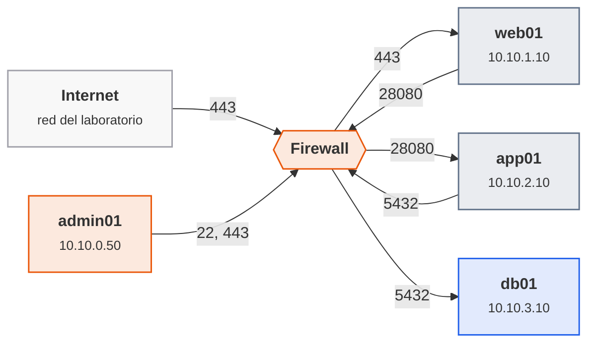
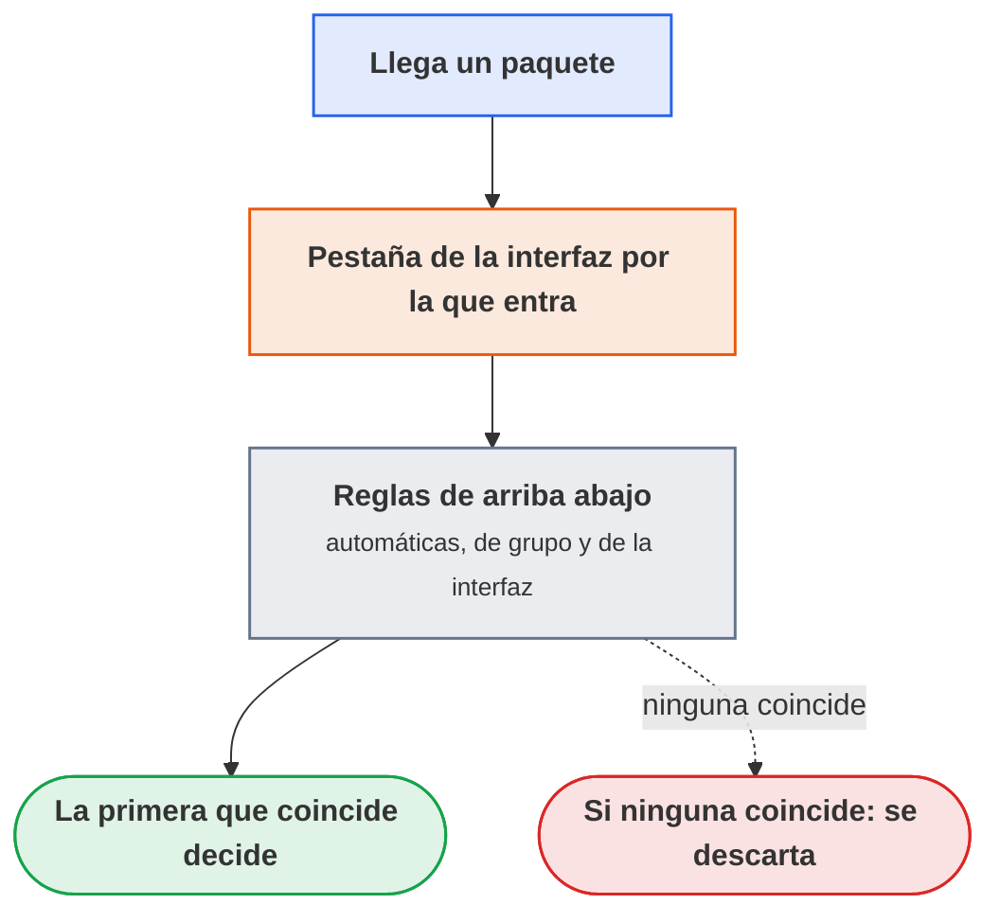
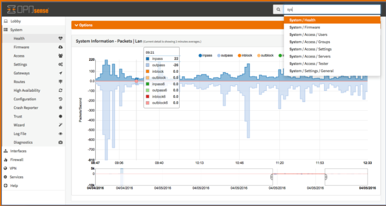
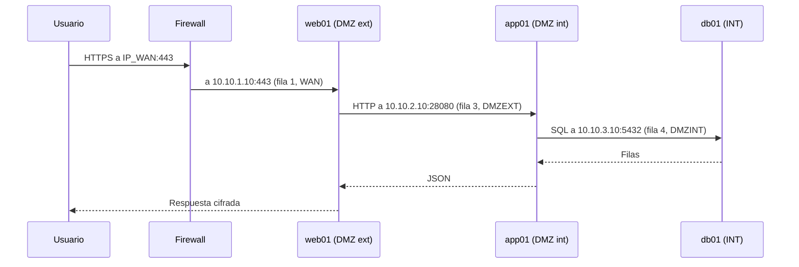
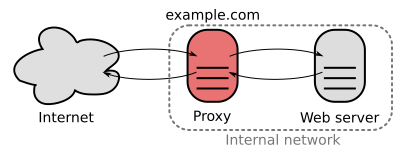

# UT3 · Seguridad por capas: DMZ externa, DMZ interna y zona interna

<p class="ut-meta">10 h · Sesiones 15 a 19 · RA1 CE d</p>

La UT2 dejó en dev cuatro VNets, una por zona (gestión, front, back y data), unidas por `router-dev`. Funcionaba demasiado bien: en la A2.2 web01, en front, llegaba al 5432 de db01, en data, y cualquier máquina llegaba a cualquier puerto de otra zona. Si alguien entrase en el proxy, que es lo único que se ve desde fuera, tendría la base de datos al alcance.

En esta unidad ese router se sustituye por un cortafuegos OPNsense y la red abierta pasa a ser una red por capas: cada zona tiene un papel, cada salto entre zonas está permitido de forma explícita y queda registrado. Primero se pone el cortafuegos en el sitio del router y se publica la web; después cada pieza del servicio pasa a su zona; y al final se demuestra con pruebas que el aislamiento es real. El cortafuegos, sus reglas y la CA del curso se usan hasta el final del curso, también en Mantenimiento.

## Sesión 15 · Modelo de seguridad por capas y publicación de un servicio

<p class="ut-meta" markdown>25 de noviembre · Teoría y práctica · <span class="dur" tabindex="0" aria-label="Defensa en profundidad y zonas · 5 min&#10;Cortafuegos con estado y reglas · 5 min&#10;NAT: port forward y outbound · 5 min&#10;A3.1 Firewall y publicación de la web · 95 min" data-dur="Defensa en profundidad y zonas · 5 min&#10;Cortafuegos con estado y reglas · 5 min&#10;NAT: port forward y outbound · 5 min&#10;A3.1 Firewall y publicación de la web · 95 min">:material-school:<i class="dur-barra" style="--teoria:14%"></i>:material-flask:</span></p>

Hoy `router-dev` deja su sitio a un cortafuegos, y ese cortafuegos publica hacia fuera la web de web01 con HTTPS. En clase se explican tres ideas: por qué la red se separa en zonas, cómo decide un cortafuegos qué paquete pasa y cómo se llega desde fuera a una máquina con dirección privada (NAT). El resto de apartados ([OPNsense](#opnsense), [Aliases](#aliases), [Logs](#logs) y [Certificados](#certificados)) es de consulta: lo usan la preparación de casa y los pasos de la hoja.

### Defensa en profundidad y zonas

**Para qué sirve.** Ningún control de seguridad es perfecto: el proxy tendrá una vulnerabilidad algún día o alguien reutilizará una contraseña. La **defensa en profundidad** consiste en poner varios controles en serie, de modo que si uno cae el atacante se encuentre otro delante, y cada intento deje rastro en un log.

**Cómo se hace en una red: zonas.** Las máquinas se agrupan en zonas según lo expuestas que están, y entre zona y zona solo pasa lo imprescindible. Lo que se ve desde Internet va en la zona más expuesta, la **DMZ** (zona desmilitarizada); lo más valioso, los datos, en la más profunda.

| Zona | Qué aloja | Quién puede entrar |
|----|----|----|
| DMZ externa | Lo que se ve desde fuera: el proxy inverso | Internet, solo en 80 y 443 |
| DMZ interna | La aplicación (API) | Solo la DMZ externa, en puertos concretos |
| Zona interna | Bases de datos y copias | Solo la DMZ interna, en puertos concretos |
| Gestión | Consola del cortafuegos, SSH, monitorización | Solo los administradores |

**Las cuatro reglas del juego**, que aparecen en cualquier auditoría:

- **Denegar por defecto**: lo que no está permitido de forma expresa se bloquea y se registra.
- **Solo por saltos**: cada zona solo abre conexiones hacia la inmediatamente más profunda. La web nunca habla con la base de datos sin pasar por la aplicación.
- **Mínima exposición**: cada servicio expone solo el puerto que necesita, y la gestión va por una red aparte.
- **Registro**: lo denegado y lo que toca los datos queda en el log, con hora, origen, destino y regla.

**La buena práctica.** En el curso hay un solo cortafuegos con una interfaz por zona, que es lo habitual en una empresa mediana: toda la política está en un sitio y se revisa de una vez. Las empresas grandes a veces ponen dos en serie, uno de cara a Internet y otro delante de los datos.

#### Mapa sobre la VPC de la UT2

**No hay que rehacer la red.** Cada zona ya tiene su VNet, es decir, su propio bridge, y entre dos bridges distintos solo se pasa a través de una máquina con una pata en cada uno. Hasta hoy esa máquina era `router-dev`; desde hoy es el cortafuegos, y por eso todo lo que cruza de una zona a otra se puede filtrar. Lo que cambia es el papel de cada subred:

| Zona | VNet en Proxmox | Red | Gateway (firewall) | Máquinas |
|----|----|----|----|----|
| DMZ externa | devfront | 10.10.1.0/24 | 10.10.1.1 | web01 (proxy) |
| DMZ interna | devback | 10.10.2.0/24 | 10.10.2.1 | app01 |
| Zona interna | devdata | 10.10.3.0/24 | 10.10.3.1 | db01 |
| Gestión | devmgmt | 10.10.0.0/24 | 10.10.0.1 | Puesto de administración, mon01 |
| Exterior (WAN) | vmbr0 | La del laboratorio | Router del laboratorio | Todo lo demás |



<p class="pie" markdown>Ningún salto entre capas es directo: todos pasan por el cortafuegos, y por eso se puede filtrar cada uno por separado.</p>

**El cortafuegos hereda las direcciones del router.** OPNsense ocupa las cuatro `.1` de `router-dev`, su DHCP con las mismas reservas y su DNS con los mismos nombres. Como las VM reciben por DHCP el `.1` de su zona como puerta de enlace y la 10.10.0.1 como DNS, ninguna tiene que cambiar nada. `router-dev` se apaga cuando el relevo está hecho y se destruye al cerrar la evaluable, el 4 de diciembre.

**Y da la hora.** Desde hoy las zonas de servicio no salen a Internet, para que una máquina comprometida no pueda descargar herramientas ni sacar datos. Así que tampoco llegan a los servidores de hora públicos, y el cortafuegos pasa a ser su servidor de hora. Con la hora mal, los logs de dos máquinas no se pueden cruzar y un certificado puede parecer caducado.

### Cortafuegos con estado

**Para qué sirve saberlo.** Decide cuántas reglas hay que escribir. Un cortafuegos **con estado** recuerda las conexiones que ya ha aceptado en una **tabla de estados**: cuando una regla deja pasar el primer paquete de una conexión (web01 pide a app01:28080), las respuestas y el resto de paquetes de esa conexión pasan solos, sin volver a mirar las reglas.

**Cómo se nota al escribir reglas.** Solo se escribe la regla del primer paquete, en el sentido en que se abre la conexión. "El proxy puede abrir conexiones hacia la API, pero la API no puede abrir nada hacia el proxy" es una sola regla. En OPNsense cada regla Pass crea su estado sola; en Linux este mecanismo se llama conntrack (seguimiento de conexiones) y nftables necesita una línea que acepte lo ya establecido.

### Reglas y orden de evaluación

**Dónde va una regla: en la interfaz por la que entra el paquete.** Las reglas de OPNsense se organizan por interfaz y se aplican al tráfico que **entra** por ella. Para que web01 hable con app01:28080, la regla va en DMZEXT, que es por donde entra el paquete al cortafuegos, aunque el destino esté en DMZINT.

!!! truco "La pregunta que resuelve casi todas las dudas"
    «¿Por qué interfaz **llega** este paquete al cortafuegos?». Esa es la pestaña donde va la regla.



<p class="pie" markdown>Gana la primera regla que coincide: una regla permisiva arriba anula todas las restrictivas de debajo.</p>

**El orden.** Primero van las reglas automáticas del sistema (como la anti-lockout, que impide quedarse fuera de la consola), después las de grupos de interfaces (en el laboratorio, la regla 0 del grupo `ZONAS`), después las de la interfaz, de arriba abajo, y al final la denegación por defecto. Se ordenan de la más concreta a la más general.

**Qué lleva cada regla.** Acción, interfaz, protocolo, origen, destino, puerto, log y una **descripción**. La descripción es lo que aparece en el log, así que en el curso empieza por el número de fila de la [matriz de reglas](#matriz-de-reglas) ("3 Proxy a la API y a whoami"): cada línea del log lleva a la justificación de su regla.

**Block, no Reject.** Block descarta el paquete en silencio y Reject contesta que no hay servicio. En el laboratorio todas las denegaciones son Block, porque las pruebas de la unidad leen el `filtered` de nmap como prueba de que el paquete murió en el cortafuegos.

**La buena práctica: Apply y estados.** Nada entra en vigor hasta pulsar **Apply**. Y una conexión que ya estaba abierta sigue viva aunque una regla nueva la prohíba, porque la decide la tabla de estados: para cortarla, se borra su estado en Firewall → Diagnostics → States.

### NAT: port forward y outbound

**Para qué sirve.** web01 tiene una dirección privada, la 10.10.1.10, que desde la red del laboratorio no se alcanza: desde fuera solo se ve la dirección WAN del cortafuegos. NAT (traducción de direcciones) resuelve los dos sentidos.

**Port forward: hacia dentro.** Publica un servicio interno en la IP WAN: lo que llega a WAN:443 se reenvía a `srv_web`:443. En OPNsense está en Firewall → NAT → Destination NAT. Su campo "Filter rule association" se deja en **Register rule**, que crea sola la regla de filtro que deja pasar el paquete ya traducido, con `srv_web` como destino.

!!! ojo "El port forward sin regla de filtro no publica nada"
    Con "Manual" en "Filter rule association", OPNsense no crea la regla de filtro: el paquete se traduce y
    después se bloquea en la WAN, y el `curl` se queda colgado sin respuesta. Con "Register rule" se crea sola.

**Outbound NAT: hacia fuera.** Cambia la dirección privada de origen por la del cortafuegos para salir a Internet. OPNsense lo hace en modo automático y se deja así: quien decide qué sale son las reglas de filtro. La política del curso:

- **Gestión sale** a los puertos 80 y 443 (fila 2 de la matriz): ahí viven las máquinas que descargan paquetes e imágenes.
- **Las zonas de servicio no salen.** Si una hoja necesita instalar algo en ellas, abre en la pestaña de esa zona una regla **TEMPORAL** (origen la máquina, destino any, puertos `p_web`, y en la descripción `TEMPORAL`, la fecha de alta y la de baja), instala y la borra en el mismo paso. Una regla temporal olvidada es la forma más común de que un cortafuegos acabe dejándolo pasar todo.

!!! empresa "Sin salida ni siquiera un rato"
    En producción las zonas internas no salen a Internet ni para actualizarse: toman los paquetes de una caché
    de paquetes que vive en gestión.

### OPNsense

!!! consulta "Material de consulta"
    No se explica en clase: lo usan la preparación de casa de la A3.1 y sus primeros pasos.

**Qué es.** OPNsense es una distribución de cortafuegos basada en FreeBSD, con interfaz web, gratuita y de código abierto. Saca dos versiones al año, numeradas como año.mes (26.1, 26.7), y en el curso se instala la última 26.x. Si en una empresa aparece pfSense, su pariente cercano, todo lo de esta unidad vale cambiando algún nombre de menú.

<figure markdown="span">
  { width="640" }
  <figcaption>Panel de OPNsense con el estado de interfaces, servicios y tráfico. Fuente: Hagennos, CC BY-SA 4.0, vía Wikimedia Commons.</figcaption>
</figure>

#### Instalación en Proxmox

**Una VM con una tarjeta por zona.** VM 109 (la última de la franja de gestión de dev), 2 vCPU, 1 GB de RAM, 20 GB de disco y cinco tarjetas VirtIO, una por zona. Dentro, FreeBSD llama a las tarjetas `vtnet0`, `vtnet1`... en el orden `net0`, `net1`... de Proxmox, así que el orden en que se crean decide qué zona queda detrás de cada interfaz. La tabla del curso, que es la que manda:

| Interfaz OPNsense | vtnet | Tarjeta Proxmox | Bridge / VNet | IP |
|----|----|----|----|----|
| WAN | vtnet0 | net0 | vmbr0 (laboratorio) | DHCP del laboratorio |
| DMZEXT | vtnet1 | net1 | devfront | 10.10.1.1/24 |
| DMZINT | vtnet2 | net2 | devback | 10.10.2.1/24 |
| INT | vtnet3 | net3 | devdata | 10.10.3.1/24 |
| MGMT | vtnet4 | net4 | devmgmt | 10.10.0.1/24 |

**La buena práctica: la consola, solo en gestión.** Quien entra en la consola web cambia todas las reglas, así que lo primero es dejarla escuchando solo en MGMT (System → Settings → Administration → Listen Interfaces). Si un error deja fuera, la consola de Proxmox de la VM tiene un menú de texto para reasignar interfaces o volver a fábrica, sin reinstalar.

#### El relevo de router-dev

**Para qué.** El cortafuegos tiene que pasar a ser el `.1`, el DHCP y el DNS de las cuatro zonas sin que ninguna VM se quede sin red. No pueden convivir los dos: dos máquinas con la misma `.1` se pisan y el ping funciona a ratos. Por eso el relevo va en tres tiempos:

1. **Preparar sin aplicar.** El cortafuegos recibe sus direcciones en las interfaces internas, pero apagadas, y una dirección provisional en gestión, la 10.10.0.2. El DHCP y el DNS se copian de `router-dev`.
2. **Cambiar.** `router-dev` suelta sus direcciones internas y su dnsmasq, y el cortafuegos activa las suyas.
3. **Comprobar y retirar.** Cuando una VM ha renovado con el cortafuegos y conserva su IP, se apaga `router-dev`, sin borrarlo, por si hubiera que deshacer.

Hay margen: cada VM tiene una concesión de 12 horas, así que aunque el DHCP desaparezca un rato, ninguna pierde su IP.

**Quién hace el DHCP y quién el DNS.** OPNsense trae dos servicios. **dnsmasq** (Services → Dnsmasq DNS & DHCP), el mismo de `router-dev`, reparte las direcciones y conoce los nombres de las reservas. **Unbound** (Services → Unbound DNS) atiende el puerto 53 y no sabe nada de las reservas. Se reparten así: dnsmasq escucha en el puerto 53053 y Unbound le reenvía las preguntas del dominio `lab`, que incluye `dev.lab` y los nombres de gestión como `mon01.lab`.

**La regla 0.** En cuanto se activan las interfaces internas, la denegación por defecto corta también las preguntas al propio cortafuegos, y ninguna VM resolvería un nombre. Por eso la primera regla se escribe en el mismo momento del relevo: en el **grupo de interfaces** `ZONAS`, que reúne las cuatro zonas para escribirla una sola vez, deja pasar hacia **This Firewall** (cualquier dirección del propio cortafuegos) el DNS (53), la hora (123) y el ping. La consola web, el 443 del cortafuegos, no entra.

**Gestión, el primer rato.** OPNsense trae unas reglas de fábrica que dejan salir a todo desde LAN (la futura MGMT). Se sustituyen por las reglas propias de gestión en la misma hoja.

### Alternativa: nftables en una VM Linux

El mismo modelo de zonas se puede montar con un router Debian y **nftables**, la herramienta con la que se escriben las reglas del cortafuegos del kernel de Linux: se pierde la interfaz web y se gana un fichero de texto que se versiona en git. En el curso se usa OPNsense; el fichero completo está en [Para ampliar](../ampliacion.md#nftables-el-fichero-de-reglas-completo).

### Aliases

**Para qué sirve.** Una regla escrita con IPs sueltas no se entiende sin saber qué máquina es cada dirección, y cuando una máquina cambia de IP hay que buscarla en todas las reglas. Un **alias** es un nombre para una lista de direcciones, redes o puertos: la regla se lee sola ("`srv_web` a `srv_app` en `p_app`") y, si app01 cambia de IP, se cambia el alias y no diez reglas.

**Cómo se hace.** Firewall → Aliases → `+`, con nombre, tipo (Host, Network o Port) y contenido. El nombre dice qué es: `srv_` un servidor, `net_` una red, `p_` una lista de puertos. Todos los del curso, con la hoja que los crea:

| Alias | Tipo | Valor | Para qué | Nace en |
|----|----|----|----|----|
| `p_infra` | Port | 53, 123 | La regla 0: DNS y hora del propio cortafuegos | A3.1 |
| `srv_web`, `srv_app` y `srv_db` | Host | 10.10.1.10, 10.10.2.10 y 10.10.3.10 | Las tres máquinas del servicio | A3.1 |
| `net_mgmt` | Network | 10.10.0.0/24 | Todo lo que vive en gestión | A3.1 |
| `p_web` | Port | 80, 443 | La publicación de la web y la salida a Internet | A3.1 |
| `p_app` | Port | 28080, y el 28090 desde la A3.2 | Lo que el proxy pide a app01 | A3.1 |
| `srv_gitea` | Host | 10.10.0.20; la 10.10.0.11 desde el 12 de febrero | La Gitea a la que empuja app01 | A3.2 |
| `net_cli_a` y `net_cli_b` | Network | 10.10.101.0/24 y 10.10.102.0/24 | Las redes de los dos clientes | [Demostración](#demostracion-dos-clientes-en-vlan) (2 dic) |
| `srv_mon`, `p_mon_app` y `p_mon_db` | Host y Port | 10.10.0.20 y los puertos de cada exporter | El scrape y los logs de la monitorización | A3.1 de Mantenimiento (26 nov) |

**La buena práctica.** Ninguna regla del laboratorio lleva IPs sueltas: todas se escriben con aliases.

### Logs

**Para qué sirve.** El cortafuegos decide en silencio, y el log es lo único que dice qué ha decidido. En esta unidad es además la evidencia: una denegación que no deja línea en el log no se puede demostrar.

**Dónde se mira.** Firewall → Log Files → Live View muestra en directo cada paquete de una regla con log activado, y los de la denegación por defecto si está activada la opción que los registra ("Log packets matched by the default deny rule"). Cada línea trae interfaz, acción, origen, destino y la descripción de la regla. Conviene filtrar por interfaz o por descripción: con veinte laboratorios escaneándose, el log sin filtro no se puede leer.

**La buena práctica.** Log en todas las reglas de denegación y en las de permiso hacia la zona interna, que dicen quién toca los datos. No en la de WAN:443, que dejaría una línea por cada visita; para eso están los logs del proxy.

### Certificados

**Para qué sirve.** Con HTTPS el cliente comprueba que habla con el servidor de verdad. El servidor presenta un **certificado** que dice "esta clave es de `api.dev.lab`", firmado por una **CA** (autoridad de certificación) en la que el cliente confía. Se puede pedir la web saltándose la comprobación (`curl -k`), pero entonces cualquiera que se ponga en medio presenta su propio certificado y el cliente lo acepta.

**Una CA propia, y una sola.** Las CA públicas (como Let's Encrypt, gratuita y automática) solo firman nombres que se ven desde Internet, y `api.dev.lab` no lo es. Con una CA propia, cada cliente confía en un solo fichero, `ca.crt`, y con él en todo lo que esa CA firme. El laboratorio tiene una, `Lab 5166 CA`, que nace en `~/ca/` del puesto de administración con la preparación de la A3.1 y firma todo lo que se cifra después en las dos asignaturas.

**Cómo se crea.** Con `openssl ca`, que apunta cada certificado emitido en `index.txt` y así permite revocarlo más adelante. Primero, la carpeta:

```bash
mkdir -p ~/ca/emitidos && chmod 700 ~/ca && cd ~/ca
touch index.txt
echo 1000 > serial
echo 1000 > crlnumber
```

Después, el fichero de configuración `~/ca/ca.cnf`, entero. Tiene una sección para certificados de servidor y otra para certificados de cliente:

```ini
[ ca ]
default_ca        = ca_curso

[ ca_curso ]
dir               = $ENV::HOME/ca
certificate       = $dir/ca.crt
private_key       = $dir/ca.key
database          = $dir/index.txt      # registro de lo emitido y lo revocado
serial            = $dir/serial
crlnumber         = $dir/crlnumber
new_certs_dir     = $dir/emitidos       # una copia de cada certificado
default_md        = sha256
default_days      = 365
default_crl_days  = 30
policy            = politica
copy_extensions   = copy                # conserva los nombres (SAN) de la petición
unique_subject    = no                  # deja reemitir con el mismo nombre

[ politica ]
commonName        = supplied

# servidores: proxy, exporters, Jenkins, registry
[ server_cert ]
basicConstraints       = CA:FALSE
extendedKeyUsage       = serverAuth
subjectKeyIdentifier   = hash
authorityKeyIdentifier = keyid,issuer

# clientes que se identifican con certificado: Promtail, logcli
[ client_cert ]
basicConstraints       = CA:FALSE
extendedKeyUsage       = clientAuth
subjectKeyIdentifier   = hash
authorityKeyIdentifier = keyid,issuer
```

La CA se crea una sola vez, con diez años de vida. La línea `keyUsage` hace falta: sin ella, algunos clientes estrictos rechazan todo lo que firme la CA.

```bash
cd ~/ca
openssl req -x509 -newkey ec -pkeyopt ec_paramgen_curve:prime256v1 -nodes \
  -keyout ca.key -out ca.crt -days 3650 -subj "/CN=Lab 5166 CA" \
  -addext "keyUsage=critical,keyCertSign,cRLSign"
chmod 600 ca.key
```

**Cada certificado, en dos órdenes:** una petición con la clave y los nombres, y la firma de la CA. Los nombres van en el **SAN** (los nombres e IP para los que vale el certificado): sin él, los clientes actuales rechazan el certificado aunque la firma sea buena.

```bash
cd ~/ca
openssl req -new -newkey ec -pkeyopt ec_paramgen_curve:prime256v1 -nodes \
  -keyout api.dev.lab.key -out api.dev.lab.csr -subj "/CN=api.dev.lab" \
  -addext "subjectAltName=DNS:api.dev.lab,IP:10.10.1.10"
openssl ca -config ~/ca/ca.cnf -extensions server_cert \
  -in api.dev.lab.csr -out api.dev.lab.crt
```

`openssl ca` pregunta dos veces antes de firmar (con `-batch` no pregunta). Un certificado de cliente es igual con `-extensions client_cert`. Para comprobar: `openssl x509 -in api.dev.lab.crt -noout -ext subjectAltName` enseña los nombres, y `cat ~/ca/index.txt` una línea por certificado, con `V` mientras es válido.

**Que los clientes confíen en la CA.** Se copia `ca.crt` a `/usr/local/share/ca-certificates/` con extensión `.crt` y se ejecuta `update-ca-certificates`; desde ese momento `curl` ya no necesita `-k`.

**La buena práctica.** `ca.key` no sale nunca de `~/ca/`: con esa clave se puede firmar un certificado para cualquier nombre del laboratorio, y todos los clientes lo aceptarían.

### A3.1 Firewall y publicación de la web (sesión 15)

<span class="et et-obj">Objetivo</span> Al terminar, OPNsense ocupa el sitio de `router-dev` (la `.1` de cada zona, el DHCP y el DNS) sin que ninguna VM lo haya notado, su consola web solo responde desde MGMT, y `https://api.dev.lab` está publicado hacia la red del laboratorio con un certificado de la CA del curso. Desde fuera solo se ven el 80 y el 443. Es lo que hace cualquier empresa al poner un cortafuegos delante de una red que ya funciona.

<span class="et et-pre">Antes de empezar</span>

- La VPC dev de la UT2: `router-dev` repartiendo IP y nombres, `web01` (10.10.1.10) en `devfront` y `db01` (10.10.3.10) en `devdata`. `app01` y `mon01` siguen en `vmbr0` hasta la A3.2.
- El puesto de administración `admin01` (VM 105, 10.10.0.50), desde el que haces todo: `ssh -A ops@<IP de admin01 en la red del laboratorio>`. Tu repositorio `entregas-5166` vive en él.
- La preparación de casa del bloque siguiente, hecha.
- Explicado en clase: [Defensa en profundidad y zonas](#defensa-en-profundidad-y-zonas), con el [mapa sobre la VPC](#mapa-sobre-la-vpc-de-la-ut2), [Cortafuegos con estado](#cortafuegos-con-estado), [Reglas y orden de evaluación](#reglas-y-orden-de-evaluacion) y [NAT](#nat-port-forward-y-outbound). De consulta: [OPNsense](#opnsense), con su [instalación](#instalacion-en-proxmox) y [el relevo](#el-relevo-de-router-dev), [Aliases](#aliases), [Logs](#logs) y [Certificados](#certificados).

!!! truco "Preparación antes de la sesión: el firewall instalado y la web lista detrás"
    Unos cuarenta minutos que no dependen de nadie. Hazlos en casa: en clase solo cabe el relevo.

    **1 · La VM del firewall (15 min).** Descarga de opnsense.org la imagen `dvd` de la 26.x para amd64. Viene comprimida en `.bz2`: descomprímela con `bunzip2` y súbela a Proxmox (local → ISO Images → Upload). Después, en la shell del nodo, crea la VM con las cinco tarjetas en el orden de la tabla de [Instalación en Proxmox](#instalacion-en-proxmox):

    ```bash
    qm create 109 --name opnsense --memory 1024 --cores 2 --ostype other \
      --scsihw virtio-scsi-single --scsi0 local-lvm:20 \
      --cdrom local:iso/<nombre de la ISO> \
      --net0 virtio,bridge=vmbr0 --net1 virtio,bridge=devfront \
      --net2 virtio,bridge=devback --net3 virtio,bridge=devdata \
      --net4 virtio,bridge=devmgmt
    qm start 109
    ```

    En la consola de la VM entra como `installer` (contraseña `opnsense`), instala con las opciones por defecto y pon una contraseña a root. Al reiniciar, retira la ISO con `qm set 109 --cdrom none`. Apunta la MAC de cada tarjeta (Hardware de la VM 109): en el paso 1 es la forma de saber qué `vtnet` es cada zona.

    **2 · Los paquetes de las zonas (5 min).** Tras el relevo, web01 y db01 ya no salen a Internet, así que instala ahora lo que usa la unidad:

    ```bash
    ssh ops@10.10.1.10 'sudo apt update && sudo apt install -y nginx nmap netcat-openbsd'
    ssh ops@10.10.3.10 'sudo apt update && sudo apt install -y postgresql prometheus-postgres-exporter nmap netcat-openbsd'
    ```

    **3 · La CA del curso y el certificado del proxy (10 min).** En admin01, copia tal cual los bloques de [Certificados](#certificados): la carpeta, `ca.cnf`, la CA y el certificado de `api.dev.lab`. Mantenimiento firma con esta CA desde el 26 de noviembre, así que las rutas y los nombres tienen que ser exactamente esos. Después lleva el certificado y su clave a web01:

    ```bash
    cd ~/ca
    scp api.dev.lab.crt api.dev.lab.key ops@10.10.1.10:/tmp/
    ssh ops@10.10.1.10 'sudo mv /tmp/api.dev.lab.* /etc/ssl/ && sudo chmod 600 /etc/ssl/api.dev.lab.key'
    ```

    **4 · nginx sirviendo api.dev.lab por HTTPS (10 min).** En web01, crea `/etc/nginx/sites-available/api.dev.lab`. Es el fichero de [El proxy inverso](#el-proxy-inverso) con una página estática en lugar del reenvío, porque app01 aún no está en la VPC:

    ```nginx
    server {
        listen 80;
        server_name api.dev.lab;
        return 301 https://$host$request_uri;
    }
    server {
        listen 443 ssl;
        http2 on;
        server_name api.dev.lab;
        ssl_certificate     /etc/ssl/api.dev.lab.crt;
        ssl_certificate_key /etc/ssl/api.dev.lab.key;
        ssl_protocols TLSv1.2 TLSv1.3;
        root /var/www/html;
        index index.nginx-debian.html;
    }
    ```

    Actívalo, quita el sitio `default` y recarga:

    ```bash
    sudo ln -s /etc/nginx/sites-available/api.dev.lab /etc/nginx/sites-enabled/
    sudo rm /etc/nginx/sites-enabled/default
    sudo nginx -t && sudo systemctl reload nginx
    curl -kI https://localhost      # tiene que dar 200
    ```

<span class="et et-pas">Pasos</span>

Primero haces el relevo de `router-dev` en sus tres tiempos: en los pasos 1 y 2 lo preparas todo sin pisar al router, en el 3 haces el cambio y en el 4 compruebas que nadie lo ha notado. Después, en los pasos 5 y 6, abres solo lo justificado y publicas la web. Si vas justo de tiempo, lo que no puede quedarse a medias es el relevo: un cortafuegos preparado y sin activar no estorba a nadie, pero uno activado a medias deja las zonas sin red.

1. **Asigna cada tarjeta a su zona y cierra la consola.** Preparas las interfaces sin activarlas, porque `router-dev` sigue siendo el `.1`.

    En la consola de la VM 109 (Proxmox → 109 → Console), entra como root:

    - Opción **1) Assign interfaces**: sin VLAN; WAN `vtnet0`, LAN `vtnet4`, y como opcionales `vtnet1`, `vtnet2` y `vtnet3`, en ese orden. Comprueba con las MAC que apuntaste que cada `vtnet` es la tarjeta de la tabla.
    - Opción **2) Set interface IP address**: LAN con `10.10.0.2/24`, sin gateway, **sin servidor DHCP** y manteniendo HTTPS. Apunta la IP que recibe la WAN: sale en la cabecera de la consola.

    Abre la consola web con un túnel desde tu puesto, porque la 10.10.0.2 solo existe dentro de gestión:

    ```bash
    ssh -L 28443:10.10.0.2:443 ops@<IP de admin01 en la red del laboratorio>
    # y en el navegador: https://localhost:28443 (usuario root)
    ```

    En la consola web (si sale el asistente, pulsa Next dejando los valores que ya tiene):

    - Interfaces → **[LAN]**: Description `MGMT`. Save y Apply.
    - Interfaces → **[OPT1]**: Description `DMZEXT`, IPv4 Configuration Type `Static IPv4`, IPv4 address `10.10.1.1/24`, sin gateway y **sin marcar "Enable Interface"**. Save. Igual con **[OPT2]** como `DMZINT` (`10.10.2.1/24`) y **[OPT3]** como `INT` (`10.10.3.1/24`).
    - System → Settings → Administration: Listen Interfaces solo `MGMT`. Save.

    Deja la regla anti-lockout como está: te garantiza la entrada hasta el paso 5.

    *Comprobación:* Interfaces → Assignments muestra las cinco interfaces con su `vtnet`, y desde admin01 `curl -k -m 3 https://<IP WAN>` no contesta.

2. **Prepara el DHCP y el DNS sin aplicarlos.** Copias en el cortafuegos lo que hoy da `router-dev`, para que cada VM reciba lo mismo que recibía. Las reservas de app01 y mon01 no se usan hasta el traslado del 27 de noviembre, pero tienen que estar ya, y los nombres de `mon01.lab` los usa Mantenimiento desde ese día. Las MAC están en el `dev.conf` de `router-dev` (`/etc/dnsmasq.d/dev.conf`).

    En Services → Dnsmasq DNS & DHCP:

    - **General**: Enable; Interface `DMZEXT`, `DMZINT`, `INT` y `MGMT`; Listen port `53053`; marca **DHCP fqdn**, **DHCP register firewall rules** y **Do not forward to system defined DNS servers**. Apply.
    - **DHCP ranges**, uno por zona: interfaz, del `.100` al `.199` y Domain `dev.lab`. Deja vacíos router y DNS: así anuncia la IP de la interfaz, que es el `.1`.
    - **Hosts**, uno por reserva, con Host, Domain `dev.lab`, IP y Hardware address: `web01` 10.10.1.10, `app01` 10.10.2.10, `db01` 10.10.3.10 y `mon01` 10.10.0.20. Uno más sin MAC: Host `api`, Domain `dev.lab`, IP 10.10.1.10. Y otro para gestión: Host `mon01`, Domain `lab`, IP 10.10.0.20, Aliases `grafana.lab`, `prometheus.lab` y `gitea.lab`.

    En Services → Unbound DNS:

    - **Query Forwarding**: Domain `lab`, Server IP `127.0.0.1`, Server Port `53053`. Apply.
    - **Advanced**: Private Domains `lab`, para que Unbound no tire las respuestas con direcciones privadas. Apply.

    *Comprobación:* en Services → Dnsmasq DNS & DHCP están los cuatro rangos y las seis entradas de Hosts, y en Unbound DNS → Query Forwarding, la línea de `lab`.

3. **Haz el relevo y abre lo mínimo.** Es el cambio de guardia: `router-dev` suelta sus direcciones y el cortafuegos activa las suyas, y en seguida la regla 0, porque desde que se activan las interfaces la denegación por defecto corta el DNS y la hora.

    En `router-dev`, entrando por su IP en la red del laboratorio (`ens18`, que no se toca):

    ```bash
    sudo systemctl disable --now dnsmasq
    for i in ens19 ens20 ens21 ens22; do sudo ip link set $i down; done
    ```

    En el cortafuegos, sin perder tiempo:

    - Interfaces → DMZEXT, DMZINT e INT: marca **Enable Interface**, Save y Apply en cada una.
    - Interfaces → MGMT: IPv4 address `10.10.0.1/24`. Save y Apply. Rehaz el túnel con `10.10.0.1` en lugar de `10.10.0.2`.
    - Services → Network Time → General: comprueba que está activo y escuchando en las cuatro zonas.
    - Firewall → Groups → `+`: nombre `ZONAS`, miembros `DMZEXT`, `DMZINT`, `INT` y `MGMT`.
    - Firewall → Aliases → `+`: `p_infra`, tipo Port, `53` y `123`.
    - Firewall → Rules, interfaz **ZONAS**, dos reglas: Pass, TCP/UDP, origen any, destino **This Firewall**, puerto `p_infra`, descripción `0 DNS, hora y ping al cortafuegos`; y Pass, ICMP, tipo Echo Request, mismo origen y destino, misma descripción. Apply.

    *Comprobación:* desde web01, `ping -c 2 10.10.1.1` y `dig db01.dev.lab` contestan. Si el ping al `.1` va a ratos, en admin01 `sudo ip neigh flush all`: aún recordaba la MAC de `router-dev`.

4. **Cierra el relevo y comprueba que nadie lo ha notado.** Antes de apagar el router compruebas que las VM renuevan con el cortafuegos y conservan su IP, que es la prueba de que las reservas están bien copiadas. Después las pones a tomar la hora del cortafuegos.

    En web01 y en db01 (cambia el `.1` por el de su zona: 10.10.1.1 en web01, 10.10.3.1 en db01):

    ```bash
    sudo networkctl renew ens18 && ip -br a show ens18      # sigue con su .10
    sudo mkdir -p /etc/systemd/timesyncd.conf.d
    printf '[Time]\nNTP=<.1 de su zona>\n' | sudo tee /etc/systemd/timesyncd.conf.d/lab.conf
    sudo systemctl restart systemd-timesyncd
    timedatectl timesync-status | head -3
    ```

    Apaga `router-dev` (botón Shutdown de la VM 100), sin borrarlo: se queda así hasta la evaluable del 4 de diciembre. Por último, admin01 tiene IP fija en gestión y no recibe el DNS por DHCP: en su pestaña Cloud-Init pon DNS servers `10.10.0.1` y DNS domain `lab`, y haz Reboot.

    *Comprobación:* en admin01, `dig web01.dev.lab` contesta 10.10.1.10. Si `ssh` avisa de que la clave del host ha cambiado, mira [Errores frecuentes](#errores-frecuentes-en-el-laboratorio).

5. **Abre solo lo que la matriz justifica.** Creas los aliases y las reglas de gestión, quitas las de fábrica y publicas la web. `srv_app` y `srv_db` aún no los usa ninguna regla tuya, pero Mantenimiento escribe con ellos mañana sus filas 11 a 13.

    - Firewall → Aliases: `srv_web`, `srv_app`, `srv_db`, `net_mgmt`, `p_web` y `p_app` con los valores de la tabla de [Aliases](#aliases). Apply.
    - Firewall → Rules, interfaz **MGMT**: Pass, TCP, `net_mgmt` → any, puerto 22, con log, descripción `5 Administración por SSH`; y Pass, TCP, `net_mgmt` → any, puerto `p_web`, descripción `2 Gestión: consola y salida a Internet`. Apply. **Solo entonces** borra las reglas de fábrica "Default allow LAN to any" (IPv4 e IPv6) y Apply: si las borras antes, te quedas sin SSH hacia las zonas.
    - Interfaces → WAN: desmarca **Block private networks**, porque la red del laboratorio es privada y si no se descartaría todo lo que llega de ella. Save y Apply.
    - Firewall → NAT → Destination NAT → `+`: Interface `WAN`, Protocol `TCP`, Destination `WAN address`, puerto `p_web`, Redirect target `srv_web`, puerto `p_web`, Filter rule association **Register rule**, descripción `1 Publicación de api.dev.lab`. Save y Apply.

    *Comprobación:* en Firewall → Rules, interfaz WAN, aparece la regla creada por el NAT, con destino `srv_web` y no la IP WAN.

6. **Pide la web desde fuera y mírala como un atacante.** admin01 está también en la red del laboratorio (`ens18`), así que desde él la WAN se ve como la vería cualquiera. Haces tres pruebas distintas: que el port forward funciona, que el certificado valida y qué puertos se ven desde fuera. Guarda las salidas en `ut3/` de tu repositorio.

    ```bash
    WAN=<IP WAN del cortafuegos>
    curl -kI https://$WAN                                     # responde: el port forward funciona
    sudo cp ~/ca/ca.crt /usr/local/share/ca-certificates/lab5166.crt
    sudo update-ca-certificates
    echo "$WAN api.dev.lab" | sudo tee -a /etc/hosts
    { date; hostname; curl -v https://api.dev.lab; } > ~/entregas-5166/ut3/curl-a31.txt 2>&1
    { date; hostname; sudo nmap -sS -Pn -p 22,80,443,28080 $WAN; } > ~/entregas-5166/ut3/nmap-a31.txt 2>&1
    ```

    El `-Pn` hace falta porque el firewall no contesta al ping desde fuera, y sin él nmap da el host por caído. Contra la IP WAN el certificado no valida nunca, porque solo vale para su SAN: por eso la prueba buena va por nombre.

    *Comprobación:* mira la Comprobación de abajo y Live View filtrando por WAN.

<span class="et et-com">Comprobación</span>

- Desde admin01, la consola web abre por la 10.10.0.1; desde web01, `ping 10.10.1.1` y `dig db01.dev.lab` responden, pero `curl -k -m 3 https://10.10.1.1` acaba por timeout.
- `ip route` en web01 y db01 muestra `default via` el `.1` de su zona, y `timedatectl timesync-status`, ese mismo `.1` como servidor.
- El `curl -v` sin `-k` termina con `SSL certificate verify ok` y un 200; `curl -v http://api.dev.lab` devuelve un 301 a HTTPS.
- El nmap muestra 80 y 443 `open`, y 22 y 28080 `filtered`; en Live View, filtrando por WAN, están los intentos al 22 y al 28080 denegados.

<span class="et et-ent">Para practicar</span> Guarda en `ut3/` una captura de Interfaces → Assignments (con la MAC de cada `vtnet`), otra de Firewall → Rules (WAN y MGMT) y otra de NAT → Destination NAT, junto con `curl-a31.txt` y `nmap-a31.txt`: la matriz de pruebas de la A3.3 los reutiliza como evidencia. Guarda también `ca.crt`, nunca `ca.key`.

<span class="et et-ext">Si te sobra tiempo</span> Comprueba que sin reglas de paso nada cruza entre zonas: desde web01, `nc -zv -w 3 10.10.3.10 5432` tiene que acabar por timeout, no con "Connection refused", y salir en Live View filtrando por DMZEXT. Después mira la cabecera `Server` en la salida del curl y añade `server_tokens off;` en el bloque `http` de `/etc/nginx/nginx.conf` para dejar de regalar la versión.

## Sesión 16 · DMZ interna y zona interna

<p class="ut-meta" markdown>27 de noviembre · Teoría y práctica · <span class="dur" tabindex="0" aria-label="Publicar un servicio · 10 min&#10;Documentación operativa · 5 min&#10;A3.2 Aplicación y datos · 95 min" data-dur="Publicar un servicio · 10 min&#10;Documentación operativa · 5 min&#10;A3.2 Aplicación y datos · 95 min">:material-school:<i class="dur-barra" style="--teoria:14%"></i>:material-flask:</span></p>

Tras la A3.1, web01 está publicada pero sirve una página estática, y el servicio de verdad sigue en el compose de app01, con su base de datos y su nginx dentro, fuera de la VPC. Hoy el servicio toma la forma del modelo por capas: el proxy en la DMZ externa, la API en la DMZ interna y la base de datos en la zona interna, con una regla por salto. Es también el día del traslado: app01 y mon01 pasan a la VPC, y con ellas la pila de Mantenimiento, que el 26 de noviembre dejó en OPNsense sus filas 11 a 13. La teoría sigue el recorrido de una petición (el patrón, la base de datos y el proxy) y termina con la documentación que explica cada regla.

### Publicar un servicio

**Para qué sirve.** El servicio son tres piezas en cadena y cada una corre un riesgo distinto: el proxy habla con cualquiera de Internet, la API tiene las credenciales de la base de datos y la base de datos tiene los datos. Por eso cada una va en su zona.

**El patrón.** Es siempre el mismo: Internet → firewall (port forward 443) → proxy inverso en la DMZ externa → aplicación en la DMZ interna → base de datos en la zona interna. La aplicación no se alcanza desde fuera, y la base de datos solo acepta a la aplicación.



<p class="pie" markdown>Cada flecha cruza una zona y necesita su regla. El cifrado termina en el proxy: de ahí hacia dentro el tráfico va en claro por la red interna.</p>

**Una regla por salto.** Cada salto entra al cortafuegos por una interfaz distinta y necesita su regla, en esa interfaz: la fila 1 en WAN (de la A3.1), la 3 en DMZEXT y la 4 en DMZINT. Las respuestas vuelven por la tabla de estados. Con eso, quien comprometa el proxy solo alcanza dos puertos de app01, y quien comprometa la API, el 5432 de db01 con un usuario que solo toca su base. Hay una cuarta regla fuera del camino de la petición, la fila 6: app01 trae y sube el código del servicio a la Gitea de mon01, en gestión, por el puerto 23001.

#### La base de datos, abierta solo a la aplicación

**Dos filtros más, en la propia base de datos.** El cortafuegos decide qué máquina llega al 5432; PostgreSQL decide, además, a quién deja entrar. Si alguien abriese de más el cortafuegos, PostgreSQL seguiría rechazando lo que no conoce. Son dos ficheros de `/etc/postgresql/17/main/`:

- **`postgresql.conf`**: con `listen_addresses = '*'` escucha en todas sus direcciones, no solo en `localhost`, que es lo que trae Debian.
- **`pg_hba.conf`**: quién entra y cómo. La línea del curso solo admite al usuario `app`, en su base y desde la subred de la aplicación, con contraseña cifrada (`scram-sha-256`, que no viaja en claro):

```text
# /etc/postgresql/17/main/pg_hba.conf
host    servicio    app    10.10.2.0/24    scram-sha-256
```

**La buena práctica: un usuario por uso.** La API entra con `app`, dueño de la base `servicio` y de nada más, nunca con el superusuario `postgres`. postgres_exporter (el programa que publica en el 29187 las métricas de la base de datos para el Prometheus de mon01) entra con `monitor`, que solo tiene el rol `pg_monitor`: lee estadísticas sin tocar datos. Y los datos van en un disco aparte montado en `/data`, para que un disco de sistema lleno no pare la base de datos.

#### El proxy inverso

<figure markdown="span">
  { width="520" }
  <figcaption>El cliente solo conoce al proxy; los servidores de detrás no son alcanzables directamente. Fuente: H2g2bob, CC0, vía Wikimedia Commons.</figcaption>
</figure>

**Para qué sirve.** Un proxy inverso recibe la conexión del cliente y abre otra distinta hacia el servidor interno. Con eso:

- **Termina el cifrado**: el certificado y su clave viven en el proxy, y la aplicación habla HTTP dentro de la red.
- **Oculta lo de detrás**: el cliente ve una IP y un puerto, no cuántas máquinas hay ni en qué red.
- **Le pasa a la aplicación la IP del cliente**, que de otro modo sería siempre la del proxy, en la cabecera `X-Forwarded-For`. La aplicación solo debe creerla si viene del proxy, porque un cliente puede falsificarla.

**El fichero de web01.** En Debian cada sitio de nginx va en `/etc/nginx/sites-available/` y se activa con un enlace en `sites-enabled/`. Así queda el de `api.dev.lab` al terminar la A3.2:

```nginx
server {
    listen 80;
    server_name api.dev.lab;
    return 301 https://$host$request_uri;    # el 80 solo redirige a HTTPS
}

server {
    listen 443 ssl;
    http2 on;
    server_name api.dev.lab;

    ssl_certificate     /etc/ssl/api.dev.lab.crt;
    ssl_certificate_key /etc/ssl/api.dev.lab.key;
    ssl_protocols TLSv1.2 TLSv1.3;           # las dos versiones vigentes

    proxy_set_header Host $host;                                  # nombre que pidió el cliente
    proxy_set_header X-Forwarded-For $proxy_add_x_forwarded_for;  # IP del cliente
    proxy_set_header X-Forwarded-Proto $scheme;                   # llegó por https
    proxy_set_header X-Real-IP $remote_addr;

    location / {
        proxy_pass http://10.10.2.10:28080;    # la API del curso
    }

    location /cabeceras/ {
        proxy_pass http://10.10.2.10:28090;    # whoami: enseña lo que le llega
    }
}
```

`whoami` es un contenedor de pruebas que contesta con todas las cabeceras que recibe: es la forma de ver qué añade el proxy. `nginx -t` valida el fichero y `systemctl reload nginx` lo aplica.

**La buena práctica.** nginx se configura a mano y obliga a entender cada cabecera, por eso es el del curso. En producción con contenedores se usa a menudo Traefik, que descubre los servicios solo y renueva sus certificados.

### Documentación operativa

**Para qué sirve.** Con las reglas de hoy el cortafuegos ya pasa de diez, y dentro de un año nadie recordará por qué existe cada una. Una regla de la que nadie sabe el motivo no se atreve a borrarla nadie, y así un cortafuegos acaba dejándolo pasar todo. Hoy se empiezan los dos documentos que lo evitan: la matriz de reglas y el procedimiento de cambios.

#### Matriz de reglas

**Qué es.** Cada regla del cortafuegos con su justificación, quién la pidió, quién la aprobó y cuándo se revisa. Una regla sin justificación se borra. Las filas de esta unidad el 27 de noviembre:

| # | Interfaz | Origen | Destino | Puerto | Acción | Log | Justificación | Solicitó | Aprobó | Revisión |
|----|----|----|----|----|----|----|----|----|----|----|
| 0 | ZONAS | any | This Firewall | p_infra (53, 123) e ICMP echo | Pass | no | DNS, hora y ping al propio cortafuegos | Sistemas | Sistemas | 2027-03 |
| 1 | WAN | any | srv_web | p_web (80, 443) | Pass | no | Publicación de api.dev.lab (el 80 solo redirige a HTTPS) | Desarrollo | Sistemas | 2027-03 |
| 2 | MGMT | net_mgmt | any | p_web (80, 443) | Pass | no | Gestión: consola del cortafuegos y salida a Internet | Sistemas | Sistemas | 2027-03 |
| 3 | DMZEXT | srv_web | srv_app | p_app (28080, 28090) | Pass | no | El proxy reenvía a la API y al contenedor de pruebas de cabeceras | Desarrollo | Sistemas | 2027-03 |
| 4 | DMZINT | srv_app | srv_db | 5432 | Pass | sí | La API consulta PostgreSQL | Desarrollo | Sistemas | 2027-03 |
| 5 | MGMT | net_mgmt | any | 22 | Pass | sí | Administración por SSH | Sistemas | Sistemas | 2027-03 |
| 6 | DMZINT | srv_app | srv_gitea | 23001 | Pass | no | app01 trae y sube el repositorio `servicio` (Gitea en mon01) | Desarrollo | Sistemas | 2027-02 |
| 99 | todas | any | any | any | Block | sí | Denegación por defecto | | | |

En «Solicitó» y «Aprobó» va el equipo, no una persona: el documento tiene que sobrevivir a quien lo firma.

La numeración se reparte entre las dos asignaturas: del 0 al 10, esta unidad; del 11 al 20, [Mantenimiento](https://victor-educ.github.io/apuntes-5169/ut/ut3-seguridad-monitorizacion/#puertos-del-entorno-del-curso-y-quien-debe-llegar), que pone la 11 a la 13 (el scrape y los logs) el 26 de noviembre; del 21 en adelante, las unidades posteriores; y la 99 es siempre la denegación. La 6 se revisa en febrero porque el día 12 Gitea pasa a gitea01.

#### Procedimiento de cambios

**Qué es.** Quién puede pedir una regla, qué tiene que dar, quién la revisa y dónde queda escrita. Sin procedimiento, cada regla depende de quién tenga ese día la contraseña. El mínimo que se pide en la práctica:

1. Quien necesita la regla abre una petición con origen, destino, puerto, protocolo, motivo y fecha de caducidad si es temporal.
2. Sistemas comprueba que respeta el modelo (no salta capas, usa aliases, no entra en gestión sin un motivo escrito).
3. Se aplica en dev, se repite su prueba de la matriz de pruebas, y se pasa a pre y pro con el mismo cambio.
4. Se añade la fila a la matriz de reglas con la referencia de la petición.
5. Las reglas temporales llevan `TEMPORAL` y sus fechas de alta y baja en la descripción, y su fila en la matriz mientras existen.

### A3.2 Aplicación y datos (sesión 16)

<span class="et et-obj">Objetivo</span> Al terminar, app01 y mon01 están en la VPC, la base del servicio vive en db01 sobre su propio disco, y la cadena Internet → proxy → app01 → db01 funciona con una regla por salto. Además demuestras que el salto prohibido (proxy → base de datos) muere en el cortafuegos. Es como se publica un servicio en cualquier empresa, y desde hoy es la red en la que trabaja Mantenimiento.

<span class="et et-pre">Antes de empezar</span>

- La A3.1 terminada: relevo hecho, aliases, port forward y nginx con certificado en web01.
- En OPNsense, las filas 11 a 13 que Mantenimiento dejó ayer en su A3.1.
- La preparación de casa del bloque siguiente, hecha. Desde el traslado, a las máquinas de servicio se entra saltando por admin01; con `ssh -A` a admin01, basta `ssh ops@10.10.2.10`.
- Explicado en clase: [Publicar un servicio](#publicar-un-servicio), con [la base de datos](#la-base-de-datos-abierta-solo-a-la-aplicacion) y [el proxy inverso](#el-proxy-inverso), y [Documentación operativa](#documentacion-operativa).

!!! truco "Preparación antes de la sesión: el disco de db01 y el traslado"
    Unos veinte minutos. El disco de db01, cualquier día después de la A3.1; el traslado, solo después de la clase de Mantenimiento del 26, que todavía usa las dos VM en la red del laboratorio. Si no llegas, empieza la sesión por aquí.

    **1 · El disco de datos de db01.** En Proxmox, VM 130 → Hardware → Add → Hard Disk, en `local-lvm`, de 5 GB. En db01 (mira con `lsblk` que el disco nuevo es `sdb`):

    ```bash
    sudo mkfs.ext4 -L datos /dev/sdb
    sudo mkdir -p /data
    echo 'LABEL=datos /data ext4 defaults 0 2' | sudo tee -a /etc/fstab
    sudo systemctl daemon-reload && sudo mount /data
    sudo pg_dropcluster --stop 17 main            # borra el clúster vacío de fábrica
    sudo mkdir -p /data/postgresql/17 && sudo chown -R postgres:postgres /data/postgresql
    sudo pg_createcluster -d /data/postgresql/17/main --start 17 main
    ```

    Se monta por etiqueta porque `/dev/sdb` puede cambiar de nombre entre arranques. Desde diciembre, Mantenimiento mide este disco en sus [indicadores de capacidad](https://victor-educ.github.io/apuntes-5169/ut/ut4-kpi-pruebas/).

    **2 · El traslado de app01 y mon01.** Mientras app01 aún sale a Internet, prepárala:

    ```bash
    ssh ops@<IP de app01 en la red del laboratorio> 'docker pull traefik/whoami && sudo apt install -y netcat-openbsd'
    ```

    Después, con cada VM apagada, en Hardware edita su Network Device (net0) y cambia **solo el Bridge**: app01 (120) a `devback` y mon01 (103) a `devmgmt`. La MAC tiene que quedarse igual, porque es la clave de su reserva en el cortafuegos. En Cloud-Init, IP Config (net0) en DHCP. Arráncalas.

    Por último, borra del `/etc/hosts` de tu puesto, de admin01 y de mon01 las líneas con las IP antiguas de app01 y mon01, también las de `gitea.lab`: desde hoy esos nombres los resuelve el cortafuegos.

    Hasta el 1 de diciembre, los targets de app01 y de PostgreSQL de la monitorización estarán en DOWN, y es lo esperado: la [A3.2 de Mantenimiento](https://victor-educ.github.io/apuntes-5169/ut/ut3-seguridad-monitorizacion/#a32-red-firewall-y-tls-sesion-17) los lleva ese día a las direcciones de la VPC.

<span class="et et-pas">Pasos</span>

Montas la cadena de abajo arriba, cada pieza antes de la que depende de ella: la base de datos, las reglas entre capas, la API y el proxy. Después la recorres de punta a punta, compruebas el salto que no tiene que darse y lo documentas en la matriz de reglas.

1. **Abre la base de datos solo a la aplicación.** Dejas PostgreSQL escuchando en la red, con el usuario `app` y una línea de `pg_hba.conf` que solo lo admite desde la DMZ interna, y el exporter leyendo con un usuario de solo lectura en el 29187, el puerto que Mantenimiento recoge desde el 1 de diciembre. La contraseña de `app` es la de `DB_PASSWORD` en `/opt/servicio/.env` de app01, que es de donde la lee la API.

    En db01:

    ```bash
    sudo -u postgres psql <<'EOF'
    CREATE USER app WITH PASSWORD '<DB_PASSWORD del .env de app01>';
    CREATE DATABASE servicio OWNER app;
    CREATE USER monitor WITH PASSWORD '<contraseña para monitor>';
    GRANT pg_monitor TO monitor;
    EOF
    echo "listen_addresses = '*'" | sudo tee /etc/postgresql/17/main/conf.d/escucha.conf
    echo "host servicio app 10.10.2.0/24 scram-sha-256" | sudo tee -a /etc/postgresql/17/main/pg_hba.conf
    sudo systemctl restart postgresql
    ```

    En `/etc/default/prometheus-postgres-exporter` deja estas dos líneas y reinicia el servicio `prometheus-postgres-exporter`:

    ```bash
    DATA_SOURCE_NAME='postgresql://monitor:<contraseña para monitor>@127.0.0.1:5432/postgres?sslmode=disable'
    ARGS='--web.listen-address=:29187'
    ```

    *Comprobación:* `curl -s localhost:29187/metrics | grep pg_up` da `pg_up 1`, y `sudo -u postgres psql -c 'show data_directory'` devuelve la ruta de `/data`.

2. **Escribe las reglas entre capas.** Una regla por salto, en la pestaña por la que entra el tráfico: el proxy entra por DMZEXT y la API por DMZINT.

    - Firewall → Aliases: añade `28090` a `p_app`, para que la regla 3 cubra también whoami; y crea `srv_gitea`, Host, `10.10.0.20` (cuando Gitea se mude, cambiará el alias y no la regla).
    - Firewall → Rules, interfaz **DMZEXT**: Pass, TCP, `srv_web` → `srv_app`, puerto `p_app`, descripción `3 Proxy a la API y a whoami`.
    - Interfaz **DMZINT**: Pass, TCP, `srv_app` → `srv_db`, puerto 5432, con log, descripción `4 La API consulta PostgreSQL`; y Pass, TCP, `srv_app` → `srv_gitea`, puerto 23001, descripción `6 app01 a Gitea`. Apply.

    *Comprobación:* desde app01, `nc -zv -w 3 10.10.3.10 5432` dice `succeeded`.

3. **Lleva la API a su zona, contra db01.** En app01 solo tiene que quedar la API, que ahora habla con db01; la base y el nginx del compose sobran. Arrancas también whoami en el 28090 (el 20080 es del nginx del compose, el 28080 de la API y el 28081 de cAdvisor).

    En app01:

    ```bash
    sudo sed -i '/gitea.lab/d' /etc/hosts          # ahora lo resuelve el cortafuegos
    docker run -d --name whoami --restart unless-stopped -p 28090:28090 traefik/whoami --port 28090
    cd /opt/servicio
    sed -i 's/^DB_HOST=.*/DB_HOST=10.10.3.10/' .env
    ```

    Edita `compose.yml`: borra enteros los servicios `db`, `nginx` y `postgres_exporter`, y el `depends_on` de `app`, que sigue publicando el 28080. Después levanta y sube el cambio, porque el compose lo usan las dos asignaturas y en Gitea tiene que estar como está de verdad:

    ```bash
    docker compose up -d --remove-orphans
    git commit -am "La base de datos pasa a db01" && git push
    ```

    El `--port 28090` va detrás del nombre de la imagen: sin él, whoami escucha en su 80 de fábrica y el 28090 no contesta.

    *Comprobación:* `docker compose ps` solo muestra `app`, y `curl -s localhost:28080/health` responde.

4. **Convierte web01 en proxy inverso.** Cambias la página estática de la A3.1 por el reenvío a app01. En `/etc/nginx/sites-available/api.dev.lab` de web01, sustituye en el bloque 443 las líneas `root` e `index` por las cuatro `proxy_set_header` y los dos `location` de [El proxy inverso](#el-proxy-inverso). Después:

    ```bash
    sudo nginx -t && sudo systemctl reload nginx
    ```

    *Comprobación:* desde web01, `curl -sk https://localhost/health` devuelve la respuesta de la API.

5. **Recorre la cadena y demuestra el salto prohibido.** Desde admin01 pides el servicio por nombre, como un usuario de fuera; desde web01 intentas lo que el patrón prohíbe. Las dos mitades juntas son la prueba de las capas.

    ```bash
    # en admin01
    { date; hostname; curl -s https://api.dev.lab/items; curl -s https://api.dev.lab/cabeceras/; } \
      > ~/entregas-5166/ut3/curl-a32.txt 2>&1
    ssh ops@10.10.1.10 'date; hostname; nc -zv -w 3 10.10.3.10 5432' > ~/entregas-5166/ut3/nc-a32.txt 2>&1
    ```

    Mientras lanzas el `nc`, ten abierto Live View filtrando por DMZEXT. `/items` devuelve `[]`: los datos de prueba de octubre y noviembre no se trasladan.

    *Comprobación:* en la respuesta de whoami está tu IP en `X-Forwarded-For`, y el `nc` acaba por timeout con su línea en el log.

6. **Empieza la matriz de reglas.** Crea `ut3/matriz-reglas.md` con la tabla de [Matriz de reglas](#matriz-de-reglas) y añádele las filas 11 a 13 de Mantenimiento con la justificación de su tabla de puertos. Repásala contra Firewall → Rules: una matriz solo vale si dice lo que hay de verdad, así que cada regla tiene su fila y cada regla temporal que siga abierta, también.

    *Comprobación:* cada descripción de OPNsense empieza por un número que está en la matriz.

<span class="et et-com">Comprobación</span>

- Desde admin01, `curl https://api.dev.lab/items` responde la API y `/cabeceras/` whoami, con tu IP en `X-Forwarded-For`.
- En app01, `docker compose ps` solo muestra `app`; app01 y mon01 tienen la IP de su reserva (10.10.2.10 y 10.10.0.20).
- Desde web01, el `nc` al 5432 acaba por timeout (no "refused") y la línea está en Live View, interfaz DMZEXT.
- En db01, `df -h /data` muestra el disco de 5 GB, `show data_directory` devuelve `/data/postgresql/17/main` y el exporter da `pg_up 1`.

<span class="et et-ent">Para practicar</span> Guarda en `ut3/` `matriz-reglas.md` (las reglas actuales más la denegación por defecto), `curl-a32.txt`, `nc-a32.txt` y la captura de la línea del log del `nc`. La evaluable parte de esta matriz.

<span class="et et-ext">Si te sobra tiempo</span> Pon en web01, dentro de `location /cabeceras/`, `proxy_set_header X-Forwarded-For "1.2.3.4";` y observa que whoami se lo cree: por eso la aplicación solo debe confiar en la cabecera si viene del proxy.

## Sesión 17 · Separación de clientes y pruebas de seguridad

<p class="ut-meta" markdown>2 de diciembre · Teoría y práctica · <span class="dur" tabindex="0" aria-label="Separación de clientes · 5 min&#10;Demostración: dos clientes en VLAN · 10 min&#10;Pruebas de seguridad · 5 min&#10;A3.3 Pruebas y evidencias · 90 min" data-dur="Separación de clientes · 5 min&#10;Demostración: dos clientes en VLAN · 10 min&#10;Pruebas de seguridad · 5 min&#10;A3.3 Pruebas y evidencias · 90 min">:material-school:<i class="dur-barra" style="--teoria:18%"></i>:material-flask:</span></p>

La red está montada. Quedan dos cosas del mismo criterio de evaluación. La primera: un proveedor comparte su infraestructura entre clientes, y uno no puede ver ni atacar a otro; se explica cómo se separan con una VLAN por cliente y se ve en una demostración. La segunda: una configuración solo dice lo que se quería hacer, y lo que demuestra que el aislamiento funciona es probarlo desde el lado del atacante, con una evidencia fechada de cada prueba. La hoja ejecuta esas pruebas.

### Separación de clientes

**Para qué sirve.** Cuando la misma infraestructura sirve a varios clientes, una máquina comprometida de uno no puede llegar a las del otro. Se puede separar en la aplicación (un campo de cliente en cada tabla, barato pero frágil), con una red por cliente, con una VPC completa por cliente o con hardware dedicado, de más barato a más caro.

**La elección del curso: una VLAN por cliente.** Los dos clientes comparten el proxy y el cortafuegos, pero cada uno tiene su red y no se alcanzan. Es lo habitual en proveedores medianos, lo que pide el criterio de evaluación y lo más barato que separa de verdad en la red: por cada cliente, una interfaz en el cortafuegos y dos reglas.

#### VLAN en Proxmox y en OPNsense

**Qué es una VLAN.** Una red separada que comparte cable o bridge con otras, gracias a una etiqueta numérica (del 1 al 4094) en cada trama. Ya apareció en [las modalidades de red del hipervisor](ut1-virtualizacion.md#modalidades-de-red-bridge-nat-vlan-y-bond).

**Cómo se hace.**

- **En Proxmox**, el bridge `vmbr1` se marca como **VLAN aware**, y cada VM de cliente lleva su etiqueta en la tarjeta (`tag=101` o `tag=102`). El bridge pone y quita la etiqueta: la VM no sabe nada de VLAN.
- **En el cortafuegos**, una sola tarjeta en `vmbr1` **sin** etiqueta recibe las dos VLAN (eso es un **trunk**). En OPNsense se crean sobre ella dos interfaces VLAN (Interfaces → Devices → VLAN), con tags 101 y 102, como CLI_A (10.10.101.1/24) y CLI_B (10.10.102.1/24). Cada una tiene su pestaña de reglas.

**Las reglas de cada cliente.** Dos líneas en la pestaña de su VLAN, primero el Pass y después el Block:

| # | Interfaz | Acción | Origen | Destino | Puerto | Log | Descripción |
|----|----|----|----|----|----|----|----|
| 7 | CLI_A | Pass | net_cli_a | srv_web | 443 | no | Cliente A al proxy compartido |
| 8 | CLI_A | Block | net_cli_a | any | any | sí | Cliente A: resto denegado |
| 9 | CLI_B | Pass | net_cli_b | srv_web | 443 | no | Cliente B al proxy compartido |
| 10 | CLI_B | Block | net_cli_b | any | any | sí | Cliente B: resto denegado |

**La buena práctica.** El Block explícito repite la denegación por defecto, pero deja en el log una descripción que se entiende. Y el aislamiento de red no basta: el proxy reenvía a app01 desde su propia IP, así que la aplicación tiene que distinguir a cada cliente por otro medio (cabecera, nombre o autenticación).

### Demostración: dos clientes en VLAN

**Qué se demuestra.** Se monta una vez, en el laboratorio del profesor, porque exige dos VM más, una sexta tarjeta en el cortafuegos y un bridge VLAN aware. Lo que interesa es ver qué prueba que dos clientes están separados y cómo se lee esa prueba: la evaluable pide escribir estas reglas en la matriz y explicar estos resultados.

**Cómo se monta, en cuatro tiempos.**

1. **Los clientes**: `cli-a` (180) y `cli-b` (181), clones de la plantilla con 512 MB y `nmap`, `netcat-openbsd` y `curl` instalados. Su tarjeta pasa a `vmbr1` con VLAN Tag `101` o `102`, e IP fija 10.10.101.10/24 o 10.10.102.10/24 con el `.1` de su red como gateway.
2. **El cortafuegos**: una sexta tarjeta en `vmbr1` sin tag (`vtnet5`), las VLAN 101 y 102 sobre ella, activadas como CLI_A y CLI_B y añadidas al grupo `ZONAS`. Un ping de cada cliente a su `.1` (lo deja pasar la regla 0) confirma que la VLAN llega.
3. **Las reglas**: los aliases `net_cli_a` y `net_cli_b` y las reglas 7 a 10. En el `/etc/hosts` de cada cliente, `api.dev.lab` apunta a 10.10.1.10, porque los clientes llegan al proxy por dentro, como la oficina de un cliente unida al proveedor por un enlace privado.
4. **La prueba, desde el cliente A**: tres intentos de alcanzar a B y una petición al servicio desde los dos clientes.

**Qué se observa.**

| Prueba desde cli-a | Resultado | Qué demuestra |
|----|----|----|
| `ping 10.10.102.10` | 100 % de pérdida | B no contesta, pero aún no se sabe por qué |
| `sudo nmap -sn 10.10.102.0/24` | Solo aparece la 10.10.102.1, el cortafuegos | El descubrimiento no encuentra a B |
| `nmap -Pn -p 22,80,443 10.10.102.10` | Los tres puertos `filtered` | Algo en medio tira los paquetes |
| `curl -k https://api.dev.lab/cabeceras/`, desde A y desde B | whoami, con la IP de cada cliente en `X-Forwarded-For` | Los dos tienen servicio, y la aplicación los distingue por la cabecera |

En Live View, filtrando por CLI_A, cada intento contra B sale con la descripción "8 Cliente A: resto denegado": es la línea que dice que fue el cortafuegos, y no B, quien lo impidió.

**El error que se provoca a propósito.** Al final se quita el tag de la tarjeta de `cli-b` y se repiten las pruebas: B cae en la red sin etiquetar del bridge y ya no pasa por CLI_B. Es el error más frecuente al montar clientes en VLAN; se diagnostica con `bridge vlan show` en el host de Proxmox.

### Pruebas de seguridad

!!! consulta "Repaso"
    nmap, nc y tcpdump se explicaron en [Cómo se prueba una red](ut2-vpc.md#como-se-prueba-una-red). Aquí solo va lo que cambia con un cortafuegos delante.

**Desde dónde se prueba.** Desde la máquina que representa cada origen (admin01 por la WAN para Internet, web01 para la DMZ externa, app01 para la interna), nunca desde el cortafuegos: lo que sale del propio cortafuegos no pasa por sus reglas y no demuestra nada.

#### nmap

Detrás de un cortafuegos se usan siempre dos opciones: `-sS` (escaneo SYN, necesita `sudo`) y `-Pn` (no hacer ping antes, porque el cortafuegos no lo contesta y nmap daría el host por caído).

| Estado nmap | Qué significa |
|----|----|
| `open` | Hay un servicio y el cortafuegos lo deja pasar. |
| `closed` | El paquete **llegó** a la máquina y no hay nada escuchando: el cortafuegos no lo filtró. |
| `filtered` | Nadie contestó: algo en medio descartó el paquete. |

**Por qué `filtered` y no `closed`.** Todo lo que no está publicado tiene que salir `filtered`. Un `closed` quiere decir que el paquete pasó el cortafuegos y contestó la máquina de destino: alguna regla deja pasar más de lo que parece, o hay un Reject donde debería haber Block. Es el hallazgo típico de la práctica.

#### nc, curl y tcpdump

`nc -zv -w 3 <IP> <puerto>` prueba un puerto: "succeeded" (abierto), "Connection refused" (llegó y no hay servicio, como `closed`) o nada hasta el timeout (como `filtered`). `curl -v` comprueba el servicio de extremo a extremo, con su certificado.

**Dónde muere un paquete.** Con tcpdump en el cortafuegos, en dos interfaces a la vez: por la que entra el paquete y por la que tendría que salir.

```bash
# en la shell del cortafuegos: entrada desde DMZEXT y salida hacia INT
tcpdump -ni vtnet1 -c 5 host 10.10.3.10 and port 5432
tcpdump -ni vtnet3 -c 5 host 10.10.3.10 and port 5432
```

Si el paquete sale en la entrada y no en la salida, lo ha tirado el cortafuegos, y la línea estará en el log. Si sale en las dos y no hay respuesta, el problema está en la máquina de destino. Si no sale ni en la entrada, el paquete no llega al cortafuegos: hay que mirar la ruta de la máquina de origen. Qué `vtnet` es cada zona está en la tabla de [Instalación en Proxmox](#instalacion-en-proxmox).

#### La matriz de pruebas

**Qué es.** Una fila por cada par origen y destino que importa, con lo esperado, lo obtenido y la evidencia. Lo esperado sale de la matriz de reglas: cada Pass es una fila que tiene que pasar, y cada salto prohibido, una que no. Cualquier diferencia es un hallazgo, que se corrige con el procedimiento de cambios.

| Origen | Destino | Puerto | Esperado | Obtenido | Evidencia |
|----|----|----|----|----|----|
| Internet | proxy DMZ ext | 443 | Permitido | | curl |
| Internet | proxy DMZ ext | 22 | Bloqueado | | nmap (filtered) |
| Internet | app DMZ int | 28080 | Bloqueado | | nmap (filtered) |
| proxy | app | 28080 y 28090 | Permitido | | nc |
| proxy | db | 5432 | Bloqueado | | nc + log del firewall |
| proxy | Internet | 443 | Bloqueado | | curl con timeout |
| app | db | 5432 | Permitido | | nc |
| app | proxy | 22 | Bloqueado | | nc |
| db | cualquiera | cualquiera | Bloqueado | | nmap desde db01 |
| Internet | consola del firewall | 443 | Bloqueado | | curl -v a IP_WAN: el certificado es el de web01 |

**La buena práctica.** Una matriz sin hallazgos en la primera pasada es sospechosa, no meritoria: lo normal es que algo no salga a la primera.

### A3.3 Pruebas y evidencias (sesión 17)

<span class="et et-obj">Objetivo</span> Al terminar tienes la matriz de pruebas completa, con evidencias fechadas desde cada origen, dos denegaciones localizadas con tcpdump, los hallazgos corregidos con el procedimiento de cambios y el cortafuegos sin reglas temporales. Es lo que pide cualquier auditoría antes de pasar una red a producción, y el material del informe de la evaluable.

<span class="et et-pre">Antes de empezar</span>

- Las A3.1 y A3.2 funcionando, y en `ut3/` sus evidencias (`curl-a31.txt`, `nmap-a31.txt`, `curl-a32.txt` y `nc-a32.txt`), que hoy se reutilizan.
- nmap y curl en admin01; nmap y netcat-openbsd en web01 y db01; netcat-openbsd en app01.
- Explicado en clase: [Pruebas de seguridad](#pruebas-de-seguridad), con [nmap](#nmap), [nc, curl y tcpdump](#nc-curl-y-tcpdump) y [la matriz de pruebas](#la-matriz-de-pruebas); y los resultados de la [demostración](#demostracion-dos-clientes-en-vlan), que retoma la evaluable.

<span class="et et-pas">Pasos</span>

Vas de lo general a lo concreto: primero la matriz entera, desde cada origen; después, en dos filas bloqueadas, dónde muere el paquete; luego corriges lo que no haya salido como esperabas; y al final dejas el cortafuegos sin reglas temporales. Todo se lanza desde admin01, que salta por SSH a cada máquina de origen y guarda la salida en tu repositorio.

1. **Ejecuta la matriz de pruebas.** Crea `ut3/matriz-pruebas.md` con la tabla de [La matriz de pruebas](#la-matriz-de-pruebas) más una columna Fecha. Las filas de Internet ya las tienes de la A3.1 y la de proxy → db de la A3.2: llevan la evidencia y la fecha de aquel día. Las demás se ejecutan hoy, cada una en su máquina de origen y nunca en el cortafuegos. La fecha y la máquina dentro de la salida son lo que convierte un comando en una evidencia.

    En admin01:

    ```bash
    cd ~/entregas-5166/ut3 && mkdir -p evidencias
    WAN=<IP WAN del cortafuegos>
    ssh ops@10.10.1.10 'date; hostname; nc -zv -w 3 10.10.2.10 28080; nc -zv -w 3 10.10.2.10 28090' > evidencias/proxy-app.txt 2>&1
    ssh ops@10.10.1.10 'date; hostname; curl -m 5 -sI https://deb.debian.org' > evidencias/proxy-internet.txt 2>&1
    ssh ops@10.10.2.10 'date; hostname; nc -zv -w 3 10.10.3.10 5432' > evidencias/app-db.txt 2>&1
    ssh ops@10.10.2.10 'date; hostname; nc -zv -w 3 10.10.1.10 22' > evidencias/app-proxy-22.txt 2>&1
    ssh ops@10.10.3.10 'date; hostname; sudo nmap -sS -Pn -p 22,80,443,5432,28080 10.10.1.10 10.10.2.10' > evidencias/db-todo.txt 2>&1
    { date; hostname; curl -kv https://$WAN 2>&1 | grep -i subject; } > evidencias/consola-wan.txt
    ```

    Rellena "Obtenido" y "Fecha" de cada fila con lo que dice su fichero.

    *Comprobación:* cada fila de la matriz apunta a un fichero de `evidencias/` que empieza por la fecha y el nombre de la máquina.

2. **Localiza dónde muere el paquete en dos filas bloqueadas.** Para proxy → db:5432 y app → proxy:22, capturas en el cortafuegos a la vez en la interfaz por la que entra el paquete y en la que tendría que salir. La captura dice dónde murió el paquete, y el log, qué regla lo tiró.

    En la consola de la VM 109, opción **8) Shell**, y escribe `sh` para tener la misma shell que en Linux:

    ```bash
    tcpdump -ni vtnet1 -c 5 host 10.10.3.10 and port 5432 > /tmp/entrada.txt 2>&1 &
    tcpdump -ni vtnet3 -c 5 host 10.10.3.10 and port 5432 > /tmp/salida.txt 2>&1 &
    ```

    Lanza desde admin01 el `nc` de web01 a 10.10.3.10 5432 (el de la A3.2), espera a que acabe y vuelve a la shell:

    ```bash
    kill %1 %2; cat /tmp/entrada.txt; echo ---; cat /tmp/salida.txt
    ```

    Repite con app → proxy:22, cambiando a `vtnet2` (entrada), `vtnet1` (salida) y `host 10.10.1.10 and port 22`. Copia las dos salidas a `evidencias/` y apunta en la columna Evidencia la línea de Live View que lo explica, con su descripción de regla.

    *Comprobación:* la captura de entrada tiene los intentos; la de salida, ninguno.

3. **Tramita cada hallazgo con el procedimiento.** Un hallazgo es cada fila cuyo resultado no es el esperado. Lo corriges siguiendo tu procedimiento escrito, porque un cambio hecho por fuera es un cambio que nadie sabrá explicar dentro de un año.

    - Crea `ut3/procedimiento.md` con los cinco pasos de [Procedimiento de cambios](#procedimiento-de-cambios), adaptados a tu laboratorio: quién pide, quién aprueba y dónde se registra.
    - Por cada hallazgo, en `ut3/hallazgos.md`: la petición (origen, destino, puerto, motivo y fecha), la regla que lo causaba y cómo lo corregiste. En `matriz-reglas.md`, la fila cambiada con la referencia de la petición. Y repite la prueba, con su evidencia nueva.

    *Pista:* el hallazgo típico es un `closed` donde tenía que haber `filtered`. Si no aparece ninguno, prueba filas que no están en la tabla: desde web01 hacia gestión (`nc -zv -w 3 10.10.0.20 23001`) o desde db01 hacia app01.

4. **Deja el cortafuegos sin reglas temporales.** En Firewall → Rules, revisa todas las interfaces y busca `TEMPORAL` en las descripciones. Si queda alguna, bórrala por el procedimiento, pulsa Apply y anota la baja en `matriz-reglas.md`. La evaluable comprueba que la matriz y el cortafuegos dicen lo mismo.

    *Comprobación:* ninguna regla de OPNsense lleva `TEMPORAL`, y cada regla tiene su fila en `matriz-reglas.md`.

<span class="et et-com">Comprobación</span>

- Cada fila de la matriz tiene "Obtenido", fecha y un fichero de evidencia en el repositorio.
- Ninguna fila bloqueada tiene `closed` ni `succeeded` tras la corrección.
- Las dos capturas muestran el intento en la entrada y nada en la salida, y en el log está la línea que lo explica.
- `procedimiento.md` existe y, si hubo hallazgo, `hallazgos.md` y `matriz-reglas.md` citan la misma petición.

<span class="et et-ent">Para practicar</span> Guarda en `ut3/` `matriz-pruebas.md`, la carpeta `evidencias/`, `hallazgos.md` y `procedimiento.md`: son los puntos 3 a 5 del informe de la evaluable.

<span class="et et-ext">Si te sobra tiempo</span> Empieza el diagrama de zonas que pide la evaluable, a partir del de [Mapa sobre la VPC](#mapa-sobre-la-vpc-de-la-ut2): con las máquinas de gestión y la subred y el `.1` de cada red, tal como está hoy el entorno.

## Sesión 18 · Práctica evaluable

<p class="ut-meta" markdown>4 de diciembre · Práctica evaluable · <span class="dur" tabindex="0" aria-label="Aclaración del enunciado · 10 min&#10;Trabajo en la práctica · 100 min" data-dur="Aclaración del enunciado · 10 min&#10;Trabajo en la práctica · 100 min">:material-school:<i class="dur-barra" style="--teoria:9%"></i>:material-flask:</span></p>

La sesión empieza con diez minutos de aclaración del enunciado; el resto es para montar el informe con lo que ya está en `ut3/`. Casi todo sale de las hojas, y al lado de cada punto va de dónde. Lo único nuevo es el diagrama de zonas y el punto de la separación de clientes. El informe es el documento que se le daría a quien aprueba que esta red pase a producción: tiene que entenderse sin haber estado en el laboratorio.

Entrega un informe (máximo 6 páginas) sobre el entorno dev:

1. Diagrama de zonas de dev, a partir del de [Mapa sobre la VPC](#mapa-sobre-la-vpc-de-la-ut2), con las máquinas de gestión y la subred y el `.1` de cada red, tal como está hoy. Vale en Mermaid o a mano y fotografiado.
2. Matriz de reglas completa con la justificación de cada regla: `matriz-reglas.md`, que empieza en el paso 6 de la A3.2 y completan los pasos 3 y 4 de la A3.3.
3. Matriz de pruebas ejecutada con evidencias, mínimo 8 filas (A3.3, pasos 1 y 2).
4. Un hallazgo real y cómo lo corregiste (A3.3, paso 3). Si de verdad no ha habido ninguno, qué prueba adicional harías para buscarlo.
5. El procedimiento para solicitar una regla nueva: `procedimiento.md` (A3.3, paso 3).
6. La separación de dos clientes, a partir de la [demostración](#demostracion-dos-clientes-en-vlan), en un apartado propio del informe (no en `matriz-reglas.md`, que solo recoge lo que hay en tu cortafuegos): las reglas 7 a 10 con las columnas de la matriz y su justificación, y en el diagrama, dónde irían las dos VLAN. Después responde en un párrafo: qué resultado esperas de cada una de las cuatro pruebas de la demostración y por qué, qué línea del log demuestra que fue el cortafuegos quien paró al cliente A, y qué pasaría si la tarjeta del cliente B perdiera su tag.

Checklist antes de entregar:

- [ ] Ninguna regla usa IPs sueltas en lugar de aliases.
- [ ] Ningún escaneo desde Internet devuelve `closed` en puertos no publicados; todo lo no publicado es `filtered` (A3.1, paso 6).
- [ ] La consola del firewall solo responde desde MGMT (A3.1, paso 1).
- [ ] El certificado del proxy tiene SAN y lo firma la CA del curso (preparación de la A3.1 y paso 6).
- [ ] Las evidencias llevan fecha y máquina de origen, con `date; hostname` (A3.3, paso 1).

| Criterio (RA1 d) | De dónde sale | Peso |
|----|----|----|
| Capas de seguridad desplegadas según exposición (DMZ externa, DMZ interna y zona interna) | A3.1, A3.2 y el diagrama del punto 1 | 30 % |
| Pruebas de seguridad y aislamiento ejecutadas y documentadas | A3.3, pasos 1 y 2 | 30 % |
| Separación de clientes demostrada | La demostración del 2 de diciembre y el punto 6 | 20 % |
| Matriz de reglas justificada y procedimiento | A3.2, paso 6; A3.3, pasos 3 y 4 | 20 % |

Cuando hayas entregado, destruye `router-dev` (100) en la consola web (More → Remove, marcando la opción de purgar): son 512 MB que quedan libres. Desde hoy el `.1` de dev es solo el cortafuegos.

!!! examen "Lo que viene después no es una unidad nueva"
    Esta entrega cierra la unidad y la primera evaluación. El 9 de diciembre hay sesión de recuperación y repaso, y el 11 de diciembre, examen: una prueba teórico-práctica en el laboratorio sobre la UT1, la UT2 y la UT3, que pesa el 60 % de la nota de la evaluación. Entra todo lo montado hasta hoy: hipervisor y plantilla cloud-init, VPC con SDN y direccionamiento, DHCP y DNS propios, cortafuegos por zonas, publicación con proxy inverso y TLS, separación de clientes y pruebas de aislamiento. La UT5, infraestructura como código, empieza el 16 de diciembre.

## Sesión 19 · Recuperación y repaso

<p class="ut-meta" markdown>9 de diciembre · Práctica · <span class="dur" tabindex="0" aria-label="Dudas antes del examen · 10 min&#10;Trabajo pendiente · 100 min" data-dur="Dudas antes del examen · 10 min&#10;Trabajo pendiente · 100 min">:material-school:<i class="dur-barra" style="--teoria:9%"></i>:material-flask:</span></p>

Es la última sesión antes del examen del 11 de diciembre, sin explicación nueva ni hoja. Los diez primeros minutos son para dudas sobre las tres unidades del examen; el resto, para terminar lo pendiente, por este orden. Primero, la evaluable de la UT3, si no se entregó o hay que rehacer alguna evidencia. Después, lo que quedó a medias en las hojas y necesita la evaluable, sobre todo el traslado de app01 y mon01 de la A3.2, del que dependen el servicio y la monitorización de Mantenimiento.

Con eso hecho, el tiempo que quede es para los «Si te sobra tiempo», que sirven de repaso: la prueba de que sin reglas nada cruza y `server_tokens` de la A3.1, y la cabecera `X-Forwarded-For` falsificada de la A3.2. Quien quiera reproducir la [demostración de los dos clientes](#demostracion-dos-clientes-en-vlan) puede hacerlo con sus cuatro tiempos, si le cabe la memoria de dos VM de 512 MB; al terminar, se destruyen `cli-a` y `cli-b`.

## Errores frecuentes en el laboratorio

**Las interfaces de OPNsense no corresponden a los bridges esperados.** Se asigna 10.10.1.1 a DMZEXT y web01 no hace ping al gateway: `vtnet1` no está en `devfront`. En Interfaces → Assignments se compara la MAC de cada `vtnet` con la del Hardware de la VM en Proxmox, y se reasigna sin reinstalar.

**Dos máquinas con la misma `.1`.** Se activaron las interfaces internas del firewall con `router-dev` aún en marcha, o una subnet del SDN conserva su gateway. El ping al `.1` responde a ratos; `ip neigh` en una VM de la zona enseña que la MAC del `.1` cambia. Se deja un solo `.1`.

**Las VM se quedan sin IP ni DNS a mitad del relevo.** Se apagó `router-dev` antes de tener el DHCP y el DNS del cortafuegos listos. Cada VM conserva su concesión de 12 horas, así que hay margen para volver a levantar `router-dev` y rehacer el relevo.

**Tras el relevo, las VM no resuelven los nombres del laboratorio.** `dig db01.dev.lab` da NXDOMAIN aunque los nombres de Internet resuelven. Falta el reenvío del dominio `lab` en Unbound hacia el 53053, dnsmasq no escucha en ese puerto, o falta `lab` en Private Domains de Unbound (paso 2 de la A3.1).

**Las VM no renuevan su concesión.** En Live View salen bloqueados los paquetes al puerto 67 del cortafuegos: a dnsmasq le falta "DHCP register firewall rules".

**`ssh` a admin01 avisa de que la clave del host ha cambiado.** Pasa tras cambiar su DNS en Cloud-Init: cloud-init regenera las claves del host. No es un ataque: `ssh-keygen -R <IP de admin01 en la red del laboratorio>` en el puesto y se vuelve a entrar.

**Desde el laboratorio no se llega a la WAN.** "Block private networks" sigue marcado en Interfaces → WAN y descarta todo lo que viene de la red del laboratorio, que es privada.

**La regla existe, pero está en la interfaz equivocada.** "srv_web → srv_app:28080" se puso en DMZINT porque el destino está ahí. Va en DMZEXT, por donde entra el paquete; el log enseña la denegación por defecto en DMZEXT.

**Port forward sin regla de filtro.** El Destination NAT se creó con "Manual": se traduce, pero la WAN bloquea. Se cambia a "Register rule".

**Los cambios no se aplican.** Falta pulsar Apply, o la conexión que se prueba ya tenía estado y sigue viva hasta que expira: se borra en Firewall → Diagnostics → States.

**db01 rechaza a app01 aunque el firewall lo permite.** `nc` dice "Connection refused": el paquete llega. PostgreSQL escucha solo en `localhost` o `pg_hba.conf` no incluye 10.10.2.0/24. El cortafuegos no tiene la culpa.

**`/cabeceras/` devuelve 502.** whoami se arrancó sin `--port 28090` y escucha en su 80 de fábrica. `docker logs whoami` dice el puerto; se borra el contenedor y se crea de nuevo con la opción detrás del nombre de la imagen.

**nginx responde 403 en lugar de la página de bienvenida.** Falta la línea `index index.nginx-debian.html;`: nginx busca `index.html`, que Debian no trae.

**Certificado rechazado aunque lo firma la CA propia.** Falta el SAN: los clientes actuales no miran el nombre clásico del certificado. Se regenera con `subjectAltName`.

**nmap dice que el host está caído y no escanea.** El firewall no contesta al ping: falta `-Pn`.

**El log no muestra la denegación buscada.** No está activado el registro de la denegación por defecto, o la regla de Block no tiene log. Se activa y se repite la prueba: el log no es retroactivo.

**Las VM de los clientes A y B se ven entre sí.** Las dos tarjetas están sin tag, el bridge no es VLAN aware o el tag se puso en el firewall y no en las VM. `bridge vlan show` en el host de Proxmox muestra qué puerto lleva qué VLAN.

Los enlaces para ampliar están en [Para ampliar](../ampliacion.md#ut3-seguridad-por-capas-dmz-externa-dmz-interna-y-zona-interna).
