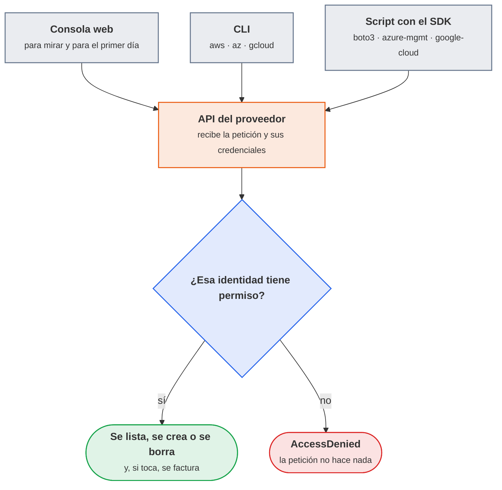
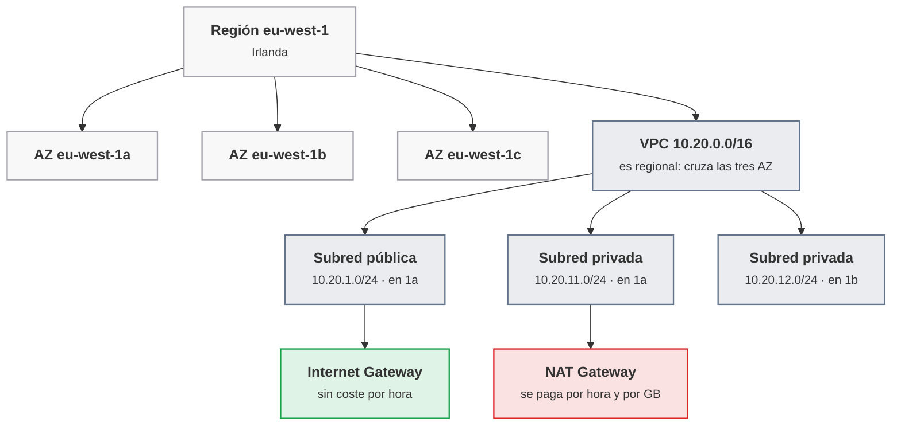
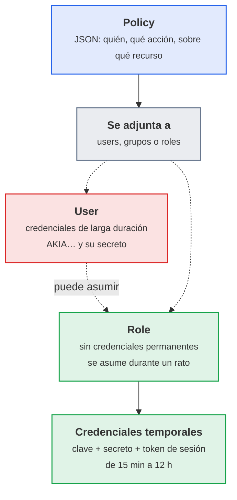
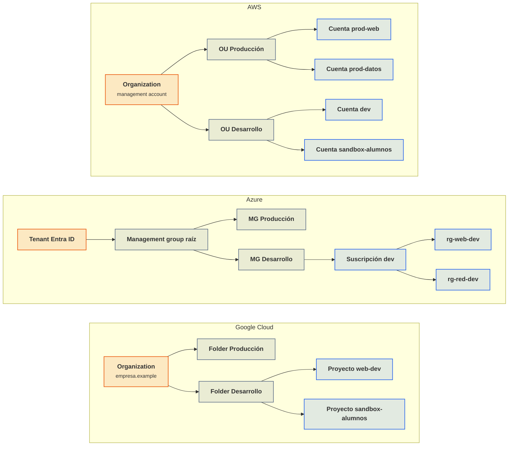
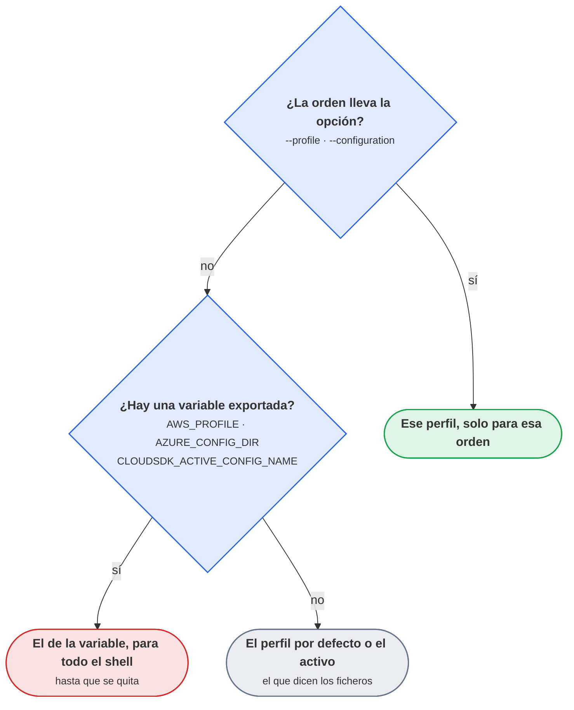
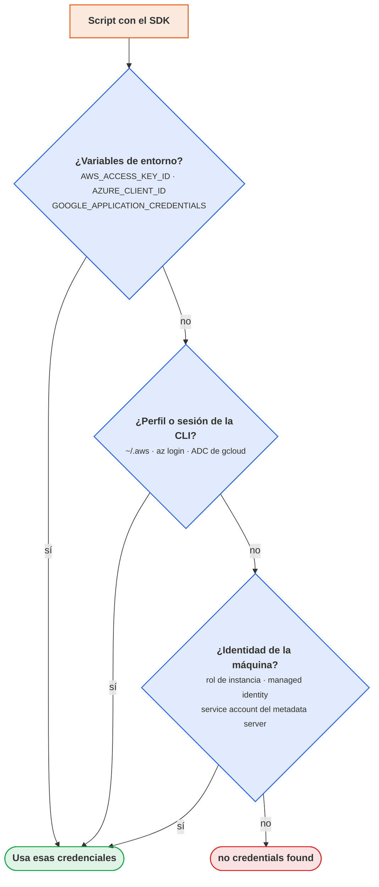

# UT4 · Nube pública: consola, CLI y SDK

<p class="ut-meta">12 h · Formación en empresa (19 abr a 9 jun 2027) · RA2 CE a, b, c, d, e</p>

En el centro, todo se montó primero a mano sobre Proxmox: el hipervisor, la VPC con sus subredes, OPNsense, la DMZ y el proxy inverso. Después, el entorno `pre` se levantó sin tocar la consola, con OpenTofu llamando a la API de Proxmox (una API es una interfaz a la que un programa le pide por HTTP que cree o liste recursos; la de Proxmox ya se había llamado a mano [con `curl` y un token](ut2-vpc.md#la-api-rest-con-token-la-antesala-de-opentofu)). Una empresa rara vez tiene todo eso en un armario propio: lo alquila a un proveedor de nube pública, que ofrece esas mismas piezas por horas y expuestas por API. Esta unidad trata de cómo se trabaja con esa infraestructura alquilada, y lo que cambia respecto al laboratorio cabe en dos ideas. La primera: la consola web, la CLI (la herramienta de línea de comandos del proveedor) y el SDK (la librería para hacer lo mismo desde código) son tres formas de llamar a la misma API, y lo que se aprende en una vale en las otras. La segunda: cada llamada lleva una identidad y puede costar dinero, así que quien tenga unas credenciales puede gastar a cargo de la empresa.

Por eso la unidad avanza en el orden en que se gana autonomía sin perder el control: entrar con una identidad propia y saber dónde se está (bloque 1), dejar la consola a mano y el gasto vigilado (bloque 2), pasar a la CLI sin claves permanentes (bloque 3), manejar varios entornos con perfiles (bloque 4) y hacer lo mismo desde código sin escribir una sola credencial (bloque 5). Conviene llegar a la empresa con la infraestructura como código reciente y salir de ella con perfiles de CLI funcionando y credenciales bien gestionadas.

**Por qué se hace en la empresa.** La nube pública cuesta dinero desde el primer minuto y necesita una cuenta real, así que esta unidad no se cursa en el centro: se hace durante la formación en empresa, sobre la cuenta de la empresa, y la plataforma la decide el tutor. Puede ser AWS, Azure, Google Cloud o alguna alternativa europea (OVHcloud, Hetzner, Scaleway). Los apuntes desarrollan AWS, que es el más extendido, y dan Azure y Google Cloud como correspondencia, en tablas o en pestañas; las alternativas europeas tienen sus propias CLI y librerías, pero los conceptos son los mismos. Lo que sigue es la guía de referencia que conviene llevar leída el primer día y la lista de evidencias que hay que entregar al terminar.

**Cómo se trabaja.** Se trabaja con la cuenta de la empresa y al lado de recursos de los que responde su equipo, así que cada hoja pide en su "Antes de empezar" una autorización concreta del tutor. Ninguna de las cinco actividades crea infraestructura: leen, configuran la propia sesión o, como mucho, crean una alerta de presupuesto. Si el tutor encarga crear algo aparte, se aplica la [regla de la empresa](#los-errores-caros-tipicos): se destruye el mismo día. El tutor marca cuándo se hace cada actividad, pero el orden de las hojas no es arbitrario: la A4.2 parte de la identidad de la A4.1, y la A4.3, la A4.4 y la A4.5 se encadenan, porque el script de la última usa los perfiles de las dos anteriores. Cada una se documenta en la [ficha de evidencias](#ficha-de-evidencias), que firma el tutor. Las capturas van sin datos sensibles: se tapan los números de cuenta completos, las claves, las IP públicas de producción y los correos de terceros. La razón es que la evidencia sale de la empresa y acaba en el aula virtual: un número de cuenta o una IP de producción le ahorran a un atacante el trabajo de averiguarlos, y una clave visible le da acceso directo. Por eso, en la [práctica evaluable](#practica-evaluable), una evidencia con credenciales visibles invalida la actividad.

!!! otra "Mantenimiento también está en la empresa estas semanas"
    La [UT5](https://victor-educ.github.io/apuntes-5169/ut/ut5-logs-accesos-rendimiento/) (logs, accesos y rendimiento) y la
    [UT6](https://victor-educ.github.io/apuntes-5169/ut/ut6-copias-seguridad/) (copias de seguridad) de Mantenimiento se
    cursan en la empresa en las mismas semanas, y también piden evidencias anonimizadas. Conviene acordar con el tutor un
    mismo sistema para las tres unidades: la cuenta y la región que se identifican aquí suelen ser las de los servicios que
    allí se revisan, y si las copias de seguridad van a un almacenamiento de la nube, lo que se ve aquí sobre regiones,
    permisos y coste de descarga es lo que se aplica allí.

## Bloque 1 · Acceso a la plataforma (CE 2a)

<p class="ut-meta">En la empresa · con el tutor</p>

El primer día en la empresa, la consola de la nube es un catálogo de cientos de servicios con nombres propios, y antes de tocar nada hay que saber tres cosas: qué se está mirando, quién se es y dónde se está. Este bloque las responde en ese orden. Primero, el mapa: qué alquila un proveedor de nube, cómo reparte su infraestructura en regiones y zonas, y a qué pieza de Proxmox corresponde cada servicio, que es lo que convierte el catálogo en algo conocido (la tabla de correspondencias vuelve a usarse en la actividad de cierre). Después, la identidad: la cuenta todopoderosa que no se usa, las piezas con que se reparten los permisos, el segundo factor y las credenciales temporales, y cómo agrupa sus cuentas una empresa. Por último, las etiquetas, que dicen de quién es cada recurso. Va primero porque todo lo demás depende de ello: sin identidad no se entra, y sin saber en qué cuenta y en qué región se está, cada orden de los bloques siguientes puede ir al sitio equivocado. La hoja A4.1 lo aplica: entrar con el segundo factor y anotar la cuenta, la región y las etiquetas obligatorias.

### Qué es una nube pública y qué se alquila

**El problema.** Todo lo montado en el centro tenía un techo físico: el Proxmox del puesto tenía la memoria que tenía, y cada VM nueva había que encajarla en su [presupuesto de memoria](../laboratorio.md#presupuesto-de-memoria). Una empresa con servidores propios vive lo mismo a otra escala: compra para el pico de uso, espera semanas a que llegue el hardware y paga el centro de datos aunque esté medio vacío.

**Qué es y de dónde sale.** Un proveedor de nube pública resuelve eso alquilando por horas (en muchos servicios, por segundos) la misma infraestructura que se construyó en el centro: máquinas virtuales, redes privadas, discos, balanceadores y DNS, y además bases de datos gestionadas y decenas de servicios que en el centro no hay (colas, almacenamiento de objetos, funciones sin servidor). La idea de alquilar servidores por horas y crearlos por API la popularizó Amazon en 2006, con sus servicios de almacenamiento y de máquinas virtuales, y Microsoft y Google la siguieron en los años siguientes. Se paga por uso, se crea y se destruye por API, y cualquier cosa que se hace desde la consola web se puede hacer desde la línea de comandos o desde código.

**Cómo se trabaja con ella: tres puertas a la misma API.** La consola, la CLI y un script con el SDK no son tres sistemas distintos, sino tres clientes de la misma API. Cada petición llega con unas credenciales, y antes de hacer nada la API comprueba si esa identidad tiene permiso para lo que pide:



<p class="pie" markdown>Las tres puertas llevan a la misma API y en las tres decide la identidad. Es lo que pasaba con Proxmox: la consola web, `pvesh`, `curl` y OpenTofu acababan en el mismo sitio.</p>

**Para qué se usa en el curso.** La consola es para mirar y para el primer día; la CLI y el SDK son con lo que se trabaja, porque lo que se hace con ellos se puede repetir, guardar en un fichero y revisar antes de lanzarlo, como el código de OpenTofu de `iac-lab`. Las hojas recorren las tres puertas en ese orden. Lo que las tres comparten es la identidad que acompaña a cada petición, y por eso, después del mapa de regiones y servicios, el bloque se dedica a ella.

#### Regiones y zonas de disponibilidad

**El problema que resuelven.** Un centro de datos puede quedarse sin corriente, inundarse o perder su conexión, y entonces cae a la vez todo lo que vive en él. Además, dónde están físicamente los datos no es indiferente: la distancia añade latencia, y la ley condiciona dónde se pueden guardar los datos personales (el RGPD, el reglamento europeo de protección de datos, pone condiciones a su traslado fuera del Espacio Económico Europeo). Los proveedores lo resuelven repartiendo su infraestructura en dos niveles.

**Cómo se reparte.** Una **región** es un conjunto de centros de datos en una zona geográfica, con nombre propio y su propio catálogo de servicios y de precios. Dentro de cada región hay varias **zonas de disponibilidad** (AZ, *availability zones*), cada una con uno o varios centros de datos separados físicamente de los de las otras zonas (a kilómetros de distancia, con alimentación y red independientes) pero unidos a ellos por enlaces de baja latencia. Un desastre en una AZ no debería afectar a las otras de la misma región; un desastre regional sí afecta a todas. Por eso un servicio que tiene que aguantar la caída de un centro de datos reparte sus máquinas entre dos o tres AZ, igual que en un clúster de Proxmox se repartirían entre nodos. Algunas de las regiones europeas que más se usan desde España:

| Proveedor | Región | Dónde está | Notas |
|---|---|---|---|
| AWS | `eu-west-1` | Irlanda (Dublín) | La primera región europea de AWS y de las que más servicios tienen. Tres AZ: `eu-west-1a`, `1b`, `1c`. |
| AWS | `eu-south-2` | España (Aragón) | Abierta en 2022. Útil por latencia y residencia de datos; algunos servicios llegan más tarde que a Irlanda. |
| AWS | `eu-central-1` | Alemania (Fráncfort) | Muy usada por empresas con requisitos de datos en la UE. |
| Azure | `westeurope` | Países Bajos | Una de las regiones europeas de Azure con más servicios. |
| Azure | `spaincentral` | Madrid | Abierta en 2024. |
| Google Cloud | `europe-southwest1` | Madrid | Zonas `europe-southwest1-a`, `-b`, `-c`. |
| Google Cloud | `europe-west1` | Bélgica | Región europea clásica de GCP. |

**Dos consecuencias prácticas.** La primera: casi todos los recursos son regionales. Una VPC de AWS vive en una región, y una subred, en una AZ concreta dentro de esa VPC. Si la consola de AWS se abre en `us-east-1`, no aparece nada de lo creado en `eu-west-1`. La segunda: los precios varían por región, a veces un 10 o un 20 %, y el tráfico entre regiones se paga. La región se elige por cercanía a los usuarios, por disponibilidad de los servicios necesarios y por dónde tiene que residir el dato, y se fija como región por defecto desde el primer día: es el dato que anota la A4.1 y el que llevan por defecto la consola y los perfiles de la CLI.



<p class="pie" markdown>La subred vive en una zona; la VPC, en la región entera. En rojo lo que sigue cobrando aunque no pase tráfico.</p>

La traducción a lo hecho en el centro es directa: la VPC es un entorno del laboratorio (dev, con su `/16` repartido en VNets del SDN), la subred pública es front, la DMZ externa, las subredes privadas son back y data, el Internet Gateway es la interfaz WAN de OPNsense y el NAT Gateway es su NAT de salida. La diferencia es que en la nube cada una de esas piezas tiene precio, y el NAT Gateway en particular tiene uno que sorprende, como se ve en [Los errores caros típicos](#los-errores-caros-tipicos).

#### Correspondencia con lo que ya sabes

**Para qué sirve esta tabla.** La correspondencia de la red ya se dio al presentar la VPC ([Qué es una VPC](ut2-vpc.md#que-es-una-vpc)); esta la extiende a todo lo que se ha montado en el curso, para que cada servicio de la consola se pueda traducir a algo conocido. Se lee por filas: la primera columna es lo que se hizo en el centro, y las otras tres, cómo se llama en cada proveedor. Es también la base de la actividad de cierre, que compara la nube de la empresa con la VPC del centro.

| Concepto del curso (Proxmox) | AWS | Azure | Google Cloud |
|---|---|---|---|
| Hipervisor / VM | EC2 (instancia) | Virtual Machines | Compute Engine |
| Plantilla de VM / cloud-init | AMI (imagen de máquina) + user data | Imagen + custom data | Imagen + startup script / metadata |
| Disco de la VM | EBS (volumen) | Managed Disk | Persistent Disk |
| Snapshot / backup | EBS Snapshot, AWS Backup | Snapshot, Azure Backup | Snapshot |
| VPC (zona y VNets del SDN) | VPC | Virtual Network (VNet) | VPC (global, subredes regionales) |
| Subred / zona | Subnet en una AZ | Subnet (la VNet abarca la región) | Subnet regional |
| OPNsense: reglas por interfaz | Security Groups (por instancia, con estado) y NACL (listas de control de acceso de red, por subred, sin estado) | Network Security Groups (con estado) | Firewall rules (a nivel de VPC, con etiquetas de red) |
| OPNsense: NAT de salida | NAT Gateway | NAT Gateway | Cloud NAT |
| OPNsense: WAN | Internet Gateway + Elastic IP | Public IP | External IP |
| Proxy inverso / balanceador | ALB (balanceador de aplicación) y NLB (balanceador de red) | Application Gateway, Load Balancer | Cloud Load Balancing |
| DNS interno | Route 53 (zonas privadas) | Azure DNS (zonas privadas) | Cloud DNS |
| Usuarios y permisos | IAM (users, roles, policies) e IAM Identity Center | Entra ID + RBAC | IAM + service accounts |
| Token de API de Proxmox | Claves de acceso de un user (`AKIA...`) | Secreto de un service principal | Clave JSON de una service account |
| Estructura de cuentas | Organizations: root, OUs, cuentas | Management groups, suscripciones, resource groups | Organization, folders, proyectos |
| Consola integrada | CloudShell | Azure Cloud Shell | Cloud Shell |
| CLI | `aws` | `az` | `gcloud` |
| SDK Python | `boto3` | `azure-identity`, `azure-mgmt-*` | `google-cloud-*` |
| SDK Node | `@aws-sdk/client-*` | `@azure/identity`, `@azure/arm-*` | `@google-cloud/*` |
| Contenedores gestionados | ECS (con Fargate), EKS | Container Apps, AKS | Cloud Run, GKE |
| Registro de imágenes | ECR | Azure Container Registry | Artifact Registry |
| Almacenamiento de objetos | S3 | Blob Storage | Cloud Storage |
| Monitorización (Prometheus y Grafana) | CloudWatch | Azure Monitor | Cloud Monitoring |

La fila de contenedores gestionados es solo un mapa: en este módulo no se despliega nada en ECS, AKS ni Cloud Run, pero conviene saber que ECS/Container Apps/Cloud Run son la opción "dame un contenedor y olvídate del clúster" y que EKS/AKS/GKE son Kubernetes gestionado (el plano de control lo lleva el proveedor, los nodos siguen siendo VM propias o gestionadas).

### Identidad y estructura de cuentas

**El problema.** En el laboratorio había una sola persona por Proxmox, y aun así se separó `root@pam` de `admin@pve`, y OpenTofu recibió su propio usuario, `terraform@pve`, con los permisos justos. En la nube de una empresa llaman a la misma API decenas de personas, programas y pipelines, sobre recursos que cuestan dinero, y cada petición tiene que responder a tres preguntas: quién la hace, qué puede hacer y en qué cuenta. Casi todos los errores de los bloques siguientes ("no veo nada", "acceso denegado", "dice que soy otra persona") se explican por una de las tres, y la A4.1 pide identificarlas por escrito. El apartado las recorre en orden: la identidad que no se usa, las piezas con que se reparten los permisos, cómo se demuestra la identidad sin claves permanentes y cómo se agrupan las cuentas.

#### El usuario raíz y por qué no se usa a diario

**Qué es.** Toda cuenta de nube nace con una identidad todopoderosa: el usuario raíz en AWS (el correo con el que se creó la cuenta), el administrador global del *tenant* en Entra ID (Entra ID es el directorio de identidades de la empresa en Azure, y el *tenant*, la instancia de ese directorio que pertenece a una organización) y, en Google Cloud, el superadministrador de Google Workspace o Cloud Identity, el directorio del que cuelga la organización. Esa identidad puede cerrar la cuenta, cambiar los datos de pago y borrar cualquier cosa, y los permisos que se reparten dentro de la cuenta no la limitan.

**Por qué no se usa a diario.** Es el `root@pam` de Proxmox a escala de empresa, y vale la misma regla que en el laboratorio, donde se creó `admin@pve` para el trabajo diario y root se reservó para lo que solo él puede hacer ([Usuarios y permisos](ut1-virtualizacion.md#usuarios-y-permisos)): un descuido o una contraseña robada con esa identidad no tienen límite. Ninguna empresa seria la usa a diario: la protege con MFA (autenticación multifactor, un segundo paso además de la contraseña) con llave física, guarda la contraseña en una caja fuerte y registra cada uso. A quien llega a la empresa se le da un usuario propio o una identidad federada (su cuenta corporativa, en la que la nube confía) con permisos limitados, nunca la raíz ni una cuenta compartida.

#### Usuarios, roles y políticas

**El problema.** Para dar a cada persona o programa los permisos justos, y poder quitárselos sin tocar a los demás, hay que separar tres cosas: quién es, qué credencial presenta y qué se le permite. En Proxmox ya estaban separadas: el usuario `terraform@pve` de la [A5.1](ut5-iac.md#a51-primer-despliegue-sesion-21) tenía su propio token (la credencial) y tres permisos, cada uno un rol sobre una ruta (`PVEVMAdmin` sobre `/vms`). Los proveedores de nube resuelven lo mismo con tres piezas: identidades de persona con credenciales de larga duración, identidades sin credenciales permanentes que se asumen durante un rato y devuelven credenciales temporales, y documentos que dicen quién puede hacer qué sobre qué recurso. El ejemplo va con nombres de AWS, que es el más extendido; en las pestañas del final del apartado están los equivalentes.

**Las tres piezas en AWS.** IAM (*Identity and Access Management*) es el servicio de AWS que decide quién puede hacer qué. Los *users* son identidades con credenciales de larga duración: contraseña de consola y, opcionalmente, un par de claves de acceso, un identificador que empieza por `AKIA` y su secreto. Los *roles* son identidades sin credenciales permanentes que se *asumen* durante un rato: una instancia EC2 asume un rol para leer de S3, una persona asume un rol de administrador en otra cuenta, Jenkins asume un rol para desplegar. Al asumir un rol se reciben credenciales temporales (clave, secreto y token de sesión) con una vida de entre 15 minutos y 12 horas. Las emite STS (*Security Token Service*, el servicio de AWS que fabrica credenciales temporales), y su clave empieza por `ASIA` en lugar de `AKIA`, así que una clave permanente se distingue de una temporal a simple vista. Las *policies* son documentos JSON que dicen quién puede hacer qué sobre qué recurso, y se adjuntan a users, a grupos o a roles.



<p class="pie" markdown>La diferencia que importa: el *user* lleva una llave que caduca cuando alguien se acuerda; el *role* entrega llaves que caducan solas.</p>

**Cómo se lee una política.** Una política mínima para alguien que solo necesita mirar la red y las instancias en Irlanda tiene esta pinta:

```json
{
  "Version": "2012-10-17",
  "Statement": [
    {
      "Sid": "SoloLecturaRedYComputo",
      "Effect": "Allow",
      "Action": [
        "ec2:DescribeVpcs",
        "ec2:DescribeSubnets",
        "ec2:DescribeSecurityGroups",
        "ec2:DescribeInstances",
        "ec2:DescribeRegions"
      ],
      "Resource": "*",
      "Condition": {
        "StringEquals": { "aws:RequestedRegion": "eu-west-1" }
      }
    }
  ]
}
```

Conviene fijarse en tres detalles, porque explican la mayoría de los accesos denegados de las actividades siguientes:

- **Lo que no está permitido, está prohibido.** El efecto por defecto es denegar: todo lo que no está en un `Allow` explícito está prohibido, y un `Deny` explícito gana siempre. Un `AccessDenied` no significa que algo esté roto, sino que nadie ha concedido ese permiso.
- **Las acciones se llaman como las órdenes.** Se nombran como `servicio:Operación`, con el mismo nombre que usa la CLI (`aws ec2 describe-vpcs` es `ec2:DescribeVpcs`). El mensaje de error dice qué acción faltaba, y con ese nombre se le pide al tutor el permiso exacto.
- **La condición limita la región.** Con esta política, la misma orden lanzada contra otra región devuelve `AccessDenied` aunque la acción esté en la lista.

Las políticas gestionadas por AWS como `ReadOnlyAccess` o `AdministratorAccess` sirven para empezar; en producción se escriben políticas propias con el mínimo necesario, que es el [mínimo privilegio](ut6-ci.md#minimo-privilegio) que se aplicó a las credenciales de Jenkins.

Cada proveedor le pone otro nombre a esas piezas y las organiza a su manera:

=== "AWS"

    Los *users* llevan credenciales de larga duración, los *roles* se asumen y devuelven credenciales temporales, y las *policies* son los documentos JSON de arriba, adjuntos a users, a grupos o a roles. La estructura de cuentas la gestiona Organizations.

    Lo que hoy usan las empresas para las personas no son users con clave, sino IAM Identity Center (el antiguo AWS SSO, inicio de sesión único): se entra con la identidad corporativa (Entra ID, Google Workspace, Okta) y se reciben credenciales temporales para cada cuenta y conjunto de permisos. Es lo que `aws configure sso` configura en la máquina local.

=== "Azure"

    Azure separa dos mundos. Entra ID (antes Azure Active Directory) es el directorio: usuarios, grupos, aplicaciones, MFA, acceso condicional. Azure RBAC (control de acceso basado en roles) es la autorización sobre los recursos: una *asignación de rol* une una identidad (usuario, grupo, service principal, que es la identidad de una aplicación, o identidad administrada), un rol (`Reader`, `Contributor`, `Owner`, `Network Contributor`, o uno personalizado) y un ámbito (management group, suscripción, resource group o recurso concreto). Los permisos se heredan hacia abajo: `Reader` en la suscripción permite ver todos los resource groups de esa suscripción. Es el mismo modelo que los permisos de Proxmox, un rol sobre una ruta con herencia hacia los hijos, a escala de empresa. El equivalente al rol de AWS para máquinas y servicios es la identidad administrada (managed identity): una VM o una Container App recibe una identidad sin secretos que puede acceder a Key Vault (el almacén de secretos) o a Storage (el de ficheros).

=== "Google Cloud"

    En GCP el IAM funciona por *bindings* entre un *principal* (usuario de Google Workspace, grupo, service account) y un *rol* sobre un recurso, con herencia desde la organización a las carpetas y de estas a los proyectos. Hay roles básicos (`Viewer`, `Editor`, `Owner`, demasiado anchos para producción), roles predefinidos por servicio (`roles/compute.viewer`, `roles/compute.networkViewer`) y roles personalizados. Las service accounts son identidades para cargas de trabajo; una VM de Compute Engine arranca con una service account adjunta y obtiene tokens del servidor de metadatos sin fichero de clave alguno. Las claves JSON de service account descargadas son el equivalente a las claves `AKIA` de AWS: un secreto de larga duración que hay que evitar.

#### MFA, SSO y credenciales temporales

**El problema.** Una contraseña sola se roba, se adivina o se reutiliza, y una clave de acceso guardada en un fichero vale para siempre en manos de quien la copie. Para entrar en la consola, la respuesta es el segundo factor; para la CLI y el SDK, que no pueden pedir un código en cada orden, es no guardar claves permanentes y trabajar con credenciales que caducan solas.

**Cómo encajan las piezas.** Los tres proveedores empujan hacia el mismo esquema. La persona se autentica con MFA (un código TOTP, que genera una app como Google Authenticator y cambia cada treinta segundos, una llave física FIDO2 o una passkey del móvil) a través del proveedor de identidad de la empresa, que es el sistema donde están las cuentas corporativas (Entra ID, Google Workspace u otro). Eso es el SSO (*single sign-on*, inicio de sesión único): una sola autenticación sirve para la consola de la nube y para el resto de aplicaciones de la empresa. De ahí salen credenciales temporales para la consola y para la CLI, y en el portátil no queda ninguna clave permanente:

```mermaid
flowchart LR
    P["<b>Persona</b>"]:::act
    MFA["<b>MFA</b><br><small>TOTP, llave FIDO2 o passkey</small>"]:::pieza
    IDP["<b>Proveedor de identidad</b><br><small>el de la empresa</small>"]:::pieza
    TMP["<b>Credenciales temporales</b><br><small>para la consola y para la CLI</small>"]:::ok
    NADA(["<b>Ninguna clave permanente<br>en el portátil</b>"]):::ok
    P --> MFA --> IDP --> TMP --> NADA
    classDef act fill:#ea580c22,stroke:#ea580c,stroke-width:1.5px
    classDef pieza fill:#64748b22,stroke:#64748b,stroke-width:1.5px
    classDef dato fill:#2563eb22,stroke:#2563eb,stroke-width:1.5px
    classDef infra fill:#a1a1aa14,stroke:#a1a1aa,stroke-width:1.5px
    classDef ok fill:#16a34a22,stroke:#16a34a,stroke-width:1.5px
    classDef riesgo fill:#dc262622,stroke:#dc2626,stroke-width:1.5px
```



<p class="pie" markdown>Es el esquema al que empujan los tres proveedores. Si en la empresa se entrega un `AKIA…` por correo, algo va mal.</p>

En la máquina de trabajo eso se traduce en estas órdenes, que no piden ninguna clave permanente y que la A4.3 usa para autenticarse:

```bash
# AWS con IAM Identity Center: abre el navegador para autenticarse y guarda un token de sesión
aws configure sso          # solo la primera vez, crea el perfil
aws sso login --profile empresa-dev
# en una máquina sin navegador, las dos admiten --use-device-code

# Azure: abre el navegador contra Entra ID; --use-device-code si la VM no tiene navegador
az login
az login --use-device-code

# Google Cloud: dos logins distintos, uno para gcloud y otro para el SDK
gcloud auth login                       # identidad que usa la CLI
gcloud auth application-default login   # identidad que usan las librerías (ADC)
```

**Los dos logins de Google Cloud.** La distinción de GCP entre `gcloud auth login` y `gcloud auth application-default login` confunde a todo el mundo la primera vez: la primera guarda una credencial que usa `gcloud`, y la segunda guarda un fichero en `~/.config/gcloud/application_default_credentials.json`, que es lo que buscan las librerías cliente (las ADC, *Application Default Credentials*). Si un script de Python falla con `DefaultCredentialsError` ("Your default credentials were not found" en las versiones actuales de la librería, "Could not automatically determine credentials" en las antiguas), es porque se ejecutó el primero y no el segundo.

**Lo que queda en el disco.** Lo que dejan estos logins en el directorio personal (`~/.aws/sso/cache/`, `~/.azure/`, `~/.config/gcloud/`) son tokens que caducan o que la empresa puede revocar desde su proveedor de identidad, no claves permanentes. Aun así dan acceso mientras valen, así que esos directorios no se copian a otra máquina, no se suben a ningún repositorio y no salen en ninguna captura.

!!! ojo "Claves de acceso de larga duración"
    Un par de claves de AWS (`AKIA...`) o una clave JSON de service account de GCP no caduca y no pide MFA. Si acaba en un repositorio público, en menos de una hora habrá alguien minando criptomoneda a cargo de la empresa (hay bots escaneando GitHub para eso). Si el tutor entrega una, conviene preguntar si de verdad no hay alternativa con SSO o roles, guardarla fuera del proyecto y borrarla al terminar. Nunca en un fichero del repositorio, nunca en una variable de entorno de un `Dockerfile`. En el laboratorio ya se usó una clave de este tipo: la credencial de MinIO para el estado de OpenTofu iba en `AWS_ACCESS_KEY_ID` y `AWS_SECRET_ACCESS_KEY` ([Backend remoto](ut5-iac.md#backend-remoto-s3-contra-minio)). Contra una cuenta real de AWS, la misma clave da acceso a recursos que cuestan dinero.

#### Cómo se organizan las cuentas

**El problema.** Si toda la empresa trabajara en una sola cuenta, un error en desarrollo podría borrar producción, la factura no diría qué proyecto gasta qué y cualquier permiso amplio valdría para todo. Es el mismo razonamiento que separó dev, pre y pro en el laboratorio, llevado a la administración. Por eso ninguna empresa mediana trabaja con una sola cuenta: la unidad de aislamiento (facturación, límites y radio de explosión de un error) es la cuenta en AWS, la suscripción en Azure y el proyecto en GCP, y encima hay una jerarquía para agrupar y aplicar políticas:



<p class="pie" markdown>Los tres hacen lo mismo con nombres distintos: una raíz que factura, una capa de agrupación para aplicar políticas y una unidad aislada donde vive cada cosa.</p>

**Las políticas que bajan por la jerarquía.** En AWS, Organizations permite aplicar políticas de control de servicio (*service control policies*) a una OU entera (unidad organizativa, una carpeta de cuentas): por ejemplo, "en la OU de desarrollo nadie puede crear recursos fuera de `eu-west-1` ni instancias mayores de `t3.large`" (un tamaño de VM de 2 vCPU y 8 GB). En Azure, Azure Policy se asigna a un management group, a una suscripción o a un resource group, y los bloqueos de recurso (*locks*), que impiden borrar o modificar lo que protegen, se ponen en una suscripción, en un resource group o en un recurso concreto, nunca en un management group. El resource group es una capa más que agrupa recursos con el mismo ciclo de vida: al borrar el grupo se va todo lo que contiene, muy útil para limpiar prácticas. En GCP, las políticas de organización se aplican a la organización, a las carpetas y a los proyectos. Estas políticas explican los accesos denegados que ningún permiso del usuario explica: si la OU prohíbe una región, ni el administrador de la cuenta puede crear nada en ella.

**Para qué se usa en el curso.** Lo más probable es recibir acceso a una cuenta, suscripción o proyecto de desarrollo o *sandbox* (un entorno de pruebas aislado), y lo primero que hay que anotar es su identificador: el número de cuenta de 12 dígitos de AWS, el GUID de suscripción de Azure (un identificador de 32 caracteres hexadecimales separados por guiones) o el ID de proyecto de GCP. Todos los comandos y scripts de esta unidad giran alrededor de ese identificador, y es el dato que la A4.1 pide anotar, tapado en parte. Cada consola lo enseña en un sitio, junto a la identidad con la que se ha entrado: en AWS, el menú de la cuenta (arriba a la derecha) muestra el número de cuenta y el usuario o rol; en Azure, el icono de usuario muestra el usuario y el directorio (el *tenant*), y la página Subscriptions, las suscripciones con su ID; en GCP, el selector de proyecto de la barra superior. Es lo primero que se mira cuando algo no cuadra.

### Etiquetado

**El problema.** En una cuenta compartida por varios equipos, con cientos de recursos creados por personas, por pipelines y por OpenTofu, nadie sabe de memoria de quién es cada máquina: qué proyecto la paga, a quién preguntar antes de apagarla o si alguien la olvidó tras una prueba.

**Qué son.** Las etiquetas (*tags* en AWS y Azure, *labels* en GCP) son pares clave/valor que se ponen a cada recurso. No cambian su comportamiento, pero permiten filtrar, facturar por proyecto y saber a quién preguntar antes de borrar algo. El mínimo habitual es `proyecto`, `entorno` (dev, pre, prod), `propietario` (normalmente un correo) y a veces `coste` (centro de coste) y `caduca` (fecha).

**Por qué se sigue la convención de la empresa al pie de la letra.** Muchas organizaciones tienen políticas que impiden crear recursos sin las etiquetas obligatorias, o scripts que borran de madrugada lo que no lleva `propietario`. Además, la vista de costes por etiqueta, la de la A4.2, solo funciona si todo el mundo escribe la misma clave de la misma forma: en AWS, donde las claves distinguen mayúsculas, `Propietario` y `propietario` son dos etiquetas distintas. Cada proveedor pone también sus límites de formato: en GCP los valores solo admiten minúsculas, números, guiones y guiones bajos, así que un correo se escribe de otra manera (`alumno-empresa-example`, por ejemplo).

**Para qué se usa en el curso.** Lo que se crea para practicar se etiqueta con algo reconocible (`propietario=alumno-fp`, `caduca=2027-06-09`) para que el tutor sepa qué puede borrar sin preguntar, y la política de etiquetas es el tercer dato que anota la A4.1.

### A4.1 Acceso a la plataforma (CE 2a)

<span class="et et-obj">Objetivo</span> Entrar en la consola del proveedor con tu usuario y MFA activo, y saber decir en qué cuenta, suscripción o proyecto, en qué región y con qué política de etiquetas trabajas. Son las tres coordenadas de todo lo que harás en la unidad: con otra cuenta o en otra región, las órdenes de la CLI y el script de la A4.5 irán a otro sitio, y lo que se cree sin las etiquetas obligatorias puede ser rechazado o borrado.

<span class="et et-pre">Antes de empezar</span>

- Autorización del tutor para usar la cuenta de la empresa con el usuario que te haya creado, nunca el usuario raíz ni una cuenta compartida.
- Un móvil o una llave física para el segundo factor, del tipo que admita la empresa (app TOTP o passkey).
- Leído [Identidad y estructura de cuentas](#identidad-y-estructura-de-cuentas), en particular [MFA, SSO y credenciales temporales](#mfa-sso-y-credenciales-temporales) y [Cómo se organizan las cuentas](#como-se-organizan-las-cuentas), y los apartados [Regiones y zonas de disponibilidad](#regiones-y-zonas-de-disponibilidad) y [Etiquetado](#etiquetado).

<span class="et et-pas">Pasos</span>

Vas de lo que te protege a lo que te sitúa. Primero aseguras tu acceso, porque nada de lo demás debería hacerse con un usuario que solo tiene contraseña; después averiguas en qué cuenta estás y qué hay por encima de ella, luego en qué región están los recursos y, al final, cómo se marca de quién es cada cosa. Cada paso deja un dato para la Entrega y para el documento de cierre.

1. **Protege tu acceso antes de nada.** Entra por primera vez con tu usuario y activa el segundo factor antes de hacer nada más. Un usuario con solo contraseña es justo lo que buscan los ataques, y en la nube da acceso a recursos que cuestan dinero; cómo encaja el segundo factor con el SSO de la empresa está en [MFA, SSO y credenciales temporales](#mfa-sso-y-credenciales-temporales).

    *Pista:* con SSO, el segundo factor se activa en el proveedor de identidad de la empresa, no en la nube. En Azure se registra en `https://mysignins.microsoft.com/security-info`.

2. **Sitúate en la estructura de cuentas.** Identifica la cuenta, suscripción o proyecto en que trabajas, con su identificador, y localiza dónde se ve la jerarquía que la agrupa (Organizations, management groups o carpetas), aunque no tengas permiso para tocarla: la captura de un acceso denegado también sirve. El identificador es el que usarán todas tus órdenes, y la jerarquía te dice qué políticas te llegan desde arriba, como se explica en [Cómo se organizan las cuentas](#como-se-organizan-las-cuentas).

3. **Encuentra la región de trabajo.** Averigua en qué región crea la empresa sus recursos y comprueba que ahí hay máquinas o redes. Casi todo es regional, así que mirar en otra región es no ver nada ([Regiones y zonas de disponibilidad](#regiones-y-zonas-de-disponibilidad)), y es la región que llevarán por defecto tu consola y tus perfiles de la CLI.

    *Pista:* la consola de AWS solo enseña la región del selector de arriba a la derecha: si no ves nada, casi siempre es eso.

4. **Conoce la política de etiquetas.** Pregunta al tutor por la política de etiquetas (cuáles son obligatorias y con qué formato) y comprueba en un recurso cualquiera que las lleva. Es lo que tendrá que llevar todo lo que crees, y la etiqueta de propietario es la que te dejará ver tus costes en la A4.2 ([Etiquetado](#etiquetado)).

<span class="et et-com">Comprobación</span> Al cerrar sesión y volver a entrar te pide el segundo factor, y eres capaz de decir de memoria cuenta, región y las etiquetas obligatorias.

<span class="et et-ent">Entrega</span> Captura de la consola con el usuario, la cuenta o proyecto y la región visibles, y un párrafo con el identificador (parcialmente tapado), la región y las etiquetas obligatorias. Todo va a la carpeta o el repositorio de evidencias, y la fila A4.1 de la [ficha de evidencias](#ficha-de-evidencias) la firma el tutor.

<span class="et et-ext">Si te sobra tiempo</span> Busca en la consola qué políticas o roles tiene asignados tu usuario: te servirá para explicar los `AccessDenied` de las actividades siguientes.

## Bloque 2 · Configuración de la interfaz (CE 2b)

<p class="ut-meta">En la empresa · con el tutor</p>

Con la identidad clara aparecen dos riesgos nuevos. El primero parece de comodidad y acaba en errores: sin configurar, la consola abre donde le parece y cada entrada empieza buscando lo mismo. El segundo es de dinero: en la nube un descuido no avisa, se cobra, y la factura llega a fin de mes. Este bloque deja resueltas las dos cosas antes de que la unidad pase a la CLI. Primero, la consola: qué se ajusta el primer día y por qué, y el terminal que trae dentro, con la CLI ya instalada. Después, el coste: el presupuesto con alerta que avisa antes que la factura, las piezas que cobran aunque nadie las use y la regla de la empresa para lo que se cree. La hoja A4.2 deja la consola configurada, la alerta puesta y anotado el coste de partida, que la actividad de cierre compara con el del final de la estancia.

### Consola web y shells integrados

**El problema.** La consola de un proveedor grande es una aplicación web con un panel para cada uno de sus cientos de servicios. Sin configurar, abre con la página de inicio genérica, en el idioma del navegador y, en AWS, en la última región que se visitó. Entrar en la región equivocada es la causa más común de "no veo nada", y buscar cada día los mismos servicios es tiempo perdido. Por eso el primer día se ajusta lo que pide el CE 2b, y cada ajuste tiene su razón:

- **El idioma**: inglés, salvo que la empresa trabaje en otro. La documentación, los mensajes de error y los foros están en inglés, y las traducciones de la consola cambian los nombres de los menús, así que un error traducido no se encuentra en ningún buscador.
- **La región por defecto**: la de la empresa, la que se anotó en la A4.1. En AWS se fija en la configuración de la consola (*Unified Settings*, en el icono del engranaje, donde también está el idioma) y vale para ese usuario en cualquier navegador. En Azure el portal no tiene región por defecto: se elige al crear cada recurso, y las listas enseñan los de todas las regiones. En Google Cloud la región por defecto es un dato del proyecto, compartido por todo el equipo, que la consola usa para rellenar los formularios: se consulta, pero no se cambia sin el tutor. La región por defecto personal, en los tres, se fija en la CLI (bloque 4).
- **Los favoritos**: los servicios a los que se vuelve en esta unidad, que son red, cómputo, identidad y facturación: VPC, EC2, IAM y Billing en AWS; Virtual networks, Virtual machines y Cost Management en Azure; VPC network, Compute Engine, IAM y Billing en GCP. El tema, a gusto de cada uno.
- **La moneda** en que se muestran los costes es un ajuste de la cuenta de facturación de la empresa. Se mira, porque la A4.2 pide anotarla, pero no se cambia: afecta a toda la empresa.

La vista que identifica al usuario (cuenta, usuario o rol, directorio) es la misma que se localizó en la A4.1, como se explica al final de [Cómo se organizan las cuentas](#como-se-organizan-las-cuentas), y conviene tenerla a mano: es lo primero que se mira cuando algo no cuadra.

**El terminal que trae la consola.** Los tres tienen un terminal dentro de la consola, ya autenticado con la identidad con la que se abrió y con la CLI instalada. Se abre desde el icono de terminal de la barra superior, y es la forma más rápida de probar la CLI sin instalar nada:

| Shell integrado | Qué trae | Qué persiste |
|---|---|---|
| AWS CloudShell | Linux con `aws`, `python3`, `git` y `docker` | 1 GB de directorio personal, uno por región (al cambiar de región se cambia de CloudShell) |
| Azure Cloud Shell | Bash o PowerShell con `az`, `terraform` y `kubectl`; también en `shell.azure.com` | El directorio personal, en un storage account que pide la primera vez; en sesión efímera, nada |
| Google Cloud Shell | Una VM pequeña con `gcloud`, `kubectl`, `docker` y editores | 5 GB de directorio personal |

**Para qué se usa en el curso.** El shell integrado sirve para el primer contacto con la CLI (es el "Si te sobra tiempo" de la A4.2) y para consultas puntuales. Para las hojas A4.3 a A4.5, el criterio habitual es instalar la CLI en el equipo de trabajo, donde está el código: los perfiles que crean la A4.3 y la A4.4 son los que usa el script de la A4.5, porque el SDK lee las credenciales de la CLI de esa misma máquina, y ahí es también donde se lanzaría OpenTofu, como en el puesto de administración del laboratorio. Si el tutor prefiere que no se instale nada, se acuerda con él dónde se hacen las tres; lo que no conviene es repartirlas entre dos sitios, porque obliga a repetir la autenticación y los perfiles.

### Presupuestos y costes

**El problema.** En Proxmox una VM olvidada solo ocupa disco del puesto; en la nube cuesta dinero cada hora, y la factura llega a fin de mes, cuando el olvido lleva semanas sumando.

**Cómo se resuelve.** En dos capas: un presupuesto con alerta, que avisa cuando el gasto se acerca a una cifra, y saber qué piezas cobran aunque nadie las use, que son las que más sorprenden en la factura. Las dos se apoyan en el [Etiquetado](#etiquetado) del bloque 1, que dice de quién es cada recurso y permite ver el gasto por propietario.

**Para qué se usa en el curso.** La alarma de gasto la deja puesta la A4.2. Los errores caros y la regla de destruir lo creado valen para lo que el tutor encargue aparte, porque ninguna de las cinco actividades de la unidad crea infraestructura: solo leen.

#### Free tier, presupuestos y alertas

**El nivel gratuito no cuenta.** Los tres proveedores tienen algún tipo de nivel gratuito para cuentas nuevas, pero nada de eso aplica aquí: la cuenta de la empresa es una cuenta de pago, así que cada recurso creado tiene coste desde el minuto uno. Qué regala cada proveedor a una cuenta nueva está en [Para ampliar](../ampliacion.md#el-nivel-gratuito-de-las-cuentas-nuevas).

**El presupuesto y su alerta.** Un presupuesto es una cifra mensual que el proveedor compara con el gasto real y, si se le pide, con el previsto para final de mes; la alerta es el correo que manda cuando se supera un porcentaje de esa cifra. Por defecto no detiene nada: solo avisa. Y avisa con retraso, porque los datos de gasto llegan con horas de demora, así que es una red de seguridad para el olvido de un día, no para el de un minuto. Se configura antes de crear nada, porque su valor está en el olvido que todavía no se ha cometido. En AWS es Billing > Budgets (un presupuesto mensual de, digamos, 20 en la moneda de la cuenta, con aviso al 80 %); en Azure es Cost Management > Budgets sobre la suscripción o el resource group; en GCP es Facturación > Presupuestos y alertas.

**La vista de costes.** Además de la alerta, se mira la factura antes y después de cada práctica en la vista de costes de cada proveedor (Cost Explorer en AWS, Cost analysis en Azure, Informes de facturación en GCP), agrupada por servicio y filtrada por etiqueta. En AWS hay una trampa: una etiqueta solo aparece en Cost Explorer si alguien la ha activado como etiqueta de asignación de costes (*cost allocation tag*), y en una organización eso solo puede hacerlo la cuenta de gestión. Si el filtro por `propietario` no ofrece nada, casi siempre es eso.

#### Los errores caros típicos

**Lo que cobra aunque nadie lo use.** La mayoría de los sustos no vienen de una máquina encendida a propósito, sino de piezas que se cobran por existir, no por usarse, y que siguen ahí cuando la prueba ya terminó. Las habituales, con por qué duelen y cómo se evitan:

| Error | Por qué duele | Cómo se evita |
|---|---|---|
| NAT Gateway olvidado | Se cobra por hora aunque no pase tráfico (del orden de 30 a 35 € al mes en AWS) más cada GB procesado. Es la sorpresa más habitual en la factura de una VPC de pruebas. | Si solo hace falta salida a Internet desde una VM para instalar paquetes, sirve una IP pública temporal o una instancia NAT pequeña, y el gateway se destruye al terminar. |
| IP públicas reservadas | AWS cobra todas las IPv4 públicas por hora desde febrero de 2024 (0,005 dólares la hora, unos 3,6 dólares al mes cada una); Azure y GCP también cobran las IP públicas, y una IP estática reservada se paga aunque no esté asociada a nada. | Conviene liberar las Elastic IP (las IP públicas fijas de AWS) y las IP estáticas sin uso. La factura dice cuántas hay. |
| Snapshots y discos huérfanos | Al borrar una VM el disco puede quedarse (en AWS depende de `DeleteOnTermination`; en Azure, el disco administrado sobrevive a la VM si no se marcó para borrarse con ella). Los snapshots se cobran por GB al mes para siempre. | Después de borrar, conviene listar los volúmenes y snapshots sin asociar y borrarlos. |
| Egress (tráfico saliente) | El tráfico que entra es gratis; el que sale a Internet o a otra región se paga por GB (AWS regala los primeros 100 GB al mes por cuenta). Descargar 500 GB de backups "para probar" se nota. | Los datos se mueven dentro de la misma región. Para pruebas, ficheros pequeños. |
| Instancias grandes "un momento" | Una máquina de 16 vCPU y 64 GB cuesta por hora unas 75 veces lo que una `t3.micro` (2 vCPU y 1 GB), y se olvida igual de fácil. | Se crea siempre el tamaño mínimo que sirva y se deja una alarma en el móvil para apagarla. |
| Balanceadores y bases de datos gestionadas | Se cobran por hora desde que se crean, con datos o sin ellos. | No se crean en esta unidad salvo que el tutor lo pida. |

!!! empresa "Regla de la empresa"
    Lo que se crea para practicar, si el tutor encarga crear algo, se destruye el mismo día. Antes de cerrar sesión se listan instancias, discos, IP, NAT y snapshots con la CLI y se compara con lo que había por la mañana: es la única forma de saber hoy que no queda nada, porque la factura tarda horas en reflejarlo. El coste se anota para el paso 4 de la actividad de cierre: es una evidencia tan válida como una captura.

### A4.2 Configuración de la interfaz (CE 2b)

<span class="et et-obj">Objetivo</span> Dejar la consola configurada para trabajar (idioma, región, favoritos) y tener una alerta de presupuesto que avise antes que la factura. Al terminar, la consola abre con lo que usas a mano y, si algún día se te olvida apagar algo, te enterarás por un correo y no por la factura de fin de mes.

<span class="et et-pre">Antes de empezar</span>

- A4.1 hecha: entras con MFA y sabes en qué cuenta o suscripción estás.
- Autorización del tutor para crear un presupuesto sobre tu cuenta, suscripción o resource group; si no te lo puede dar, acuerda con él la etiqueta de propietario por la que vas a filtrar los costes.
- Leídos [Consola web y shells integrados](#consola-web-y-shells-integrados) y [Free tier, presupuestos y alertas](#free-tier-presupuestos-y-alertas).

<span class="et et-pas">Pasos</span>

Primero haces que la consola trabaje para ti, después pones la red de seguridad del gasto y al final tomas la medida de partida. La alerta va antes de que el tutor te encargue crear nada, porque su valor está en el olvido que todavía no has cometido, y el coste de hoy es la línea base con la que compararás al cerrar la unidad.

1. **Deja la consola a tu medida.** Ponla en inglés (salvo que la empresa trabaje en otro idioma), con la región de la empresa por defecto y con los servicios de red, cómputo, identidad y facturación en favoritos: los de cada proveedor están en [Consola web y shells integrados](#consola-web-y-shells-integrados), con la razón de cada ajuste. Son los cuatro sitios a los que vuelves en toda la unidad, y la región por defecto es la que evita el "no veo nada".

    *Pista:* en AWS, idioma y región por defecto están juntos en *Unified Settings*. En Google Cloud la región por defecto es del proyecto y la comparte todo el equipo: no la cambies.

2. **Pon la alarma del gasto.** Crea sobre tu cuenta, suscripción o resource group una alerta de presupuesto mensual (por ejemplo, 20 €) que avise a tu correo al 80 %, desde el menú de [Free tier, presupuestos y alertas](#free-tier-presupuestos-y-alertas). Es la red de seguridad de todo lo que el tutor te encargue crear: si olvidas algo encendido, te avisa antes de que el gasto llegue al límite.

    *Pista:* si no tienes permiso para crearla, la evidencia es la vista de costes del mes en curso (Cost Explorer, Cost analysis o Informes) filtrada por tu etiqueta de propietario. En AWS, si el filtro no ofrece la etiqueta, falta activarla como etiqueta de asignación de costes.

3. **Toma la medida de partida.** Anota el coste del mes hasta hoy y su moneda, que no se cambia porque es un ajuste de la cuenta de la empresa. Lo compararás con el del final de la estancia en la actividad de cierre, y la diferencia es lo que ha costado tu trabajo en la unidad.

<span class="et et-com">Comprobación</span> Al entrar, la consola abre en la región de la empresa (en AWS; en Azure y Google Cloud la consola no guarda una región tuya), los favoritos aparecen en la barra y el presupuesto figura en la lista de presupuestos con el umbral del 80 % (o la consulta de costes filtrada por tu etiqueta devuelve resultados).

<span class="et et-ent">Entrega</span> Capturas de las preferencias y de la alerta de presupuesto (o de la consulta de costes), sin datos sensibles, en la carpeta de evidencias. Fila A4.2 de la ficha.

<span class="et et-ext">Si te sobra tiempo</span> Abre el shell integrado y lanza `aws sts get-caller-identity`, `az account show` o `gcloud auth list`: ya está autenticado con la identidad de la consola.

## Bloque 3 · Instalación de la CLI (CE 2c)

<p class="ut-meta">En la empresa · con el tutor</p>

Con la consola se mira, pero no se trabaja: lo que se hace a clics no se puede repetir igual, ni guardar en un fichero, ni revisar antes de lanzarlo. La CLI resuelve eso, como los scripts de la A2.6 lo resolvieron frente a la consola web de Proxmox. A cambio, trae un problema que la consola no tenía: necesita credenciales guardadas en la máquina donde se ejecuta, y si son claves permanentes, quien copie el fichero se lleva el acceso. El bloque va en el orden en que se pone en marcha: qué es la CLI y qué forma tienen sus órdenes, cómo se instala la versión correcta, cómo se autentica sin claves permanentes y, al final, cómo se comprueba con qué identidad se está hablando. Es el grueso de la unidad, porque los dos bloques siguientes se apoyan en lo que deja montado. La hoja A4.3 hace ese recorrido y deja la CLI lista para los perfiles del bloque 4.

### La CLI a fondo

**Qué es.** La CLI es un programa que traduce cada orden en una o varias llamadas a la API del proveedor, con las credenciales que tenga configuradas, y enseña la respuesta. Es la segunda de las [tres puertas](#que-es-una-nube-publica-y-que-se-alquila), y hace lo que `pvesh` y `curl` hacían con la API de Proxmox. Este apartado cubre lo que evalúa el CE 2c: instalarla, autenticarse sin claves permanentes y comprobar la identidad; los perfiles y el filtrado de las respuestas, que evalúa el CE 2d, van en el bloque 4.

**La forma de las órdenes.** Las tres CLI siguen el mismo patrón: la herramienta, el servicio, el recurso y la acción, y después las opciones (`aws ec2 describe-vpcs`, `az network vnet list`, `gcloud compute networks list`; AWS junta la acción y el recurso en una sola palabra). Esas tres órdenes listan las redes, y son las que usa la A4.3 para comprobar que la identidad puede leerlas. Las tres CLI guardan su configuración en el directorio personal, aceptan variables de entorno que la sobrescriben y pueden devolver JSON para filtrarlo. Lo que cambia es la ortografía, y sabiendo la forma, la orden concreta se encuentra en la ayuda de cada nivel (`aws ec2 help`, `az network vnet -h`, `gcloud compute networks --help`).

#### Instalación

**Por qué el instalador oficial.** Las CLI publican versiones nuevas con mucha frecuencia y los paquetes de las distribuciones van por detrás. Con AWS la diferencia importa: según la distribución, `apt install awscli` instala la v1 (Debian 11, Ubuntu 22.04), que no tiene `aws configure sso`, o una v2 con meses o años de retraso (Debian 12 y 13). El instalador oficial instala la última versión y se actualiza de la misma forma. En Azure y Google Cloud el camino oficial es el repositorio de paquetes del propio proveedor, que sí sigue el ritmo de cada versión:

=== "AWS"

    La CLI v2 se distribuye como binario, no por `pip`. En Linux x86_64:

    ```bash
    curl "https://awscli.amazonaws.com/awscli-exe-linux-x86_64.zip" -o awscliv2.zip
    unzip awscliv2.zip
    sudo ./aws/install
    aws --version        # aws-cli/2.x.y Python/3.x ...
    ```

    En macOS hay un `.pkg` y en Windows un `.msi`; en ARM (Raspberry, Mac con Apple Silicon bajo Linux) el zip es `awscli-exe-linux-aarch64.zip`. Para actualizar se repite con `sudo ./aws/install --update`. Documentación: <https://docs.aws.amazon.com/cli/latest/userguide/getting-started-install.html>.

=== "Azure"

    En Debian y Ubuntu, el script oficial añade el repositorio de Microsoft e instala el paquete `azure-cli`:

    ```bash
    curl -sL https://aka.ms/InstallAzureCLIDeb | sudo bash
    az version
    ```

    Si se prefiere no ejecutar un script con `sudo` sin leerlo (buena costumbre), la misma página documenta los pasos manuales: clave GPG, fichero en `/etc/apt/sources.list.d/`, `apt install azure-cli`. Documentación: <https://learn.microsoft.com/cli/azure/install-azure-cli-linux>.

=== "Google Cloud"

    En Debian y Ubuntu se añade el repositorio de Google y se instala `google-cloud-cli`:

    ```bash
    sudo apt-get install -y apt-transport-https ca-certificates gnupg curl
    curl https://packages.cloud.google.com/apt/doc/apt-key.gpg | sudo gpg --dearmor -o /usr/share/keyrings/cloud.google.gpg
    echo "deb [signed-by=/usr/share/keyrings/cloud.google.gpg] https://packages.cloud.google.com/apt cloud-sdk main" | sudo tee /etc/apt/sources.list.d/google-cloud-sdk.list
    sudo apt-get update && sudo apt-get install -y google-cloud-cli
    gcloud version
    ```

    Hay componentes opcionales (`gcloud components list`): `kubectl`, el emulador de Pub/Sub, etc. Con la instalación por `apt` los componentes se instalan también por `apt` (`google-cloud-cli-gke-gcloud-auth-plugin`, por ejemplo). Documentación: <https://cloud.google.com/sdk/docs/install>.

#### Autenticación y "quién soy"

**Por qué se comprueba la identidad.** Una CLI puede tener a mano varias credenciales a la vez (una sesión SSO, un perfil, unas variables de entorno olvidadas) y usa la que le toque según un orden que no siempre es el que se cree. Por eso, después de autenticarse, la primera orden es la que dice con qué identidad se está hablando con la API: si la salida no es la esperada, todo lo que venga después irá al sitio equivocado. Es también la evidencia que pide la A4.3. En AWS la respuesta la da la propia API, a través de STS (el servicio de credenciales temporales de [Usuarios, roles y políticas](#usuarios-roles-y-politicas)); en Azure y en Google Cloud la dan los datos de sesión que guarda la CLI, y lo que confirma que valen es la primera orden que lee algo de verdad, que es el paso 4 de la A4.3.

=== "AWS"

    ```bash
    aws configure sso
    # SSO session name: empresa
    # SSO start URL: https://empresa.awsapps.com/start
    # SSO region: eu-west-1
    # ... elige cuenta y permission set, región por defecto eu-west-1, formato json, nombre de perfil empresa-dev

    aws sso login --profile empresa-dev
    aws sts get-caller-identity --profile empresa-dev
    ```

    ```json
    {
        "UserId": "AROAEXAMPLEID:alumno@empresa.example",
        "Account": "123456789012",
        "Arn": "arn:aws:sts::123456789012:assumed-role/AWSReservedSSO_DevReadOnly_abc123/alumno@empresa.example"
    }
    ```

    El `Arn` (*Amazon Resource Name*, el identificador único de cualquier recurso o identidad en AWS) indica que se está usando un rol asumido vía SSO (`AWSReservedSSO_...`, el rol que IAM Identity Center crea en cada cuenta para cada conjunto de permisos o *permission set*) y no un user con claves. Si la empresa entrega claves de acceso en lugar de SSO, `aws configure --profile empresa-dev` las pide y las guarda en `~/.aws/credentials`, y entonces el `Arn` tiene la forma `arn:aws:iam::<cuenta>:user/<nombre>`.

    Desde la versión 2.22, `aws configure sso` y `aws sso login` esperan un navegador en la misma máquina. En una VM sin navegador se les añade `--use-device-code`, que da una dirección y un código para autorizar el acceso desde el navegador de otro equipo.

=== "Azure"

    ```bash
    az login                      # abre el navegador
    az account show               # tenant y suscripción activa
    az account list -o table      # todas las suscripciones a las que se tiene acceso
    az account set --subscription "Desarrollo"
    az ad signed-in-user show --query "{nombre:displayName, upn:userPrincipalName}"
    ```

    `az account show` devuelve el `id` de la suscripción (el GUID), el `tenantId` y el usuario, con su tipo: `user` para una persona, `servicePrincipal` para una aplicación. Si hay acceso a varias suscripciones, `az login` pide elegir una (desde la versión 2.61; las anteriores dejaban activa la primera de la lista) y el resto de órdenes van contra la que esté activa; cambiarla es `az account set`.

=== "Google Cloud"

    ```bash
    gcloud init                   # asistente: cuenta, proyecto, región y zona por defecto
    gcloud auth list              # cuentas autenticadas y cuál está activa
    gcloud config list            # proyecto, región, zona de la configuración activa
    gcloud config set project sandbox-alumnos-2027
    gcloud auth application-default login   # para el SDK
    ```

    `gcloud auth list` marca con un asterisco la cuenta activa; una service account se reconoce porque su dirección termina en `.gserviceaccount.com`. `gcloud config list` muestra la configuración activa (proyecto, cuenta, región y zona por defecto).

### A4.3 Instalación de la CLI (CE 2c)

<span class="et et-obj">Objetivo</span> Tener la CLI del proveedor instalada donde diga la empresa, autenticada sin claves de larga duración y con la identidad comprobada. Es la base de las dos hojas siguientes: los perfiles de la A4.4 parten de esta autenticación y el script de la A4.5 usa sus credenciales, así que lo que quede mal aquí falla allí.

<span class="et et-pre">Antes de empezar</span>

- Autorización del tutor sobre dónde instalarla (tu portátil, una VM de la empresa o el shell integrado) y sobre el mecanismo de autenticación que usa la empresa. Si te ofrece un par de claves de acceso, pregúntale antes si hay alternativa con SSO o roles. Lo práctico es hacer esta hoja y las dos siguientes en la misma máquina, por lo que explica el final de [Consola web y shells integrados](#consola-web-y-shells-integrados).
- Permisos de administrador en la máquina donde instales.
- Leídos [La CLI a fondo](#la-cli-a-fondo), con [Instalación](#instalacion) y [Autenticación y "quién soy"](#autenticacion-y-quien-soy).

<span class="et et-pas">Pasos</span>

Sigues el orden de cualquier herramienta que habla con una API: primero que el programa funcione, después que tenga credenciales, luego que sean las que crees y, solo entonces, una operación real. Así, si el último paso falla, sabes que el problema está en los permisos y no en la instalación ni en la identidad.

1. **Instala la versión buena.** Usa el instalador oficial de [Instalación](#instalacion) y comprueba qué versión te queda; en el shell integrado la CLI ya viene instalada. La versión importa: la autenticación por SSO de los pasos siguientes necesita una versión reciente, y la que trae tu distribución puede no tenerla.

    *Pista:* según la distribución, `apt install awscli` da la v1, que no tiene `aws configure sso`, o una v2 antigua.

2. **Autentícate sin claves permanentes.** Entra con el mecanismo de la empresa, sin claves de larga duración, y comprueba con qué identidad hablas con la API, como en [Autenticación y "quién soy"](#autenticacion-y-quien-soy). La comprobación no es un trámite: si la identidad no es la que esperas, todo lo que hagas después irá a otro sitio.

    === "AWS"

        *Pista:* el perfil se llama `empresa-dev`, porque la A4.4 y la A4.5 lo usan por ese nombre. En una máquina sin navegador, añade `--use-device-code`.

    === "Azure"

        *Pista:* en una VM sin navegador, `az login --use-device-code`.

    === "Google Cloud"

        *Pista:* la configuración se llama `empresa-dev`, porque la A4.4 la usa por ese nombre. Créala antes de `gcloud init`, o `gcloud init` rellenará la `default`.

3. **Identifica qué credencial tienes.** Escribe en una línea qué tipo de credencial muestra la salida de identidad: rol asumido por SSO, usuario con claves, cuenta de persona o service account. Es la prueba de lo que pide el CE 2c, que trabajas sin claves de larga duración, y saber leerla te servirá cada vez que una orden diga que eres otra persona ([Usuarios, roles y políticas](#usuarios-roles-y-politicas)).

    *Pista:* en AWS lo dice el `Arn`; en Azure, el campo `user.type` de `az account show`; en GCP, la cuenta activa de `gcloud auth list`.

4. **Haz una lectura de verdad.** Lista las redes con la orden de tu proveedor del principio de [La CLI a fondo](#la-cli-a-fondo), para ver si tu identidad puede leerlas. Hasta aquí has comprobado quién eres; esta orden comprueba qué puedes hacer, y un `AccessDenied` que sabes explicar con [cómo se lee una política](#usuarios-roles-y-politicas) vale tanto como un listado.

<span class="et et-com">Comprobación</span> El comando de versión devuelve una versión reciente (AWS 2.x), el de identidad devuelve tu usuario o rol en la cuenta de la empresa, y el listado de redes devuelve algo o un `AccessDenied` que sabes explicar.

<span class="et et-ent">Entrega</span> Salida de `aws --version` y `aws sts get-caller-identity`, o `az version` y `az account show`, o `gcloud version` y `gcloud auth list`, en texto (no captura), con el comentario de una línea sobre el tipo de credencial. Fila A4.3 de la ficha.

<span class="et et-ext">Si te sobra tiempo</span> Mira qué ha dejado la autenticación en `~/.aws`, `~/.azure` o `~/.config/gcloud` y comprueba que no hay ningún fichero con una clave permanente.

## Bloque 4 · Gestión de perfiles (CE 2d)

<p class="ut-meta">En la empresa · con el tutor</p>

Con la CLI autenticada contra un entorno se trabaja bien hasta que hay dos: desarrollo y preproducción, dos regiones o dos suscripciones. Entonces cada orden tiene que decir, además de qué hace, contra qué entorno lo hace, y el error típico deja de ser una orden mal escrita para ser una orden correcta lanzada contra el entorno equivocado. Los perfiles resuelven eso: agrupan con un nombre la cuenta, la región y las credenciales de cada entorno. El bloque va en dos partes. Primero, cómo se definen los perfiles, dónde se guardan y las dos formas de elegir uno, que se diferencian en su alcance; después, cómo se recorta la respuesta de la CLI para que varias pantallas de JSON quepan en una tabla, que es lo que hace legibles las evidencias. La hoja A4.4 crea el segundo perfil, cambia entre los dos de las dos formas y deja listo `empresa-pre`, que la A4.5 usa junto a `empresa-dev`.

### Perfiles y ficheros de configuración

**Qué es un perfil.** Un perfil (AWS), un directorio de configuración de `az` con su login, su suscripción activa y sus valores por defecto (Azure) o una *configuration* (GCP) agrupan con un nombre la región, el proyecto y las credenciales de un entorno, y lo normal es tener uno por entorno: `empresa-dev`, `empresa-pre`, o uno por región cuando se trabaja en dos. Es la misma idea que los directorios `envs/dev` y `envs/pre` de `iac-lab`: lo que cambia de un entorno a otro, separado y con nombre. Crearlos, elegirlos y borrarlos es el núcleo del CE 2d.

**Cómo se elige.** En los tres proveedores hay dos mecanismos, y lo que los distingue es su alcance. Una opción en la orden (`--profile` en AWS, `--configuration` en GCP) vale solo para esa orden; una variable de entorno (`AWS_PROFILE`, `AZURE_CONFIG_DIR`, `CLOUDSDK_ACTIVE_CONFIG_NAME`) vale para todo lo que se lance desde ese shell hasta que se quite. `az` no tiene una opción para elegir perfil, y en su lugar la variable se escribe delante de la orden, que la limita a esa orden. La variable exportada es lo que usan los scripts y los pipelines para elegir entorno, y por eso es también lo que se queda olvidado:



<p class="pie" markdown>La opción manda sobre la variable, y la variable sobre los ficheros. La del medio es la peligrosa: vale para todo lo que se lance desde ese shell y no se ve.</p>

Las pestañas muestran cómo es cada uno por dentro, con sus ficheros y sus órdenes:

=== "AWS"

    Dos ficheros. `~/.aws/config` guarda todo lo que no es secreto (región, formato de salida, sesiones SSO, roles a asumir) y `~/.aws/credentials` guarda claves de acceso si las hay. Con SSO el segundo no existe y el token temporal se cachea en `~/.aws/sso/cache/`.

    ```ini
    # ~/.aws/config
    [sso-session empresa]
    sso_start_url = https://empresa.awsapps.com/start
    sso_region = eu-west-1
    sso_registration_scopes = sso:account:access

    [profile empresa-dev]
    sso_session = empresa
    sso_account_id = 123456789012
    sso_role_name = DevReadOnly
    region = eu-west-1
    output = json

    [profile empresa-pre]
    sso_session = empresa
    sso_account_id = 210987654321
    sso_role_name = PreReadOnly
    region = eu-south-2
    output = table
    ```

    Para asumir un rol en otra cuenta usando las credenciales de un perfil existente hay un tercer mecanismo, `role_arn` con `source_profile`; ninguna actividad lo usa y su formato está en [Para ampliar](../ampliacion.md#asumir-un-rol-desde-otro-perfil).

    ```bash
    aws configure list-profiles
    aws configure list --profile empresa-pre       # de dónde sale cada valor
    aws ec2 describe-vpcs --profile empresa-dev --output table
    aws ec2 describe-vpcs --profile empresa-pre
    export AWS_PROFILE=empresa-dev                 # y ya no hace falta --profile
    aws configure set region eu-west-1 --profile empresa-dev
    ```

    Borrar un perfil es editar el fichero a mano; no hay subcomando. Variables de entorno que mandan sobre los ficheros: `AWS_PROFILE`, `AWS_REGION` (y la antigua `AWS_DEFAULT_REGION`), `AWS_ACCESS_KEY_ID`, `AWS_SECRET_ACCESS_KEY`, `AWS_SESSION_TOKEN`, y `AWS_CONFIG_FILE`, que cambia el fichero entero. Unas claves exportadas en `AWS_ACCESS_KEY_ID` y `AWS_SECRET_ACCESS_KEY` y olvidadas en el shell pasan por delante de `AWS_PROFILE` y del perfil por defecto, y ese es un clásico de "por qué me dice que soy otro".

=== "Azure"

    `az` guarda todo en `~/.azure/`: `azureProfile.json` con las suscripciones y cuál está activa, el caché de tokens de la librería de autenticación de Microsoft y `config` (formato INI) con las opciones por defecto. El concepto de "perfil" se reparte entre la suscripción activa y esa configuración:

    ```bash
    az account list -o table                       # suscripciones disponibles
    az account set --subscription "Desarrollo"     # cambia el contexto
    az account show --query "{sub:name, id:id, tenant:tenantId}" -o table

    az config set core.output=table               # formato por defecto
    az config set defaults.location=spaincentral   # región por defecto para crear recursos
    az config set defaults.group=rg-red-dev        # resource group por defecto
    az config get                                  # ver todo
    az config unset defaults.group
    ```

    Para tener dos "perfiles" separados de verdad, cada uno con su login, su suscripción activa y su región por defecto, se usa `AZURE_CONFIG_DIR`: la variable apunta a otro directorio y `az` mantiene ahí su propio login y configuración. Es el mecanismo de la A4.4, donde `~/.azure` hace de perfil de dev y `~/.azure-pre` de perfil de pre, y funciona igual con una sola suscripción que con dos.

    ```bash
    export AZURE_CONFIG_DIR=~/.azure-pre
    az login                                       # sesión independiente, guardada en ~/.azure-pre
    az config set defaults.location=westeurope     # la región por defecto de este perfil
    unset AZURE_CONFIG_DIR                         # vuelta a ~/.azure
    AZURE_CONFIG_DIR=~/.azure-pre az network vnet list -o table   # pre solo para esta orden
    ```

    Otras variables útiles: `AZURE_DEFAULTS_LOCATION`, `AZURE_DEFAULTS_GROUP`, `AZURE_CORE_OUTPUT`. Cualquier opción de `az config` se puede expresar como variable `AZURE_<SECCION>_<CLAVE>` en mayúsculas.

=== "Google Cloud"

    `gcloud` tiene el concepto más limpio: las *configurations* son conjuntos con nombre de propiedades (cuenta, proyecto, región, zona) que se guardan en `~/.config/gcloud/configurations/config_<nombre>` y se activan de forma exclusiva.

    ```bash
    gcloud config configurations list
    gcloud config configurations create empresa-dev
    gcloud config set account alumno@empresa.example
    gcloud config set project sandbox-alumnos-2027
    gcloud config set compute/region europe-southwest1
    gcloud config set compute/zone europe-southwest1-a

    gcloud config configurations create empresa-pre
    gcloud config set project pre-web-2027
    gcloud config set compute/region europe-west1

    gcloud config configurations activate empresa-dev
    gcloud compute networks list
    gcloud compute networks list --configuration=empresa-pre    # sin cambiar la activa
    gcloud config configurations delete <nombre>                # no borra la activa
    ```

    La configuración activa se apunta en `~/.config/gcloud/active_config`. Variables: `CLOUDSDK_ACTIVE_CONFIG_NAME` selecciona una configuración, y cualquier propiedad se puede sobrescribir con `CLOUDSDK_<SECCION>_<PROPIEDAD>` (`CLOUDSDK_CORE_PROJECT`, `CLOUDSDK_COMPUTE_ZONE`). También `--project` en cualquier comando.

### Formatos de salida y filtrado

**El problema.** El JSON completo de `describe-instances` de una cuenta con veinte máquinas ocupa varias pantallas, y lo que se busca suele ser una columna: el identificador, el estado o la IP. Buscar a ojo en ese JSON es la forma más segura de equivocarse, y pegarlo en una evidencia la hace ilegible.

**Cómo se resuelve.** Las tres CLI permiten elegir el formato de salida (JSON, tabla o texto) y quedarse con los campos que importan, ya sea pidiendo al servidor que filtre o recortando la respuesta en el propio cliente. Con lo primero viajan menos datos por la red; lo segundo vale para cualquier campo.

**Para qué se usa en el curso.** Las salidas de la A4.4 se entregan en texto, y con una tabla de tres o cuatro columnas se ve de un vistazo que los dos perfiles apuntan a entornos distintos.

=== "AWS"

    `--output` acepta `json` (por defecto), `table`, `text` y `yaml`. `--query` aplica una expresión JMESPath (un lenguaje de consulta para JSON, como una ruta con filtros) sobre el JSON antes de formatearlo.

    ```bash
    aws ec2 describe-vpcs --output table
    aws ec2 describe-vpcs --query "Vpcs[].{Id:VpcId, Cidr:CidrBlock, Default:IsDefault}" --output table

    # instancias: id, tipo, estado, IP privada y la etiqueta Name
    aws ec2 describe-instances \
      --query "Reservations[].Instances[].{Id:InstanceId, Tipo:InstanceType, Estado:State.Name, IP:PrivateIpAddress, Nombre:Tags[?Key=='Name']|[0].Value}" \
      --output table

    # solo las que están encendidas, con filtro en el servidor (más barato que filtrar en cliente)
    aws ec2 describe-instances --filters "Name=instance-state-name,Values=running" \
      --query "Reservations[].Instances[].InstanceId" --output text
    ```

    `--filters` filtra en el servidor (menos datos por la red) y `--query` en el cliente. Para scripts, `--output text` con `--query` devuelve columnas separadas por tabulador, cómodo para `while read`.

=== "Azure"

    `-o` (o `--output`) acepta `json`, `jsonc`, `table`, `tsv`, `yaml` y `none`. `--query` usa JMESPath igual que AWS, así que la sintaxis se traslada.

    ```bash
    az network vnet list -o table
    az network vnet list --query "[].{Nombre:name, RG:resourceGroup, Rango:addressSpace.addressPrefixes[0]}" -o table

    # máquinas con su estado (necesita -d para que traiga el powerState)
    az vm list -d --query "[].{Nombre:name, RG:resourceGroup, Estado:powerState, IP:privateIps}" -o table

    # solo las de un resource group
    az vm list -g rg-web-dev -o table
    ```

    `tsv` es el formato para scripts: sin comillas ni cabeceras.

=== "Google Cloud"

    `--format` acepta `json`, `yaml`, `table(...)`, `value(...)`, `csv(...)` y más; `--filter` selecciona los elementos con una sintaxis propia, distinta de JMESPath.

    ```bash
    gcloud compute networks list
    gcloud compute networks list --format="table(name, x_gcloud_subnet_mode, x_gcloud_bgp_routing_mode)"
    gcloud compute networks subnets list --filter="region:europe-southwest1" --format="table(name, region.basename(), ipCidrRange)"

    # máquinas: nombre, zona, tipo, estado, IP interna
    gcloud compute instances list \
      --format="table(name, zone.basename(), machineType.basename(), status, networkInterfaces[0].networkIP)"

    gcloud compute instances list --filter="status=RUNNING" --format="value(name)"
    gcloud compute instances list --format=json | jq '.[].name'
    ```

    `value(...)` es el equivalente de `--output text` de AWS. `--format=json` con `jq` (el filtro de JSON de línea de comandos) es lo que hace todo el mundo cuando las proyecciones de `gcloud` se vuelven crípticas.

### A4.4 Gestión de perfiles (CE 2d)

<span class="et et-obj">Objetivo</span> Tener dos perfiles o configuraciones que apunten a entornos distintos, saltar entre ellos con el mecanismo nativo y con la variable de entorno, y saber qué ficheros hay debajo. Importa porque el error más caro con la CLI no es una orden mal escrita, sino una orden correcta lanzada contra el entorno equivocado, y eso solo se evita sabiendo en cada momento qué perfil manda.

<span class="et et-pre">Antes de empezar</span>

- A4.3 hecha: la CLI autenticada con `empresa-dev` y la identidad comprobada.
- Autorización del tutor para acceder a un segundo entorno (dev y pre, dos regiones o dos suscripciones). Si solo tienes uno, el segundo perfil apunta al mismo con otra región por defecto.
- Leídos [Perfiles y ficheros de configuración](#perfiles-y-ficheros-de-configuracion) y [Formatos de salida y filtrado](#formatos-de-salida-y-filtrado).

<span class="et et-pas">Pasos</span>

Vas de lo más acotado a lo más amplio. Creas el segundo perfil, cambias de entorno primero con la opción de la orden, que solo afecta a esa orden, y después con la variable de entorno, que afecta a todo el shell; luego miras los ficheros donde vive todo eso y terminas creando y borrando un perfil de usar y tirar. Así conoces el alcance de cada mecanismo antes de la A4.5, cuyo script cambia de entorno solo con la variable.

1. **Crea el segundo perfil.** Da de alta el perfil o la configuración `empresa-pre`, apuntando al otro entorno. Con un solo perfil no hay nada que elegir: este es el que demuestra que sabes separar entornos, y el que usa la A4.5 junto a `empresa-dev`.

    === "AWS"

        *Pista:* otra vez `aws configure sso`, reutilizando la sesión SSO de `empresa-dev`.

    === "Azure"

        *Pista:* `az` no tiene perfiles con nombre: pre es el directorio `~/.azure-pre`, con su propio `az login` y su `defaults.location`.

    === "Google Cloud"

        *Pista:* la configuración nueva nace vacía y activa; al terminar de rellenarla, vuelve a activar `empresa-dev`.

2. **Cambia de entorno para una sola orden.** Lista las redes con cada perfil usando el mecanismo nativo, que es una opción de la propia orden, sin cambiar el perfil activo. Es la forma más segura de tocar otro entorno: el cambio dura lo que dura la orden y no deja nada cambiado, como se ve en el esquema de [Perfiles y ficheros de configuración](#perfiles-y-ficheros-de-configuracion).

    *Pista:* `az` no tiene esa opción. Su mecanismo nativo es poner `AZURE_CONFIG_DIR=~/.azure-pre` delante de la orden.

3. **Cambia de entorno para toda la sesión.** Repite el cambio con la variable de entorno, sin opciones en la orden, y muestra de dónde sale cada valor mientras está exportada. Es como eligen entorno los scripts y los pipelines, y justo lo que hará la A4.5. Quítala al terminar: olvidada en el shell, manda sobre el perfil por defecto, y todo lo que lances después sin opción irá a ese entorno sin avisar.

    *Pista:* lo que en AWS dice `aws configure list`, en Azure lo dice `az config get` y en GCP, `gcloud config list`.

4. **Mira lo que hay debajo.** Muestra los ficheros de configuración que hay debajo de los dos perfiles, sin ningún secreto. Cuando una orden no hace lo que esperas, el fichero es la fuente de verdad, y saber cuáles guardan secretos es lo que evita que acaben en una evidencia o en un repositorio.

    *Pista:* en AWS, `~/.aws/config` y nunca `~/.aws/credentials`.

5. **Crea y borra un perfil de usar y tirar.** Practica el borrado con `empresa-tmp`: créalo, comprueba que aparece en el listado, bórralo y vuelve a listar. Borrar también es gestionar perfiles, y cada CLI lo hace de una forma distinta: con uno de prueba lo aprendes sin arriesgar los buenos. `empresa-pre` sigue vivo para la A4.5.

    === "AWS"

        *Pista:* no hay subcomando para borrar: el bloque se quita de `~/.aws/config` a mano.

    === "Azure"

        *Pista:* el perfil es un directorio, `~/.azure-tmp`, y se borra con él.

    === "Google Cloud"

        *Pista:* créala con `--no-activate`, porque `gcloud` no deja borrar la configuración activa.

<span class="et et-com">Comprobación</span> Los dos perfiles apuntan a entornos distintos (listados de redes distintos o, si comparten cuenta, región por defecto distinta), `aws configure list` o su equivalente muestra de dónde sale cada valor con la variable exportada, y tras borrar el perfil de prueba el listado vuelve a ser el de antes de crearlo, con el perfil de pre dentro.

<span class="et et-ent">Entrega</span> Los comandos y sus salidas en texto: los listados de cada perfil de los pasos 2 y 3, el fichero `~/.aws/config` o las dos salidas de `az config get`, o la de `gcloud config configurations list`, y el borrado del paso 5. Fila A4.4 de la ficha.

<span class="et et-ext">Si te sobra tiempo</span> Exporta a la vez `AWS_PROFILE` y una `AWS_REGION` distinta de la del perfil y comprueba con `aws configure list` cuál gana.

## Bloque 5 · SDK (CE 2e)

<p class="ut-meta">En la empresa · con el tutor</p>

La CLI cubre el trabajo a mano y los scripts cortos de shell, pero cuando la lógica crece (cruzar datos de varios servicios, tratar errores, generar un informe) hace falta un lenguaje de programación. Y entonces vuelve el problema de las credenciales en su peor versión: lo más fácil es escribir la clave en el código, y el código acaba en un repositorio. El bloque lo resuelve en orden. Primero, de dónde saca un programa sus credenciales sin que nadie las escriba, que es la cadena de credenciales por defecto; después, el ejemplo en Python o en Node que se apoya en ella; y al final, las buenas prácticas que protegen el repositorio, con el repaso de `gitleaks`. La hoja A4.5 lo junta en un script que lista redes y máquinas sin una sola credencial dentro y que funciona con los dos perfiles del bloque 4 cambiando solo una variable de entorno.

### Librerías cliente (SDK)

**Qué es.** El último paso es hacer desde código lo que ya se hace desde la CLI. Un SDK (*software development kit*) es la librería del proveedor que hace desde un lenguaje de programación las mismas llamadas a la API que la CLI: `boto3` en Python para AWS, los paquetes `azure-*` para Azure, los `google-cloud-*` para Google Cloud, y sus equivalentes en Node. Es la tercera de las [tres puertas](#que-es-una-nube-publica-y-que-se-alquila). Lo que importa aquí no es la librería concreta, sino de dónde saca el programa sus credenciales sin que nadie las escriba en él. En AWS la relación con la CLI es directa: la CLI está construida sobre la misma base que `boto3` (la librería `botocore`), y por eso las dos leen los mismos ficheros de `~/.aws`.

**Qué evalúa el CE 2e.** Que la librería se instale con el gestor de dependencias del proyecto, nada de `pip install` suelto sin dejar rastro en `requirements.txt`, porque otra persona o un pipeline tienen que poder reproducir el mismo entorno; que el script no lleve credenciales dentro; y que se entienda de dónde las saca.

#### La cadena de credenciales por defecto

**El problema.** Un script con la clave escrita dentro funciona, pero solo con esa clave, solo contra su entorno y solo hasta que alguien sube el fichero a un repositorio. Lo que se quiere es lo contrario: un script sin ninguna credencial que funcione igual en el portátil (con la sesión de la CLI), en una VM de la nube (con la identidad de la propia máquina) y en un pipeline de Jenkins (con variables de entorno que inyecta el propio Jenkins).

**Cómo funciona.** Los tres SDK buscan credenciales en un orden fijo y se quedan con la primera que encuentran. Conocer ese orden es lo que permite escribir ese script, y explica también los errores raros:



<p class="pie" markdown>El SDK prueba en este orden y se queda con lo primero que encuentra (Azure mira la identidad de la máquina antes que la sesión de `az login`). Por eso una variable de entorno olvidada manda sobre el perfil que se creía en uso.</p>

**Dónde se resuelve en el portátil.** Donde se ejecuta el script de la A4.5, la cadena se resuelve casi siempre en el escalón del medio: `boto3` usa el perfil de `~/.aws/config` que indique `AWS_PROFILE` (incluido el de SSO), `DefaultAzureCredential` usa la sesión que dejó `az login` (antes prueba la identidad de la máquina, que en un portátil no existe, y sigue), y las *Application Default Credentials* de Google usan el fichero que escribe `gcloud auth application-default login`. Ese fichero es uno solo para todas las configuraciones de `gcloud`: el script cambia de proyecto con la variable de entorno, pero la identidad con que llama es siempre la del último `application-default login`. Los otros dos escalones entran cuando el mismo script corre en otro sitio: variables de entorno inyectadas por un pipeline, o la identidad de la propia máquina cuando se ejecuta dentro de la nube. El orden completo de los tres proveedores, escalón a escalón, está en [Para ampliar](../ampliacion.md#la-cadena-de-credenciales-escalon-a-escalon).

**La consecuencia práctica.** El script que se escribe en la empresa no debe tener ni `aws_access_key_id=` ni `credential=ClientSecretCredential(...)` ni `from_service_account_file(...)`. Cualquiera de las tres ata el script a una credencial concreta, escrita en el código o guardada en un fichero de clave, y además se salta la cadena, así que el script deja de obedecer a la variable de entorno con la que se elige el perfil. Tiene que apoyarse en la cadena.

#### Python

**Instalar con el gestor de dependencias.** Un entorno virtual por proyecto y las dependencias apuntadas en un fichero, para que cualquiera reproduzca el mismo entorno con una orden. De las tres líneas `pip install`, se usa solo la del proveedor del proyecto:

```bash
python3 -m venv .venv
source .venv/bin/activate
pip install boto3                                          # AWS
pip install azure-identity azure-mgmt-network azure-mgmt-compute   # Azure
pip install google-cloud-compute                           # GCP
pip freeze > requirements.txt
```

Lo que se entrega es `requirements.txt` (o `pyproject.toml` si el proyecto usa `uv` o Poetry, otros gestores de dependencias de Python), y `.venv/` va en `.gitignore`, porque se reconstruye entero a partir de ese fichero. Los tres ejemplos siguientes hacen lo mismo con la librería de cada proveedor: listar las redes y las máquinas apoyándose en la cadena.

=== "AWS"

    ```python
    # listar_aws.py: VPC e instancias con boto3 usando el perfil de la CLI
    import boto3

    ses = boto3.Session()        # perfil y región salen de AWS_PROFILE
    ec2 = ses.client("ec2")

    print("VPC:")
    for vpc in ec2.describe_vpcs()["Vpcs"]:
        print(f"  {vpc['VpcId']}  {vpc['CidrBlock']}  default={vpc['IsDefault']}")

    print("Instancias:")
    paginador = ec2.get_paginator("describe_instances")
    for pagina in paginador.paginate():
        for r in pagina["Reservations"]:
            for i in r["Instances"]:
                nombre = next((t["Value"] for t in i.get("Tags", []) if t["Key"] == "Name"), "-")
                print(f"  {i['InstanceId']}  {i['InstanceType']}  {i['State']['Name']}  "
                      f"{i.get('PrivateIpAddress', '-')}  {nombre}")
    ```

    `boto3.Session()` sin argumentos recorre la cadena por defecto: con `AWS_PROFILE` exportado usa ese perfil y su región, y el mismo script vale en una EC2 con rol. Un `profile_name` o un `region_name` escritos en el código ganan a la variable, y con el segundo perfil el script seguiría consultando la región del primero. El paginador importa: muchos listados de la API se devuelven por páginas, y un bucle que solo lee la primera se deja elementos fuera sin dar ningún error. Con el paginador se recorren todas, sean una o cien.

=== "Azure"

    ```python
    # listar_azure.py: VNets y VMs con DefaultAzureCredential
    import os
    from azure.identity import DefaultAzureCredential
    from azure.mgmt.network import NetworkManagementClient
    from azure.mgmt.compute import ComputeManagementClient

    sub = os.environ["AZURE_SUBSCRIPTION_ID"]      # el GUID que devuelve az account show
    cred = DefaultAzureCredential()

    red = NetworkManagementClient(cred, sub)
    print("VNets:")
    for vnet in red.virtual_networks.list_all():
        rg = vnet.id.split("/")[4]
        print(f"  {vnet.name}  rg={rg}  {vnet.location}  {vnet.address_space.address_prefixes}")

    comp = ComputeManagementClient(cred, sub)
    print("VMs:")
    for vm in comp.virtual_machines.list_all():
        rg = vm.id.split("/")[4]
        print(f"  {vm.name}  rg={rg}  {vm.location}  {vm.hardware_profile.vm_size}")
    ```

    `DefaultAzureCredential` encontrará la sesión de `az login`. El ID de suscripción se pasa por variable de entorno para no fijarlo en el código: `export AZURE_SUBSCRIPTION_ID=$(az account show --query id -o tsv)`.

=== "Google Cloud"

    ```python
    # listar_gcp.py: redes VPC e instancias con google-cloud-compute (ADC)
    import os
    from google.cloud import compute_v1

    proyecto = os.environ.get("CLOUDSDK_CORE_PROJECT") or os.environ["GOOGLE_CLOUD_PROJECT"]

    print("Redes:")
    for red in compute_v1.NetworksClient().list(project=proyecto):
        modo = "auto" if red.auto_create_subnetworks else "custom"
        print(f"  {red.name}  modo={modo}")

    print("Instancias:")
    agregado = compute_v1.InstancesClient().aggregated_list(project=proyecto)
    for zona, resp in agregado:
        for vm in resp.instances:
            ip = vm.network_interfaces[0].network_i_p if vm.network_interfaces else "-"
            print(f"  {vm.name}  {zona.split('/')[-1]}  {vm.machine_type.split('/')[-1]}  {vm.status}  {ip}")
    ```

    `aggregated_list` recorre todas las zonas de una vez; `list` necesita la zona. Las credenciales salen de `gcloud auth application-default login`.

#### Node.js

**Lo mismo en Node.** El patrón es idéntico: `npm` hace de gestor de dependencias y `package-lock.json` fija las versiones exactas, como `requirements.txt` en Python. Se instala solo la librería del proveedor del proyecto:

```bash
npm init -y
npm install @aws-sdk/client-ec2                         # AWS (SDK v3, un paquete por servicio)
npm install @azure/identity @azure/arm-network @azure/arm-compute
npm install @google-cloud/compute
```

`package.json` y `package-lock.json` son los entregables; `node_modules/` va al `.gitignore`. Un ejemplo con AWS, que es el que más se ve en las empresas:

```javascript
// listar-aws.mjs
import { EC2Client, DescribeVpcsCommand, paginateDescribeInstances } from "@aws-sdk/client-ec2";

const ec2 = new EC2Client({}); // credenciales y región: cadena por defecto (AWS_PROFILE, SSO, rol...)

const { Vpcs } = await ec2.send(new DescribeVpcsCommand({}));
console.log("VPC:");
for (const v of Vpcs) console.log(`  ${v.VpcId}  ${v.CidrBlock}`);

console.log("Instancias:");
for await (const page of paginateDescribeInstances({ client: ec2 }, {})) {
  for (const r of page.Reservations ?? []) {
    for (const i of r.Instances ?? []) {
      const nombre = i.Tags?.find(t => t.Key === "Name")?.Value ?? "-";
      console.log(`  ${i.InstanceId}  ${i.InstanceType}  ${i.State.Name}  ${i.PrivateIpAddress ?? "-"}  ${nombre}`);
    }
  }
}
```

Se ejecuta con `AWS_PROFILE=empresa-dev node listar-aws.mjs`. Para Azure el patrón es `new NetworkManagementClient(new DefaultAzureCredential(), subscriptionId)` y luego `for await (const v of client.virtualNetworks.listAll())`; para GCP, `new NetworksClient().list({ project })`.

??? info "Por qué el SDK y no solo la CLI"
    Con la CLI y `jq` se llega lejos, y para tareas puntuales es lo correcto. El SDK entra cuando la lógica crece (cruzar instancias con snapshots huérfanos, calcular costes por etiqueta, generar un informe), cuando hay que manejar errores y reintentos con criterio, o cuando el código forma parte de una aplicación. Los providers de OpenTofu, como `bpg/proxmox`, son eso mismo: programas que llaman a la API del proveedor, como un script con el SDK, con la lógica de qué crear, cambiar o destruir por encima.

### Buenas prácticas mínimas

**Por qué una lista.** Lo que sigue es la lista corta de lo que el tutor va a dar por supuesto y de lo que más se penaliza en la evaluación, donde una evidencia con credenciales visibles invalida su actividad. Casi todo ha salido ya en la unidad; aquí está junto, cada punto con su porqué, para repasarlo antes de cada sesión en la empresa.

- MFA en todo usuario, sin excepciones: con el segundo factor, una contraseña robada no basta para entrar. Permisos por rol y por grupo, nunca asignados a personas concretas: cuando alguien cambia de equipo se le cambia de grupo y ya está, sin buscar sus permisos uno a uno.
- Nada expuesto desde `0.0.0.0/0` salvo el balanceador o el proxy inverso, y en ese caso solo los puertos 80 y 443, el mismo criterio que en el OPNsense del laboratorio, donde desde fuera solo se publicaba el proxy. El SSH (22) y el escritorio remoto de Windows (3389) se abren a la IP de la oficina, a una VPN o se sustituyen por Session Manager en AWS, Azure Bastion o el reenvío de puertos de Identity-Aware Proxy en Google Cloud, tres servicios que abren una sesión en la VM a través del proveedor sin exponer el puerto. Las consolas suelen avisar cuando se crea una regla abierta al mundo; conviene hacerles caso.
- Etiquetar todo y destruir lo que se crea para practicar el mismo día: lo que no tiene dueño no lo borra nadie. Comprobar la factura al día siguiente, porque el gasto llega con horas de retraso.
- Nunca subir credenciales a Git: el repositorio se escanea con `gitleaks` y lleva el hook de pre-commit, como en `iac-lab` (repaso a continuación).
- Ficheros que nunca van al repositorio: `.env`, `*.pem`, los JSON de service account, `~/.aws/credentials` y `terraform.tfstate`, que guarda en claro todo lo que el provider leyó, contraseñas incluidas. Van al `.gitignore` antes del primer commit, porque lo que entra en un commit ya no se borra borrando el fichero.

!!! consulta "Repaso"
    gitleaks y el framework pre-commit se explican en [.gitignore y pre-commit](ut5-iac.md#gitignore-y-pre-commit) y se montan en la [A5.8](ut5-iac.md#a58-correccion-de-hallazgos-sesion-28). En el repositorio nuevo de la empresa basta con copiar de allí `.pre-commit-config.yaml` dejando solo el bloque de gitleaks y ejecutar `pre-commit install`; `gitleaks git -v` (`gitleaks detect -v` en versiones antiguas) escanea el historial entero. Si en la máquina de la empresa no se puede instalar pre-commit, el hook se escribe a mano: un `.git/hooks/pre-commit` ejecutable con la línea `gitleaks git --pre-commit --staged --redact`.

**Lo que cambia en la empresa** es la consecuencia de un hallazgo. Si `gitleaks` encuentra algo que ya se subió, no basta con borrarlo en el siguiente commit: sigue en el historial. La clave hay que revocarla en el proveedor en ese momento y avisar al tutor, en el mismo orden que con el token de Proxmox ([Cuando gitleaks encuentra algo](ut5-iac.md#cuando-gitleaks-encuentra-algo)): primero se revoca y después se limpia, porque limpiar sin revocar deja la clave válida en cualquier copia del repositorio que ya exista.

### A4.5 SDK (CE 2e)

<span class="et et-obj">Objetivo</span> Un script en el lenguaje del proyecto de la empresa que liste las VPC/VNets y las máquinas sin una sola credencial dentro, y que funcione con dos perfiles cambiando solo la variable de entorno. Es la prueba de que has entendido la cadena de credenciales: el mismo fichero, sin tocar una línea, valdría en tu equipo, en un pipeline o en una máquina de la nube.

<span class="et et-pre">Antes de empezar</span>

- A4.4 hecha: `empresa-dev` y `empresa-pre` funcionando.
- Autorización del tutor sobre el lenguaje (Python o Node; si el proyecto usa otro, decide el tutor) y sobre el repositorio privado donde vas a guardar el código.
- Python 3 o Node en la misma máquina donde tienes la CLI, porque el SDK reutiliza sus credenciales, y `gitleaks` instalado en ella o autorización del tutor para instalarlo.
- Leídos [La cadena de credenciales por defecto](#la-cadena-de-credenciales-por-defecto), [Python](#python) o [Node.js](#nodejs), y [Buenas prácticas mínimas](#buenas-practicas-minimas) con su repaso de `gitleaks`.

<span class="et et-pas">Pasos</span>

Preparas el repositorio antes de escribir una línea, escribes el script apoyado en la cadena, lo pruebas con los dos perfiles y lo escaneas antes de subirlo. El `.gitignore` va primero porque lo que entra en un commit ya no se borra borrando el fichero, y el escaneo va al final porque `gitleaks git` solo ve lo que ya está en el historial.

1. **Prepara el repositorio.** Crea el repositorio `listar-nube` e instala en él solo la librería de tu proveedor con el gestor de dependencias, de modo que quede en `requirements.txt` o `package.json`. Antes del primer commit, su `.gitignore` deja fuera `.venv/` o `node_modules/` y lo que según [Buenas prácticas mínimas](#buenas-practicas-minimas) nunca va al repositorio. Las dos cosas son lo primero que mira el CE 2e: que otra persona pueda reproducir tu entorno y que no se cuele nada que no debe.

    *Pista:* los JSON de service account se bloquean por nombre y no con `*.json`, que dejaría fuera `package.json` y `package-lock.json`.

2. **Escribe el script sin credenciales.** Parte del ejemplo de tu proveedor en [Python](#python) o [Node.js](#nodejs), sin perfil, región ni credencial en el código. No es solo por seguridad: lo que escribas en el código pasa por delante de la [cadena de credenciales](#la-cadena-de-credenciales-por-defecto), y el script dejaría de obedecer a la variable con la que cambias de perfil.

3. **Pruébalo con los dos perfiles.** Ejecútalo con cada perfil cambiando solo variables de entorno y guarda las dos salidas. Compáralas con lo que da la CLI con el mismo perfil: si coinciden, el script ve lo mismo que la CLI, que es justo lo que promete la cadena.

    === "AWS"

        *Pista:* basta `AWS_PROFILE` delante de la orden, como en la A4.4.

    === "Azure"

        *Pista:* `DefaultAzureCredential` llama a `az`, así que respeta `AZURE_CONFIG_DIR`. `AZURE_SUBSCRIPTION_ID` cambia con el perfil: sácalo de `az account show` en cada uno.

    === "Google Cloud"

        *Pista:* el SDK no usa el login de `gcloud`: antes hace falta `gcloud auth application-default login`. El proyecto va en `CLOUDSDK_CORE_PROJECT`.

4. **Escanéalo antes de subirlo.** Haz commit y escanea el repositorio con `gitleaks` antes de subirlo, guardando la salida. Es la última barrera antes de que el código salga de tu máquina, y la salida limpia es la evidencia de que el script cumple lo que promete: ni una credencial dentro, tampoco en el historial.

    *Pista:* `gitleaks git` revisa el historial, no la carpeta: lo que no está en un commit no lo ve. Si encuentra una clave, borrarla no basta: revócala en el proveedor y avisa al tutor.

<span class="et et-com">Comprobación</span> Las dos salidas del script coinciden con las de la CLI para cada perfil, `grep -rIiE "AKIA|secret|password" . --include='*.py' --include='*.mjs' --include='*.js' --exclude-dir=.venv --exclude-dir=node_modules` no devuelve nada y `gitleaks` termina sin fugas (`no leaks found`).

<span class="et et-ent">Entrega</span> `requirements.txt` o `package.json` (con `package-lock.json`), el script, su salida con cada perfil y la salida de `gitleaks git` sobre el repositorio donde lo has guardado. Fila A4.5 de la ficha.

<span class="et et-ext">Si te sobra tiempo</span> Monta el hook de pre-commit como en la A5.8 (repaso en [Buenas prácticas mínimas](#buenas-practicas-minimas)), intenta hacer commit de un fichero con una clave falsa (`AKIA` y 16 caracteres) y guarda el rechazo.

## Actividad de cierre

<p class="ut-meta">En la empresa · con el tutor</p>

<span class="et et-obj">Objetivo</span> Un documento de dos páginas que explique cómo está organizada la nube de la empresa y en qué se diferencia de la VPC de Proxmox del centro. Es lo que demuestra que no solo has seguido pasos, sino que entiendes el sistema: cada apartado sale de algo que anotaste en las hojas y lo compara con algo que montaste tú en el centro.

<span class="et et-pre">Antes de empezar</span>

- Las cinco actividades hechas, porque el documento se apoya en lo que anotaste en ellas.
- Autorización del tutor sobre qué se puede contar por escrito: nombres de cuentas, rangos de red y nombres de máquinas pueden ser información interna.
- Releída la tabla de [Correspondencia con lo que ya sabes](#correspondencia-con-lo-que-ya-sabes) y tus apuntes de la VPC del centro.

<span class="et et-pas">Pasos</span>

Recorres la nube de la empresa en el mismo orden que la unidad: primero dónde está todo, luego la red, luego quién puede hacer qué, luego cuánto cuesta y, al final, la comparación. Los cuatro primeros pasos no se escriben de memoria, sino a partir de tus evidencias (la cuenta, la región y las etiquetas de la A4.1, el coste de la A4.2, la identidad de la A4.3 y los listados de la A4.4), y por eso el último es el único que es tuyo del todo: lo que has entendido al comparar.

1. **La estructura.** Describe las cuentas, suscripciones o proyectos y cómo se agrupan (OUs, management groups, carpetas), qué regiones usa la empresa y por qué. Es el marco de todo lo demás: cada red, cada permiso y cada coste viven en una cuenta y en una región.
2. **La red.** Describe las redes y subredes, qué es público y qué privado, cómo se sale a Internet y qué hace de cortafuegos, y compáralo pieza a pieza con la VPC del centro (bridge, DMZ, OPNsense, NAT), con la tabla de [Correspondencia con lo que ya sabes](#correspondencia-con-lo-que-ya-sabes). Es donde más se nota lo que montaste en el centro: las piezas son las mismas, con otro nombre y con precio.
3. **Identidad y permisos.** Describe con qué mecanismo se entra (SSO, MFA), cómo se reparten los permisos (roles, grupos, políticas) y qué tienes tú. Es lo que más cambia de una empresa a otra, y lo que explica cada `AccessDenied` que te hayas encontrado.
4. **Etiquetas y costes.** Describe la política de etiquetas y de costes: etiquetas obligatorias, presupuestos, quién revisa la factura y qué te ha costado a ti la unidad (la vista de costes de la A4.2 antes y después). Un número concreto aquí vale más que cualquier descripción general.
5. **Las diferencias.** Cierra con las diferencias: interesa especialmente lo que no esperabas, qué hace la empresa que en el centro no se hizo y qué se hizo en el centro que en la nube ya viene dado. Es la parte que muestra si sabes por qué existe cada pieza, y no solo cómo se llama.

<span class="et et-com">Comprobación</span> Cabe en dos páginas, cada apartado de los cuatro primeros pasos tiene al menos un dato concreto sacado de tus evidencias, y no contiene identificadores completos, claves ni IP públicas de producción.

<span class="et et-ent">Entrega</span> El documento (PDF) en la carpeta de evidencias, junto con la ficha firmada. Fila "Cierre" de la ficha.

<span class="et et-ext">Si te sobra tiempo</span> Añade un diagrama de la red de la empresa con la misma notación que el de regiones y zonas de esta unidad.

## Práctica evaluable

<p class="ut-meta">En la empresa · ficha de evidencias firmada por el tutor</p>

La práctica evaluable de esta unidad es el conjunto de las cinco actividades más el documento de cierre, entregados a través de la ficha de evidencias firmada por el tutor de empresa. No pide nada que no salga ya de un paso de las hojas. No hay defensa en el centro: el profesor evalúa con la ficha, las evidencias adjuntas y el documento.

Entregables (en un repositorio privado o en la carpeta que indique el profesor):

- [ ] Ficha de evidencias firmada (PDF o foto legible), con la fila de cada actividad, que se rellena en su Entrega.
- [ ] Captura y párrafo de cuenta, región y etiquetas (de la A4.1, pasos 2 a 4), sin datos sensibles.
- [ ] Capturas de las preferencias y del presupuesto o la consulta de costes (de la A4.2, pasos 1 y 2), sin datos sensibles.
- [ ] Salidas de versión e identidad con el comentario sobre el tipo de credencial (de la A4.3, pasos 1 a 3), en texto.
- [ ] Listados de cada perfil, ficheros de configuración y borrado del perfil de prueba (de la A4.4, pasos 2 a 5), en texto.
- [ ] Script, fichero de dependencias, salida con cada perfil y salida de gitleaks (de la A4.5, pasos 1 a 4).
- [ ] Documento de cierre de dos páginas (de la actividad de cierre, pasos 1 a 5).

### Ficha de evidencias

| Actividad | CE | Fecha | Evidencia adjunta | Observaciones del tutor | Firma |
|---|---|---|---|---|---|
| A4.1 Acceso | 2a | | | | |
| A4.2 Interfaz | 2b | | | | |
| A4.3 CLI | 2c | | | | |
| A4.4 Perfiles | 2d | | | | |
| A4.5 SDK | 2e | | | | |
| Cierre | (todos) | | | | |

### Criterios de evaluación y pesos

| Criterio | Peso |
|---|---|
| A4.1 Acceso a la consola: MFA activo, identificación correcta de cuenta, región y política de etiquetas (CE 2a) | 15 % |
| A4.2 Configuración de la interfaz y alerta de presupuesto (CE 2b) | 10 % |
| A4.3 CLI instalada y autenticada sin credenciales de larga duración, identidad verificada (CE 2c) | 20 % |
| A4.4 Dos perfiles funcionando, cambio por mecanismo nativo y por variable de entorno, ficheros de configuración mostrados y un perfil de prueba creado y borrado (CE 2d) | 20 % |
| A4.5 SDK instalado con el gestor de dependencias, script sin credenciales, funciona con dos perfiles, gitleaks limpio (CE 2e) | 20 % |
| Documento de cierre: organización de la nube de la empresa y comparación razonada con la VPC del centro | 15 % |

Una evidencia con credenciales visibles (aunque estén revocadas) invalida la actividad correspondiente.

## Errores frecuentes en el laboratorio

**"No veo nada de lo que creé"**. La sesión está abierta en otra región. Lo dicen el selector de región de la consola o `aws configure get region`, `az config get defaults.location` y `gcloud config get compute/region`. En AWS, `aws ec2 describe-instances --region eu-south-2` comprueba una región concreta.

**`Unable to locate credentials` / `Please run 'az login'` / `DefaultCredentialsError`**. La cadena no ha encontrado nada. Conviene comprobar `aws sts get-caller-identity`, `az account show` o `gcloud auth list`; si la CLI funciona pero el SDK no, en GCP falta `gcloud auth application-default login` (el error dice "Your default credentials were not found" o, en versiones antiguas, "Could not automatically determine credentials"), y en AWS hay que revisar que el script use el mismo perfil que la CLI (`AWS_PROFILE`).

**El token SSO ha caducado** (`The SSO session associated with this profile has expired`). La sesión del portal de IAM Identity Center dura lo que haya configurado la empresa, ocho horas si no ha cambiado el valor por defecto. `aws sso login --profile empresa-dev` y a seguir. Lo mismo con `az login` cuando el token de Entra ID expira (suele avisar con `AADSTS700082`).

**`AccessDenied` / `AuthorizationFailed` / `403 Forbidden` en una operación concreta**. El rol no tiene ese permiso; el mensaje suele decir qué acción (`ec2:RunInstances`) y sobre qué recurso. La solución no es pedir `AdministratorAccess`: se anota la acción exacta y se pide al tutor el permiso mínimo. En AWS, si la política tiene condición de región y la sesión está en otra, el error es el mismo.

**`aws` dice que soy otra persona**. Hay una `AWS_ACCESS_KEY_ID` o un `AWS_PROFILE` exportados en el shell (`env | grep AWS`) o un `[default]` olvidado en `~/.aws/credentials`. `aws configure list` dice de dónde sale cada valor.

**`az` va contra la suscripción equivocada**. Está activa otra suscripción: la que se eligió en el selector de `az login` o, en versiones anteriores a la 2.61, la primera de la lista (`az account list -o table` y `az account set --subscription <id>`). O hay un `AZURE_CONFIG_DIR` exportado y olvidado (`env | grep AZURE`).

**El script de Python lista menos máquinas que la consola**. Casi siempre se está mirando otra región o una sola zona: el script de AWS usa la región del perfil, y en GCP `list` necesita una zona, mientras que `aggregated_list` las recorre todas. Si no es eso, el bucle no recorre todas las páginas del listado: en AWS se usa el paginador, y en Azure `list_all` ya pagina.

**La factura sube aunque "no hay nada"**. Conviene listar NAT gateways, IP públicas reservadas, discos sin asociar y snapshots; casi siempre es uno de esos. En AWS, Cost Explorer filtrado por servicio lo dice en un minuto.

**La CLI instalada por `pip` o `apt` es antigua**. `apt install awscli` instala la v1 en Debian 11 y Ubuntu 22.04, que no tiene `configure sso`, y una v2 con meses o años de retraso en Debian 12 y 13. Hay que usar el instalador oficial de la v2. `pip install azure-cli` funciona pero es lento de actualizar; el repositorio de Microsoft es lo recomendado.

**Cloud Shell "pierde" los ficheros**. En AWS CloudShell solo persiste el directorio personal y por región; en Azure con sesión efímera no persiste nada. Conviene subir el trabajo a un repositorio antes de cerrar.

Los enlaces para ampliar y los apartados que van más allá de lo que se hace en la empresa están en [Para ampliar](../ampliacion.md#ut4-nube-publica-consola-cli-y-sdk).
