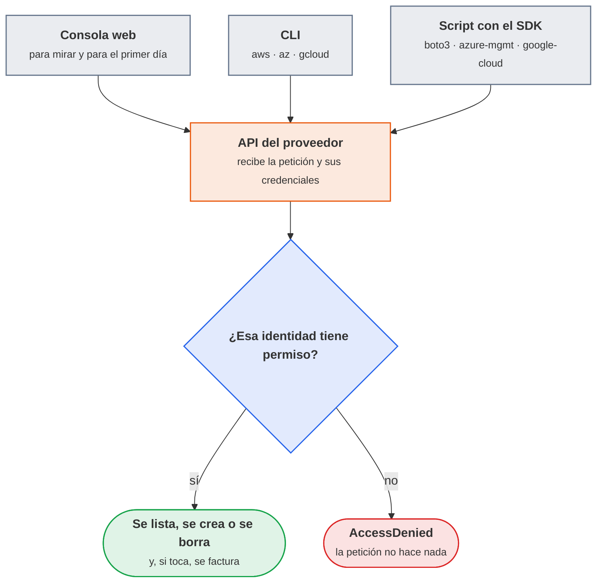
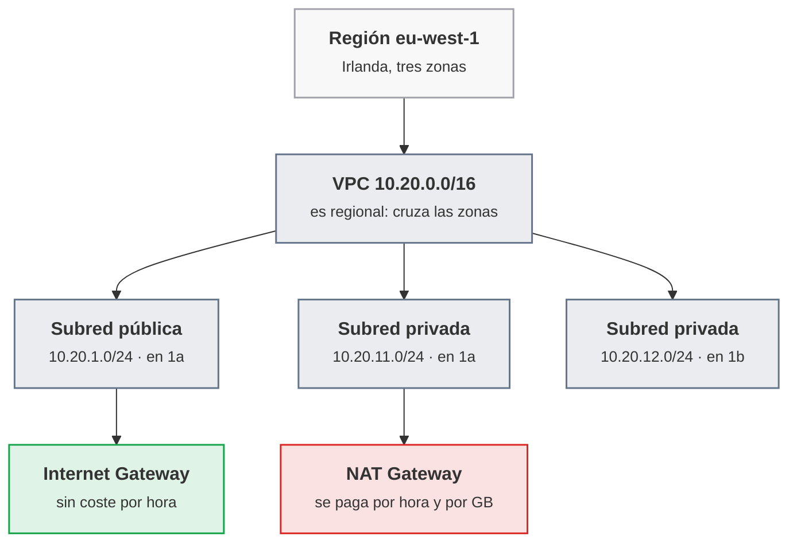
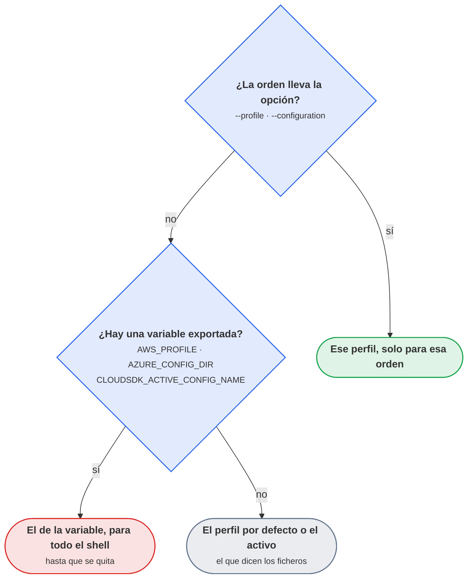
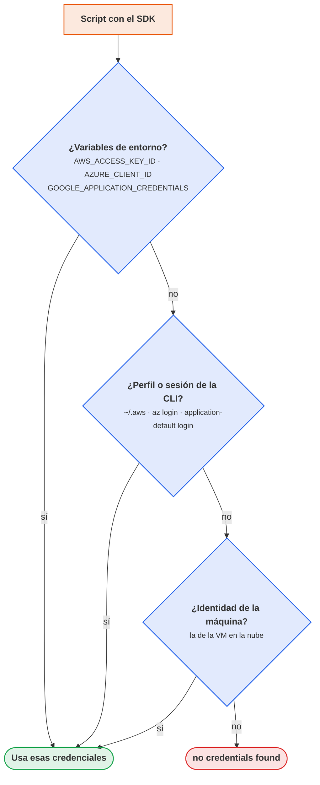

# UT4 · Nube pública: consola, CLI y SDK

<p class="ut-meta">12 h · Formación en empresa (19 abr a 9 jun 2027) · RA2 CE a, b, c, d, e</p>

En el centro, todo se montó a mano sobre Proxmox y después se automatizó con OpenTofu llamando a su API (una API es una interfaz a la que un programa le pide por HTTP que cree o liste recursos; la de Proxmox ya se llamó a mano [con `curl` y un token](ut2-vpc.md#la-api-rest-con-token-la-antesala-de-opentofu)). Una empresa rara vez tiene eso en un armario propio: lo alquila a un proveedor de nube pública, que ofrece las mismas piezas por horas y expuestas por API. Esta unidad enseña a trabajar con esa infraestructura alquilada, y se apoya en dos ideas. La primera: la consola web, la CLI (la herramienta de línea de comandos del proveedor) y el SDK (la librería para hacer lo mismo desde código) son tres formas de llamar a la misma API. La segunda: cada llamada lleva una identidad y puede costar dinero.

La unidad avanza en el orden en que se gana autonomía sin perder el control: entrar con una identidad propia y saber dónde se está (bloque 1), dejar la consola a mano y el gasto vigilado (bloque 2), pasar a la CLI sin claves permanentes (bloque 3), manejar varios entornos con perfiles (bloque 4) y hacer lo mismo desde código sin escribir una sola credencial (bloque 5).

**Por qué se hace en la empresa.** La nube pública cuesta dinero desde el primer minuto y necesita una cuenta real, así que esta unidad se hace durante la formación en empresa, sobre la cuenta de la empresa, y la plataforma la decide el tutor: AWS, Azure, Google Cloud o una alternativa europea (OVHcloud, Hetzner, Scaleway). Los apuntes desarrollan AWS, que es el más extendido, y dan Azure y Google Cloud como correspondencia, en tablas o en pestañas; con otro proveedor, los conceptos son los mismos.

**Cómo se trabaja.** Se trabaja con la cuenta de la empresa y al lado de recursos de los que responde su equipo, así que cada hoja pide en su "Antes de empezar" una autorización concreta del tutor. Ninguna de las cinco actividades crea infraestructura: leen, configuran la propia sesión o, como mucho, crean una alerta de presupuesto. Si el tutor encarga crear algo aparte, se aplica la [regla de la empresa](#los-errores-caros-tipicos): se destruye el mismo día. El tutor marca cuándo se hace cada actividad, pero el orden importa: la A4.2 parte de la identidad de la A4.1, y la A4.3, la A4.4 y la A4.5 se encadenan, porque el script de la última usa los perfiles de las dos anteriores. Cada una se documenta en la [ficha de evidencias](#ficha-de-evidencias), que firma el tutor. Las capturas van sin datos sensibles: se tapan los números de cuenta completos, las claves, las IP públicas de producción y los correos de terceros, porque la evidencia sale de la empresa y acaba en el aula virtual. En la [práctica evaluable](#practica-evaluable), una evidencia con credenciales visibles invalida la actividad.

!!! otra "Mantenimiento también está en la empresa estas semanas"
    La [UT5](https://victor-educ.github.io/apuntes-5169/ut/ut5-logs-accesos-rendimiento/) (logs, accesos y rendimiento) y la
    [UT6](https://victor-educ.github.io/apuntes-5169/ut/ut6-copias-seguridad/) (copias de seguridad) de Mantenimiento se
    cursan en la empresa en las mismas semanas, y también piden evidencias anonimizadas. Conviene acordar con el tutor un
    mismo sistema para las tres unidades: la cuenta y la región que se identifican aquí suelen ser las de los servicios que
    allí se revisan, y si las copias de seguridad van a un almacenamiento de la nube, lo que se ve aquí sobre regiones,
    permisos y coste de descarga es lo que se aplica allí.

## Bloque 1 · Acceso a la plataforma (CE 2a)

<p class="ut-meta">En la empresa · con el tutor</p>

Antes de tocar nada en la consola hay que saber tres cosas: qué se está mirando, quién se es y dónde se está. Este bloque las responde en ese orden: qué alquila un proveedor y cómo se traduce a lo hecho en Proxmox, cómo se reparten las identidades y las cuentas, y cómo se marca con etiquetas de quién es cada recurso. La hoja A4.1 lo aplica.

### Qué es una nube pública y qué se alquila

**Para qué sirve.** En el centro, cada VM nueva había que encajarla en el [presupuesto de memoria](../laboratorio.md#presupuesto-de-memoria) del puesto. Un proveedor de nube pública elimina ese techo: alquila por horas máquinas virtuales, redes privadas, discos, balanceadores y DNS, y además servicios que en el centro no hay, como bases de datos gestionadas o almacenamiento de objetos. Se paga por uso y todo se crea y se destruye por API.

**Tres puertas a la misma API.** La consola, la CLI y un script con el SDK son tres clientes de la misma API. Cada petición llega con unas credenciales, y la API comprueba si esa identidad tiene permiso para lo que pide:



<p class="pie" markdown>Las tres puertas llevan a la misma API y en las tres decide la identidad, como en Proxmox con la consola web, `pvesh`, `curl` y OpenTofu.</p>

**La buena práctica.** La consola es para mirar; se trabaja con la CLI y el SDK, porque lo que se hace con ellos se puede repetir, guardar en un fichero y revisar antes de lanzarlo, como el código de OpenTofu de `iac-lab`.

#### Regiones y zonas de disponibilidad

**Para qué sirven.** Un centro de datos puede quedarse sin corriente o sin conexión, y entonces cae todo lo que vive en él. Además, la distancia añade latencia y la ley condiciona dónde se pueden guardar los datos personales. Los proveedores lo resuelven repartiendo su infraestructura en dos niveles.

**Cómo se reparte.** Una **región** es un conjunto de centros de datos en una zona geográfica, con nombre propio y sus propios precios. Dentro de cada región hay varias **zonas de disponibilidad**, centros de datos separados físicamente pero unidos por enlaces rápidos. Un servicio que tiene que aguantar la caída de un centro de datos reparte sus máquinas entre dos o tres zonas. Regiones europeas habituales desde España:

| Proveedor | Región | Dónde está |
|---|---|---|
| AWS | `eu-west-1` | Irlanda (zonas `eu-west-1a`, `1b`, `1c`) |
| AWS | `eu-south-2` | España (Aragón) |
| AWS | `eu-central-1` | Alemania (Fráncfort) |
| Azure | `westeurope` / `spaincentral` | Países Bajos / Madrid |
| Google Cloud | `europe-southwest1` / `europe-west1` | Madrid / Bélgica |

**La consecuencia práctica.** Casi todos los recursos son regionales: si la consola de AWS se abre en `us-east-1`, no aparece nada de lo creado en `eu-west-1`. Por eso la región de trabajo se fija por defecto desde el primer día, en la consola y en los perfiles de la CLI, y es el dato que anota la A4.1.



<p class="pie" markdown>La subred vive en una zona; la VPC, en la región entera. En rojo, lo que sigue cobrando aunque no pase tráfico.</p>

La traducción al laboratorio es directa: la VPC es un entorno (dev, con su `/16`), la subred pública es front, la DMZ externa, las privadas son back y data, el Internet Gateway es la WAN de OPNsense y el NAT Gateway, su NAT de salida. La diferencia es que en la nube cada pieza tiene precio.

#### Correspondencia con el laboratorio

**Para qué sirve.** Traduce cada servicio de la consola a algo ya montado en el curso. Se lee por filas, y es la base de la actividad de cierre, que compara la nube de la empresa con la VPC del centro.

| Concepto del curso (Proxmox) | AWS | Azure | Google Cloud |
|---|---|---|---|
| VM | EC2 (instancia) | Virtual Machines | Compute Engine |
| Plantilla de VM / cloud-init | Imagen de máquina + user data | Imagen + custom data | Imagen + startup script |
| Disco de la VM | EBS (volumen) | Managed Disk | Persistent Disk |
| VPC (zona y VNets del SDN) | VPC | Virtual Network (VNet) | VPC |
| Subred | Subnet en una zona | Subnet | Subnet regional |
| OPNsense: reglas de cortafuegos | Security Groups | Network Security Groups | Firewall rules |
| OPNsense: NAT de salida | NAT Gateway | NAT Gateway | Cloud NAT |
| OPNsense: WAN | Internet Gateway + Elastic IP | Public IP | External IP |
| Proxy inverso / balanceador | Application Load Balancer | Application Gateway | Cloud Load Balancing |
| DNS interno | Route 53 (zonas privadas) | Azure DNS (zonas privadas) | Cloud DNS |
| Usuarios y permisos | IAM e IAM Identity Center | Entra ID + RBAC | IAM + service accounts |
| Token de API de Proxmox | Claves de acceso (`AKIA...`) | Secreto de un service principal | Clave JSON de service account |
| Estructura de cuentas | Organizations: cuentas | Management groups, suscripciones | Organization, folders, proyectos |
| CLI | `aws` | `az` | `gcloud` |
| SDK Python | `boto3` | `azure-identity`, `azure-mgmt-*` | `google-cloud-*` |

### Identidad y estructura de cuentas

**Para qué sirve.** En la nube de una empresa llaman a la misma API decenas de personas, programas y pipelines, sobre recursos que cuestan dinero. Cada petición tiene que responder a tres preguntas: quién la hace, qué puede hacer y en qué cuenta. Casi todos los errores de los bloques siguientes ("no veo nada", "acceso denegado", "dice que soy otra persona") se explican por una de las tres.

#### Usuarios, roles y políticas

**La cuenta raíz no se usa.** Toda cuenta de nube nace con una identidad todopoderosa (el usuario raíz en AWS, el administrador global en Azure, el superadministrador en Google Cloud) que puede cerrar la cuenta y borrar cualquier cosa. Es el `root@pam` de Proxmox a escala de empresa, y vale la misma regla que en [Usuarios y permisos](ut1-virtualizacion.md#usuarios-y-permisos): se protege y no se usa a diario. A quien llega a la empresa se le da un usuario propio o su cuenta corporativa, con permisos limitados.

**Las tres piezas, con nombres de AWS.** IAM es el servicio que decide quién puede hacer qué, igual que en Proxmox el usuario `terraform@pve` de la [A5.1](ut5-iac.md#a51-primer-despliegue-sesion-21) tenía su token y sus permisos:

- **Users**: identidades con credenciales de larga duración, una contraseña y, a veces, un par de claves de acceso cuyo identificador empieza por `AKIA`.
- **Roles**: identidades sin credenciales permanentes que se *asumen* durante un rato. Al asumir un rol se reciben credenciales temporales (de 15 minutos a 12 horas) cuya clave empieza por `ASIA`. Así se distingue a simple vista una clave permanente de una temporal.
- **Policies**: documentos JSON que dicen qué acciones se permiten sobre qué recursos, y se adjuntan a users, a grupos o a roles.

**Cómo se lee una política.** Esta permite solo mirar la red y las instancias en Irlanda:

```json
{
  "Version": "2012-10-17",
  "Statement": [
    {
      "Effect": "Allow",
      "Action": ["ec2:DescribeVpcs", "ec2:DescribeSubnets", "ec2:DescribeInstances"],
      "Resource": "*",
      "Condition": { "StringEquals": { "aws:RequestedRegion": "eu-west-1" } }
    }
  ]
}
```

- **Lo que no está permitido, está prohibido.** Un `AccessDenied` no es una avería: es un permiso que nadie ha concedido.
- **Las acciones se llaman como las órdenes.** `aws ec2 describe-vpcs` es `ec2:DescribeVpcs`. El mensaje de error dice qué acción faltaba, y con ese nombre se le pide al tutor el permiso exacto.
- **La condición limita la región.** La misma orden contra otra región devuelve `AccessDenied`.

En Azure y Google Cloud las piezas son las mismas con otro nombre:

| Pieza | AWS | Azure | Google Cloud |
|---|---|---|---|
| Identidad de persona | User o, mejor, IAM Identity Center | Usuario de Entra ID | Usuario de Google Workspace |
| Identidad de un programa o una máquina | Role | Service principal o managed identity | Service account |
| Permisos | Policy adjunta | Asignación de rol (`Reader`, `Contributor`...) sobre un ámbito | Rol (`roles/compute.viewer`...) sobre un recurso |

**La buena práctica.** Permisos mínimos y por rol, no por persona: las políticas amplias como `AdministratorAccess` sirven para empezar, pero en producción se aplica el [mínimo privilegio](ut6-ci.md#minimo-privilegio), como con las credenciales de Jenkins.

#### MFA, SSO y credenciales temporales

**Para qué sirven.** Una contraseña sola se roba, y una clave de acceso guardada en un fichero vale para siempre en manos de quien la copie. Para la consola, la solución es el MFA (autenticación multifactor: un código del móvil o una llave física además de la contraseña). Para la CLI y el SDK, es trabajar con credenciales que caducan solas.

**Cómo se hace.** La persona entra por SSO (inicio de sesión único: la misma cuenta corporativa sirve para la nube y para el resto de aplicaciones de la empresa) con su MFA, y de ahí salen credenciales temporales para la consola y para la CLI. En la máquina de trabajo son estas órdenes, que usa la A4.3:

```bash
# AWS con IAM Identity Center: abre el navegador y guarda un token de sesión
aws configure sso          # solo la primera vez, crea el perfil
aws sso login --profile empresa-dev

# Azure: abre el navegador contra Entra ID
az login

# Google Cloud: un login para la CLI y otro para las librerías del SDK
gcloud auth login
gcloud auth application-default login
```

En una máquina sin navegador, las órdenes de AWS y Azure admiten `--use-device-code`, que da un código para autorizar el acceso desde el navegador de otro equipo. En Google Cloud, si un script de Python falla con `DefaultCredentialsError`, es que falta el segundo login.

**La buena práctica.** Lo que dejan estos logins (`~/.aws/sso/cache/`, `~/.azure/`, `~/.config/gcloud/`) son tokens que caducan, pero dan acceso mientras valen: esos directorios no se copian, no se suben a ningún repositorio y no salen en ninguna captura.

!!! ojo "Claves de acceso de larga duración"
    Un par de claves de AWS (`AKIA...`) o una clave JSON de service account de Google Cloud no caduca y no pide MFA. Si
    acaba en un repositorio público, en menos de una hora habrá bots usándola a cargo de la empresa. Si el tutor entrega
    una, conviene preguntar si hay alternativa con SSO, guardarla fuera del proyecto y borrarla al terminar. En el
    laboratorio ya se usó una clave de este tipo, la de MinIO del [backend remoto](ut5-iac.md#backend-remoto-s3-contra-minio);
    contra una cuenta real, la misma clave da acceso a recursos que cuestan dinero.

#### Cómo se organizan las cuentas

**Para qué sirve.** Si toda la empresa trabajara en una sola cuenta, un error en desarrollo podría borrar producción y la factura no diría qué proyecto gasta qué. Por eso se separa, como dev, pre y pro en el laboratorio:

| Nivel | AWS | Azure | Google Cloud |
|---|---|---|---|
| Raíz que factura | Organization | Tenant y management group raíz | Organization |
| Agrupación para aplicar políticas | Unidades organizativas | Management groups | Folders |
| Unidad aislada donde vive cada cosa | Cuenta (12 dígitos) | Suscripción (y dentro, resource groups) | Proyecto |

**Cómo se usa.** Las políticas que se aplican en la agrupación bajan a todo lo que cuelga de ella: si la de desarrollo prohíbe una región, ni el administrador de la cuenta puede crear nada en ella. Eso explica los accesos denegados que ningún permiso propio explica.

**La buena práctica.** Lo primero es anotar el identificador de la cuenta, suscripción o proyecto en que se trabaja, porque todas las órdenes giran a su alrededor. En AWS lo enseña el menú de la cuenta (arriba a la derecha); en Azure, la página Subscriptions; en Google Cloud, el selector de proyecto de la barra superior. Es lo primero que se mira cuando algo no cuadra.

### Etiquetado

**Para qué sirve.** En una cuenta compartida, con cientos de recursos, nadie sabe de memoria de quién es cada máquina ni si alguien la olvidó tras una prueba.

**Cómo se hace.** Las etiquetas (*tags* en AWS y Azure, *labels* en Google Cloud) son pares clave/valor que se ponen a cada recurso. No cambian su comportamiento, pero permiten filtrar y facturar por proyecto. El mínimo habitual es `proyecto`, `entorno` (dev, pre, prod), `propietario` y a veces `caduca` (fecha). Lo que se crea para practicar se etiqueta con algo reconocible, como `propietario=alumno-fp` y `caduca=2027-06-09`.

**La buena práctica.** Se sigue la convención de la empresa al pie de la letra: hay políticas que rechazan recursos sin las etiquetas obligatorias, y la vista de costes por etiqueta (la de la A4.2) solo funciona si todo el mundo escribe la misma clave igual. En AWS `Propietario` y `propietario` son dos etiquetas distintas.

### A4.1 Acceso a la plataforma (CE 2a)

<span class="et et-obj">Objetivo</span> Entrar en la consola del proveedor con tu usuario y MFA activo, y saber decir en qué cuenta, suscripción o proyecto, en qué región y con qué política de etiquetas trabajas. Son las tres coordenadas de todo lo que harás en la unidad: con otra cuenta o en otra región, tus órdenes irán a otro sitio.

<span class="et et-pre">Antes de empezar</span>

- Autorización del tutor para usar la cuenta de la empresa con el usuario que te haya creado, nunca el usuario raíz ni una cuenta compartida.
- Un móvil o una llave física para el segundo factor, del tipo que admita la empresa.
- Leídos [Usuarios, roles y políticas](#usuarios-roles-y-politicas), [MFA, SSO y credenciales temporales](#mfa-sso-y-credenciales-temporales), [Cómo se organizan las cuentas](#como-se-organizan-las-cuentas), [Regiones y zonas de disponibilidad](#regiones-y-zonas-de-disponibilidad) y [Etiquetado](#etiquetado).

<span class="et et-pas">Pasos</span>

Primero aseguras tu acceso y después averiguas, por este orden, en qué cuenta estás, en qué región están los recursos y cómo se etiquetan. Cada paso deja un dato para la Entrega y para el documento de cierre.

1. **Protege tu acceso antes de nada.** Entra por primera vez con la dirección de acceso que te dé el tutor y activa el segundo factor antes de hacer nada más: un usuario con solo contraseña es justo lo que buscan los ataques.

    === "AWS"

        Con SSO, el segundo factor se activa en el proveedor de identidad de la empresa. Con un usuario de IAM: menú de la cuenta (arriba a la derecha) > *Security credentials* > *Assign MFA device*.

    === "Azure"

        Regístralo en `https://mysignins.microsoft.com/security-info` > *Add sign-in method*.

    === "Google Cloud"

        Regístralo en `https://myaccount.google.com/security` > *2-Step Verification*.

    Compruébalo: cierra sesión, vuelve a entrar y te tiene que pedir el segundo factor.

2. **Sitúate en la estructura de cuentas.** Apunta el identificador de la cuenta, suscripción o proyecto en que trabajas y busca la jerarquía que la agrupa, aunque no tengas permiso para verla: la captura de un acceso denegado también sirve.

    | | Identificador | Jerarquía |
    |---|---|---|
    | AWS | Menú de la cuenta, arriba a la derecha | Servicio *AWS Organizations* |
    | Azure | *Subscriptions*, columna *Subscription ID* | *Management groups* |
    | Google Cloud | Selector de proyecto de la barra superior | *IAM & Admin* > *Manage resources* |

    Compruébalo: tienes el identificador apuntado y una captura de la jerarquía o de su acceso denegado.

3. **Encuentra la región de trabajo.** Pregunta al tutor en qué región crea la empresa sus recursos y comprueba que ahí hay máquinas o redes: en AWS, elige la región en el selector de arriba a la derecha y abre *EC2* > *Instances*; en Azure, *Virtual machines* y mira la columna *Location*; en Google Cloud, *Compute Engine* > *VM instances* y mira la columna de zona.

    Compruébalo: el listado no está vacío. Si lo está, casi siempre es que miras otra región.

4. **Conoce la política de etiquetas.** Pregunta al tutor qué etiquetas son obligatorias y con qué formato, y comprueba en un recurso cualquiera que las lleva: ábrelo y mira su pestaña *Tags* (*Labels* en Google Cloud).

    Compruébalo: el recurso tiene todas las etiquetas obligatorias que te ha dicho el tutor.

<span class="et et-com">Comprobación</span> Al cerrar sesión y volver a entrar te pide el segundo factor, y eres capaz de decir de memoria cuenta, región y las etiquetas obligatorias.

<span class="et et-ent">Entrega</span> Captura de la consola con el usuario, la cuenta o proyecto y la región visibles, y un párrafo con el identificador (parcialmente tapado), la región y las etiquetas obligatorias. Todo va a la carpeta o el repositorio de evidencias, y la fila A4.1 de la [ficha de evidencias](#ficha-de-evidencias) la firma el tutor.

<span class="et et-ext">Si te sobra tiempo</span> Busca en la consola qué políticas o roles tiene asignados tu usuario: te servirá para explicar los `AccessDenied` de las actividades siguientes.

## Bloque 2 · Configuración de la interfaz (CE 2b)

<p class="ut-meta">En la empresa · con el tutor</p>

Con la identidad clara quedan dos cosas por resolver antes de pasar a la CLI: que la consola abra donde se trabaja, y que un descuido de gasto avise antes de llegar a la factura. La hoja A4.2 deja la consola configurada, la alerta puesta y anotado el coste de partida.

### Consola web y shells integrados

**Para qué sirve.** Sin configurar, la consola abre en el idioma del navegador y, en AWS, en la última región visitada. Entrar en la región equivocada es la causa más común de "no veo nada". El primer día se ajusta lo que pide el CE 2b:

- **El idioma**: inglés, salvo que la empresa trabaje en otro. Los mensajes de error traducidos no se encuentran en ningún buscador.
- **La región por defecto**: la de la empresa. En AWS se fija en *Unified Settings* (el engranaje), junto al idioma. En Azure el portal no tiene región por defecto: se elige al crear cada recurso. En Google Cloud es un dato del proyecto, compartido por todo el equipo: se consulta, pero no se cambia sin el tutor.
- **Los favoritos**: red, cómputo, identidad y facturación. *VPC*, *EC2*, *IAM* y *Billing* en AWS; *Virtual networks*, *Virtual machines* y *Cost Management* en Azure; *VPC network*, *Compute Engine*, *IAM* y *Billing* en Google Cloud.
- **La moneda** de los costes es un ajuste de la cuenta de facturación de la empresa: se anota, pero no se cambia.

**El terminal que trae la consola.** Los tres proveedores tienen un terminal dentro de la consola (CloudShell en AWS, Cloud Shell en Azure y en Google Cloud), con la CLI instalada y ya autenticado con la identidad de la consola. Se abre desde el icono de terminal de la barra superior y conserva solo el directorio personal.

**La buena práctica.** El shell integrado sirve para consultas puntuales. Para las hojas A4.3 a A4.5 se instala la CLI en el equipo de trabajo, donde está el código, porque el script de la A4.5 usa los perfiles de la CLI de esa misma máquina. Si el tutor prefiere que no se instale nada, se acuerda con él dónde se hacen las tres, pero siempre en el mismo sitio.

### Presupuestos y costes

**Para qué sirve.** En Proxmox una VM olvidada solo ocupa disco; en la nube cuesta dinero cada hora, y la factura llega a fin de mes. Se vigila en dos capas: un presupuesto con alerta y saber qué piezas cobran aunque nadie las use.

#### Free tier, presupuestos y alertas

**El nivel gratuito no cuenta.** Los proveedores regalan un nivel gratuito a las cuentas nuevas, pero la cuenta de la empresa es de pago: cada recurso cuesta desde el minuto uno.

**El presupuesto y su alerta.** Un presupuesto es una cifra mensual que el proveedor compara con el gasto; la alerta es el correo que manda cuando se supera un porcentaje. No detiene nada, solo avisa, y con horas de retraso. Se crea en *Billing and Cost Management* > *Budgets* en AWS, en *Cost Management* > *Budgets* en Azure y en *Billing* > *Budgets & alerts* en Google Cloud.

**La vista de costes.** El gasto se mira en *Cost Explorer* (AWS), *Cost analysis* (Azure) o *Reports* de facturación (Google Cloud), agrupado por servicio y filtrado por etiqueta. En AWS, una etiqueta solo aparece en el filtro si la cuenta de gestión la ha activado como etiqueta de asignación de costes (*cost allocation tag*).

**La buena práctica.** El presupuesto se crea antes que cualquier recurso, porque su valor está en el olvido que todavía no se ha cometido.

#### Los errores caros típicos

**Lo que cobra aunque nadie lo use.** La mayoría de los sustos vienen de piezas que se cobran por existir y siguen ahí cuando la prueba ya terminó:

| Error | Por qué duele | Cómo se evita |
|---|---|---|
| NAT Gateway olvidado | Se cobra por hora aunque no pase tráfico (unos 30 € al mes en AWS) y por cada GB. | Se destruye al terminar la prueba. |
| IP públicas reservadas | Se cobran por hora aunque no estén asociadas a nada. | Se liberan las que no se usan. |
| Discos y snapshots huérfanos | El disco puede sobrevivir a la VM, y los snapshots se cobran cada mes. | Tras borrar una VM, se listan y se borran. |
| Tráfico de salida | Lo que sale a Internet o a otra región se paga por GB. | Los datos se mueven dentro de la región. |
| Instancias grandes "un momento" | Una máquina grande cuesta por hora decenas de veces lo que una pequeña. | Siempre el tamaño mínimo que sirva. |

!!! empresa "Regla de la empresa"
    Lo que se crea para practicar, si el tutor encarga crear algo, se destruye el mismo día. Antes de cerrar sesión se
    listan instancias, discos, IP, NAT y snapshots con la CLI y se compara con lo que había por la mañana, porque la
    factura tarda horas en reflejarlo. El coste se anota para el paso 4 de la actividad de cierre.

### A4.2 Configuración de la interfaz (CE 2b)

<span class="et et-obj">Objetivo</span> Dejar la consola configurada para trabajar (idioma, región, favoritos) y tener una alerta de presupuesto que avise antes que la factura. Al terminar, la consola abre con lo que usas a mano y, si se te olvida apagar algo, te enterarás por un correo.

<span class="et et-pre">Antes de empezar</span>

- A4.1 hecha: entras con MFA y sabes en qué cuenta o suscripción estás.
- Autorización del tutor para crear un presupuesto sobre tu cuenta, suscripción o resource group; si no te lo puede dar, acuerda con él la etiqueta de propietario por la que vas a filtrar los costes.
- Leídos [Consola web y shells integrados](#consola-web-y-shells-integrados) y [Free tier, presupuestos y alertas](#free-tier-presupuestos-y-alertas).

<span class="et et-pas">Pasos</span>

Primero haces que la consola trabaje para ti, después pones la alarma del gasto y al final tomas la medida de partida, que compararás con la del final de la estancia.

1. **Deja la consola a tu medida.** Ponla en inglés, con la región de la empresa por defecto y con los servicios de red, cómputo, identidad y facturación en favoritos.

    === "AWS"

        Engranaje > *Unified Settings* > *Language* y *Default Region*. Favoritos: busca cada servicio y pulsa la estrella junto a su nombre.

    === "Azure"

        Engranaje > *Language + region*. Favoritos: *All services* y la estrella de cada servicio. La región no se fija en el portal.

    === "Google Cloud"

        Tu avatar > *Preferences* > *Language*. Favoritos: en el menú de navegación, la chincheta de cada servicio. La región por defecto es del proyecto: no la cambies.

    Compruébalo: cierra la consola, vuelve a abrirla y aparecen el idioma, los favoritos y, en AWS, la región.

2. **Pon la alarma del gasto.** Crea un presupuesto mensual (por ejemplo, 20 €) sobre tu cuenta, suscripción o resource group, que avise a tu correo al 80 % del gasto real.

    === "AWS"

        *Billing and Cost Management* > *Budgets* > *Create budget* > *Customize (advanced)* > *Cost budget*: importe 20, umbral 80 % *of budgeted amount* sobre *Actual*, tu correo.

    === "Azure"

        *Cost Management* > *Budgets* > *Add*, ámbito tu suscripción o resource group: importe 20, alerta *Actual* al 80 %, tu correo.

    === "Google Cloud"

        *Billing* > *Budgets & alerts* > *Create budget*, ámbito tu proyecto: importe 20, umbral 80 % del gasto real, notificación por correo.

    Compruébalo: el presupuesto aparece en la lista con el umbral del 80 %. Si no tienes permiso para crearlo, la evidencia es la vista de costes del mes filtrada por tu etiqueta de propietario.

3. **Toma la medida de partida.** Abre la vista de costes (*Cost Explorer*, *Cost analysis* o *Reports*) y anota el coste del mes hasta hoy y su moneda. La diferencia con el del final de la estancia es lo que ha costado tu trabajo en la unidad.

    Compruébalo: tienes anotados el importe, la moneda y la fecha.

<span class="et et-com">Comprobación</span> Al entrar, la consola abre en la región de la empresa (en AWS; en Azure y Google Cloud la consola no guarda una región tuya), los favoritos aparecen en la barra y el presupuesto figura en la lista de presupuestos con el umbral del 80 % (o la consulta de costes filtrada por tu etiqueta devuelve resultados).

<span class="et et-ent">Entrega</span> Capturas de las preferencias y de la alerta de presupuesto (o de la consulta de costes), sin datos sensibles, en la carpeta de evidencias. Fila A4.2 de la ficha.

<span class="et et-ext">Si te sobra tiempo</span> Abre el shell integrado y lanza `aws sts get-caller-identity`, `az account show` o `gcloud auth list`: ya está autenticado con la identidad de la consola.

## Bloque 3 · Instalación de la CLI (CE 2c)

<p class="ut-meta">En la empresa · con el tutor</p>

Lo que se hace a clics no se puede repetir igual ni revisar antes de lanzarlo; la CLI sí, como los scripts de la A2.3 frente a la consola de Proxmox. A cambio, necesita credenciales guardadas en la máquina. El bloque explica cómo se instala, cómo se autentica sin claves permanentes y cómo se comprueba con qué identidad se habla. La hoja A4.3 deja la CLI lista para los perfiles del bloque 4.

### La CLI a fondo

**Para qué sirve.** La CLI traduce cada orden en llamadas a la API del proveedor, con las credenciales que tenga configuradas, como `pvesh` y `curl` con la API de Proxmox.

**La forma de las órdenes.** Las tres siguen el patrón herramienta, servicio, recurso y acción, y después las opciones. Estas tres listan las redes, y son las que usa la A4.3:

```bash
aws ec2 describe-vpcs              # AWS junta acción y recurso
az network vnet list -o table      # Azure
gcloud compute networks list       # Google Cloud
```

La orden concreta se encuentra en la ayuda de cada nivel: `aws ec2 help`, `az network vnet -h`, `gcloud compute networks --help`.

#### Instalación

**La buena práctica: el instalador oficial.** Los paquetes de las distribuciones van por detrás: según la versión de Debian o Ubuntu, `apt install awscli` da la v1, que no tiene `aws configure sso`, o una v2 muy antigua. Se usa el instalador del proveedor:

=== "AWS"

    ```bash
    curl "https://awscli.amazonaws.com/awscli-exe-linux-x86_64.zip" -o awscliv2.zip
    unzip awscliv2.zip
    sudo ./aws/install          # para actualizar: sudo ./aws/install --update
    aws --version               # aws-cli/2.x.y ...
    ```

    En ARM el fichero es `awscli-exe-linux-aarch64.zip`; en macOS y Windows hay instalador gráfico. Documentación: <https://docs.aws.amazon.com/cli/latest/userguide/getting-started-install.html>.

=== "Azure"

    ```bash
    curl -sL https://aka.ms/InstallAzureCLIDeb | sudo bash
    az version
    ```

    Documentación: <https://learn.microsoft.com/cli/azure/install-azure-cli-linux>.

=== "Google Cloud"

    ```bash
    sudo apt-get install -y apt-transport-https ca-certificates gnupg curl
    curl https://packages.cloud.google.com/apt/doc/apt-key.gpg | sudo gpg --dearmor -o /usr/share/keyrings/cloud.google.gpg
    echo "deb [signed-by=/usr/share/keyrings/cloud.google.gpg] https://packages.cloud.google.com/apt cloud-sdk main" | sudo tee /etc/apt/sources.list.d/google-cloud-sdk.list
    sudo apt-get update && sudo apt-get install -y google-cloud-cli
    gcloud version
    ```

    Documentación: <https://cloud.google.com/sdk/docs/install>.

#### Autenticación y "quién soy"

**Para qué sirve.** Una CLI puede tener a mano varias credenciales a la vez (una sesión SSO, un perfil, unas variables olvidadas), y no siempre usa la que se cree. Por eso, tras autenticarse, la primera orden es la que dice con qué identidad se habla con la API. Es la evidencia que pide la A4.3.

=== "AWS"

    ```bash
    aws configure sso
    # SSO session name: empresa
    # SSO start URL: la que dé el tutor (https://<empresa>.awsapps.com/start)
    # SSO region: la de la empresa
    # después: cuenta, conjunto de permisos, región por defecto, formato json y nombre de perfil empresa-dev

    aws sso login --profile empresa-dev
    aws sts get-caller-identity --profile empresa-dev
    ```

    ```json
    {
        "UserId": "AROAEXAMPLEID:alumno@empresa.example",
        "Account": "123456789012",
        "Arn": "arn:aws:sts::123456789012:assumed-role/AWSReservedSSO_DevReadOnly_abc123/alumno@empresa.example"
    }
    ```

    `sts` es el servicio de AWS que emite las credenciales temporales. El campo `Arn` es el identificador único de la identidad: `assumed-role/AWSReservedSSO_...` indica un rol asumido por SSO; `user/<nombre>` indicaría un usuario con claves permanentes.

=== "Azure"

    ```bash
    az login                           # abre el navegador y pide elegir suscripción
    az account show                    # suscripción activa, tenant y usuario
    az account list -o table           # todas las suscripciones a las que se tiene acceso
    az account set --subscription "<nombre o id>"
    ```

    En `az account show`, el campo `user.type` dice si la identidad es una persona (`user`) o una aplicación (`servicePrincipal`).

=== "Google Cloud"

    ```bash
    gcloud config configurations create empresa-dev
    gcloud init                        # cuenta, proyecto y región por defecto
    gcloud auth list                   # cuentas autenticadas; la activa lleva asterisco
    gcloud config list                 # proyecto y región de la configuración activa
    ```

    Una service account se reconoce porque su dirección termina en `.gserviceaccount.com`.

### A4.3 Instalación de la CLI (CE 2c)

<span class="et et-obj">Objetivo</span> Tener la CLI del proveedor instalada donde diga la empresa, autenticada sin claves de larga duración y con la identidad comprobada. Es la base de las dos hojas siguientes: los perfiles de la A4.4 parten de esta autenticación y el script de la A4.5 usa sus credenciales.

<span class="et et-pre">Antes de empezar</span>

- Autorización del tutor sobre dónde instalarla (tu portátil, una VM de la empresa o el shell integrado) y sobre el mecanismo de autenticación de la empresa. Si te ofrece un par de claves de acceso, pregúntale antes si hay alternativa con SSO. Haz esta hoja y las dos siguientes en la misma máquina.
- Permisos de administrador en la máquina donde instales.
- Leídos [La CLI a fondo](#la-cli-a-fondo), con [Instalación](#instalacion) y [Autenticación y "quién soy"](#autenticacion-y-quien-soy).

<span class="et et-pas">Pasos</span>

Primero que el programa funcione, después que tenga credenciales, luego que sean las que crees y, solo entonces, una lectura real. Así, si el último paso falla, sabes que el problema está en los permisos.

1. **Instala la versión buena.** Copia las órdenes de tu proveedor de [Instalación](#instalacion). En el shell integrado ya viene instalada y este paso se reduce a comprobar la versión.

    Compruébalo: `aws --version`, `az version` o `gcloud version` responde; en AWS, con una versión `2.x`.

2. **Autentícate sin claves permanentes.** Copia las órdenes de tu proveedor de [Autenticación y "quién soy"](#autenticacion-y-quien-soy), cambiando la dirección de acceso y la región por las que te dé el tutor. El nombre `empresa-dev` no se cambia, porque la A4.4 y la A4.5 lo usan.

    === "AWS"

        ```bash
        aws configure sso                        # perfil: empresa-dev
        aws sso login --profile empresa-dev      # sin navegador: --use-device-code
        aws sts get-caller-identity --profile empresa-dev
        ```

    === "Azure"

        ```bash
        az login                                 # sin navegador: az login --use-device-code
        az account show
        ```

    === "Google Cloud"

        ```bash
        gcloud config configurations create empresa-dev   # antes de gcloud init
        gcloud init
        gcloud auth list
        ```

    Compruébalo: la salida de identidad muestra tu usuario en la cuenta, suscripción o proyecto que anotaste en la A4.1.

3. **Identifica qué credencial tienes.** Escribe en una línea qué tipo de credencial muestra la salida del paso 2: rol asumido por SSO, usuario con claves, cuenta de persona o service account. En AWS lo dice el `Arn`; en Azure, el campo `user.type`; en Google Cloud, la cuenta activa de `gcloud auth list`.

    Compruébalo: tu línea coincide con lo que acordaste con el tutor, y no es un usuario con claves permanentes salvo que él lo haya decidido así.

4. **Haz una lectura de verdad.** Lista las redes con tu identidad. Hasta aquí has comprobado quién eres; esta orden comprueba qué puedes hacer.

    ```bash
    aws ec2 describe-vpcs --profile empresa-dev --output table   # AWS
    az network vnet list -o table                                # Azure
    gcloud compute networks list                                 # Google Cloud
    ```

    Compruébalo: sale un listado, o un `AccessDenied` que sabes explicar con [cómo se lee una política](#usuarios-roles-y-politicas).

<span class="et et-com">Comprobación</span> El comando de versión devuelve una versión reciente (AWS 2.x), el de identidad devuelve tu usuario o rol en la cuenta de la empresa, y el listado de redes devuelve algo o un `AccessDenied` que sabes explicar.

<span class="et et-ent">Entrega</span> Salida de `aws --version` y `aws sts get-caller-identity`, o `az version` y `az account show`, o `gcloud version` y `gcloud auth list`, en texto (no captura), con el comentario de una línea sobre el tipo de credencial. Fila A4.3 de la ficha.

<span class="et et-ext">Si te sobra tiempo</span> Mira qué ha dejado la autenticación en `~/.aws`, `~/.azure` o `~/.config/gcloud` y comprueba que no hay ningún fichero con una clave permanente.

## Bloque 4 · Gestión de perfiles (CE 2d)

<p class="ut-meta">En la empresa · con el tutor</p>

Con dos entornos (desarrollo y preproducción, dos regiones o dos suscripciones), el error típico deja de ser una orden mal escrita para ser una orden correcta lanzada contra el entorno equivocado. Los perfiles lo resuelven, y el filtrado de la salida hace que las evidencias se lean de un vistazo. La hoja A4.4 crea `empresa-pre`, que la A4.5 usa junto a `empresa-dev`.

### Perfiles y ficheros de configuración

**Para qué sirve.** Un perfil agrupa con un nombre la cuenta, la región y las credenciales de un entorno: uno por entorno, como los directorios `envs/dev` y `envs/pre` de `iac-lab`. En AWS se llama perfil; en Google Cloud, *configuration*; en Azure, un directorio de configuración de `az` con su propio login.

**Cómo se elige.** Hay dos mecanismos y se diferencian en su alcance. Una opción en la orden (`--profile` en AWS, `--configuration` en Google Cloud) vale solo para esa orden. Una variable de entorno exportada (`AWS_PROFILE`, `AZURE_CONFIG_DIR`, `CLOUDSDK_ACTIVE_CONFIG_NAME`) vale para todo lo que se lance desde ese shell. `az` no tiene opción: la variable se escribe delante de la orden, y así vale solo para ella.



<p class="pie" markdown>La opción manda sobre la variable, y la variable sobre los ficheros. La del medio es la peligrosa: vale para todo el shell y no se ve.</p>

**Dónde se guardan.**

=== "AWS"

    `~/.aws/config` guarda todo lo que no es secreto. Con SSO no hay fichero `~/.aws/credentials`: el token se guarda en `~/.aws/sso/cache/`.

    ```ini
    # ~/.aws/config
    [sso-session empresa]
    sso_start_url = https://empresa.awsapps.com/start
    sso_region = eu-west-1
    sso_registration_scopes = sso:account:access

    [profile empresa-dev]
    sso_session = empresa
    sso_account_id = 123456789012
    sso_role_name = DevReadOnly
    region = eu-west-1
    output = json

    [profile empresa-pre]
    sso_session = empresa
    sso_account_id = 210987654321
    sso_role_name = PreReadOnly
    region = eu-south-2
    output = table
    ```

    ```bash
    aws configure list-profiles                    # perfiles definidos
    aws configure list --profile empresa-pre       # de dónde sale cada valor
    export AWS_PROFILE=empresa-dev                 # y ya no hace falta --profile
    ```

    No hay orden para borrar un perfil: se quita su bloque del fichero. Unas claves exportadas en `AWS_ACCESS_KEY_ID` pasan por delante de `AWS_PROFILE`, y son el clásico "por qué me dice que soy otro".

=== "Azure"

    `az` guarda su login y su configuración en `~/.azure/`. Para tener un segundo perfil, `AZURE_CONFIG_DIR` apunta a otro directorio con su propio login y su región por defecto: `~/.azure` hace de dev y `~/.azure-pre` de pre.

    ```bash
    export AZURE_CONFIG_DIR=~/.azure-pre
    az login                                       # sesión independiente
    az config set defaults.location=westeurope     # región por defecto de este perfil
    az config get                                  # ver la configuración
    unset AZURE_CONFIG_DIR                         # vuelta a ~/.azure
    AZURE_CONFIG_DIR=~/.azure-pre az network vnet list -o table   # pre solo para esta orden
    ```

=== "Google Cloud"

    Las *configurations* son conjuntos con nombre de propiedades (cuenta, proyecto, región) guardados en `~/.config/gcloud/configurations/config_<nombre>`.

    ```bash
    gcloud config configurations create empresa-pre    # nace activa y vacía
    gcloud config set account alumno@empresa.example
    gcloud config set project pre-web-2027
    gcloud config set compute/region europe-west1
    gcloud config configurations activate empresa-dev
    gcloud compute networks list --configuration=empresa-pre    # sin cambiar la activa
    gcloud config configurations delete <nombre>                # no borra la activa
    ```

**La buena práctica.** Para tocar otro entorno, la opción en la orden; la variable exportada se quita en cuanto se termina, porque olvidada en el shell manda sobre todo lo que se lance después.

### Formatos de salida y filtrado

**Para qué sirve.** El JSON completo de una cuenta con veinte máquinas ocupa varias pantallas, y lo que se busca suele ser una columna. Las tres CLI permiten elegir el formato (JSON, tabla o texto) y quedarse con los campos que importan.

=== "AWS"

    `--output` elige el formato y `--query` recorta el JSON con una expresión de consulta:

    ```bash
    aws ec2 describe-vpcs --query "Vpcs[].{Id:VpcId, Cidr:CidrBlock}" --output table
    aws ec2 describe-instances \
      --query "Reservations[].Instances[].{Id:InstanceId, Estado:State.Name, IP:PrivateIpAddress}" \
      --output table
    ```

=== "Azure"

    `-o` elige el formato y `--query` usa la misma sintaxis que AWS:

    ```bash
    az network vnet list --query "[].{Nombre:name, RG:resourceGroup, Rango:addressSpace.addressPrefixes[0]}" -o table
    az vm list -d --query "[].{Nombre:name, Estado:powerState, IP:privateIps}" -o table
    ```

=== "Google Cloud"

    `--format` elige el formato y las columnas, y `--filter` selecciona los elementos:

    ```bash
    gcloud compute networks subnets list --format="table(name, region.basename(), ipCidrRange)"
    gcloud compute instances list --filter="status=RUNNING" --format="table(name, zone.basename(), status)"
    ```

**La buena práctica.** Las evidencias se entregan en tabla de tres o cuatro columnas: se ve de un vistazo que los dos perfiles apuntan a entornos distintos.

### A4.4 Gestión de perfiles (CE 2d)

<span class="et et-obj">Objetivo</span> Tener dos perfiles o configuraciones que apunten a entornos distintos, saltar entre ellos con el mecanismo nativo y con la variable de entorno, y saber qué ficheros hay debajo. Importa porque el error más caro con la CLI es una orden correcta lanzada contra el entorno equivocado.

<span class="et et-pre">Antes de empezar</span>

- A4.3 hecha: la CLI autenticada con `empresa-dev` y la identidad comprobada.
- Autorización del tutor para acceder a un segundo entorno (dev y pre, dos regiones o dos suscripciones). Si solo tienes uno, el segundo perfil apunta al mismo con otra región por defecto.
- Leídos [Perfiles y ficheros de configuración](#perfiles-y-ficheros-de-configuracion) y [Formatos de salida y filtrado](#formatos-de-salida-y-filtrado).

<span class="et et-pas">Pasos</span>

Creas el segundo perfil, cambias de entorno primero solo para una orden y después para todo el shell, miras los ficheros que hay debajo y terminas creando y borrando un perfil de prueba. El script de la A4.5 cambia de entorno con la variable, así que llegarás sabiendo su alcance.

1. **Crea el segundo perfil.** Da de alta `empresa-pre`, apuntando al otro entorno. Cambia lo marcado por los datos que te dé el tutor.

    === "AWS"

        ```bash
        aws configure sso --profile empresa-pre     # reutiliza la sesión SSO "empresa"
        aws configure list-profiles
        ```

    === "Azure"

        ```bash
        export AZURE_CONFIG_DIR=~/.azure-pre
        az login
        az config set defaults.location=<región de pre>
        unset AZURE_CONFIG_DIR
        ls -d ~/.azure*
        ```

    === "Google Cloud"

        ```bash
        gcloud config configurations create empresa-pre
        gcloud config set account <tu cuenta>
        gcloud config set project <proyecto de pre>
        gcloud config set compute/region <región de pre>
        gcloud config configurations activate empresa-dev
        gcloud config configurations list
        ```

    Compruébalo: el listado muestra `empresa-dev` y `empresa-pre` (en Azure, los directorios `~/.azure` y `~/.azure-pre`).

2. **Cambia de entorno para una sola orden.** Lista las redes con cada perfil usando la opción de la orden, sin cambiar el perfil activo.

    === "AWS"

        ```bash
        aws ec2 describe-vpcs --profile empresa-dev --query "Vpcs[].{Id:VpcId, Cidr:CidrBlock}" --output table
        aws ec2 describe-vpcs --profile empresa-pre --query "Vpcs[].{Id:VpcId, Cidr:CidrBlock}" --output table
        ```

    === "Azure"

        ```bash
        az network vnet list -o table
        AZURE_CONFIG_DIR=~/.azure-pre az network vnet list -o table
        ```

    === "Google Cloud"

        ```bash
        gcloud compute networks list
        gcloud compute networks list --configuration=empresa-pre
        ```

    Compruébalo: los dos listados son distintos (o, si comparten cuenta, la región por defecto lo es).

3. **Cambia de entorno para toda la sesión.** Repite el cambio con la variable de entorno, sin opciones en la orden, y muestra de dónde sale cada valor mientras está exportada. Es como eligen entorno los scripts, y lo que hará la A4.5.

    === "AWS"

        ```bash
        export AWS_PROFILE=empresa-pre
        aws configure list
        aws ec2 describe-vpcs --query "Vpcs[].{Id:VpcId, Cidr:CidrBlock}" --output table
        unset AWS_PROFILE
        ```

    === "Azure"

        ```bash
        export AZURE_CONFIG_DIR=~/.azure-pre
        az config get
        az network vnet list -o table
        unset AZURE_CONFIG_DIR
        ```

    === "Google Cloud"

        ```bash
        export CLOUDSDK_ACTIVE_CONFIG_NAME=empresa-pre
        gcloud config list
        gcloud compute networks list
        unset CLOUDSDK_ACTIVE_CONFIG_NAME
        ```

    Compruébalo: el listado coincide con el de pre del paso 2, y tras el `unset` una orden sin opciones vuelve a dev.

4. **Mira lo que hay debajo.** Muestra los ficheros de configuración de los dos perfiles, sin ningún secreto.

    ```bash
    cat ~/.aws/config                                    # AWS (nunca ~/.aws/credentials)
    az config get; AZURE_CONFIG_DIR=~/.azure-pre az config get   # Azure
    gcloud config configurations list                    # Google Cloud
    ```

    Compruébalo: en la salida aparecen los dos entornos y ninguna clave ni token.

5. **Crea y borra un perfil de usar y tirar.** Practica el borrado con `empresa-tmp`: créalo, lístalo, bórralo y vuelve a listar. `empresa-pre` sigue vivo para la A4.5.

    === "AWS"

        ```bash
        aws configure set region eu-west-1 --profile empresa-tmp
        aws configure list-profiles
        nano ~/.aws/config            # borra el bloque [profile empresa-tmp]
        aws configure list-profiles
        ```

    === "Azure"

        ```bash
        AZURE_CONFIG_DIR=~/.azure-tmp az config set core.output=table
        ls -d ~/.azure*
        rm -r ~/.azure-tmp
        ls -d ~/.azure*
        ```

    === "Google Cloud"

        ```bash
        gcloud config configurations create empresa-tmp --no-activate
        gcloud config configurations list
        gcloud config configurations delete empresa-tmp
        gcloud config configurations list
        ```

    Compruébalo: el último listado es igual que el de antes de crear `empresa-tmp`.

<span class="et et-com">Comprobación</span> Los dos perfiles apuntan a entornos distintos (listados de redes distintos o, si comparten cuenta, región por defecto distinta), `aws configure list` o su equivalente muestra de dónde sale cada valor con la variable exportada, y tras borrar el perfil de prueba el listado vuelve a ser el de antes de crearlo, con el perfil de pre dentro.

<span class="et et-ent">Entrega</span> Los comandos y sus salidas en texto: los listados de cada perfil de los pasos 2 y 3, el fichero `~/.aws/config` o las dos salidas de `az config get`, o la de `gcloud config configurations list`, y el borrado del paso 5. Fila A4.4 de la ficha.

<span class="et et-ext">Si te sobra tiempo</span> Exporta a la vez `AWS_PROFILE` y una `AWS_REGION` distinta de la del perfil y comprueba con `aws configure list` cuál gana.

## Bloque 5 · SDK (CE 2e)

<p class="ut-meta">En la empresa · con el tutor</p>

Cuando la lógica crece (cruzar datos, tratar errores, generar un informe) hace falta un lenguaje de programación, y vuelve el riesgo de escribir la clave en el código. El bloque explica de dónde saca un programa sus credenciales sin que nadie las escriba, un ejemplo en Python y en Node, y las buenas prácticas que protegen el repositorio. La hoja A4.5 lo junta en un script sin credenciales que funciona con los dos perfiles del bloque 4.

### Librerías cliente (SDK)

**Para qué sirve.** El SDK es la librería del proveedor que hace desde código las mismas llamadas que la CLI: `boto3` en Python para AWS, los paquetes `azure-*` para Azure, los `google-cloud-*` para Google Cloud, y sus equivalentes en Node.

**Qué evalúa el CE 2e.** Que la librería se instale con el gestor de dependencias del proyecto (que quede en `requirements.txt` o `package.json`, para que otra persona reproduzca el entorno), que el script no lleve credenciales dentro y que se entienda de dónde las saca.

#### La cadena de credenciales por defecto

**Para qué sirve.** Lo que se quiere es un script sin ninguna credencial que funcione igual en el portátil (con la sesión de la CLI), en un pipeline (con variables que inyecta Jenkins) y en una VM de la nube (con la identidad de la propia máquina).

**Cómo funciona.** Los tres SDK buscan credenciales en un orden fijo y se quedan con la primera que encuentran:



<p class="pie" markdown>El SDK prueba en este orden y se queda con lo primero que encuentra. Por eso una variable de entorno olvidada manda sobre el perfil que se creía en uso.</p>

**En el portátil.** Donde se ejecuta el script de la A4.5, la cadena se resuelve en el escalón del medio: `boto3` usa el perfil que indique `AWS_PROFILE`, `DefaultAzureCredential` usa la sesión de `az login`, y Google Cloud usa el fichero que deja `gcloud auth application-default login`. Ese fichero de Google es uno solo para todas las configuraciones: el script cambia de proyecto con la variable, pero la identidad es siempre la del último login.

**La buena práctica.** El script no lleva `aws_access_key_id=`, ni `ClientSecretCredential(...)`, ni `from_service_account_file(...)`. Cualquiera de las tres ata el script a una credencial concreta y se salta la cadena, así que dejaría de obedecer a la variable con la que se elige el perfil.

#### Python

**Cómo se instala.** Un entorno virtual por proyecto y las dependencias apuntadas en un fichero. Se usa solo la línea `pip install` del proveedor del proyecto:

```bash
python3 -m venv .venv
source .venv/bin/activate
pip install boto3                                                  # AWS
pip install azure-identity azure-mgmt-network azure-mgmt-compute   # Azure
pip install google-cloud-compute                                   # Google Cloud
pip freeze > requirements.txt
```

Se entrega `requirements.txt`, y `.venv/` va en `.gitignore`. Los tres ejemplos listan las redes y las máquinas apoyándose en la cadena:

=== "AWS"

    ```python
    # listar.py: VPC e instancias con boto3 usando el perfil de la CLI
    import boto3

    ses = boto3.Session()        # perfil y región salen de AWS_PROFILE
    ec2 = ses.client("ec2")

    print("VPC:")
    for vpc in ec2.describe_vpcs()["Vpcs"]:
        print(f"  {vpc['VpcId']}  {vpc['CidrBlock']}  default={vpc['IsDefault']}")

    print("Instancias:")
    paginador = ec2.get_paginator("describe_instances")
    for pagina in paginador.paginate():
        for r in pagina["Reservations"]:
            for i in r["Instances"]:
                nombre = next((t["Value"] for t in i.get("Tags", []) if t["Key"] == "Name"), "-")
                print(f"  {i['InstanceId']}  {i['InstanceType']}  {i['State']['Name']}  "
                      f"{i.get('PrivateIpAddress', '-')}  {nombre}")
    ```

    `boto3.Session()` sin argumentos recorre la cadena. El paginador recorre todas las páginas del listado: sin él, se leería solo la primera y faltarían máquinas sin dar error.

=== "Azure"

    ```python
    # listar.py: VNets y VMs con DefaultAzureCredential
    import os
    from azure.identity import DefaultAzureCredential
    from azure.mgmt.network import NetworkManagementClient
    from azure.mgmt.compute import ComputeManagementClient

    sub = os.environ["AZURE_SUBSCRIPTION_ID"]      # el id que devuelve az account show
    cred = DefaultAzureCredential()

    red = NetworkManagementClient(cred, sub)
    print("VNets:")
    for vnet in red.virtual_networks.list_all():
        rg = vnet.id.split("/")[4]
        print(f"  {vnet.name}  rg={rg}  {vnet.location}  {vnet.address_space.address_prefixes}")

    comp = ComputeManagementClient(cred, sub)
    print("VMs:")
    for vm in comp.virtual_machines.list_all():
        rg = vm.id.split("/")[4]
        print(f"  {vm.name}  rg={rg}  {vm.location}  {vm.hardware_profile.vm_size}")
    ```

    El id de suscripción se pasa por variable: `export AZURE_SUBSCRIPTION_ID=$(az account show --query id -o tsv)`.

=== "Google Cloud"

    ```python
    # listar.py: redes VPC e instancias con google-cloud-compute
    import os
    from google.cloud import compute_v1

    proyecto = os.environ.get("CLOUDSDK_CORE_PROJECT") or os.environ["GOOGLE_CLOUD_PROJECT"]

    print("Redes:")
    for red in compute_v1.NetworksClient().list(project=proyecto):
        modo = "auto" if red.auto_create_subnetworks else "custom"
        print(f"  {red.name}  modo={modo}")

    print("Instancias:")
    agregado = compute_v1.InstancesClient().aggregated_list(project=proyecto)
    for zona, resp in agregado:
        for vm in resp.instances:
            ip = vm.network_interfaces[0].network_i_p if vm.network_interfaces else "-"
            print(f"  {vm.name}  {zona.split('/')[-1]}  {vm.machine_type.split('/')[-1]}  {vm.status}  {ip}")
    ```

    `aggregated_list` recorre todas las zonas de una vez. Las credenciales salen de `gcloud auth application-default login`.

#### Node.js

**Lo mismo en Node.** `npm` hace de gestor de dependencias y `package-lock.json` fija las versiones. Se instala solo la librería del proveedor del proyecto:

```bash
npm init -y
npm install @aws-sdk/client-ec2                                    # AWS
npm install @azure/identity @azure/arm-network @azure/arm-compute  # Azure
npm install @google-cloud/compute                                  # Google Cloud
```

Se entregan `package.json` y `package-lock.json`; `node_modules/` va al `.gitignore`. El ejemplo de AWS:

```javascript
// listar.mjs
import { EC2Client, DescribeVpcsCommand, paginateDescribeInstances } from "@aws-sdk/client-ec2";

const ec2 = new EC2Client({}); // credenciales y región: cadena por defecto

const { Vpcs } = await ec2.send(new DescribeVpcsCommand({}));
console.log("VPC:");
for (const v of Vpcs) console.log(`  ${v.VpcId}  ${v.CidrBlock}`);

console.log("Instancias:");
for await (const page of paginateDescribeInstances({ client: ec2 }, {})) {
  for (const r of page.Reservations ?? []) {
    for (const i of r.Instances ?? []) {
      const nombre = i.Tags?.find(t => t.Key === "Name")?.Value ?? "-";
      console.log(`  ${i.InstanceId}  ${i.InstanceType}  ${i.State.Name}  ${i.PrivateIpAddress ?? "-"}  ${nombre}`);
    }
  }
}
```

Se ejecuta con `AWS_PROFILE=empresa-dev node listar.mjs`. En Azure el patrón es `new NetworkManagementClient(new DefaultAzureCredential(), subscriptionId)` y `for await (const v of client.virtualNetworks.listAll())`; en Google Cloud, `new NetworksClient().list({ project })`.

### Buenas prácticas mínimas

**Para qué sirve esta lista.** Es lo que el tutor da por supuesto y lo que más se penaliza en la evaluación:

- **MFA en todo usuario**, y permisos por rol y por grupo, nunca asignados a personas concretas.
- **Nada abierto a `0.0.0.0/0`** salvo el balanceador o el proxy inverso, y solo en 80 y 443, como en el OPNsense del laboratorio. El SSH se abre solo a la IP de la oficina o a una VPN, o se sustituye por el acceso a través del proveedor (Session Manager en AWS, Azure Bastion, Identity-Aware Proxy en Google Cloud).
- **Etiquetar todo y destruir lo de prácticas el mismo día**, y comprobar la factura al día siguiente.
- **Nunca credenciales en Git**: el repositorio se escanea con `gitleaks`, como en `iac-lab`.
- **Al `.gitignore` antes del primer commit**: `.env`, `*.pem`, los JSON de clave de service account, `~/.aws/credentials` y `terraform.tfstate`. Lo que entra en un commit ya no se borra borrando el fichero.

!!! consulta "Repaso"
    gitleaks y el framework pre-commit se explican en [.gitignore y pre-commit](ut5-iac.md#gitignore-y-pre-commit) y se montan en la [A5.8](ut5-iac.md#a58-correccion-de-hallazgos-sesion-28). En el repositorio nuevo de la empresa basta con copiar de allí `.pre-commit-config.yaml` dejando solo el bloque de gitleaks y ejecutar `pre-commit install`; `gitleaks git -v` escanea el historial entero. Si no se puede instalar pre-commit, el hook se escribe a mano: un `.git/hooks/pre-commit` ejecutable con la línea `gitleaks git --pre-commit --staged --redact`.

**Si `gitleaks` encuentra algo ya subido**, borrarlo en el siguiente commit no basta: sigue en el historial. Primero se revoca la clave en el proveedor y se avisa al tutor, y después se limpia, igual que con el token de Proxmox ([Cuando gitleaks encuentra algo](ut5-iac.md#cuando-gitleaks-encuentra-algo)).

### A4.5 SDK (CE 2e)

<span class="et et-obj">Objetivo</span> Un script en el lenguaje del proyecto de la empresa que liste las VPC/VNets y las máquinas sin una sola credencial dentro, y que funcione con dos perfiles cambiando solo la variable de entorno. El mismo fichero, sin tocar una línea, valdría en tu equipo, en un pipeline o en una máquina de la nube.

<span class="et et-pre">Antes de empezar</span>

- A4.4 hecha: `empresa-dev` y `empresa-pre` funcionando.
- Autorización del tutor sobre el lenguaje (Python o Node; si el proyecto usa otro, decide el tutor) y sobre el repositorio privado donde vas a guardar el código.
- Python 3 o Node en la misma máquina donde tienes la CLI, y `gitleaks` instalado en ella o autorización del tutor para instalarlo.
- Leídos [La cadena de credenciales por defecto](#la-cadena-de-credenciales-por-defecto), [Python](#python) o [Node.js](#nodejs), y [Buenas prácticas mínimas](#buenas-practicas-minimas) con su repaso de `gitleaks`.

<span class="et et-pas">Pasos</span>

Preparas el repositorio antes de escribir una línea, escribes el script apoyado en la cadena, lo pruebas con los dos perfiles y lo escaneas antes de subirlo. Los ejemplos van en Python; en Node, cambia `pip` por `npm` y `listar.py` por `listar.mjs`.

1. **Prepara el repositorio.** Crea el repositorio `listar-nube`, su `.gitignore` y el entorno con solo la librería de tu proveedor ([Python](#python) o [Node.js](#nodejs)).

    ```bash
    mkdir listar-nube && cd listar-nube && git init
    cat > .gitignore <<'EOF'
    .venv/
    node_modules/
    .env
    *.pem
    terraform.tfstate*
    EOF
    python3 -m venv .venv && source .venv/bin/activate
    pip install boto3                     # o la línea de tu proveedor
    pip freeze > requirements.txt
    ```

    Si usas Google Cloud y tienes un JSON de clave de service account, añade su nombre exacto al `.gitignore`: no pongas `*.json`, que dejaría fuera `package.json`.

    Compruébalo: `git status` muestra `.gitignore` y `requirements.txt`, y no `.venv/`.

2. **Escribe el script sin credenciales.** Copia el ejemplo de tu proveedor de [Python](#python) o [Node.js](#nodejs) en `listar.py`, sin añadir perfil, región ni credencial: lo que escribas en el código pasa por delante de la [cadena de credenciales](#la-cadena-de-credenciales-por-defecto), y el script dejaría de obedecer a la variable.

    Compruébalo: `grep -nE "profile|region|key|secret" listar.py` no devuelve nada.

3. **Pruébalo con los dos perfiles.** Ejecútalo con cada perfil cambiando solo variables de entorno, guarda las dos salidas y compáralas con lo que da la CLI con el mismo perfil.

    === "AWS"

        ```bash
        AWS_PROFILE=empresa-dev python listar.py > salida-dev.txt
        AWS_PROFILE=empresa-pre python listar.py > salida-pre.txt
        ```

    === "Azure"

        ```bash
        export AZURE_SUBSCRIPTION_ID=$(az account show --query id -o tsv)
        python listar.py > salida-dev.txt
        export AZURE_CONFIG_DIR=~/.azure-pre
        export AZURE_SUBSCRIPTION_ID=$(az account show --query id -o tsv)
        python listar.py > salida-pre.txt
        unset AZURE_CONFIG_DIR AZURE_SUBSCRIPTION_ID
        ```

    === "Google Cloud"

        ```bash
        gcloud auth application-default login          # una vez: el SDK no usa el login de gcloud
        CLOUDSDK_CORE_PROJECT=<proyecto de dev> python listar.py > salida-dev.txt
        CLOUDSDK_CORE_PROJECT=<proyecto de pre> python listar.py > salida-pre.txt
        ```

    Compruébalo: cada salida tiene las mismas redes que el listado de la CLI de ese perfil en la A4.4.

4. **Escanéalo antes de subirlo.** Haz commit y escanea el historial con `gitleaks`, guardando la salida.

    ```bash
    git add . && git commit -m "Script de listado sin credenciales"
    gitleaks git -v 2>&1 | tee gitleaks.txt
    ```

    `gitleaks git` revisa el historial, no la carpeta: lo que no está en un commit no lo ve. Si encuentra una clave, borrarla no basta: revócala en el proveedor y avisa al tutor.

    Compruébalo: la salida termina con `no leaks found`.

<span class="et et-com">Comprobación</span> Las dos salidas del script coinciden con las de la CLI para cada perfil, `grep -rIiE "AKIA|secret|password" . --include='*.py' --include='*.mjs' --include='*.js' --exclude-dir=.venv --exclude-dir=node_modules` no devuelve nada y `gitleaks` termina sin fugas (`no leaks found`).

<span class="et et-ent">Entrega</span> `requirements.txt` o `package.json` (con `package-lock.json`), el script, su salida con cada perfil y la salida de `gitleaks git` sobre el repositorio donde lo has guardado. Fila A4.5 de la ficha.

<span class="et et-ext">Si te sobra tiempo</span> Monta el hook de pre-commit como en la A5.8 (repaso en [Buenas prácticas mínimas](#buenas-practicas-minimas)), intenta hacer commit de un fichero con una clave falsa (`AKIA` y 16 caracteres) y guarda el rechazo.

## Actividad de cierre

<p class="ut-meta">En la empresa · con el tutor</p>

<span class="et et-obj">Objetivo</span> Un documento de dos páginas que explique cómo está organizada la nube de la empresa y en qué se diferencia de la VPC de Proxmox del centro. Demuestra que entiendes el sistema y no solo has seguido pasos: cada apartado sale de algo que anotaste en las hojas y lo compara con algo que montaste en el centro.

<span class="et et-pre">Antes de empezar</span>

- Las cinco actividades hechas, porque el documento se apoya en lo que anotaste en ellas.
- Autorización del tutor sobre qué se puede contar por escrito: nombres de cuentas, rangos de red y nombres de máquinas pueden ser información interna.
- Releída la tabla de [Correspondencia con el laboratorio](#correspondencia-con-el-laboratorio) y tus apuntes de la VPC del centro.

<span class="et et-pas">Pasos</span>

Recorres la nube de la empresa en el orden de la unidad. Los cuatro primeros apartados salen de tus evidencias (la cuenta, la región y las etiquetas de la A4.1, el coste de la A4.2, la identidad de la A4.3 y los listados de la A4.4); el último es tu comparación.

1. **La estructura.** Describe las cuentas, suscripciones o proyectos y cómo se agrupan, qué regiones usa la empresa y por qué. Compruébalo: aparecen el identificador (tapado) y la región de la A4.1.
2. **La red.** Describe las redes y subredes, qué es público y qué privado, cómo se sale a Internet y qué hace de cortafuegos, y compáralo pieza a pieza con la VPC del centro (bridge, DMZ, OPNsense, NAT) con la tabla de [Correspondencia con el laboratorio](#correspondencia-con-el-laboratorio). Compruébalo: cada pieza de la empresa tiene al lado su equivalente del centro.
3. **Identidad y permisos.** Describe con qué mecanismo se entra (SSO, MFA), cómo se reparten los permisos y qué tienes tú. Compruébalo: citas el tipo de credencial de la A4.3.
4. **Etiquetas y costes.** Describe las etiquetas obligatorias, los presupuestos, quién revisa la factura y qué te ha costado la unidad (la vista de costes de la A4.2 antes y después). Compruébalo: hay un importe concreto.
5. **Las diferencias.** Cierra con lo que no esperabas, qué hace la empresa que en el centro no se hizo y qué se hizo en el centro que en la nube ya viene dado. Compruébalo: cada diferencia dice por qué existe la pieza, no solo cómo se llama.

<span class="et et-com">Comprobación</span> Cabe en dos páginas, cada apartado de los cuatro primeros pasos tiene al menos un dato concreto sacado de tus evidencias, y no contiene identificadores completos, claves ni IP públicas de producción.

<span class="et et-ent">Entrega</span> El documento (PDF) en la carpeta de evidencias, junto con la ficha firmada. Fila "Cierre" de la ficha.

<span class="et et-ext">Si te sobra tiempo</span> Añade un diagrama de la red de la empresa con la misma notación que el de regiones y zonas de esta unidad.

## Práctica evaluable

<p class="ut-meta">En la empresa · ficha de evidencias firmada por el tutor</p>

La práctica evaluable es el conjunto de las cinco actividades más el documento de cierre, entregados con la ficha de evidencias firmada por el tutor de empresa. No pide nada que no salga ya de un paso de las hojas. No hay defensa en el centro: el profesor evalúa con la ficha, las evidencias adjuntas y el documento.

Entregables (en un repositorio privado o en la carpeta que indique el profesor):

- [ ] Ficha de evidencias firmada (PDF o foto legible), con la fila de cada actividad, que se rellena en su Entrega.
- [ ] Captura y párrafo de cuenta, región y etiquetas (de la A4.1, pasos 2 a 4), sin datos sensibles.
- [ ] Capturas de las preferencias y del presupuesto o la consulta de costes (de la A4.2, pasos 1 y 2), sin datos sensibles.
- [ ] Salidas de versión e identidad con el comentario sobre el tipo de credencial (de la A4.3, pasos 1 a 3), en texto.
- [ ] Listados de cada perfil, ficheros de configuración y borrado del perfil de prueba (de la A4.4, pasos 2 a 5), en texto.
- [ ] Script, fichero de dependencias, salida con cada perfil y salida de gitleaks (de la A4.5, pasos 1 a 4).
- [ ] Documento de cierre de dos páginas (de la actividad de cierre, pasos 1 a 5).

### Ficha de evidencias

| Actividad | CE | Fecha | Evidencia adjunta | Observaciones del tutor | Firma |
|---|---|---|---|---|---|
| A4.1 Acceso | 2a | | | | |
| A4.2 Interfaz | 2b | | | | |
| A4.3 CLI | 2c | | | | |
| A4.4 Perfiles | 2d | | | | |
| A4.5 SDK | 2e | | | | |
| Cierre | (todos) | | | | |

### Criterios de evaluación y pesos

| Criterio | Peso |
|---|---|
| A4.1 Acceso a la consola: MFA activo, identificación correcta de cuenta, región y política de etiquetas (CE 2a) | 15 % |
| A4.2 Configuración de la interfaz y alerta de presupuesto (CE 2b) | 10 % |
| A4.3 CLI instalada y autenticada sin credenciales de larga duración, identidad verificada (CE 2c) | 20 % |
| A4.4 Dos perfiles funcionando, cambio por mecanismo nativo y por variable de entorno, ficheros de configuración mostrados y un perfil de prueba creado y borrado (CE 2d) | 20 % |
| A4.5 SDK instalado con el gestor de dependencias, script sin credenciales, funciona con dos perfiles, gitleaks limpio (CE 2e) | 20 % |
| Documento de cierre: organización de la nube de la empresa y comparación razonada con la VPC del centro | 15 % |

Una evidencia con credenciales visibles (aunque estén revocadas) invalida la actividad correspondiente.

## Errores frecuentes en el laboratorio

**"No veo nada de lo que creé"**. La sesión está en otra región. Lo dicen el selector de región de la consola o `aws configure get region`, `az config get defaults.location` y `gcloud config get compute/region`.

**`Unable to locate credentials` / `Please run 'az login'` / `DefaultCredentialsError`**. La cadena de credenciales no ha encontrado nada. Se comprueba con `aws sts get-caller-identity`, `az account show` o `gcloud auth list`. Si la CLI funciona pero el SDK no, en Google Cloud falta `gcloud auth application-default login`, y en AWS el script no usa el mismo `AWS_PROFILE` que la CLI.

**El token SSO ha caducado** (`The SSO session associated with this profile has expired`). `aws sso login --profile empresa-dev` y a seguir. Lo mismo con `az login` cuando caduca la sesión de Azure.

**`AccessDenied` / `AuthorizationFailed` / `403 Forbidden`**. El rol no tiene ese permiso, y el mensaje suele decir qué acción faltaba. No se pide `AdministratorAccess`: se anota la acción exacta y se pide al tutor el permiso mínimo. Si la política limita la región y la sesión está en otra, el error es el mismo.

**`aws` dice que soy otra persona**. Hay una `AWS_ACCESS_KEY_ID` o un `AWS_PROFILE` exportados (`env | grep AWS`) o un `[default]` olvidado en `~/.aws/credentials`. `aws configure list` dice de dónde sale cada valor.

**`az` va contra la suscripción equivocada**. Está activa otra suscripción (`az account list -o table` y `az account set --subscription <id>`), o hay un `AZURE_CONFIG_DIR` exportado y olvidado (`env | grep AZURE`).

**El script lista menos máquinas que la consola**. Casi siempre mira otra región. Si no es eso, el bucle no recorre todas las páginas: en AWS se usa el paginador.

**La factura sube aunque "no hay nada"**. Se listan NAT gateways, IP públicas reservadas, discos sin asociar y snapshots; casi siempre es uno de esos.

**La CLI instalada por `apt` es antigua**. No tiene `aws configure sso`. Se usa el instalador oficial de [Instalación](#instalacion).

**Cloud Shell "pierde" los ficheros**. Solo persiste el directorio personal (en AWS, uno por región). Conviene subir el trabajo a un repositorio antes de cerrar.

Los enlaces para ampliar están en [Para ampliar](../ampliacion.md#ut4-nube-publica-consola-cli-y-sdk).
