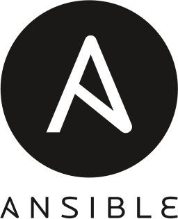
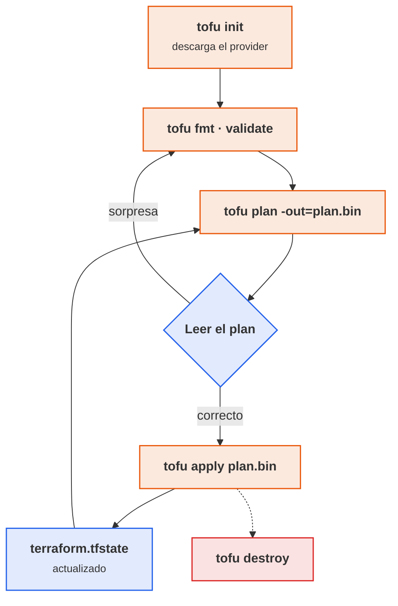
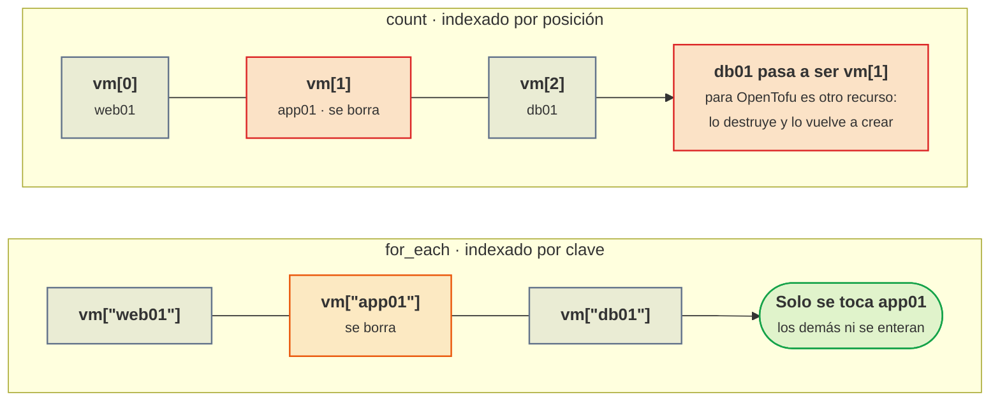
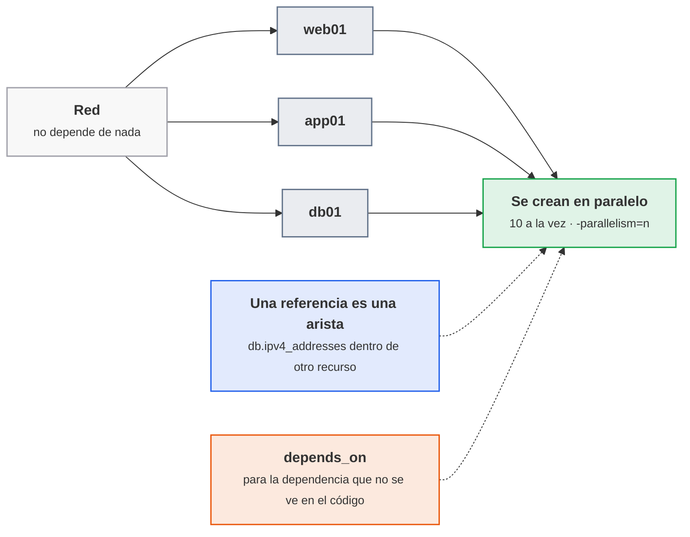
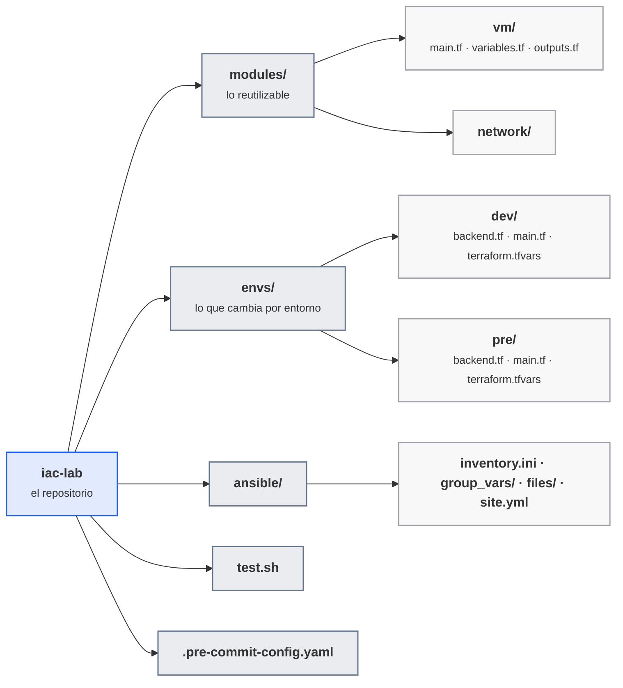
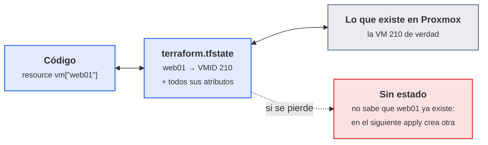
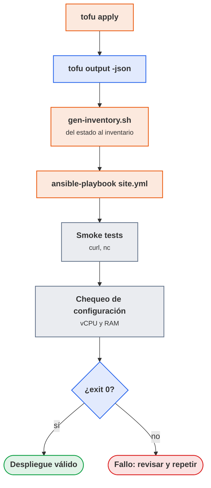

# UT5 · Infraestructura como código

<p class="ut-meta">18 h · Sesiones 21 a 29 · RA3 CE a, b, c, d</p>

En la UT2 la VPC se montó dos veces: primero a mano en la consola de Proxmox, y después con un script bash, el de la [A2.6](ut2-vpc.md#a26-script-de-creacion-sesion-12), que repetía los mismos pasos. El script fue un avance, pero tiene un defecto de fondo: describe cómo llegar, no dónde hay que estar. Para no crear las cosas dos veces tiene que preguntar antes de cada orden si ya existen, no sabe cambiar una VM que ya está creada, y si alguien toca una a mano, no se entera.

En esta unidad cambia el enfoque: se escribe en ficheros de texto el estado deseado (tres VM con estas CPU, estas IP, en estos puentes) y una herramienta calcula y aplica la diferencia. El objetivo es que cualquiera del grupo, con un `git clone` y unas pocas órdenes, levante el entorno `pre` completo con el servicio funcionando, y que un script diga si está bien. Para eso se encadenan cuatro piezas, y la unidad las construye en ese orden: OpenTofu crea las máquinas en Proxmox, Ansible las configura, un script de pruebas comprueba que el servicio responde y tres escáneres revisan que el código no deje nada expuesto. Es la primera de las tres unidades que entran en el examen de la segunda evaluación, el 24 de marzo de 2027. El entorno `pre` que nace aquí no es de un día: Mantenimiento lo actualiza en febrero y lo da de baja en marzo con el mismo repositorio, el mismo estado remoto y el mismo token, así que al terminar la práctica evaluable no se destruye ni se borra su estado.

## Sesión 21 · IaC: conceptos y primer despliegue

<p class="ut-meta" markdown>16 de diciembre · Teoría y práctica · <span class="dur" tabindex="0" aria-label="Infraestructura como código · 15 min&#10;OpenTofu: instalación y primer proyecto · 15 min&#10;A5.1 Primer despliegue · 80 min" data-dur="Infraestructura como código · 15 min&#10;OpenTofu: instalación y primer proyecto · 15 min&#10;A5.1 Primer despliegue · 80 min">:material-school:<i class="dur-barra" style="--teoria:27%"></i>:material-flask:</span></p>

El script de la A2.6 crea un entorno y lo destruye sin fallar aunque se ejecute dos veces, pero lo consigue a fuerza de comprobar a mano, orden por orden, si cada cosa existe ya, y eso no se arregla añadiéndole más comprobaciones: hace falta otra forma de describir la infraestructura. Esta sesión la presenta y la pone a funcionar sobre una VM de usar y tirar. La teoría empieza por el cambio de enfoque, que es lo que justifica todo lo demás: qué es describir la infraestructura en ficheros, en qué se diferencia una herramienta declarativa de un script y por qué la idempotencia es la propiedad que se exige a todo el código de la unidad. Sigue con OpenTofu: dónde se instala, cómo se organiza un proyecto, qué hace cada paso del ciclo `init`, `plan`, `apply`, cómo se lee un plan antes de decir que sí y cuál es el proyecto más pequeño que crea una VM. La hoja A5.1 crea en Proxmox el usuario con el que OpenTofu trabajará hasta marzo, recorre el ciclo entero sobre una VM de prueba y deja publicado el repositorio `iac-lab`, donde vivirá todo el código de la unidad.

### Infraestructura como código

**El problema.** Lo que se monta a mano no sale igual dos veces, y un script repite pasos sin saber qué hay al otro lado. Cuantas más máquinas y más entornos, más casos hay que prever en el script, y más fácil es que lo que existe y lo que el script cree que existe dejen de coincidir.

**Qué es y de dónde sale.** La infraestructura como código (IaC) es describir la infraestructura (máquinas, redes, discos, reglas de cortafuegos, registros DNS) en ficheros de texto que una herramienta aplica automáticamente. La idea creció con la nube: cuando crear un servidor pasó a ser una llamada a una API, y no una compra y una instalación, escribir esas llamadas en ficheros fue el paso natural. Los ficheros van a un repositorio Git como cualquier otro código: se revisan en un pull request (la petición de revisión de cambios de GitLab o GitHub), se versionan, se prueban y se pueden volver a aplicar en otro sitio.

**Qué aporta frente a la consola.** Cuatro cosas concretas:

- Reproducible: dev, pre y pro, los tres entornos del laboratorio, salen iguales porque nacen del mismo código con distintos valores.
- Rápido: un entorno completo (tres VM, red, configuración del servicio) tarda minutos, y el tiempo lo pone la máquina, no una persona.
- Auditable: el historial de Git dice quién cambió qué y cuándo, y el plan dice qué va a pasar antes de que pase.
- Recuperable: si se pierde el entorno (un nodo Proxmox que muere, alguien que borra la VM equivocada), se vuelve a aplicar el código.

#### Declarativo frente a imperativo

**Dos formas de escribirlo.** Un script dice qué hacer; un fichero declarativo dice cómo tiene que quedar. La diferencia se ve sobre todo en lo que pasa la segunda vez:

|  | Declarativo | Imperativo |
|----|----|----|
| Qué se escribe | El estado final deseado ("quiero 3 VM así") | Los pasos ("crea VM, luego disco, luego red") |
| Quién calcula los cambios | La herramienta, comparando lo deseado con lo que existe | Quien escribe el script, que tiene que prever todos los casos |
| Segunda ejecución | No hace nada si ya está como se pidió | Repite los pasos, con lo que eso implique |
| Ejemplos | Terraform/OpenTofu, CloudFormation, Bicep, manifiestos de Kubernetes | Scripts bash, Ansible (parcialmente) |

**Dónde cae Ansible.** Ansible está en la columna imperativa "parcialmente" porque un playbook es una lista ordenada de tareas (imperativo), pero cada tarea es declarativa: `state: present` no dice "instala", dice "que esté instalado", y el módulo comprueba antes de actuar. El resultado es que un playbook bien escrito se comporta como declarativo aunque se lea como una receta.

**La propiedad que se exige: idempotencia.** Lo que se busca en las dos columnas es la idempotencia: aplicar el código dos veces deja el mismo resultado que una. La A2.6 ya la exigía a sus scripts, y la conseguía a mano, con una comprobación delante de cada orden; una herramienta declarativa la trae de serie, porque antes de actuar compara lo pedido con lo que hay. Es lo que permite ejecutar el código sin miedo, meterlo en un pipeline que corre en cada commit y usarlo para reparar un entorno que alguien ha tocado a mano. Cuando una hoja de esta unidad pide "ejecútalo dos veces y captura la segunda", es esto lo que se comprueba.

#### Herramientas

**Dos herramientas, dos trabajos.** Crear una máquina y dejarla útil son trabajos distintos, y en el curso los hacen dos herramientas. Terraform { .logo-inline }, de HashiCorp, y su bifurcación libre OpenTofu **aprovisionan**: crean, cambian y destruyen infraestructura (VM, redes, DNS, recursos de nube) llamando a la API de cada plataforma a través de **providers** (el complemento que sabe hablar con cada una: Proxmox, AWS, Cloudflare), y se escriben en HCL, su propio lenguaje de configuración. Ansible { .logo-inline }, de Red Hat, **configura** lo que hay dentro de las máquinas (paquetes, ficheros, servicios) por SSH, sin agente, en YAML. Una crea la máquina y la otra la deja útil.

**El patrón del curso**, que es también el más habitual en empresas medianas: OpenTofu crea las VM en Proxmox con cloud-init (la configuración del primer arranque, la misma que ya usa la plantilla 9000); Ansible instala PostgreSQL y Docker y despliega el servicio; un script de pruebas comprueba que todo responde.

**Lo que se encuentra en otras empresas.** Las alternativas hacen el trabajo de OpenTofu con otro lenguaje o para un solo proveedor:

| Herramienta | En qué se diferencia de OpenTofu | Dónde se encuentra |
|---|---|---|
| Pulumi | Mismo modelo, pero el código se escribe en Python, TypeScript o Go | Equipos de desarrollo que no quieren aprender otro lenguaje; en operaciones se ve menos |
| CloudFormation (AWS) y Bicep (Azure) | Lenguajes propios de cada nube, que solo sirven en ella | Empresas que trabajan con un solo proveedor de nube |

Terraform y OpenTofu sirven en todas las nubes y también en Proxmox, que es lo que hay en el laboratorio: son la herramienta de referencia del sector y la del curso.

#### Por qué existen Terraform y OpenTofu

**Dos nombres para la misma herramienta.** Terraform nació en 2014 con licencia libre. En 2023 HashiCorp la cambió por otra que prohíbe usar el código para ofrecer un producto que compita con ella, y OpenTofu es la bifurcación que continuó desde la última versión libre, hoy alojada en la Linux Foundation. En el laboratorio del curso se usa OpenTofu por eso, y en una empresa aparecen las dos.

**Qué cambia en la práctica.** Casi nada: el lenguaje, los providers y los ficheros son los mismos. Donde un tutorial diga `terraform plan` aquí se escribe `tofu plan`, y los providers se descargan de `registry.opentofu.org` en lugar de `registry.terraform.io`. Los ficheros conservan los nombres de Terraform (`terraform.tfvars`, `terraform.tfstate`, el bloque `terraform {}`), y por eso aparecen así en todo el curso.

Cómo se llegó a la bifurcación y en qué se han separado las dos herramientas desde entonces está en [Para ampliar](../ampliacion.md#del-cambio-de-licencia-de-terraform-a-opentofu).

### OpenTofu: instalación y primer proyecto

**Dónde se instala.** OpenTofu se instala en el puesto de administración (10.10.0.50), y toda la unidad se trabaja desde ahí: es la máquina que llega a la vez a la API de Proxmox por la red del laboratorio y a las zonas de los entornos. Es también donde están la clave SSH que OpenTofu meterá en cada VM y la copia de trabajo del repositorio.

**Cómo.** El script oficial añade el repositorio APT de OpenTofu e instala el paquete, así que después se actualiza con `apt` como cualquier otro:

```bash
# OpenTofu en Debian/Ubuntu (instala el repositorio APT oficial)
curl -fsSL https://get.opentofu.org/install-opentofu.sh | sh -s -- --install-method deb
tofu version
```

En macOS `brew install opentofu`; en Windows, `winget install OpenTofu.Tofu`. Si en la empresa se usa Terraform, `terraform version` y el resto de esta unidad se lee igual.

#### Estructura de un proyecto

**Un directorio con ficheros `.tf`.** Un proyecto (en la jerga, un **módulo raíz**) es un directorio con ficheros `.tf`. OpenTofu los lee todos y los junta, así que el reparto en ficheros es para las personas; los nombres son una convención, pero es la convención que todo el mundo espera:

| Fichero | Contenido | En el curso |
|----|----|----|
| `providers.tf` | Qué providers se usan, de dónde se descargan, con qué versión y cómo se conectan | El provider `bpg/proxmox` y el token de `terraform@pve`, desde la A5.1 |
| `variables.tf` | Variables de entrada con tipo, descripción, valor por defecto y validaciones | La traducción de la tabla de requisitos del servicio, en la A5.2 |
| `main.tf` | Recursos y llamadas a módulos | Una VM de prueba en la A5.1; las tres de `pre` desde la A5.3 |
| `outputs.tf` | Valores que se exportan (IP, ID) para otros módulos, para Ansible o para leerlos por pantalla | Las IP de las que sale el inventario de Ansible en la A5.5 |
| `terraform.tfvars` | Valores de las variables para este entorno. No se sube si contiene secretos (y mejor que no los contenga) | Los valores de `pre`, sin secretos: se sube |
| `.terraform.lock.hcl` | Versiones exactas y huellas de los providers descargados. Este sí se sube | Garantiza que todo el que use el repositorio trabaja con el mismo provider |

**Lo que no se sube.** `tofu init` crea además un directorio `.terraform/` con los providers descargados, binarios de decenas de megas que se regeneran con otro `init`, y `apply` escribe el estado en `terraform.tfstate`. Ninguno de los dos va al repositorio, y tampoco un plan guardado (`plan.bin`): el estado y el plan llevan dentro valores sensibles, como explica [validation y sensitive](#validation-y-sensitive). Por eso el `.gitignore` de la A5.1 se escribe antes del primer commit.

#### El ciclo init, plan, apply

**Tres versiones de la misma infraestructura.** OpenTofu trabaja comparando tres cosas: lo que dice el código, que es lo que se quiere; lo que apuntó en el **estado** la última vez que aplicó, es decir, qué creó y con qué identificador real; y lo que existe ahora en la plataforma, que pregunta a su API. De esa comparación sale el **plan**, la lista de operaciones que dejarían la realidad como dice el código. Si alguien ha tocado una VM a mano, la diferencia aparece en el plan (a eso se le llama **deriva**), y aplicarlo la corrige. El estado se ve a fondo en la sesión 24, el 13 de enero, cuando se lleva a un almacén compartido.

**El bucle de trabajo.** Cada cambio pasa por las mismas órdenes, en este orden:



<p class="pie" markdown>El bucle es el trabajo diario. La flecha de «sorpresa» es la importante: si el plan no dice lo esperado, se vuelve al código, no se aplica.</p>

1. `tofu init`: descarga los providers al directorio `.terraform/`, escribe el fichero de bloqueo y configura el **backend**, el sitio donde se guarda el estado (un fichero local si no se dice otra cosa). Hay que repetirlo al cambiar de backend o al añadir un provider o un módulo.
2. `tofu fmt` y `tofu validate`: formato canónico y comprobación sintáctica y de tipos, sin hablar con Proxmox. Son los dos primeros pasos de cualquier pipeline de IaC.
3. `tofu plan`: lee el estado, consulta a la API qué existe de verdad (a eso se le llama *refresh*), compara con el código y muestra qué crearía, cambiaría o destruiría. Siempre se lee antes de aplicar. Con `-out=plan.bin` el plan se guarda y `apply` ejecuta exactamente eso, no un plan recalculado.
4. `tofu apply`: aplica el plan, llamando a la API de la plataforma, y apunta en el estado lo que ha creado. Sin fichero de plan lo recalcula y pide confirmación; con `-auto-approve` no la pide (solo en scripts y en CI).
5. `tofu destroy`: elimina todo lo que gestiona el estado. En las pruebas del laboratorio se usa a diario; en producción, y en el `pre` del curso, está protegido por permisos y por `prevent_destroy`.

#### Cómo leer un plan

**Por qué leerlo siempre.** El plan es el único momento en el que se puede parar una destrucción antes de que ocurra, y lo que hace el `apply` es exactamente lo que el plan anuncia. Resume cada recurso con un símbolo, y hay que saber leerlos antes de escribir `yes`:

| Símbolo | Significado | Qué hacer |
|----|----|----|
| `+` create | Recurso nuevo | Normal en el primer apply |
| `~` update in-place | Cambia atributos sin recrear (memoria, nombre) | Normal; leer qué atributo |
| `-` destroy | Se elimina | Solo si se ha pedido |
| `-/+` replace | Se destruye y se crea de nuevo | Peligro: se pierde el disco y su contenido |
| `<=` read | Un `data` (bloque de solo lectura) que se consulta en apply | Inofensivo |

**La línea que más disgustos da.** La línea `# forces replacement` junto a un atributo significa que el provider no sabe cambiar ese atributo en caliente (por ejemplo el nodo donde vive la VM o su `vm_id`) y va a resolverlo destruyendo la VM y creando otra. Para una VM web sin estado es molesto; para `db01` es perder la base de datos.

**El resumen final.** Las últimas líneas cuentan lo que va a pasar: `Plan: 1 to add, 0 to change, 1 to destroy` cuando se esperaba `0 to destroy` es motivo suficiente para parar y volver al código.

**Dos protecciones.** El bloque `lifecycle { prevent_destroy = true }` en los recursos con datos, que hace fallar el plan en lugar de destruir (lo llevan las VM de `pre` desde la A5.3), y `tofu plan -detailed-exitcode` en CI, que devuelve 2 cuando hay cambios y permite exigir revisión humana.

#### El proyecto mínimo

**Lo más pequeño que crea algo.** El proyecto más pequeño que crea algo en Proxmox tiene tres ficheros y un solo recurso con los valores escritos a mano. Es el que copia la A5.1:

```hcl
# providers.tf
terraform {
  required_providers {
    proxmox = { source = "bpg/proxmox", version = "~> 0.60" }
  }
}

provider "proxmox" {
  endpoint  = var.pve_endpoint
  api_token = var.pve_token      # llega por TF_VAR_pve_token, nunca en un fichero
  insecure  = true               # certificado autofirmado del laboratorio
}

# variables.tf
variable "pve_endpoint" {
  type = string
}
variable "pve_token" {
  type      = string
  sensitive = true
}

# main.tf
resource "proxmox_virtual_environment_vm" "prueba" {
  name      = "prueba01"
  node_name = "pve"
  vm_id     = 150                  # primera de la franja de pruebas de dev (150 a 199)

  clone { vm_id = 9000 }           # la plantilla cloud-init

  cpu    { cores = 1 }
  memory { dedicated = 1024 }
  network_device { bridge = "devfront" }
  agent { enabled = true }         # qemu-guest-agent, para leer la IP

  initialization {
    ip_config {
      ipv4 {
        address = "10.10.1.200/24"
        gateway = "10.10.1.1"
      }
    }
    user_account {
      username = "ops"
      keys     = [file("~/.ssh/id_ed25519.pub")]
    }
  }
}
```

**Qué hace cada bloque.**

- `terraform { required_providers }` dice qué provider hace falta y de dónde se descarga: `bpg/proxmox`, del registro de OpenTofu. `~> 0.60` admite cualquier versión 0.x a partir de la 0.60; la que se descarga en el primer `init` queda escrita en `.terraform.lock.hcl`, y es la que se usa hasta que alguien pida otra con `tofu init -upgrade`.
- `provider "proxmox"` dice cómo conectarse. `endpoint` es la URL de la API del nodo, la misma que la de la consola web (`https://<IP del nodo>:8006/`), y `insecure = true` acepta su certificado, que firma una CA creada por el propio Proxmox al instalarse y que el puesto no conoce; en producción se instala esa CA en el puesto en lugar de desactivar la comprobación.
- Los dos bloques `variable` son las entradas del proyecto. `pve_endpoint` toma su valor de `terraform.tfvars`, y `pve_token`, de la variable de entorno `TF_VAR_pve_token`: OpenTofu toma como valor de una variable `nombre` cualquier variable de entorno `TF_VAR_nombre`, y así el token pasa de la terminal al provider sin escribirse en ningún fichero.
- `resource "proxmox_virtual_environment_vm" "prueba"` es la VM. El tipo de recurso lo define el provider y el nombre local lo pone quien escribe el código; juntos forman su dirección, `proxmox_virtual_environment_vm.prueba`, que es como la nombran el plan y el estado. Dentro, `node_name` es el nombre del nodo en la consola (el que se le dio al instalarlo, `pve` en estos apuntes), `clone` dice de qué plantilla sale, `agent` hace que el provider espere a que el agente QEMU de la VM le diga sus direcciones, e `initialization` son los datos de cloud-init que la VM aplicará en su primer arranque, los mismos que se rellenaban a mano en la pestaña Cloud-Init al clonar la plantilla.

**Los valores escritos a mano.** El `vm_id` no es opcional en la práctica: sin él Proxmox da el primer ID libre, que cae en la franja de gestión de dev, y el [laboratorio](../laboratorio.md#convenciones) reserva de la 150 a la 199 para las pruebas. La `10.10.1.200` es del rango libre de front. La clave que mete `initialization` es la del puesto de administración, que es desde donde se entra después.

### A5.1 Primer despliegue (sesión 21)

<span class="et et-obj">Objetivo</span> Desde el puesto de administración, una VM clonada de la plantilla 9000 aparece en Proxmox creada por OpenTofu, un segundo `plan` dice `No changes` y `destroy` la elimina. Ese segundo plan es lo que importa: demuestra que OpenTofu sabe lo que ha creado y no lo repite, que es lo que el script de la A2.6 tenía que comprobar a mano. De paso nacen dos cosas que se usan hasta marzo, en esta asignatura y en Mantenimiento: el usuario `terraform@pve` con su token y el repositorio `iac-lab` en Gitea.

<span class="et et-pre">Antes de empezar</span> El puesto de administración (VM 105, 10.10.0.50, de la A2.4) encendido; entras en él desde el puesto con `ssh ops@<IP de admin01 en la red del laboratorio>`. La consola del nodo (Shell en la interfaz web, o SSH como `root`), Proxmox en `https://192.168.100.150:8006/` (o la IP de tu nodo en la red del laboratorio) y la plantilla cloud-init 9000. La Gitea de `mon01` en `http://gitea.lab:23001` con el usuario `ops`, la de la A2.6 de Mantenimiento. Se ha explicado [qué es IaC y la idempotencia](#infraestructura-como-codigo), [el ciclo init, plan, apply](#el-ciclo-init-plan-apply) y [el proyecto mínimo](#el-proyecto-minimo).

<span class="et et-pas">Pasos</span>

Vas en el orden en que cada pieza necesita a la anterior. Primero, la identidad con la que OpenTofu entrará en Proxmox, porque sin ella no puede hacer nada. Después, el proyecto, con el `.gitignore` puesto antes del primer commit para que ningún fichero con secretos llegue nunca al historial. Luego, el ciclo entero sobre una VM de usar y tirar, que es donde se ve la idempotencia. Y al final, la publicación del repositorio, que es el que usan las hojas siguientes.

1. **Dale a OpenTofu su propia identidad en Proxmox.** Crea en la consola web, en `Datacenter → Permissions`, el usuario `terraform@pve` con un token `tofu` sin separación de privilegios y tres permisos: `PVEVMAdmin` sobre `/vms`, `PVEDatastoreUser` sobre `/storage/local-lvm` y `PVESDNUser` sobre `/sdn/zones/lab`. Son los justos para clonar y configurar VM, reservar espacio para sus discos en `local-lvm` y conectarlas a las VNets de la zona, y nada más: es el criterio del usuario de prácticas de la A2.6, pero este se queda hasta marzo. En el puesto de administración, exporta el token en `TF_VAR_pve_token`, nunca en un fichero, y comprueba que la API de Proxmox responde con él.

    *Pista:* son tres paneles de `Datacenter → Permissions`: Users (realm `pve`), API Tokens (con Privilege Separation desmarcado) y Permissions → Add → User Permission, una vez por permiso con su Path y su Role. El secreto se ve una sola vez: guárdalo en el gestor de contraseñas. El valor completo es `terraform@pve!tofu=<secreto>`, y el `curl` de prueba está en [Errores frecuentes](#errores-frecuentes-en-el-laboratorio).

2. **Prepara el proyecto y cierra la puerta a los secretos.** Instala OpenTofu en el puesto y crea el repositorio `~/iac-lab` con el [proyecto mínimo](#el-proyecto-minimo) tal cual, un `terraform.tfvars` con el `pve_endpoint` de tu nodo y, antes del primer commit, un `.gitignore` que deje fuera `.terraform/`, `*.tfstate`, `*.tfstate.*` y `plan.bin`. El orden importa: lo que entra en un commit se queda en el historial aunque se borre después, y el estado y el plan guardado van a llevar datos que no pueden salir del puesto, como cuenta [Estructura de un proyecto](#estructura-de-un-proyecto).

    *Pista:* el proyecto lee `~/.ssh/id_ed25519.pub`; si el puesto no tiene ese par de claves, genéralo antes.

3. **Recorre el ciclo y demuestra que no se repite.** Con un plan guardado en `plan.bin`, crea la VM, entra por SSH en `prueba01` (ID 150), repite el `plan` y destruye la VM. El segundo plan es la prueba de la idempotencia: OpenTofu compara el código con su estado y con lo que hay en Proxmox, y no encuentra nada que hacer. Guarda la salida de los dos planes y cuenta en el primero cuántos atributos lleva la VM, aunque tú solo hayas escrito una docena: el resto lo rellena el provider.

4. **Publica `iac-lab` en Gitea.** Crea en la Gitea de `mon01` el repositorio privado `iac-lab` de `ops` y sube el primer commit. Desde hoy es la fuente de verdad del entorno `pre`, y las hojas siguientes trabajan sobre él.

    *Pista:* el remoto es `http://gitea.lab:23001/ops/iac-lab.git`, y el repositorio vacío se crea antes, desde la web o con un `POST` a `/api/v1/user/repos`.

<span class="et et-com">Comprobación</span> El segundo `plan` termina en `No changes. Your infrastructure matches the configuration.`, tras `destroy` la VM 150 no aparece en Proxmox y `git status` no muestra `.terraform/` ni ningún tfstate. Si `plan` o `apply` fallan con `401 authentication failure` o con `Permission check failed`, revisa el token y sus permisos (paso 1) en [Errores frecuentes](#errores-frecuentes-en-el-laboratorio).

<span class="et et-ent">Para practicar</span> Deja en `iac-lab` de Gitea los `.tf`, el tfvars sin el token y el `.gitignore`, y guarda la salida de los dos `plan` en `ut5/a51/` de `entregas-5166`. Desde hoy cada hoja termina con `git add`, `git commit` y `git push` de `iac-lab`, del que parte la práctica evaluable, y sus salidas van a `ut5/` de `entregas-5166`.

<span class="et et-ext">Si te sobra tiempo</span> Cambia `dedicated` a 2048 con la VM creada y mira si el plan marca `~` o `-/+`. Prueba `tofu graph | dot -Tsvg > graph.svg` si tienes graphviz instalado.

## Sesión 22 · Requisitos y variables

<p class="ut-meta" markdown>18 de diciembre · Teoría y práctica · <span class="dur" tabindex="0" aria-label="De los requisitos al código · 10 min&#10;validation y sensitive · 5 min&#10;A5.2 Requisitos y variables · 95 min" data-dur="De los requisitos al código · 10 min&#10;validation y sensitive · 5 min&#10;A5.2 Requisitos y variables · 95 min">:material-school:<i class="dur-barra" style="--teoria:14%"></i>:material-flask:</span></p>

El proyecto mínimo de la A5.1 funciona, pero con los valores escritos dentro del recurso: un 1024 aquí, un `devfront` allá, sin que conste de dónde sale ninguno y sin nada que impida escribir un 512 o una IP sin prefijo hasta que el `apply` falle o, peor, hasta que la VM nazca mal. Antes de crear las tres VM del servicio hay que poner orden en los números, y de eso va esta sesión, que no crea máquinas: primero se escribe qué necesita el servicio y de dónde sale cada dato, y después cada fila se convierte en una variable con tipo, descripción y validación, de modo que un `terraform.tfvars` mal escrito falle en `plan`, en segundos y con un mensaje propio. La sintaxis de `validation` y `sensitive` se ve hoy, antes que el resto del lenguaje, porque la hoja A5.2 la necesita.

**El almacén S3, de paso.** La hoja empieza montando MinIO en `mon01`: un servidor libre de almacenamiento de objetos que habla S3, el protocolo del servicio de almacenamiento de Amazon, que se ha convertido en el estándar para guardar ficheros por HTTP. Guarda los ficheros (objetos) en contenedores con nombre, los **buckets**, y da a cada programa su propia credencial. Hoy no se usa. Desde el 13 de enero guarda el estado de OpenTofu (bucket `tfstate`, credencial `tofu`), y desde el 11 de febrero, las copias de seguridad de Mantenimiento (bucket `backups`, credencial `restic`). Se monta ahora porque esas dos sesiones van justas de tiempo. La receta completa está en el [laboratorio](../laboratorio.md#como-se-monta-minio), y por qué el estado se guarda en un almacén así, en [Backend remoto: s3 contra MinIO](#backend-remoto-s3-contra-minio).

### De los requisitos al código

**Por qué empezar por los requisitos.** Las variables describen lo que el servicio necesita, y ese dato existe antes que el código: antes de escribir una línea de HCL hay que saber qué pide el servicio y de dónde sale cada número. Para la aplicación del curso (web + API + PostgreSQL):

| Recurso | Requisito | Origen del dato |
|----|----|----|
| Cómputo | 2 vCPU la app, 1 vCPU el proxy, 2 vCPU la BD | Pruebas de carga previas / recomendación del fabricante |
| Memoria | 2 GB app, 1 GB proxy, 2 GB BD | Idem |
| Almacenamiento | 20 GB SO + 50 GB datos en disco aparte para la BD | Volumen de datos esperado × 3 |
| Red | Subredes front/back/data de la VPC; puertos 443, 28080, 5432 | Diseño de la VPC y del cortafuegos |
| Disponibilidad | Dos instancias de app tras el proxy | Acuerdo de servicio |
| Backup | Snapshot diario de la BD | Política de la empresa |

**Para qué sirve la columna del origen.** Cuando dentro de seis meses alguien pregunte por qué la BD tiene 2 GB de memoria, la respuesta tiene que estar en el README, y tiene que decir de dónde salió: de una prueba de carga, de la recomendación del fabricante o de una política de la empresa. Un número sin origen no se puede defender, y tampoco cambiar con criterio. La A5.2 copia esta tabla al README de `iac-lab`, que es el primer punto de la práctica evaluable.

**Cada fila, una variable.** Cada fila acaba siendo una variable en el código, con tipo, descripción y una validación que impida valores absurdos. Un `memory = 512` para PostgreSQL debería fallar en `tofu plan`, no a las tres de la mañana en producción. Cómo se escribe esa validación es el apartado siguiente.

**Lo que el laboratorio no cumple, por escrito.** El laboratorio no cumple la tabla entera, y el README lo dice en vez de esconderlo: en `pre` cada VM lleva 1 GB y un solo disco de 20 GB, porque es lo que el nodo da a ese entorno; hay una sola instancia de app, y las copias de la BD las hace la asignatura de Mantenimiento. Esas filas se dejan como requisito documentado, con la diferencia y su motivo al lado.

### validation y sensitive

**El problema.** Un tipo dice qué forma tiene un valor (un número, un texto, un mapa de objetos), pero no si tiene sentido: `memory = 512` es un número perfectamente válido. Las validaciones añaden esa segunda comprobación, con un mensaje escrito para quien se equivoque. Esta es la variable `vms` de la A5.2, con dos validaciones, y la del token:

```hcl
variable "vms" {
  type = map(object({
    vmid   = number
    cores  = number
    memory = number
    disk   = number
    bridge = string
    ip     = string
  }))
  description = "VM a crear, con sus requisitos"

  validation {
    condition     = alltrue([for v in values(var.vms) : v.memory >= 1024])
    error_message = "Ninguna VM puede tener menos de 1024 MB."
  }
  validation {
    condition     = alltrue([for v in values(var.vms) : can(cidrhost(v.ip, 0))])
    error_message = "ip debe ser una dirección con prefijo, por ejemplo 10.10.1.10/24."
  }
}

variable "pve_token" {
  type      = string
  sensitive = true
}
```

**Cómo se lee.** `vms` es un mapa de objetos: una entrada por VM, con su nombre como clave y seis campos. Cada bloque `validation` lleva una `condition`, una expresión que tiene que dar `true`, y el `error_message` que se enseña cuando da `false`. La primera recorre las VM con una expresión `for` y exige que todas (`alltrue`) tengan al menos 1024 MB. La segunda usa un truco habitual: `cidrhost()` falla si la IP no lleva prefijo, y `can()` convierte ese fallo en `false`. Para comprobar que un valor está en una lista, como pide la tercera validación de la A5.2 si se hace sobre `bridge`, está `contains(lista, valor)`. El tipo `map(object(...))` se explica con el resto de tipos del lenguaje en la sesión 23, el 8 de enero.

**Cuándo se comprueban.** Las validaciones se evalúan en `plan`, antes de pedir nada a Proxmox, así que un tfvars mal escrito falla en segundos y con un mensaje propio, en lugar de con un error genérico del provider a mitad de un `apply`.

**Qué hace `sensitive` y qué no.** `sensitive = true` hace que el valor aparezca como `(sensitive value)` en el plan y en los outputs. No lo cifra: si el valor acaba en un atributo de un recurso o en un output, se guarda en claro en el estado, y un plan guardado con `-out` lleva sin cifrar los valores de todas las variables. Es una protección contra terminales y logs de CI, no contra quien pueda leer el tfstate o el `plan.bin`; por eso los dos están en el `.gitignore` desde la A5.1.

### A5.2 Requisitos y variables (sesión 22)

<span class="et et-obj">Objetivo</span> Un `variables.tf` con tipos, descripciones y validaciones que rechaza con tu propio mensaje un tfvars mal escrito, y MinIO en marcha en la `10.10.0.30` con sus dos buckets, listo para la A5.4. Al terminar, las tres VM de `pre` están descritas con valores que tienen origen y que no pueden salir absurdos, listas para que la A5.3 las cree, y el estado ya tiene dónde vivir.

<span class="et et-pre">Antes de empezar</span> El proyecto `iac-lab` de A5.1 en el puesto de administración (sin VM creadas), con `TF_VAR_pve_token` exportado como en el paso 1 de la A5.1: sin él, `tofu plan` se para a pedirlo. Para el paso 1, SSH a `mon01` (10.10.0.20) como `ops`, saltando desde el puesto de administración: entra en él con `ssh -A`, que le presta la clave del puesto sin copiarla. Si el profesor monta MinIO para toda el aula, el paso 1 se reduce a lo que dice la receta para ese caso. Se ha explicado [cómo pasar de los requisitos a variables](#de-los-requisitos-al-codigo); la sintaxis está en [validation y sensitive](#validation-y-sensitive).

<span class="et et-pas">Pasos</span>

Empiezas por MinIO porque no depende de nada de lo demás, se hace en otra máquina y tiene esperas (la descarga de la imagen), y conviene dejarlo comprobado hoy. Después vas de lo general a lo concreto: primero qué necesita el servicio y de dónde sale cada número, luego las variables que lo traducen, después los valores de `pre` y al final la prueba de que las validaciones rechazan lo que deben.

1. **Preparación: el almacén S3 del laboratorio.** Monta MinIO en `mon01`, como un servicio más de su pila, con la receta de [Cómo se monta MinIO](../laboratorio.md#como-se-monta-minio): segunda dirección `10.10.0.30`, servicio `minio`, buckets `tfstate` y `backups` y credenciales `tofu` y `restic`. Hoy no se usa: guardará el estado remoto desde la [A5.4](#a54-modulos-y-estado-sesion-24) y, desde el 11 de febrero, las copias de Mantenimiento, cada uso con su propia credencial para poder revocar una sin tocar la otra. Comprueba desde el puesto de administración que responde, porque es desde ahí desde donde lo usará OpenTofu.

    *Pista:* la receta se copia tal cual; lo único tuyo son las tres contraseñas, y las de `tofu` y `restic` van al gestor de contraseñas antes de seguir.

2. **Escribe qué necesita el servicio y de dónde sale.** Copia la tabla de requisitos del apartado "De los requisitos al código" a un `README.md` en la raíz de `iac-lab` y rellénala para el servicio del curso (web + API + PostgreSQL). Cada fila lleva su origen del dato; si no lo sabes, escribe de dónde lo sacarías. Debajo, en dos o tres líneas, las diferencias del laboratorio con su motivo, como las cuenta el apartado. De esta tabla salen las variables del paso siguiente, y es el primer punto de la práctica evaluable.

3. **Traduce las filas a variables que se defiendan solas.** Escribe un `variables.tf` con `vms` y `pve_token`, de [validation y sensitive](#validation-y-sensitive), y `pve_endpoint`, de la A5.1, las tres con `description`. Cada fila de cómputo, memoria, almacenamiento y red de tu tabla tiene su campo en `vms`, y el bloque lleva una tercera validación tuya, sobre el disco o sobre `bridge`, con su propio `error_message`. La descripción es lo que lee quien use el proyecto sin haber estado en clase; el mensaje de error, lo que lee quien se equivoque.

    *Pista:* para `bridge`, `contains()` contra la lista de las seis VNets de dev y pre.

4. **Da los valores de pre.** Escribe `terraform.tfvars` con las tres VM del servicio en el entorno `pre`: ID 210, 220 y 230, puentes `prefront`, `preback` y `predata`, IP `10.20.1.10/24`, `10.20.2.10/24` y `10.20.3.10/24`, 1024 MB y 20 GB cada una, y las vCPU de tu tabla. Son los de la [ficha de pre](../laboratorio.md#el-entorno-pre) del laboratorio, y los usan después las dos asignaturas. Sin recursos aún, `main.tf` queda vacío: borra el recurso `prueba` de la A5.1.

5. **Comprueba que las validaciones rechazan lo que deben.** Pasa `fmt`, `validate` y `plan`, y guarda la salida. Prueba después la validación con un `malo.tfvars`, copia del tuyo con `memory = 512` en `db01`, y guarda también la salida de ese plan: tiene que fallar con tu mensaje, no con un error del provider, y es la evidencia de que la validación funciona.

    *Pista:* otro fichero de valores se le pasa al plan con `-var-file=`.

<span class="et et-com">Comprobación</span> `tofu validate` sale con `Success!`, el `plan` correcto no da errores y el `plan` con `malo.tfvars` falla en segundos mostrando tu `error_message`, no un error genérico del provider. El `$M ls lab` del paso 1 lista `tfstate` y `backups`, y el `curl` de salud responde `200`.

<span class="et et-ent">Para practicar</span> Deja en `iac-lab` el `README.md` con la tabla, `variables.tf` y `terraform.tfvars`, y en `ut5/a52/` de `entregas-5166`, `malo.tfvars`, las dos salidas de `plan` y la del `$M ls lab` del paso 1.

<span class="et et-ext">Si te sobra tiempo</span> Abre `tofu console` y prueba `cidrhost(var.vms["db01"].ip, 1)` y `{ for k, v in var.vms : k => v.memory }` contra tus variables.

## Sesión 23 · VM con OpenTofu

<p class="ut-meta" markdown>8 de enero · Teoría y práctica · <span class="dur" tabindex="0" aria-label="El lenguaje HCL · 10 min&#10;Provider Proxmox y una VM completa · 10 min&#10;A5.3 VM completas · 90 min" data-dur="El lenguaje HCL · 10 min&#10;Provider Proxmox y una VM completa · 10 min&#10;A5.3 VM completas · 90 min">:material-school:<i class="dur-barra" style="--teoria:18%"></i>:material-flask:</span></p>

La A5.2 dejó descritas las tres VM de `pre` en variables, pero el único recurso que se sabe escribir es el de la A5.1: una VM con sus valores dentro. Copiarlo tres veces funcionaría hasta el primer cambio, y además las VM nacerían en una red a la que el puesto de administración no llega, porque `pre` está aislado de gestión desde la A2.5. Esta sesión resuelve las dos cosas. La teoría empieza por el lenguaje HCL: los tipos, las expresiones y `for_each`, que convierte un mapa de VM en tantos recursos como entradas tenga; sigue con el recurso completo del provider `bpg/proxmox`, que es el de la A5.1 con los valores sacados de las variables, y termina con el camino mínimo de gestión a `pre`. La hoja A5.3 abre primero ese camino, para que las VM sean accesibles en cuanto nazcan, y después las crea, comprueba que están protegidas y lee el plan de un cambio de memoria que no recrea nada. Para leer el plan del paso 4 de la A5.3 sirve la tabla de símbolos de [Cómo leer un plan](#como-leer-un-plan).

### El lenguaje HCL

**Para qué hace falta un lenguaje.** Con tres VM y dos entornos, copiar el bloque de la A5.1 multiplica los sitios donde equivocarse. HCL (HashiCorp Configuration Language), el lenguaje que HashiCorp creó para sus herramientas, es declarativo pero tiene lo justo para no repetirse: tipos, variables, expresiones, bucles y funciones. No hace falta memorizarlo entero: con los tipos de bloque, los tipos de dato, `for_each` y media docena de funciones se escribe casi todo un proyecto.

**Bloques y atributos.** Un fichero `.tf` es una serie de bloques `tipo "etiqueta" "etiqueta" { atributo = expresión }`. Los tipos de bloque de uso habitual, con lo que hace cada uno:

```hcl
terraform {                      # ajustes del propio proyecto: versiones y backend
  required_version = ">= 1.9"
  required_providers {
    proxmox = { source = "bpg/proxmox", version = "~> 0.60" }
  }
}

provider "proxmox" { ... }       # cómo conectar con la API

variable "memory" {              # entrada
  type        = number
  description = "RAM en MB"
  default     = 2048
}

locals {                         # valores calculados, para no repetir
  gateway = cidrhost(var.cidr, 1)
}

data "proxmox_virtual_environment_nodes" "all" {}   # lectura, no crea nada

resource "proxmox_virtual_environment_vm" "web" { ... }   # lo que se crea

module "vm" { source = "./modules/vm" ... }   # llamada a un módulo

output "ip" { value = local.ip }  # salida
```

#### Tipos y expresiones

**Por qué tipar.** Un tipo dice qué forma tiene un valor, y OpenTofu lo comprueba antes de hacer nada: si `vms` espera un número en `memory` y el tfvars trae `"1024 MB"`, el plan se para ahí. Los tipos primitivos son `string`, `number` y `bool`. Los compuestos: `list(T)`, `set(T)`, `map(T)` (claves string) y `object({ campo = T, ... })`, que se pueden anidar. Un `map(object({...}))` es el tipo más frecuente: un diccionario de máquinas con sus atributos, como la variable `vms` de la A5.2.

**Expresiones.** Las expresiones admiten referencias (`var.x`, `local.y`, `resource_type.name.attr`, `module.m.output`), operadores, condicionales `cond ? a : b`, interpolación en cadenas `"${var.env}-web"`, y bucles `for`, que recorren una lista o un mapa y construyen otro. La segunda línea es la que usa el output `ips` de la A5.3:

```hcl
[for k, v in var.vms : k if v.bridge == "prefront"]     # lista de nombres del front
{ for k, v in var.vms : k => v.ip }                      # mapa nombre => IP
```

#### count frente a for_each

**El problema.** Con el mapa `vms` hecho, falta que un solo bloque `resource` cree una VM por entrada. HCL tiene dos formas de crear varios recursos con un bloque, y no son intercambiables.

**`count`, por posición.** `count = 3` crea `vm[0]`, `vm[1]`, `vm[2]` indexadas por posición; si se borra la del medio, la tercera pasa a ser `vm[1]` y OpenTofu la destruye y la recrea porque para él es otra.

**`for_each`, por clave.** `for_each = var.vms` crea `vm["web01"]`, `vm["app01"]`, indexadas por clave: borrar `app01` del mapa solo toca `app01`. Dentro del bloque se accede con `each.key` (el nombre, `web01`) y `each.value` (el objeto con sus campos, `each.value.memory`).

**El criterio.** `count` para "n copias idénticas" o para activar o desactivar un recurso (`count = var.enabled ? 1 : 0`); `for_each` para todo lo demás, y por eso es el del curso.



<p class="pie" markdown>`count` solo para «n copias idénticas» o para activar y desactivar un recurso. Para todo lo demás, `for_each`.</p>


#### locals y funciones útiles

**Calcular una vez.** `locals` guarda valores calculados una vez y usados varias, para no repetir la misma expresión en cinco sitios.

**Las funciones.** HCL trae de serie funciones para redes, cadenas, ficheros y colecciones. Estas salen en casi todos los proyectos:

| Función | Ejemplo | Resultado |
|----|----|----|
| `cidrhost(prefix, n)` | `cidrhost("10.10.1.0/24", 1)` | `10.10.1.1` (la puerta de enlace) |
| `cidrsubnet(prefix, bits, n)` | `cidrsubnet("10.10.0.0/16", 8, 2)` | `10.10.2.0/24` (subred n de la VPC) |
| `cidrnetmask(prefix)` | `cidrnetmask("10.10.1.0/24")` | `255.255.255.0` |
| `contains(list, value)` | `contains(["prefront", "preback"], "preback")` | `true` |
| `lookup(map, key, default)` | `lookup(var.sizes, "db", 2048)` | valor o 2048 si no existe |
| `file(path)` | `file("~/.ssh/id_ed25519.pub")` | contenido del fichero |
| `templatefile(path, vars)` | `templatefile("ci.tftpl", { user = "ops" })` | fichero renderizado (cloud-init) |
| `format`, `join`, `split` | `format("%s-%02d", "web", 3)` | `web-03` |
| `merge(a, b)` | `merge(local.defaults, each.value)` | objeto con valores por defecto sobreescritos |
| `try(expr, default)` | `try(each.value.disk, 20)` | 20 si el campo no existe |

De la tabla, el curso usa tres: `cidrhost`, que da la puerta de enlace de cada VM (la `.1` de su subred) y sirve para validar que una IP lleva prefijo; `file`, que lee la clave pública que cloud-init mete en cada VM, y `contains`, en la tercera validación de la A5.2 si se hace sobre `bridge`. `tofu console` abre una consola donde probar cualquiera de estas expresiones contra las variables del proyecto antes de meterlas en el código.

#### El grafo de dependencias

**Quién va primero.** OpenTofu no ejecuta los bloques en el orden del fichero. Construye un grafo dirigido: cada referencia (`proxmox_virtual_environment_vm.db.ipv4_addresses` dentro de otro recurso) es una arista, y los recursos sin dependencias entre sí se crean en paralelo (10 a la vez por defecto, `-parallelism=n`). Por eso las tres VM del laboratorio se crean a la vez y por eso el orden de destrucción es el inverso.

**Cuando la dependencia no se ve.** Si un recurso necesita que otro exista aunque no use ninguno de sus atributos, el grafo no lo sabe, y hay que declararlo con `depends_on = [recurso]`. `tofu graph | dot -Tsvg > graph.svg` dibuja el grafo.



<p class="pie" markdown>OpenTofu ordena por las referencias, no por el fichero: lo que no depende de nada se crea en paralelo, y al destruir recorre el grafo al revés.</p>


### Provider Proxmox y una VM completa

**De una VM a tres.** Con el lenguaje visto, toca crear máquinas de verdad: un proyecto completo que clona tres veces la plantilla cloud-init 9000 en el entorno `pre`, base de las actividades A5.3 y A5.4. El recurso es el de la A5.1 con tres cambios: los valores salen de la variable `vms` a través de `for_each`, un bloque `disk` fija el tamaño del disco y un bloque `lifecycle` impide destruir las VM.

**Qué hace el provider por debajo.** Hay dos providers para Proxmox con uso real: `Telmate/proxmox`, el histórico, y `bpg/proxmox`, más completo y mantenido, que es el que se usa aquí. Por debajo, el provider hace por la API lo mismo que se hacía a mano en la consola web: clona la plantilla, le pone CPU, memoria, disco y red, y le rellena los datos de cloud-init que la VM aplicará en su primer arranque. Con `agent` activado, además, espera a que el agente QEMU de la VM le diga sus direcciones antes de dar la VM por creada.

**El ejemplo del curso, completo.** Conviene fijarse en cuatro cosas: el token entra por variable y no por fichero, `for_each` sobre el mapa `vms` hace que un solo bloque `resource` cree las tres VM, el bloque `initialization` es lo que cloud-init aplica en el primer arranque (IP, puerta de enlace, usuario y clave SSH), y `lifecycle` impide que un plan destruya las VM:

```hcl
# providers.tf
terraform {
  required_providers {
    proxmox = { source = "bpg/proxmox", version = "~> 0.60" }
  }
}

provider "proxmox" {
  endpoint  = var.pve_endpoint
  api_token = var.pve_token      # usuario!token=uuid, nunca en el código
  insecure  = true               # certificado autofirmado del laboratorio
}

# variables.tf
variable "pve_endpoint" {
  type = string
}
variable "pve_token" {
  type      = string
  sensitive = true
}
variable "vms" {
  type = map(object({ vmid = number, cores = number, memory = number, disk = number, bridge = string, ip = string }))
}

# main.tf
resource "proxmox_virtual_environment_vm" "vm" {
  for_each  = var.vms
  name      = each.key
  node_name = "pve"
  vm_id     = each.value.vmid              # 210, 220, 230: la convención de IDs del laboratorio

  clone { vm_id = 9000 }                     # la plantilla cloud-init

  cpu    { cores = each.value.cores }
  memory { dedicated = each.value.memory }

  disk {
    datastore_id = "local-lvm"
    interface    = "scsi0"
    size         = each.value.disk
  }

  network_device { bridge = each.value.bridge }

  agent { enabled = true }                   # qemu-guest-agent, para leer la IP

  initialization {
    ip_config {
      ipv4 {
        address = each.value.ip
        gateway = cidrhost(each.value.ip, 1)
      }
    }
    user_account {
      username = "ops"
      keys     = [file("~/.ssh/id_ed25519.pub")]
    }
  }

  lifecycle {
    prevent_destroy = true                   # pre no se destruye sin aprobación
  }
}

# outputs.tf
output "ips" { value = { for k, v in var.vms : k => v.ip } }
```

```hcl
# terraform.tfvars (pre)
pve_endpoint = "https://192.168.100.150:8006/"
vms = {
  web01 = { vmid = 210, cores = 1, memory = 1024, disk = 20, bridge = "prefront", ip = "10.20.1.10/24" }
  app01 = { vmid = 220, cores = 2, memory = 1024, disk = 20, bridge = "preback",  ip = "10.20.2.10/24" }
  db01  = { vmid = 230, cores = 2, memory = 1024, disk = 20, bridge = "predata",  ip = "10.20.3.10/24" }
}
```

**El token.** Va en la variable de entorno `TF_VAR_pve_token`, como en la A5.1, y no en ningún fichero. Es el token `tofu` de `terraform@pve` que se crea en la A5.1, con tres permisos: `PVEVMAdmin` sobre `/vms`, `PVEDatastoreUser` sobre `/storage/local-lvm` y `PVESDNUser` sobre `/sdn/zones/lab`, que es el que deja conectar una VM a una VNet. El token se crea sin separación de privilegios (`--privsep 0`) para que herede los permisos del usuario.

**Los valores.** Los del tfvars son los que caben en el nodo, no los de la tabla de requisitos: 1 GB y 20 GB por VM, con la diferencia escrita en el README. Los puentes son las VNets de `pre` en el SDN (`prefront`, `preback`, `predata`; el porqué de esos nombres, en [Una VNet por zona, una subred por VNet](ut2-vpc.md#una-vnet-por-zona-una-subred-por-vnet)). El ejemplo despliega `pre` porque las VM de `dev` ya existen, creadas a mano, y aplicar el código contra ellas chocaría.

**La protección.** `prevent_destroy` hace fallar cualquier plan que quiera destruir una de estas VM, por error o a propósito. Lo que se quiere proteger de verdad es `db01`, que guarda la base de datos, pero el bloque `lifecycle` es del recurso entero y no admite variables, así que con `for_each` protege las tres, que es lo que conviene en `pre`. Mantenimiento depende de él hasta que lo da de baja, el 11 de marzo, y para hacerlo quita el bloque en una rama del repositorio, que queda como evidencia de la aprobación.

!!! ojo "La sintaxis exacta del provider cambia entre versiones"
    Los nombres de bloques y atributos de `bpg/proxmox` (por ejemplo `initialization`, `ip_config`, `user_account`) han cambiado varias veces entre versiones 0.x, y seguirán haciéndolo. El ejemplo de arriba se escribió para la serie 0.6x, pero `version = "~> 0.60"` admite cualquier 0.x a partir de la 0.60: la versión que se usa de verdad es la que `tofu init` dejó escrita en `.terraform.lock.hcl`. Antes de copiar nada conviene abrir la página del recurso en https://registry.opentofu.org/providers/bpg/proxmox/latest/docs para esa versión, y no subirla (`tofu init -upgrade`) sin leer el changelog.

#### Cómo llega el puesto de administración a pre

**El problema: pre está aislado a propósito.** Desde la A2.5, nada de `dev` alcanza `pre`: `router-pre` tiene un blackhole para `10.10.0.0/16` y ningún router conoce la red del otro entorno. OpenTofu no lo nota, porque habla con la API de Proxmox por la red del laboratorio y no con las VM. Pero entrar por SSH en ellas, y después configurarlas con Ansible, exige llegar desde el puesto de administración. Es lo que se dejó previsto al aislar los entornos: cuando haga falta unir dos, se añade la ruta concreta, en un solo sentido y filtrada.

**El camino mínimo, en tres piezas.** Se abre solo lo imprescindible, y en un solo sentido:

- `router-pre` recibe una sexta tarjeta, en `devmgmt`, con la `10.10.0.2`, una dirección del rango `.2` a `.9` que el laboratorio reserva para servicios de red. Dentro de la VM es `ens23`. Como `10.10.0.0/24` queda conectada a esa tarjeta, es una ruta más específica que el blackhole de `10.10.0.0/16` y gana (un router elige siempre la ruta de prefijo más largo): `router-pre` ya puede contestar a gestión.
- En `router-pre`, tres reglas nftables en la cadena `forward`: lo establecido y relacionado pasa, lo que entra por `ens23` pasa, y nada nuevo sale de `pre` hacia `ens23`. `pre` responde a gestión, pero no puede iniciar nada contra ella.
- En el puesto de administración, una ruta a `10.20.0.0/16` por la `10.10.0.2`, en la misma unidad `ruta-lab.service` de la A2.4.

**Las tres reglas.** Van en la tabla `inet fw`, la de los hosts del curso, en una cadena enganchada a `forward`, que es la que ve el tráfico que el router pasa de una red a otra:

```text
table inet fw {
    chain forward {
        type filter hook forward priority filter; policy accept;
        ct state established,related accept
        iifname "ens23" accept
        oifname "ens23" drop
    }
}
```

La primera regla deja pasar las respuestas de cualquier conexión ya aceptada, la segunda todo lo que llega desde gestión, y la tercera tira cualquier conexión nueva que `pre` intente abrir hacia gestión. La política `accept` mantiene lo que ya funcionaba: la salida de `pre` a Internet por el NAT y el tráfico entre sus zonas. Para que sobrevivan a un reinicio se guardan en `/etc/nftables.conf` junto a la tabla de NAT de la A2.5, porque es el fichero que carga `nftables.service` al arrancar.

!!! otra "Repaso"
    nftables se explica a fondo en la [sesión 17 de Mantenimiento](https://victor-educ.github.io/apuntes-5169/ut/ut3-seguridad-monitorizacion/#nftables-por-host-el-fichero-completo) (1 de diciembre), y en `router-pre` ya hace el NAT de salida desde la A2.5. Aquí solo se añade la tabla `inet fw`, la de los hosts del curso, con una cadena `forward` de tres reglas.

**Qué entra en pre y cómo.** Lo que llega a `pre` se empuja siempre desde gestión: ficheros con Ansible e imágenes con `docker save` por SSH, porque `pre` no puede abrir conexiones hacia gestión. `pre` sale a Internet por el NAT de `router-pre`, como desde la A2.5. En las hojas, las máquinas de `pre` se escriben con su IP (`10.20.x.10`): los nombres `<host>.pre.lab` solo los resuelve `router-pre`.

### A5.3 VM completas (sesión 23)

<span class="et et-obj">Objetivo</span> El puesto de administración llega a `pre`, y `web01`, `app01` y `db01` corren en ese entorno, accesibles por SSH desde el puesto y protegidas con `prevent_destroy`, con un cambio de memoria que el plan resuelve con `~` sobre un solo recurso. Es el entorno `pre` que usan las dos asignaturas hasta marzo, y distinguir en un plan lo que cambia en caliente de lo que se recrea es lo que evita perder `db01` el día que alguien toque el atributo equivocado.

<span class="et et-pre">Antes de empezar</span> `iac-lab` con el `variables.tf` y el tfvars de A5.2 y `TF_VAR_pve_token` exportado en el puesto de administración. `pre` como quedó en la A2.5: las VNets `prefront`, `preback` y `predata`, con su subred **sin puerta de enlace y sin rango DHCP**, y `router-pre` (ID 200) encendido como `.1`, DHCP y DNS del entorno, accesible por su IP en la red del laboratorio. La `web01` de pre (ID 210) de la A2.5 ya no existe: en el árbol de recursos no hay ninguna VM entre la 210 y la 239. Se despliega `pre` porque las VM de `dev` ya existen, creadas a mano, y las tres nuevas caben en el [presupuesto de memoria](../laboratorio.md#presupuesto-de-memoria) sin apagar nada de `dev`. Se ha explicado [el recurso VM del provider](#provider-proxmox-y-una-vm-completa), [cómo llega el puesto de administración a pre](#como-llega-el-puesto-de-administracion-a-pre), [for_each](#count-frente-a-for_each) y [cómo leer un plan](#como-leer-un-plan).

<span class="et et-pas">Pasos</span>

Primero abres el camino de gestión a `pre`: OpenTofu no lo necesita para crear las VM, porque habla con la API de Proxmox, pero tú sí para entrar en ellas en cuanto nazcan. Después las creas, compruebas que la protección funciona antes de que nadie dependa de ella, y terminas leyendo el plan de un cambio pequeño, que es lo que más vas a hacer en el resto de la unidad.

1. **El camino de gestión a pre.** Abre el paso del puesto de administración a `pre` con los tres cambios de [Cómo llega el puesto de administración a pre](#como-llega-el-puesto-de-administracion-a-pre), de forma que sobrevivan a un reinicio: la tarjeta de `router-pre` en `devmgmt`, sus tres reglas de `forward` y la ruta del puesto. Que sobrevivan importa porque `router-pre` y el puesto se reinician durante el curso, y Mantenimiento entra en `pre` por este mismo camino en febrero. Guarda el `ip r` de `router-pre`, donde se ve por qué gana la ruta de gestión al blackhole, y comprueba que `10.20.1.1` responde desde el puesto.

    *Pista:* la tarjeta se añade en Hardware → Add → Network Device de la VM 200, y su IP, en la pestaña Cloud-Init (IP Config de net5); cloud-init no la configura hasta que reinicias la VM. Al guardar las reglas en `/etc/nftables.conf`, conserva la tabla de NAT de la A2.5; la ruta es una segunda línea `ExecStart=` en `ruta-lab.service`.

2. **Crea las tres VM desde un plan guardado.** Escribe `main.tf` y `outputs.tf` con el ejemplo de [Provider Proxmox y una VM completa](#provider-proxmox-y-una-vm-completa) y despliega las tres VM a partir de un plan guardado, que tiene que resumirse en `Plan: 3 to add, 0 to change, 0 to destroy`: aplicar el fichero del plan garantiza que se crea exactamente lo que has leído. Comprueba sus direcciones con `tofu output ips` y entra por SSH en las tres desde el puesto de administración; si entras, cloud-init ha hecho su trabajo y el camino del paso 1 funciona.

3. **Comprueba que pre está protegido.** `tofu plan -destroy` tiene que fallar sin tocar nada. Guarda la salida. Es la prueba de que el `prevent_destroy` está donde debe antes de que otra asignatura empiece a depender de `pre`.

4. **Lee el plan de un cambio pequeño.** Sube la memoria de `app01` a 1536 en `terraform.tfvars` y guarda la salida completa del plan, sin aplicar: el nodo no tiene RAM para ello. Léelo con la tabla de [Cómo leer un plan](#como-leer-un-plan): qué símbolo lleva, cuántos recursos toca y si alguno se recrea. Devuelve la memoria a 1024 y comprueba que el plan no deja nada pendiente.

<span class="et et-com">Comprobación</span> `ping -c1 10.20.1.1` responde desde el puesto de administración. El `plan -destroy` del paso 3 falla con `Instance cannot be destroyed`. El plan del paso 4 lleva exactamente un recurso con `~ update in-place`, `Plan: 0 to add, 1 to change, 0 to destroy`, y ninguna línea `# forces replacement`; con la memoria devuelta a 1024, `tofu plan` dice `No changes`.

<span class="et et-ent">Para practicar</span> Deja `main.tf` y `outputs.tf` en `iac-lab` y, en `ut5/a53/` de `entregas-5166`, el `ip r` de `router-pre` y las salidas de los pasos 3 y 4. No destruyas las VM: la A5.4 sigue sobre ellas.

<span class="et et-ext">Si te sobra tiempo</span> Cambia `node_name` o `datastore_id` solo en el plan (sin aplicar), localiza la línea `# forces replacement` y fíjate en que `prevent_destroy` para el plan antes de destruir nada.

## Sesión 24 · Módulos y estado

<p class="ut-meta" markdown>13 de enero · Teoría y práctica · <span class="dur" tabindex="0" aria-label="Módulos, entornos y estructura del repositorio · 5 min&#10;El estado a fondo · 15 min&#10;A5.4 Módulos y estado · 90 min" data-dur="Módulos, entornos y estructura del repositorio · 5 min&#10;El estado a fondo · 15 min&#10;A5.4 Módulos y estado · 90 min">:material-school:<i class="dur-barra" style="--teoria:18%"></i>:material-flask:</span></p>

Con las tres VM de `pre` vivas, el proyecto funciona, pero tiene dos debilidades que se notarán en cuanto lo use alguien más. La primera es el código: está en la raíz del repositorio y sirve para un solo entorno, así que describir `dev` sería copiarlo entero. La segunda es el estado: es un fichero en el disco del puesto de administración, y si se pierde OpenTofu olvida qué VM son suyas, si dos personas aplican a la vez se pisan, y nadie más puede usarlo. En esta sesión el repositorio adopta la forma que tendrá hasta marzo: un módulo `vm`, un directorio por entorno (`envs/dev`, `envs/pre`) y el estado en MinIO con bloqueo. La teoría empieza por los módulos y la estructura por entornos, y sigue con el estado: qué contiene, cómo se guarda en un backend remoto y cómo se mueve un recurso al módulo con `moved` o `state mv` sin que el plan quiera destruirlo. La hoja A5.4 recorre exactamente ese camino, sin recrear ninguna VM, sobre el MinIO que quedó montado en la A5.2. Ese estado compartido es el que usa Mantenimiento el 11 de marzo para dar de baja `pre`.

### Módulos, entornos y estructura del repositorio

**El problema: copiar y pegar.** Con un proyecto que ya funciona, el siguiente problema es no repetirlo: tres VM en dev, otras tres en pre, otras en pro, cada una con los mismos cuarenta atributos. Un cambio en la forma de crear una VM (otro disco, otra opción del agente) habría que hacerlo en todas las copias, y alguna se quedaría atrás. Aquí la VM se empaqueta en un módulo y los entornos se separan de forma que un error en dev no pueda tocar pro.

**Qué es un módulo.** Un directorio con ficheros `.tf` que recibe variables y devuelve outputs, como una función. Cualquier proyecto es ya un módulo (el raíz); un módulo hijo se llama con `module "app" { source = "./modules/vm" ... }`, pasándole sus variables, y se accede a sus salidas con `module.app.ip`. Sirve para que el equipo de plataforma publique "así se hace una VM aquí" y los demás solo pasen nombre, tamaño y red.

**Qué declara un módulo y qué no.** Dos reglas de diseño: un módulo hace una cosa (una VM, una subred, un bucket) y no configura su propio provider, que hereda del raíz con su endpoint y su token. Lo que sí tiene que hacer es decir qué provider usa: si no lo declara, OpenTofu supone que su `proxmox` es `hashicorp/proxmox`, que no existe, y `tofu init` falla al buscarlo. Basta este bloque, sin versión, porque la versión ya la fija el raíz:

```hcl
# al principio de modules/vm/main.tf
terraform {
  required_providers {
    proxmox = { source = "bpg/proxmox" }
  }
}
```

**Un directorio por entorno.** Para los entornos hay dos caminos. Los workspaces (`tofu workspace new pre`) mantienen varios estados para el mismo código y exponen `terraform.workspace` como variable; sirven cuando la única diferencia entre entornos son valores. El directorio por entorno (`envs/dev`, `envs/pre`, `envs/pro`), cada uno con su backend, su tfvars y sus llamadas a los módulos comunes, es lo que prefiere la mayoría de los equipos, y lo que se usa aquí: se ve de un vistazo qué hay en cada entorno, un error en `dev` no puede tocar el estado de `pro`, los permisos del backend se dan por directorio y el pipeline solo tiene que hacer `cd envs/pre`. Los workspaces comparten backend y credenciales, y es fácil aplicar en el workspace equivocado.



<p class="pie" markdown>La separación que importa es `modules/` frente a `envs/`: el módulo no sabe en qué entorno vive, y el entorno solo aporta sus valores.</p>

**El módulo `vm` del curso.** Expone como mínimo `name`, `vmid`, `cores`, `memory`, `disk`, `bridge`, `ip` como variables y `ip` y `vm_id` como outputs. Dentro tiene un solo recurso, sin `for_each`: sabe crear una VM, y quien lo llama decide cuántas. `envs/pre/main.tf` lo llama con `for_each = var.vms` y pasa a cada variable del módulo el campo de `each.value` del mismo nombre. Los módulos se pueden versionar aparte y referenciar por Git (`source = "git::https://gitea.lab/iac/modules.git//vm?ref=v1.2.0"`), que es como se hace cuando varios repositorios los comparten.

### El estado a fondo

**Qué problema resuelve.** En el código la VM se llama `vm["web01"]`, y en Proxmox es la VM 210. Algo tiene que guardar que son la misma, y ese algo es el estado, la pieza que hace que OpenTofu sea declarativo y también la que más disgustos da cuando se trabaja en equipo. `terraform.tfstate` es un JSON con la correspondencia entre cada bloque `resource` del código y el objeto real: su ID en Proxmox, todos sus atributos tal como el provider los leyó la última vez (también los que no escribió nadie, como los de la A5.1), las dependencias y la versión del provider. Sin estado OpenTofu no sabe que `vm["web01"]` es el VMID 210 y en el siguiente apply intentaría crear otra.

**Por qué es delicado.** Al guardar todos los atributos, guarda también los que no deberían salir de ahí:

!!! ojo "El estado es un fichero con secretos dentro"
    Como guarda todos los atributos tal como el provider los leyó, guarda también las contraseñas de
    cloud-init, los tokens y cualquier valor que un recurso devuelva. Nunca va al repositorio, ni siquiera
    «temporalmente para probar»: el historial de Git no se olvida.



<p class="pie" markdown>El estado es lo que convierte el código en declarativo: sin él no hay forma de saber qué bloque corresponde a qué máquina.</p>

**Las reglas que salen de ahí.**

- Nunca editarlo a mano. Para moverlo o limpiarlo están los subcomandos `tofu state`.
- En equipo, guardarlo en un backend remoto con bloqueo, no en Git. Dos personas aplicando a la vez sobre el mismo estado lo corrompen.
- Protegerlo como un secreto: permisos en el bucket, cifrado, sin copias en el portátil.
- `.gitignore` con `*.tfstate`, `*.tfstate.*` y `.terraform/`. Si el estado ha entrado en el repositorio alguna vez, tratarlo como un secreto filtrado.

#### Backend remoto: s3 contra MinIO

**Por qué no basta el fichero local.** Un estado en el disco del puesto de administración sirve para una persona y un día. Se pierde con el disco, no lo ve nadie más y no impide que dos personas apliquen a la vez, que es la forma más rápida de corromperlo. El backend es el sitio donde OpenTofu guarda el estado: el local, que es el de por defecto, lo deja en un fichero junto al código; uno remoto lo guarda en un servidor compartido y, si lo admite, lo bloquea mientras alguien aplica.

**Por qué S3.** El backend `s3` guarda el estado como un objeto dentro de un bucket de cualquier almacén que hable S3, el protocolo del servicio de almacenamiento de Amazon. En el laboratorio ese almacén es MinIO, en la subred de gestión, en la `10.10.0.30`, como un contenedor más de la pila de `mon01`; lo monta el primer paso de la hoja [A5.2](#a52-requisitos-y-variables-sesion-22), casi un mes antes de que haga falta, y en él se guarda el estado de los dos entornos del repositorio.

**Cómo se configura.** El bloque va en `envs/pre/backend.tf`. Usa el mismo protocolo que AWS S3, así que solo hay que apuntarlo a MinIO y desactivar las comprobaciones que son de AWS:

```hcl
terraform {
  backend "s3" {
    bucket                      = "tfstate"
    key                         = "envs/pre/terraform.tfstate"
    region                      = "main"
    endpoints                   = { s3 = "http://10.10.0.30:29000" }
    use_path_style              = true
    skip_credentials_validation = true
    skip_region_validation      = true
    skip_requesting_account_id  = true
    skip_metadata_api_check     = true
    use_lockfile                = true
  }
}
```

**Lo que no es obvio del bloque.**

- `bucket` y `key` dicen dónde se guarda: el bucket `tfstate` de la A5.2 y la ruta del objeto dentro de él. Cada entorno lleva su propia `key` (`envs/pre/...`, `envs/dev/...`), y por eso los dos estados no se tocan.
- `endpoints` y `use_path_style` apuntan a MinIO. AWS pone el nombre del bucket delante del nombre del servidor (`tfstate.s3.amazonaws.com`); MinIO lo espera en la ruta (`10.10.0.30:29000/tfstate`).
- `region` y los cuatro `skip_*` existen porque el backend está pensado para AWS, que valida la región, la cuenta y las credenciales contra servicios suyos que MinIO no tiene: las comprobaciones se desactivan y la región queda como un nombre de relleno.

**Las credenciales, fuera del bloque.** Van en `AWS_ACCESS_KEY_ID` y `AWS_SECRET_ACCESS_KEY` (o en `-backend-config=` en `init`), nunca en el bloque, que se sube a Git. Con MinIO, la clave de acceso es el nombre del usuario (`tofu`) y el secreto, su contraseña. Llevar un estado local a un backend nuevo es un `init`: OpenTofu ve que el backend ha cambiado y, con `-migrate-state`, copia el estado al sitio nuevo.

**El bloqueo.** `use_lockfile = true` implementa el bloqueo con un fichero `.tflock` junto al estado; requiere una versión reciente de MinIO. Mientras alguien aplica, ese fichero existe, y un segundo `apply` simultáneo falla con `Error acquiring the state lock` en lugar de pisar el estado. Si alguien pierde la conexión con el bloqueo tomado, `tofu force-unlock ID` lo libera, solo después de comprobar que nadie está aplicando de verdad.

OpenTofu puede además cifrar el estado antes de subirlo, y hay otros backends para cuando no se tiene un almacén S3 a mano; las dos cosas, en [Para ampliar](../ampliacion.md#el-estado-cifrado-y-otros-backends).

#### Manipular el estado

**Cuándo hace falta.** El estado relaciona direcciones del código con objetos reales, y hay cambios que mueven la dirección sin tocar el objeto. Al llevar el recurso a un módulo, `proxmox_virtual_environment_vm.vm["db01"]` pasa a llamarse `module.vm["db01"].proxmox_virtual_environment_vm.this`, y para OpenTofu son dos recursos distintos: uno que ya no está en el código, y que por tanto hay que destruir, y otro nuevo, que hay que crear. Con `prevent_destroy` el plan se para; sin él, recrearía las tres VM. Lo que falta es decirle que es el mismo objeto con otra dirección, y para eso, y para otras operaciones sobre el estado, hay órdenes que lo tocan sin editarlo a mano:

```bash
tofu state list                                    # qué recursos gestiona
tofu state show 'module.vm["db01"].proxmox_virtual_environment_vm.this'
tofu state mv 'proxmox_virtual_environment_vm.vm["db01"]' 'module.vm["db01"].proxmox_virtual_environment_vm.this'
tofu state rm 'proxmox_virtual_environment_vm.vm["tmp"]'   # olvida el recurso, no lo destruye
tofu import 'proxmox_virtual_environment_vm.legacy' pve/110  # adopta una VM que ya existía (web01 de dev)
```

**`state mv` o `moved`.** `state mv` es lo que salva al extraer un recurso a un módulo (actividad A5.4): cambia la dirección en el estado en el momento, desde una terminal, y no deja rastro en el código. Esto mismo se puede escribir en el código con un bloque `moved { from = ... to = ... }`, que queda versionado y se aplica en el siguiente plan de cualquiera que use el repositorio; es preferible al comando en proyectos de equipo. El plan lo anuncia como un movimiento, sin crear ni destruir nada, y el estado guarda la dirección nueva con el siguiente `apply`.

**Adoptar lo que ya existe.** `import` adopta un recurso creado a mano: OpenTofu lo lee y lo mete en el estado, y el siguiente plan muestra la diferencia entre lo que hay y lo que dice el código. El formato del ID (`nodo/vmid` en el caso de bpg) lo dice la documentación de cada recurso. En el curso no se importa `dev`: sus VM se crearon a mano y han cambiado desde entonces (la red por DHCP, el segundo disco de `db01`), y el primer plan tras importarlas querría dejarlas como dice el código. Por eso `envs/dev` se escribe en la A5.4 pero no se aplica. Hay también un bloque `import` que además escribe el HCL del recurso adoptado; está en [Para ampliar](../ampliacion.md#importar-con-el-bloque-import).

### A5.4 Módulos y estado (sesión 24)

<span class="et et-obj">Objetivo</span> El repositorio queda con `modules/vm`, `envs/pre` y `envs/dev`, el estado en MinIO con bloqueo, y las tres VM de A5.3 siguen vivas sin haberse recreado. Es la forma que tendrá `iac-lab` hasta marzo, y del estado remoto que dejas hoy sale el inventario de Ansible en la A5.5.

<span class="et et-pre">Antes de empezar</span> Las VM de A5.3 desplegadas y su `terraform.tfstate` local, en `iac-lab` del puesto de administración. MinIO en marcha en la `10.10.0.30`, con los buckets `tfstate` y `backups` y el secreto de la credencial `tofu` a mano: se montó en el paso 1 de la [A5.2](#a52-requisitos-y-variables-sesion-22), y si no está, móntalo con ese paso antes de la sesión. El puesto de administración está en la subred de gestión y alcanza el 29000 de MinIO: el `curl` de salud de ese paso tiene que dar `200`. Se han explicado [módulos y entornos](#modulos-entornos-y-estructura-del-repositorio), el [backend remoto](#backend-remoto-s3-contra-minio) y [cómo mover recursos en el estado](#manipular-el-estado).

<span class="et et-pas">Pasos</span>

Primero cambias la forma del código (el módulo y el directorio de `pre`) y después arreglas el estado para que reconozca las VM en su dirección nueva: mientras el plan quiera destruir algo, el estado no se mueve de sitio. Solo con el estado correcto lo llevas a MinIO, compruebas que el bloqueo protege de verdad y, al final, describes `dev` con el mismo módulo, que es la prueba de que el código sirve para más de un entorno.

1. **Empaqueta la VM en un módulo y lleva pre a su directorio.** Extrae la VM a un módulo, `modules/vm`, y pasa el proyecto a `envs/pre/`. El módulo tiene un solo `resource "proxmox_virtual_environment_vm" "this"` sin `for_each`, las variables `name`, `vmid`, `cores`, `memory`, `disk`, `bridge` e `ip`, el `lifecycle` de la A5.3 y los outputs `ip` y `vm_id`; no lleva bloque `provider`, pero sí su `required_providers`, como cuenta [Módulos, entornos y estructura del repositorio](#modulos-entornos-y-estructura-del-repositorio). A `envs/pre/` van `providers.tf`, `variables.tf`, `outputs.tf` y el tfvars, con un `main.tf` nuevo que llama al módulo con `for_each = var.vms`; el de la raíz se borra. Así el módulo solo sabe crear una VM, y `envs/pre` solo dice cuáles.

    *Pista:* la llamada lleva `source = "../../modules/vm"`, `name = each.key` y cada campo de `each.value` en la variable del mismo nombre.

2. **Mueve las VM al módulo sin recrearlas.** Con el `terraform.tfstate` de la A5.3 copiado a `envs/pre/`, dile a OpenTofu dónde ha ido a parar cada una, hasta que el plan diga `No changes` o solo anuncie los movimientos. Sin esto, el plan querría destruir las tres VM y crearlas otra vez con la dirección del módulo, y `prevent_destroy` lo pararía. Guarda esa salida y, si has usado bloques `moved`, aplica el plan: el estado no guarda las direcciones nuevas hasta el `apply`, y ese `apply` no toca ninguna VM.

    *Pista:* un bloque `moved` por VM, de `proxmox_virtual_environment_vm.vm["web01"]` a `module.vm["web01"].proxmox_virtual_environment_vm.this`, o el `state mv` equivalente de [Manipular el estado](#manipular-el-estado).

3. **Lleva el estado a MinIO.** Pon el estado de `pre` en MinIO con un `envs/pre/backend.tf` con el bloque de [Backend remoto: s3 contra MinIO](#backend-remoto-s3-contra-minio) y la credencial `tofu` de la A5.2 exportada en `AWS_ACCESS_KEY_ID` y `AWS_SECRET_ACCESS_KEY`. Guarda la salida de `tofu state list` antes y después de borrar el `terraform.tfstate` local y su `.backup`: las dos veces tiene que listar las tres VM, y la segunda demuestra que lo que lee OpenTofu ya está en MinIO y no en el disco del puesto.

    *Pista:* la clave de acceso es el propio nombre de la credencial, `tofu`. El cambio de backend se hace con `tofu init -migrate-state`.

4. **Comprueba que el bloqueo protege.** Lanza `tofu apply` a la vez desde dos terminales, captura el error de la segunda y responde `no` en la primera. Es lo que pasaría si dos personas aplicaran a la vez sobre `pre`: la segunda se encuentra el bloqueo en lugar de pisar el estado.

5. **Describe dev con el mismo módulo, sin aplicarlo.** Crea `envs/dev/` copiando `pre`, con su propia `key` en el backend, `envs/dev/terraform.tfstate`, y el tfvars de dev: `vmid` 110, 120 y 130, puentes `devfront`, `devback` y `devdata`, IP `10.10.1.10/24`, `10.10.2.10/24` y `10.10.3.10/24` y la memoria de la tabla del laboratorio (1024, 2048 y 2048). Inicialízalo y pasa el plan **sin aplicar**: esas VM ya existen, creadas a mano, y un `apply` chocaría con ellas. Lo que demuestra el paso es que otro entorno se describe cambiando solo los valores y la `key` del estado.

<span class="et et-com">Comprobación</span> `git status` no muestra ningún tfstate; `tofu state list` en `envs/pre` responde desde MinIO; el plan del paso 2 no destruyó nada; el error de bloqueo está capturado.

<span class="et et-ent">Para practicar</span> Deja `modules/` y `envs/` en `iac-lab` y las salidas de los pasos 2, 3 y 4 en `ut5/a54/` de `entregas-5166`. No borres el estado remoto: con él da de baja `pre` Mantenimiento, el 11 de marzo.

<span class="et et-ext">Si te sobra tiempo</span> Añade una variable `env` al módulo y úsala en el nombre (`"${var.env}-${var.name}"`); mira en el plan qué atributos fuerza a recrear un cambio de nombre en bpg/proxmox.

## Sesión 25 · Ansible

<p class="ut-meta" markdown>15 de enero · Teoría y práctica · <span class="dur" tabindex="0" aria-label="Ansible · 25 min&#10;A5.5 Ansible · 85 min" data-dur="Ansible · 25 min&#10;A5.5 Ansible · 85 min">:material-school:<i class="dur-barra" style="--teoria:23%"></i>:material-flask:</span></p>

Las VM de `pre` existen, arrancan y aceptan SSH, pero están vacías: son clones limpios de la plantilla. Falta lo que las convierte en el servicio, PostgreSQL en `db01` y la API en `app01`, y falta hacerlo como se ha hecho todo en la unidad: descrito en ficheros, repetible y sin cambios si se ejecuta dos veces. OpenTofu no es la herramienta para eso: su terreno es lo que la API de Proxmox sabe crear, y dentro de la máquina solo puede intervenir en el primer arranque, a través de cloud-init. Para configurar una máquina que ya existe, y volver a hacerlo cada vez que algo cambie, está Ansible. La teoría lo recorre en el orden en que se usa: a qué máquinas (el inventario, a mano y generado con `jq` desde los outputs de OpenTofu para no escribirlo dos veces), qué se les hace (los comandos ad hoc y el playbook del curso con handlers), por qué la segunda pasada no cambia nada y cómo se organiza en roles cuando crece; Vault y ansible-lint cierran el apartado, y ansible-lint lo usa la hoja A5.5 en su último paso. Al acabar, PostgreSQL corre en `db01` y el servicio del curso en `app01` de `pre`, y la segunda pasada del playbook termina con `changed=0`.

### Ansible

**Qué es y de dónde sale.** Ansible es una herramienta de gestión de configuración: deja las máquinas como se le describe (paquetes instalados, ficheros con un contenido, servicios arrancados). Nació en 2012 y desde 2015 es de Red Hat. Su rasgo distintivo es que no instala agente: necesita SSH y un intérprete de Python en el destino, cosa que cualquier imagen cloud de Debian o Ubuntu trae.

**Cómo trabaja.** Desde la **máquina de control** (en esta unidad, el puesto de administración) se conecta a cada host, copia un pequeño programa Python (el **módulo**, que en Ansible es cada acción: instalar un paquete, copiar un fichero), lo ejecuta y recoge el resultado en JSON, que dice si ha cambiado algo. La palabra coincide, pero un módulo de Ansible no tiene nada que ver con un módulo de OpenTofu.

**Instalación.** En Debian se instala con el paquete de la distribución, `sudo apt install ansible ansible-lint`, que trae `ansible-core` y las **colecciones** de la comunidad (paquetes de módulos, como `community.docker` y `community.postgresql`) que usa el playbook del curso; `ansible --version` debe indicar core 2.18 o superior. En otros sistemas, `pipx install ansible` (pipx instala herramientas Python cada una en su entorno aislado).

#### Inventario

**A qué máquinas.** El inventario lista los hosts y los agrupa. Las jugadas del playbook se dirigen a grupos y no a máquinas sueltas, así que añadir una segunda máquina de aplicación sería añadir una línea al grupo `app`. En INI, que es el formato que usa el curso:

```ini
# inventory.ini
[web]
web01 ansible_host=10.20.1.10

[app]
app01 ansible_host=10.20.2.10

[db]
db01 ansible_host=10.20.3.10

[servicio:children]
web
app
db

[all:vars]
ansible_user=ops
ansible_python_interpreter=/usr/bin/python3
```

Cada línea de host lleva el nombre con el que Ansible lo llama y, en `ansible_host`, la IP a la que se conecta. `[servicio:children]` es un grupo de grupos, y `[all:vars]` pone variables a todos: el usuario con el que entra (`ops`, el que crea cloud-init) y el Python que usa en el destino. El mismo inventario se puede escribir en YAML, el formato que prefiere ansible-lint; el curso se queda con INI porque es el que genera `gen-inventory.sh`, y la versión YAML está en [Para ampliar](../ampliacion.md#inventario-en-yaml). `ansible-inventory -i inventory.ini --graph` dibuja los grupos y sirve para comprobar que la agrupación es la correcta.

#### Inventario generado desde los outputs de OpenTofu

**El problema.** Escribir el inventario a mano duplica lo que ya está en tfvars, y se desincroniza a la primera: una IP cambiada en un sitio y no en el otro, y Ansible configura la máquina equivocada. Quien sabe qué máquinas existen y con qué IP es OpenTofu, así que el inventario se saca de sus outputs.

**Cómo.** `tofu output -json` devuelve todos los outputs en JSON (entre ellos `ips`, el mapa de nombre a IP de la A5.3), y con `jq` (el filtro de JSON de la línea de comandos) se convierte en inventario en cinco líneas:

```bash
#!/usr/bin/env bash
# gen-inventory.sh: genera ansible/inventory.ini desde los outputs de envs/pre
set -euo pipefail
cd "$(dirname "$0")/envs/${ENV:-pre}"
tofu output -json ips | jq -r '
  to_entries
  | map(. + { group: (.key | sub("[0-9]+$"; "")) })
  | group_by(.group)
  | map("[\(.[0].group)]\n" + (map("\(.key) ansible_host=\(.value | split("/")[0])") | join("\n")))
  | join("\n\n")' > ../../ansible/inventory.ini
printf '\n[all:vars]\nansible_user=ops\n' >> ../../ansible/inventory.ini
```

El filtro convierte el mapa en una lista de parejas, agrupa por el nombre sin el número final (`web01` va al grupo `web`, `db01` a `db`), escribe cada grupo con su cabecera y quita el `/24` de la IP. Como `tofu output` lee el estado, y el estado está en MinIO desde la A5.4, el script necesita las mismas credenciales que `tofu plan`. En proyectos más grandes se usa el plugin de inventario `cloud.terraform.terraform_state`, que lee el estado directamente; el script se entiende entero.

#### Comandos ad hoc y playbooks

**Órdenes sueltas, para comprobar.** Un comando ad hoc ejecuta un módulo en un grupo sin escribir playbook. Sirve para comprobar y para arreglar cosas puntuales:

```bash
ansible -i inventory.ini all -m ping                          # conectividad y Python
ansible -i inventory.ini db -m setup -a 'filter=ansible_memtotal_mb'
ansible -i inventory.ini app -b -m apt -a 'name=docker.io,docker-compose state=present update_cache=true'
```

El módulo `ping` no es el ping de red: comprueba que Ansible entra por SSH y encuentra Python. `setup` recoge los **facts**, los datos que Ansible averigua de cada máquina (memoria, CPU, discos, red), y `-b` (*become*) ejecuta como root, con sudo. La tercera orden es la que instala Docker en `app01` en la A5.5.

**El playbook: lo que se quiere, en orden.** Un playbook es un fichero YAML con una o más jugadas (plays), cada una con un grupo de hosts y una lista de tareas, y cada tarea llama a un módulo con sus parámetros. El del curso tiene dos: la primera deja PostgreSQL en `db01` con la base `servicio` y el usuario `app`, abierto solo a la subred de `app01`; la segunda deja el servicio en `app01`, con el compose en `/opt/servicio` apuntando a esa base. `web01` no tiene jugada: en `pre` se queda como clon limpio, sin nginx ni certificado. Conviene fijarse en que cada tarea tiene nombre, usa el nombre completo del módulo y describe un estado (`present`, `directory`), no una acción, y en que lo que va entre dobles llaves (`{{ pg_conf }}`) es una plantilla de Ansible (Jinja2) que se sustituye por el valor de la variable:

```yaml
# site.yml
- name: PostgreSQL en db01
  hosts: db
  become: true
  vars:
    pg_conf: /etc/postgresql/17/main
  tasks:
    - name: Instalar PostgreSQL y lo que necesitan los módulos
      ansible.builtin.apt:
        name: [postgresql, python3-psycopg2, acl]
        state: present
        update_cache: true

    - name: Escuchar en la red
      ansible.builtin.lineinfile:
        path: "{{ pg_conf }}/postgresql.conf"
        regexp: "^#?listen_addresses"
        line: "listen_addresses = '*'"
      notify: Reiniciar PostgreSQL

    - name: Admitir solo a la subred de app
      ansible.builtin.lineinfile:
        path: "{{ pg_conf }}/pg_hba.conf"
        line: "host servicio app 10.20.2.0/24 scram-sha-256"
      notify: Reiniciar PostgreSQL

    - name: Crear el usuario de la aplicación
      become: true
      become_user: postgres
      community.postgresql.postgresql_user:
        name: app
        password: "{{ db_password }}"
      no_log: true

    - name: Crear la base del servicio
      become: true
      become_user: postgres
      community.postgresql.postgresql_db:
        name: servicio
        owner: app

  handlers:
    - name: Reiniciar PostgreSQL
      ansible.builtin.service:
        name: postgresql
        state: restarted

- name: El servicio en app01
  hosts: app
  become: true
  vars:
    app_dir: /opt/servicio
  tasks:
    - name: Instalar Docker y el plugin compose
      ansible.builtin.apt:
        name: [docker.io, docker-compose]
        state: present
        update_cache: true

    - name: Crear el directorio del servicio
      ansible.builtin.file:
        path: "{{ app_dir }}"
        state: directory
        mode: "0755"

    - name: Crear la red obs que el compose declara externa
      community.docker.docker_network:
        name: obs

    - name: Copiar el fichero compose
      ansible.builtin.copy:
        src: files/compose.yml
        dest: "{{ app_dir }}/compose.yml"
        mode: "0644"
      notify: Reiniciar el servicio

    - name: Escribir el .env de pre
      ansible.builtin.copy:
        dest: "{{ app_dir }}/.env"
        content: |
          APP_IMAGE={{ app_image }}
          DB_HOST={{ db_host }}
          DB_NAME=servicio
          DB_USER=app
          DB_PASSWORD={{ db_password }}
        mode: "0600"
      no_log: true
      notify: Reiniciar el servicio

    - name: Levantar el servicio
      community.docker.docker_compose_v2:
        project_src: "{{ app_dir }}"
        state: present

  handlers:
    - name: Reiniciar el servicio
      community.docker.docker_compose_v2:
        project_src: "{{ app_dir }}"
        state: restarted
```

Y las variables que usan las dos jugadas, en `group_vars/all.yml` junto al playbook:

```yaml
# group_vars/all.yml
app_image: app:1.4.2            # la imagen que corre en app01 de dev: docker image ls app
db_host: 10.20.3.10
# La contraseña del usuario app la genera Ansible la primera vez y la guarda en
# ansible/secretos/db-pre, que está en .gitignore: nunca entra en el repositorio
db_password: "{{ lookup('ansible.builtin.password', 'secretos/db-pre', length=24, chars=['ascii_letters', 'digits']) }}"
```

**Las decisiones del playbook.**

- **El orden.** Las jugadas se ejecutan en orden, y los handlers al final de cada una: PostgreSQL ya escucha en la red cuando arranca la API, que crea su esquema al conectarse.
- **Quién ejecuta las tareas de la base.** `become: true` ejecuta como root; las tareas de la base, además, como el usuario `postgres` (`become_user`), que es el que puede entrar sin contraseña. El paquete `acl` es lo que Ansible necesita para cambiar a un usuario sin privilegios.
- **La contraseña.** El `lookup` de `password` la genera la primera vez, la guarda en `ansible/secretos/db-pre` y la lee de ahí en las pasadas siguientes, así que es siempre la misma y nunca entra en Git. Si ese fichero se pierde, la pasada siguiente genera otra y cambia la contraseña de la base, así que quien ejecute el playbook desde otra máquina tiene que reconstruirlo antes a partir del `.env` de `app01`. `no_log: true` evita que la contraseña salga por pantalla.
- **El `.env`.** Lleva las cuatro variables con las que la API encuentra su base (si el `.env` de `app01` en dev tiene alguna más, se añade aquí con el mismo nombre) y una quinta, `APP_IMAGE`, que el compose de `pre` usa en su línea `image:`.

**La imagen, aparte.** La imagen del servicio no la lleva el playbook. Como el laboratorio todavía no tiene registry, llega a `pre` desde `app01` de dev por una tubería, `docker save` en un lado y `docker load` en el otro, y el playbook la encuentra ya cargada. Qué imagen arranca lo decide `app_image`: para desplegar otra versión basta con cargarla y ejecutar el playbook con `-e app_image=...`.

**Ejecutarlo.** `ansible-playbook -i inventory.ini site.yml`. La primera vez casi todo sale `changed`; la segunda todo `ok` y el resumen final tiene `changed=0` en cada host. Si en la segunda pasada algo sigue en `changed`, esa tarea no es idempotente y hay que arreglarla: casi siempre es un `command` o `shell` sin `creates:` o `changed_when:`.

#### Módulos idempotentes y handlers

**Por qué la segunda pasada no cambia nada.** Cada módulo compara el estado pedido con el real antes de tocar nada: `apt` consulta dpkg, `copy` compara el hash del fichero, `service` pregunta a systemd, `user` lee `/etc/passwd`. Si ya está como se pide, no hace nada y lo informa como `ok`. `command` y `shell` no pueden saber nada de eso, así que siempre informan `changed`; se usan solo cuando no hay módulo, con `creates: /ruta` (no ejecutar si existe) o `changed_when: false` (es una consulta).

**Handlers: reiniciar solo si hace falta.** Los handlers son tareas que solo se ejecutan si alguna tarea con `notify` ha cambiado algo, y una sola vez al final de la jugada aunque las notifiquen cinco tareas. Es lo que hace que un cambio en `postgresql.conf` reinicie PostgreSQL una vez, y que una pasada sin cambios no reinicie nada.

**Nombres completos y colecciones.** Los nombres completos de los módulos (`ansible.builtin.apt` en lugar de `apt`) son obligatorios para ansible-lint y evitan ambigüedades con colecciones instaladas. Las colecciones que no vienen con `ansible-core` las trae el paquete `ansible` de Debian; con pipx se instalan con `ansible-galaxy collection install community.docker` o, mejor, con un `requirements.yml` en el repositorio.

#### Roles, variables y group_vars

**Cuando el playbook crece.** Cuando el playbook pasa de veinte tareas, se parte en roles: directorios con estructura fija que Ansible carga solo, y que se pueden reutilizar en otros playbooks. `ansible-galaxy role init roles/docker` crea el esqueleto:

```text
roles/docker/
  tasks/main.yml        # las tareas
  handlers/main.yml     # los handlers
  defaults/main.yml     # variables con la prioridad más baja (el usuario las sobreescribe)
  vars/main.yml         # variables internas del rol
  templates/            # ficheros Jinja2 (.j2), plantillas con variables, para el módulo template
  files/                # ficheros que se copian tal cual
  meta/main.yml         # dependencias de otros roles
```

Y `site.yml` queda en `- hosts: app`, `roles: [docker, app_compose]`. En la práctica evaluable el playbook puede ir con roles o sin ellos; partirlo es el «Si te sobra tiempo» de la A5.5.

**Dónde van las variables y cuál gana.** Las variables por grupo van en `group_vars/app.yml` y `group_vars/db.yml`, y las de todos en `group_vars/all.yml`; por host, en `host_vars/db01.yml`. Si la misma variable está en dos sitios, gana la de más precedencia, que va de `defaults` del rol (la más baja) a `-e` en la línea de comandos (la más alta), pasando por group_vars, host_vars y `vars` del play. Por eso un `-e app_image=...` manda sobre el valor de `group_vars/all.yml`. Cuando una variable no toma el valor esperado, `ansible-inventory --host db01` muestra lo que Ansible ha resuelto para ese host.

#### Ansible Vault

**El problema.** Las contraseñas de la base de datos o las claves del registro de contenedores no pueden ir en claro en `group_vars`. El playbook del curso lo evita generando la contraseña fuera del repositorio; cuando un secreto sí tiene que viajar con el código, **Ansible Vault** cifra ficheros o valores sueltos con AES-256 y una contraseña:

```bash
ansible-vault create group_vars/db/vault.yml       # abre el editor, guarda cifrado
ansible-vault encrypt_string 'S3cr3t0' --name 'db_password'   # un solo valor, para pegar en YAML
ansible-playbook site.yml --ask-vault-pass          # o --vault-password-file ~/.vault_pass
```

**Qué se sube y qué no.** El fichero cifrado sí se sube a Git (empieza por `$ANSIBLE_VAULT;1.1;AES256` y gitleaks lo reconoce como cifrado). La contraseña del vault se pasa por entorno o por fichero fuera del repositorio; en un pipeline la inyecta el orquestador como credencial.

#### ansible-lint, --check y --diff

**Revisar antes de ejecutar.** `ansible-lint` (el paquete `ansible-lint` de Debian) revisa sintaxis, nombres completos de módulos, tareas sin `name`, permisos sin especificar en `copy`, y tiene un perfil `production` más exigente. Va en el pipeline junto a `tofu validate`, y la hoja A5.5 lo pasa en su último paso.

**Ensayar sin tocar.** `ansible-playbook --check` ejecuta en modo simulación: cada módulo dice qué cambiaría sin cambiarlo (los que no lo soportan se saltan), y `--diff` muestra el diff de cada fichero que `copy`, `template` o `lineinfile` van a tocar. `--check --diff` juntos son el equivalente al `tofu plan` de Ansible, y `--limit db01` restringe a un host durante la depuración.

### A5.5 Ansible (sesión 25)

<span class="et et-obj">Objetivo</span> PostgreSQL corre en `db01` y el servicio del curso en `app01` de `pre`, desplegados por un playbook cuyo inventario sale de `tofu output`, y la segunda pasada termina con `changed=0`. Con eso `pre` deja de ser tres máquinas vacías y pasa a ser el servicio, desplegado desde el repositorio.

<span class="et et-pre">Antes de empezar</span> Las VM de `envs/pre` levantadas y accesibles por SSH desde el puesto de administración, con las credenciales de la cuenta `tofu` de MinIO exportadas como en el paso 3 de la A5.4, porque `gen-inventory.sh` lee el estado remoto. Entra hoy en el puesto con `ssh -A ops@<IP de admin01 en la red del laboratorio>`: el `-A` le presta la clave del puesto para llegar a `app01` de dev (10.10.2.10), de donde salen el compose del servicio y su imagen. Se han explicado [inventario, playbooks y módulos idempotentes](#ansible), el [inventario generado desde los outputs](#inventario-generado-desde-los-outputs-de-opentofu) y el [playbook del curso](#comandos-ad-hoc-y-playbooks).

<span class="et et-pas">Pasos</span>

Vas de fuera adentro: primero a qué máquinas (el inventario, sacado del estado), después qué se les hace (el compose, el playbook y sus variables), luego lo que el playbook da por hecho y no hace él (Docker y la imagen en `app01`) y al final el despliegue, la segunda pasada que demuestra la idempotencia y la revisión con ansible-lint.

1. **Saca el inventario del estado.** Instala Ansible, ansible-lint y `jq` con los paquetes de Debian (Ansible core 2.18 o superior), genera `ansible/inventory.ini` con el `gen-inventory.sh` de [Inventario generado desde los outputs de OpenTofu](#inventario-generado-desde-los-outputs-de-opentofu), copiado a la raíz del repositorio, y comprueba que los tres hosts responden al módulo `ping`. Si responden, Ansible entra por SSH y encuentra Python en las tres, y todo lo que sigue tiene por dónde llegar.

    *Pista:* el script escribe en `ansible/` y no crea la carpeta. Lo que añadas a `[all:vars]` va en el script y no en `inventory.ini`, que se regenera en cada ejecución.

2. **Prepara lo que el playbook va a desplegar.** Prepara `ansible/`: en `files/compose.yml`, el compose que corre en `app01` de dev (`/opt/servicio/compose.yml`, solo con el servicio `app` desde noviembre), sin bloque `build:` y con `image: ${APP_IMAGE}`, porque en `pre` no se construye nada: la imagen llega hecha y el `.env` dice cuál; `site.yml` y `group_vars/all.yml`, los de [Comandos ad hoc y playbooks](#comandos-ad-hoc-y-playbooks), con la etiqueta de la imagen de `app01` de dev en `app_image`. Añade `ansible/secretos/` al `.gitignore` antes de la primera ejecución: ahí deja el playbook la contraseña de la base, y la crea la primera vez que se ejecuta.

3. **Lleva Docker y la imagen a app01 de pre.** Docker, con el comando ad hoc del apartado; la imagen, desde `app01` de dev, con la etiqueta de `app_image` y sin pasar por ningún registry. Va antes del playbook porque el playbook levanta el servicio con una imagen que tiene que estar ya cargada, y para cargarla hace falta Docker.

    *Pista:* es una tubería entre dos `ssh` lanzada desde el puesto: `ssh ops@10.10.2.10 docker save app:<versión> | ssh ops@10.20.2.10 sudo docker load`.

4. **Despliega el servicio.** Ejecuta el playbook, guarda la salida y comprueba que el servicio corre en `app01` de pre y responde en `http://10.20.2.10:28080/health`. La salida de esta primera pasada es la que compararás con la del paso siguiente.

5. **Demuestra que es idempotente.** Ejecútalo otra vez y guarda la salida completa: el resumen tiene que llevar `changed=0` en `app01` y en `db01`. Es lo que permite volver a lanzarlo sin miedo, y lo que comprueba el `test.sh` de la A5.6 cada vez que se ejecuta en modo completo.

6. **Pasa ansible-lint hasta que salga limpio.** Pasa `ansible-lint` a `ansible/site.yml` y corrige lo que marque hasta que salga limpio. Es la revisión estática de [ansible-lint](#ansible-lint-check-y-diff), que encuentra lo que una ejecución correcta no enseña: tareas sin nombre, permisos sin especificar, módulos sin su nombre completo.

<span class="et et-com">Comprobación</span> La segunda pasada del paso 5 termina en `changed=0 unreachable=0 failed=0` para los dos hosts; `ansible-lint` no devuelve hallazgos; `curl http://10.20.2.10:28080/health` responde y `nc -zv 10.20.3.10 5432` conecta.

<span class="et et-ent">Para practicar</span> Deja `gen-inventory.sh` y `ansible/` en `iac-lab`, sin `ansible/secretos/`, y las salidas de las dos ejecuciones en `ut5/a55/` de `entregas-5166`. Las VM se quedan levantadas con el servicio: las usan la A5.6 y Mantenimiento, que lo actualiza el 11 de febrero.

<span class="et et-ext">Si te sobra tiempo</span> Cambia una línea de `files/compose.yml` (por ejemplo una etiqueta), ejecuta de nuevo y comprueba que solo cambia `Copiar el fichero compose` y que el handler reinicia el servicio. Después parte la segunda jugada en dos roles con `ansible-galaxy role init roles/docker` y `roles/app_compose`, y mueve `app_dir` a `group_vars/app.yml`.

## Sesión 26 · Pruebas del despliegue

<p class="ut-meta" markdown>20 de enero · Teoría y práctica · <span class="dur" tabindex="0" aria-label="Pruebas del despliegue · 15 min&#10;A5.6 Pruebas del despliegue · 95 min" data-dur="Pruebas del despliegue · 15 min&#10;A5.6 Pruebas del despliegue · 95 min">:material-school:<i class="dur-barra" style="--teoria:14%"></i>:material-flask:</span></p>

Al terminar la A5.5, `pre` funciona, y lo dicen un `curl` y un resumen con `changed=0` que ha mirado una persona. Eso no basta para lo que viene. La práctica evaluable pide demostrar que el despliegue funciona y que las máquinas son como se pidieron. Además, desde el 26 de febrero quien despliega en `pre` es un pipeline, el de integración continua de la UT6, y un pipeline no lee salidas: solo distingue un 0 de cualquier otro número.

Esta sesión convierte el despliegue en algo que se puede afirmar o negar con un código de salida: un `test.sh` que aplica, configura, lanza smoke tests, compara la máquina con los requisitos y comprueba la idempotencia, y que con `SOLO_PRUEBAS=1` se limita a probar lo que hay. La teoría empieza por los niveles de prueba del IaC, del más barato al más caro, para situar qué cubre el script y qué no, y sigue con el script parte a parte. La hoja A5.6 lo pone en marcha y lo rompe dos veces a propósito, para ver que falla y que, al fallar, nombra la causa correcta.

### Pruebas del despliegue

**El problema.** Un despliegue que no se prueba no está terminado: OpenTofu puede acabar sin error con una VM que no arranca, y Ansible puede decir `ok` con un servicio que no responde, porque cada herramienta solo responde de su parte. Aquí se monta la cadena que va del `apply` a un código de salida 0 o distinto de 0.



<p class="pie" markdown>El inventario sale del estado, no se escribe a mano: así no hay forma de que Ansible configure una máquina que ya no existe.</p>

**Probar por niveles.** Probar infraestructura es probar por niveles, del más barato al más caro. Cada nivel atrapa un tipo de error distinto y ninguno sustituye a los demás. En el nivel de servicio aparece la **prueba de humo** (*smoke test*): la comprobación mínima y rápida de que lo esencial responde, sin entrar en detalle; si falla, no tiene sentido seguir probando nada más.

| Nivel | Qué se prueba | Cómo | Cuándo |
|----|----|----|----|
| Estático | Sintaxis, formato, buenas prácticas | `tofu fmt -check`, `tofu validate`, `ansible-lint`, `checkov` | En cada commit, en segundos, sin credenciales |
| Plan | Que el plan sea el esperado y nada se destruya por sorpresa | Leer `tofu plan`; `tofu plan -detailed-exitcode` en CI (0 sin cambios, 2 con cambios, 1 error) | Antes de cada apply |
| Unitario | Que un módulo produce los recursos que debe con unas entradas dadas | `tofu test` para módulos y Molecule para roles de Ansible; en el curso no se piden, y cómo son está en [Para ampliar](../ampliacion.md#tofu-test-y-molecule) | Al cambiar el módulo o el rol |
| Servicio | Que lo desplegado funciona de verdad | Smoke test: `curl -f http://10.20.2.10:28080/health` contra lo que el playbook ha desplegado, `nc -zv` a los puertos que deben escuchar | Después de cada apply |
| Configuración | Que la máquina es como se pidió | `ansible -m setup` y comparar `ansible_processor_vcpus`, `ansible_memtotal_mb`, tamaño de disco con los requisitos | Después de cada apply |
| Idempotencia | Segunda ejecución sin cambios | `tofu plan` = "No changes"; `ansible-playbook` con `changed=0` | Después de cada apply |

**Dónde está cada nivel en la unidad.** El estático ya se ha usado (`tofu validate` desde la A5.2, `ansible-lint` en la A5.5); el de plan es la lectura de la A5.3; el unitario queda para ampliar, y los tres últimos son los que encadena `test.sh`. El estático se amplía en la sesión siguiente, el 22 de enero, con escáneres de seguridad como checkov.

#### test.sh

**Qué encadena.** El script que pide la actividad A5.6 y la práctica encadena los niveles Servicio, Configuración e Idempotencia, precedidos del despliegue. Lo importante es la disciplina de `set -euo pipefail` (para en el primer comando que falle, en variables sin definir y en tuberías rotas) y que cada comprobación salga con un mensaje claro: la función `fail` escribe la causa y termina con código 1, así que el código de salida dice si falla y el mensaje dice por qué:

```bash
#!/usr/bin/env bash
# test.sh: despliega pre y comprueba que está como se pidió.
# SOLO_PRUEBAS=1 ./test.sh pre se salta el despliegue y la idempotencia.
set -euo pipefail
ENV="${1:-pre}"
cd "$(dirname "$0")"

fail() { echo "FALLO: $*" >&2; exit 1; }

if [ -z "${SOLO_PRUEBAS:-}" ]; then
  echo "== Despliegue"
  ( cd "envs/$ENV" && tofu apply -auto-approve -input=false )
  ./gen-inventory.sh
  ansible-playbook -i ansible/inventory.ini ansible/site.yml
fi

echo "== Smoke tests"
for h in 10.20.1.10 10.20.2.10 10.20.3.10; do
  nc -zv -w 3 "$h" 22 || fail "la VM $h no responde por SSH"
done
nc -zv -w 3 10.20.3.10 5432 || fail "PostgreSQL no escucha en db01"
curl -fsS --max-time 5 http://10.20.2.10:28080/health >/dev/null || fail "el servicio no responde en /health"

echo "== Configuración contra requisitos"
vcpus=$(ansible -i ansible/inventory.ini db01 -m setup -a 'filter=ansible_processor_vcpus' \
        | grep -o '"ansible_processor_vcpus": [0-9]*' | grep -o '[0-9]*$')
[ "$vcpus" -ge 2 ] || fail "db01 tiene $vcpus vCPU, se pedían 2"
mem=$(ansible -i ansible/inventory.ini db01 -m setup -a 'filter=ansible_memtotal_mb' \
        | grep -o '"ansible_memtotal_mb": [0-9]*' | grep -o '[0-9]*$')
[ "$mem" -ge 900 ] || fail "db01 tiene $mem MB, se pedían 1024"

if [ -z "${SOLO_PRUEBAS:-}" ]; then
  echo "== Idempotencia"
  ( cd "envs/$ENV" && tofu plan -detailed-exitcode -input=false >/dev/null ) || fail "el plan no está limpio"
  ansible-playbook -i ansible/inventory.ini ansible/site.yml > /tmp/segunda.log
  if grep -q 'changed=[1-9]' /tmp/segunda.log; then
    fail "la segunda pasada de Ansible ha cambiado algo"
  fi
fi

echo "OK: despliegue $ENV válido"
```

**Las decisiones del script.**

- **Los smoke tests prueban lo que de verdad hay en `pre`, ni más ni menos**: el servicio del curso en `app01`, que es lo que la API contesta en `/health`, y PostgreSQL en `db01`, que tiene que escuchar en el 5432. De `web01`, que en `pre` se queda como clon limpio de la plantilla, se comprueba lo que `tofu apply` promete: que la máquina existe, ha arrancado y admite SSH. Si algún día el playbook configura también un nginx en `web01`, su comprobación se añade aquí, y no al revés: un smoke test contra algo que nadie despliega falla siempre y acaba enseñando a ignorar los fallos. Las IP son las de `pre`, el único entorno que se despliega desde código.
- **La configuración se mira desde dentro.** Las vCPU y la memoria salen de los facts de `setup`, que es lo que la máquina ve de sí misma, y no del tfvars: así se detecta una VM que no tiene lo que el código dice. El umbral de memoria es 900 y no 1024 porque el kernel reserva parte y `ansible_memtotal_mb` devuelve lo que ve el SO.
- **La idempotencia se mira en las dos herramientas.** `tofu plan -detailed-exitcode` devuelve 0 si no hay nada que hacer y 2 si lo hay, y el script lo trata como fallo. La segunda pasada de Ansible se da por buena solo si ningún host tiene `changed` distinto de 0: buscar `changed=0` no basta, porque lo encontraría en un host aunque el otro hubiera cambiado algo.
- **`SOLO_PRUEBAS=1` existe por una razón práctica**: el playbook repara lo que encuentra roto. Si alguien para el servicio y se lanza el script completo, el playbook lo vuelve a levantar antes de los smoke tests y el script da `OK`. Para ver que las pruebas detectan un servicio caído hay que saltarse el despliegue. Por eso la A5.6 rompe dos cosas, una en cada modo.

### A5.6 Pruebas del despliegue (sesión 26)

<span class="et et-obj">Objetivo</span> Un `test.sh` que despliega, configura y comprueba el entorno `pre`, y que devuelve 0 cuando todo está bien y distinto de 0 cuando algo falla, demostrado con las dos salidas. Es el criterio c de la práctica evaluable.

<span class="et et-pre">Antes de empezar</span> El repositorio tal como quedó en A5.5 (envs, playbook, `gen-inventory.sh`) con el servicio corriendo en `pre`. En el puesto de administración, `TF_VAR_pve_token` y las credenciales de la cuenta `tofu` de MinIO exportadas (`AWS_ACCESS_KEY_ID` y `AWS_SECRET_ACCESS_KEY`, como en la A5.4), y `curl` y `nc` (paquete `netcat-openbsd`) instalados. Se han explicado [los niveles de prueba](#pruebas-del-despliegue) y el [script test.sh](#testsh).

<span class="et et-pas">Pasos</span>

Primero instalas el script y lo ves pasar con todo en orden, que es la referencia. Después lo rompes dos veces, cada vez en un nivel distinto y en el modo que le corresponde: la configuración, en modo completo, porque el fallo está en el código y hay que aplicarlo para que exista; el servicio, con `SOLO_PRUEBAS=1`, porque en modo completo el playbook lo repararía antes de probarlo. Al final lo pasas completo una vez más para dejar `pre` como estaba.

1. **Instala el script con tus requisitos.** Copia a la raíz del repositorio el [test.sh](#testsh) del apartado, con los smoke tests tal cual, y ajusta los umbrales de «Configuración contra requisitos» a las vCPU y los MB de `db01` de tu tfvars, si no son 2 y 1024. Los umbrales son tus requisitos convertidos en comprobación: si no coinciden con el tfvars, el script aprobaría o fallaría por una razón equivocada.

2. **Comprueba que pasa con todo en orden.** Pasa `./test.sh pre` con todo en orden y guarda la salida completa y el código de salida. Es la referencia con la que vas a comparar los dos fallos siguientes.

3. **Rompe la configuración.** Baja a 1 los `cores` de `db01` en `envs/pre/terraform.tfvars`, pasa el script completo y guarda la salida y el código de salida. El script aplica el cambio, así que la VM se queda de verdad con una vCPU, y es la comprobación de configuración la que tiene que detectarlo.

4. **Rompe el servicio sin dejar que el playbook lo arregle.** Devuelve a 2 los `cores` de `db01` en el tfvars, sin aplicar, y rompe ahora el servicio: para `app` en `app01` de pre y pasa el script con `SOLO_PRUEBAS=1`. Guarda la salida y el código de salida. En modo completo, el playbook levantaría el servicio antes de los smoke tests y el script daría `OK`.

5. **Déjalo todo en verde.** Pasa `./test.sh pre` completo una última vez, para que devuelva la vCPU a `db01`, vuelva a levantar el servicio y quede en verde, que es como tiene que quedarse `pre`.

<span class="et et-com">Comprobación</span> Las ejecuciones de los pasos 2 y 5 terminan con `OK: despliegue pre válido` y `$?` igual a 0. Las de los pasos 3 y 4 terminan con una línea `FALLO: ...` que nombra la causa correcta (vCPU de `db01`, servicio sin responder en `/health`) y `$?` distinto de 0. Ninguna ejecución se queda colgada: si `curl` o `nc` tardan, revisa los `--max-time` y `-w`.

<span class="et et-ent">Para practicar</span> Deja `test.sh` en `iac-lab` y, en `ut5/a56/` de `entregas-5166`, las tres salidas (correcta, vCPU baja, servicio parado) con su código de salida.

<span class="et et-ext">Si te sobra tiempo</span> Añade una comprobación de disco (`ansible_devices` en `-m setup`) o escribe un `tests/vm.tftest.hcl` para `modules/vm` con `command = plan`, como el de [Para ampliar](../ampliacion.md#tofu-test-y-molecule).

## Sesión 27 · Escaneo de seguridad

<p class="ut-meta" markdown>22 de enero · Teoría y práctica · <span class="dur" tabindex="0" aria-label="Seguridad del IaC · 15 min&#10;A5.7 Escaneo de seguridad · 95 min" data-dur="Seguridad del IaC · 15 min&#10;A5.7 Escaneo de seguridad · 95 min">:material-school:<i class="dur-barra" style="--teoria:14%"></i>:material-flask:</span></p>

Después de la A5.6 el repositorio despliega `pre` y lo demuestra con un código de salida, pero esas pruebas miran si funciona, no si es seguro: un token escrito en un fichero, un puerto abierto a cualquiera o una versión sin fijar pasan todas las pruebas de `test.sh`. Esos fallos están en el código antes de estar en la máquina, y se buscan leyendo el código con herramientas que conocen los errores típicos: los escáneres. La teoría empieza por los errores que más se repiten en infraestructura como código, sigue con los tres escáneres del curso y cómo decide cada uno qué es un hallazgo, y termina con cómo se lee un hallazgo y cómo se acepta uno con su justificación. La hoja A5.7 solo diagnostica: pasa los escáneres, comprueba qué son capaces de ver y deja la lista completa de hallazgos tabulada por severidad, con la corrección prevista de cada uno. Corregirlos es el trabajo de la sesión siguiente, el 27 de enero, que es también cuando se ve a fondo qué hacer con lo que encuentra gitleaks.

### Seguridad del IaC

**Por qué el código de infraestructura es especial.** En el código de una aplicación, un fallo suele quedarse en un error de funcionamiento; en el de infraestructura es una VM con SSH abierto a todo Internet o un token de administrador publicado en GitHub, y se repite en cada entorno que sale del mismo código. Los errores que más se repiten:

- Secretos en claro (tokens de API, contraseñas de BD) en tfvars, en `group_vars` o en el propio HCL, subidos a Git. Una vez en el historial, están ahí aunque se borren en el siguiente commit.
- Puertos abiertos a `0.0.0.0/0`, usuarios con permisos de administrador donde bastaba `PVEVMUser`, discos y buckets sin cifrar.
- Versiones de provider y de módulos sin fijar, imágenes base sin actualizar desde hace un año.
- Estado de Terraform en el repositorio, con todo lo anterior dentro.

**Por qué un escáner.** Son errores con forma reconocible: una línea con `0.0.0.0/0`, un recurso sin cifrado, un valor con aspecto de token. Un programa los busca en segundos en cada commit, siempre con el mismo criterio, que es justo lo que una revisión a ojo no garantiza.

#### Escáneres

**Tres herramientas, cada una con su foco.** En el laboratorio se pasan las tres:

| Herramienta | Qué revisa | Instalación | Comando |
|----|----|----|----|
| checkov | Terraform, Ansible, Docker, Kubernetes, Helm, con cientos de reglas de configuración | `pipx install checkov` | `checkov -d .` |
| trivy config | Misma familia de reglas, en el mismo programa que el escáner de imágenes `trivy image` | ya está en el puesto de administración | `trivy config .` |
| gitleaks | Secretos en el árbol de trabajo y en todo el historial de Git, por patrones y entropía | `sudo apt install gitleaks` | `gitleaks detect -v` (o `gitleaks git` en versiones recientes) |

!!! otra "Repaso: Trivy"
    Trivy se explica a fondo en la [sesión 25 de Mantenimiento](https://victor-educ.github.io/apuntes-5169/ut/ut4-kpi-pruebas/#seguridad-zap-baseline-y-trivy-image) (21 de enero), y su A4.6 lo instala en el puesto de administración. Aquí solo cambia el modo: `trivy image` busca vulnerabilidades conocidas en los paquetes de una imagen; `trivy config` lee ficheros de configuración (HCL, YAML de Ansible, Dockerfile) y avisa de malas prácticas con su propio catálogo de reglas, sin consultar la base de vulnerabilidades.

**Cómo decide cada uno.** checkov y trivy config llevan un catálogo de reglas: cada regla describe una mala configuración concreta (un puerto abierto al mundo, una versión sin fijar), tiene un identificador y una severidad, y el escáner busca en el código los recursos que la cumplen. gitleaks busca secretos de dos formas: con una expresión regular por cada formato conocido (los tokens de GitHub, las claves de AWS) y con una regla genérica que busca palabras como `token` o `password` seguidas de una cadena con aspecto aleatorio, lo que mide con la **entropía** (cuanto más impredecible es una cadena, más entropía tiene). De ahí sale su límite: cada escáner ve lo que alguna de sus reglas describe, y nada más. Por eso la A5.7 no se queda con un «sin hallazgos» y comprueba con fallos puestos a propósito qué ve de verdad cada herramienta.

**Por qué tres.** En mucha documentación aparece un cuarto, tfsec, específico de Terraform: el proyecto está archivado y sus reglas se integraron en trivy, así que no hace falta pasarlo. checkov y trivy se solapan bastante; se pasan los dos porque las reglas no son idénticas y porque en una empresa pedirán uno u otro. gitleaks es de otra categoría: no mira la calidad del código, mira si se ha filtrado algo, y es el único que revisa commits antiguos. Hoy solo se ejecuta.

#### Cómo leer un hallazgo y cómo suprimirlo

**Las partes de un hallazgo.** Un hallazgo de checkov tiene este aspecto:

```text
Check: CKV_TF_1: "Ensure Terraform module sources use a commit hash"
        FAILED for resource: module.vm
        File: /envs/dev/main.tf:12-18
        Guide: https://docs.prismacloud.io/...
```

Id de la regla, qué comprueba, recurso y fichero con líneas, y un enlace con la explicación. La severidad (baja, media, alta o crítica) la da trivy en cada hallazgo; checkov solo la muestra con una cuenta en la plataforma de su fabricante, y sin ella se toma la de la regla equivalente de trivy.

**Corregir o aceptar, por escrito.** Cada hallazgo se trata como una incidencia: se corrige, o se documenta por escrito por qué se acepta el riesgo. La supresión va en el código, junto al recurso, con la justificación en la misma línea para que quien lea el fichero la vea:

```hcl
resource "proxmox_virtual_environment_vm" "vm" {
  #checkov:skip=CKV_TF_1: módulo local del mismo repositorio, no aplica el hash
  #trivy:ignore:AVD-XXX-0001 laboratorio sin TLS válido; en pro el endpoint tiene certificado
  ...
}
```

Una supresión sin justificación no vale; en la práctica evaluable cuenta como hallazgo sin corregir. Los hallazgos de gitleaks tienen su propio tratamiento, el de [Cuando gitleaks encuentra algo](#cuando-gitleaks-encuentra-algo), que se aplica en la sesión siguiente.

### A5.7 Escaneo de seguridad (sesión 27)

<span class="et et-obj">Objetivo</span> Tabla completa de hallazgos de checkov, trivy y gitleaks sobre el repositorio, cada uno clasificado, con su riesgo escrito y con la corrección prevista lista para aplicarla en la A5.8. Es el «antes» del informe de seguridad de la práctica evaluable y el plan de trabajo de la sesión siguiente.

<span class="et et-pre">Antes de empezar</span> El repositorio de A5.6 con todo en commit. Se han explicado [los escáneres](#escaneres) y [cómo leer y suprimir un hallazgo](#como-leer-un-hallazgo-y-como-suprimirlo).

<span class="et et-pas">Pasos</span>

Primero dejas que los escáneres hablen, cada uno en su fichero, sin interpretar nada. Después pones orden (cuántos hallazgos, de qué severidad y de qué tipo), lees a fondo los más graves para entender qué riesgo hay detrás y comparas las dos herramientas que se solapan. Antes de convertirlo todo en un plan, compruebas con fallos puestos a propósito qué ven de verdad, porque si una herramienta no ve un tipo de fallo, su informe limpio no dice nada sobre ese fallo.

1. **Pasa los tres escáneres y guarda lo que dicen.** Instala checkov y gitleaks en el puesto de administración y pasa los tres escáneres desde la raíz del repositorio, cada uno a su fichero: `informe/antes-checkov.txt`, `informe/antes-trivy.txt` e `informe/antes-gitleaks.txt`. Son el «antes» del informe de seguridad, y se quedan como están. Trivy ya está en el puesto: lo instaló la A4.6 de Mantenimiento, el 21 de enero.

    *Pista:* checkov se instala con `pipx`; si luego la terminal no lo encuentra, `pipx ensurepath` y vuelve a entrar. La orden de cada escáner está en [Escáneres](#escaneres).

2. **Pon orden en los hallazgos.** Cuenta los hallazgos de cada herramienta por severidad y reparte los altos y críticos entre las cuatro categorías de [Seguridad del IaC](#seguridad-del-iac), más una tuya, con nombre, si alguno no encaja. Agrupados se ve qué tipo de error domina en tu repositorio.

    *Pista:* checkov sin cuenta en su plataforma no da la severidad: usa la de la regla equivalente de trivy, o media si trivy no la tiene.

3. **Entiende los tres más graves.** De los tres hallazgos más graves (o de todos, si hay menos), lee el enlace `Guide` y escribe con tus palabras qué comprueba la regla y, en una frase tuya, qué podría pasar en este laboratorio si no se corrige. Esa frase es la columna de riesgo de la tabla del paso 6.

4. **Compara checkov y trivy.** Con un hallazgo que vean checkov y trivy y otro que vea solo uno de los dos, escribe en dos líneas si en una empresa te quedarías con las dos herramientas o con una, y por qué.

5. **Comprueba qué ven de verdad los escáneres.** Sin hacer commit, mete en ficheros que ya estén en Git dos fallos: `mode: "0777"` en una tarea `copy` del playbook y, en un `.tf`, un token falso con el formato de Proxmox (`terraform@pve!tofu=` y un uuid inventado). Pasa otra vez las tres herramientas, apunta qué herramienta ve cada fallo y si alguno no lo ve ninguna, y deja el árbol de trabajo limpio. Un fallo que no ve ninguna dice qué no puede garantizar el informe.

    *Pista:* para que gitleaks mire el árbol de trabajo y no el historial, `gitleaks detect --no-git` (o `gitleaks dir .`, según la versión).

6. **Convierte los hallazgos en un plan de trabajo.** Escribe `informe/hallazgos.md` con una fila por hallazgo alto o crítico y estas columnas: id, severidad, fichero y línea, descripción, categoría (la del paso 2), riesgo en una frase (el del paso 3 en los que leíste a fondo), decisión (corregir o aceptar) y **corrección prevista**: qué fichero, qué línea y qué pondrás en ella o, si lo aceptas, la línea de supresión completa con el motivo ya redactado. No apliques nada todavía: eso es la A5.8.

<span class="et et-com">Comprobación</span> La tabla cubre todos los hallazgos de severidad alta o crítica de los tres informes y ninguna fila tiene la columna de corrección prevista vacía. Para cada fallo del paso 5 está anotado qué herramienta lo ve, o que no lo ve ninguna, y `git status` vuelve a estar limpio.

<span class="et et-ent">Para practicar</span> Deja en `informe/` de `iac-lab` los tres `antes-*.txt`, `hallazgos.md` y tus notas de los pasos 4 y 5. La columna de corrección prevista es tu plan de trabajo en la A5.8 y el arranque del punto 5 de la práctica evaluable.

<span class="et et-ext">Si te sobra tiempo</span> Pasa `checkov --compact --framework ansible -d ansible/` y compara el recuento con el de la pasada general del paso 1. Mira si `.terraform.lock.hcl` está en el repositorio y qué versiones del provider fija por hash.

## Sesión 28 · Corrección de hallazgos

<p class="ut-meta" markdown>27 de enero · Teoría y práctica · <span class="dur" tabindex="0" aria-label="Secretos, gitleaks y pre-commit · 10 min&#10;A5.8 Corrección de hallazgos · 100 min" data-dur="Secretos, gitleaks y pre-commit · 10 min&#10;A5.8 Corrección de hallazgos · 100 min">:material-school:<i class="dur-barra" style="--teoria:9%"></i>:material-flask:</span></p>

La A5.7 dejó una tabla con una corrección prevista para cada hallazgo, y casi todas se aplican editando la línea que dice. Los secretos no: si un token llegó a un commit, borrarlo del fichero no lo saca del historial, y cualquier clon del repositorio lo conserva. Y aunque hoy quede todo limpio, nada impide que el próximo commit vuelva a meter uno. La teoría responde a esas tres cosas en orden: dónde puede vivir un secreto sin entrar en el repositorio, qué se hace cuando uno se ha escapado (incluido enseñar a gitleaks a reconocer el token de Proxmox, para el que no trae regla propia) y cómo se bloquea un commit con un secreto antes de que exista, con el `.gitignore` y pre-commit. La hoja A5.8 aplica las correcciones de la A5.7, limpia el historial si hace falta, instala esa barrera, demuestra que funciona y vuelve a escanear. Al acabar, el repositorio pasa checkov, trivy y gitleaks sin hallazgos altos ni críticos sin justificar, el token de Proxmox no está en ningún fichero ni en el historial y pre-commit bloquea un commit que lo contenga.

### Secretos, gitleaks y pre-commit

**El problema.** Git guarda cada versión de cada fichero, y cada clon del repositorio lleva el historial entero. Un secreto que entra en un commit se queda ahí aunque el commit siguiente lo borre, y se copia a cada máquina que clone el repositorio. Por eso con los secretos importa más impedir que entren que saber sacarlos. Este apartado es el de referencia de gitleaks y pre-commit en las dos asignaturas: dónde puede vivir un secreto, qué se hace cuando uno se escapa al repositorio y cómo se impide que vuelva a pasar.

#### Gestión de secretos

**Dónde puede vivir un secreto.** Cuatro sitios, del más simple al más serio, y todos se usan:

| Dónde vive el secreto | Qué es | Cuándo se usa | Cómo lo leen OpenTofu y Ansible |
|----|----|----|----|
| Variable de entorno | `export TF_VAR_pve_token=...` en la sesión, o un `.env` fuera de Git que se carga con `source` | Un puesto de trabajo; no sirve para compartir | `TF_VAR_nombre`; `lookup('ansible.builtin.env', 'NOMBRE')` |
| Ansible Vault | Un fichero o un valor cifrado con una contraseña, que sí se sube | Secretos de Ansible en un equipo pequeño | Solo Ansible, con `--ask-vault-pass` o un fichero de contraseña |
| sops con age | Un YAML o JSON con los valores cifrados campo a campo y las claves legibles, que se sube y se descifra con la clave privada de cada persona | Equipos pequeños que quieren el secreto versionado con el código y sin servidor | Provider `carlpett/sops`; colección `community.sops` |
| HashiCorp Vault u OpenBao | Un servidor de secretos con autenticación, políticas, rotación y auditoría (OpenBao es su bifurcación libre, por la misma razón que OpenTofu) | Empresas grandes; montarlo bien es un proyecto en sí | Provider `vault`; colección `community.hashi_vault` |

**Los del curso.** En el laboratorio, el token de Proxmox va en variable de entorno y la contraseña de la base de `pre` la genera Ansible fuera del repositorio. Cómo se trabaja con sops y age orden a orden está en [Para ampliar](../ampliacion.md#sops-age-y-vault-en-la-practica).

#### Cuando gitleaks encuentra algo

**Dos casos que se tratan distinto.** Un falso positivo (un valor de ejemplo, un hash que parece un token) se suprime con un fichero `.gitleaksignore` con la huella del hallazgo (commit:fichero:regla:línea), y la justificación va al informe como cualquier otra supresión. Un secreto real nunca se suprime: se rota primero (se revoca el token en Proxmox y se crea otro) y, si el repositorio no es público, se reescribe después el historial con `git filter-repo` (la herramienta que reescribe todos los commits para quitar el fichero o la línea). Si es público, se da por quemado aunque se reescriba.

**Por qué en ese orden.** Reescribir sin rotar deja el secreto válido en cualquier copia del repositorio que ya exista: en el clon de un compañero, en el workspace de un pipeline. Rotar primero hace que esas copias lleven un secreto que ya no abre nada.

**Lo que gitleaks no reconoce, se le enseña.** gitleaks no trae una regla propia para los tokens de Proxmox, y su regla genérica no reconoce con fiabilidad el formato `usuario@realm!nombre=secreto`. Un historial «sin hallazgos» no demuestra entonces que el token no esté. Se le enseña con una regla propia en `.gitleaks.toml`, en la raíz del repositorio, que gitleaks lee solo (también desde el hook de pre-commit) y que conserva todas las reglas de serie:

```toml
# .gitleaks.toml, en la raíz de iac-lab
[extend]
useDefault = true

[[rules]]
id = "proxmox-api-token"
description = "Token de API de Proxmox (usuario@realm!nombre=uuid)"
regex = '''[\w.-]+@[\w.-]+![\w.-]+=[0-9a-f]{8}-[0-9a-f]{4}-[0-9a-f]{4}-[0-9a-f]{4}-[0-9a-f]{12}'''
```

La expresión pide lo que lleva cualquier token de Proxmox: usuario, `@`, realm, `!`, nombre del token, `=` y un uuid, que es la forma del secreto.

#### .gitignore y pre-commit

**Primera barrera: que el fichero no llegue a Git.** El `.gitignore` mínimo de un repositorio de IaC:

```text
.terraform/
*.tfstate
*.tfstate.*
*.tfplan
plan.bin
# los tfvars de ejemplo sí se suben
*.tfvars
!*.example.tfvars
.env
*.pem
.vault_pass
```

Los comentarios van en su propia línea: en un `.gitignore`, un `#` a mitad de línea forma parte del patrón y lo estropea. En `iac-lab` la línea `*.tfvars` no sirve tal cual: los tfvars con valores no sensibles (tamaños, nombres, IP internas) pueden subirse, y en `envs/` de hecho deben subirse porque son la definición del entorno. La regla se cambia a `**/secrets*.tfvars` en ese caso, y los secretos van en ficheros con ese nombre o en variables de entorno.

**Segunda barrera: que el commit no llegue a existir.** Git ejecuta antes de cada commit el script `.git/hooks/pre-commit`, si existe, y si termina con error no crea el commit. **pre-commit** es un programa que gestiona esos *hooks*: lee la lista de comprobaciones de `.pre-commit-config.yaml`, descarga cada una en la versión que dice `rev` y las ejecuta sobre los ficheros que van a entrar en el commit. Así, para que nada de esto dependa de acordarse, los escáneres se ejecutan antes de cada commit:

```yaml
# .pre-commit-config.yaml
repos:
  - repo: https://github.com/antonbabenko/pre-commit-terraform
    rev: v1.99.0
    hooks:
      - id: terraform_fmt
      - id: terraform_validate
      - id: terraform_checkov
  - repo: https://github.com/gitleaks/gitleaks
    rev: v8.24.0
    hooks:
      - id: gitleaks
```

`pipx install pre-commit`, `pre-commit install` en el repositorio, y a partir de ahí un commit con un token dentro no llega a existir. Los hooks no viajan con el repositorio, porque `.git/hooks` no se versiona: cada clon necesita su `pre-commit install`, y por eso conviene pasar gitleaks también en el pipeline. Los hooks de pre-commit-terraform llaman al binario `terraform` por defecto; con `PCT_TFPATH=tofu` en el entorno usan OpenTofu. Las etiquetas `rev` de arriba son las de un momento concreto; `pre-commit autoupdate` las sube.

### A5.8 Corrección de hallazgos (sesión 28)

<span class="et et-obj">Objetivo</span> El repositorio pasa checkov, trivy y gitleaks sin hallazgos altos ni críticos sin justificar, no tiene secretos en el historial y pre-commit bloquea un commit con un token. Con eso se cierra el informe de seguridad de la práctica evaluable.

<span class="et et-pre">Antes de empezar</span> La tabla de hallazgos de A5.7. Se han explicado [dónde viven los secretos](#gestion-de-secretos), [qué hacer cuando gitleaks encuentra algo](#cuando-gitleaks-encuentra-algo) y [.gitignore y pre-commit](#gitignore-y-pre-commit).

<span class="et et-pas">Pasos</span>

Vas de lo que ya está decidido a lo que evita que se repita. Primero aplicas las correcciones que la A5.7 dejó escritas. Después te ocupas del único hallazgo que no se arregla editando un fichero, un secreto en el historial, y para buscarlo bien antes enseñas a gitleaks a reconocer el token de Proxmox. Luego pones la barrera de pre-commit y la pruebas con un token falso, y al final vuelves a escanear para tener el «después» del informe.

1. **Aplica el plan de la A5.7.** Corrige los hallazgos altos y críticos como dice la columna de corrección prevista de la A5.7. Los que aceptes llevan su supresión junto al recurso, con la justificación en la misma línea, y esa justificación también en el informe.

2. **Busca el token en el historial y, si está, trátalo como un secreto real.** Antes de buscar, añade al repositorio la regla para tokens de Proxmox de [Cuando gitleaks encuentra algo](#cuando-gitleaks-encuentra-algo): sin ella, un historial limpio no demuestra nada. Si con ella gitleaks encuentra el token en algún commit, trátalo como un secreto real, en el orden del apartado: revócalo, crea otro como en el paso 1 de la A5.1, expórtalo y reescribe el historial, hasta que `gitleaks detect` no encuentre nada.

    *Pista:* el token nuevo se sigue llamando `tofu`, que es el nombre con el que lo usan las dos asignaturas, y su secreto sustituye al anterior en el gestor de contraseñas.

3. **Pon la barrera antes de cada commit.** Instala pre-commit con `pipx`, monta en el repositorio el `.pre-commit-config.yaml` de [.gitignore y pre-commit](#gitignore-y-pre-commit) y haz que sus hooks pasen limpios sobre todos los ficheros, no solo sobre los del próximo commit: un hook que falla con lo que ya hay obliga a saltárselo en cada commit, y entonces no protege nada.

    *Pista:* los hooks de pre-commit-terraform llaman a `terraform` salvo que exportes `PCT_TFPATH=tofu`; `pre-commit run --all-files` los pasa sobre todo el repositorio.

4. **Demuestra que la barrera funciona.** Intenta hacer commit de un `prueba.tf` con la línea `api_token = "terraform@pve!tofu=12345678-1234-1234-1234-123456789abc"`, captura el rechazo de gitleaks y borra el fichero. Lleva el mismo formato que describe la regla del paso 2.

5. **Vuelve a escanear para el informe.** Vuelve a pasar los tres escáneres a `informe/despues-*.txt`. Junto a los `antes-*` de la A5.7, son la prueba de lo que ha cambiado.

<span class="et et-com">Comprobación</span> Los ficheros `despues-*` no contienen hallazgos de severidad alta o crítica que no estén en la tabla como aceptados y suprimidos con motivo; `gitleaks detect` sale sin hallazgos en todo el historial; la captura del paso 4 muestra el commit bloqueado.

<span class="et et-ent">Para practicar</span> Deja en `iac-lab` los `informe/despues-*.txt`, `.pre-commit-config.yaml`, `.gitleaks.toml` y las supresiones en el código, y la captura del paso 4 en `ut5/a58/` de `entregas-5166`. Este informe es el punto 5 de la práctica evaluable.

<span class="et et-ext">Si te sobra tiempo</span> Cifra con `ansible-vault encrypt_string` la contraseña que Ansible guardó en `ansible/secretos/db-pre` y ponla en `group_vars/all.yml` en lugar del `lookup`, o prueba sops con age sobre un `secrets.yaml`, y comprueba que gitleaks lo da por limpio.

## Sesión 29 · Práctica evaluable

<p class="ut-meta" markdown>29 de enero · Práctica evaluable · <span class="dur" tabindex="0" aria-label="Aclaración del enunciado · 10 min&#10;Trabajo en la práctica · 100 min" data-dur="Aclaración del enunciado · 10 min&#10;Trabajo en la práctica · 100 min">:material-school:<i class="dur-barra" style="--teoria:9%"></i>:material-flask:</span></p>

La sesión empieza con diez minutos de aclaración del enunciado y el resto es trabajo sobre tu repositorio. Todo lo que se pide lo has construido en las hojas A5.1 a A5.8; aquí lo cierras, lo documentas en el README y lo entregas. Repásalo como lo leería alguien que no ha estado en clase: con el README, esa persona tiene que poder desplegar, probar y destruir sin preguntarte nada. Cada punto de la lista dice de qué hoja sale, para que sepas dónde mirar si algo falta. Ten a mano la lista de errores frecuentes del final de la página. Al entregar no destruyas `pre` ni borres su estado: Mantenimiento lo actualiza en febrero y lo da de baja en marzo con este mismo repositorio.

Entrega el repositorio `iac-lab`, publicado en Gitea, con:

1. `README.md`: la tabla de requisitos con el origen del dato y las diferencias del laboratorio (de la A5.2, paso 2), y tres apartados cortos: cómo desplegar, cómo probar y cómo destruir.
2. Código OpenTofu modular: `modules/vm` y los entornos `dev` y `pre` en directorios (de la A5.4, pasos 1 y 5), backend remoto con bloqueo (de la A5.4, pasos 3 y 4), versiones de provider fijadas y sin secretos en ningún fichero ni en el historial (de la A5.8, pasos 1 y 2), y las VM de `pre` con `prevent_destroy` (de la A5.3, pasos 2 y 3).
3. Playbook Ansible, con roles o sin ellos, pero con nombres completos de módulo y handlers, que deja PostgreSQL en `db01` y el servicio en `app01`, e inventario generado desde los outputs (de la A5.5, pasos 1, 4 y 5).
4. `test.sh` con smoke tests y comprobación de configuración, que devuelve 0 o distinto de 0 (de la A5.6).
5. Informe de seguridad: hallazgos, correcciones y justificaciones, con el antes y el después de los escáneres (de la A5.7 y la A5.8).

Checklist antes de entregar:

- [ ] `tofu fmt -check`, `tofu validate` y `ansible-lint` limpios (de la A5.5, paso 6, y de la A5.8, paso 3)
- [ ] Segundo `tofu plan` con `No changes` (de la A5.4, paso 2) y segunda pasada del playbook con `changed=0` (de la A5.5, paso 5)
- [ ] `gitleaks detect` sin hallazgos en todo el historial (de la A5.8, paso 2)
- [ ] `.gitignore` con tfstate, `.terraform/` y `ansible/secretos/` (de la A5.1, paso 2, y de la A5.5, paso 2)
- [ ] `test.sh` probado fallando y acertando (de la A5.6, pasos 2 a 5)

| Criterio | RA3 | Sale de | Peso |
|----|----|----|----|
| Requisitos recogidos y trasladados a variables | a | A5.2 | 20 % |
| Código de despliegue funcional, modular e idempotente | b | A5.3, A5.4 y A5.5 | 30 % |
| Ejecución con pruebas de servicio y chequeo de configuración | c | A5.6 | 25 % |
| Seguridad verificada: escaneo, correcciones, sin secretos | d | A5.7 y A5.8 | 25 % |

## Errores frecuentes en el laboratorio

- `Error: 401 authentication failure` en el primer `plan`. Proxmox no reconoce el token: el formato no es `usuario@realm!nombre=uuid`, o el secreto no es el que mostró la consola al crearlo. Se comprueba con `curl -k -H "Authorization: PVEAPIToken=$TF_VAR_pve_token" https://192.168.100.150:8006/api2/json/version`. Si el `curl` responde pero el `plan` o el `apply` fallan con `403` o `Permission check failed`, el token entra pero no tiene permisos: creado con separación de privilegios y sin ACL propia, o le falta alguno de los tres. Se comprueba en Datacenter > Permissions.
- `Permission check failed (/sdn/zones/lab/devfront, SDN.Use)` en el `apply`. Al usuario le falta el tercer permiso de la A5.1, `PVESDNUser` sobre `/sdn/zones/lab`, que es el que deja conectar una VM a una VNet. En `Datacenter → Permissions → Users`, el botón Permissions con el usuario seleccionado lista lo que tiene.
- `Error: x509: certificate signed by unknown authority`. El certificado de Proxmox es autofirmado y falta `insecure = true` en el provider (o, mejor en pro, la CA en el sistema).
- El apply se queda minutos en `Still creating...` y acaba en timeout. Casi siempre `agent { enabled = true }` con una plantilla que no tiene `qemu-guest-agent` instalado: el provider espera a que el agente informe de la IP. Se instala el agente en la plantilla 9000 o se quita el bloque.
- La VM arranca pero no tiene la IP que se le dio. cloud-init no ha corrido porque la plantilla no tenía el disco cloud-init (`ide2`) o el clon lo ha perdido; la pestaña Hardware de la 210 (o de la VM afectada) muestra si tiene CloudInit Drive. Si en cambio tiene IP pero repetida con la de otro clon, la plantilla llegó a arrancar antes de convertirse y los clones comparten su `/etc/machine-id` (ver la regla "La plantilla no se arranca nunca" de [cloud-init](ut1-virtualizacion.md#cloud-init)).
- `ssh` a `router-pre` avisa de que la clave del host ha cambiado después del paso 1 de la A5.3. La tarjeta nueva, con su IP Config en Cloud-Init, cambia la configuración de cloud-init de la VM, y cloud-init regenera entonces las claves del host, como le pasó al puesto de administración en la A3.1. No es un ataque: se borra la entrada vieja con `ssh-keygen -R <IP de router-pre en la red del laboratorio>` en la máquina desde la que se entra y se vuelve a entrar.
- El `init` de `envs/pre` falla porque no encuentra el provider `hashicorp/proxmox`. Al módulo `vm` le falta su `required_providers`: sin él, OpenTofu supone que el `proxmox` del módulo es `hashicorp/proxmox`, que no existe. Se añade el bloque de [Módulos, entornos y estructura del repositorio](#modulos-entornos-y-estructura-del-repositorio) y se repite el `init`.
- `Error acquiring the state lock` sin que nadie esté aplicando. Un apply anterior murió con el bloqueo puesto (Ctrl+C, sesión SSH cortada). `tofu force-unlock ID` con el ID que muestra el error, tras comprobarlo con el resto del grupo.
- El plan falla con `Instance cannot be destroyed` después de mover el recurso al módulo (sin `prevent_destroy`, querría destruir y crear las tres VM). Falta `tofu state mv` o el bloque `moved`. No se quita la protección para seguir: son las mismas VM con otra dirección en el estado.
- `Plan: 0 to add, 1 to change` cada vez que se ejecuta el plan, sin haber tocado nada. Un atributo que el provider lee distinto de como se escribió (mayúsculas en una MAC, tamaño de disco en G en vez de GB, orden de una lista). Se pone en el código el valor que devuelve el provider, o se añade a `lifecycle { ignore_changes = [...] }` con una justificación.
- Ansible: `Permission denied (publickey)`. La clave que cloud-init instaló no es la que usa el agente SSH local, o el usuario no es `ops`. `ssh -v ops@10.20.2.10` lo dice; `ansible_ssh_private_key_file=~/.ssh/id_ed25519` en `[all:vars]` lo arregla, añadido en `gen-inventory.sh` y no en el inventario, que se regenera.
- Ansible: `/usr/bin/python3: not found`. Imagen mínima sin Python; `ansible -m raw -a 'apt-get install -y python3'` una vez, o meter el paquete en la plantilla.
- `ssh ops@10.20.x.10` se queda sin respuesta desde el puesto de administración. Falta un trozo del camino de gestión a `pre` del paso 1 de la A5.3: `ip route get 10.20.1.10` en el puesto tiene que salir por la `10.10.0.2`, y en `router-pre` `ip r` tiene que mostrar `10.10.0.0/24 dev ens23` y `nft list ruleset` las tres reglas de `forward`.
- El servicio de `app01` en `pre` no arranca y `docker compose ps` muestra `pull access denied for app`. La imagen no está cargada: se repite la tubería `docker save | docker load` del paso 3 de la A5.5 con la etiqueta que dice `app_image` (`sudo grep APP_IMAGE /opt/servicio/.env` en `app01` muestra cuál espera).
- La segunda pasada del playbook sigue diciendo `changed=1`. Una tarea `command` sin `creates` o `changed_when`, o un `copy` de un fichero que otra tarea modifica después. El módulo `debug` y `--diff` localizan cuál.
- gitleaks encuentra el token en un commit de hace tres semanas aunque ya no está en el fichero. Está en el historial. Se rota el token en Proxmox primero y se reescribe el historial después.
- El commit de `prueba.tf` del paso 4 de la A5.8 entra sin rechazo. O falta en la raíz del repositorio el `.gitleaks.toml` con la regla del token de Proxmox, o pre-commit no está instalado en ese clon: si `gitleaks detect --no-git` (o `gitleaks dir .`) encuentra el token en `prueba.tf`, la regla funciona y lo que falta es el `pre-commit install`. Después se deshace ese commit, si no se ha subido, con `git reset --hard HEAD~1`: el token es falso, pero el historial no tiene por qué llevarlo.

Los enlaces para ampliar y los apartados que van más allá de lo que se hace en clase están en [Para ampliar](../ampliacion.md#ut5-infraestructura-como-codigo).
