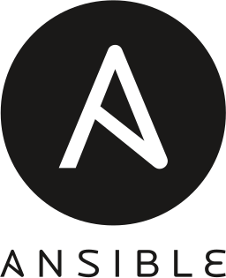
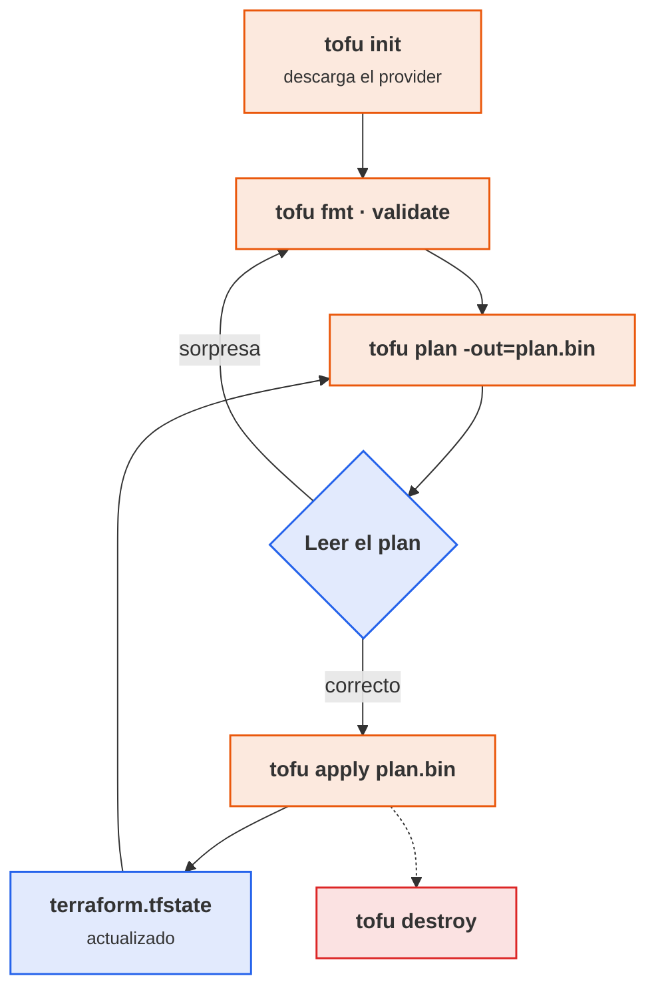
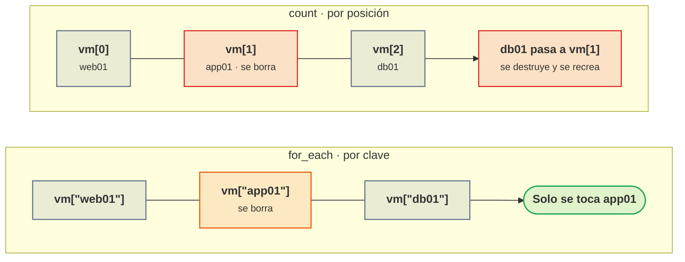
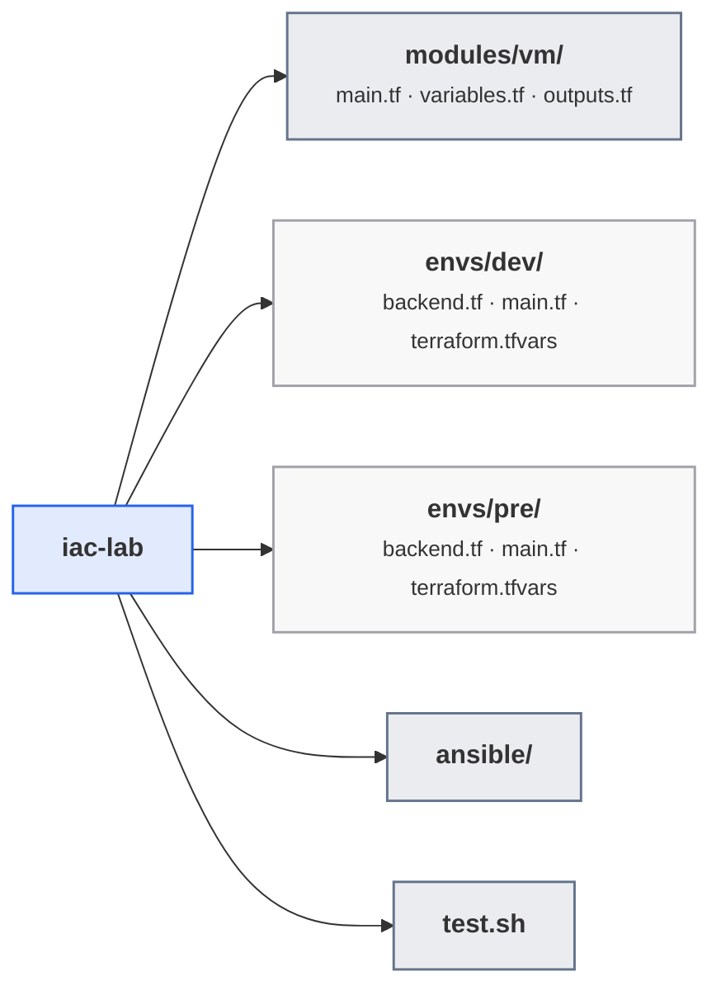
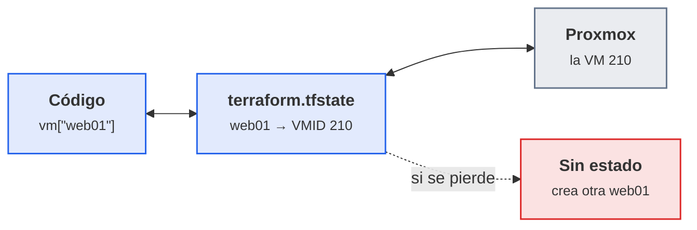
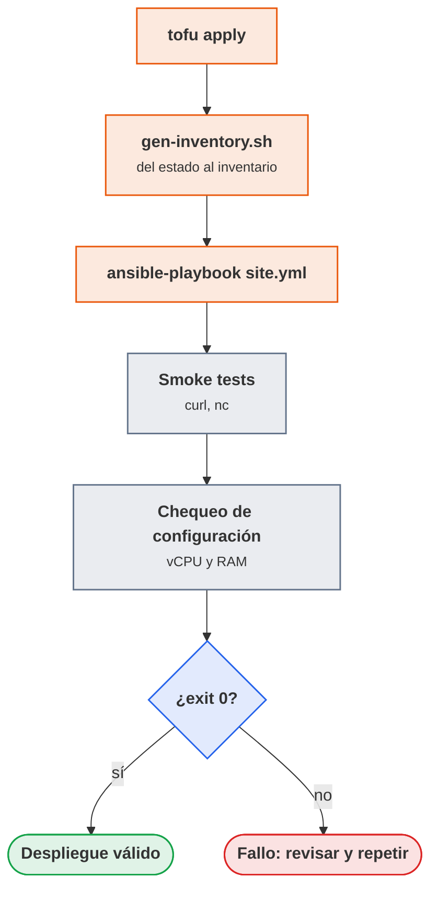

# UT5 · Infraestructura como código

<p class="ut-meta">18 h · Sesiones 21 a 29 · RA3 CE a, b, c, d</p>

En la UT2 la VPC se montó dos veces: a mano en la consola de Proxmox y después con el script bash de la [A2.3](ut2-vpc.md#demostracion-crear-un-entorno-con-un-script). El script describe cómo llegar, no dónde hay que estar: tiene que preguntar antes de cada orden si la cosa ya existe, no sabe cambiar una VM ya creada y no se entera si alguien toca algo a mano.

En esta unidad se escribe en ficheros el estado deseado (tres VM con estas CPU, estas IP, en estos puentes) y una herramienta calcula y aplica la diferencia. El objetivo es que cualquiera del grupo, con un `git clone` y unas pocas órdenes, levante el entorno `pre` con el servicio funcionando y un script diga si está bien. Se encadenan cuatro piezas, en este orden: OpenTofu crea las máquinas en Proxmox, Ansible las configura, un script de pruebas comprueba que el servicio responde y tres escáneres revisan que el código no deje nada expuesto. Es la primera de las tres unidades del examen de la segunda evaluación, el 24 de marzo de 2027. El entorno `pre` que nace aquí lo actualiza Mantenimiento en febrero y lo da de baja en marzo con el mismo repositorio, el mismo estado y el mismo token, así que al terminar la práctica evaluable no se destruye ni se borra su estado.

## Sesión 21 · IaC: conceptos y primer despliegue

<p class="ut-meta" markdown>16 de diciembre · Teoría y práctica · <span class="dur" tabindex="0" aria-label="Infraestructura como código · 15 min&#10;OpenTofu: instalación y primer proyecto · 15 min&#10;A5.1 Primer despliegue · 80 min" data-dur="Infraestructura como código · 15 min&#10;OpenTofu: instalación y primer proyecto · 15 min&#10;A5.1 Primer despliegue · 80 min">:material-school:<i class="dur-barra" style="--teoria:27%"></i>:material-flask:</span></p>

El script de la A2.3 funciona a fuerza de comprobar a mano, orden por orden, si cada cosa existe ya. Hoy se cambia de enfoque: primero qué es describir la infraestructura en ficheros y por qué se exige idempotencia; después OpenTofu, su ciclo `init`, `plan`, `apply` y el proyecto más pequeño que crea una VM. La hoja A5.1 crea el usuario de Proxmox con el que OpenTofu trabajará hasta marzo, recorre el ciclo sobre una VM de usar y tirar y publica el repositorio `iac-lab`, donde vive todo el código de la unidad.

### Infraestructura como código

**El problema.** Lo que se monta a mano no sale igual dos veces, y un script repite pasos sin saber qué hay al otro lado. Cuantas más máquinas y entornos, más fácil es que lo que existe y lo que el script cree que existe dejen de coincidir.

**Qué es.** La infraestructura como código (IaC) es describir máquinas, redes y discos en ficheros de texto que una herramienta aplica sola. Los ficheros van a un repositorio Git: se revisan, se versionan y se pueden volver a aplicar en otro sitio. Lo que aporta frente a la consola:

- **Reproducible:** dev, pre y pro salen iguales porque nacen del mismo código con distintos valores.
- **Rápido:** un entorno completo tarda minutos, y el tiempo lo pone la máquina.
- **Auditable:** Git dice quién cambió qué, y el plan dice qué va a pasar antes de que pase.
- **Recuperable:** si se pierde el entorno, se vuelve a aplicar el código.

#### Declarativo frente a imperativo

**Dos formas de escribirlo.** Un script dice qué hacer; un fichero declarativo dice cómo tiene que quedar. La diferencia se ve la segunda vez:

|  | Declarativo (OpenTofu) | Imperativo (script bash) |
|----|----|----|
| Qué se escribe | El estado final ("quiero 3 VM así") | Los pasos ("crea VM, luego disco, luego red") |
| Quién calcula los cambios | La herramienta, comparando lo pedido con lo que existe | Quien escribe el script |
| Segunda ejecución | No hace nada si ya está como se pidió | Repite los pasos |

Ansible queda en medio: un playbook es una lista ordenada de tareas, pero cada tarea dice cómo tiene que quedar algo (`state: present`, "que esté instalado"), así que bien escrito se comporta como declarativo.

**La propiedad que se exige: idempotencia.** Aplicar el código dos veces deja el mismo resultado que una. Es lo que permite ejecutarlo sin miedo, meterlo en un pipeline y usarlo para reparar un entorno tocado a mano. Cuando una hoja pide "ejecútalo dos veces y guarda la segunda", es esto lo que se comprueba.

#### Herramientas

**Dos herramientas, dos trabajos.** OpenTofu { .logo-inline } **aprovisiona**: crea, cambia y destruye VM, redes y discos llamando a la API de cada plataforma a través de **providers** (el complemento que sabe hablar con cada una: Proxmox, AWS...). Se escribe en HCL, su lenguaje. Ansible { .logo-inline } **configura** lo que hay dentro de las máquinas (paquetes, ficheros, servicios) por SSH, en YAML. El patrón del curso, el habitual en empresas medianas: OpenTofu crea las VM con cloud-init, Ansible instala PostgreSQL y Docker y despliega el servicio, y un script comprueba que todo responde.

**OpenTofu y Terraform.** OpenTofu es la versión libre de Terraform, que cambió de licencia en 2023, y en las empresas aparecen los dos. El lenguaje, los providers y los ficheros son los mismos: donde un tutorial diga `terraform plan` se escribe `tofu plan`. Los ficheros conservan los nombres de Terraform (`terraform.tfvars`, `terraform.tfstate`, el bloque `terraform {}`).

### OpenTofu: instalación y primer proyecto

**Dónde se instala.** En el puesto de administración (10.10.0.50), y toda la unidad se trabaja desde ahí: llega a la API de Proxmox y a las redes de los entornos, y tiene la clave SSH que OpenTofu mete en cada VM. El script oficial añade el repositorio APT de OpenTofu, así que después se actualiza con `apt`:

```bash
curl -fsSL https://get.opentofu.org/install-opentofu.sh | sh -s -- --install-method deb
tofu version
```

#### Estructura de un proyecto

**Un directorio con ficheros `.tf`.** OpenTofu lee todos los `.tf` del directorio y los junta; el reparto en ficheros es para las personas, pero es la convención que todo el mundo espera:

| Fichero | Contenido | ¿Se sube a Git? |
|----|----|----|
| `providers.tf` | Qué providers se usan, con qué versión y cómo se conectan | Sí |
| `variables.tf` | Variables de entrada con tipo, descripción y validaciones | Sí |
| `main.tf` | Los recursos (las VM) | Sí |
| `outputs.tf` | Valores que se exportan, como las IP para Ansible | Sí |
| `terraform.tfvars` | Los valores de las variables para este entorno, sin secretos | Sí |
| `.terraform.lock.hcl` | Versión exacta de los providers descargados | Sí |
| `.terraform/` | Los providers descargados, que regenera `tofu init` | No |
| `terraform.tfstate` y `plan.bin` | El estado y el plan guardado: llevan valores sensibles | No |

**La buena práctica.** El `.gitignore` se escribe antes del primer commit: lo que entra en un commit se queda en el historial aunque se borre después.

#### El ciclo init, plan, apply

**Qué compara OpenTofu.** Lo que dice el código (lo que se quiere), lo que apuntó en el **estado** la última vez (qué creó y con qué identificador) y lo que existe ahora en Proxmox. De esa comparación sale el **plan**: la lista de operaciones que dejarían la realidad como dice el código. Si alguien toca una VM a mano, la diferencia aparece en el plan (se llama **deriva**) y aplicarlo la corrige.



<p class="pie" markdown>El bucle es el trabajo diario. La flecha de «sorpresa» es la importante: si el plan no dice lo esperado, se vuelve al código, no se aplica.</p>

| Orden | Qué hace |
|----|----|
| `tofu init` | Descarga los providers y prepara dónde se guarda el estado. Se repite al añadir un provider o un módulo |
| `tofu fmt` y `tofu validate` | Formato y comprobación de sintaxis y tipos, sin hablar con Proxmox |
| `tofu plan -out=plan.bin` | Calcula qué crearía, cambiaría o destruiría, y lo guarda |
| `tofu apply plan.bin` | Aplica exactamente ese plan y apunta en el estado lo creado. Sin fichero, recalcula y pide `yes` |
| `tofu destroy` | Elimina todo lo que gestiona el estado |

**La buena práctica.** El plan se lee siempre antes de aplicar, y se aplica el plan guardado: así se crea exactamente lo que se ha leído.

#### Cómo leer un plan

**Por qué leerlo.** El plan es el único momento en que se puede parar una destrucción antes de que ocurra. Cada recurso lleva un símbolo:

| Símbolo | Significado | Qué hacer |
|----|----|----|
| `+` create | Recurso nuevo | Normal en el primer apply |
| `~` update in-place | Cambia atributos sin recrear (memoria, nombre) | Normal; mirar qué atributo |
| `-` destroy | Se elimina | Solo si se ha pedido |
| `-/+` replace | Se destruye y se crea de nuevo | Peligro: se pierde el disco y su contenido |

La línea `# forces replacement` junto a un atributo avisa de que el provider no sabe cambiarlo en caliente y va a recrear la VM: para `db01` es perder la base de datos. La última línea resume: `Plan: 1 to add, 0 to change, 1 to destroy` cuando se esperaba `0 to destroy` es motivo para parar. Las VM con datos llevan además `lifecycle { prevent_destroy = true }`, que hace fallar el plan en lugar de destruir.

#### El proyecto mínimo

**Lo más pequeño que crea algo.** Tres ficheros y una VM con los valores escritos a mano. Es el que copia la A5.1:

```hcl
# providers.tf
terraform {
  required_providers {
    proxmox = { source = "bpg/proxmox", version = "~> 0.60" }
  }
}

provider "proxmox" {
  endpoint  = var.pve_endpoint
  api_token = var.pve_token      # llega por TF_VAR_pve_token, nunca en un fichero
  insecure  = true               # certificado autofirmado del laboratorio
}

# variables.tf
variable "pve_endpoint" {
  type = string
}
variable "pve_token" {
  type      = string
  sensitive = true
}

# main.tf
resource "proxmox_virtual_environment_vm" "prueba" {
  name      = "prueba01"
  node_name = "pve"
  vm_id     = 150                  # primera de la franja de pruebas de dev (150 a 199)

  clone { vm_id = 9000 }           # la plantilla cloud-init

  cpu    { cores = 1 }
  memory { dedicated = 1024 }
  network_device { bridge = "devfront" }
  agent { enabled = true }         # qemu-guest-agent, para leer la IP

  initialization {
    ip_config {
      ipv4 {
        address = "10.10.1.200/24"
        gateway = "10.10.1.1"
      }
    }
    user_account {
      username = "ops"
      keys     = [file("~/.ssh/id_ed25519.pub")]
    }
  }
}
```

**Qué hace cada bloque.**

- `required_providers`: qué provider hace falta (`bpg/proxmox`) y desde qué versión. La que se descarga queda fijada en `.terraform.lock.hcl`.
- `provider "proxmox"`: la URL de la API del nodo (la misma de la consola web, `https://<IP del nodo>:8006/`) y el token. `insecure = true` acepta el certificado autofirmado del laboratorio.
- `variable`: las entradas. `pve_endpoint` sale de `terraform.tfvars`; `pve_token`, de la variable de entorno `TF_VAR_pve_token` (OpenTofu toma `TF_VAR_nombre` como valor de la variable `nombre`), así el token no se escribe en ningún fichero.
- `resource`: la VM. Su dirección, `proxmox_virtual_environment_vm.prueba`, es como la nombran el plan y el estado. `node_name` es el nombre del nodo (`pve`), `clone` la plantilla de origen, `agent` hace que el provider espere a que la VM diga su IP, e `initialization` son los datos de cloud-init de la pestaña Cloud-Init.

El `vm_id` se fija siempre: sin él Proxmox da el primer ID libre, que cae en la franja de gestión, y el [laboratorio](../laboratorio.md#convenciones) reserva la 150 a la 199 para pruebas.

### A5.1 Primer despliegue (sesión 21)

<span class="et et-obj">Objetivo</span> Desde el puesto de administración creas con OpenTofu una VM clonada de la plantilla 9000, compruebas que un segundo `plan` dice `No changes` y la destruyes. Ese segundo plan demuestra que la herramienta sabe lo que ha creado y no lo repite, que es lo que en un trabajo permite relanzar el código sin miedo. Además dejas creados el usuario `terraform@pve` con su token y el repositorio `iac-lab` en Gitea, que se usan hasta marzo en las dos asignaturas.

<span class="et et-pre">Antes de empezar</span> El puesto de administración (VM 105, 10.10.0.50, de la A2.2) encendido; entras con `ssh -A ops@<IP de admin01 en la red del laboratorio>`. La consola del nodo (Shell en la web de Proxmox), la plantilla 9000 y la Gitea de `mon01` en `http://gitea.lab:23001` con el usuario `ops`. Teoría de hoy: [infraestructura como código](#infraestructura-como-codigo), [el ciclo init, plan, apply](#el-ciclo-init-plan-apply) y [el proyecto mínimo](#el-proyecto-minimo).

<span class="et et-pas">Pasos</span>

Primero creas la identidad con la que OpenTofu entra en Proxmox. Después el proyecto, con el `.gitignore` antes del primer commit. Luego recorres el ciclo entero sobre una VM de prueba y, al final, publicas el repositorio.

1. **Dale a OpenTofu su propia identidad en Proxmox.** Un usuario `terraform@pve` con un token `tofu` y solo tres permisos: clonar y configurar VM, usar el disco `local-lvm` y conectar VM a las VNets de la zona `lab`. En la Shell del nodo:

    ```bash
    pveum user add terraform@pve
    pveum user token add terraform@pve tofu --privsep 0     # muestra el secreto UNA vez
    pveum acl modify /vms --users terraform@pve --roles PVEVMAdmin
    pveum acl modify /storage/local-lvm --users terraform@pve --roles PVEDatastoreUser
    pveum acl modify /sdn/zones/lab --users terraform@pve --roles PVESDNUser
    ```

    Guarda el secreto en el gestor de contraseñas. En el puesto de administración, exporta el token y prueba la API:

    ```bash
    export TF_VAR_pve_token='terraform@pve!tofu=<secreto>'
    curl -k -H "Authorization: PVEAPIToken=$TF_VAR_pve_token" https://<IP de tu nodo>:8006/api2/json/version
    ```

    Se comprueba: el `curl` devuelve un JSON con la versión de Proxmox. Si da `401`, mira [Errores frecuentes](#errores-frecuentes-en-el-laboratorio).

2. **Prepara el proyecto y cierra la puerta a los secretos.** Instala OpenTofu como en [la teoría](#opentofu-instalacion-y-primer-proyecto) y crea el repositorio:

    ```bash
    mkdir ~/iac-lab && cd ~/iac-lab && git init
    printf '.terraform/\n*.tfstate\n*.tfstate.*\nplan.bin\n' > .gitignore
    echo 'pve_endpoint = "https://<IP de tu nodo>:8006/"' > terraform.tfvars
    ls ~/.ssh/id_ed25519.pub || ssh-keygen -t ed25519      # la clave que meterá cloud-init
    ```

    Crea `providers.tf`, `variables.tf` y `main.tf` copiando los tres trozos del [proyecto mínimo](#el-proyecto-minimo) tal cual. Se comprueba: `tofu init` termina con `OpenTofu has been successfully initialized!` y `tofu validate` con `Success!`.

3. **Recorre el ciclo y demuestra que no se repite.** Crea la VM desde un plan guardado, entra en ella, repite el plan y destrúyela:

    ```bash
    mkdir -p ~/entregas-5166/ut5/a51
    tofu plan -out=plan.bin | tee ~/entregas-5166/ut5/a51/plan1.txt
    tofu apply plan.bin
    ssh ops@10.10.1.200 hostname                     # prueba01
    tofu plan | tee ~/entregas-5166/ut5/a51/plan2.txt
    tofu destroy
    ```

    En el primer plan, cuenta cuántos atributos lleva la VM aunque tú solo hayas escrito una docena: el resto lo rellena el provider. Se comprueba: el segundo plan termina en `No changes.` y, tras `destroy`, la VM 150 ya no aparece en Proxmox.

4. **Publica `iac-lab` en Gitea.** Crea en la web de Gitea el repositorio privado `iac-lab` del usuario `ops`, vacío, y sube el primer commit:

    ```bash
    git add . && git commit -m "Proyecto mínimo de OpenTofu"
    git branch -M main
    git remote add origin http://gitea.lab:23001/ops/iac-lab.git
    git push -u origin main
    ```

    Se comprueba: `git status` no muestra `.terraform/` ni ningún tfstate, y la web de Gitea enseña los `.tf`, el tfvars y el `.gitignore`.

<span class="et et-com">Comprobación</span> El segundo `plan` dice `No changes. Your infrastructure matches the configuration.`, la VM 150 no existe tras `destroy` y en Gitea no hay ningún tfstate ni el token. Si `plan` o `apply` fallan con `401 authentication failure` o `Permission check failed`, revisa el paso 1 en [Errores frecuentes](#errores-frecuentes-en-el-laboratorio).

<span class="et et-ent">Para practicar</span> Deja en `iac-lab` de Gitea los `.tf`, el tfvars sin el token y el `.gitignore`, y las dos salidas de `plan` en `ut5/a51/` de `entregas-5166`. Desde hoy cada hoja termina con `git add`, `git commit` y `git push` de `iac-lab`, del que parte la práctica evaluable.

<span class="et et-ext">Si te sobra tiempo</span> Con la VM creada, cambia `dedicated` a 2048 y mira si el plan marca `~` o `-/+`.

## Sesión 22 · Requisitos y variables

<p class="ut-meta" markdown>18 de diciembre · Teoría y práctica · <span class="dur" tabindex="0" aria-label="De los requisitos al código · 10 min&#10;validation y sensitive · 5 min&#10;A5.2 Requisitos y variables · 95 min" data-dur="De los requisitos al código · 10 min&#10;validation y sensitive · 5 min&#10;A5.2 Requisitos y variables · 95 min">:material-school:<i class="dur-barra" style="--teoria:14%"></i>:material-flask:</span></p>

El proyecto de la A5.1 lleva los valores escritos dentro del recurso, sin que conste de dónde sale ninguno y sin nada que impida un 512 o una IP sin prefijo. Hoy no se crean máquinas: primero se escribe qué necesita el servicio y de dónde sale cada dato, y después cada fila se convierte en una variable con tipo y validación, para que un `terraform.tfvars` mal escrito falle en `plan`, en segundos y con un mensaje propio.

**El almacén S3, de paso.** La hoja empieza montando MinIO en `mon01`: un servidor libre que guarda ficheros por HTTP con el protocolo S3 de Amazon, el estándar para esto. Guarda los ficheros en contenedores con nombre, los **buckets**, y da a cada programa su propia credencial. Hoy no se usa: desde el 13 de enero guarda el estado de OpenTofu (bucket `tfstate`, credencial `tofu`) y desde el 11 de febrero las copias de Mantenimiento (bucket `backups`, credencial `restic`). Se monta ahora porque esas dos sesiones van justas de tiempo.

### De los requisitos al código

**Por qué empezar por los requisitos.** Las variables describen lo que el servicio necesita, y ese dato existe antes que el código. Para el servicio del curso (web + API + PostgreSQL):

| Recurso | Requisito | Origen del dato |
|----|----|----|
| Cómputo | 2 vCPU la app, 1 vCPU el proxy, 2 vCPU la base de datos | Pruebas de carga previas / recomendación del fabricante |
| Memoria | 2 GB app, 1 GB proxy, 2 GB base de datos | Idem |
| Almacenamiento | 20 GB sistema + 50 GB de datos en disco aparte para la base de datos | Volumen de datos esperado × 3 |
| Red | Subredes front/back/data de la VPC; puertos 443, 28080, 5432 | Diseño de la VPC y del cortafuegos |
| Disponibilidad | Dos instancias de app tras el proxy | Acuerdo de servicio |
| Copias | Copia diaria de la base de datos | Política de la empresa |

**La buena práctica.** Cada número lleva su origen en el README: un número sin origen no se puede defender ni cambiar con criterio. Lo que el laboratorio no cumple se escribe al lado con su motivo, en vez de esconderlo: en `pre` cada VM lleva 1 GB y un solo disco de 20 GB porque es lo que da el nodo, hay una sola instancia de app y las copias las hace Mantenimiento.

### validation y sensitive

**El problema.** Un tipo dice qué forma tiene un valor, pero no si tiene sentido: `memory = 512` es un número válido. Un bloque `validation` añade esa comprobación con un mensaje propio. Esta es la variable `vms` de la A5.2 y la del token:

```hcl
variable "vms" {
  type = map(object({
    vmid   = number
    cores  = number
    memory = number
    disk   = number
    bridge = string
    ip     = string
  }))
  description = "VM a crear, con sus requisitos"

  validation {
    condition     = alltrue([for v in values(var.vms) : v.memory >= 1024])
    error_message = "Ninguna VM puede tener menos de 1024 MB."
  }
  validation {
    condition     = alltrue([for v in values(var.vms) : can(cidrhost(v.ip, 0))])
    error_message = "ip debe ser una dirección con prefijo, por ejemplo 10.10.1.10/24."
  }
}

variable "pve_token" {
  type      = string
  sensitive = true
}
```

**Cómo se lee.** `vms` es un mapa: una entrada por VM, con su nombre como clave y seis campos. Cada `validation` lleva una `condition` que tiene que dar `true` y el `error_message` que sale si no. La primera exige que todas las VM (`alltrue`) tengan al menos 1024 MB. La segunda usa `cidrhost()`, que falla si la IP no lleva prefijo, y `can()`, que convierte ese fallo en `false`. Para comprobar que un valor está en una lista se usa `contains(lista, valor)`. Las validaciones se evalúan en `plan`, antes de pedir nada a Proxmox.

**Qué hace `sensitive`.** Oculta el valor en pantalla (`(sensitive value)`), pero no lo cifra: el estado y el `plan.bin` lo guardan en claro. Por eso los dos están en el `.gitignore`.

### A5.2 Requisitos y variables (sesión 22)

<span class="et et-obj">Objetivo</span> Un `variables.tf` con tipos, descripciones y validaciones que rechaza con tu mensaje un tfvars mal escrito, y MinIO en marcha en la `10.10.0.30` con sus dos buckets. Al terminar, las tres VM de `pre` están descritas con valores que tienen origen y no pueden salir absurdos, que es como se entrega un proyecto de IaC que otra persona tiene que usar.

<span class="et et-pre">Antes de empezar</span> `iac-lab` de la A5.1 en el puesto de administración, sin VM creadas, y `TF_VAR_pve_token` exportado como en el paso 1 de la A5.1 (sin él, `tofu plan` se para a pedirlo). Para el paso 1, entra en el puesto con `ssh -A` y salta a `mon01` con `ssh ops@10.10.0.20`. Si el profesor monta MinIO para toda el aula, el paso 1 se reduce a lo que dice la receta para ese caso. Teoría de hoy: [de los requisitos al código](#de-los-requisitos-al-codigo) y [validation y sensitive](#validation-y-sensitive).

<span class="et et-pas">Pasos</span>

Empiezas por MinIO, que se hace en otra máquina y tiene esperas. Después vas de lo general a lo concreto: la tabla de requisitos, las variables que la traducen, los valores de `pre` y la prueba de que las validaciones rechazan lo que deben.

1. **Preparación: el almacén S3 del laboratorio.** Monta MinIO en `mon01` copiando tal cual la receta de [Cómo se monta MinIO](../laboratorio.md#como-se-monta-minio): segunda dirección `10.10.0.30`, servicio `minio`, buckets `tfstate` y `backups` y credenciales `tofu` y `restic`. Lo único tuyo son las tres contraseñas; las de `tofu` y `restic` van al gestor de contraseñas antes de seguir. Guarda la salida del `$M ls lab` de la receta. Se comprueba desde el puesto de administración, que es desde donde lo usará OpenTofu:

    ```bash
    curl -s -o /dev/null -w '%{http_code}\n' http://10.10.0.30:29000/minio/health/live    # 200
    ```

2. **Escribe qué necesita el servicio y de dónde sale.** Copia la tabla de [De los requisitos al código](#de-los-requisitos-al-codigo) a un `README.md` en la raíz de `iac-lab` y rellénala para el servicio del curso. Cada fila lleva su origen; si no lo sabes, escribe de dónde lo sacarías. Debajo, en dos o tres líneas, las diferencias del laboratorio con su motivo. Es el primer punto de la práctica evaluable.

3. **Traduce las filas a variables.** Sustituye `variables.tf` por las variables `vms` y `pve_token` de [validation y sensitive](#validation-y-sensitive) y la `pve_endpoint` de la A5.1, las tres con `description`. Añade al bloque `vms` una tercera validación tuya, sobre el disco o sobre el puente, con su propio mensaje:

    ```hcl
      validation {
        condition     = alltrue([for v in values(var.vms) : <condición sobre v.disk o v.bridge>])
        error_message = "<tu mensaje>"
      }
    ```

    Para el puente sirve `contains()` contra la lista de las seis VNets de dev y pre. Se comprueba: `tofu validate` dice `Success!`.

4. **Da los valores de pre.** Escribe `terraform.tfvars` con las tres VM del servicio en `pre`, con los valores de la [ficha de pre](../laboratorio.md#el-entorno-pre), que usan las dos asignaturas, y las vCPU de tu tabla. Vacía `main.tf`, porque aún no hay recursos:

    ```hcl
    pve_endpoint = "https://<IP de tu nodo>:8006/"
    vms = {
      web01 = { vmid = 210, cores = <vCPU>, memory = 1024, disk = 20, bridge = "prefront", ip = "10.20.1.10/24" }
      app01 = { vmid = 220, cores = <vCPU>, memory = 1024, disk = 20, bridge = "preback",  ip = "10.20.2.10/24" }
      db01  = { vmid = 230, cores = <vCPU>, memory = 1024, disk = 20, bridge = "predata",  ip = "10.20.3.10/24" }
    }
    ```

    ```bash
    : > main.tf          # borra el recurso prueba de la A5.1
    ```

5. **Comprueba que las validaciones rechazan lo que deben.** Pasa el plan con tus valores y con una copia rota, `malo.tfvars`, con `memory = 512` en `db01`:

    ```bash
    mkdir -p ~/entregas-5166/ut5/a52
    tofu fmt && tofu validate
    tofu plan 2>&1 | tee ~/entregas-5166/ut5/a52/plan-bueno.txt
    cp terraform.tfvars malo.tfvars && nano malo.tfvars        # memory = 512 en db01
    tofu plan -var-file=malo.tfvars 2>&1 | tee ~/entregas-5166/ut5/a52/plan-malo.txt
    ```

    Se comprueba: el plan con `malo.tfvars` falla en segundos con tu `error_message`, no con un error del provider.

<span class="et et-com">Comprobación</span> `tofu validate` sale con `Success!`, el `plan` correcto no da errores y el de `malo.tfvars` muestra tu mensaje. El `$M ls lab` del paso 1 lista `tfstate` y `backups`, y el `curl` de salud responde `200`.

<span class="et et-ent">Para practicar</span> Deja en `iac-lab` el `README.md` con la tabla, `variables.tf` y `terraform.tfvars`, y en `ut5/a52/` de `entregas-5166`, `malo.tfvars`, las dos salidas de `plan` y la del `$M ls lab` del paso 1. La tabla y las validaciones son el criterio a de la práctica evaluable.

<span class="et et-ext">Si te sobra tiempo</span> Abre `tofu console` y prueba `cidrhost(var.vms["db01"].ip, 1)` y `{ for k, v in var.vms : k => v.memory }` contra tus variables.

## Sesión 23 · VM con OpenTofu

<p class="ut-meta" markdown>8 de enero · Teoría y práctica · <span class="dur" tabindex="0" aria-label="El lenguaje HCL · 10 min&#10;Provider Proxmox y una VM completa · 10 min&#10;A5.3 VM completas · 90 min" data-dur="El lenguaje HCL · 10 min&#10;Provider Proxmox y una VM completa · 10 min&#10;A5.3 VM completas · 90 min">:material-school:<i class="dur-barra" style="--teoria:18%"></i>:material-flask:</span></p>

Las tres VM de `pre` están descritas en variables, pero el único recurso que se sabe escribir es el de la A5.1, con los valores dentro. Hoy se ve lo justo de HCL para que un solo bloque cree una VM por entrada del mapa, el recurso completo del provider y el camino mínimo para que el puesto de administración llegue a `pre`, que está aislado desde la A2.3. La hoja A5.3 abre ese camino, crea las VM, comprueba que están protegidas y lee el plan de un cambio pequeño.

### El lenguaje HCL

**Para qué sirve.** Copiar el bloque de la A5.1 tres veces funcionaría hasta el primer cambio. HCL tiene lo justo para no repetirse: tipos, variables, expresiones y bucles. Un fichero `.tf` es una serie de bloques; estos son los habituales:

```hcl
terraform { ... }                     # versiones y dónde se guarda el estado
provider "proxmox" { ... }            # cómo conectar con la API
variable "memory" { type = number }   # una entrada
resource "proxmox_virtual_environment_vm" "web" { ... }   # lo que se crea
module "vm" { source = "./modules/vm" }                    # llamada a un módulo
output "ip" { value = var.ip }        # una salida
```

#### Tipos y expresiones

**Tipos.** `string`, `number` y `bool`, y los compuestos `list(T)`, `map(T)` y `object({ campo = T })`. El más frecuente es `map(object({...}))`: un diccionario de máquinas con sus atributos, como `vms`. OpenTofu comprueba el tipo antes de hacer nada.

**Expresiones.** Referencias (`var.x`, `module.m.ip`), interpolación (`"${var.env}-web"`) y bucles `for`, que recorren un mapa y construyen otro. Esta línea es el output `ips` de la A5.3, un mapa nombre ⇒ IP:

```hcl
{ for k, v in var.vms : k => v.ip }
```

**Tres funciones que usa el curso.** `cidrhost("10.20.1.10/24", 1)` da `10.20.1.1`, la puerta de enlace; `file("~/.ssh/id_ed25519.pub")` lee la clave que cloud-init mete en la VM, y `contains(lista, valor)` comprueba si un valor está en una lista. `tofu console` sirve para probar cualquier expresión antes de meterla en el código.

#### count frente a for_each

**El problema.** Un solo bloque `resource` tiene que crear una VM por entrada del mapa `vms`. Hay dos formas, y no son intercambiables:

- `count = 3` crea `vm[0]`, `vm[1]`, `vm[2]` por posición: si se borra la del medio, la tercera pasa a ser `vm[1]` y OpenTofu la recrea.
- `for_each = var.vms` crea `vm["web01"]`, `vm["app01"]`... por clave: borrar `app01` solo toca `app01`. Dentro del bloque, `each.key` es el nombre y `each.value` el objeto (`each.value.memory`).



<p class="pie" markdown>`count` solo para «n copias idénticas» o para activar y desactivar un recurso. Para todo lo demás, `for_each`, que es el del curso.</p>

### Provider Proxmox y una VM completa

**De una VM a tres.** El recurso es el de la A5.1 con tres cambios: los valores salen de `vms` a través de `for_each`, un bloque `disk` fija el tamaño del disco y `lifecycle` impide destruir las VM. Por debajo, el provider hace por la API lo mismo que se hacía en la consola: clona la plantilla, le pone CPU, memoria, disco y red, y rellena cloud-init.

```hcl
# main.tf
resource "proxmox_virtual_environment_vm" "vm" {
  for_each  = var.vms
  name      = each.key
  node_name = "pve"
  vm_id     = each.value.vmid              # 210, 220, 230: la convención de IDs del laboratorio

  clone { vm_id = 9000 }                     # la plantilla cloud-init

  cpu    { cores = each.value.cores }
  memory { dedicated = each.value.memory }

  disk {
    datastore_id = "local-lvm"
    interface    = "scsi0"
    size         = each.value.disk
  }

  network_device { bridge = each.value.bridge }

  agent { enabled = true }                   # qemu-guest-agent, para leer la IP

  initialization {
    ip_config {
      ipv4 {
        address = each.value.ip
        gateway = cidrhost(each.value.ip, 1)
      }
    }
    user_account {
      username = "ops"
      keys     = [file("~/.ssh/id_ed25519.pub")]
    }
  }

  lifecycle {
    prevent_destroy = true                   # pre no se destruye sin aprobación
  }
}

# outputs.tf
output "ips" { value = { for k, v in var.vms : k => v.ip } }
```

`providers.tf` y `variables.tf` son los de las sesiones anteriores, y `terraform.tfvars` el de la A5.2. El token sigue en `TF_VAR_pve_token`.

**La protección.** `prevent_destroy` hace fallar cualquier plan que quiera destruir una de estas VM. Lo que importa proteger es `db01`, pero `lifecycle` no admite variables, así que protege las tres. Mantenimiento lo quita en una rama el 11 de marzo para dar de baja `pre`, y esa rama queda como evidencia de la aprobación.

!!! ojo "La sintaxis del provider cambia entre versiones"
    Los nombres de bloques de `bpg/proxmox` (`initialization`, `ip_config`, `user_account`) han cambiado entre versiones 0.x. La versión que se usa es la que quedó en `.terraform.lock.hcl`; si algo no encaja, se mira la página del recurso en https://registry.opentofu.org/providers/bpg/proxmox/latest/docs para esa versión, y no se sube de versión (`tofu init -upgrade`) sin leer qué cambia.

#### Cómo llega el puesto de administración a pre

**El problema.** Desde la A2.3 nada de `dev` alcanza `pre`: `router-pre` tiene un blackhole para `10.10.0.0/16`. OpenTofu no lo nota, porque habla con la API de Proxmox, pero entrar por SSH en las VM y configurarlas con Ansible exige llegar desde el puesto de administración. Se abre solo lo imprescindible, en un solo sentido:

- **Una tarjeta de `router-pre` en `devmgmt`**, con la `10.10.0.2` (dentro de la VM, `ens23`). La ruta a `10.10.0.0/24` que crea esa tarjeta es más concreta que el blackhole de `10.10.0.0/16` y gana, porque un router elige siempre la ruta de prefijo más largo.
- **Tres reglas nftables en `router-pre`**: pasan las respuestas, pasa lo que entra desde gestión y se tira lo nuevo que `pre` intente abrir hacia gestión.
- **Una ruta en el puesto** a `10.20.0.0/16` por la `10.10.0.2`, en la unidad `ruta-lab.service` de la A2.2.

Las reglas van en `/etc/nftables.conf` de `router-pre`, junto a la tabla de NAT de la A2.3, para que sobrevivan a un reinicio:

```text
table inet fw {
    chain forward {
        type filter hook forward priority filter; policy accept;
        ct state established,related accept
        iifname "ens23" accept
        oifname "ens23" drop
    }
}
```

La política `accept` mantiene lo que ya funcionaba: la salida de `pre` a Internet por el NAT y el tráfico entre sus zonas. Como `pre` no puede abrir conexiones hacia gestión, todo lo que llega a `pre` se empuja desde el puesto (Ansible, `docker save` por SSH). En las hojas, las máquinas de `pre` se escriben con su IP (`10.20.x.10`): los nombres `<host>.pre.lab` solo los resuelve `router-pre`.

!!! otra "Repaso"
    nftables se explica en la [sesión 17 de Mantenimiento](https://victor-educ.github.io/apuntes-5169/ut/ut3-seguridad-monitorizacion/#nftables-por-host-el-fichero-completo) (1 de diciembre). Aquí solo se añade la tabla `inet fw` con una cadena `forward` de tres reglas.

### A5.3 VM completas (sesión 23)

<span class="et et-obj">Objetivo</span> El puesto de administración llega a `pre`, y `web01`, `app01` y `db01` corren en ese entorno, accesibles por SSH y protegidas con `prevent_destroy`. Además lees el plan de un cambio de memoria que no recrea nada. Distinguir en un plan lo que cambia en caliente de lo que se recrea es lo que evita perder una base de datos en un trabajo.

<span class="et et-pre">Antes de empezar</span> `iac-lab` con el `variables.tf` y el tfvars de la A5.2 y `TF_VAR_pve_token` exportado. `pre` como quedó en la A2.3: las VNets `prefront`, `preback` y `predata` y `router-pre` (ID 200) encendido, accesible por su IP en la red del laboratorio. En Proxmox no hay ninguna VM entre la 210 y la 239: la `web01` de la A2.3 se destruyó al cerrar la UT2. Las tres nuevas caben en el [presupuesto de memoria](../laboratorio.md#presupuesto-de-memoria) sin apagar nada de `dev`. Teoría de hoy: [count frente a for_each](#count-frente-a-for_each), [el recurso VM](#provider-proxmox-y-una-vm-completa), [cómo llega el puesto a pre](#como-llega-el-puesto-de-administracion-a-pre) y, de la sesión 21, [cómo leer un plan](#como-leer-un-plan).

<span class="et et-pas">Pasos</span>

Primero abres el camino de gestión a `pre`, para poder entrar en las VM en cuanto nazcan. Después las creas, compruebas que la protección funciona y terminas leyendo el plan de un cambio pequeño.

1. **El camino de gestión a pre.** Los tres cambios de [Cómo llega el puesto de administración a pre](#como-llega-el-puesto-de-administracion-a-pre), de forma que sobrevivan a un reinicio: Mantenimiento entra en `pre` por este mismo camino en febrero.

    En la Shell del nodo, la tarjeta y su IP por cloud-init (equivale a Hardware → Add → Network Device y a la pestaña Cloud-Init de la VM 200):

    ```bash
    qm set 200 --net5 virtio,bridge=devmgmt --ipconfig5 ip=10.10.0.2/24
    qm reboot 200          # cloud-init configura la tarjeta al arrancar
    ```

    En `router-pre`, añade la tabla `inet fw` de la teoría al final de `/etc/nftables.conf`, sin tocar la tabla de NAT, y cárgala:

    ```bash
    sudo nano /etc/nftables.conf
    sudo nft -f /etc/nftables.conf && sudo nft list ruleset
    ```

    En el puesto de administración, añade a `/etc/systemd/system/ruta-lab.service` una segunda línea `ExecStart=` y guarda el `ip r` de `router-pre`:

    ```bash
    # ExecStart=/sbin/ip route replace 10.20.0.0/16 via 10.10.0.2 dev ens19
    sudo nano /etc/systemd/system/ruta-lab.service
    sudo systemctl daemon-reload && sudo systemctl restart ruta-lab.service
    mkdir -p ~/entregas-5166/ut5/a53
    ssh ops@10.10.0.2 ip r | tee ~/entregas-5166/ut5/a53/ip-r-router-pre.txt
    ping -c1 10.20.1.1
    ```

    Se comprueba: el `ping` responde, y en el `ip r` de `router-pre` aparece `10.10.0.0/24 dev ens23`. Si SSH avisa de que la clave del host ha cambiado, mira [Errores frecuentes](#errores-frecuentes-en-el-laboratorio).

2. **Crea las tres VM desde un plan guardado.** Escribe `main.tf` y `outputs.tf` copiando los de [Provider Proxmox y una VM completa](#provider-proxmox-y-una-vm-completa) y despliega:

    ```bash
    tofu plan -out=plan.bin          # tiene que decir: Plan: 3 to add, 0 to change, 0 to destroy
    tofu apply plan.bin
    tofu output ips
    for ip in 10.20.1.10 10.20.2.10 10.20.3.10; do ssh ops@$ip hostname; done
    ```

    Se comprueba: entras en las tres. Si entras, cloud-init ha hecho su trabajo y el camino del paso 1 funciona.

3. **Comprueba que pre está protegido.** Un plan de destrucción tiene que fallar sin tocar nada:

    ```bash
    tofu plan -destroy 2>&1 | tee ~/entregas-5166/ut5/a53/plan-destroy.txt
    ```

    Se comprueba: termina con `Instance cannot be destroyed`.

4. **Lee el plan de un cambio pequeño.** Sube la memoria de `app01` a 1536 en `terraform.tfvars` y guarda el plan, **sin aplicar** (el nodo no tiene RAM para ello):

    ```bash
    tofu plan 2>&1 | tee ~/entregas-5166/ut5/a53/plan-memoria.txt
    ```

    Léelo con la tabla de [Cómo leer un plan](#como-leer-un-plan): qué símbolo lleva, cuántos recursos toca y si alguno se recrea. Devuelve la memoria a 1024. Se comprueba: `tofu plan` vuelve a decir `No changes`.

<span class="et et-com">Comprobación</span> `ping -c1 10.20.1.1` responde desde el puesto. El `plan -destroy` falla con `Instance cannot be destroyed`. El plan del paso 4 toca exactamente un recurso, `Plan: 0 to add, 1 to change, 0 to destroy`, sin ninguna línea `# forces replacement`; con la memoria devuelta, `No changes`.

<span class="et et-ent">Para practicar</span> Deja `main.tf` y `outputs.tf` en `iac-lab` y, en `ut5/a53/`, el `ip r` de `router-pre` y las salidas de los pasos 3 y 4. No destruyas las VM: la A5.4 sigue sobre ellas.

<span class="et et-ext">Si te sobra tiempo</span> Cambia `node_name` o `datastore_id` solo en el plan (sin aplicar), localiza la línea `# forces replacement` y fíjate en que `prevent_destroy` para el plan antes de destruir nada.

## Sesión 24 · Módulos y estado

<p class="ut-meta" markdown>13 de enero · Teoría y práctica · <span class="dur" tabindex="0" aria-label="Módulos, entornos y estructura del repositorio · 5 min&#10;El estado a fondo · 15 min&#10;A5.4 Módulos y estado · 90 min" data-dur="Módulos, entornos y estructura del repositorio · 5 min&#10;El estado a fondo · 15 min&#10;A5.4 Módulos y estado · 90 min">:material-school:<i class="dur-barra" style="--teoria:18%"></i>:material-flask:</span></p>

El proyecto funciona, pero tiene dos debilidades que se notan en cuanto lo usa alguien más: el código sirve para un solo entorno, y el estado es un fichero en el disco del puesto. Hoy el repositorio toma la forma que tendrá hasta marzo: un módulo `vm`, un directorio por entorno y el estado en MinIO con bloqueo. Primero los módulos y la estructura; después el estado, el backend remoto y cómo se mueve un recurso al módulo sin que el plan quiera destruirlo. Ese estado compartido es el que usa Mantenimiento el 11 de marzo para dar de baja `pre`.

### Módulos, entornos y estructura del repositorio

**El problema: copiar y pegar.** Tres VM en dev, otras tres en pre, cada una con los mismos atributos: un cambio en la forma de crear una VM habría que hacerlo en todas las copias.

**Qué es un módulo.** Un directorio con ficheros `.tf` que recibe variables y devuelve outputs, como una función. Se llama con `module "vm" { source = "../../modules/vm" ... }` y sus salidas se leen con `module.vm["web01"].ip`. Un módulo hace una sola cosa y no lleva bloque `provider` (lo hereda del entorno que lo llama), pero sí dice qué provider usa: sin su `required_providers`, `tofu init` busca un `hashicorp/proxmox` que no existe y falla.

**Un directorio por entorno.** `envs/dev` y `envs/pre`, cada uno con su backend, su tfvars y su llamada al módulo. Es lo que hace la mayoría de los equipos: se ve qué hay en cada entorno y un error en `dev` no puede tocar el estado de `pre`.



<p class="pie" markdown>La separación que importa es `modules/` frente a `envs/`: el módulo no sabe en qué entorno vive, y el entorno solo aporta sus valores.</p>

**El módulo `vm` del curso.** Es el recurso de la sesión 23 sin `for_each` y con `var.*` en lugar de `each.value.*`: sabe crear una VM, y quien lo llama decide cuántas.

```hcl
# modules/vm/main.tf
terraform {
  required_providers {
    proxmox = { source = "bpg/proxmox" }   # sin versión: la fija el entorno
  }
}

resource "proxmox_virtual_environment_vm" "this" {
  name      = var.name
  node_name = "pve"
  vm_id     = var.vmid
  clone { vm_id = 9000 }
  cpu    { cores = var.cores }
  memory { dedicated = var.memory }
  disk {
    datastore_id = "local-lvm"
    interface    = "scsi0"
    size         = var.disk
  }
  network_device { bridge = var.bridge }
  agent { enabled = true }
  initialization {
    ip_config {
      ipv4 {
        address = var.ip
        gateway = cidrhost(var.ip, 1)
      }
    }
    user_account {
      username = "ops"
      keys     = [file("~/.ssh/id_ed25519.pub")]
    }
  }
  lifecycle { prevent_destroy = true }
}

# modules/vm/variables.tf
variable "name"   { type = string }
variable "vmid"   { type = number }
variable "cores"  { type = number }
variable "memory" { type = number }
variable "disk"   { type = number }
variable "bridge" { type = string }
variable "ip"     { type = string }

# modules/vm/outputs.tf
output "ip"    { value = var.ip }
output "vm_id" { value = proxmox_virtual_environment_vm.this.vm_id }

# envs/pre/main.tf
module "vm" {
  for_each = var.vms
  source   = "../../modules/vm"
  name     = each.key
  vmid     = each.value.vmid
  cores    = each.value.cores
  memory   = each.value.memory
  disk     = each.value.disk
  bridge   = each.value.bridge
  ip       = each.value.ip
}
```

### El estado a fondo

**Qué problema resuelve.** En el código la VM se llama `vm["web01"]` y en Proxmox es la VM 210: el estado es lo que guarda que son la misma. `terraform.tfstate` es un JSON con cada recurso del código, su ID real y todos sus atributos tal como el provider los leyó. Sin él, OpenTofu no sabe que `web01` ya existe y en el siguiente apply intentaría crear otra.



<p class="pie" markdown>El estado relaciona cada bloque del código con una máquina real.</p>

**Las reglas del oficio.**

- Nunca se edita a mano: para moverlo o consultarlo están los subcomandos `tofu state`.
- En equipo va en un backend remoto con bloqueo, nunca en Git: dos personas aplicando a la vez lo corrompen.
- Se protege como un secreto, porque guarda en claro contraseñas y tokens que devuelvan los recursos.

!!! ojo "El estado es un fichero con secretos dentro"
    Nunca va al repositorio, ni siquiera «temporalmente para probar»: el historial de Git no se olvida.

#### Backend remoto: s3 contra MinIO

**Para qué sirve.** El backend es el sitio donde OpenTofu guarda el estado. El local lo deja en un fichero que se pierde con el disco y no ve nadie más; el backend `s3` lo guarda como un objeto en un bucket, y lo bloquea mientras alguien aplica. En el laboratorio, el bucket `tfstate` del MinIO de la A5.2. El bloque va en `envs/pre/backend.tf`:

```hcl
terraform {
  backend "s3" {
    bucket                      = "tfstate"
    key                         = "envs/pre/terraform.tfstate"   # cada entorno, la suya
    region                      = "main"                         # relleno: MinIO no tiene regiones
    endpoints                   = { s3 = "http://10.10.0.30:29000" }
    use_path_style              = true                           # bucket en la ruta, como lo espera MinIO
    skip_credentials_validation = true                           # los cuatro skip_* desactivan
    skip_region_validation      = true                           # comprobaciones que solo existen en AWS
    skip_requesting_account_id  = true
    skip_metadata_api_check     = true
    use_lockfile                = true                           # bloqueo con un fichero .tflock
  }
}
```

**Las credenciales, fuera del bloque.** El bloque se sube a Git, así que la credencial va en `AWS_ACCESS_KEY_ID` (el nombre del usuario de MinIO, `tofu`) y `AWS_SECRET_ACCESS_KEY` (su contraseña). Llevar el estado local al backend nuevo es `tofu init -migrate-state`.

**El bloqueo.** Mientras alguien aplica existe el `.tflock`, y un segundo `apply` falla con `Error acquiring the state lock` en lugar de pisar el estado.

#### Manipular el estado

**Cuándo hace falta.** Al llevar el recurso al módulo, `proxmox_virtual_environment_vm.vm["db01"]` pasa a llamarse `module.vm["db01"].proxmox_virtual_environment_vm.this`. Para OpenTofu son dos recursos distintos: destruiría uno y crearía otro. Hay que decirle que es el mismo objeto con otra dirección, con un bloque `moved` en el código:

```hcl
moved {
  from = proxmox_virtual_environment_vm.vm["db01"]
  to   = module.vm["db01"].proxmox_virtual_environment_vm.this
}
```

o con la orden equivalente, que cambia el estado en el momento:

```bash
tofu state list          # qué recursos gestiona
tofu state mv 'proxmox_virtual_environment_vm.vm["db01"]' 'module.vm["db01"].proxmox_virtual_environment_vm.this'
```

**La buena práctica.** En equipo se prefiere `moved`: queda versionado y se aplica en el siguiente plan de cualquiera que use el repositorio. El plan lo anuncia como un movimiento, sin crear ni destruir nada, y el estado guarda la dirección nueva con el siguiente `apply`.

### A5.4 Módulos y estado (sesión 24)

<span class="et et-obj">Objetivo</span> El repositorio queda con `modules/vm`, `envs/pre` y `envs/dev`, el estado en MinIO con bloqueo, y las tres VM de la A5.3 siguen vivas sin haberse recreado. Es la forma que tiene un repositorio de IaC en una empresa, y del estado remoto que dejas hoy sale el inventario de Ansible en la A5.5.

<span class="et et-pre">Antes de empezar</span> Las VM de la A5.3 desplegadas y su `terraform.tfstate` local en `iac-lab`. MinIO en marcha en la `10.10.0.30` con el bucket `tfstate` y el secreto de la credencial `tofu` a mano: se montó en el paso 1 de la [A5.2](#a52-requisitos-y-variables-sesion-22), y su `curl` de salud tiene que dar `200`. Teoría de hoy: [módulos y entornos](#modulos-entornos-y-estructura-del-repositorio), el [backend remoto](#backend-remoto-s3-contra-minio) y [cómo mover recursos en el estado](#manipular-el-estado).

<span class="et et-pas">Pasos</span>

Primero cambias la forma del código y después arreglas el estado para que reconozca las VM en su dirección nueva. Solo con el estado correcto lo llevas a MinIO, compruebas el bloqueo y, al final, describes `dev` con el mismo módulo.

1. **Empaqueta la VM en un módulo y lleva pre a su directorio.** Mueve el proyecto a `envs/pre/` y crea el módulo:

    ```bash
    cd ~/iac-lab
    mkdir -p modules/vm envs/pre
    git mv providers.tf variables.tf outputs.tf terraform.tfvars .terraform.lock.hcl envs/pre/
    git rm main.tf
    ```

    Crea `modules/vm/main.tf`, `modules/vm/variables.tf`, `modules/vm/outputs.tf` y `envs/pre/main.tf` copiando los cuatro trozos de [El módulo vm del curso](#modulos-entornos-y-estructura-del-repositorio). Se comprueba: `cd envs/pre && tofu init` termina sin errores.

2. **Mueve las VM al módulo sin recrearlas.** Copia el estado de la A5.3 y crea `envs/pre/moved.tf` con un bloque `moved` por VM, como el de [Manipular el estado](#manipular-el-estado), para `web01`, `app01` y `db01`:

    ```bash
    cp ~/iac-lab/terraform.tfstate ~/iac-lab/envs/pre/
    nano moved.tf                        # tres bloques moved
    mkdir -p ~/entregas-5166/ut5/a54
    tofu plan 2>&1 | tee ~/entregas-5166/ut5/a54/plan-moved.txt
    tofu apply                           # guarda las direcciones nuevas; no toca ninguna VM
    ```

    Se comprueba: el plan solo anuncia `has moved to` y `0 to add, 0 to change, 0 to destroy`. Si dice `Instance cannot be destroyed`, falta algún `moved`.

3. **Lleva el estado a MinIO.** Crea `envs/pre/backend.tf` con el bloque de [Backend remoto: s3 contra MinIO](#backend-remoto-s3-contra-minio) y migra:

    ```bash
    export AWS_ACCESS_KEY_ID=tofu
    export AWS_SECRET_ACCESS_KEY='<secreto de tofu>'
    tofu init -migrate-state             # responde yes
    tofu state list | tee ~/entregas-5166/ut5/a54/state-antes.txt
    rm -f terraform.tfstate terraform.tfstate.backup ~/iac-lab/terraform.tfstate*
    tofu state list | tee ~/entregas-5166/ut5/a54/state-despues.txt
    ```

    Se comprueba: las dos listas muestran las tres VM; la segunda ya no puede venir del disco del puesto.

4. **Comprueba que el bloqueo protege.** Abre dos terminales en `envs/pre`, con las variables exportadas en las dos. Lanza `tofu apply` en la primera y, sin responder, lánzalo en la segunda:

    ```bash
    tofu apply 2>&1 | tee ~/entregas-5166/ut5/a54/bloqueo.txt     # en la segunda terminal
    ```

    Se comprueba: la segunda falla con `Error acquiring the state lock`. Responde `no` en la primera.

5. **Describe dev con el mismo módulo, sin aplicarlo.** Copia `pre`, cambia la `key` del backend a `envs/dev/terraform.tfstate` y pon en el tfvars los valores de dev: `vmid` 110, 120 y 130, puentes `devfront`, `devback` y `devdata`, IP `10.10.1.10/24`, `10.10.2.10/24` y `10.10.3.10/24` y la memoria de la tabla del laboratorio (1024, 2048 y 2048).

    ```bash
    cd ~/iac-lab && cp -r envs/pre envs/dev
    rm -rf envs/dev/.terraform envs/dev/moved.tf
    cd envs/dev && nano backend.tf terraform.tfvars
    tofu init && tofu plan
    ```

    **No apliques:** esas VM ya existen, creadas a mano, y un `apply` chocaría con ellas. Se comprueba: el plan propone crear tres VM, lo que demuestra que otro entorno se describe cambiando solo los valores y la `key`.

<span class="et et-com">Comprobación</span> `git status` no muestra ningún tfstate; `tofu state list` en `envs/pre` responde desde MinIO; el plan del paso 2 no destruyó nada; el error de bloqueo está guardado.

<span class="et et-ent">Para practicar</span> Deja `modules/` y `envs/` en `iac-lab` y las salidas de los pasos 2, 3 y 4 en `ut5/a54/` de `entregas-5166`. No borres el estado remoto: con él da de baja `pre` Mantenimiento, el 11 de marzo.

<span class="et et-ext">Si te sobra tiempo</span> Añade una variable `env` al módulo y úsala en el nombre (`"${var.env}-${var.name}"`); mira en el plan si el cambio de nombre se hace con `~` o fuerza a recrear.

## Sesión 25 · Ansible

<p class="ut-meta" markdown>15 de enero · Teoría y práctica · <span class="dur" tabindex="0" aria-label="Ansible · 25 min&#10;A5.5 Ansible · 85 min" data-dur="Ansible · 25 min&#10;A5.5 Ansible · 85 min">:material-school:<i class="dur-barra" style="--teoria:23%"></i>:material-flask:</span></p>

Las VM de `pre` arrancan y aceptan SSH, pero están vacías. Falta lo que las convierte en el servicio, PostgreSQL en `db01` y la API en `app01`, descrito en ficheros y sin cambios si se ejecuta dos veces. OpenTofu solo entra en la máquina en el primer arranque, con cloud-init; para configurar una máquina que ya existe está Ansible. La teoría va en el orden en que se usa: a qué máquinas (el inventario, generado desde OpenTofu), qué se les hace (el playbook del curso) y por qué la segunda pasada no cambia nada.

### Ansible

**Qué es.** Una herramienta que deja las máquinas como se le describe: paquetes instalados, ficheros con un contenido, servicios arrancados. No instala agente: solo necesita SSH y Python en el destino, que trae cualquier imagen cloud de Debian.

**Cómo trabaja.** Desde la **máquina de control** (el puesto de administración) entra en cada host por SSH, ejecuta un **módulo** (cada acción de Ansible: instalar un paquete, copiar un fichero) y recoge si ha cambiado algo. Un módulo de Ansible no tiene nada que ver con un módulo de OpenTofu.

**Instalación.** `sudo apt install ansible ansible-lint`, que trae también las **colecciones** (paquetes de módulos, como `community.docker` y `community.postgresql`) que usa el playbook del curso. `ansible --version` debe indicar core 2.18 o superior.

#### Inventario

**A qué máquinas.** El inventario lista los hosts y los agrupa; las tareas se dirigen a grupos, así que añadir una segunda máquina de aplicación es añadir una línea al grupo `app`:

```ini
# inventory.ini
[web]
web01 ansible_host=10.20.1.10

[app]
app01 ansible_host=10.20.2.10

[db]
db01 ansible_host=10.20.3.10

[all:vars]
ansible_user=ops
```

Cada línea lleva el nombre del host y, en `ansible_host`, la IP a la que se conecta. `[all:vars]` pone variables a todos: aquí, el usuario que crea cloud-init. `ansible-inventory -i inventory.ini --graph` dibuja los grupos.

#### Inventario generado desde los outputs de OpenTofu

**El problema.** Escribir el inventario a mano duplica lo que ya está en el tfvars y se desincroniza a la primera. Quien sabe qué máquinas existen es OpenTofu, así que el inventario se saca de su output `ips` con `jq`, el filtro de JSON de la línea de comandos:

```bash
#!/usr/bin/env bash
# gen-inventory.sh: genera ansible/inventory.ini desde los outputs de envs/pre
set -euo pipefail
cd "$(dirname "$0")/envs/${ENV:-pre}"
tofu output -json ips | jq -r '
  to_entries
  | map(. + { group: (.key | sub("[0-9]+$"; "")) })
  | group_by(.group)
  | map("[\(.[0].group)]\n" + (map("\(.key) ansible_host=\(.value | split("/")[0])") | join("\n")))
  | join("\n\n")' > ../../ansible/inventory.ini
printf '\n[all:vars]\nansible_user=ops\n' >> ../../ansible/inventory.ini
```

El filtro agrupa por el nombre sin el número final (`web01` va al grupo `web`) y quita el `/24` de la IP. Como `tofu output` lee el estado, que está en MinIO, el script necesita las mismas credenciales que `tofu plan`.

#### Comandos ad hoc y playbooks

**Órdenes sueltas.** Un comando ad hoc ejecuta un módulo en un grupo sin escribir playbook; sirve para comprobar y para arreglos puntuales:

```bash
ansible -i inventory.ini all -m ping                          # entra por SSH y encuentra Python
ansible -i inventory.ini app -b -m apt -a 'name=docker.io,docker-compose state=present update_cache=true'
```

`ping` no es el ping de red: comprueba que Ansible entra y encuentra Python. `-b` ejecuta como root, con sudo. La segunda orden instala Docker en `app01` en la A5.5.

**El playbook.** Un fichero YAML con jugadas: cada una, un grupo de hosts y una lista de tareas, y cada tarea llama a un módulo. El del curso deja PostgreSQL en `db01` y el servicio en `app01`; `web01` se queda como clon limpio. Cada tarea tiene nombre, usa el nombre completo del módulo y describe un estado (`present`, `directory`), no una acción. Lo que va entre dobles llaves (`{{ pg_conf }}`) se sustituye por el valor de la variable:

```yaml
# site.yml
- name: PostgreSQL en db01
  hosts: db
  become: true
  vars:
    pg_conf: /etc/postgresql/17/main
  tasks:
    - name: Instalar PostgreSQL y lo que necesitan los módulos
      ansible.builtin.apt:
        name: [postgresql, python3-psycopg2, acl]
        state: present
        update_cache: true

    - name: Escuchar en la red
      ansible.builtin.lineinfile:
        path: "{{ pg_conf }}/postgresql.conf"
        regexp: "^#?listen_addresses"
        line: "listen_addresses = '*'"
      notify: Reiniciar PostgreSQL

    - name: Admitir solo a la subred de app
      ansible.builtin.lineinfile:
        path: "{{ pg_conf }}/pg_hba.conf"
        line: "host servicio app 10.20.2.0/24 scram-sha-256"
      notify: Reiniciar PostgreSQL

    - name: Crear el usuario de la aplicación
      become: true
      become_user: postgres
      community.postgresql.postgresql_user:
        name: app
        password: "{{ db_password }}"
      no_log: true

    - name: Crear la base del servicio
      become: true
      become_user: postgres
      community.postgresql.postgresql_db:
        name: servicio
        owner: app

  handlers:
    - name: Reiniciar PostgreSQL
      ansible.builtin.service:
        name: postgresql
        state: restarted

- name: El servicio en app01
  hosts: app
  become: true
  vars:
    app_dir: /opt/servicio
  tasks:
    - name: Instalar Docker y el plugin compose
      ansible.builtin.apt:
        name: [docker.io, docker-compose]
        state: present
        update_cache: true

    - name: Crear el directorio del servicio
      ansible.builtin.file:
        path: "{{ app_dir }}"
        state: directory
        mode: "0755"

    - name: Crear la red obs que el compose declara externa
      community.docker.docker_network:
        name: obs

    - name: Copiar el fichero compose
      ansible.builtin.copy:
        src: files/compose.yml
        dest: "{{ app_dir }}/compose.yml"
        mode: "0644"
      notify: Reiniciar el servicio

    - name: Escribir el .env de pre
      ansible.builtin.copy:
        dest: "{{ app_dir }}/.env"
        content: |
          APP_IMAGE={{ app_image }}
          DB_HOST={{ db_host }}
          DB_NAME=servicio
          DB_USER=app
          DB_PASSWORD={{ db_password }}
        mode: "0600"
      no_log: true
      notify: Reiniciar el servicio

    - name: Levantar el servicio
      community.docker.docker_compose_v2:
        project_src: "{{ app_dir }}"
        state: present

  handlers:
    - name: Reiniciar el servicio
      community.docker.docker_compose_v2:
        project_src: "{{ app_dir }}"
        state: restarted
```

Y las variables de las dos jugadas, en `group_vars/all.yml` junto al playbook:

```yaml
# group_vars/all.yml
app_image: app:1.4.2            # la imagen que corre en app01 de dev: docker image ls app
db_host: 10.20.3.10
# La contraseña la genera Ansible la primera vez y la guarda en ansible/secretos/db-pre,
# que está en .gitignore
db_password: "{{ lookup('ansible.builtin.password', 'secretos/db-pre', length=24, chars=['ascii_letters', 'digits']) }}"
```

**Lo que conviene saber del playbook.**

- **`become`.** `become: true` ejecuta como root; las tareas de la base, como el usuario `postgres` (`become_user`). El paquete `acl` es lo que Ansible necesita para cambiar a ese usuario.
- **La contraseña.** El `lookup` de `password` la genera la primera vez, la guarda en `ansible/secretos/db-pre` y la reutiliza después, así que nunca entra en Git. Si ese fichero se pierde, la siguiente pasada cambia la contraseña de la base: quien ejecute el playbook desde otra máquina lo reconstruye antes con el valor del `.env` de `app01`. `no_log: true` evita que salga por pantalla.
- **La imagen.** No la lleva el playbook: como el laboratorio aún no tiene registry, llega desde `app01` de dev con `docker save | docker load`. Qué imagen arranca lo dice `app_image`; para otra versión se carga y se ejecuta el playbook con `-e app_image=...`.

**Ejecutarlo.** `ansible-playbook -i inventory.ini site.yml`. La primera vez casi todo sale `changed`; la segunda, el resumen tiene `changed=0` en cada host.

#### Módulos idempotentes y handlers

**Por qué la segunda pasada no cambia nada.** Cada módulo compara lo pedido con lo que hay antes de tocar nada (`apt` consulta los paquetes instalados, `copy` compara el contenido del fichero) y, si ya está, informa `ok`. `command` y `shell` no pueden saberlo y siempre dicen `changed`: se usan solo cuando no hay módulo, con `creates: /ruta` o `changed_when: false`.

**Handlers.** Tareas que solo se ejecutan si alguna tarea con `notify` ha cambiado algo, y una sola vez al final de la jugada. Así un cambio en `postgresql.conf` reinicia PostgreSQL una vez, y una pasada sin cambios no reinicia nada.

#### Roles, variables y group_vars

**Cuando el playbook crece.** Pasadas unas veinte tareas, se parte en roles: directorios con estructura fija (`tasks/`, `handlers/`, `templates/`, `defaults/`...) que crea `ansible-galaxy role init roles/docker` y que se reutilizan en otros playbooks. Las variables van en `group_vars/<grupo>.yml` o `host_vars/<host>.yml`, y `-e` en la línea de comandos manda sobre todas. En la práctica evaluable el playbook puede ir con roles o sin ellos.

#### ansible-lint, --check y --diff

**Revisar antes de ejecutar.** `ansible-lint site.yml` revisa tareas sin nombre, módulos sin su nombre completo y permisos sin especificar. Va en el pipeline junto a `tofu validate`. `ansible-playbook --check --diff` ensaya sin tocar nada y muestra qué cambiaría en cada fichero: es el `tofu plan` de Ansible. `--limit db01` restringe a un host.

### A5.5 Ansible (sesión 25)

<span class="et et-obj">Objetivo</span> PostgreSQL corre en `db01` y el servicio del curso en `app01` de `pre`, desplegados por un playbook cuyo inventario sale de `tofu output`, y la segunda pasada termina con `changed=0`. Es el despliegue repetible que en una empresa sustituye a la instalación a mano.

<span class="et et-pre">Antes de empezar</span> Las VM de `envs/pre` levantadas y accesibles por SSH, con las credenciales de `tofu` de MinIO exportadas como en el paso 3 de la A5.4. Entra en el puesto con `ssh -A ops@<IP de admin01 en la red del laboratorio>`: el `-A` le presta tu clave para llegar a `app01` de dev (10.10.2.10), de donde salen el compose y la imagen. Teoría de hoy: [Ansible](#ansible), el [inventario generado](#inventario-generado-desde-los-outputs-de-opentofu) y el [playbook del curso](#comandos-ad-hoc-y-playbooks).

<span class="et et-pas">Pasos</span>

Vas de fuera adentro: a qué máquinas (el inventario), qué se les hace (el playbook y sus ficheros), lo que el playbook da por hecho (Docker y la imagen) y al final el despliegue, la segunda pasada y la revisión con ansible-lint.

1. **Saca el inventario del estado.** Instala las herramientas, copia `gen-inventory.sh` de [la teoría](#inventario-generado-desde-los-outputs-de-opentofu) a la raíz del repositorio y genera el inventario:

    ```bash
    sudo apt install -y ansible ansible-lint jq
    cd ~/iac-lab && mkdir -p ansible
    nano gen-inventory.sh && chmod +x gen-inventory.sh
    ./gen-inventory.sh && cat ansible/inventory.ini
    cd ansible && ansible -i inventory.ini all -m ping
    ```

    Se comprueba: los tres hosts responden `pong`. Lo que quieras añadir a `[all:vars]` va en el script, porque `inventory.ini` se regenera.

2. **Prepara lo que el playbook va a desplegar.** Trae el compose de `app01` de dev, cámbialo para `pre` y crea el playbook y sus variables:

    ```bash
    mkdir -p files group_vars
    scp ops@10.10.2.10:/opt/servicio/compose.yml files/compose.yml
    nano files/compose.yml        # quita el bloque build: y pon image: ${APP_IMAGE}
    ssh ops@10.10.2.10 docker image ls app      # la etiqueta para app_image
    nano site.yml group_vars/all.yml
    echo 'ansible/secretos/' >> ../.gitignore
    ```

    `site.yml` y `group_vars/all.yml` son los de [Comandos ad hoc y playbooks](#comandos-ad-hoc-y-playbooks), con la etiqueta de la imagen en `app_image`. En `pre` no se construye nada: la imagen llega hecha y el `.env` dice cuál. Se comprueba: `ansible-playbook -i inventory.ini site.yml --syntax-check` no da errores.

3. **Lleva Docker y la imagen a app01 de pre.** Van antes del playbook, porque el playbook levanta el servicio con una imagen que tiene que estar ya cargada:

    ```bash
    ansible -i inventory.ini app -b -m apt -a 'name=docker.io,docker-compose state=present update_cache=true'
    ssh ops@10.10.2.10 docker save app:<versión> | ssh ops@10.20.2.10 sudo docker load
    ```

    Se comprueba: `ssh ops@10.20.2.10 sudo docker image ls app` muestra la etiqueta.

4. **Despliega el servicio.** Ejecuta el playbook y guarda la salida:

    ```bash
    mkdir -p ~/entregas-5166/ut5/a55
    ansible-playbook -i inventory.ini site.yml | tee ~/entregas-5166/ut5/a55/primera.txt
    curl http://10.20.2.10:28080/health
    ```

    Se comprueba: el `curl` responde.

5. **Demuestra que es idempotente.** Ejecútalo otra vez:

    ```bash
    ansible-playbook -i inventory.ini site.yml | tee ~/entregas-5166/ut5/a55/segunda.txt
    ```

    Se comprueba: el resumen lleva `changed=0` en `app01` y en `db01`. Es lo que comprueba el `test.sh` de la A5.6 en modo completo.

6. **Pasa ansible-lint hasta que salga limpio.** La revisión de [ansible-lint](#ansible-lint-check-y-diff) encuentra lo que una ejecución correcta no enseña:

    ```bash
    ansible-lint site.yml
    ```

    Corrige lo que marque y repite. Se comprueba: termina sin hallazgos.

<span class="et et-com">Comprobación</span> La segunda pasada termina en `changed=0 unreachable=0 failed=0` para los dos hosts; `ansible-lint` no devuelve hallazgos; `curl http://10.20.2.10:28080/health` responde y `nc -zv 10.20.3.10 5432` conecta.

<span class="et et-ent">Para practicar</span> Deja `gen-inventory.sh` y `ansible/` en `iac-lab`, sin `ansible/secretos/`, y las salidas de las dos ejecuciones en `ut5/a55/` de `entregas-5166`. Las VM se quedan con el servicio: las usan la A5.6 y Mantenimiento, que lo actualiza el 11 de febrero.

<span class="et et-ext">Si te sobra tiempo</span> Cambia una línea de `files/compose.yml`, ejecuta de nuevo y comprueba que solo cambia `Copiar el fichero compose` y que el handler reinicia el servicio. Después parte la segunda jugada en dos roles con `ansible-galaxy role init roles/docker` y `roles/app_compose`.

## Sesión 26 · Pruebas del despliegue

<p class="ut-meta" markdown>20 de enero · Teoría y práctica · <span class="dur" tabindex="0" aria-label="Pruebas del despliegue · 15 min&#10;A5.6 Pruebas del despliegue · 95 min" data-dur="Pruebas del despliegue · 15 min&#10;A5.6 Pruebas del despliegue · 95 min">:material-school:<i class="dur-barra" style="--teoria:14%"></i>:material-flask:</span></p>

Al terminar la A5.5, `pre` funciona porque lo dicen un `curl` y un `changed=0` que ha mirado una persona. Un pipeline no lee salidas: solo distingue un 0 de cualquier otro número, y desde el 26 de febrero quien despliega en `pre` es el pipeline de integración continua de la UT6. Hoy el despliegue pasa a afirmarse o negarse con un código de salida: primero los niveles de prueba del IaC, después el script `test.sh` parte a parte. La hoja A5.6 lo pone en marcha y lo rompe dos veces para ver que falla y nombra la causa correcta.

### Pruebas del despliegue

**El problema.** OpenTofu puede acabar sin error con una VM que no arranca, y Ansible decir `ok` con un servicio que no responde: cada herramienta solo responde de su parte. Hace falta una cadena que vaya del `apply` a un código de salida 0 o distinto de 0.



<p class="pie" markdown>El inventario sale del estado, no se escribe a mano: así Ansible no configura una máquina que ya no existe.</p>

**Probar por niveles.** Del más barato al más caro; cada uno atrapa un tipo de error distinto. Una **prueba de humo** (*smoke test*) es la comprobación mínima y rápida de que lo esencial responde.

| Nivel | Qué se prueba | Cómo | Dónde se ve en la unidad |
|----|----|----|----|
| Estático | Sintaxis y buenas prácticas | `tofu validate`, `ansible-lint`, escáneres | A5.2, A5.5 y sesión 27 |
| Plan | Que nada se destruya por sorpresa | Leer `tofu plan` | A5.3 |
| Servicio | Que lo desplegado responde | `curl -f` a `/health`, `nc -zv` a los puertos | `test.sh` |
| Configuración | Que la máquina es como se pidió | `ansible -m setup`: vCPU y memoria contra los requisitos | `test.sh` |
| Idempotencia | Segunda ejecución sin cambios | `tofu plan` sin cambios y `changed=0` | `test.sh` |

#### test.sh

**Qué encadena.** El despliegue y los tres últimos niveles. `set -euo pipefail` para el script en el primer comando que falla, y la función `fail` escribe la causa y sale con 1: el código de salida dice si falla y el mensaje dice por qué.

```bash
#!/usr/bin/env bash
# test.sh: despliega pre y comprueba que está como se pidió.
# SOLO_PRUEBAS=1 ./test.sh pre se salta el despliegue y la idempotencia.
set -euo pipefail
ENV="${1:-pre}"
cd "$(dirname "$0")"

fail() { echo "FALLO: $*" >&2; exit 1; }

if [ -z "${SOLO_PRUEBAS:-}" ]; then
  echo "== Despliegue"
  ( cd "envs/$ENV" && tofu apply -auto-approve -input=false )
  ./gen-inventory.sh
  ansible-playbook -i ansible/inventory.ini ansible/site.yml
fi

echo "== Smoke tests"
for h in 10.20.1.10 10.20.2.10 10.20.3.10; do
  nc -zv -w 3 "$h" 22 || fail "la VM $h no responde por SSH"
done
nc -zv -w 3 10.20.3.10 5432 || fail "PostgreSQL no escucha en db01"
curl -fsS --max-time 5 http://10.20.2.10:28080/health >/dev/null || fail "el servicio no responde en /health"

echo "== Configuración contra requisitos"
vcpus=$(ansible -i ansible/inventory.ini db01 -m setup -a 'filter=ansible_processor_vcpus' \
        | grep -o '"ansible_processor_vcpus": [0-9]*' | grep -o '[0-9]*$')
[ "$vcpus" -ge 2 ] || fail "db01 tiene $vcpus vCPU, se pedían 2"
mem=$(ansible -i ansible/inventory.ini db01 -m setup -a 'filter=ansible_memtotal_mb' \
        | grep -o '"ansible_memtotal_mb": [0-9]*' | grep -o '[0-9]*$')
[ "$mem" -ge 900 ] || fail "db01 tiene $mem MB, se pedían 1024"

if [ -z "${SOLO_PRUEBAS:-}" ]; then
  echo "== Idempotencia"
  ( cd "envs/$ENV" && tofu plan -detailed-exitcode -input=false >/dev/null ) || fail "el plan no está limpio"
  ansible-playbook -i ansible/inventory.ini ansible/site.yml > /tmp/segunda.log
  if grep -q 'changed=[1-9]' /tmp/segunda.log; then
    fail "la segunda pasada de Ansible ha cambiado algo"
  fi
fi

echo "OK: despliegue $ENV válido"
```

**Lo que conviene saber del script.**

- **Se prueba lo que de verdad hay en `pre`**: el servicio en `app01`, PostgreSQL en `db01` y, de `web01`, que es un clon limpio, solo que admite SSH. Un smoke test contra algo que nadie despliega falla siempre y enseña a ignorar los fallos.
- **La configuración se mira desde dentro**, con los datos que la máquina ve de sí misma (`setup`), no con el tfvars. El umbral de memoria es 900 porque el sistema ve algo menos de lo asignado.
- **La idempotencia, en las dos herramientas.** `tofu plan -detailed-exitcode` devuelve 2 si hay cambios, y el script lo trata como fallo. En Ansible se busca cualquier `changed` distinto de 0.
- **`SOLO_PRUEBAS=1`** existe porque el playbook repara lo que encuentra roto: con el servicio parado, el modo completo lo levantaría antes de probarlo y daría `OK`.

### A5.6 Pruebas del despliegue (sesión 26)

<span class="et et-obj">Objetivo</span> Un `test.sh` que despliega, configura y comprueba `pre`, y que devuelve 0 cuando todo está bien y distinto de 0 cuando algo falla, demostrado con las salidas. Es lo que un pipeline necesita para decidir solo si un despliegue vale, y es el criterio c de la práctica evaluable.

<span class="et et-pre">Antes de empezar</span> El repositorio de la A5.5 con el servicio corriendo en `pre`. En el puesto, `TF_VAR_pve_token` y las credenciales de `tofu` de MinIO exportadas como en la A5.4, y `curl` y `nc` instalados (`sudo apt install -y netcat-openbsd`). Teoría de hoy: [los niveles de prueba](#pruebas-del-despliegue) y el [script test.sh](#testsh).

<span class="et et-pas">Pasos</span>

Primero instalas el script y lo ves pasar, que es la referencia. Después lo rompes dos veces: la configuración en modo completo, porque el fallo está en el código y hay que aplicarlo; el servicio con `SOLO_PRUEBAS=1`, porque el playbook lo repararía. Al final lo pasas completo para dejar `pre` como estaba.

1. **Instala el script con tus requisitos.** Copia el [test.sh](#testsh) a la raíz del repositorio. Si las vCPU o los MB de `db01` en tu tfvars no son 2 y 1024, cambia los umbrales de las líneas `-ge 2` y `-ge 900`:

    ```bash
    cd ~/iac-lab && nano test.sh && chmod +x test.sh
    ```

    Se comprueba: `bash -n test.sh` no da errores de sintaxis.

2. **Comprueba que pasa con todo en orden.** Guarda la salida y el código de salida, que es la referencia para comparar los fallos:

    ```bash
    mkdir -p ~/entregas-5166/ut5/a56
    ./test.sh pre 2>&1 | tee ~/entregas-5166/ut5/a56/ok.txt; echo "codigo: ${PIPESTATUS[0]}" | tee -a ~/entregas-5166/ut5/a56/ok.txt
    ```

    Se comprueba: termina con `OK: despliegue pre válido` y `codigo: 0`.

3. **Rompe la configuración.** Baja a 1 los `cores` de `db01` en `envs/pre/terraform.tfvars` y pasa el script completo, que aplicará el cambio:

    ```bash
    ./test.sh pre 2>&1 | tee ~/entregas-5166/ut5/a56/vcpu.txt; echo "codigo: ${PIPESTATUS[0]}" | tee -a ~/entregas-5166/ut5/a56/vcpu.txt
    ```

    Se comprueba: termina con una línea `FALLO:` y un código distinto de 0.

4. **Rompe el servicio sin dejar que el playbook lo arregle.** Devuelve a 2 los `cores` de `db01` en el tfvars, sin aplicar, para el servicio en `app01` de pre y pasa solo las pruebas:

    ```bash
    ssh ops@10.20.2.10 'cd /opt/servicio && sudo docker compose stop app'
    SOLO_PRUEBAS=1 ./test.sh pre 2>&1 | tee ~/entregas-5166/ut5/a56/servicio.txt; echo "codigo: ${PIPESTATUS[0]}" | tee -a ~/entregas-5166/ut5/a56/servicio.txt
    ```

    Se comprueba: falla, y el `FALLO:` nombra una causa distinta a la del paso 3.

5. **Déjalo todo en verde.** Pasa `./test.sh pre` completo una última vez: devuelve la vCPU a `db01` y vuelve a levantar el servicio. Se comprueba: `OK: despliegue pre válido`.

<span class="et et-com">Comprobación</span> Las ejecuciones de los pasos 2 y 5 terminan con `OK: despliegue pre válido` y código 0. Las de los pasos 3 y 4 terminan con una línea `FALLO: ...` que nombra la causa correcta y un código distinto de 0. Ninguna se queda colgada: si `curl` o `nc` tardan, revisa los `--max-time` y `-w`.

<span class="et et-ent">Para practicar</span> Deja `test.sh` en `iac-lab` y, en `ut5/a56/` de `entregas-5166`, las tres salidas (correcta, vCPU baja, servicio parado) con su código de salida.

<span class="et et-ext">Si te sobra tiempo</span> Añade una comprobación del tamaño de disco de `db01` con `ansible_devices` en `-m setup`.

## Sesión 27 · Escaneo de seguridad

<p class="ut-meta" markdown>22 de enero · Teoría y práctica · <span class="dur" tabindex="0" aria-label="Seguridad del IaC · 15 min&#10;A5.7 Escaneo de seguridad · 95 min" data-dur="Seguridad del IaC · 15 min&#10;A5.7 Escaneo de seguridad · 95 min">:material-school:<i class="dur-barra" style="--teoria:14%"></i>:material-flask:</span></p>

Las pruebas de la A5.6 miran si el despliegue funciona, no si es seguro: un token escrito en un fichero o un puerto abierto a cualquiera pasan todas las pruebas de `test.sh`. Esos fallos están en el código y se buscan con escáneres, herramientas que conocen los errores típicos. Primero los errores que más se repiten, después los tres escáneres del curso y, al final, cómo se lee un hallazgo y cómo se acepta uno por escrito. La hoja A5.7 solo diagnostica: deja la lista de hallazgos con la corrección prevista de cada uno. Corregirlos es el trabajo de la sesión 28, el 27 de enero.

### Seguridad del IaC

**Por qué importa.** Un fallo en el código de infraestructura es una VM con SSH abierto a Internet o un token publicado, y se repite en cada entorno que sale de ese código. Los errores que más se repiten:

- **Secretos en claro** (tokens, contraseñas) en tfvars, `group_vars` o HCL, subidos a Git. En el historial siguen aunque se borren en el commit siguiente.
- **Permisos de más**: puertos abiertos a `0.0.0.0/0`, usuarios administradores donde bastaba uno limitado.
- **Versiones sin fijar** de providers, módulos e imágenes.
- **El estado en el repositorio**, con todo lo anterior dentro.

Son errores con forma reconocible, y un programa los busca en segundos en cada commit, siempre con el mismo criterio.

#### Escáneres

**Tres herramientas, cada una con su foco.** En el laboratorio se pasan las tres:

| Herramienta | Qué revisa | Instalación | Orden |
|----|----|----|----|
| checkov | Malas configuraciones en OpenTofu, Ansible, Docker... | `pipx install checkov` | `checkov -d .` |
| trivy config | Lo mismo, con su propio catálogo de reglas | ya está en el puesto de administración | `trivy config .` |
| gitleaks | Secretos en los ficheros y en todo el historial de Git | `sudo apt install gitleaks` | `gitleaks detect -v` (o `gitleaks git` en versiones recientes) |

**Cómo decide cada uno.** checkov y trivy llevan un catálogo de reglas: cada una describe una mala configuración, con un identificador y una severidad. gitleaks busca formatos conocidos de secretos (tokens de GitHub, claves de AWS) y palabras como `token` o `password` seguidas de una cadena con aspecto aleatorio. Cada escáner ve solo lo que alguna de sus reglas describe: un informe «sin hallazgos» no garantiza nada sobre lo que no busca. Por eso la A5.7 lo comprueba con fallos puestos a propósito.

!!! otra "Repaso: Trivy"
    Trivy se explica en la [sesión 25 de Mantenimiento](https://victor-educ.github.io/apuntes-5169/ut/ut4-kpi-pruebas/#seguridad-zap-baseline-y-trivy-image) (21 de enero), y su A4.6 lo instala en el puesto de administración. Allí se usa `trivy image`, que busca vulnerabilidades en una imagen; aquí `trivy config`, que lee ficheros de configuración.

#### Cómo leer un hallazgo y cómo suprimirlo

**Las partes de un hallazgo.** Un hallazgo de checkov tiene este aspecto:

```text
Check: CKV_TF_1: "Ensure Terraform module sources use a commit hash"
        FAILED for resource: module.vm
        File: /envs/dev/main.tf:12-18
        Guide: https://docs.prismacloud.io/...
```

Identificador de la regla, qué comprueba, recurso, fichero con líneas y un enlace con la explicación. La severidad (baja, media, alta o crítica) la da trivy; checkov solo la muestra con cuenta en la plataforma de su fabricante, y sin ella se toma la de la regla equivalente de trivy.

**Corregir o aceptar, por escrito.** Cada hallazgo se corrige o se acepta con su motivo. La supresión va en el código, junto al recurso, con la justificación en la misma línea:

```hcl
resource "proxmox_virtual_environment_vm" "vm" {
  #checkov:skip=CKV_TF_1: módulo local del mismo repositorio, no aplica el hash
  #trivy:ignore:AVD-XXX-0001 laboratorio sin TLS válido; en pro el endpoint tiene certificado
  ...
}
```

Una supresión sin justificación no vale: en la práctica evaluable cuenta como hallazgo sin corregir. Los de gitleaks se tratan aparte, como dice [Cuando gitleaks encuentra algo](#cuando-gitleaks-encuentra-algo).

### A5.7 Escaneo de seguridad (sesión 27)

<span class="et et-obj">Objetivo</span> Una tabla con todos los hallazgos altos y críticos de checkov, trivy y gitleaks sobre tu repositorio, cada uno clasificado, con su riesgo y con la corrección prevista lista para aplicarla en la A5.8. Es el «antes» del informe de seguridad de la práctica evaluable, y la forma en que se prepara una auditoría en una empresa.

<span class="et et-pre">Antes de empezar</span> El repositorio de la A5.6 con todo en commit. Teoría de hoy: [los escáneres](#escaneres) y [cómo leer y suprimir un hallazgo](#como-leer-un-hallazgo-y-como-suprimirlo).

<span class="et et-pas">Pasos</span>

Primero dejas que los escáneres hablen, cada uno en su fichero. Después pones orden, lees a fondo los más graves y comparas las dos herramientas que se solapan. Antes de hacer el plan compruebas con fallos puestos a propósito qué ven de verdad.

1. **Pasa los tres escáneres y guarda lo que dicen.** Desde la raíz del repositorio (trivy ya está en el puesto desde la A4.6 de Mantenimiento):

    ```bash
    sudo apt install -y pipx gitleaks
    pipx install checkov && pipx ensurepath      # si luego no encuentra checkov, sal y vuelve a entrar
    cd ~/iac-lab && mkdir -p informe
    checkov -d . > informe/antes-checkov.txt
    trivy config . > informe/antes-trivy.txt
    gitleaks detect -v > informe/antes-gitleaks.txt 2>&1
    ```

    Se comprueba: los tres ficheros tienen contenido. Se quedan como están: son el «antes».

2. **Pon orden en los hallazgos.** Cuenta los hallazgos de cada herramienta por severidad (trivy da el recuento en sus líneas `Failures:`; checkov, al final, en `Failed checks:`). Reparte los altos y críticos entre las cuatro categorías de [Seguridad del IaC](#seguridad-del-iac), más una tuya si alguno no encaja. A checkov ponle la severidad de la regla equivalente de trivy, o media si trivy no la tiene.

3. **Entiende los tres más graves.** De los tres hallazgos más graves (o de todos, si hay menos), abre el enlace `Guide` y escribe con tus palabras qué comprueba la regla y, en una frase, qué podría pasar en este laboratorio si no se corrige. Esa frase es la columna de riesgo del paso 6.

4. **Compara checkov y trivy.** Con un hallazgo que vean los dos y otro que vea solo uno, escribe en dos líneas si en una empresa te quedarías con las dos herramientas o con una, y por qué.

5. **Comprueba qué ven de verdad los escáneres.** Sin hacer commit, mete dos fallos en ficheros que ya están en Git: `mode: "0777"` en una tarea `copy` de `ansible/site.yml` y, en un `.tf`, un token falso con el formato de Proxmox (`terraform@pve!tofu=` y un uuid inventado). Pasa otra vez las tres herramientas:

    ```bash
    checkov -d . --compact
    trivy config .
    gitleaks detect --no-git -v          # mira los ficheros, no el historial (o gitleaks dir .)
    git checkout -- .                    # deja el árbol limpio
    ```

    Apunta qué herramienta ve cada fallo y si alguno no lo ve ninguna. Se comprueba: `git status` vuelve a estar limpio.

6. **Convierte los hallazgos en un plan de trabajo.** Escribe `informe/hallazgos.md` con una fila por hallazgo alto o crítico:

    ```markdown
    | Id | Severidad | Fichero:línea | Descripción | Categoría | Riesgo | Decisión | Corrección prevista |
    |----|----|----|----|----|----|----|----|
    ```

    La corrección prevista dice qué fichero, qué línea y qué pondrás en ella o, si lo aceptas, la línea de supresión completa con el motivo. No apliques nada todavía: eso es la A5.8.

<span class="et et-com">Comprobación</span> La tabla cubre todos los hallazgos altos y críticos de los tres informes y ninguna fila tiene vacía la corrección prevista. Para cada fallo del paso 5 está anotado qué herramienta lo ve, o que no lo ve ninguna, y `git status` está limpio.

<span class="et et-ent">Para practicar</span> Deja en `informe/` de `iac-lab` los tres `antes-*.txt`, `hallazgos.md` y tus notas de los pasos 4 y 5. La corrección prevista es tu plan de trabajo en la A5.8 y el arranque del punto 5 de la práctica evaluable.

<span class="et et-ext">Si te sobra tiempo</span> Pasa `checkov --compact --framework ansible -d ansible/` y compara el recuento con el de la pasada general del paso 1.

## Sesión 28 · Corrección de hallazgos

<p class="ut-meta" markdown>27 de enero · Teoría y práctica · <span class="dur" tabindex="0" aria-label="Secretos, gitleaks y pre-commit · 10 min&#10;A5.8 Corrección de hallazgos · 100 min" data-dur="Secretos, gitleaks y pre-commit · 10 min&#10;A5.8 Corrección de hallazgos · 100 min">:material-school:<i class="dur-barra" style="--teoria:9%"></i>:material-flask:</span></p>

Casi todas las correcciones de la A5.7 se aplican editando la línea que dicen. Los secretos no: si un token llegó a un commit, borrarlo del fichero no lo saca del historial. Y aunque hoy quede todo limpio, nada impide que el próximo commit meta otro. La teoría responde a eso en orden: dónde puede vivir un secreto, qué se hace cuando uno se escapa y cómo se bloquea un commit con un secreto antes de que exista. La hoja A5.8 aplica las correcciones, instala esa barrera, demuestra que funciona y vuelve a escanear.

### Secretos, gitleaks y pre-commit

**El problema.** Cada clon de un repositorio lleva el historial entero: un secreto que entra en un commit se copia a cada máquina que lo clone. Con los secretos importa más impedir que entren que saber sacarlos. Este apartado es el de referencia de gitleaks y pre-commit en las dos asignaturas.

#### Gestión de secretos

**Dónde puede vivir un secreto**, del más simple al más serio:

| Dónde | Qué es | Cuándo se usa |
|----|----|----|
| Variable de entorno | `export TF_VAR_pve_token=...` en la sesión; OpenTofu la lee como `TF_VAR_nombre` | Un puesto de trabajo; no sirve para compartir |
| Ansible Vault | Un fichero o un valor cifrado con una contraseña, que sí se sube: `ansible-vault encrypt_string '<valor>' --name 'db_password'`, y se ejecuta con `--ask-vault-pass` | Secretos de Ansible en un equipo pequeño |
| Servidor de secretos (HashiCorp Vault u OpenBao) | Un servicio con autenticación, permisos, rotación y registro de accesos | Empresas grandes |

**Los del curso.** El token de Proxmox va en variable de entorno y la contraseña de la base de `pre` la genera Ansible fuera del repositorio.

#### Cuando gitleaks encuentra algo

**Dos casos que se tratan distinto.**

- **Un falso positivo** (un valor de ejemplo, un hash que parece un token) se suprime añadiendo su huella a un fichero `.gitleaksignore`, con la justificación en el informe.
- **Un secreto real** nunca se suprime. Primero se **rota** (se revoca el token y se crea otro) y después se reescribe el historial con `git filter-repo`, la herramienta que quita un texto de todos los commits. Se rota primero porque reescribir no borra las copias que ya existen (el clon de un compañero, el de un pipeline), y así esas copias llevan un secreto que ya no abre nada. Si el repositorio es público, el secreto se da por quemado.

**Lo que gitleaks no reconoce, se le enseña.** gitleaks no trae regla para los tokens de Proxmox (`usuario@realm!nombre=uuid`), así que un historial «sin hallazgos» no demuestra que el token no esté. Se le añade una regla en `.gitleaks.toml`, en la raíz del repositorio, que gitleaks lee solo y que conserva las reglas de serie:

```toml
# .gitleaks.toml, en la raíz de iac-lab
[extend]
useDefault = true

[[rules]]
id = "proxmox-api-token"
description = "Token de API de Proxmox (usuario@realm!nombre=uuid)"
regex = '''[\w.-]+@[\w.-]+![\w.-]+=[0-9a-f]{8}-[0-9a-f]{4}-[0-9a-f]{4}-[0-9a-f]{4}-[0-9a-f]{12}'''
```

#### .gitignore y pre-commit

**Primera barrera: que el fichero no llegue a Git.** El `.gitignore` de `iac-lab`. Los tfvars de `envs/` se suben, porque son la definición del entorno y no llevan secretos; los que sí los lleven se llaman `secrets*.tfvars` y se quedan fuera:

```text
.terraform/
*.tfstate
*.tfstate.*
plan.bin
**/secrets*.tfvars
ansible/secretos/
.env
*.pem
.vault_pass
```

En un `.gitignore` los comentarios van en su propia línea: un `#` a mitad de línea forma parte del patrón.

**Segunda barrera: que el commit no llegue a existir.** Git ejecuta antes de cada commit el script `.git/hooks/pre-commit`, si existe, y si falla no crea el commit. **pre-commit** es un programa que gestiona esos *hooks*: lee la lista de `.pre-commit-config.yaml` y pasa cada comprobación sobre los ficheros del commit.

```yaml
# .pre-commit-config.yaml
repos:
  - repo: https://github.com/antonbabenko/pre-commit-terraform
    rev: v1.99.0
    hooks:
      - id: terraform_fmt
      - id: terraform_validate
      - id: terraform_checkov
  - repo: https://github.com/gitleaks/gitleaks
    rev: v8.24.0
    hooks:
      - id: gitleaks
```

Se instala con `pipx install pre-commit` y se activa con `pre-commit install` en el repositorio. Los hooks de pre-commit-terraform llaman a `terraform`; con `PCT_TFPATH=tofu` exportado usan OpenTofu. **La buena práctica:** `.git/hooks` no viaja con el repositorio, así que cada clon necesita su `pre-commit install`, y por eso gitleaks se pasa también en el pipeline.

### A5.8 Corrección de hallazgos (sesión 28)

<span class="et et-obj">Objetivo</span> El repositorio pasa checkov, trivy y gitleaks sin hallazgos altos ni críticos sin justificar, no tiene secretos en el historial y pre-commit bloquea un commit con un token. Con eso cierras el informe de seguridad de la práctica evaluable y tienes montada la barrera que cualquier repositorio de infraestructura debería tener.

<span class="et et-pre">Antes de empezar</span> La tabla de hallazgos de la A5.7. Teoría de hoy: [dónde viven los secretos](#gestion-de-secretos), [qué hacer cuando gitleaks encuentra algo](#cuando-gitleaks-encuentra-algo) y [.gitignore y pre-commit](#gitignore-y-pre-commit).

<span class="et et-pas">Pasos</span>

Primero aplicas lo que la A5.7 dejó decidido. Después buscas el token en el historial, enseñando antes a gitleaks a reconocerlo. Luego pones la barrera de pre-commit y la pruebas con un token falso, y al final vuelves a escanear para tener el «después».

1. **Aplica el plan de la A5.7.** Corrige los hallazgos altos y críticos como dice la columna de corrección prevista. Los que aceptes llevan su supresión junto al recurso, con la justificación en la misma línea, y esa justificación también en el informe. Se comprueba: `cd envs/pre && tofu validate` y `ansible-lint ansible/site.yml` siguen limpios.

2. **Busca el token en el historial y, si está, trátalo como un secreto real.** Crea `.gitleaks.toml` copiando el de [Cuando gitleaks encuentra algo](#cuando-gitleaks-encuentra-algo) y busca:

    ```bash
    cd ~/iac-lab && nano .gitleaks.toml
    gitleaks detect -v
    ```

    Si encuentra el token, en este orden: revócalo y crea otro con el mismo nombre en la Shell del nodo, guarda el secreto nuevo en el gestor de contraseñas, expórtalo y reescribe el historial:

    ```bash
    pveum user token remove terraform@pve tofu
    pveum user token add terraform@pve tofu --privsep 0       # en la Shell del nodo
    ```

    ```bash
    sudo apt install -y git-filter-repo                        # en el puesto
    echo '<secreto antiguo>==>REDACTADO' > ~/sustituir.txt
    git filter-repo --replace-text ~/sustituir.txt --force
    git remote add origin http://gitea.lab:23001/ops/iac-lab.git   # filter-repo quita el remoto
    git push --force -u origin main
    ```

    Se comprueba: `gitleaks detect -v` termina sin hallazgos.

3. **Pon la barrera antes de cada commit.** Crea `.pre-commit-config.yaml` copiando el de [.gitignore y pre-commit](#gitignore-y-pre-commit) y actívalo:

    ```bash
    pipx install pre-commit
    nano .pre-commit-config.yaml
    pre-commit install
    export PCT_TFPATH=tofu
    pre-commit run --all-files
    ```

    Corrige lo que falle hasta que todo pase: un hook que falla con lo que ya hay obliga a saltárselo en cada commit, y entonces no protege nada. Se comprueba: todos los hooks dicen `Passed`.

4. **Demuestra que la barrera funciona.** Intenta hacer commit de un token falso con el formato de la regla del paso 2:

    ```bash
    echo 'api_token = "terraform@pve!tofu=12345678-1234-1234-1234-123456789abc"' > prueba.tf
    git add prueba.tf && git commit -m "prueba"
    git rm --cached prueba.tf && rm prueba.tf
    ```

    Captura el rechazo. Se comprueba: el hook `gitleaks` sale como `Failed` y `git log` no tiene el commit.

5. **Vuelve a escanear para el informe.** Pasa los tres escáneres como en el paso 1 de la A5.7, ahora a `informe/despues-checkov.txt`, `informe/despues-trivy.txt` e `informe/despues-gitleaks.txt`. Junto a los `antes-*`, son la prueba de lo que ha cambiado.

<span class="et et-com">Comprobación</span> Los `despues-*` no contienen hallazgos altos o críticos que no estén en la tabla como aceptados y suprimidos con motivo; `gitleaks detect` sale sin hallazgos en todo el historial; la captura del paso 4 muestra el commit bloqueado.

<span class="et et-ent">Para practicar</span> Deja en `iac-lab` los `informe/despues-*.txt`, `.pre-commit-config.yaml`, `.gitleaks.toml` y las supresiones en el código, y la captura del paso 4 en `ut5/a58/` de `entregas-5166`. Este informe es el punto 5 de la práctica evaluable.

<span class="et et-ext">Si te sobra tiempo</span> Cifra con `ansible-vault encrypt_string` la contraseña de `ansible/secretos/db-pre`, ponla en `group_vars/all.yml` en lugar del `lookup` y comprueba que gitleaks lo da por limpio.

## Sesión 29 · Práctica evaluable

<p class="ut-meta" markdown>29 de enero · Práctica evaluable · <span class="dur" tabindex="0" aria-label="Aclaración del enunciado · 10 min&#10;Trabajo en la práctica · 100 min" data-dur="Aclaración del enunciado · 10 min&#10;Trabajo en la práctica · 100 min">:material-school:<i class="dur-barra" style="--teoria:9%"></i>:material-flask:</span></p>

La sesión empieza con diez minutos de aclaración del enunciado y el resto es trabajo sobre tu repositorio. Todo lo que se pide lo has construido en las hojas A5.1 a A5.8; aquí lo cierras, lo documentas en el README y lo entregas. Con el README, alguien que no ha estado en clase tiene que poder desplegar, probar y destruir sin preguntarte nada. Cada punto dice de qué hoja sale. Al entregar no destruyas `pre` ni borres su estado: Mantenimiento lo actualiza en febrero y lo da de baja en marzo con este mismo repositorio.

Entrega el repositorio `iac-lab`, publicado en Gitea, con:

1. `README.md`: la tabla de requisitos con el origen del dato y las diferencias del laboratorio (de la A5.2, paso 2), y tres apartados cortos: cómo desplegar, cómo probar y cómo destruir.
2. Código OpenTofu modular: `modules/vm` y los entornos `dev` y `pre` en directorios (de la A5.4, pasos 1 y 5), backend remoto con bloqueo (de la A5.4, pasos 3 y 4), versiones de provider fijadas y sin secretos en ningún fichero ni en el historial (de la A5.8, pasos 1 y 2), y las VM de `pre` con `prevent_destroy` (de la A5.3, pasos 2 y 3).
3. Playbook Ansible, con roles o sin ellos, pero con nombres completos de módulo y handlers, que deja PostgreSQL en `db01` y el servicio en `app01`, e inventario generado desde los outputs (de la A5.5, pasos 1, 4 y 5).
4. `test.sh` con smoke tests y comprobación de configuración, que devuelve 0 o distinto de 0 (de la A5.6).
5. Informe de seguridad: hallazgos, correcciones y justificaciones, con el antes y el después de los escáneres (de la A5.7 y la A5.8).

Checklist antes de entregar:

- [ ] `tofu fmt -check`, `tofu validate` y `ansible-lint` limpios (de la A5.5, paso 6, y de la A5.8, paso 3)
- [ ] Segundo `tofu plan` con `No changes` (de la A5.4, paso 2) y segunda pasada del playbook con `changed=0` (de la A5.5, paso 5)
- [ ] `gitleaks detect` sin hallazgos en todo el historial (de la A5.8, paso 2)
- [ ] `.gitignore` con tfstate, `.terraform/` y `ansible/secretos/` (de la A5.1, paso 2, y de la A5.5, paso 2)
- [ ] `test.sh` probado fallando y acertando (de la A5.6, pasos 2 a 5)

| Criterio | RA3 | Sale de | Peso |
|----|----|----|----|
| Requisitos recogidos y trasladados a variables | a | A5.2 | 20 % |
| Código de despliegue funcional, modular e idempotente | b | A5.3, A5.4 y A5.5 | 30 % |
| Ejecución con pruebas de servicio y chequeo de configuración | c | A5.6 | 25 % |
| Seguridad verificada: escaneo, correcciones, sin secretos | d | A5.7 y A5.8 | 25 % |

## Errores frecuentes en el laboratorio

- `Error: 401 authentication failure` en el primer `plan`. Proxmox no reconoce el token: el formato no es `usuario@realm!nombre=uuid`, o el secreto no es el que mostró al crearlo. Se comprueba con `curl -k -H "Authorization: PVEAPIToken=$TF_VAR_pve_token" https://<IP del nodo>:8006/api2/json/version`. Si el `curl` responde pero `plan` o `apply` fallan con `403` o `Permission check failed`, el token entra pero le faltan permisos: se creó con separación de privilegios o falta alguno de los tres. `pveum user permissions terraform@pve` lista los que tiene.
- `Permission check failed (/sdn/zones/lab/devfront, SDN.Use)` en el `apply`. Falta el tercer permiso de la A5.1, `PVESDNUser` sobre `/sdn/zones/lab`.
- `Error: x509: certificate signed by unknown authority`. Falta `insecure = true` en el provider.
- El apply se queda minutos en `Still creating...` y acaba en timeout. La plantilla no tiene `qemu-guest-agent` y el provider espera a que el agente informe de la IP. Se instala el agente en la plantilla 9000 o se quita el bloque `agent`.
- La VM arranca sin la IP que se le dio. La plantilla no tenía el disco cloud-init (`ide2`): la pestaña Hardware de la VM muestra si tiene CloudInit Drive. Si tiene IP pero repetida con otro clon, la plantilla llegó a arrancar antes de convertirse (ver "La plantilla no se arranca nunca" en [cloud-init](ut1-virtualizacion.md#cloud-init)).
- `ssh` a `router-pre` avisa de que la clave del host ha cambiado tras el paso 1 de la A5.3. La tarjeta nueva cambia la configuración de cloud-init y este regenera las claves del host. No es un ataque: `ssh-keygen -R <IP de router-pre>` y se vuelve a entrar.
- El `init` de `envs/pre` busca el provider `hashicorp/proxmox`. Al módulo `vm` le falta su `required_providers`: se añade el bloque de [Módulos, entornos y estructura del repositorio](#modulos-entornos-y-estructura-del-repositorio) y se repite el `init`.
- `Error acquiring the state lock` sin que nadie esté aplicando. Un apply anterior murió con el bloqueo puesto (Ctrl+C, SSH cortado). Se libera con `tofu force-unlock <ID>`, con el ID que muestra el error, tras comprobar con el grupo que nadie está aplicando.
- `Instance cannot be destroyed` después de mover el recurso al módulo. Falta el bloque `moved` o el `tofu state mv`. No se quita la protección para seguir: son las mismas VM con otra dirección.
- `Plan: 0 to add, 1 to change` cada vez, sin haber tocado nada. Un atributo que el provider lee distinto de como se escribió. Se pone en el código el valor que devuelve el provider.
- Ansible: `Permission denied (publickey)`. La clave del agente SSH no es la que instaló cloud-init, o el usuario no es `ops`. `ssh -v ops@10.20.2.10` lo dice; `ansible_ssh_private_key_file=~/.ssh/id_ed25519` en `[all:vars]` lo arregla, añadido en `gen-inventory.sh`.
- Ansible: `/usr/bin/python3: not found`. Imagen sin Python: `ansible -m raw -a 'apt-get install -y python3'` una vez.
- `ssh ops@10.20.x.10` se queda sin respuesta. Falta un trozo del camino del paso 1 de la A5.3: `ip route get 10.20.1.10` en el puesto tiene que salir por la `10.10.0.2`, y en `router-pre`, `ip r` tiene que mostrar `10.10.0.0/24 dev ens23` y `nft list ruleset` las tres reglas de `forward`.
- El servicio de `app01` en `pre` no arranca y `docker compose ps` muestra `pull access denied for app`. La imagen no está cargada: se repite la tubería `docker save | docker load` del paso 3 de la A5.5 con la etiqueta de `app_image` (`sudo grep APP_IMAGE /opt/servicio/.env` en `app01`).
- La segunda pasada del playbook sigue con `changed=1`. Una tarea `command` sin `creates` o `changed_when`, o un fichero que otra tarea modifica después. `--diff` localiza cuál.
- gitleaks encuentra el token en un commit antiguo aunque ya no está en el fichero. Está en el historial: se rota el token primero y se reescribe el historial después.
- El commit de `prueba.tf` del paso 4 de la A5.8 entra sin rechazo. Falta el `.gitleaks.toml` en la raíz o el `pre-commit install` en ese clon: si `gitleaks detect --no-git` encuentra el token, la regla funciona y falta el `install`. El commit se deshace, si no se ha subido, con `git reset --hard HEAD~1`.
