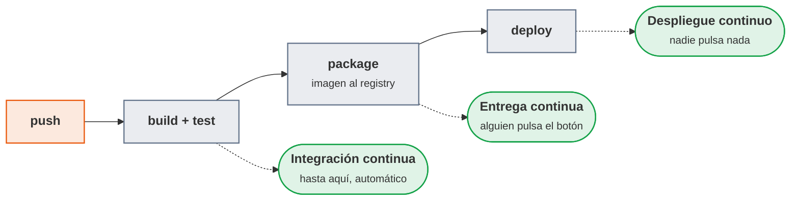
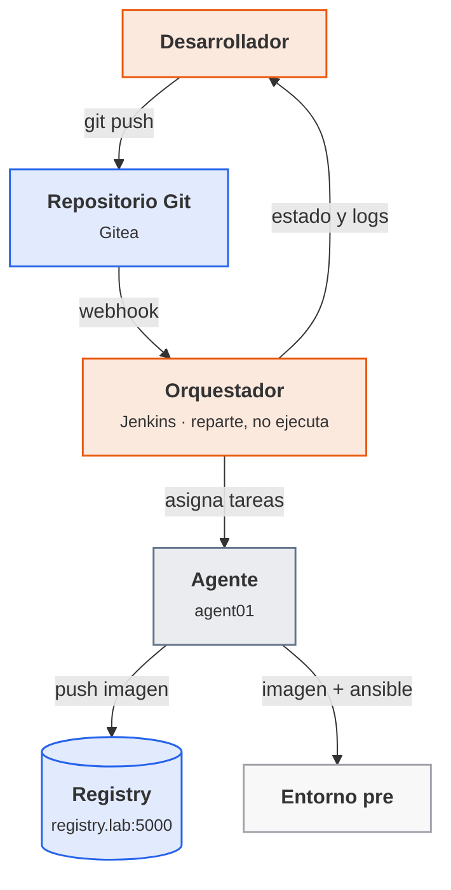
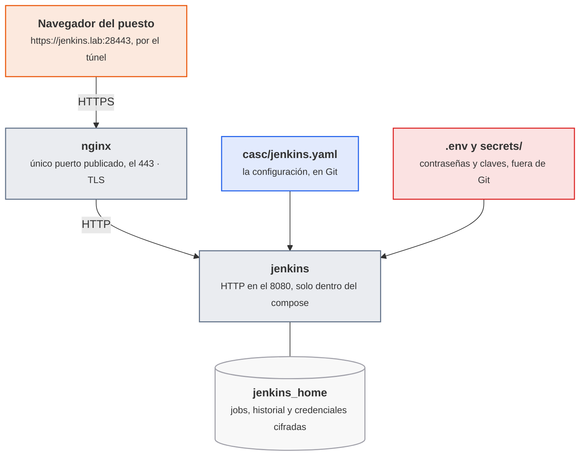
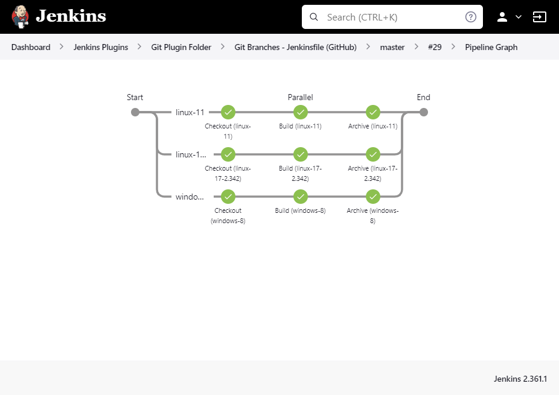
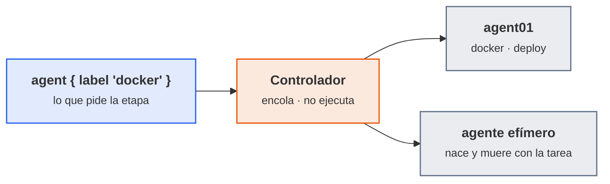
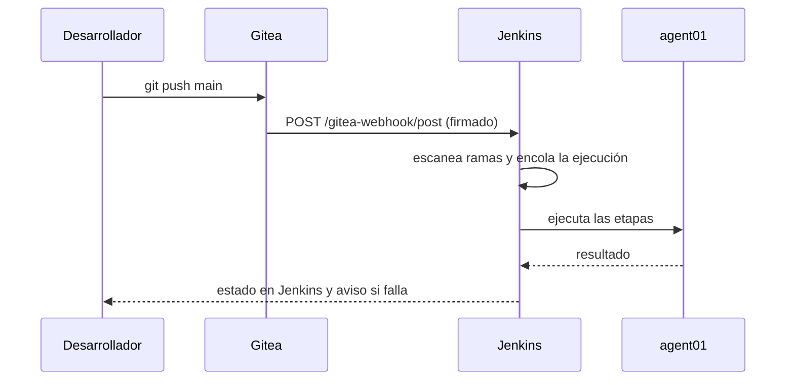
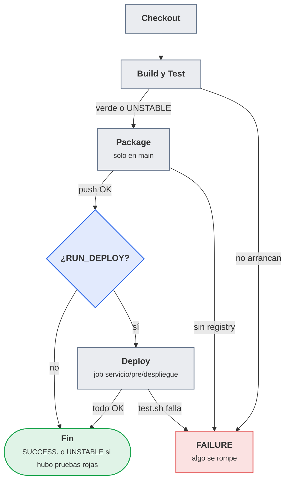
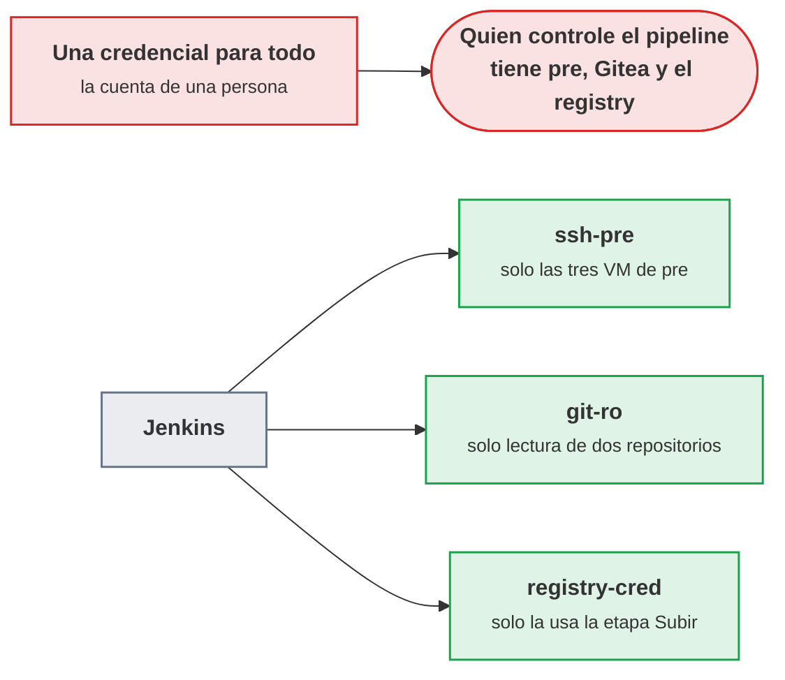

# UT6 · Orquestador de integración continua

<p class="ut-meta">18 h · Sesiones 30 a 38 · RA4 CE a, b, c, d, e, f, g, h</p>

En la UT5 quedó un repositorio con el que se levanta el servicio del curso de principio a fin: `tofu apply` crea las máquinas, Ansible las configura y `test.sh` comprueba que responde. Todo eso se lanzaba a mano desde el puesto de administración, con claves personales y solo cuando alguien se acordaba. Esta unidad quita a la persona de en medio: un orquestador de integración continua vigila el repositorio, ejecuta las pruebas, construye la imagen, la sube a un registry y, cuando se le pide, la despliega en `pre` con el mismo playbook y el mismo `test.sh`.

La unidad sigue el orden en que se monta un sistema así. Primero se elige la herramienta. Después se instala Jenkins de forma segura, porque guardará las credenciales de todo lo demás, y se le dan máquinas donde ejecutar. Luego se engancha al repositorio para que cada push lo dispare, se escribe el pipeline en dos tandas (construir y probar; empaquetar y decidir cuándo) y se prueba por los caminos que acaban mal. Lo último es la credencial que entra en `pre` para desplegar. La práctica evaluable, el 10 de marzo, lo junta todo.

<figure markdown="span">
  { width="120" }
  <figcaption>Jenkins, el orquestador que se usa en el laboratorio. Fuente: proyecto Jenkins, CC BY-SA 3.0.</figcaption>
</figure>

## Sesión 30 · CI y elección del orquestador

<p class="ut-meta" markdown>3 de febrero · Teoría y práctica · <span class="dur" tabindex="0" aria-label="Integración continua, entrega continua y despliegue continuo · 15 min&#10;Elegir el orquestador · 10 min&#10;A6.1 Elección del orquestador · 85 min" data-dur="Integración continua, entrega continua y despliegue continuo · 15 min&#10;Elegir el orquestador · 10 min&#10;A6.1 Elección del orquestador · 85 min">:material-school:<i class="dur-barra" style="--teoria:23%"></i>:material-flask:</span></p>

El `test.sh` de la UT5 demuestra que un despliegue funciona, pero solo cuando alguien lo lanza. Antes de instalar nada hay que decidir qué se quiere automatizar y con qué herramienta. El primer apartado aclara las palabras (integración, entrega y despliegue continuos) y qué aporta un pipeline frente a un script; el segundo compara los orquestadores más usados. La hoja ejecuta el mismo hola mundo en Jenkins y en Gitea Actions y termina con una justificación escrita de cuál usar.

### Integración continua, entrega continua y despliegue continuo

**Para qué sirve.** Cuando cada persona trabaja semanas por su cuenta y el código se junta al final, aparecen a la vez los conflictos de todos y nadie sabe qué cambio rompió qué. La **integración continua** (CI) consiste en juntar el trabajo varias veces al día en un repositorio común y comprobar automáticamente, en cada cambio, que el proyecto se construye y pasa las pruebas. Así el error aparece a los diez minutos y lo arregla quien lo acaba de escribir.



<p class="pie" markdown>Los tres escalones son el mismo pipeline: lo que cambia es hasta dónde llega sin intervención humana.</p>

**Los tres escalones.** Lo que los distingue es quién decide que un cambio llega a producción:

| Escalón | Qué añade | Quién decide el paso a producción |
|---|---|---|
| Integración continua | Build, pruebas y empaquetado automáticos en cada cambio | Nadie despliega todavía |
| Entrega continua (*continuous delivery*, CD) | El artefacto validado se despliega solo en los entornos de prueba y queda listo para producción | Una persona pulsa un botón |
| Despliegue continuo (*continuous deployment*) | Cada cambio que pasa las pruebas llega a producción | Nadie; el pipeline es la aprobación |

**Hasta dónde llega el curso.** Hasta la entrega continua: el pipeline despliega en `pre` cuando se le pide con un parámetro, y producción sigue siendo una decisión humana. El despliegue continuo exige una batería de pruebas muy completa y no se improvisa.

#### Las piezas

Un sistema de integración continua tiene cinco piezas, y la unidad monta una o dos por sesión:

- **Repositorio Git** con el código y, dentro, la definición del pipeline, para que se versione y se revise como el código. En el curso es `servicio`, en la Gitea del laboratorio.
- **Orquestador** (Jenkins, GitLab CI, GitHub Actions, Gitea Actions): recibe el aviso de cambio, decide qué ejecutar, dónde y con qué credenciales, y guarda logs y resultados. El aviso es un **webhook**: una petición HTTP que el servidor Git manda al orquestador cada vez que alguien hace push.
- **Agentes**: las máquinas o contenedores donde se ejecutan de verdad las tareas. El orquestador solo coordina.
- **Registry**: el servidor de imágenes de contenedor (`docker push` sube, `docker pull` descarga), donde queda la imagen que produce el pipeline.
- **Entornos** de destino: `pre`, el que se creó en la UT5.



<p class="pie" markdown>El círculo se cierra en el desarrollador: lo útil de un pipeline es que devuelve el resultado a quien escribió el cambio.</p>

#### Qué aporta un pipeline frente a un script

Un **pipeline** es la cadena de etapas que atraviesa cada cambio (checkout, build, test, package, deploy); cada etapa puede detener la cadena si falla. Un script con un cron haría lo mismo solo en el camino feliz. El orquestador añade:

- **Historial**: cada ejecución queda numerada con su commit, su log y quién la lanzó.
- **Estados con significado**: distingue "todo bien", "pruebas rojas", "se rompió" y "alguien lo canceló".
- **Credenciales gestionadas**: guardadas cifradas, entregadas solo a la etapa que las necesita y tapadas en el log.
- **Condiciones, paralelismo y límites**: "esto solo en `main`", dos etapas a la vez, tiempo máximo y nunca dos despliegues a la vez.
- **Disparo automático** desde el repositorio.

**La buena práctica.** El pipeline vive en el mismo repositorio que el código, y lo que hace a mano una persona se pasa al pipeline en cuanto se repite.

### Elegir el orquestador

**Para qué sirve.** Cambiar de orquestador obliga a reescribir todos los pipelines, así que se elige con criterios y no por costumbre. El módulo pide cuatro (CE 4a): que pueda **controlar las variables** (parámetros, secretos), aplicar **limitaciones** (tiempo, concurrencia, quién lanza qué), **integrarse** con el entorno (Git, Docker, Ansible, registry) y **registrar** cada ejecución. En una empresa pesan igual otros dos: quién lo va a mantener y dónde está ya el código.

|  | **Jenkins** | **GitLab CI** | **GitHub Actions** | **Gitea Actions** |
|----|----|----|----|----|
| Instalación | Servidor propio (contenedor) | Incluido en GitLab | Servicio de GitHub | Incluido en Gitea; runner aparte |
| Integración | Más de 1800 plugins | Integrado con su repositorio y su registry | Catálogo de acciones | Reutiliza acciones de GitHub |
| Registro de ejecuciones | Historial por job, artefactos e informes | Log por job, artefactos e informes de pruebas | Log por job y artefactos | Como Actions, más limitado |
| Variables y límites | Parámetros, credenciales, cuotas por agente, timeouts | Variables por proyecto, límites por runner, timeouts | Secretos, concurrencia, timeouts | Secretos, concurrencia |
| Mantenimiento | Alto: núcleo, plugins, copias, agentes | Medio: va con GitLab, que es pesado | Bajo en la nube | Bajo |
| Comunidad | Enorme, con mucho material antiguo | Muy buena | La mayor | Pequeña |

**La elección del curso.** **Jenkins**, porque obliga a montar cada pieza (agentes, secretos, webhook) y, cuando falla, se sabe dónde mirar; lo aprendido se traslada a GitLab CI cambiando la sintaxis. Su punto débil es el mantenimiento de los plugins, que la unidad trata en la sesión 31.

#### Jenkins y Gitea Actions por dentro

La hoja compara los dos extremos de la tabla con el mismo hola mundo.

**Jenkins: un servidor que ejecuta *jobs*.** Es una aplicación web en Java. Cada cosa que se le pide es un **job** (un proyecto); el de tipo *Pipeline* lleva un script que dice qué etapas ejecutar. Casi todo lo que sabe hacer viene de plugins. El primer arranque pide una contraseña inicial, que deja en un fichero de su directorio de datos, y ofrece instalar los plugins recomendados.

**Gitea Actions: el pipeline vive en el repositorio.** Usa la sintaxis de GitHub Actions: un fichero YAML en `.gitea/workflows/` que dice cuándo se dispara (`on: push`), qué trabajos tiene (`jobs`), dónde corre cada uno (`runs-on`) y qué pasos ejecuta (`steps`). Los trabajos los ejecuta un **runner**, `act_runner`, un programa aparte que se registra en Gitea con un token y anuncia **etiquetas**: `debian:docker://debian:13-slim` significa que los trabajos con `runs-on: debian` corren en un contenedor de esa imagen. Por eso el runner necesita el Docker de su máquina.

### A6.1 Elección del orquestador (sesión 30)

<span class="et et-obj">Objetivo</span> Al terminar has ejecutado el mismo «hola mundo» en Jenkins y en Gitea Actions y tienes escrita la justificación de cuál usarías para el servicio del curso. Elegir y justificar la herramienta es lo primero que se pide en cualquier proyecto de integración continua, y la tabla y la justificación de hoy van tal cual a la práctica evaluable.

<span class="et et-pre">Antes de empezar</span> El nodo, la plantilla 9000 y el puesto de administración accesibles, y tu Gitea de `mon01` (`http://gitea.lab:23001`, la de la práctica evaluable de la UT2 de Mantenimiento) con tu usuario. Se han explicado [integración, entrega y despliegue continuos](#integracion-continua-entrega-continua-y-despliegue-continuo), la [comparativa de orquestadores](#elegir-el-orquestador) y [cómo están hechos Jenkins y Gitea Actions](#jenkins-y-gitea-actions-por-dentro).

<span class="et et-pas">Pasos</span>

Primero preparas la máquina que alojará Jenkins el resto del curso. Después montas el mismo hola mundo en los dos orquestadores, con la instalación mínima, porque hoy interesa ver cómo es cada herramienta, no protegerla. Al final pasas lo que has visto a una tabla y decides. Apunta mientras trabajas: cada casilla de la tabla tiene que salir de algo que has hecho.

1. **Prepara `jenkins01`.** Es la VM 101 de la [tabla del laboratorio](../laboratorio.md#maquinas-ids-de-vm-y-direcciones) y aloja Jenkins todo el curso. En la Shell del nodo:

    ```bash
    qm clone 9000 101 --name jenkins01 --full
    qm set 101 --memory 2048 --net0 virtio,bridge=devmgmt \
      --ipconfig0 ip=10.10.0.10/24,gw=10.10.0.1 --nameserver 10.10.0.1 --searchdomain lab
    qm start 101
    ```

    En OPNsense, Services → Dnsmasq DNS & DHCP → Hosts, da de alta `jenkins.lab` y `jenkins01.lab` con la 10.10.0.10. Dentro de `jenkins01`, instala Docker como en la A1.3:

    ```bash
    curl -fsSL https://get.docker.com | sudo sh
    sudo usermod -aG docker ops     # sal y vuelve a entrar para que se aplique
    ```

    Compruébalo con `ssh jenkins01 docker version` desde el puesto de administración.

2. **Haz el hola mundo en Jenkins.** Levanta un Jenkins de usar y tirar, sin TLS ni roles. Solo en esta demo se publica el 8080. En `jenkins01`, crea `~/demo/compose.yml`:

    ```yaml
    services:
      jenkins:
        image: jenkins/jenkins:lts-jdk21
        ports: ["8080:8080"]
        volumes: [jenkins_demo:/var/jenkins_home]
    volumes:
      jenkins_demo:
    ```

    ```bash
    cd ~/demo && docker compose up -d
    docker compose exec jenkins cat /var/jenkins_home/secrets/initialAdminPassword
    ```

    Desde tu puesto, abre un túnel (`ssh -L <puerto libre>:10.10.0.10:8080 admin01`, con un puerto libre de la [franja del curso](../laboratorio.md#puertos)) y entra en `http://localhost:<puerto libre>`. Completa el asistente y crea un job de tipo Pipeline con este script:

    ```groovy
    pipeline {
        agent any
        stages {
            stage('Hola') { steps { echo 'hola desde Jenkins' } }
        }
    }
    ```

    Apunta todo lo que te pide antes de dejarte ejecutar nada. Pulsa "Build Now": la consola de la ejecución tiene que mostrar el `echo`.

3. **Haz lo mismo en Gitea Actions.** Crea en tu Gitea el repositorio de prueba `hola-ci` y activa Actions en su configuración. Copia el token de la página de runners del repositorio y levanta el runner en `~/runner/compose.yml` de `jenkins01` antes de escribir el workflow, para que baje su imagen mientras tanto:

    ```yaml
    services:
      runner:
        image: gitea/act_runner:0.2.11
        environment:
          GITEA_INSTANCE_URL: http://gitea.lab:23001
          GITEA_RUNNER_REGISTRATION_TOKEN: <token de la página de runners>
          GITEA_RUNNER_LABELS: debian:docker://debian:13-slim
        volumes:
          - /var/run/docker.sock:/var/run/docker.sock
          - ./data:/data
    ```

    Después sube a `hola-ci` el fichero `.gitea/workflows/hola.yml`:

    ```yaml
    on: push
    jobs:
      hola:
        runs-on: debian
        steps:
          - run: echo 'hola desde Gitea Actions'
    ```

    El runner tiene que aparecer en la página de runners, y la pestaña Actions del repositorio, mostrar la ejecución.

4. **Compara las dos ejecuciones.** Apunta, del log de cada una, dónde ha corrido, cuánto ha tardado y cuántos pasos de configuración hicieron falta hasta ver el `echo`. Son los datos en bruto de la tabla del paso siguiente.

5. **Pásalo a una tabla.** Compara Jenkins y Gitea Actions con los criterios de [Elegir el orquestador](#elegir-el-orquestador) (control de variables, limitaciones, integración, registro, mantenimiento, comunidad), con lo que acabas de ver y la tabla de la teoría.

6. **Decide y justifícalo.** Escribe en media página cuál usarías para el servicio del curso, apoyándote en las casillas de tu tabla que más pesan para un servicio como este.

<span class="et et-com">Comprobación</span> Las dos ejecuciones en verde con el `echo` visible en el log, y una tabla donde cada casilla diga algo que hayas comprobado, no copiado.

<span class="et et-ent">Para practicar</span> Guarda en `A6.1` de `entregas-5166` la tabla, la justificación y una captura de la ejecución en cada orquestador.

<span class="et et-ext">Si te sobra tiempo</span> Añade una segunda etapa que falle (`sh 'exit 1'`) en los dos y compara cómo lo muestra cada uno.

## Sesión 31 · Instalación segura y plugins

<p class="ut-meta" markdown>5 de febrero · Teoría y práctica · <span class="dur" tabindex="0" aria-label="Instalar y asegurar Jenkins · 15 min&#10;Plugins · 5 min&#10;A6.2 Instalación segura y plugins · 90 min" data-dur="Instalar y asegurar Jenkins · 15 min&#10;Plugins · 5 min&#10;A6.2 Instalación segura y plugins · 90 min">:material-school:<i class="dur-barra" style="--teoria:18%"></i>:material-flask:</span></p>

El Jenkins de la demo servía para ver la herramienta, no para trabajar: hablaba HTTP en claro, tenía un solo administrador y sus plugins no tenían versión conocida. Este Jenkins va a guardar las credenciales de Gitea, del registry y de `pre`, así que será la máquina más atractiva del laboratorio para un atacante. Esta sesión lo instala para quedarse, por capas: en contenedor con nginx delante, con certificado, con roles, sin ejecutar nada en el controlador y con toda la configuración en un YAML. Los plugins van en la misma sesión porque se meten en la misma imagen. Al acabar, todo está en el repositorio `jenkins-config`.

### Instalar y asegurar Jenkins

El objetivo es un Jenkins accesible por HTTPS con un certificado de la CA del curso, con usuarios y roles, y con su configuración en un YAML versionado. Los ficheros de este apartado están enteros porque la hoja A6.2 los copia.



<p class="pie" markdown>Lo que define a Jenkins está en Git y se puede reconstruir; el volumen y los secretos se guardan aparte.</p>

#### Despliegue en contenedor

**Para qué.** La imagen oficial `jenkins/jenkins:lts-jdk21` (LTS es la versión de soporte largo, la de producción) trae Jenkins y Java, sin plugins. Todo su estado vive en `/var/jenkins_home`, en un volumen: actualizar es cambiar la imagen. Jenkins habla HTTP en el 8080; delante va **nginx**, que recibe el HTTPS y se lo pasa por la red interna del compose, como el nginx de `web01` en la UT3.

```yaml
# compose.yml
services:
  jenkins:
    image: jenkins/jenkins:lts-jdk21
    volumes:
      - jenkins_home:/var/jenkins_home
      - ./casc:/var/jenkins_home/casc:ro
      - ./secrets:/run/secrets:ro      # claves que lee Configuration as Code
    env_file: .env                     # contraseñas de los usuarios, fuera del repositorio
    environment:
      JAVA_OPTS: "-Djenkins.install.runSetupWizard=false"
      CASC_JENKINS_CONFIG: /var/jenkins_home/casc/jenkins.yaml
    # sin ports: solo nginx llega a él por la red interna del compose
  nginx:
    image: nginx:1.27
    ports: ["443:443"]
    volumes:
      - ./nginx.conf:/etc/nginx/conf.d/default.conf:ro
      - ./certs:/etc/nginx/certs:ro
    depends_on: [jenkins]
volumes:
  jenkins_home:
```

- `jenkins` no publica puertos: desde fuera solo está abierto el 443 de nginx.
- `runSetupWizard=false` apaga el asistente de la demo: los usuarios los crea el YAML y los plugins vienen en la imagen.
- `CASC_JENKINS_CONFIG` dice dónde está ese YAML.
- Los secretos no van en el repositorio: las contraseñas llegan desde `.env` y las claves, como ficheros de `secrets/`.

```nginx
# nginx.conf
server {
    listen 443 ssl;
    server_name jenkins.lab;
    ssl_certificate     /etc/nginx/certs/jenkins.crt;
    ssl_certificate_key /etc/nginx/certs/jenkins.key;

    location / {
        proxy_pass         http://jenkins:8080;
        proxy_http_version 1.1;
        proxy_set_header   Host              $host;
        proxy_set_header   X-Real-IP         $remote_addr;
        proxy_set_header   X-Forwarded-For   $proxy_add_x_forwarded_for;
        proxy_set_header   X-Forwarded-Proto https;
        proxy_set_header   X-Forwarded-Host  $host;
        # agentes y cliente de línea de órdenes por WebSocket
        proxy_set_header   Upgrade    $http_upgrade;
        proxy_set_header   Connection "upgrade";
        proxy_read_timeout 90s;
        client_max_body_size 50m;
    }
}
```

- `proxy_pass` manda todo al contenedor `jenkins` por su nombre.
- Las cabeceras `X-Forwarded-*` le dicen a Jenkins que le han llamado por HTTPS y a qué nombre; sin ellas genera enlaces rotos y avisa de que el proxy está mal configurado.
- `Upgrade` y `Connection` dejan pasar las conexiones permanentes (WebSocket) de algunos agentes.

**Dónde vive.** En `jenkins01` (10.10.0.10), en la subred de gestión, nunca en la DMZ: guarda credenciales de todo y no lo necesita nadie de fuera. Este mismo `nginx.conf`, cambiando nombre, certificado y destino, publica Gitea el 12 de febrero.

#### Certificados

**De dónde sale.** El certificado de `jenkins.lab` lo firma **la CA del curso**, la de `~/ca/` del puesto de administración, que se montó en la preparación de la [A3.1](ut3-seguridad-por-capas.md#a31-firewall-y-publicacion-de-la-web-sesion-15). Son dos comandos desde `~/ca/` (`openssl ca` pide confirmar dos veces):

```bash
openssl req -new -newkey rsa:2048 -nodes -keyout jenkins.key -out jenkins.csr \
  -subj "/CN=jenkins.lab" -addext "subjectAltName=DNS:jenkins.lab"
openssl ca -config ca.cnf -extensions server_cert -notext -in jenkins.csr -out jenkins.crt
```

Los certificados de `gitea.lab` y del registry salen igual cambiando el nombre. Con `-extensions client_cert` sale un certificado de cliente, el que demuestra quién es el que se conecta; Jenkins usa uno el 10 de febrero para dar órdenes al Docker de su agente.

**Quién confía en ella.** `ca.crt` se instala en el navegador del puesto y en cada máquina que habla con Jenkins, Gitea o el registry (`/usr/local/share/ca-certificates/lab-ca.crt` y `update-ca-certificates`). `ca.key` no sale nunca del puesto.

!!! truco "subjectAltName obligatorio"
    Sin el `subjectAltName` los navegadores rechazan el certificado aunque el CN sea correcto; es el error más repetido en esta sesión.

#### Usuarios y permisos

**El problema.** Quien administra Jenkins puede ejecutar código con sus permisos y leer todas las credenciales que guarda. Por eso los administradores son muy pocos y el resto tiene solo lo que usa.

- **Roles**, con el plugin Role-based Authorization Strategy: administrador (dos personas como mucho), desarrollador (lanzar y ver) y lector (solo ver). El YAML del curso crea `admin`, `dev` y `lector`; en una empresa los usuarios vienen del directorio corporativo.
- **Sin registro abierto**: nadie se da de alta solo (`allowsSignup: false`).
- **Protección contra peticiones falsificadas** (CSRF en la pantalla de Jenkins): impide que una web ajena use el navegador de alguien ya autenticado para lanzar acciones. Viene activada y no se desactiva.
- **La Script Console** (Manage Jenkins → Script Console) ejecuta código sin restricciones con los permisos de Jenkins. La tiene quien tiene `Overall/Administer`, y por eso se da a tan pocos.

#### Hardening del controlador

**El controlador es lo que más se protege**, porque guarda las credenciales cifradas y la clave que las descifra.

- **0 ejecutores en el controlador**: nada se ejecuta en él, todo en agentes. Un pipeline que corriese ahí podría leer la clave de las credenciales.
- **Actualizaciones y copias**: la versión LTS, los plugins revisados cada mes y copia del volumen `jenkins_home`.
- **Configuration as Code** (plugin `configuration-as-code`): la configuración en un YAML versionado que Jenkins aplica al arrancar. Es lo que permite reconstruirlo en cinco minutos.

El YAML del laboratorio. Los bloques importantes: `securityRealm` y `authorizationStrategy` (usuarios y roles), `nodes` (el agente `agent01`) y `credentials` (la clave SSH del agente, leída de un fichero). Los dos últimos se añaden el 10 de febrero, con el agente.

```yaml
# casc/jenkins.yaml
jenkins:
  systemMessage: "Jenkins de la asignatura. Configurado por JCasC, no toques nada a mano."
  numExecutors: 0
  mode: EXCLUSIVE
  securityRealm:
    local:
      allowsSignup: false
      users:
        - id: admin
          password: ${ADMIN_PASSWORD}
        - id: dev
          password: ${DEV_PASSWORD}
        - id: lector
          password: ${LECTOR_PASSWORD}
  authorizationStrategy:
    roleBased:
      roles:
        global:
          - name: admin
            permissions: ["Overall/Administer"]
            entries:
              - user: admin
          - name: dev
            permissions: ["Overall/Read", "Job/Read", "Job/Build", "Job/Cancel", "Job/Workspace"]
            entries:
              - user: dev
          - name: lector
            permissions: ["Overall/Read", "Job/Read"]
            entries:
              - group: authenticated
  crumbIssuer:
    standard:
      excludeClientIPFromCrumb: false
  nodes:
    - permanent:
        name: agent01
        labelString: "docker deploy"
        remoteFS: /home/jenkins
        numExecutors: 2
        launcher:
          ssh:
            host: 10.10.0.12
            port: 22
            credentialsId: agent-ssh
            sshHostKeyVerificationStrategy:
              manuallyProvidedKeyVerificationStrategy:
                key: "ssh-ed25519 AAAAC3Nza... agent01"
unclassified:
  location:
    url: https://jenkins.lab/
    adminAddress: ops@lab
credentials:
  system:
    domainCredentials:
      - credentials:
          - basicSSHUserPrivateKey:
              scope: SYSTEM
              id: agent-ssh
              username: jenkins
              privateKeySource:
                directEntry:
                  privateKey: ${AGENT_SSH_KEY}
```

**Cómo llegan los secretos.** Los `${...}` se rellenan al arrancar: las contraseñas, de las variables de `.env`, y `${AGENT_SSH_KEY}`, del fichero `/run/secrets/AGENT_SSH_KEY`. Así el YAML se sube al repositorio sin un solo secreto. El rol `lector` va al grupo `authenticated` (todos los que han entrado), así que `dev` y `admin` también leen.

### Plugins

**Para qué.** Un Jenkins recién instalado no sabe clonar, hablar con Docker ni leer un informe de pruebas: cada capacidad es un plugin. Instalarlos a mano desde Manage Jenkins → Plugins deja cada Jenkins con versiones distintas; lo que se hace es una imagen propia que los trae de una lista, `plugins.txt`, con una línea `id:version` por plugin:

```dockerfile
FROM jenkins/jenkins:lts-jdk21
COPY plugins.txt /usr/share/jenkins/ref/plugins.txt
RUN jenkins-plugin-cli --plugin-file /usr/share/jenkins/ref/plugins.txt
# la CA del curso, para que el controlador confíe en gitea.lab y en el registry
USER root
COPY ca.crt /usr/local/share/ca-certificates/lab-ca.crt
RUN update-ca-certificates && \
    keytool -importcert -noprompt -cacerts -storepass changeit -alias lab-ca \
      -file /usr/local/share/ca-certificates/lab-ca.crt
USER jenkins
```

`jenkins-plugin-cli` descarga cada plugin con sus dependencias al construir la imagen. Las líneas siguientes meten la CA del curso en el almacén del sistema (lo usa `git`) y en el de Java (lo usa Jenkins), para cuando Gitea pase a HTTPS el 12 de febrero.

**Los que necesita el módulo**, con la sesión en que se empiezan a usar:

| **Plugin** | **Id** | **Para qué** | **Sesión** |
|----|----|----|----|
| Git | `git` | Clonar repositorios, `checkout scm` | 33 |
| Gitea | `gitea` | Descubrir ramas y recibir el webhook de Gitea | 33 |
| Pipeline | `workflow-aggregator` | Todo lo necesario para un `Jenkinsfile` | 34 |
| Docker Pipeline | `docker-workflow` | `agent { docker {...} }`, `docker.build`, `docker.withRegistry` | 34, 35 |
| Docker | `docker-plugin` | Agentes efímeros en contenedor | 32 |
| SSH Build Agents | `ssh-slaves` | Agentes permanentes por SSH | 32 |
| Credentials Binding | `credentials-binding` | Usar los secretos con `withCredentials` | 33 |
| Folders | `cloudbees-folder` | Carpetas con credenciales propias | 33, 37 |
| Role-based Authorization Strategy | `role-strategy` | Permisos por rol | 31 |
| Configuration as Code | `configuration-as-code` | Configuración versionada | 31 |
| JUnit | `junit` | Publicar informes de pruebas | 34 |
| Pipeline Graph View | `pipeline-graph-view` | Ver el pipeline por etapas | 34 |
| Timestamper | `timestamper` | Hora en cada línea del log | 31 |
| Workspace Cleanup | `ws-cleanup` | `cleanWs()` al terminar | 36 |

**La buena práctica.** Un plugin es código de terceros que corre con todos los permisos de Jenkins. Se instala solo lo que se usa, con la versión fijada, y antes se mira en [plugins.jenkins.io](https://plugins.jenkins.io/) la fecha de la última versión y si tiene avisos de seguridad; uno abandonado se cambia por otro.

<figure markdown="span">
  { width="640" }
  <figcaption>Un pipeline visto con Pipeline Graph View: etapas, duración y estado de cada una. Fuente: Mark Waite, CC BY-SA 4.0, vía Wikimedia Commons.</figcaption>
</figure>

### A6.2 Instalación segura y plugins (sesión 31)

<span class="et et-obj">Objetivo</span> Al terminar tienes el Jenkins definitivo del curso en `https://jenkins.lab`, con candado, tres roles que solo pueden lo que les toca, 0 ejecutores en el controlador y los plugins en una imagen propia con versión fijada. Todo queda en el repositorio `jenkins-config` con un README para reconstruirlo, que es como se entrega una instalación en una empresa.

<span class="et et-pre">Antes de empezar</span> `jenkins01` de la A6.1, con Docker y con `jenkins.lab` en OPNsense, y la CA del curso en `~/ca/` del puesto de administración (la de la A3.1). Tira la demo de la A6.1 con sus volúmenes: `docker compose down -v` en `~/demo` y en `~/runner` de `jenkins01`. Se han explicado [cómo se instala y asegura Jenkins](#instalar-y-asegurar-jenkins) y [qué plugins hacen falta](#plugins).

<span class="et et-pas">Pasos</span>

Vas de fuera hacia dentro: primero el certificado; después revisas los plugins antes de meterlos en la imagen; montas los ficheros, levantas Jenkins y compruebas los permisos con cada usuario. Al final lo dejas escrito en el repositorio.

1. **Emite el certificado de `jenkins.lab`.** En el puesto de administración, con los dos comandos de [Certificados](#certificados), y llévalo a `jenkins01`:

    ```bash
    cd ~/ca
    # los dos comandos openssl de Certificados
    ssh jenkins01 'mkdir -p ~/jenkins-config/certs ~/jenkins-config/casc ~/jenkins-config/secrets'
    scp jenkins.crt jenkins.key jenkins01:jenkins-config/certs/
    scp ca.crt jenkins01:jenkins-config/
    ```

    Compruébalo con `openssl x509 -in jenkins.crt -noout -ext subjectAltName`: tiene que salir `DNS:jenkins.lab`. `ca.key` no sale del puesto.

2. **Revisa los plugins antes de instalarlos.** Busca en [plugins.jenkins.io](https://plugins.jenkins.io/) tres plugins de la [tabla](#plugins), entre ellos `docker-plugin`, y recoge en una tabla: id, última versión y su fecha, avisos de seguridad abiertos y tu veredicto (se queda, se cambia o se quita) en media línea.

3. **Monta la instalación.** En `~/jenkins-config` de `jenkins01`:

    - `compose.yml` y `nginx.conf` de [Despliegue en contenedor](#despliegue-en-contenedor), cambiando en `jenkins` la línea `image:` por `build: .`, para que se construya tu imagen.
    - El `Dockerfile` de [Plugins](#plugins), tal cual.
    - `plugins.txt` con todos los plugins de la tabla, uno por línea y con la versión que has visto en plugins.jenkins.io: `git:<versión>`, `gitea:<versión>`...
    - `.gitignore` con dos líneas, `.env` y `secrets/`, para que ningún secreto llegue al repositorio.

    Compruébalo con `docker compose config`, que no debe dar errores.

4. **Escribe la configuración en YAML.** Copia en `casc/jenkins.yaml` el YAML de [Hardening del controlador](#hardening-del-controlador) **sin** los bloques `nodes` y `credentials`, que son del agente y se añaden el 10 de febrero. Crea el `.env` con las tres contraseñas:

    ```bash
    ADMIN_PASSWORD=<contraseña de admin>
    DEV_PASSWORD=<contraseña de dev>
    LECTOR_PASSWORD=<contraseña de lector>
    ```

5. **Levántalo y prueba los permisos con cada usuario.** Construir la imagen descarga los plugins y tarda: aprovecha la espera para empezar el README del paso 6.

    ```bash
    docker compose up -d --build
    docker compose logs -f jenkins     # espera a "Jenkins is fully up and running"
    ```

    En tu puesto, añade `127.0.0.1 jenkins.lab` al fichero hosts, abre el túnel `ssh -L 28443:10.10.0.10:443 admin01` (el de [Nombres DNS y acceso](../laboratorio.md#nombres-dns-y-acceso)) y entra como `admin` en `https://jenkins.lab:28443`. Crea un job Pipeline vacío y comprueba con `dev` y con `lector` si pueden lanzarlo, ver su consola y entrar en Manage Jenkins. En Manage Jenkins → Plugins, mira que están los tuyos con la versión que fijaste.

6. **Déjalo escrito para reconstruirlo.** Crea en tu Gitea el repositorio vacío `ops/jenkins-config` y escribe un `README.md` con: cómo se emiten los certificados y que la CA vive en el puesto de administración, qué roles hay y qué puede cada uno, de dónde salen los plugins, qué variables lleva `.env` y los dos comandos para levantarlo. Súbelo todo:

    ```bash
    cd ~/jenkins-config
    git init -b main && git add . && git commit -m "Instalación de Jenkins"
    git remote add origin http://gitea.lab:23001/ops/jenkins-config.git
    git push -u origin main
    ```

    Comprueba en la web de Gitea que no aparecen `.env` ni `secrets/`.

<span class="et et-com">Comprobación</span> Candado en el navegador sin avisos; `lector` no puede lanzar nada; Manage Jenkins → Nodes muestra el controlador con 0 ejecutores; Manage Jenkins → Plugins lista todos los de `plugins.txt` con su versión; ni el YAML ni el README contienen contraseñas; y la tabla del paso 2 no deja ningún aviso de seguridad sin decisión.

<span class="et et-ent">Para practicar</span> Guarda en `A6.2` la URL de `jenkins-config`, la tabla de revisión de plugins del paso 2 y dos capturas, `https://jenkins.lab` con candado y la matriz de roles: lo pide la práctica evaluable.

<span class="et et-ext">Si te sobra tiempo</span> Comprueba que el README sirve: `docker compose down -v` (borra el volumen) y vuelve a levantarlo siguiendo solo tu `README.md`; lo que eches en falta, añádelo. Cuenta también cuántos plugins lista Manage Jenkins → Plugins → Installed frente a las líneas de tu `plugins.txt`: la diferencia son dependencias; localiza tres y anota de qué plugin tuyo cuelgan.

## Sesión 32 · Agentes

<p class="ut-meta" markdown>10 de febrero · Teoría y práctica · <span class="dur" tabindex="0" aria-label="Agentes · 10 min&#10;A6.3 Agentes · 100 min" data-dur="Agentes · 10 min&#10;A6.3 Agentes · 100 min">:material-school:<i class="dur-barra" style="--teoria:9%"></i>:material-flask:</span></p>

El controlador tiene cero ejecutores, a propósito: nada se ejecuta en la máquina que guarda las credenciales. La consecuencia es que Jenkins aún no puede ejecutar nada. Esta sesión le da dónde: un agente permanente, `agent01`, al que entra por SSH, y agentes efímeros en contenedor, que exigen abrir el Docker de `agent01` a la red sin regalárselo a nadie. La hoja monta los dos y lanza un job que pasa por ambos.

### Agentes

**El controlador coordina; los agentes ejecutan.** Un **agente** es una máquina o un contenedor donde Jenkins ejecuta las tareas. Tiene **ejecutores** (cuántas tareas admite a la vez), un directorio de trabajo donde cada job tiene su carpeta (el *workspace*) y **etiquetas**. Cuando una etapa pide `agent { label 'docker' }`, el controlador la encola hasta que un agente con esa etiqueta tenga un ejecutor libre.



<p class="pie" markdown>La etiqueta describe una **capacidad**, no una máquina: cambiar `agent01` por otra no obliga a tocar ningún `Jenkinsfile`.</p>

**Los dos tipos del laboratorio.** El **agente permanente por SSH** es una VM a la que Jenkins entra con una clave; sirve para las etapas que necesitan herramientas del host (`git`, `ansible`, Docker). El **agente en contenedor** lo crea la cloud Docker (plugin `docker-plugin`): Jenkins pide a un demonio Docker un contenedor para cada tarea y lo borra al terminar, así que no quedan restos de la ejecución anterior. En empresas grandes se hace lo mismo con Kubernetes.

#### agent01, el agente permanente por SSH

**Cómo entra Jenkins.** El controlador abre SSH con el usuario `jenkins` de `agent01`, copia `agent.jar` (el programa Java del agente) y lo arranca. Por eso la máquina necesita Java 21, `git`, Docker y un usuario `jenkins` cuyo directorio, `/home/jenkins`, es el de trabajo (el `remoteFS` del YAML).

**Con qué clave.** Un par de claves propio, de nadie en concreto: la privada la guarda Jenkins como credencial `agent-ssh` (leída de `secrets/AGENT_SSH_KEY`) y la pública se autoriza en el usuario `jenkins` de `agent01`.

**Cómo sabe que es `agent01`.** El YAML lleva la clave de host de `agent01`, sacada con `ssh-keyscan`; si otra máquina suplanta la IP, Jenkins rechaza la conexión y no le entrega código ni secretos.

!!! ojo "El grupo `docker` equivale a root"
    El usuario `jenkins` va en el grupo `docker` para lanzar contenedores sin `sudo`, y quien maneja Docker puede montar cualquier directorio del host. Por eso, en una empresa, el agente que construye no es el que despliega.

#### El demonio Docker por la red, con TLS

**Para qué.** La cloud Docker crea los agentes efímeros en `agent01`, pero quien los pide es el controlador, desde `jenkins01`: Jenkins tiene que dar órdenes al Docker de otra máquina. De serie, Docker solo escucha en un socket local.

**El riesgo y la solución.** Quien da órdenes a Docker es root en esa máquina. Por eso el demonio se publica en el **2376 con TLS en los dos sentidos**: presenta un certificado de servidor de la CA del curso (con la IP de `agent01` en el `subjectAltName`, porque la cloud entra por IP) y solo acepta clientes con un certificado de cliente de esa misma CA, que solo tiene Jenkins. El 2375, sin cifrar, no se usa nunca.

```json
{
  "hosts": ["unix:///var/run/docker.sock", "tcp://0.0.0.0:2376"],
  "tlsverify": true,
  "tlscacert": "/etc/docker/tls/ca.crt",
  "tlscert": "/etc/docker/tls/agent01.crt",
  "tlskey": "/etc/docker/tls/agent01.key"
}
```

Es `/etc/docker/daemon.json`. `hosts` mantiene el socket local y añade el TCP; `tlsverify` exige al cliente un certificado firmado por la CA de `tlscacert`.

**El choque con systemd.** Con ese fichero, Docker no arranca: systemd lo lanza con `-H fd://` y Docker se niega si `hosts` le llega también por `daemon.json`. Se arregla con un *override* que deja la orden de arranque sin opciones:

```ini
# /etc/systemd/system/docker.service.d/override.conf
[Service]
ExecStart=
ExecStart=/usr/bin/dockerd
```

La línea vacía borra la orden original y la segunda pone la nueva. Después, `systemctl daemon-reload` y reiniciar Docker.

**Qué recibe Jenkins.** Una credencial *X.509 Client Certificate*, `docker-tls`, con la clave y el certificado de cliente y `ca.crt`. Con ella, la cloud Docker se conecta a `tcp://10.10.0.12:2376`.

#### Elegir el agente desde el Jenkinsfile

**Dos cosas que se confunden.** La cloud Docker crea el agente entero como contenedor. `agent { docker { image 'python:3.12'; label 'docker' } }` hace otra cosa: en un agente con etiqueta `docker`, lanza un contenedor de esa imagen, monta dentro el workspace y ejecuta ahí los pasos. Es lo que usa el pipeline del curso para las pruebas: `agent01` no tiene Python 3.12, lo trae la imagen.

**La buena práctica.** El pipeline declara `agent none` y cada etapa dice el suyo. Así se decide en cada etapa dónde corre y con qué credenciales, y la construcción no se mezcla con el despliegue.

### A6.3 Agentes (sesión 32)

<span class="et et-obj">Objetivo</span> Al terminar, Jenkins tiene dónde ejecutar: un agente permanente, `agent01`, al que entra por SSH, y una cloud Docker que crea un agente en contenedor para cada tarea. Has lanzado un job con una etapa en cada uno y has visto en el log dónde corrió cada una. Sin esto no se puede ejecutar ningún pipeline de la unidad.

<span class="et et-pre">Antes de empezar</span> El Jenkins de la A6.2 funcionando con su repositorio `jenkins-config`, y la CA del curso en el puesto de administración. Se han explicado [los agentes y las etiquetas](#agentes), [cómo entra Jenkins en `agent01`](#agent01-el-agente-permanente-por-ssh) y [cómo se abre el Docker de un agente a la red](#el-demonio-docker-por-la-red-con-tls).

<span class="et et-pas">Pasos</span>

Primero el agente permanente: la máquina, la clave con la que Jenkins entra y su alta en el YAML. Después el efímero, que necesita que el Docker de `agent01` acepte órdenes por la red, pero solo de Jenkins. Al final, un job con una etapa en cada uno.

1. **Prepara `agent01`.** Es la VM 106 de la [tabla del laboratorio](../laboratorio.md#maquinas-ids-de-vm-y-direcciones). En la Shell del nodo:

    ```bash
    qm clone 9000 106 --name agent01 --full
    qm set 106 --memory 2048 --net0 virtio,bridge=devmgmt \
      --ipconfig0 ip=10.10.0.12/24,gw=10.10.0.1 --nameserver 10.10.0.1 --searchdomain lab
    qm start 106
    ```

    Da de alta `agent01.lab` en OPNsense. Dentro de `agent01`:

    ```bash
    sudo apt-get update && sudo apt-get install -y openjdk-21-jre-headless git
    curl -fsSL https://get.docker.com | sudo sh
    sudo useradd -m -s /bin/bash -G docker jenkins
    ```

    Compruébalo con `java -version` y `id jenkins`, que tiene que mostrar el grupo `docker`.

2. **Crea la clave con la que entra Jenkins.** En el puesto de administración, crea el par, autoriza la pública en `jenkins` de `agent01`, lleva la privada a `jenkins01` y bórrala del puesto:

    ```bash
    ssh-keygen -t ed25519 -N '' -C jenkins-agent -f agent_ssh
    ssh agent01 'sudo mkdir -p /home/jenkins/.ssh && sudo tee -a /home/jenkins/.ssh/authorized_keys' < agent_ssh.pub
    ssh agent01 'sudo chown -R jenkins:jenkins /home/jenkins/.ssh && sudo chmod 700 /home/jenkins/.ssh'
    scp agent_ssh jenkins01:jenkins-config/secrets/AGENT_SSH_KEY
    rm agent_ssh
    ssh-keyscan -t ed25519 10.10.0.12      # la clave de host que pide el YAML
    ```

    Apunta la clave de host sin la IP que `ssh-keyscan` escribe delante: el YAML quiere solo `ssh-ed25519 AAAA...`.

3. **Da de alta `agent01` en el YAML.** Añade a `casc/jenkins.yaml` los bloques `nodes` y `credentials` de [Hardening del controlador](#hardening-del-controlador), con tu clave de host en `key:`, y relanza Jenkins con `docker compose restart jenkins`. En Manage Jenkins → Nodes, `agent01` tiene que salir conectado, con las etiquetas `docker deploy` y dos ejecutores.

4. **Abre el Docker de `agent01` a Jenkins, y solo a Jenkins.** En el puesto, emite con la CA del curso un certificado de servidor para `agent01` y uno de cliente para Jenkins:

    ```bash
    cd ~/ca
    openssl req -new -newkey rsa:2048 -nodes -keyout agent01.key -out agent01.csr \
      -subj "/CN=agent01.lab" -addext "subjectAltName=DNS:agent01.lab,IP:10.10.0.12"
    openssl ca -config ca.cnf -extensions server_cert -notext -in agent01.csr -out agent01.crt
    openssl req -new -newkey rsa:2048 -nodes -keyout jenkins-key.pem -out jenkins-cliente.csr \
      -subj "/CN=jenkins"
    openssl ca -config ca.cnf -extensions client_cert -notext -in jenkins-cliente.csr -out jenkins-cert.pem
    scp ca.crt agent01.crt agent01.key agent01:/tmp/
    scp jenkins-cert.pem jenkins-key.pem jenkins01:jenkins-config/secrets/
    ```

    En `agent01`, coloca los certificados, mete la CA en el almacén del sistema (la usarán `git` y el registry), crea `/etc/docker/daemon.json` y el `override.conf` de [El demonio Docker por la red, con TLS](#el-demonio-docker-por-la-red-con-tls), y reinicia:

    ```bash
    sudo mkdir -p /etc/docker/tls && sudo mv /tmp/agent01.crt /tmp/agent01.key /etc/docker/tls/
    sudo cp /tmp/ca.crt /etc/docker/tls/ca.crt
    sudo cp /tmp/ca.crt /usr/local/share/ca-certificates/lab-ca.crt && sudo update-ca-certificates
    # crea daemon.json y override.conf con el contenido de la teoría
    sudo systemctl daemon-reload && sudo systemctl restart docker
    ```

    Desde `~/jenkins-config` de `jenkins01`, prueba el demonio con y sin certificado de cliente:

    ```bash
    docker -H tcp://10.10.0.12:2376 --tlsverify --tlscacert ca.crt \
      --tlscert secrets/jenkins-cert.pem --tlskey secrets/jenkins-key.pem version
    docker -H tcp://10.10.0.12:2376 --tlsverify --tlscacert ca.crt version
    ```

5. **Crea la cloud Docker.** En Manage Jenkins → Clouds, crea una cloud Docker con la URI `tcp://10.10.0.12:2376` y una credencial nueva **X.509 Client Certificate** con id `docker-tls`: pega el contenido de `jenkins-key.pem`, `jenkins-cert.pem` y `ca.crt`. *Test Connection* tiene que devolver la versión del demonio. Añade una plantilla con la imagen `jenkins/agent` y la etiqueta `efimero`.

6. **Comprueba dónde corre cada etapa.** Crea un job Pipeline con este script y lánzalo. Mientras corre, mira `docker ps` en `agent01`.

    ```groovy
    pipeline {
        agent none
        stages {
            stage('Permanente') {
                agent { label 'docker' }
                steps { sh 'hostname; cat /etc/os-release' }
            }
            stage('Efímero') {
                agent { label 'efimero' }
                steps { sh 'hostname; cat /etc/os-release' }
            }
        }
    }
    ```

<span class="et et-com">Comprobación</span> En el log, la primera etapa muestra el hostname de `agent01` y la segunda uno de contenedor; *Test Connection* devuelve la versión del demonio y sin certificado ese puerto no contesta; `docker ps` en `agent01` muestra el agente efímero durante la ejecución y, al terminar, ya no está. Nada se ejecutó en el controlador.

<span class="et et-ent">Para practicar</span> Sube a `jenkins-config` el `jenkins.yaml` actualizado y guarda en `A6.3` la captura del log con los dos hostnames, que pide la práctica evaluable.

<span class="et et-ext">Si te sobra tiempo</span> Pasa la cloud al YAML: exporta la configuración (Manage Jenkins → Configuration as Code → View Configuration), copia el bloque `clouds` y deja la credencial `docker-tls` fuera, en `secrets/`. Y levanta un segundo agente con la imagen `jenkins/inbound-agent` y la opción `-webSocket`, que se conecta él a Jenkins a través de nginx sin abrir ningún puerto más.

## Sesión 33 · Proyecto y credenciales

<p class="ut-meta" markdown>12 de febrero · Teoría y práctica · <span class="dur" tabindex="0" aria-label="Proyectos, credenciales y webhooks · 15 min&#10;A6.4 Proyecto y credenciales · 95 min" data-dur="Proyectos, credenciales y webhooks · 15 min&#10;A6.4 Proyecto y credenciales · 95 min">:material-school:<i class="dur-barra" style="--teoria:14%"></i>:material-flask:</span></p>

Jenkins ya tiene dónde ejecutar, pero no sabe nada del código: ni dónde está, ni cómo leerlo, ni cuándo cambia. Esta sesión lo engancha, y lo hace contra la dirección definitiva de Gitea: la de `mon01` era provisional y hoy se muda a `gitea01`, con HTTPS. Después vienen el proyecto que sabe dónde está el código, la credencial con la que lo lee y el webhook que lo dispara con cada push.

### Proyectos, credenciales y webhooks

Para que Jenkins trabaje solo hacen falta tres cosas: un proyecto que sepa dónde está el código, una credencial para leerlo y un webhook para que arranque con cada push. Antes, la mudanza que deja Gitea en su dirección definitiva.

#### La mudanza de Gitea a gitea01

**Por qué hoy.** Desde hoy Jenkins lee de Gitea con una credencial y Gitea avisa a Jenkins con cada push; conviene configurar las dos cosas una sola vez, contra `https://gitea.lab` en `gitea01` (10.10.0.11). En esa máquina va también el registry el 19 de febrero, y por eso `registry.lab` apunta a su IP desde hoy.

**Cómo se lleva.** Gitea guarda todo (repositorios, usuarios, incidencias, tokens y su base de datos) en `/data`, que en `mon01` es el volumen `monitoring_gitea_data`. Se para Gitea, se empaqueta el volumen en un `tar`, se crea un volumen en `gitea01` y se desempaqueta dentro, con la misma versión de Gitea en los dos lados.

**El compose nuevo.** Es el servicio `gitea` de la práctica evaluable de la UT2 de Mantenimiento con estos cambios:

```yaml
# /opt/gitea/compose.yml, en gitea01 (delante va el nginx de jenkins-config)
services:
  gitea:
    image: gitea/gitea:1.24                        # la misma versión que corre en mon01
    environment:
      GITEA__server__HTTP_PORT: "23001"            # el mismo que en mon01, ahora sin publicar
      GITEA__server__ROOT_URL: https://gitea.lab/
      GITEA__webhook__ALLOWED_HOST_LIST: jenkins.lab
    volumes:
      - gitea_data:/data
      - ./ca.crt:/etc/ssl/certs/lab-ca.pem:ro
    # sin ports: solo nginx llega a él
volumes:
  gitea_data:
    external: true                                 # el que llega de mon01 en el tar
```

- **Sin puerto publicado**: Gitea se publica solo por nginx, en el 443, con un certificado de `gitea.lab`.
- **`ROOT_URL`**: la dirección que Gitea escribe en sus enlaces y URL de clonado.
- **La CA en `/etc/ssl/certs/`**: Gitea llama a `https://jenkins.lab` para entregar cada webhook y tiene que confiar en su certificado.
- **`ALLOWED_HOST_LIST`**: por defecto Gitea solo entrega webhooks a direcciones públicas; esta línea autoriza a Jenkins, y solo a él.
- **`external: true`**: el volumen ya existe, lo crea la mudanza; sin esta línea, compose crearía otro vacío.

**Lo que apuntaba a la dirección vieja.** Una mudanza no acaba al arrancar: hay que cambiar el DNS de OPNsense, la regla del cortafuegos que deja a `app01` llegar a Gitea, el receptor de incidencias de `mon01` y el remoto de cada copia de trabajo. El volumen viejo se guarda una semana.

#### El proyecto

**Qué es.** El **proyecto** (*job*) es lo que se lanza, tiene historial y se configura. El curso usa el tipo **Multibranch Pipeline**: Jenkins escanea el repositorio, crea un subjob por cada rama que tenga `Jenkinsfile` y lo borra cuando la rama desaparece. Así cada rama se prueba antes de fusionarse.

**Cómo encuentra el repositorio.** El plugin de Gitea añade una lista de servidores Gitea (Manage Jenkins → System → Gitea Servers). Con ella, el Multibranch descubre las ramas y sabe a qué proyecto va cada webhook. En el curso Jenkins solo lee, así que el webhook se crea a mano en Gitea.

**La buena práctica.** Descartar ejecuciones antiguas (si no, `jenkins_home` crece sin límite), poner un tiempo máximo y no permitir dos ejecuciones a la vez si tocan el mismo entorno.

#### Credenciales

**El problema.** El pipeline necesita secretos, pero el `Jenkinsfile` está en el repositorio a la vista de todos. Jenkins guarda los secretos cifrados (Manage Jenkins → Credentials) y el pipeline solo los nombra por su id. Cuatro tipos cubren casi todo:

| Tipo | Para qué | Cómo se usa en el pipeline |
|---|---|---|
| Username with password | Registry, Gitea por HTTPS | `usernamePassword(credentialsId:, usernameVariable:, passwordVariable:)` |
| Secret text | Tokens de API (Telegram) | `string(credentialsId:, variable:)` |
| SSH Username with private key | Agentes SSH, Ansible | `sshUserPrivateKey(credentialsId:, keyFileVariable:)` |
| Secret file | Ficheros `.env`, certificados | `file(credentialsId:, variable:)` |

**Dónde vive cada una.** Con el plugin Folders cada carpeta tiene sus propias credenciales: una creada en `servicio/pre` solo la ven los jobs de esa carpeta.

**Un token en lugar de la contraseña.** Para leer de Gitea se guarda un token como si fuese la contraseña: se limita a `read:repository` y se revoca sin tocar la cuenta. Es la credencial `git-ro`, del usuario de servicio `jenkins` de Gitea.

**Cómo se usa.** Con `withCredentials`, que entrega el secreto solo durante un bloque y lo tapa con `****` en el log:

```groovy
withCredentials([usernamePassword(credentialsId: 'registry-cred',
                                  usernameVariable: 'REG_USER',
                                  passwordVariable: 'REG_PASS')]) {
    sh 'echo "$REG_PASS" | docker login -u "$REG_USER" --password-stdin registry.lab:5000'
}
```

!!! ojo "Comillas simples en el `sh` que usa secretos"
    Con comillas simples, la variable la expande el shell. Con dobles la expandiría Jenkins antes, el secreto viajaría dentro del texto del comando y Jenkins avisa con "A secret was passed to sh using Groovy String interpolation".

#### Webhooks

**Avisar en lugar de preguntar.** Un webhook es un POST que Gitea envía a Jenkins cuando alguien hace push. La alternativa, preguntar al repositorio cada pocos minutos, llega tarde y carga el servidor.

**Cómo se configura.** En Gitea, el webhook del repositorio apunta a `https://jenkins.lab/gitea-webhook/post` con un **secreto** que también conoce Jenkins: así nadie más puede disparar pipelines. Gitea guarda cada entrega con su código de respuesta en la pestaña del webhook, que es el primer sitio donde mirar si algo falla.



<p class="pie" markdown>Un `git push` dispara todo lo demás. El trabajo lo hace el agente; el controlador encola y guarda el resultado.</p>

### A6.4 Proyecto y credenciales (sesión 33)

<span class="et et-obj">Objetivo</span> Al terminar, Gitea está en su máquina definitiva, `gitea01`, con HTTPS y todo su historial, y Jenkins tiene un proyecto Multibranch que lee el repositorio del servicio con una credencial de solo lectura y arranca solo con cada push. Desde ahora, todo lo que se añada al pipeline se ejecutará así.

<span class="et et-pre">Antes de empezar</span> Jenkins con `agent01` conectado, la plantilla 9000 y la CA del curso en el puesto de administración. Los repositorios del curso están en la Gitea que Mantenimiento levantó en `mon01` en la práctica evaluable de su UT2. Se han explicado [la mudanza de Gitea](#la-mudanza-de-gitea-a-gitea01) y [proyectos, credenciales y webhooks](#proyectos-credenciales-y-webhooks).

<span class="et et-pas">Pasos</span>

Empiezas por la mudanza, porque todo lo demás apunta a la dirección definitiva de Gitea: la máquina con sus datos, los nombres y la red, y las copias de trabajo. Con Gitea en su sitio, das a Jenkins permiso para leer, creas el proyecto y, al final, el webhook.

1. **Muda Gitea a `gitea01`, con todos sus datos.** Crea la VM 102 de la [tabla del laboratorio](../laboratorio.md#maquinas-ids-de-vm-y-direcciones) e instala Docker como en `jenkins01`:

    ```bash
    qm clone 9000 102 --name gitea01 --full
    qm set 102 --memory 1024 --net0 virtio,bridge=devmgmt \
      --ipconfig0 ip=10.10.0.11/24,gw=10.10.0.1 --nameserver 10.10.0.1 --searchdomain lab
    qm start 102
    ```

    Para Gitea en `mon01`, empaqueta su volumen conservando los propietarios y llévalo a `gitea01`:

    ```bash
    # en mon01
    cd /opt/monitoring && docker compose stop gitea
    sudo tar -C /var/lib/docker/volumes/monitoring_gitea_data/_data -czpf /tmp/gitea-data.tgz .
    # en el puesto de administración
    scp -3 mon01:/tmp/gitea-data.tgz gitea01:/tmp/
    # en gitea01
    docker volume create gitea_data
    sudo tar -C /var/lib/docker/volumes/gitea_data/_data -xzpf /tmp/gitea-data.tgz
    ```

    En `/opt/gitea` de `gitea01` van el `compose.yml` de [la mudanza](#la-mudanza-de-gitea-a-gitea01), el `ca.crt` y, como segundo servicio del compose, el `nginx` de `jenkins-config` con tres cambios en su `nginx.conf`: `server_name gitea.lab`, el certificado de `gitea.lab` (emitido como el de `jenkins.lab`) y `proxy_pass http://gitea:23001`. Levántalo con `docker compose up -d`; desde el puesto, `curl --cacert ~/ca/ca.crt https://10.10.0.11 -H 'Host: gitea.lab'` tiene que devolver la página de Gitea.

2. **Lleva los nombres y la red a la Gitea nueva.**

    - En OPNsense, `gitea.lab` a 10.10.0.11 y, ya, `registry.lab` a la misma IP, para el registry del 19 de febrero.
    - En la matriz de reglas del laboratorio, la fila de Gitea para `app01` pasa de `10.10.0.20:23001` a `10.10.0.11:443`.
    - En `mon01`, quita `gitea` de la pila (su volumen se guarda una semana) y apunta el receptor de incidencias a `https://gitea.lab` (`GITEA_URL`, en `secrets/tickets.env`). El receptor usa `requests`, que no lee el almacén del sistema: necesita `REQUESTS_CA_BUNDLE` apuntando a un `ca.crt` montado en su contenedor.

    Compruébalo con `dig +short gitea.lab` desde `app01`, que tiene que dar 10.10.0.11.

3. **Cambia el remoto de cada copia de trabajo.** En cada una de la tabla:

    ```bash
    git remote set-url origin https://gitea.lab/ops/<repositorio>.git
    git fetch
    ```

    | Máquina | Copias de trabajo |
    |---|---|
    | `app01` | `/opt/servicio` (`servicio`) |
    | `mon01` | `/opt/monitoring` y `/opt/alerting` |
    | `jenkins01` | `~/jenkins-config` |
    | puesto de administración | `iac-lab`, `operacion` y `entregas-5166` |

    `git fetch` sin errores es la prueba de que la mudanza no ha perdido nada. Si falla con `server certificate verification failed`, esa máquina aún no confía en la CA: métela en su almacén del sistema.

4. **Da a Jenkins permiso para leer, y nada más.** En Gitea, crea el usuario de servicio `jenkins`, hazlo colaborador de lectura de `ops/servicio` y genérale un token con el alcance `read:repository` únicamente. En Jenkins, añade el servidor `https://gitea.lab` en Manage Jenkins → System → Gitea Servers, crea la carpeta `servicio` y, dentro, la credencial `git-ro` (Username with password: `jenkins` y el token).

5. **Crea el proyecto Multibranch.** Sube a la raíz de `servicio` este `Jenkinsfile` mínimo:

    ```groovy
    pipeline {
        agent none
        stages {
            stage('Checkout') {
                agent { label 'docker' }
                steps { checkout scm }
            }
        }
    }
    ```

    En la carpeta `servicio`, crea el Multibranch Pipeline `ci`, con origen Gitea, la credencial `git-ro`, descubrimiento de ramas y "Discard old items". El primer escaneo tiene que crear el subjob `main`.

6. **Haz que el push lo dispare solo.** En Gitea, en el repositorio `servicio`, crea un webhook de tipo Gitea hacia `https://jenkins.lab/gitea-webhook/post`, con un secreto largo que pongas también en el servidor Gitea de Jenkins. Haz un commit trivial y push: la entrega tiene que salir con 200 en la pestaña del webhook y, en Jenkins, arrancar la ejecución.

<span class="et et-com">Comprobación</span> `git fetch` funciona contra `https://gitea.lab` en todas las copias de trabajo de la tabla del paso 3; la ejecución arranca en menos de un minuto tras el push sin pulsar nada; el log muestra el `checkout scm` en `agent01` y en ningún sitio aparece el token.

<span class="et et-ent">Para practicar</span> Guarda en `A6.4` dos capturas, que pide la práctica evaluable: el aviso del webhook en Gitea con su código de respuesta y la ejecución que disparó el push.

<span class="et et-ext">Si te sobra tiempo</span> Crea una rama `feature/prueba`, haz push y comprueba que aparece como subjob; bórrala y comprueba que desaparece tras el siguiente escaneo.

## Sesión 34 · Pipeline I: build y test

<p class="ut-meta" markdown>17 de febrero · Teoría y práctica · <span class="dur" tabindex="0" aria-label="Pipeline declarativo · 15 min&#10;A6.5 Pipeline I: build y test · 95 min" data-dur="Pipeline declarativo · 15 min&#10;A6.5 Pipeline I: build y test · 95 min">:material-school:<i class="dur-barra" style="--teoria:14%"></i>:material-flask:</span></p>

Cada push arranca ya una ejecución, pero solo clona el código. Esta sesión escribe la primera mitad del pipeline: el código se construye, las pruebas pasan o no, y Jenkins dice cuál ha fallado. La teoría presenta el `Jenkinsfile` entero, para ver dónde va cada parte, y lo explica en orden: dónde corre cada etapa, cómo viaja el código entre etapas y cómo las pruebas deciden el color de la ejecución. La hoja escribe solo `Checkout` y `Build & Test`.

### Pipeline declarativo

**Qué es.** Un `Jenkinsfile` declarativo tiene una estructura fija (`pipeline`, `agent`, `stages`, `post`...) que Jenkins comprueba antes de ejecutar nada, así que un error de forma se ve antes de empezar. Lo que solo existe en la forma libre (*scripted*) se mete en un bloque `script { }`.

**El pipeline del curso.** Va en la raíz del repositorio `servicio`. Conviene leerlo entero una vez: cada etapa declara su agente, no hay ninguna contraseña escrita y `Deploy` solo corre si se pide con un parámetro.

```groovy
pipeline {
    agent none
    options {
        timeout(time: 30, unit: 'MINUTES')
        buildDiscarder(logRotator(numToKeepStr: '20'))
        disableConcurrentBuilds()
        skipDefaultCheckout()
    }
    parameters {
        choice(name: 'ENV', choices: ['pre'], description: 'Entorno de despliegue')
        booleanParam(name: 'RUN_DEPLOY', defaultValue: false)
    }
    environment {
        REGISTRY = 'registry.lab:5000'
        IMAGEN = "${REGISTRY}/app"
        TG_CHAT = '<chat_id del grupo de Telegram>'
    }
    stages {
        stage('Checkout') {
            agent { label 'docker' }
            steps {
                script { env.TAG = checkout(scm).GIT_COMMIT.take(7) }
                stash 'src'
            }
        }
        stage('Build & Test') {
            agent { docker { image 'python:3.12'; label 'docker' } }
            steps {
                unstash 'src'
                sh '''
                    cd api
                    python -m venv /tmp/venv
                    /tmp/venv/bin/pip install -q -r requirements.txt
                    /tmp/venv/bin/pytest --junitxml=../report.xml || true
                '''
            }
            post { always { junit 'report.xml' } }
        }
        stage('Package') {
            when { beforeAgent true; branch 'main' }
            agent { label 'docker' }
            stages {
                stage('Construir') {
                    steps {
                        unstash 'src'
                        script { docker.build("${IMAGEN}:${TAG}", 'api') }
                    }
                }
                // Aquí va la etapa 'Escaneo de vulnerabilidades' de la A7.6 de Mantenimiento:
                // escanea ${IMAGEN}:${TAG} después de construirla y antes de subirla.
                stage('Subir') {
                    steps {
                        script {
                            docker.withRegistry("https://${REGISTRY}", 'registry-cred') {
                                docker.image("${IMAGEN}:${TAG}").push()
                            }
                        }
                    }
                }
            }
        }
        stage('Deploy') {
            when { allOf { branch 'main'; expression { params.RUN_DEPLOY } } }
            steps {
                build job: "/servicio/${params.ENV}/despliegue",
                      parameters: [string(name: 'TAG', value: env.TAG)]
            }
        }
    }
    post {
        unsuccessful {
            node('docker') {
                withCredentials([string(credentialsId: 'telegram-token', variable: 'TG_TOKEN')]) {
                    sh 'curl -s -o /dev/null "https://api.telegram.org/bot$TG_TOKEN/sendMessage" -d chat_id="$TG_CHAT" -d text="$JOB_NAME #$BUILD_NUMBER no ha acabado en verde: $BUILD_URL"'
                }
            }
        }
        always { node('docker') { cleanWs() } }
    }
}
```

#### Dónde corre cada etapa y con qué límites

**`agent none`.** El pipeline no reserva agente; cada etapa pide el suyo, como en [Elegir el agente desde el Jenkinsfile](#elegir-el-agente-desde-el-jenkinsfile).

**`options`**, los límites del pipeline entero:

- `timeout` de 30 minutos: una ejecución colgada no bloquea un ejecutor para siempre.
- `buildDiscarder` guarda solo las últimas 20 ejecuciones, para no llenar `jenkins_home`.
- `disableConcurrentBuilds` encola una ejecución si ya hay otra en marcha, para que dos despliegues no se pisen.
- `skipDefaultCheckout` apaga el clonado automático de cada etapa (apartado siguiente).

#### Qué viaja de una etapa a otra

**Un solo checkout.** Si no se apaga, Jenkins clona el repositorio en cada etapa que declara agente. El pipeline del curso lo apaga y clona una sola vez, en `Checkout`, con `checkout scm` (el repositorio y la credencial los pone el Multibranch). Los siete primeros caracteres del commit quedan en `env.TAG`, que ven todas las etapas siguientes.

**`stash` y `unstash`.** `stash 'src'` guarda en el controlador los ficheros del workspace con ese nombre, y `unstash 'src'` los deja en el workspace de la etapa que lo pide, esté en el agente que esté. En el laboratorio hay un solo agente con la etiqueta `docker` y los ficheros podrían seguir ahí por casualidad; el `stash` hace que el pipeline no dependa de eso. Sirve para código, no para gigabytes.

#### Las pruebas y el color de la ejecución

**Pruebas en un contenedor.** `Build & Test` corre en un contenedor `python:3.12` lanzado en `agent01`, con el workspace montado dentro. Las dependencias van a un entorno virtual en `/tmp` porque el contenedor corre con el usuario de Jenkins, que no puede escribir en el Python del sistema.

**El informe.** `pytest --junitxml` deja el resultado en JUnit, un formato XML que entienden casi todas las herramientas, y `post { always { junit ... } }` lo publica pase lo que pase. Jenkins enseña cada prueba y cuál ha fallado.

**Amarillo o rojo.** Un `sh` que acaba con error corta el pipeline en FAILURE (rojo). El `|| true` tras `pytest` deja la decisión a `junit`: si hay pruebas rojas, marca la ejecución UNSTABLE (amarillo) y el pipeline sigue. Si `pip` falla o `pytest` no llega a ejecutarse, no hay informe y el resultado es FAILURE, que es lo correcto.

**`post` del pipeline.** Lo que se hace al terminar según el resultado: `unsuccessful` (todo lo que no sea SUCCESS) avisa por Telegram y `always` limpia el workspace con `cleanWs()`. Van dentro de `node('docker')` porque, con `agent none`, el `post` no tiene agente. Otras condiciones útiles: `success`, `failure` y `fixed` (pasó de rojo o amarillo a verde). Este `post` se monta el 24 de febrero.

#### Lo que llega en las sesiones siguientes

`parameters`, `environment` y `Package` se escriben el 19 de febrero, con el registry; `Deploy`, el 26, con el despliegue en `pre`.

- **`parameters`**: valores que se eligen al lanzar. `ENV`, una lista cerrada con un solo valor en el laboratorio, `pre`, y `RUN_DEPLOY`, un sí o no. Se leen con `params.ENV`. Jenkins los descubre al ejecutar el `Jenkinsfile`, así que el botón «Build with Parameters» aparece desde la segunda ejecución.
- **`environment`**: variables para todas las etapas: el registry, el nombre de la imagen y el `chat_id` de Telegram, que no es secreto. Variables que Jenkins ya trae: `BUILD_NUMBER`, `JOB_NAME`, `BUILD_URL`, `BRANCH_NAME`.
- **`Package`**: solo en `main`. `Construir` hace la imagen con el contexto `api/` y la etiqueta con `TAG`, para saber qué commit lleva; `Subir` entra en el registry con `registry-cred` solo mientras dura el bloque y sube la imagen. Entre las dos queda el hueco del escaneo de Mantenimiento.
- **`Deploy`**: solo en `main` y con `RUN_DEPLOY` marcado. No despliega ella: lanza el job `despliegue` de la carpeta del entorno (`servicio/pre`) y le pasa el `TAG`. Así la clave que entra en `pre` no la ve nunca el Multibranch, que ejecuta el código de cualquier rama.



<p class="pie" markdown>Los finales del pipeline. Una prueba roja no lo para: lo deja en UNSTABLE y sigue.</p>

### A6.5 Pipeline I: build y test (sesión 34)

<span class="et et-obj">Objetivo</span> Al terminar, cada push al repositorio del servicio construye y prueba el código en un contenedor de Python y publica el resultado de las pruebas en Jenkins, con un `Jenkinsfile` que tiene `Checkout` y `Build & Test` y que marca UNSTABLE cuando una prueba falla. Es la integración continua de verdad: un cambio que rompe una prueba se ve a los pocos minutos, con la prueba señalada.

<span class="et et-pre">Antes de empezar</span> El Multibranch de la A6.4 disparándose por webhook, y el repositorio `servicio` con la API en `api/`: sus pruebas (`pytest`), su `requirements.txt` y su `api/Dockerfile`. Se han explicado la [sintaxis del pipeline declarativo](#pipeline-declarativo), [qué viaja de una etapa a otra](#que-viaja-de-una-etapa-a-otra) y [cómo se convierten las pruebas en el color de la ejecución](#las-pruebas-y-el-color-de-la-ejecucion).

<span class="et et-pas">Pasos</span>

Escribes la primera mitad del pipeline y la pruebas pieza a pieza: que publica el informe, dónde corre cada etapa, la imagen que construirá el pipeline desde el 19 de febrero, los límites de `options` y los colores. La tabla del último paso crece cada sesión hasta la evaluable.

1. **Escribe `Checkout` y `Build & Test`.** Sustituye el `Jenkinsfile` mínimo por el [pipeline declarativo](#pipeline-declarativo) quitando `parameters`, `environment`, `Package`, `Deploy` y su `post`, y cierra con este `post`:

    ```groovy
    post { always { echo "Resultado: ${currentBuild.currentResult}" } }
    ```

    Haz push. La pestaña "Test Result" de la ejecución tiene que listar las pruebas.

2. **Mira dónde corre cada etapa y qué le llega.** Anota, del log, en qué agente y en qué directorio de trabajo ha corrido cada etapa y cuántas veces se ha clonado el repositorio. Quita después el `unstash 'src'` de `Build & Test`, relánzalo, explica en tus notas el resultado con [Qué viaja de una etapa a otra](#que-viaja-de-una-etapa-a-otra) y vuelve a ponerlo.

3. **Deja lista la imagen del servicio.** Revisa el `api/Dockerfile` del repositorio, el que el servicio comparte con Mantenimiento, para que cumpla cinco cosas: imagen base con versión fijada, `requirements.txt` copiado e instalado antes que el código, un usuario que no sea root, `EXPOSE 28080` y un `CMD` que arranque gunicorn en ese puerto (`--bind 0.0.0.0:28080`), porque `EXPOSE` solo lo anuncia. Constrúyelo a mano en `agent01`, en el directorio de trabajo que anotaste en el paso 2:

    ```bash
    cd <directorio de trabajo de la etapa>/api
    docker build -t app:prueba .
    docker image inspect app:prueba --format '{{.Config.User}} {{.Config.ExposedPorts}}'
    ```

4. **Comprueba los límites del bloque `options`.** Lanza dos ejecuciones seguidas, sin esperar a que acabe la primera, y mira en la cola qué hace `disableConcurrentBuilds()`. Para ver `buildDiscarder` sin esperar a veinte ejecuciones, baja un momento `numToKeepStr` a `'3'`, lanza una más y cuenta las que guarda el historial. Anota las dos observaciones y devuelve el 20.

5. **Pon una prueba en rojo y vuelve a verde.** Haz fallar una prueba (`assert False`), haz push y observa el estado UNSTABLE y la prueba roja en el informe. Añade al `post` del pipeline `fixed { echo 'Vuelve a estar en verde' }` y arregla la prueba: la ejecución tiene que salir SUCCESS con ese mensaje en el log.

6. **Documenta el pipeline.** Crea en el repositorio del servicio una tabla con una fila por etapa: agente, qué hace, qué produce (informe JUnit, `stash`, imagen) y en qué estado deja la ejecución si falla.

<span class="et et-com">Comprobación</span> Tres ejecuciones seguidas: verde, amarilla, verde; en la tercera aparece el `echo` de `fixed`; el contenedor `python:3.12` no queda en `docker ps -a` de `agent01`; `app:prueba` no corre como root y expone el 28080; y tus notas del paso 2 explican por qué la ejecución sin `unstash` ha pasado igual en el laboratorio y cuándo fallaría.

<span class="et et-ent">Para practicar</span> Sube a `servicio` el `Jenkinsfile`, la tabla de etapas y, si lo has completado, el `api/Dockerfile`, y guarda en `A6.5` una captura del historial con las tres ejecuciones y otra de la ejecución encolada del paso 4.

<span class="et et-ext">Si te sobra tiempo</span> Mide cuánto tarda `pip install` y prueba una imagen propia con las dependencias ya instaladas.

## Sesión 35 · Pipeline II: package y ejecución condicional

<p class="ut-meta" markdown>19 de febrero · Teoría y práctica · <span class="dur" tabindex="0" aria-label="Package y el registry local · 10 min&#10;Más directivas que hacen falta · 10 min&#10;A6.6 Pipeline II: package y ejecución condicional · 90 min" data-dur="Package y el registry local · 10 min&#10;Más directivas que hacen falta · 10 min&#10;A6.6 Pipeline II: package y ejecución condicional · 90 min">:material-school:<i class="dur-barra" style="--teoria:18%"></i>:material-flask:</span></p>

El pipeline prueba cada cambio, pero no produce nada desplegable. Esta sesión añade `Package`, la etapa que construye la imagen y la publica, y para eso antes hace falta un registry propio, con TLS y contraseña, en `gitea01`. Después llega el segundo problema: empaquetaría en cada push de cada rama. El segundo apartado da las directivas que deciden qué se ejecuta, cuándo y con qué valores.

### Package y el registry local

**Para qué.** Un registry es el servidor al que `docker push` sube las imágenes y del que `docker pull` las descarga. Las imágenes del servicio no tienen por qué ser públicas ni depender de Internet, así que el laboratorio tiene uno propio en `gitea01` (`registry.lab`, desde la A6.4).

**El nombre dice a dónde va.** Lo que va antes de la primera barra, si lleva un punto o dos puntos, es el registry: `registry.lab:5000/app:1a2b3c4` va a `registry.lab:5000`, repositorio `app`, etiqueta `1a2b3c4`. La etiqueta es el commit: dada una imagen se sabe qué código lleva, cosa que `latest` no dice.

**Cómo se monta.** Con la imagen `registry:2`, TLS con un certificado de la CA del curso y usuarios en un fichero `htpasswd`. El compose se versiona en `jenkins-config`:

```yaml
# registry/compose.yml
services:
  registry:
    image: registry:2
    ports: ["5000:5000"]
    volumes:
      - registry_data:/var/lib/registry
      - ./certs:/certs:ro
      - ./auth:/auth:ro
    environment:
      REGISTRY_HTTP_TLS_CERTIFICATE: /certs/registry.crt
      REGISTRY_HTTP_TLS_KEY: /certs/registry.key
      REGISTRY_AUTH: htpasswd
      REGISTRY_AUTH_HTPASSWD_REALM: "Registry lab"
      REGISTRY_AUTH_HTPASSWD_PATH: /auth/htpasswd
volumes:
  registry_data:
```

```bash
# usuario jenkins para el registry (bcrypt, el único formato que acepta)
htpasswd -Bc auth/htpasswd jenkins
# o sin apache2-utils:
docker run --rm --entrypoint htpasswd httpd:2 -Bbn jenkins 'S3creto' > auth/htpasswd
```

**Cómo confía Docker en la CA.** Con la CA en el almacén del sistema y Docker reiniciado; en `agent01` ya está hecho desde la A6.3. Las VM de `pre` no descargan del registry, porque desde `pre` no se llega a gestión: la imagen les llega por SSH.

**Cómo se comprueba.** `curl --cacert ca.crt -u jenkins https://registry.lab:5000/v2/_catalog` devuelve los repositorios, y `/v2/app/tags/list`, las etiquetas subidas.

**La buena práctica.** Nunca un registry sin TLS declarado como *insecure registry*: es una costumbre que acaba copiada en producción.

### Más directivas que hacen falta

Con `Package` subiendo imágenes, el pipeline hace demasiado: empaqueta ramas que nadie desplegará. Estas directivas deciden qué se ejecuta y cuándo. La hoja usa `parameters` (presentada en [Lo que llega en las sesiones siguientes](#lo-que-llega-en-las-sesiones-siguientes)), `when` y `parallel`.

**`when`.** Condiciones de ejecución (rama, parámetro, ficheros cambiados), combinables con `allOf`, `anyOf` y `not`. La etapa que no las cumple sale como saltada:

```groovy
when {
    beforeAgent true                     // evalúa antes de reservar agente
    allOf {
        branch 'main'
        expression { params.RUN_DEPLOY }
    }
}
```

`beforeAgent true` evita reservar un agente para una etapa que no se va a ejecutar.

**`parallel`.** Etapas a la vez, cada una con su agente. En el curso, las pruebas y el *lint* (revisar el estilo y los errores del código sin ejecutarlo) con `ruff`, que así tardan lo que la más lenta. Con `failFast true`, si una falla se abortan las demás:

```groovy
stage('Calidad') {
    failFast true
    parallel {
        stage('Test') {
            agent { docker { image 'python:3.12'; label 'docker' } }
            steps {
                unstash 'src'
                sh '''
                    cd api
                    python -m venv /tmp/venv
                    /tmp/venv/bin/pip install -q -r requirements.txt
                    /tmp/venv/bin/pytest --junitxml=../report.xml || true
                '''
            }
            post { always { junit 'report.xml' } }
        }
        stage('Lint') {
            agent { docker { image 'python:3.12'; label 'docker' } }
            steps {
                unstash 'src'
                sh 'python -m venv /tmp/venv && /tmp/venv/bin/pip install -q ruff && /tmp/venv/bin/ruff check api'
            }
        }
    }
}
```

**`input`.** Pausa el pipeline hasta que alguien con permiso aprueba: es el botón de la entrega continua. Puesto como directiva de la etapa, no ocupa ejecutor mientras espera, y el `timeout` evita que quede abierto para siempre:

```groovy
stage('Aprobar pre') {
    options { timeout(time: 1, unit: 'HOURS') }
    input { message '¿Desplegar en pre?'; ok 'Adelante'; submitter 'admin' }
    steps { echo "Aprobado" }
}
```

### A6.6 Pipeline II: package y ejecución condicional (sesión 35)

<span class="et et-obj">Objetivo</span> Al terminar, el pipeline produce la imagen del servicio, etiquetada con su commit, en un registry local con TLS y contraseña. Y lo hace solo cuando toca: con parámetros, `Lint` en paralelo y `Package` solo en `main`, con una tabla de verdad comprobada ejecución a ejecución. Esa tabla es lo que evita que una rama de pruebas acabe desplegada.

<span class="et et-pre">Antes de empezar</span> El pipeline de la A6.5 en verde, `registry.lab` resolviendo a `gitea01` (10.10.0.11) desde la A6.4, `agent01` confiando en la CA del curso desde la A6.3, y el `api/Dockerfile` revisado en la A6.5. Se han explicado el [registry local](#package-y-el-registry-local) y [las directivas `when` y `parallel`](#mas-directivas-que-hacen-falta).

<span class="et et-pas">Pasos</span>

Primero el registry y la comprobación de que el agente llega a él; después la etapa que sube las imágenes. Con el pipeline empaquetando, le pones parámetros y el paralelo, y al final recorres la tabla de verdad, que lo comprueba todo a la vez.

1. **Levanta el registry.** En el puesto de administración, emite el certificado de `registry.lab` como el de la A6.2 y llévalo a `gitea01`:

    ```bash
    cd ~/ca
    openssl req -new -newkey rsa:2048 -nodes -keyout registry.key -out registry.csr \
      -subj "/CN=registry.lab" -addext "subjectAltName=DNS:registry.lab"
    openssl ca -config ca.cnf -extensions server_cert -notext -in registry.csr -out registry.crt
    ssh gitea01 'sudo mkdir -p /opt/registry/certs /opt/registry/auth && sudo chown -R ops: /opt/registry'
    scp registry.crt registry.key gitea01:/opt/registry/certs/
    ```

    En `/opt/registry` de `gitea01`, copia el `compose.yml` de [Package y el registry local](#package-y-el-registry-local) tal cual, crea el usuario `jenkins` con una de las dos órdenes de `htpasswd` y levántalo con `docker compose up -d`. Guarda la contraseña en tu gestor de contraseñas: la pide el paso 2. Compruébalo desde el puesto:

    ```bash
    curl --cacert ~/ca/ca.crt -u jenkins https://registry.lab:5000/v2/_catalog
    ```

2. **Comprueba que el agente llega y dale la credencial a Jenkins.** Es `agent01` quien subirá las imágenes:

    ```bash
    ssh agent01 "curl -s -o /dev/null -w '%{http_code}\n' https://registry.lab:5000/v2/"
    ```

    Tiene que dar 401 (pide usuario) y no un error de certificado. Crea en la carpeta `servicio` la credencial `registry-cred` (Username with password, usuario `jenkins`).

3. **Añade la etapa `Package`.** Añade al `Jenkinsfile` el bloque `environment` con `REGISTRY` e `IMAGEN` y la etapa `Package` del [pipeline declarativo](#pipeline-declarativo) tal cual, con sus dos etapas anidadas y el comentario del hueco del escaneo de la A7.6 de Mantenimiento. Haz push y comprueba con `/v2/app/tags/list` que llega la etiqueta del commit.

4. **Haz que los parámetros se usen de verdad.** En un solo cambio, añade el bloque `parameters` del pipeline declarativo, un `echo "ENV=${params.ENV} RUN_DEPLOY=${params.RUN_DEPLOY}"` al principio de los `steps` de `Checkout` y esta etapa `Deploy` provisional al final de `stages`, que se sustituye por el despliegue el 26 de febrero:

    ```groovy
    stage('Deploy') {
        when { allOf { branch 'main'; expression { params.RUN_DEPLOY } } }
        steps { echo "Desplegaría ${IMAGEN}:${TAG} en ${params.ENV}" }
    }
    ```

    La primera ejecución tras el cambio corre sin poder elegir los parámetros; desde la segunda tienes «Build with Parameters».

5. **Pasa las pruebas y el lint en paralelo.** Sustituye `Build & Test` por la etapa `Calidad` de [Más directivas que hacen falta](#mas-directivas-que-hacen-falta), tal cual. En la vista del pipeline, `Test` y `Lint` tienen que aparecer a la vez.

6. **Recorre la tabla de verdad.** Crea la rama `feature/x` y lanza cuatro ejecuciones: `main` y `feature/x`, cada una con `RUN_DEPLOY` marcado y sin marcar ("Build with Parameters" sobre el subjob de cada rama). De cada una anota, en dos columnas (esperado y obtenido), qué etapas se ejecutaron, cuáles salieron NOT_BUILT y con qué etiqueta subió la imagen, si subió. Una casilla que no coincide es una condición mal escrita: corrígela aquí. Añade a la tabla de etapas de la A6.5 la condición que activa cada una y los parámetros que lee.

<span class="et et-com">Comprobación</span> `curl --cacert ~/ca/ca.crt -u jenkins https://registry.lab:5000/v2/app/tags/list` devuelve la etiqueta del commit; en el log la contraseña del registry aparece como `****`; en `feature/x`, `Package` y `Deploy` salen como NOT_BUILT y en `main` `Package` se ejecuta; y las cuatro casillas de la tabla de verdad coinciden con lo esperado.

<span class="et et-ent">Para practicar</span> Sube el `compose.yml` del registry a `jenkins-config`, sin el `htpasswd`, y el `Jenkinsfile` a `servicio`. Guarda en `A6.6` la salida del `curl` de tags y la tabla de verdad del paso 6 con sus cuatro números de build: la pide la práctica evaluable.

<span class="et et-ext">Si te sobra tiempo</span> Comprueba que `failFast` hace lo que dice: mete un error de estilo que `ruff` detecte, push, y anota si `Test` llegó a terminar o se cortó. Quita `beforeAgent true`, vuelve a lanzar en `feature/x` y busca en el log si Jenkins ha pedido agente para una etapa que no iba a ejecutar.

## Sesión 36 · Gestión de errores

<p class="ut-meta" markdown>24 de febrero · Teoría y práctica · <span class="dur" tabindex="0" aria-label="Gestión de errores · 10 min&#10;A6.7 Gestión de errores · 100 min" data-dur="Gestión de errores · 10 min&#10;A6.7 Gestión de errores · 100 min">:material-school:<i class="dur-barra" style="--teoria:9%"></i>:material-flask:</span></p>

Un pipeline que solo se ha visto en verde no está probado: nadie sabe qué hace el día que el registry no responde o alguien cancela a mitad. Esta sesión lo prueba por los caminos que acaban mal. Hacen falta los estados posibles de una ejecución, las herramientas que deciden qué pasa en cada uno, un aviso cuando el final no es verde y un plan de qué fallos provocar. La hoja pasa cuatro de los cinco casos del plan; el quinto necesita el despliegue, que llega el 26 de febrero.

### Gestión de errores

**Para qué.** Un pipeline se prueba como cualquier programa: recorriendo también los caminos de fallo, a propósito y en el entorno de pruebas, antes de que pasen solos.

**Los cinco finales.** Toda ejecución, y cada etapa, acaba en uno de estos estados:

| Estado | Qué significa | Cuándo se produce |
|---|---|---|
| SUCCESS | Todo fue bien | Ningún paso dio error |
| UNSTABLE | Se ejecutó todo, pero el resultado no es aceptable | `junit` con pruebas rojas, `catchError(buildResult: 'UNSTABLE')` |
| FAILURE | Se rompió y no siguió | Un `sh` que acaba con error, un `error('motivo')` |
| ABORTED | Alguien o algo lo paró | Cancelación manual, `timeout`, `input` rechazado |
| NOT_BUILT | No llegó a ejecutarse | Etapa saltada por su `when` |

**Las herramientas.**

- **`timeout`** por etapa (`options { timeout(time: 10, unit: 'MINUTES') }` dentro del `stage`): nada queda colgado y se sabe en qué etapa estaba el problema.
- **`retry(3)`** en pasos que fallan por causas externas (red, registry). Nunca alrededor de un despliegue: repetir a ciegas algo que falló a medias es peor.
- **`catchError(buildResult: 'UNSTABLE', stageResult: 'FAILURE')`**: la etapa queda en rojo, el pipeline en amarillo y las siguientes se ejecutan. Para etapas no críticas, como el lint.
- **Después de un UNSTABLE** el pipeline sigue, y eso incluye empaquetar código con pruebas rojas. Si no debe, `options { skipStagesAfterUnstable() }` en el pipeline.
- **`post`**: `unsuccessful` avisa y `always` limpia con `cleanWs()`.

**Dónde va cada una en el curso.** Este es el `Package` con un `timeout` para toda la etapa y el `retry` solo en la subida, que es lo que falla por causas externas. La hoja A6.7 lo copia:

```groovy
stage('Package') {
    when { beforeAgent true; branch 'main' }
    agent { label 'docker' }
    options { timeout(time: 10, unit: 'MINUTES') }
    stages {
        stage('Construir') {
            steps {
                unstash 'src'
                script { docker.build("${IMAGEN}:${TAG}", 'api') }
            }
        }
        // Aquí va la etapa 'Escaneo de vulnerabilidades' de la A7.6 de Mantenimiento
        stage('Subir') {
            steps {
                retry(3) {
                    script {
                        docker.withRegistry("https://${REGISTRY}", 'registry-cred') {
                            docker.image("${IMAGEN}:${TAG}").push()
                        }
                    }
                }
            }
        }
    }
}
```

**La buena práctica.** Cuando un despliegue falla, en `pre` se deja así y se diagnostica, y volver es desplegar la etiqueta anterior; en producción se vuelve primero y se diagnostica después. Lo que no puede pasar es no saber en qué estado ha quedado el entorno: por eso todo despliegue acaba comprobando que el servicio responde, en el curso con `test.sh`.

#### Avisar cuando algo no acaba en verde

**Por qué solo entonces.** Un aviso por cada ejecución correcta se silencia en una semana, y con él los que importan. Por eso el aviso va en `post { unsuccessful }`: FAILURE, UNSTABLE y ABORTED.

**Cómo se manda.** Con el bot de Telegram de la A2.3 de Mantenimiento, el de Alertmanager. Un `curl` a la API de Telegram con dos datos: el **token** del bot, que es secreto y va en la credencial `telegram-token` (*Secret text*) de la carpeta `servicio`, y el **`chat_id`** del grupo, que no lo es y va en `TG_CHAT`. El mensaje lleva `JOB_NAME`, `BUILD_NUMBER` y `BUILD_URL`, para abrir la ejecución con un clic. Es el `post` del [pipeline declarativo](#pipeline-declarativo).

#### Plan de pruebas del pipeline

Cinco casos; de cada uno se anota cómo se provocó, el estado final, la notificación y cómo quedaron el workspace y el agente:

| Caso | Cómo provocarlo | Estado esperado | Qué comprobar |
|---|---|---|---|
| Fallo en test | Un `assert False` en un test y push | UNSTABLE | El informe muestra la prueba roja; si `Package` se ejecuta o no; hay aviso |
| Fallo en push | Cambiar la contraseña de `registry-cred` por una mala | FAILURE tras 3 intentos | El log no muestra la contraseña; llega el aviso; la imagen no está en el registry |
| Timeout | `sleep 700` en una etapa con `timeout` de 10 minutos | ABORTED | El ejecutor queda libre; `cleanWs` se ejecutó; el `sleep` no sigue vivo en `agent01` |
| Cancelación manual | Pulsar la X durante `Calidad` | ABORTED | El contenedor `python:3.12` no queda en `docker ps -a`; el workspace está limpio |
| Fallo en deploy | Un puerto equivocado en `test.sh` | FAILURE | El log dice en qué etapa falló; se sabe qué quedó en `pre` y cómo volver |

El quinto caso necesita la etapa `Deploy` de verdad, que se escribe el 26 de febrero: allí es el fallo en el smoke test (la prueba mínima de que el servicio responde, aquí `test.sh`).

### A6.7 Gestión de errores (sesión 36)

<span class="et et-obj">Objetivo</span> Al terminar has visto fallar tu pipeline de cuatro maneras distintas, a propósito, y de cada una tienes una ficha con el estado final, la notificación y cómo quedó el agente; el quinto caso queda preparado para la A6.8. Estas fichas son el informe de pruebas de la práctica evaluable, el mismo que se pide en una empresa antes de fiarse de un pipeline.

<span class="et et-pre">Antes de empezar</span> El pipeline de la A6.6, y el bot de Telegram de la A2.3 de Mantenimiento: su token (el fichero `/opt/alerting/secrets/tg_token` de `mon01`) y el `chat_id` de su grupo. Se han explicado [los estados y las herramientas](#gestion-de-errores), [el aviso por Telegram](#avisar-cuando-algo-no-acaba-en-verde) y el [plan de pruebas](#plan-de-pruebas-del-pipeline).

<span class="et et-pas">Pasos</span>

Primero preparas el pipeline para fallar bien (límite de tiempo, reintento y aviso) y la ficha. Después pasas los casos de dos en dos: los que acaban en fallo y los que acaban parados, que son los que dejan procesos vivos si algo no está bien. Al final montas el informe.

1. **Prepara el pipeline para fallar bien.** Sustituye `Package` por el fragmento de [Gestión de errores](#gestion-de-errores), con el `timeout` y el `retry(3)`, y copia el `post` del [pipeline declarativo](#pipeline-declarativo) en lugar del tuyo, conservando el `fixed` de la A6.5. Pon el `chat_id` en `TG_CHAT` del bloque `environment` y crea en la carpeta `servicio` la credencial `telegram-token` (Secret text) con el token del bot. Compruébalo con un push que falle a propósito: tiene que llegar el aviso al grupo.

2. **Prepara la ficha de cada caso.** Cada ficha lleva: número de build, cómo lo has provocado (el commit o el cambio exacto), estado esperado y obtenido, qué dice la notificación y cómo queda `agent01` justo después. Para lo último, desde el puesto de administración:

    ```bash
    ssh agent01 'ps aux | grep -E "[s]leep|[p]ytest"; docker ps -a'
    ```

    Si un caso no acaba como esperabas, corrige el pipeline, repítelo y anota qué cambiaste.

3. **Provoca los dos fallos.** Pasa los casos 1 y 2 del [plan de pruebas](#plan-de-pruebas-del-pipeline) y comprueba lo que dice su columna «Qué comprobar». En el 1, anota si `Package` se ha ejecutado con pruebas rojas y decide si debe, con las herramientas de [Gestión de errores](#gestion-de-errores). En el 2, cuenta los intentos del `retry` en el log y deja después la credencial buena.

4. **Provoca las dos paradas.** Caso 3: añade un `sh 'sleep 90'` en `Construir` y baja el `timeout` de `Package` a 1 minuto, para no perder la sesión esperando. Caso 4: cancela con la X una ejecución en mitad de `Calidad`. En los dos, comprueba que el ejecutor queda libre, que `cleanWs()` se ha ejecutado y, con la orden del paso 2, que en `agent01` no quedan ni el `sleep` ni el contenedor. Si el `sleep` sigue vivo, anótalo. Devuelve después el `timeout` a 10 minutos y quita el `sleep`.

5. **Monta el informe.** Junta las fichas, cada una con su captura del historial y el trozo de log que demuestra el estado. Deja la ficha del caso 5 con el cómo provocarlo y el estado esperado, y hueco para una sexta, la del despliegue correcto: las dos se cierran en la A6.8, el 26 de febrero.

<span class="et et-com">Comprobación</span> Cada caso acaba en el estado de la tabla del plan (UNSTABLE, FAILURE, ABORTED, ABORTED), la notificación llega en todos, no queda ningún `sleep` ni contenedor vivo en `agent01`, y ninguna ficha tiene sin rellenar el estado del agente.

<span class="et et-ent">Para practicar</span> Guarda en `A6.7` el informe con las cinco fichas, la del quinto caso todavía abierta: la A6.8 cierra ese caso y añade la ficha del despliegue correcto, seis en total. Para la A6.8, ten localizado `iac-lab` en el puesto de administración, con `ansible/inventory.ini` subido a Gitea.

<span class="et et-ext">Si te sobra tiempo</span> Añade `catchError(buildResult: 'UNSTABLE', stageResult: 'FAILURE')` a `Lint` y comprueba que un error de estilo deja el pipeline amarillo sin parar `Package`.

## Sesión 37 · Mínimo privilegio y despliegue

<p class="ut-meta" markdown>26 de febrero · Teoría y práctica · <span class="dur" tabindex="0" aria-label="Mínimo privilegio · 10 min&#10;Desplegar en pre desde Jenkins · 10 min&#10;A6.8 Mínimo privilegio y despliegue · 90 min" data-dur="Mínimo privilegio · 10 min&#10;Desplegar en pre desde Jenkins · 10 min&#10;A6.8 Mínimo privilegio y despliegue · 90 min">:material-school:<i class="dur-barra" style="--teoria:18%"></i>:material-flask:</span></p>

El pipeline construye, prueba, empaqueta y falla bien, pero `Deploy` es todavía un `echo`. Desplegar en `pre` exige darle a Jenkins la credencial más delicada del laboratorio, una clave que entra con `sudo` en las tres máquinas de `pre`, y por eso la sesión empieza por el criterio: quién tiene cada credencial y con qué alcance. Después viene el job que despliega, que la hoja copia tal cual. Es el último despliegue en `pre`: el 9 de marzo Mantenimiento detiene el servicio de `pre` para darlo de baja.

### Mínimo privilegio

**Para qué.** Quien controle el pipeline (con un `Jenkinsfile` malicioso en una rama, un plugin vulnerable o un agente comprometido) tiene lo que tengan las credenciales que ese pipeline puede usar. El **mínimo privilegio** es dar a cada usuario, servicio o token solo los permisos que necesita para su tarea.



<p class="pie" markdown>Un usuario de servicio por integración, con lo justo. Nunca la cuenta de una persona: el día que se va, el pipeline deja de funcionar.</p>

**Cómo se aplica en el curso:**

- Un **usuario de servicio** por integración (Gitea, registry, VM de `pre`), nunca la cuenta de una persona.
- **Tokens** con alcance limitado: el usuario `jenkins` de Gitea solo lee `servicio` e `iac-lab`, y su token solo tiene `read:repository`. El usuario `jenkins` del registry solo lo usa la etapa `Subir`.
- **Credenciales por carpeta**: `ssh-pre` vive en `servicio/pre` y no la ven ni `servicio/dev` ni el Multibranch, que ejecuta el `Jenkinsfile` de cualquier rama. Es la que más se encierra, porque entra como `ops`, que tiene `sudo` sin contraseña en las tres VM de `pre`.
- **Secretos solo por `withCredentials`**, que los tapa en el log. Nunca `echo $TOKEN`, `set -x` ni `env` en un `sh` que use secretos.
- **Un inventario** de qué credenciales existen, quién las usa y cuándo se rotan: sin él no hay revisión posible.

**El inventario del curso.** Todas las credenciales que acaba teniendo el Jenkins del laboratorio:

| Id | Tipo | Dónde vive | Quién la usa | Alcance del permiso | Rotación |
|---|---|---|---|---|---|
| `agent-ssh` | SSH key | System | Controlador, para conectar `agent01` | Usuario `jenkins` en `agent01`, sin sudo pero en el grupo `docker` | Anual |
| `docker-tls` | Certificado de cliente | Global | Cloud Docker | Demonio Docker de `agent01` en el 2376 | Con su certificado |
| `git-ro` | Usuario y contraseña | Carpeta `servicio` | Multibranch y job `despliegue` | Usuario `jenkins` de Gitea, `read:repository` sobre `servicio` e `iac-lab` | 90 días |
| `registry-cred` | Usuario y contraseña | Carpeta `servicio` | Etapa `Subir` | Usuario `jenkins` del registry | 90 días |
| `telegram-token` | Secret text | Carpeta `servicio` | `post { unsuccessful }` del pipeline | Bot que solo escribe en el grupo de pruebas | Anual |
| `ssh-pre` | SSH key | Carpeta `servicio/pre` | Job `despliegue` | Usuario `ops` en las tres VM de `pre`; la clave no está autorizada en ninguna otra máquina | Con la vida de `pre` |

El inventario dice también qué retirar cuando `pre` se dé de baja: Mantenimiento retira `ssh-pre` y la carpeta `pre` el 11 de marzo.

### Desplegar en pre desde Jenkins

**Qué se hace.** Las VM de `pre` ya tienen el servicio desde la A5.5, así que desplegar una versión es llevar la imagen a `app01` de `pre`, decirle al compose cuál usar y comprobar que responde. Con tres herramientas conocidas: `docker save | ssh ... docker load` (desde `pre` no se llega al registry), el playbook de la A5.5 y el `test.sh` de la A5.6 con `SOLO_PRUEBAS=1`, el modo que solo comprueba.

**Dónde corre.** En `agent01`, por su etiqueta `deploy`. Necesita lo que hasta hoy solo tenía el puesto de administración: `ansible`, la ruta a `10.20.0.0/16` por `router-pre` y las claves de host de las tres VM en el `known_hosts` del usuario `jenkins`. Las tres VM de `pre` tienen que estar encendidas, `web01-pre` incluida, porque `test.sh` comprueba que las tres responden por SSH.

**Por qué es un job aparte.** El Multibranch ejecuta el `Jenkinsfile` de cualquier rama, y una rama podría sacar la clave con un `withCredentials`. Por eso `Deploy` solo lanza el job `despliegue` de `servicio/pre`, que lee su `Jenkinsfile.deploy` de la rama `main` de `iac-lab`, y solo ese job ve `ssh-pre`.

```groovy
// Jenkinsfile.deploy, en la raíz de iac-lab. Lo ejecuta el job servicio/pre/despliegue.
pipeline {
    agent { label 'deploy' }
    options {
        timeout(time: 15, unit: 'MINUTES')
        disableConcurrentBuilds()
    }
    parameters {
        string(name: 'TAG', description: 'Commit corto de la imagen que construyó Package')
    }
    environment {
        IMAGEN = "registry.lab:5000/app:${params.TAG}"
        APP_PRE = '10.20.2.10'
    }
    stages {
        stage('Desplegar') {
            steps {
                withCredentials([sshUserPrivateKey(credentialsId: 'ssh-pre', keyFileVariable: 'KEY')]) {
                    sh '''
                        docker save "$IMAGEN" | ssh -i "$KEY" ops@$APP_PRE sudo docker load
                        mkdir -p ansible/secretos
                        ssh -i "$KEY" ops@$APP_PRE "sudo sed -n 's/^DB_PASSWORD=//p' /opt/servicio/.env" > ansible/secretos/db-pre
                        ANSIBLE_PRIVATE_KEY_FILE="$KEY" ansible-playbook -i ansible/inventory.ini ansible/site.yml -e app_image="$IMAGEN"
                    '''
                }
            }
        }
        stage('Smoke test') {
            steps {
                withCredentials([sshUserPrivateKey(credentialsId: 'ssh-pre', keyFileVariable: 'KEY')]) {
                    script {
                        def rc = sh(script: 'ANSIBLE_PRIVATE_KEY_FILE="$KEY" SOLO_PRUEBAS=1 ./test.sh pre', returnStatus: true)
                        if (rc != 0) {
                            error("Smoke test fallido (rc=${rc}): ${env.IMAGEN} queda en pre para diagnóstico")
                        }
                    }
                }
            }
        }
    }
    post { always { cleanWs() } }
}
```

- No hay etapa de checkout: aquí el clonado automático no está apagado, y Jenkins clona `iac-lab` al empezar.
- `Desplegar` pasa la imagen por la tubería (ya está en el Docker de `agent01`, donde la construyó `Package`) y ejecuta el playbook con `-e app_image=...`, que cambia la imagen en el `.env` de `pre` y recrea el contenedor.
- La línea del `.env` lee la contraseña de la base de `pre`, que no está en `iac-lab`; sin ella el playbook generaría otra. `cleanWs()` la borra al final.
- `ANSIBLE_PRIVATE_KEY_FILE` le dice a Ansible que use la clave que `withCredentials` deja en un fichero temporal.
- `Smoke test` ejecuta `test.sh` en modo comprobación y, si falla, termina con un mensaje claro.

**Los dos caminos.** Si todo va bien, SUCCESS con la versión nueva en `pre`. Si falla el smoke test, la versión nueva ya está desplegada y el job acaba en FAILURE con el mensaje del `error(...)`; volver es relanzar `despliegue` con la etiqueta anterior. El resultado pasa a la etapa `Deploy` y de ahí al aviso por Telegram.

### A6.8 Mínimo privilegio y despliegue (sesión 37)

<span class="et et-obj">Objetivo</span> Al terminar, la etapa `Deploy` despliega en `pre` con una clave que solo existe en la carpeta `pre`, y la has recorrido por sus dos caminos: despliegue correcto y fallo en el smoke test. Tienes además el inventario de credenciales de tu Jenkins con el alcance de cada una, el documento que pide cualquier auditoría de seguridad. Con esto se cierran las evidencias de despliegue de la práctica evaluable.

<span class="et et-pre">Antes de empezar</span> El pipeline y el informe de la A6.7, con el quinto caso abierto. El servicio de `pre` respondiendo en `http://10.20.2.10:28080/health`, con `router-pre` y las tres VM de `pre` encendidas (también `web01-pre`), e `iac-lab` en Gitea con `ansible/` completo (incluido `inventory.ini`) y `test.sh`. Es el último despliegue en `pre`: el 9 de marzo Mantenimiento lo detiene, así que los dos caminos se cierran hoy. Se han explicado [mínimo privilegio](#minimo-privilegio) y [cómo se despliega en pre desde Jenkins](#desplegar-en-pre-desde-jenkins).

<span class="et et-pas">Pasos</span>

Primero el camino de red y la credencial, encerrada en su carpeta y comprobada con un job que no puede verla. Después el job que despliega y su enganche con el pipeline. Con todo montado recorres los dos caminos, el bueno primero, porque el malo deja desplegada una versión y tienes que saber cuál era la buena. Al final, el inventario.

1. **Abre a `agent01` el camino a `pre`.** En `agent01`, crea la ruta con una unidad igual que `ruta-lab.service` de [El entorno pre](../laboratorio.md#el-entorno-pre), con `dev ens18`, la única tarjeta de `agent01`; mete las claves de host de las tres VM en el `known_hosts` de `jenkins`, e instala lo que usan el playbook y `test.sh`:

    ```bash
    sudo tee /etc/systemd/system/ruta-pre.service >/dev/null <<'EOF'
    [Unit]
    Description=Ruta a pre por router-pre
    After=network-online.target
    Wants=network-online.target

    [Service]
    Type=oneshot
    RemainAfterExit=yes
    ExecStart=/sbin/ip route replace 10.20.0.0/16 via 10.10.0.2 dev ens18

    [Install]
    WantedBy=multi-user.target
    EOF
    sudo systemctl daemon-reload && sudo systemctl enable --now ruta-pre.service
    sudo -u jenkins sh -c 'mkdir -p ~/.ssh && ssh-keyscan 10.20.1.10 10.20.2.10 10.20.3.10 >> ~/.ssh/known_hosts'
    sudo apt-get install -y ansible netcat-openbsd curl
    ```

    `ip route get 10.20.2.10` tiene que salir por la 10.10.0.2. Mientras se instala `ansible`, sigue con el paso 2.

2. **Encierra la clave de `pre` en su carpeta.** En el puesto de administración, crea la clave de despliegue y autorízala en `ops` de las tres VM de `pre`:

    ```bash
    ssh-keygen -t ed25519 -N '' -C jenkins-pre -f deploy_pre
    for ip in 10.20.1.10 10.20.2.10 10.20.3.10; do ssh-copy-id -i deploy_pre.pub ops@$ip; done
    ```

    En Jenkins, crea dentro de `servicio` las carpetas `dev` y `pre` y, solo en `servicio/pre`, la credencial `ssh-pre` (SSH Username with private key, usuario `ops`, con el contenido de `deploy_pre`). Después borra la privada del puesto (`rm deploy_pre`). Comprueba el ámbito con un job Pipeline `ver-ssh-pre` en `servicio/dev` con este script, y una copia en `servicio/pre` (New Item → Copy from):

    ```groovy
    pipeline {
        agent { label 'deploy' }
        stages {
            stage('Ver ssh-pre') {
                steps {
                    withCredentials([sshUserPrivateKey(credentialsId: 'ssh-pre', keyFileVariable: 'KEY')]) {
                        sh 'ssh -i "$KEY" ops@10.20.2.10 hostname'
                    }
                }
            }
        }
    }
    ```

    El de `dev` tiene que fallar porque no encuentra la credencial, y el de `pre`, devolver el nombre.

3. **Crea el job que despliega y engánchalo al pipeline.** Son cuatro piezas:

    - En Gitea, el usuario `jenkins` como colaborador de lectura también de `ops/iac-lab`, para que `git-ro` sirva para los dos.
    - El `Jenkinsfile.deploy` del [apartado](#desplegar-en-pre-desde-jenkins), tal cual, en la raíz de `iac-lab`.
    - En `servicio/pre`, el job Pipeline `despliegue`: *Pipeline script from SCM*, repositorio `https://gitea.lab/ops/iac-lab.git`, credencial `git-ro`, rama `main` y *Script Path* `Jenkinsfile.deploy`.
    - En el `Jenkinsfile` del servicio, la etapa `Deploy` del [pipeline declarativo](#pipeline-declarativo) en lugar de la provisional de la A6.6.

    Lanza `despliegue` una vez con "Build Now" para que registre el parámetro `TAG`: falla sin tocar `pre`. Si en la A5.5 pusiste `ansible_ssh_private_key_file` en `[all:vars]`, quítalo de `gen-inventory.sh` y de `inventory.ini`, porque gana a `ANSIBLE_PRIVATE_KEY_FILE` y en `agent01` esa clave no existe.

4. **Recorre el camino bueno.** Lanza el subjob `main` con `RUN_DEPLOY` marcado. Desde el puesto de administración, comprueba que `pre` responde y qué imagen corre:

    ```bash
    curl -s http://10.20.2.10:28080/health
    ssh 10.20.2.10 'sudo docker ps --format "{{.Image}}"'
    ```

    Rellena su ficha, la sexta del informe de la A6.7: estado final, notificación, cómo queda `pre` y cómo se vuelve de él.

5. **Recorre el camino malo.** Cambia en el `test.sh` de `iac-lab` el puerto de `/health` a 28081, donde en `pre` no escucha nada, súbelo y relanza `main` con `RUN_DEPLOY`. Tiene que acabar en FAILURE con `Smoke test` en rojo, el mensaje del `error(...)`, el aviso de Telegram y el servicio respondiendo aún en el 28080. Completa la ficha, que cierra el quinto caso de la A6.7, y devuelve el 28080 a `test.sh` sin relanzar: lo que corre en `pre` es ya la versión buena.

6. **Haz el inventario de credenciales.** Copia la tabla de [Mínimo privilegio](#minimo-privilegio) y añade o quita las filas que no coincidan con Manage Jenkins → Credentials. Si alguna credencial sobra, bórrala y anótalo: una credencial que nadie usa es una puerta que nadie vigila.

<span class="et et-com">Comprobación</span> El job de `servicio/dev` no encuentra `ssh-pre` y el de `servicio/pre` devuelve el nombre de `app01` de `pre`; tras el camino 1, `app01` de `pre` corre la imagen con la etiqueta del commit y `/health` responde; el camino 2 acaba en FAILURE con aviso y con `/health` respondiendo en el 28080; `Deploy` sale saltada en los push sin `RUN_DEPLOY`; y la clave `ssh-pre` no aparece en ningún log ni queda en el puesto de administración.

<span class="et et-ent">Para practicar</span> Sube el `Jenkinsfile` del servicio con la etapa `Deploy` definitiva y el `Jenkinsfile.deploy` de `iac-lab`, y guarda en `A6.8` el informe de pruebas con las seis fichas, el inventario de credenciales y la captura del job de `dev` que no encuentra `ssh-pre`.

## Sesión 38 · Práctica evaluable

<p class="ut-meta" markdown>10 de marzo · Práctica evaluable · <span class="dur" tabindex="0" aria-label="Aclaración del enunciado · 10 min&#10;Trabajo en la práctica · 100 min" data-dur="Aclaración del enunciado · 10 min&#10;Trabajo en la práctica · 100 min">:material-school:<i class="dur-barra" style="--teoria:9%"></i>:material-flask:</span></p>

Las hojas A6.1 a A6.8 han montado un sistema de integración continua completo: el orquestador elegido e instalado con seguridad, sus agentes, el enganche con el repositorio y un pipeline que construye, prueba, empaqueta y despliega, probado por los caminos que acaban mal y con cada credencial en su sitio. La sesión empieza con diez minutos para aclarar el enunciado; el resto es para cerrar y entregar. No hay nada nuevo que construir. Hoy no se despliega: el 9 de marzo Mantenimiento paró el servicio de `pre`, así que el despliegue se entrega con las evidencias del 26 de febrero. Repasa cada entregable contra su hoja, termina lo que quedara a medias y pasa la lista de comprobación antes de entregar.

Entrega:

1. La elección del orquestador: la tabla comparativa y la justificación (de la A6.1, pasos 5 y 6).
2. El repositorio `jenkins-config` con compose, `Dockerfile`, `plugins.txt` con versiones, `nginx.conf`, `casc/jenkins.yaml` sin secretos y el README de instalación (de la A6.2, pasos 3 a 6), con `agent01` en el YAML (de la A6.3, paso 3), y la tabla de revisión de plugins (de la A6.2, paso 2).
3. El repositorio `servicio` con el `Jenkinsfile` completo: `Checkout`, `Calidad` con `Test` y `Lint` en paralelo, `Package` solo en `main` con el hueco del escaneo de Mantenimiento, `Deploy` con los parámetros `ENV` y `RUN_DEPLOY`, timeouts, reintentos y aviso por Telegram (de la A6.5, paso 1; de la A6.6, pasos 3 a 5; de la A6.7, paso 1, y de la A6.8, paso 3), con su tabla de etapas (de la A6.5, paso 6, y de la A6.6, paso 6); y el `Jenkinsfile.deploy` de `iac-lab` (de la A6.8, paso 3). La etapa de escaneo la evalúa Mantenimiento: aquí no se pide.
4. El informe de pruebas del pipeline con sus seis fichas: los cinco casos del plan, el quinto cerrado con el fallo en el smoke test, y el despliegue correcto, cada una con estado final, notificación y estado del agente o de `pre` (de la A6.7, pasos 2 a 5, y de la A6.8, pasos 4 y 5).
5. El inventario de credenciales con la justificación de cada alcance, y la captura del job de `dev` que no encuentra `ssh-pre` (de la A6.8, pasos 2 y 6).

Checklist antes de entregar:

- [ ] `https://jenkins.lab` con candado, el controlador con 0 ejecutores y `lector` sin poder lanzar nada (de la A6.2, pasos 1, 4 y 5)
- [ ] `plugins.txt` con la versión fijada en cada línea (de la A6.2, paso 3)
- [ ] El log con los dos hostnames, el de `agent01` y el de un agente efímero (de la A6.3, paso 6)
- [ ] El push a `main` dispara el pipeline por webhook, no por sondeo (de la A6.4, paso 6)
- [ ] Las cuatro combinaciones de la tabla de verdad coinciden con lo esperado (de la A6.6, paso 6)
- [ ] Ninguna contraseña, token ni clave en ningún `Jenkinsfile`, compose, YAML ni README (de la A6.2, pasos 4 y 6, y de la A6.8, paso 2)
- [ ] Las seis fichas tienen estado final, notificación y estado del agente o de `pre` (de la A6.7, paso 5, y de la A6.8, pasos 4 y 5)

| Criterio | RA4 | Sale de | Peso |
|----|----|----|----|
| Orquestador seleccionado y justificado; instalado con permisos, accesos y certificados | a, b | A6.1 y A6.2 | 20 % |
| Plugins configurados e integrados; proyecto y credenciales de repositorio | c, d | A6.2, A6.3 y A6.4 | 15 % |
| Tareas parametrizadas (agente, condiciones) y pipeline con etapas y scripts | e, f | A6.5, A6.6 y A6.8 | 25 % |
| Pipeline probado en todos los caminos con gestión de errores | g | A6.7 y A6.8 | 25 % |
| Mínimo privilegio aplicado y documentado | h | A6.8 | 15 % |

## Errores frecuentes en el laboratorio

- **"It appears that your reverse proxy set up is broken"**: falta `X-Forwarded-Proto` o `X-Forwarded-Host` en nginx, o la URL de Jenkins en Manage Jenkins → System no coincide con la pública.
- **El navegador no acepta el certificado aunque la CA esté importada**: el certificado no tiene `subjectAltName`, o lo tiene con otro nombre. `openssl x509 -in jenkins.crt -noout -ext subjectAltName` lo enseña.
- **El agente SSH no conecta**: el log del nodo (Manage Jenkins → Nodes → `agent01` → Log) dice por qué. Lo habitual: la clave de host del YAML no es la de `agent01` o se pegó con la IP delante; Java no está instalado en el agente; o el usuario `jenkins` no puede escribir en `/home/jenkins`.
- **Docker no arranca en `agent01` después de publicar el 2376**: falta el *override* de [El demonio Docker por la red, con TLS](#el-demonio-docker-por-la-red-con-tls), o se puso sin `systemctl daemon-reload`. `journalctl -u docker` lo dice.
- **`docker: command not found` en una etapa `agent { docker {...} }`**: el agente no tiene Docker, o el usuario `jenkins` no está en el grupo `docker`.
- **`x509: certificate signed by unknown authority` en el push**: el Docker del agente no confía en la CA. Hay que meterla en el almacén del sistema y reiniciar Docker.
- **Gitea no entrega el webhook y dice "can only call allowed HTTP servers"**: falta `GITEA__webhook__ALLOWED_HOST_LIST` con `jenkins.lab`. Si el error es de certificado, Gitea no tiene la CA del curso en `/etc/ssl/certs/`.
- **El webhook llega pero no se lanza nada**: la entrega da 200 pero la URL del repositorio no coincide con la del proyecto (`https://` frente a `ssh://`, `.git` al final). "Scan Multibranch Pipeline Now" y mirar el log del escaneo.
- **"A secret was passed to sh using Groovy String interpolation"**: comillas dobles en un `sh` con la variable de `withCredentials`. Se cambian a simples.
- **Los parámetros no aparecen la primera vez tras añadir `parameters`**: normal, Jenkins los descubre en esa ejecución. La segunda va bien.
- **Todo se queda en "Waiting for next available executor"**: ningún agente con la etiqueta que pide la etapa está conectado, o la etapa pide `agent any` con el controlador a 0 ejecutores. Manage Jenkins → Nodes lo muestra.
- **El job `despliegue` falla con `Host key verification failed` o se queda colgado**: falta la clave de host de esa VM en el `known_hosts` de `jenkins` en `agent01`, o `agent01` no tiene la ruta a `pre` (`ip route get 10.20.2.10` tiene que salir por la 10.10.0.2). El job `ver-ssh-pre` de `servicio/pre` lo comprueba sin desplegar.
- **El smoke test falla con `la VM 10.20.1.10 no responde por SSH`**: `web01-pre` está apagada.
- **Una prueba roja deja el pipeline en rojo y no en amarillo**: falta el `|| true` detrás de `pytest`.
- **`Package` se ejecuta con pruebas rojas**: es lo que hace UNSTABLE por defecto. Para evitarlo, `options { skipStagesAfterUnstable() }` en el pipeline.

Los enlaces para ampliar y los apartados que van más allá de lo que se hace en clase están en [Para ampliar](../ampliacion.md#ut6-orquestador-de-integracion-continua).
