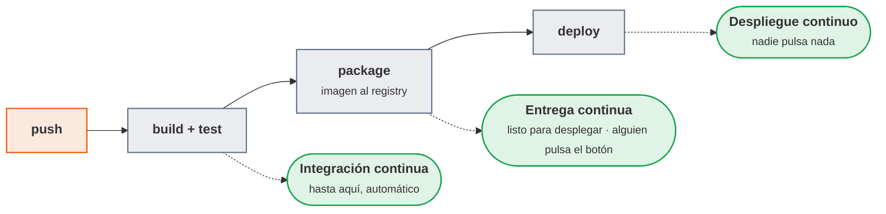
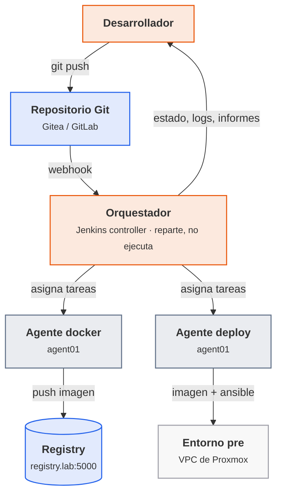
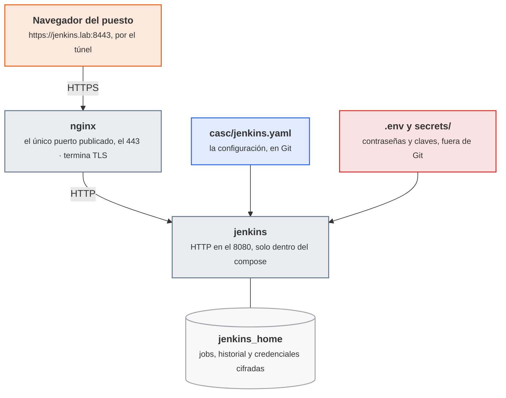
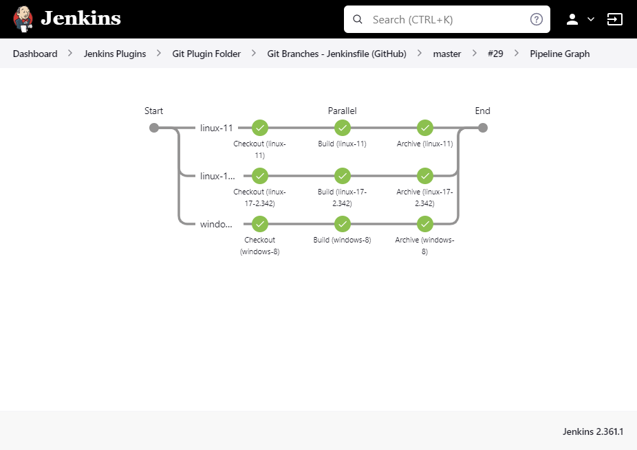
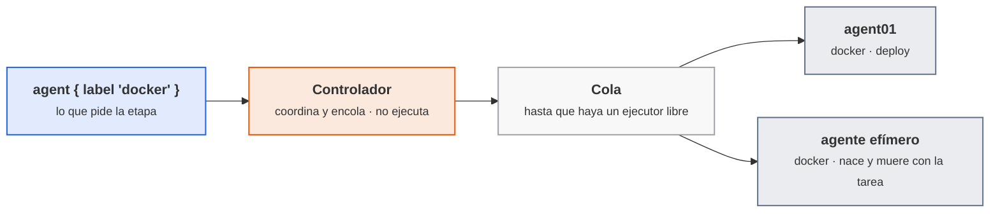
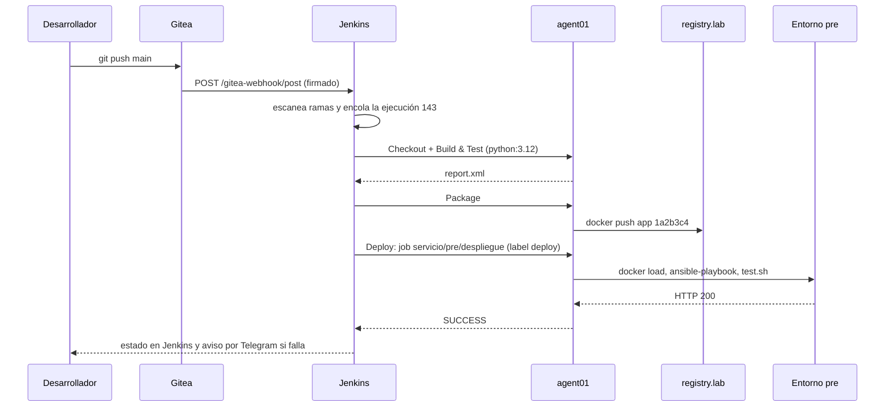
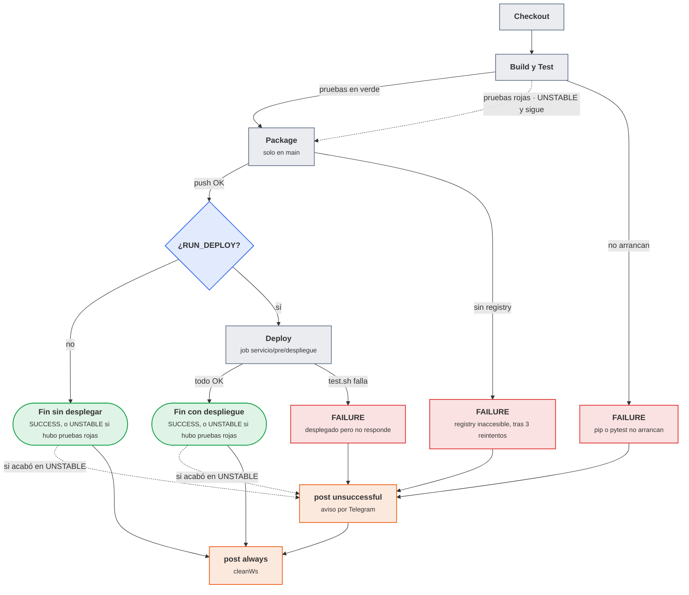
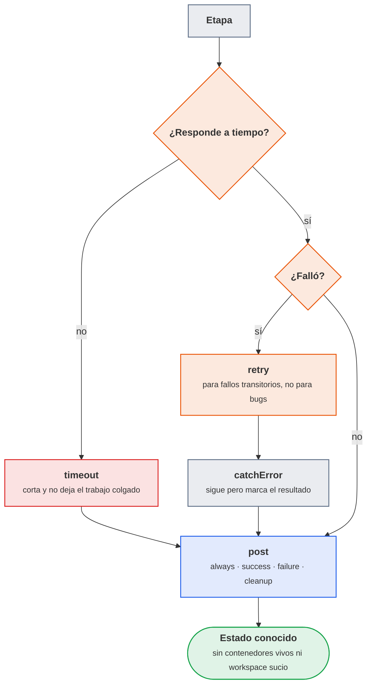
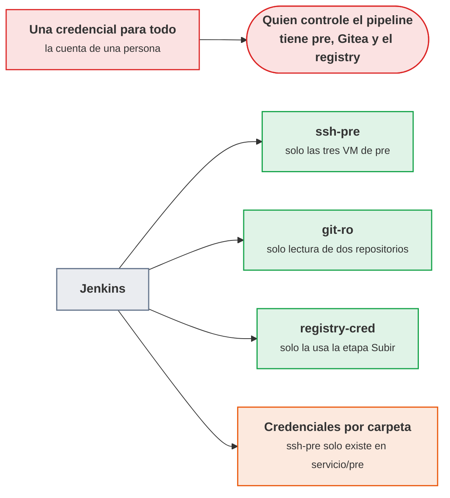

# UT6 · Orquestador de integración continua

<p class="ut-meta">18 h · Sesiones 30 a 38 · RA4 CE a, b, c, d, e, f, g, h</p>

En la UT5 quedó un repositorio con el que se levanta el servicio del curso de principio a fin: `tofu apply` crea las máquinas en Proxmox, Ansible las configura y `test.sh` comprueba que responde. Todo eso se lanzaba a mano desde el puesto de administración, con claves y tokens personales, y solo cuando alguien se acordaba de hacerlo. Esta unidad quita a la persona de en medio: un orquestador de integración continua vigila el repositorio, ejecuta las pruebas, construye la imagen, la sube a un registry y, cuando se le pide, la lleva a `pre` y la despliega con el playbook y el `test.sh` de la UT5. En la UT7, Prometheus y Grafana vigilan tanto el orquestador como el servicio que despliega.

La unidad sigue el orden en que se monta un sistema así, y cada sesión resuelve lo que la anterior deja pendiente. Primero se decide qué se quiere automatizar y con qué herramienta (sesión 30). Después se instala Jenkins de forma que no sea el punto débil del laboratorio, porque va a guardar las credenciales de todo lo demás (31), y se le dan máquinas donde ejecutar, porque el controlador no ejecuta nada (32). Con eso se engancha al repositorio para que cada push lo dispare solo (33), se escribe el pipeline en dos tandas, primero construir y probar (34) y después empaquetar y decidir cuándo (35), y se prueba por todos los caminos que acaban mal (36). Lo último es la credencial más delicada, la que entra en `pre` para desplegar (37). La sesión 38 es la práctica evaluable.

<figure markdown="span">
  { width="120" }
  <figcaption>Jenkins, el orquestador que se usa en el laboratorio. Fuente: proyecto Jenkins, CC BY-SA 3.0.</figcaption>
</figure>

## Sesión 30 · CI y elección del orquestador

<p class="ut-meta" markdown>3 de febrero · Teoría y práctica · <span class="dur" tabindex="0" aria-label="Integración continua, entrega continua y despliegue continuo · 20 min&#10;Elegir el orquestador · 10 min&#10;A6.1 Elección del orquestador · 80 min" data-dur="Integración continua, entrega continua y despliegue continuo · 20 min&#10;Elegir el orquestador · 10 min&#10;A6.1 Elección del orquestador · 80 min">:material-school:<i class="dur-barra" style="--teoria:27%"></i>:material-flask:</span></p>

El `test.sh` de la UT5 demuestra que un despliegue funciona, pero solo cuando alguien lo lanza, desde su puesto y con sus credenciales. Antes de instalar ningún orquestador hay que resolver dos cosas, y en este orden. La primera, qué se quiere automatizar exactamente: integración, entrega y despliegue continuos no son sinónimos, y un pipeline aporta cosas que un script no tiene; de eso trata el primer apartado. La segunda, con qué herramienta: el segundo compara los cuatro orquestadores más extendidos con los criterios del módulo y cuenta cómo están hechos los dos que se prueban hoy. La hoja ejecuta el mismo hola mundo en Jenkins y en Gitea Actions y termina con una justificación escrita de cuál usar para el servicio del curso.

### Integración continua, entrega continua y despliegue continuo

Antes de tocar Jenkins hay que ponerse de acuerdo en las palabras, porque en las ofertas de trabajo y en los blogs se usan como sinónimos y no lo son. Este apartado deja claro qué se automatiza en cada escalón, qué piezas intervienen y qué gana un pipeline frente al script de la UT5; sin eso, la comparativa del apartado siguiente no se puede leer con criterio.



<p class="pie" markdown>Los tres escalones son el mismo pipeline: lo que cambia es hasta dónde llega sin intervención humana.</p>

**El problema que resuelve la integración continua.** Cuando cada persona trabaja por su cuenta durante semanas y el código se junta al final, aparecen a la vez los conflictos de todos y nadie sabe qué cambio rompió qué. **Integración continua (CI)** es lo contrario: integrar el trabajo de todos los desarrolladores varias veces al día en un repositorio común y comprobar automáticamente, en cada integración, que el proyecto se construye, pasa las pruebas y se empaqueta. Si se integra cada pocas horas y una máquina ejecuta las pruebas en cada integración, el error aparece a los diez minutos de haberlo cometido y lo arregla quien lo acaba de escribir. La práctica se generalizó a finales de los años noventa con las metodologías ágiles, y la idea no ha cambiado desde entonces.

**Dos escalones más.** Sobre esa base se construyen otros dos, y lo que distingue a los tres es quién decide que un cambio llega a producción:

| Escalón | Qué añade | Quién decide el paso a producción |
|---|---|---|
| Integración continua | Build, pruebas y empaquetado automáticos en cada cambio | Nadie despliega todavía |
| Entrega continua (*continuous delivery*, CD) | El artefacto validado se despliega automáticamente en entornos de prueba y queda listo para producción | Una persona pulsa un botón |
| Despliegue continuo (*continuous deployment*) | Cada cambio que pasa todas las pruebas llega a producción sin intervención | Nadie; el pipeline entero es la aprobación |

**Hasta dónde llega el curso.** En el módulo se llega hasta la entrega continua: el pipeline despliega en `pre` cuando se le pide con un parámetro, y el paso a producción sigue siendo una decisión humana. El despliegue continuo exige una batería de pruebas tan completa y un equipo tan acostumbrado a ella que no se improvisa, y con un solo entorno de pruebas no tendría sentido.

#### Las piezas

**Qué hace falta para montarlo.** Un sistema de integración continua tiene cinco piezas, y la unidad monta una o dos por sesión:

- **Repositorio Git** con el código del servicio y, en el mismo repositorio, la definición del pipeline. Que el pipeline viva con el código importa: se versiona, se revisa en un *merge request* (la petición de fusionar una rama, *pull request* en GitHub) y cada rama lleva el suyo. En el curso es `servicio`, en la Gitea del laboratorio.
- **Orquestador** (Jenkins, GitLab CI, GitHub Actions, Gitea Actions): recibe el aviso de cambio, decide qué ejecutar, dónde y con qué credenciales, y guarda resultados, logs e informes. El aviso suele ser un **webhook**: una petición HTTP que el servidor Git manda al orquestador cada vez que pasa algo, por ejemplo un push.
- **Agentes** o *runners*: las máquinas o contenedores donde se ejecutan realmente las tareas. El orquestador solo coordina; si ejecutase él mismo las tareas, cualquier `sh` de cualquier pipeline correría con los permisos del orquestador entero.
- **Registry** de imágenes y almacén de artefactos. El registry es el servidor de imágenes de contenedor, del que se descargan con `docker pull` y al que se suben con `docker push`. Ahí queda lo que produce el pipeline (imágenes, paquetes, informes), identificado por el commit que lo generó.
- **Entornos** de destino: el entorno `pre` que se creó en la UT5.



<p class="pie" markdown>El círculo se cierra en el desarrollador: lo que hace útil un pipeline no es que despliegue, es que devuelva el resultado a quien escribió el cambio.</p>

**En qué orden llegan.** El orquestador se instala en la sesión 31, los agentes en la 32, el enganche con el repositorio y el webhook en la 33, el registry en la 35 y el despliegue en `pre` en la 37.

#### Qué aporta un pipeline frente a un script

**La pregunta es legítima.** El `test.sh` de la UT5 ya encadena `tofu apply`, `ansible-playbook` y un `curl`, y con un script un poco más largo y un cron se cubriría lo mismo. Se cubriría solo en el camino feliz. Un **pipeline** es la cadena de etapas que atraviesa cada cambio (checkout, build, test, package, deploy), donde cada etapa produce salidas (artefactos, informes) y puede detener la cadena si falla, y el orquestador le añade lo que un script no tiene:

- **Aislamiento por etapa**: cada etapa puede correr en un agente distinto, con una imagen distinta, sin heredar el estado de la anterior salvo lo que se le pasa explícitamente.
- **Historial**: cada ejecución queda numerada, con su commit, su log, quién la lanzó, cuánto tardó y qué produjo. Cuando algo falla en producción, se puede ir a la ejecución #142 y ver qué se probó.
- **Estados con significado**: un script devuelve 0 o distinto de 0. Un pipeline distingue entre "todo bien", "todo se ejecutó pero hay pruebas rojas", "se rompió a mitad" y "alguien lo canceló", y reacciona distinto en cada caso.
- **Credenciales gestionadas**: el script tiene el token en una variable de entorno o, peor, en el propio fichero. El orquestador lo guarda cifrado, lo inyecta solo en la etapa que lo necesita y lo enmascara en el log.
- **Condiciones y paralelismo**: "esto solo en `main`", "esto solo si cambió `Dockerfile`", "lint (el análisis estático del código, sin ejecutarlo) y test a la vez". En bash se puede, pero cada condición es un `if` más que nadie prueba.
- **Disparo automático** desde el repositorio y **límites** (tiempo máximo, no concurrencia) que evitan que dos despliegues pisen el mismo entorno.

**Para qué en el curso.** Cada una de esas ventajas tiene su sesión en la unidad: los agentes, la 32; el disparo desde el repositorio y las credenciales, la 33; las etapas, los límites y los estados, la 34; las condiciones y el paralelismo, la 35; y lo que hace el pipeline con cada estado que no es verde, la 36.

### Elegir el orquestador

**No se elige por costumbre.** Jenkins no es la única opción, y en una empresa el orquestador se elige con criterios, porque cambiarlo después obliga a reescribir todos los pipelines. Aquí se comparan los cuatro más extendidos con los criterios que pide el módulo, para poder defender la elección delante de quien pregunte y para reconocer los otros tres al cambiar de empresa.

|  | **Jenkins** | **GitLab CI** | **GitHub Actions** | **Gitea Actions** |
|----|----|----|----|----|
| Instalación | Servidor propio (paquete Java o contenedor) | Incluido en GitLab (autoalojado o SaaS, el servicio alojado por el proveedor) | Servicio de GitHub; runners propios opcionales | Incluido en Gitea desde 1.19; runner `act_runner` |
| Integración con el entorno | Más de 1800 plugins: Git, Docker, Ansible, cualquier registry | Integrado con su repositorio y su registry; *components* y *templates* | Marketplace de acciones | Reutiliza acciones de GitHub (con matices) |
| Registro de ejecuciones | Historial por job con log, `archiveArtifacts` e informes por plugin | Log por job, `artifacts:` e informes JUnit nativos | Log por job y `upload-artifact` | Igual que Actions, con soporte parcial |
| Control de variables y límites | Parámetros, credenciales, throttling, cuotas por agente, timeouts | Variables por proyecto/grupo, límites por runner, `timeout`, `resource_group` | Secretos, concurrencia, matrices, `timeout-minutes` | Secretos, concurrencia, matrices |
| Coste de mantenimiento | Alto: actualizaciones del núcleo y de plugins, backups, agentes | Medio: va con GitLab, pero GitLab en sí es pesado | Bajo si es SaaS; medio con runners propios | Bajo |
| Comunidad y documentación | Enorme y veterana; mucho material antiguo que ya no aplica | Muy buena, documentación oficial excelente | La mayor en proyectos abiertos | Pequeña pero creciente |
| Punto fuerte | Flexibilidad, cualquier tecnología, control total | Todo en una herramienta | Sencillez, ecosistema de acciones | Ligero, autoalojado, sintaxis conocida |
| Punto débil | Mantenimiento de plugins, curva de entrada | Ligado a GitLab | Menos control fino; coste de minutos en SaaS | Menos maduro, menos control fino |

Los nombres de fichero, el modelo de runners y la forma de guardar secretos de cada uno están en [Para ampliar](../ampliacion.md#equivalencias-entre-los-cuatro-orquestadores), por si hay que reconocerlos al cambiar de herramienta.

**Los criterios.** Los de selección del módulo (CE 4a) son cuatro: que pueda **controlar las variables** del pipeline (parámetros, secretos, entorno), aplicar **limitaciones** (tiempo máximo, concurrencia, agentes permitidos, quién puede lanzar qué), **integrarse** con las tecnologías del entorno (Git, Docker, Ansible, registry) y **registrar** cada ejecución con su log y sus artefactos. A esos cuatro criterios técnicos conviene sumar dos de organización, que en una empresa pesan igual: quién lo va a mantener (un Jenkins sin dueño se convierte en un museo de plugins sin parchear) y dónde está el código (con el código ya en GitLab, montar un Jenkins aparte necesita una justificación).

**La elección del curso.** En el módulo se usa **Jenkins** por su flexibilidad y porque obliga a entender cada pieza: en GitLab CI el runner, los secretos y el webhook vienen hechos y no se ve cómo funcionan; en Jenkins se montan uno a uno y, cuando fallan, se sabe dónde mirar. Todo lo aprendido se traslada a GitLab CI cambiando la sintaxis; en [Para ampliar](../ampliacion.md#el-mismo-pipeline-en-gitlab-ci) está el mismo pipeline escrito en `.gitlab-ci.yml`, como lectura opcional.

#### Jenkins y Gitea Actions por dentro

**Por qué estos dos.** Son los dos extremos de la tabla: Jenkins, un servidor aparte que lo hace todo con plugins, y Gitea Actions, integrado en la forja que el laboratorio ya tiene desde noviembre. Montar el mismo hola mundo en los dos enseña más diferencias que cualquier tabla, y es lo que hace la hoja.

**Jenkins: un servidor que ejecuta *jobs*.** Jenkins es una aplicación web escrita en Java. Nació en 2011 como continuación libre de Hudson, un servidor de integración continua de mediados de los años 2000, y de esa edad le vienen tanto la comunidad enorme como el material antiguo. Lo que se le pide se da de alta como un **job** (un proyecto): el de tipo *Pipeline* lleva dentro, o lee del repositorio, un script que dice qué etapas ejecutar. Casi todo lo que sabe hacer viene de plugins. La primera vez que arranca pide una contraseña inicial de administrador, que deja escrita en un fichero de su directorio de datos, y ofrece instalar los plugins recomendados, porque sin ellos no sabría ni crear un job de tipo Pipeline.

**Gitea Actions: el pipeline vive en el repositorio.** Gitea Actions reutiliza la sintaxis de GitHub Actions. El pipeline es un *workflow*: un fichero YAML dentro de `.gitea/workflows/` del propio repositorio, que dice con qué eventos se dispara (`on: push`), qué trabajos tiene (`jobs`) y, en cada uno, dónde corre (`runs-on`) y qué pasos ejecuta (`steps`, cada uno con su `run:`). Gitea no ejecuta nada: los trabajos los recoge un **runner**, `act_runner`, un programa aparte que se registra en Gitea con un token de registro y anuncia unas **etiquetas**. Cada etiqueta dice dónde se ejecuta un trabajo: `debian:docker://debian:13-slim` significa que los trabajos con `runs-on: debian` corren en un contenedor de esa imagen. Por eso el runner necesita acceso al Docker de su máquina.

**Qué se compara.** El hola mundo deja ver cuatro cosas: dónde se define el pipeline (en el job o en el repositorio), quién lo ejecuta y dónde, cuántos pasos de configuración hacen falta hasta ver el primer `echo` y qué queda registrado de cada ejecución. Son la materia prima de la tabla de la hoja.

### A6.1 Elección del orquestador (sesión 30)

<span class="et et-obj">Objetivo</span> Al terminar has ejecutado el mismo «hola mundo» en Jenkins y en Gitea Actions y tienes, escrita con lo que has visto, la justificación de cuál usarías para el servicio del curso. Elegir y justificar el orquestador es el primer criterio de la unidad, y la tabla y la justificación de hoy van tal cual a la práctica evaluable.

<span class="et et-pre">Antes de empezar</span> El nodo, la plantilla 9000 y el puesto de administración accesibles, y tu Gitea de `mon01` (`http://gitea.lab:3001`, la de la A2.6 de Mantenimiento) con tu usuario. Se han explicado [integración, entrega y despliegue continuos](#integracion-continua-entrega-continua-y-despliegue-continuo), la [comparativa de orquestadores](#elegir-el-orquestador) y [cómo están hechos Jenkins y Gitea Actions](#jenkins-y-gitea-actions-por-dentro).

<span class="et et-pas">Pasos</span>

Primero preparas la máquina que alojará Jenkins el resto del curso. Después montas el mismo hola mundo en los dos orquestadores, cada uno con la instalación mínima que lo hace funcionar, porque hoy interesa ver cómo es cada herramienta por dentro, no protegerla: eso es la sesión 31. Al final pasas lo que has visto a una tabla y decides. La comparación solo vale si cada casilla sale de algo que has hecho, así que apunta mientras trabajas.

1. **Prepara `jenkins01`.** Crea `jenkins01`, la VM 101 de la [tabla del laboratorio](../laboratorio.md#maquinas-ids-de-vm-y-direcciones) (`devmgmt`, 10.10.0.10, 2 GB), con Docker y compose, y da de alta en OPNsense sus nombres `jenkins.lab` y `jenkins01.lab`. Es la máquina de Jenkins para todo el curso: hoy aloja la demo y, desde la sesión 31, el Jenkins definitivo.

    *Pista:* la IP y el DNS (`--nameserver 10.10.0.1 --searchdomain lab`) van en el `qm set`; los nombres, en Services → Dnsmasq DNS & DHCP → Hosts. Docker, con el script de `get.docker.com`, como en la A1.3.

2. **Haz el hola mundo en Jenkins.** Levanta en `~/demo` un Jenkins de usar y tirar, sin TLS ni roles, con la imagen `jenkins/jenkins:lts-jdk21` y el 8080 publicado (solo en esta demo). Ábrelo desde tu puesto por un túnel, como los de [Nombres DNS y acceso](../laboratorio.md#nombres-dns-y-acceso), completa el asistente del primer arranque y crea un job Pipeline que haga `echo 'hola desde Jenkins'`. Fíjate en todo lo que te pide antes de dejarte ejecutar nada: es una de las columnas de tu tabla.

    *Pista:* la contraseña inicial está en `/var/jenkins_home/secrets/initialAdminPassword` del contenedor, y el desplegable *try sample Pipeline* del job trae un «Hello World».

3. **Haz lo mismo en Gitea Actions.** En un repositorio de prueba `hola-ci` de tu Gitea, con Actions activado, escribe un workflow que haga el mismo `echo`, y pon su runner en `~/runner` de `jenkins01`. Levanta el runner antes de escribir el workflow, para que baje su imagen mientras tanto.

    *Pista:* el runner es `gitea/act_runner:0.2.11` con el socket de Docker y las variables `GITEA_INSTANCE_URL`, `GITEA_RUNNER_REGISTRATION_TOKEN` (de la página de runners del repositorio) y `GITEA_RUNNER_LABELS` (`debian:docker://debian:13-slim`). El workflow va en `.gitea/workflows/` con `runs-on: debian`.

4. **Compara las dos ejecuciones.** Lanza los dos y apunta, del log de cada ejecución, dónde ha corrido, qué tardó y cuántos pasos de configuración hicieron falta hasta ver el `echo`. Son los datos en bruto de la tabla del paso siguiente.

5. **Pásalo a una tabla.** Compara Jenkins y Gitea Actions con los criterios de [Elegir el orquestador](#elegir-el-orquestador) (control de variables, limitaciones, integración, registro, mantenimiento, comunidad), con lo que acabas de ver y la tabla de la teoría.

6. **Decide y justifícalo.** Escribe en media página cuál usarías para el servicio del curso, apoyándote en las casillas de tu tabla que más pesan para un servicio como este.

<span class="et et-com">Comprobación</span> Las dos ejecuciones en verde con el `echo` visible en el log, y una tabla donde cada casilla diga algo que hayas comprobado, no copiado.

<span class="et et-ent">Entrega</span> La tabla y la justificación en Aules, con dos capturas (una ejecución de cada orquestador).

<span class="et et-ext">Si te sobra tiempo</span> Añade una segunda etapa que falle (`sh 'exit 1'`) en los dos y compara cómo lo muestra cada uno.

## Sesión 31 · Instalación segura y plugins

<p class="ut-meta" markdown>5 de febrero · Teoría y práctica · <span class="dur" tabindex="0" aria-label="Instalar y asegurar Jenkins · 15 min&#10;Plugins · 10 min&#10;A6.2 Instalación segura y plugins · 85 min" data-dur="Instalar y asegurar Jenkins · 15 min&#10;Plugins · 10 min&#10;A6.2 Instalación segura y plugins · 85 min">:material-school:<i class="dur-barra" style="--teoria:23%"></i>:material-flask:</span></p>

El Jenkins de la demo de la sesión 30 servía para ver la herramienta, no para trabajar con ella: hablaba HTTP en claro, tenía un único administrador creado a mano, podía ejecutar tareas en su propio proceso y sus plugins eran los que trajo el asistente, sin versión conocida. Y este Jenkins va a guardar las credenciales de Gitea, del registry y de `pre`, así que será la máquina más atractiva del laboratorio para un atacante. Esta sesión lo instala para quedarse, por capas: dónde corre y quién lo publica, con qué certificado, quién puede hacer qué, qué se le prohíbe al controlador y cómo queda todo escrito en un YAML. Los plugins van en la misma sesión porque son el mismo trabajo visto dos veces: la imagen que se construye para arrancar Jenkins es la que los lleva dentro. Al acabar, la instalación entera (compose, `Dockerfile`, `plugins.txt`, YAML de configuración y README) está en el repositorio `jenkins-config`.

### Instalar y asegurar Jenkins

Este apartado deja Jenkins instalado en un contenedor, accesible por HTTPS con un certificado de la CA del curso, con usuarios y roles, y con su configuración en un YAML versionado. El orden importa porque cada capa protege a la siguiente: sin TLS las contraseñas viajan en claro, sin roles cualquiera administra, y sin el YAML nadie sabe reconstruirlo cuando se rompa. El `compose.yml`, el `nginx.conf`, los comandos de `openssl` y el `casc/jenkins.yaml` están enteros porque la hoja A6.2 los copia.



<p class="pie" markdown>Lo que define a Jenkins está en Git y se puede reconstruir; lo que lo hace único, el volumen y los secretos, se guarda aparte.</p>

#### Despliegue en contenedor

**Qué es Jenkins por dentro.** Jenkins es una aplicación Java que escucha en el puerto 8080 por HTTP. La imagen oficial `jenkins/jenkins:lts-jdk21` (LTS es la línea de soporte largo, la que se usa en producción; `jdk21`, que trae Java 21) contiene el controlador, Java y Git, y ni un solo plugin. Todo su estado (configuración, jobs, credenciales cifradas, historial) vive en un directorio, `/var/jenkins_home`, y ese directorio, guardado en un volumen, es lo único que hay que conservar.

**Por qué en contenedor.** Por lo mismo que el servicio del curso: la versión queda escrita en un fichero, la instalación se repite idéntica en cualquier máquina con Docker y el estado queda separado del programa, en el volumen. Actualizar Jenkins es cambiar la imagen; volver atrás, volver a la anterior.

**Quién termina TLS.** En el curso, Jenkins no habla HTTPS: delante va un proxy inverso, nginx, que recibe las conexiones cifradas y se las pasa en HTTP por la red interna del compose. Es el mismo esquema que el nginx de `web01` delante de la API en la UT3, y el que se ve en las empresas, porque tiene dos ventajas: nginx usa el certificado en PEM (el formato de texto habitual para certificados y claves), el mismo que serviría para cualquier otro servicio, y cambiar el certificado no obliga a tocar Jenkins.

```yaml
# compose.yml
services:
  jenkins:
    image: jenkins/jenkins:lts-jdk21
    volumes:
      - jenkins_home:/var/jenkins_home
      - ./casc:/var/jenkins_home/casc:ro
      - ./secrets:/run/secrets:ro      # claves que lee JCasC (sesión 32)
    env_file: .env                     # contraseñas de los usuarios, fuera del repositorio
    environment:
      JAVA_OPTS: "-Djenkins.install.runSetupWizard=false"
      CASC_JENKINS_CONFIG: /var/jenkins_home/casc/jenkins.yaml
    # sin ports: solo nginx llega a él por la red interna del compose
  nginx:
    image: nginx:1.27
    ports: ["443:443"]
    volumes:
      - ./nginx.conf:/etc/nginx/conf.d/default.conf:ro
      - ./certs:/etc/nginx/certs:ro
    depends_on: [jenkins]
volumes:
  jenkins_home:
```

**Las decisiones del compose.**

- `jenkins` no publica ningún puerto: solo nginx llega a él, por la red interna del compose, como `jenkins:8080`. Desde fuera, lo único abierto es el 443.
- `runSetupWizard=false`, en `JAVA_OPTS`, apaga el asistente del primer arranque, el de la demo de la sesión 30, con su contraseña inicial y su instalación de plugins a mano. Aquí los usuarios los crea el YAML y los plugins vienen en la imagen.
- `CASC_JENKINS_CONFIG` dice dónde está ese YAML, que llega de solo lectura desde la carpeta `casc/`.
- Ningún secreto está en un fichero del repositorio: las contraseñas de los usuarios llegan como variables de entorno desde `.env`, y las claves, como ficheros de la carpeta `secrets/` montados en `/run/secrets`, que es donde los busca el plugin que lee el YAML.

```nginx
# nginx.conf
server {
    listen 443 ssl;
    server_name jenkins.lab;
    ssl_certificate     /etc/nginx/certs/jenkins.crt;
    ssl_certificate_key /etc/nginx/certs/jenkins.key;

    location / {
        proxy_pass         http://jenkins:8080;
        proxy_http_version 1.1;
        proxy_set_header   Host              $host;
        proxy_set_header   X-Real-IP         $remote_addr;
        proxy_set_header   X-Forwarded-For   $proxy_add_x_forwarded_for;
        proxy_set_header   X-Forwarded-Proto https;
        proxy_set_header   X-Forwarded-Host  $host;
        # agentes inbound y cliente de línea de órdenes por WebSocket
        proxy_set_header   Upgrade    $http_upgrade;
        proxy_set_header   Connection "upgrade";
        proxy_read_timeout 90s;
        client_max_body_size 50m;
    }
}
```

**Las decisiones del `nginx.conf`.**

- `proxy_pass` lleva todas las peticiones al contenedor de Jenkins por su nombre en la red del compose.
- Las cabeceras `X-Forwarded-*` le cuentan a Jenkins cómo le ha llegado de verdad la petición: por HTTPS y a qué nombre. Sin ellas, Jenkins cree que le hablan por HTTP a `jenkins:8080`, genera sus enlaces con esa dirección y muestra el aviso "It appears that your reverse proxy set up is broken". La otra condición es configurar en Jenkins su URL pública, `https://jenkins.lab/`, que en el curso la pone el YAML.
- `Upgrade` y `Connection` dejan pasar WebSocket, la conexión permanente que usan los agentes que llaman ellos al controlador (sesión 32) y el cliente de línea de órdenes de Jenkins.
- `client_max_body_size` sube el límite de 1 MB que nginx pone por defecto a lo que se le envía, para poder subir ficheros grandes, como un plugin a mano.

**La misma configuración sirve para Gitea.** Cambiando `server_name`, el certificado y el destino del `proxy_pass`, este `nginx.conf` publica Gitea en la sesión 33.

**La alternativa: que Jenkins sirva HTTPS.** Jenkins también sabe hacerlo él mismo, cargando un keystore Java (un fichero con el certificado y la clave en el formato que entiende Java) y publicando el 8443. Se usa cuando no hay ningún proxy delante; el compose y los comandos de esa variante están en [Para ampliar](../ampliacion.md#jenkins-con-keystore-java).

**Dónde vive.** Jenkins vive en la subred de gestión de la VPC (en el laboratorio del curso, `10.10.0.0/24`, en la VM `jenkins01` con la 10.10.0.10 y el nombre `jenkins.lab`), nunca en la DMZ externa: contiene credenciales de todo lo demás y no lo necesita nadie de fuera.

#### Certificados

**De dónde sale el certificado.** Para que el navegador ponga el candado, el certificado de `jenkins.lab` tiene que estar firmado por una CA en la que confíe. Una CA pública no sirve: Let's Encrypt solo firma nombres de dominios públicos, y `jenkins.lab` no lo es. En el laboratorio tampoco se crea ninguna CA nueva: se usa **la CA del curso**, la que se montó con `openssl ca` en la [A3.2](ut3-seguridad-por-capas.md#a32-publicar-la-web-sesion-15) y vive en `~/ca/` del puesto de administración, con su `ca.cnf` y su registro de certificados emitidos. En una empresa, ese papel lo hace la CA corporativa.

**Quién tiene que confiar en ella.** Su `ca.crt` se instala en los navegadores del aula y en el almacén del sistema de cada máquina que va a hablar con Jenkins, Gitea y el registry (`/usr/local/share/ca-certificates/lab-ca.crt` y `update-ca-certificates` en Debian/Ubuntu). `ca.key` no sale nunca del puesto: quien la tenga puede firmar un certificado para cualquier nombre del laboratorio.

**Cómo se emite.** Emitir un certificado para `jenkins.lab` son dos comandos, desde `~/ca/`: la petición con la clave nueva y la firma de la CA (`openssl ca` pide confirmar dos veces):

```bash
openssl req -new -newkey rsa:2048 -nodes -keyout jenkins.key -out jenkins.csr \
  -subj "/CN=jenkins.lab" -addext "subjectAltName=DNS:jenkins.lab"
openssl ca -config ca.cnf -extensions server_cert -notext -in jenkins.csr -out jenkins.crt
```

**Los demás certificados de la unidad.** Los de `gitea.lab` (sesión 33) y del registry (sesión 35) salen de los mismos dos comandos cambiando el nombre. `-extensions client_cert` en lugar de `server_cert` da un certificado de cliente, el que sirve para que un cliente demuestre quién es; es lo que usa Jenkins para hablar con el demonio Docker de su agente en la sesión 32.

!!! truco "subjectAltName obligatorio"
    Sin el `subjectAltName` los navegadores actuales rechazan el certificado aunque el CN sea correcto; es el error más repetido en esta sesión.

#### Usuarios y permisos

**El problema: administrar Jenkins es tenerlo todo.** Quien administra Jenkins puede ejecutar código con los permisos del propio Jenkins y, por tanto, leer todas las credenciales que guarda. Por eso los permisos se reparten por papeles, los administradores son muy pocos y se cierran las puertas que dan ese poder sin pedirlo.

- **Quién reparte los permisos.** Manage Jenkins → Security → Authorization: **Matrix-based security** o el plugin **Role-based Authorization Strategy**. La matriz vale para tres usuarios; en cuanto hay carpetas y equipos, los roles se gestionan mejor, y es lo que usa el curso.
- **Los papeles.** Administrador (pocos, dos personas como máximo), desarrollador (construir y ver), lector (solo ver) y cuentas de servicio (solo lo que su tarea necesita, por ejemplo un rol que solo puede lanzar un job concreto desde el webhook). El YAML del curso crea los tres primeros: `admin`, `dev` y `lector`.
- **De dónde salen los usuarios.** Locales, declarados en el YAML, solo en el laboratorio; en una empresa se autentica contra el directorio corporativo, como se cuenta en [Para ampliar](../ampliacion.md#operar-jenkins-directorio-actualizaciones-y-copias).
- **Sin registro abierto.** Nadie puede darse de alta solo: el YAML lo cierra con `allowsSignup: false`.
- **Protección CSRF**, contra la falsificación de peticiones desde otro sitio: que una web ajena use el navegador de la persona, ya autenticado, para lanzar acciones en Jenkins. Jenkins mete en sus formularios un valor ligado a la sesión, el *crumb*, y rechaza las peticiones que no lo devuelven. Viene activada, y hay tutoriales antiguos que enseñan a desactivarla para que funcione un `curl`: no se desactiva, se pasa el crumb o se usa un token de API.
- **La script console**, en Manage Jenkins → Script Console, ejecuta Groovy (el lenguaje de script de la plataforma Java, el mismo en que se escriben los `Jenkinsfile`) sin restricción y con los permisos del proceso de Jenkins. Quien tiene `Overall/Administer` tiene eso, y por eso hay que dar tan pocos.

#### Hardening del controlador

**El controlador es lo que más hay que proteger**, porque guarda las credenciales cifradas y la clave que las descifra. Las medidas van dirigidas a que nada ajeno se ejecute en él y a que se pueda reconstruir:

- **Número de ejecutores** en el controlador: 0. Nada se ejecuta en el controlador, todo en agentes. Un pipeline que corre en el controlador puede leer `/var/jenkins_home/secrets/master.key` y descifrar todas las credenciales.
- **El agente no manda en el controlador.** Un agente comprometido no puede pedirle al controlador que le lea o le escriba ficheros: es la protección *Agent → Controller*, que en las versiones actuales de Jenkins viene siempre activada y ya no se puede desactivar. No hay nada que configurar, pero conviene saber que existe, porque en los tutoriales antiguos aparece como una casilla que había que marcar.
- **Actualizaciones y copias**: la LTS del controlador, los plugins revisados cada mes y una copia de `jenkins_home` con sus dos ficheros de claves. Cómo se hace cada cosa está en [Para ampliar](../ampliacion.md#operar-jenkins-directorio-actualizaciones-y-copias).
- **Configuration as Code** (plugin **JCasC**): la configuración de Jenkins en un YAML versionado, que Jenkins lee y aplica al arrancar. Es la diferencia entre un Jenkins que se reconstruye en cinco minutos y uno que nadie se atreve a tocar.

El YAML siguiente es una configuración completa para el laboratorio. Conviene fijarse en tres bloques: `securityRealm` y `authorizationStrategy` (los tres usuarios, quién entra y qué puede hacer), `nodes` (el agente que se conecta en la sesión 32) y `credentials` (la clave SSH del agente, leída de un fichero en vez de escrita).

```yaml
# casc/jenkins.yaml
jenkins:
  systemMessage: "Jenkins de la asignatura. Configurado por JCasC, no toques nada a mano."
  numExecutors: 0
  mode: EXCLUSIVE
  securityRealm:
    local:
      allowsSignup: false
      users:
        - id: admin
          password: ${ADMIN_PASSWORD}
        - id: dev
          password: ${DEV_PASSWORD}
        - id: lector
          password: ${LECTOR_PASSWORD}
  authorizationStrategy:
    roleBased:
      roles:
        global:
          - name: admin
            permissions: ["Overall/Administer"]
            entries:
              - user: admin
          - name: dev
            permissions: ["Overall/Read", "Job/Read", "Job/Build", "Job/Cancel", "Job/Workspace"]
            entries:
              - user: dev
          - name: lector
            permissions: ["Overall/Read", "Job/Read"]
            entries:
              - group: authenticated
  crumbIssuer:
    standard:
      excludeClientIPFromCrumb: false
  nodes:
    - permanent:
        name: agent01
        labelString: "docker deploy"
        remoteFS: /home/jenkins
        numExecutors: 2
        launcher:
          ssh:
            host: 10.10.0.12
            port: 22
            credentialsId: agent-ssh
            sshHostKeyVerificationStrategy:
              manuallyProvidedKeyVerificationStrategy:
                key: "ssh-ed25519 AAAAC3Nza... agent01"
unclassified:
  location:
    url: https://jenkins.lab/
    adminAddress: ops@lab
credentials:
  system:
    domainCredentials:
      - credentials:
          - basicSSHUserPrivateKey:
              scope: SYSTEM
              id: agent-ssh
              username: jenkins
              privateKeySource:
                directEntry:
                  privateKey: ${AGENT_SSH_KEY}
```

**Cómo llegan los secretos al YAML.** Los valores entre `${...}` los resuelve JCasC al arrancar: las contraseñas, de las variables de entorno del contenedor (el `.env` que carga `env_file`), y `${AGENT_SSH_KEY}`, del fichero `/run/secrets/AGENT_SSH_KEY` que monta la carpeta `secrets/`. Así el YAML se puede subir al repositorio `jenkins-config` sin un solo secreto dentro. El rol `lector` se asigna al grupo `authenticated`, que son todos los usuarios que han entrado, así que `dev` y `admin` también leen; `admin` tiene además todo lo demás.

**Para empezar desde un Jenkins hecho a mano.** El plugin admite exportar la configuración actual (Manage Jenkins → Configuration as Code → View Configuration) y pasarla a YAML, aunque la exportación arrastra mucho ruido que conviene limpiar.

### Plugins

**El problema: un Jenkins recién instalado no sabe hacer casi nada.** No sabe clonar un repositorio, hablar con Docker, leer un informe de pruebas ni repartir permisos por roles: cada capacidad la aporta un plugin, y el catálogo pasa de 1800. Hay que decidir cuáles hacen falta para el módulo e instalarlos de forma que el Jenkins se reconstruya siempre igual.

**Por qué en la imagen y no a mano.** Desde Manage Jenkins → Plugins se instalan con un clic, pero entonces cada Jenkins tiene los suyos, con la versión que hubiera ese día, y nadie sabe reconstruirlo igual. La alternativa es una imagen propia que los deja preinstalados desde una lista, `plugins.txt`, con una línea `id:version` por plugin:

```dockerfile
FROM jenkins/jenkins:lts-jdk21
COPY plugins.txt /usr/share/jenkins/ref/plugins.txt
RUN jenkins-plugin-cli --plugin-file /usr/share/jenkins/ref/plugins.txt
# la CA del curso, para que el controlador confíe en gitea.lab y en el registry
USER root
COPY ca.crt /usr/local/share/ca-certificates/lab-ca.crt
RUN update-ca-certificates && \
    keytool -importcert -noprompt -cacerts -storepass changeit -alias lab-ca \
      -file /usr/local/share/ca-certificates/lab-ca.crt
USER jenkins
```

**Qué hace cada parte.** `jenkins-plugin-cli`, que viene en la imagen oficial, lee la lista y descarga cada plugin con sus dependencias mientras se construye la imagen. Las líneas que siguen al comentario meten la CA del curso en el almacén del sistema del contenedor (lo usa `git`) y en el de Java (lo usa Jenkins, que no mira el del sistema). Sin ellas, el controlador no confiaría en `https://gitea.lab` cuando Gitea se mude a `gitea01` en la sesión 33. `ca.crt` es público y se sube al repositorio con el resto.

**Los que necesita el módulo**, con su identificador en `plugins.txt` y la sesión en que se empieza a usar cada uno:

| **Plugin** | **Id** | **Para qué** | **Sesión** |
|----|----|----|----|
| Git | `git` | Clonar repositorios, `checkout scm` | 33 |
| Gitea | `gitea` | Descubrir ramas y *merge requests*, recibir el webhook de Gitea | 33 |
| Pipeline | `workflow-aggregator` | Todo lo que hace falta para un `Jenkinsfile`, incluido el paso `build` que lanza otro job | 34 |
| Docker Pipeline | `docker-workflow` | `agent { docker {...} }`, `docker.build`, `docker.withRegistry` | 34, 35 |
| Docker | `docker-plugin` | Cloud Docker: agentes efímeros en contenedor | 32 |
| SSH Build Agents | `ssh-slaves` | Agentes permanentes por SSH | 32 |
| Credentials Binding | `credentials-binding` | Usar los secretos con `withCredentials` | 33 |
| Folders | `cloudbees-folder` | Carpetas con credenciales de ámbito propio | 33, 37 |
| Role-based Authorization Strategy | `role-strategy` | Permisos por rol | 31 |
| Configuration as Code | `configuration-as-code` | Configuración versionada | 31 |
| JUnit | `junit` | Publicar informes de pruebas y marcar UNSTABLE | 34 |
| Pipeline Graph View | `pipeline-graph-view` | Ver el pipeline por etapas | 34 |
| Timestamper | `timestamper` | Hora en cada línea del log | 31 |
| Workspace Cleanup | `ws-cleanup` | `cleanWs()` en el `post` | 36 |

El aviso por Telegram de la sesión 36 no necesita plugin: es un `curl` a la API del bot desde el propio pipeline.

**Un plugin es código de terceros con todos los permisos.** La regla es instalar solo lo que se usa y actualizar con criterio, porque un plugin abandonado es una vulnerabilidad. Cada plugin arrastra dependencias (instalar `workflow-aggregator` mete unos treinta), y cada uno corre dentro del proceso de Jenkins, el que tiene las credenciales. Antes de instalar uno conviene mirar en [plugins.jenkins.io](https://plugins.jenkins.io/) la fecha de la última versión y si tiene avisos de seguridad abiertos; si lleva tres años sin tocarse, mejor buscar alternativa. Es la revisión que hace la hoja antes de construir la imagen.

<figure markdown="span">
  { width="640" }
  <figcaption>Un pipeline visto con Pipeline Graph View: etapas, duración y estado de cada una. Fuente: Mark Waite, CC BY-SA 4.0, vía Wikimedia Commons.</figcaption>
</figure>

### A6.2 Instalación segura y plugins (sesión 31)

<span class="et et-obj">Objetivo</span> Al terminar tienes el Jenkins definitivo del curso en `https://jenkins.lab`, con candado en el navegador, tres roles que solo pueden lo que les toca, ejecutores del controlador a 0 y los plugins de la unidad metidos en una imagen propia con su versión fijada. Todo queda en el repositorio `jenkins-config`, con un README que permite reconstruirlo: es lo que hace que este Jenkins se pueda tirar y volver a levantar igual durante el resto de la unidad.

<span class="et et-pre">Antes de empezar</span> `jenkins01` de la A6.1, con Docker y con `jenkins.lab` dado de alta en OPNsense, y la CA del curso en `~/ca/` del puesto de administración (la de la A3.2). La demo de la sesión 30 sobra: tírala con sus volúmenes, `~/demo` y `~/runner` de `jenkins01`. Se han explicado [cómo se instala y asegura Jenkins](#instalar-y-asegurar-jenkins) y [qué plugins hacen falta](#plugins).

<span class="et et-pas">Pasos</span>

Vas de fuera hacia dentro, en el orden de la teoría. Primero el certificado, que es lo que protege todo lo demás. Después revisas los plugins antes de instalar nada, porque una vez dentro de la imagen nadie vuelve a mirarlos. Con eso montas los ficheros de la instalación y la configuración, levantas Jenkins y compruebas con cada usuario que los permisos son los que dice el YAML. Al final lo dejas escrito para que cualquiera pueda reconstruirlo sin ti.

1. **Emite el certificado de `jenkins.lab`.** Emítelo en el puesto de administración con los dos comandos de [certificados](#certificados) y llévalo a `~/jenkins-config/certs/` de `jenkins01`, con `ca.crt` en `~/jenkins-config/`. Crea también `casc/` y `secrets/` (esta, vacía hasta la sesión 32). `ca.key` no sale nunca del puesto.

2. **Revisa los plugins antes de instalarlos.** Revisa en [plugins.jenkins.io](https://plugins.jenkins.io/) tres plugins de la tabla de [plugins](#plugins), entre ellos `docker-plugin`, y recoge en una tabla su id, su última versión y la fecha de esta, los avisos de seguridad abiertos y tu veredicto (se queda, se cambia por otro o se quita), justificado en media línea. Es la revisión que, en una empresa, se hace antes de meter código de terceros en la máquina que guarda las credenciales.

3. **Monta la instalación.** En `~/jenkins-config` van el `compose.yml` y el `nginx.conf` de [despliegue en contenedor](#despliegue-en-contenedor), con `build: .` en vez de `image:` en `jenkins`, para que el compose construya tu imagen; el `Dockerfile` de [plugins](#plugins), tal cual; un `plugins.txt` con todos los plugins de la tabla del apartado, cada uno con su versión fijada (`id:version`), y un `.gitignore` con `.env` y `secrets/`, para que ningún secreto llegue al repositorio.

4. **Escribe la configuración en YAML.** `casc/jenkins.yaml` lleva el YAML de [hardening](#hardening-del-controlador) sin los bloques `nodes` y `credentials`, que son de la sesión 32; las contraseñas de los tres usuarios van en el `.env`, de donde el YAML las lee como variables.

5. **Levántalo y prueba los permisos con cada usuario.** Levanta Jenkins, entra como `admin` en `https://jenkins.lab:8443` por el túnel de [Nombres DNS y acceso](../laboratorio.md#nombres-dns-y-acceso) y crea un job Pipeline vacío. Comprueba si `dev` y `lector` pueden lanzarlo, ver su consola y entrar en Manage Jenkins, y que Manage Jenkins → Plugins lista los tuyos con la versión que fijaste: es la prueba de que los roles y la imagen hacen lo que dicen.

    *Pista:* construir la imagen descarga los plugins y tarda: aprovecha la espera para empezar el README del paso 6.

6. **Déjalo escrito para reconstruirlo.** Sube compose, `Dockerfile`, `plugins.txt`, `nginx.conf`, `ca.crt` y `casc/jenkins.yaml` a `ops/jenkins-config` de tu Gitea, todavía en `http://gitea.lab:3001`, con un `README.md` de instalación: cómo se emiten los certificados y que la CA vive en el puesto de administración, qué roles hay y qué puede hacer cada uno, de dónde salen los plugins, qué variables de entorno hacen falta y los dos comandos para levantarlo.

<span class="et et-com">Comprobación</span> Candado en el navegador sin avisos; `lector` no puede lanzar nada; Manage Jenkins → Nodes muestra el controlador con 0 ejecutores; Manage Jenkins → Plugins lista todos los de `plugins.txt` con la versión que fijaste; ni el YAML ni el README contienen ninguna contraseña; y la tabla del paso 2 no deja ningún plugin con aviso de seguridad abierto sin decisión tomada.

<span class="et et-ent">Entrega</span> La URL del repositorio `jenkins-config` con compose, `Dockerfile`, `plugins.txt` con versiones, `nginx.conf`, `casc/jenkins.yaml` y `README.md`; la tabla de revisión de plugins del paso 2; y capturas de `https://jenkins.lab` con candado y de la matriz de roles, en `A6.2`.

<span class="et et-ext">Si te sobra tiempo</span> Comprueba que el README sirve de verdad: `docker compose down -v` (borra el volumen) y vuelve a levantarlo siguiendo solo tu `README.md`, sin abrir estos apuntes; cada vez que tengas que recordar algo que no está escrito, apúntalo en el README y sigue. Y cuenta cuántos plugins lista Manage Jenkins → Plugins → Installed frente a las líneas de tu `plugins.txt`: la diferencia son dependencias que ha arrastrado el instalador, así que localiza tres y anota de qué plugin tuyo cuelgan.

## Sesión 32 · Agentes

<p class="ut-meta" markdown>10 de febrero · Teoría y práctica · <span class="dur" tabindex="0" aria-label="Agentes · 15 min&#10;A6.3 Agentes · 95 min" data-dur="Agentes · 15 min&#10;A6.3 Agentes · 95 min">:material-school:<i class="dur-barra" style="--teoria:14%"></i>:material-flask:</span></p>

Desde la sesión 31 el controlador tiene cero ejecutores, a propósito: nada se ejecuta en la máquina que guarda las credenciales. La consecuencia es que, ahora mismo, Jenkins no puede ejecutar nada. Esta sesión le da dónde. Primero se explica qué es un agente y cómo decide Jenkins en cuál corre cada etapa; después, los dos tipos que se montan en el laboratorio: un agente permanente, `agent01`, al que Jenkins entra por SSH, y agentes efímeros en contenedor, que exigen abrir el Docker de `agent01` a la red sin regalárselo a nadie. La hoja monta los dos en ese orden y lanza un job que pasa por ambos.

### Agentes

**El controlador coordina; los agentes ejecutan.** Un **agente** es una máquina o un contenedor donde Jenkins ejecuta las tareas. Cada agente tiene un número de **ejecutores** (cuántas tareas admite a la vez), un **directorio de trabajo** donde cada job tiene su carpeta (el *workspace*, donde se clona el código y quedan los ficheros de la ejecución) y una o varias **etiquetas**. Cuando una etapa pide `agent { label 'docker' }`, el controlador la encola hasta que un agente con esa etiqueta tenga un ejecutor libre. Las etiquetas describen capacidades (`docker`, `deploy`, `linux`, `arm64`), no nombres de máquina: así el día que `agent01` se sustituye por `agent03` no hay que tocar ningún `Jenkinsfile`.



<p class="pie" markdown>La etiqueta describe una **capacidad**, no una máquina. Por eso cambiar el hardware no obliga a tocar ningún `Jenkinsfile`.</p>

#### Tipos de agente

**Cuatro formas de darle agentes a Jenkins**, de la más sencilla a la que se ve en empresas grandes. El laboratorio usa dos, la primera y la tercera de la lista; las otras dos conviene reconocerlas:

- **Agente permanente por SSH**: una VM con Java a la que Jenkins se conecta por SSH con una clave, copia `agent.jar` y lo arranca. Es el más sencillo de entender y el que se usa para las etapas que necesitan herramientas instaladas en el host (`git`, `ansible`, el CLI de Docker). Etiquetas (`docker`, `deploy`) para dirigir las tareas. El controlador necesita llegar al puerto 22 del agente.
- **Agente inbound**: la conexión va al revés, el agente llama al controlador con un secreto. Vale para agentes detrás de un NAT o de un cortafuegos que no admite conexiones entrantes, y con `-webSocket` pasa por el mismo 443 de nginx sin abrir el puerto 50000: `java -jar agent.jar -url https://jenkins.lab/ -name agent02 -secret <secreto> -webSocket -workDir /home/jenkins`. La imagen `jenkins/inbound-agent` hace exactamente eso.
- **Agente en contenedor** (cloud Docker con el plugin `docker-plugin`): Jenkins habla con un demonio Docker (por TCP con TLS, o por el socket de una VM dedicada), levanta un contenedor a partir de una plantilla por cada tarea y lo destruye al terminar. Limpio y reproducible: no hay restos de la ejecución anterior. Se configura en Manage Jenkins → Clouds con una plantilla que asocia imagen (`jenkins/agent` o una propia con herramientas) y etiqueta.
- **Agente efímero en Kubernetes** (plugin `kubernetes`): lo mismo a escala; cada tarea es un *pod* (el grupo de contenedores que Kubernetes arranca juntos) con los contenedores que declare el `Jenkinsfile`. Es lo habitual en empresas medianas y grandes; en este módulo no se monta.

#### agent01, el agente permanente por SSH

**Cómo entra Jenkins.** El controlador abre una conexión SSH con el usuario `jenkins` de `agent01`, copia `agent.jar`, el programa Java que hace de agente, y lo arranca; desde ese momento le manda las tareas por esa conexión. De ahí salen los requisitos de la máquina: Java para ejecutar `agent.jar` (el 21, el mismo que el controlador), `git` para clonar, Docker para las etapas que corren en contenedor y un usuario `jenkins` cuyo directorio, `/home/jenkins`, es el directorio de trabajo del agente (el `remoteFS` del YAML).

**Con qué clave.** La conexión usa un par de claves propio, que no es el de ninguna persona: la privada la guarda Jenkins como la credencial `agent-ssh`, leída del fichero `secrets/AGENT_SSH_KEY`, y la pública está autorizada en el usuario `jenkins` de `agent01`.

**Cómo sabe que es `agent01`.** Como cualquier cliente SSH, Jenkins tiene que comprobar que la máquina que contesta en 10.10.0.12 es de verdad `agent01` y no otra que se hace pasar por ella; si no lo comprobase, quien suplantara esa IP recibiría las tareas de Jenkins, con el código y los secretos que llevan. Por eso el YAML lleva la clave de host de `agent01`, sacada antes con `ssh-keyscan`, y Jenkins rechaza la conexión si la máquina presenta otra.

**Lo que pesa el grupo `docker`.** El usuario `jenkins` va en el grupo `docker` para que las etapas lancen contenedores sin `sudo`. Conviene saber lo que eso significa: quien maneja Docker puede montar cualquier directorio del host en un contenedor, así que pertenecer a ese grupo equivale a ser root en `agent01`. Es una de las razones por las que el agente que construye no debería ser el que despliega, como se ve en la sesión 37.

#### El demonio Docker por la red, con TLS

**Para qué hace falta.** La cloud Docker crea los agentes efímeros como contenedores en `agent01`, pero quien los pide es el controlador, desde `jenkins01`: Jenkins tiene que poder dar órdenes al Docker de otra máquina. Docker se maneja por una API, y de serie solo la ofrece en un socket local, `/var/run/docker.sock`; para usarla desde fuera hay que publicarla por TCP.

**El riesgo.** Quien puede dar órdenes a un demonio Docker es root en esa máquina: le basta con arrancar un contenedor que monte la raíz del host. Publicar la API por TCP sin más (en el 2375, el puerto que se usa por convención para hacerlo sin cifrar) sería dar root en `agent01` a cualquiera que llegue a la subred de gestión.

**La solución: TLS en los dos sentidos.** El demonio se publica en el 2376, el puerto que se usa por convención para Docker con TLS, y con verificación de cliente. Presenta un certificado de servidor firmado por la CA del curso, que lleva la IP de `agent01` en el SAN porque la cloud se conecta por IP, y solo acepta a los clientes que presentan un certificado de cliente firmado por esa misma CA. Ese certificado de cliente solo lo tiene Jenkins, guardado como credencial: es lo que hace que el Docker de `agent01` obedezca a Jenkins y a nadie más.

**Cómo se configura.** En el fichero de configuración del demonio, `/etc/docker/daemon.json`:

```json
{
  "hosts": ["unix:///var/run/docker.sock", "tcp://0.0.0.0:2376"],
  "tlsverify": true,
  "tlscacert": "/etc/docker/tls/ca.crt",
  "tlscert": "/etc/docker/tls/agent01.crt",
  "tlskey": "/etc/docker/tls/agent01.key"
}
```

`hosts` mantiene el socket local, que siguen usando las etapas que corren en el propio `agent01`, y añade el TCP. `tlsverify` activa el cifrado y, sobre todo, exige al cliente un certificado firmado por la CA de `tlscacert`: es la línea que cierra la puerta a todo el que no sea Jenkins.

**El choque con systemd.** Con ese fichero, Docker no arranca a la primera. La unidad de systemd del paquete de Docker lo lanza con la opción `-H fd://`, y Docker se niega a arrancar si una misma opción le llega a la vez por la línea de órdenes y por `daemon.json`, que aquí es `hosts`. Se arregla con un *override* que deja la orden de arranque sin opciones:

```ini
# /etc/systemd/system/docker.service.d/override.conf
[Service]
ExecStart=
ExecStart=/usr/bin/dockerd
```

La línea `ExecStart=` vacía borra la orden original y la segunda pone la nueva; después hay que recargar systemd (`systemctl daemon-reload`) y reiniciar Docker. La ruta es la del Docker que instala el script de `get.docker.com`, el del curso; con el paquete `docker.io` de Debian es `/usr/sbin/dockerd`.

**Qué recibe Jenkins.** Una credencial de tipo *X.509 Client Certificate*, `docker-tls`, con la clave y el certificado de cliente y el `ca.crt` para comprobar al servidor. Con ella, la cloud Docker de Manage Jenkins → Clouds se conecta a `tcp://10.10.0.12:2376`. Las instrucciones oficiales están en [Protect the Docker daemon socket](https://docs.docker.com/engine/security/protect-access/); allí se crea una CA nueva, y en el laboratorio se usa la del curso.

#### Elegir el agente desde el Jenkinsfile

**Dos maneras de "correr en un contenedor" que se confunden mucho.** La cloud Docker crea el agente entero como contenedor. `agent { docker { image 'python:3.12' } }` del plugin Docker Pipeline hace otra cosa: en un agente normal que tenga el CLI de Docker, lanza `docker run` con esa imagen, monta el workspace dentro y ejecuta los `steps` ahí. Lo segundo es lo que usa el pipeline del curso en la etapa de pruebas: la máquina `agent01` no tiene Python 3.12 instalado, lo trae la imagen.

**Dónde se decide.** En el `Jenkinsfile` se elige con `agent { label 'docker' }` o `agent { docker { image 'python:3.12'; label 'docker' } }`. Si el `pipeline` declara `agent none`, cada `stage` tiene que declarar el suyo, y es la forma preferible porque obliga a decidir en cada etapa dónde corre y con qué credenciales. Si el `pipeline` declara `agent { label 'docker' }`, todas las etapas heredan ese agente y el workspace se comparte entre ellas sin más; es más cómodo, pero mezcla en la misma máquina la construcción y el despliegue, y por tanto sus credenciales.

### A6.3 Agentes (sesión 32)

<span class="et et-obj">Objetivo</span> Al terminar, Jenkins tiene dónde ejecutar: un agente permanente, `agent01`, al que entra por SSH, y una cloud Docker que crea un agente en contenedor para cada tarea y lo borra al acabar. Has lanzado un job con una etapa en cada uno y has visto en el log dónde ha corrido cada una. Sin esto no se podría ejecutar ningún pipeline de la unidad, porque el controlador tiene cero ejecutores.

<span class="et et-pre">Antes de empezar</span> El Jenkins de la sesión 31 funcionando y su repositorio `jenkins-config`, y la CA del curso en el puesto de administración, que es la que firma los certificados del paso 4. Se han explicado [los tipos de agente y las etiquetas](#agentes), [cómo entra Jenkins en `agent01`](#agent01-el-agente-permanente-por-ssh) y [cómo se abre el Docker de un agente a la red](#el-demonio-docker-por-la-red-con-tls).

<span class="et et-pas">Pasos</span>

Primero el agente permanente, que es el más sencillo: la máquina, la clave con la que Jenkins entra en ella y su alta en el YAML, que es lo que la conecta. Después el efímero, que necesita una pieza más: que el Docker de `agent01` acepte órdenes por la red, pero solo de Jenkins. Al final, un job con una etapa en cada uno demuestra dónde cae cada cosa.

1. **Prepara `agent01`.** Crea `agent01`, la VM 106 de la [tabla del laboratorio](../laboratorio.md#maquinas-ids-de-vm-y-direcciones) (`devmgmt`, 10.10.0.12, 2 GB), con Java 21 (`openjdk-21-jre-headless`), `git`, Docker y un usuario `jenkins` en el grupo `docker`, y da de alta `agent01.lab` en OPNsense. Cada pieza tiene su porqué en [agent01, el agente permanente](#agent01-el-agente-permanente-por-ssh): sin Java no arranca el agente, y sin Docker no hay etapas en contenedor ni agentes efímeros.

2. **Crea la clave con la que entra Jenkins.** Crea en el puesto de administración el par de claves con el que el controlador entra en `agent01` como `jenkins`: la pública, autorizada en ese usuario; la privada, en `~/jenkins-config/secrets/AGENT_SSH_KEY` de `jenkins01`, y no se queda en el puesto. Apunta la clave de host ed25519 de `agent01` (`ssh-keyscan`), que pide el YAML para saber que habla con la máquina buena.

    *Pista:* el YAML quiere el tipo y la clave (`ssh-ed25519 AAAA...`), sin la IP que `ssh-keyscan` escribe delante.

3. **Da de alta `agent01` en el YAML.** Añade al `jenkins.yaml` el bloque `nodes` y la credencial `agent-ssh` de [hardening](#hardening-del-controlador), con esa clave de host, y relanza Jenkins: `agent01` tiene que salir conectado en Manage Jenkins → Nodes, con las etiquetas `docker deploy` y dos ejecutores. Al estar en el YAML, el agente sobrevive a cualquier reconstrucción de Jenkins.

4. **Abre el Docker de `agent01` a Jenkins, y solo a Jenkins.** Publica el demonio Docker de `agent01` en `tcp://10.10.0.12:2376` con TLS y verificación de cliente, como en [El demonio Docker por la red, con TLS](#el-demonio-docker-por-la-red-con-tls); el 2375 sin cifrar no se usa nunca. Con la CA del curso ([certificados](#certificados)) emite uno de servidor para `agent01` y uno de cliente para Jenkins, que queda en `jenkins01` como `jenkins-cert.pem` y `jenkins-key.pem`, y mete la CA en el almacén del sistema de `agent01` antes de reiniciar Docker: la usarán `git` y el registry. Comprueba desde `jenkins01` que el demonio responde con el certificado de cliente y no sin él, que es la prueba de que nadie más puede usarlo.

    *Pista:* el de servidor lleva `IP:10.10.0.12` en el `subjectAltName`, porque la cloud entra por IP. Si Docker no arranca tras el cambio, es el choque con `-H fd://` que explica el apartado.

5. **Crea la cloud Docker.** Crea en Manage Jenkins → Clouds una cloud Docker con la URI `tcp://10.10.0.12:2376` y una credencial **X.509 Client Certificate** `docker-tls` con la clave y el certificado de cliente y `ca.crt`: *Test Connection* tiene que devolver la versión del demonio. Añade una plantilla con la imagen `jenkins/agent` y la etiqueta `efimero`, que es la que pedirán las etapas que quieran un agente de usar y tirar.

6. **Comprueba dónde corre cada etapa.** Crea un job Pipeline con una etapa en `agent { label 'docker' }` y otra en `agent { label 'efimero' }`, las dos con `sh 'hostname; cat /etc/os-release'`. La etiqueta de cada etapa decide en qué agente cae, y el log de este job es la prueba.

<span class="et et-com">Comprobación</span> En el log, la primera etapa muestra el hostname de `agent01` y la segunda uno aleatorio de contenedor; el *Test Connection* de la cloud devuelve la versión del demonio de `agent01` y sin certificado ese puerto no contesta; `docker ps` en `agent01` durante la ejecución muestra el agente efímero y, al terminar, ya no está. Nada se ejecutó en el controlador.

<span class="et et-ent">Entrega</span> El `jenkins.yaml` actualizado en `jenkins-config` y una captura del log del job con los dos hostnames.

<span class="et et-ext">Si te sobra tiempo</span> Pasa la cloud al YAML: exporta la configuración (Manage Jenkins → Configuration as Code → View Configuration), copia el bloque `clouds` y deja la credencial `docker-tls` fuera, en `secrets/`. Y levanta un segundo agente con la imagen `jenkins/inbound-agent` y `-webSocket` a través de nginx, sin abrir el puerto 50000.

## Sesión 33 · Proyecto y credenciales

<p class="ut-meta" markdown>12 de febrero · Teoría y práctica · <span class="dur" tabindex="0" aria-label="Proyectos, credenciales y webhooks · 15 min&#10;A6.4 Proyecto y credenciales · 95 min" data-dur="Proyectos, credenciales y webhooks · 15 min&#10;A6.4 Proyecto y credenciales · 95 min">:material-school:<i class="dur-barra" style="--teoria:14%"></i>:material-flask:</span></p>

Jenkins ya está instalado y tiene dónde ejecutar, pero no sabe nada del código: no sabe dónde está el repositorio, no puede leerlo y nadie le avisa cuando cambia. Esta sesión lo engancha, y lo hace contra la dirección definitiva de Gitea. La Gitea de `mon01` era provisional; su sitio es `gitea01`, con HTTPS, que es también donde la sesión 35 levantará el registry. Por eso la teoría y la hoja empiezan por la mudanza. Después siguen el orden en que se resuelve el problema: el proyecto que sabe dónde está el código, la credencial con la que lo lee y el webhook que lo dispara con cada push.

### Proyectos, credenciales y webhooks

Con Jenkins instalado y un agente conectado, falta engancharlo al repositorio: un proyecto que sepa dónde está el código, una credencial para leerlo y un webhook (el aviso HTTP que el servidor Git envía a Jenkins cuando alguien hace push) para que arranque solo. Esas tres cosas son este apartado, y las credenciales llevan su propia parte porque son lo primero que se intenta robar de un Jenkins. Antes, la mudanza que deja Gitea en la dirección a la que se van a enganchar las tres.

#### La mudanza de Gitea a gitea01

**Por qué se muda hoy.** Hasta ahora Gitea era un contenedor más de la pila de `mon01`, publicado en el 3001 sin cifrar: bastaba para tener remoto y para las incidencias de Mantenimiento. Desde hoy Jenkins va a leer de ella con una credencial y ella va a avisar a Jenkins con cada push, y conviene que las dos cosas se configuren una sola vez, contra la dirección que se queda: `https://gitea.lab`, en `gitea01`, una máquina de plataforma de la subred de gestión que la sesión 35 comparte con el registry.

**Cómo se lleva una Gitea con todo su historial.** Gitea guarda todo (repositorios, usuarios, incidencias, tokens y su base de datos SQLite) en un único directorio, `/data`, que en `mon01` es el volumen `monitoring_gitea_data`. Mudarla es llevar ese volumen: se para Gitea para que nada cambie mientras se copia, se empaqueta su contenido en un `tar`, se crea en `gitea01` un volumen nuevo y se desempaqueta dentro. Con la misma versión de Gitea en los dos lados, para que la mudanza no sea además una actualización.

**Qué cambia en el compose.** El servicio `gitea` de `gitea01` es el de la A2.6 de Mantenimiento con estos cambios:

```yaml
# /opt/gitea/compose.yml, en gitea01 (delante va el nginx de jenkins-config)
services:
  gitea:
    image: gitea/gitea:1.24                        # la misma versión que corre en mon01
    environment:
      GITEA__server__ROOT_URL: https://gitea.lab/
      GITEA__webhook__ALLOWED_HOST_LIST: jenkins.lab
    volumes:
      - gitea_data:/data
      - ./ca.crt:/etc/ssl/certs/lab-ca.pem:ro
    # sin ports: solo nginx llega a él
volumes:
  gitea_data:
    external: true                                 # el que llega de mon01 en el tar
```

- **Sin puerto publicado.** Gitea se publica solo por nginx, en el 443, con un certificado de `gitea.lab` de la CA del curso; el 3000 queda dentro de la red del compose. Delante va el nginx de `jenkins-config`, con `server_name gitea.lab` y `proxy_pass http://gitea:3000`.
- **`ROOT_URL`** es la dirección que Gitea escribe en sus enlaces y en las URL de clonado; si se queda la vieja, la web sigue enseñando `http://gitea.lab:3001` en todas partes.
- **La CA del curso en `/etc/ssl/certs/`.** Gitea va a llamar a `https://jenkins.lab` para entregar cada webhook, y tiene que confiar en su certificado. Gitea está escrito en Go, que toma como certificados de confianza todos los ficheros de ese directorio, así que basta con dejar ahí el `ca.crt`.
- **`ALLOWED_HOST_LIST`.** Gitea, por defecto, solo entrega webhooks a direcciones públicas de Internet, para que nadie pueda usarlos para llegar a las máquinas de la red interna. Jenkins está en una dirección privada, la 10.10.0.10, así que hay que autorizarlo, y se hace por su nombre: solo él, y no toda la red.
- **`external: true`.** El volumen ya existe, porque lo crea a mano la mudanza; sin esa línea, compose crearía otro vacío con el nombre del proyecto delante.

**Lo que apuntaba a la dirección vieja.** Una mudanza no termina al arrancar en el sitio nuevo: hay que cambiar todo lo que tenía apuntada la dirección vieja. En el laboratorio son cuatro cosas: el DNS de OPNsense (`gitea.lab`, y de paso `registry.lab`, a la 10.10.0.11); la fila 6 de la matriz de reglas, que deja a `app01` llegar a Gitea y pasa de la 10.10.0.20 en el 3001 a la 10.10.0.11 en el 443; el receptor de incidencias de `mon01`, que abre las issues de las alertas de Mantenimiento; y el remoto de cada copia de trabajo de los repositorios. El volumen viejo se guarda una semana, por si algo no se copió bien.

#### El proyecto

**Qué es un proyecto.** El **proyecto** (*job*) es la unidad de trabajo de Jenkins: lo que se lanza, tiene historial y se configura. Hay tres tipos que importan: freestyle (formulario web, sin código; aquí no se usa), **Pipeline** (un `Jenkinsfile`, escrito en el propio job o leído de un repositorio) y **Multibranch Pipeline** (Jenkins escanea el repositorio, crea un subjob por cada rama que tenga `Jenkinsfile` y lo borra cuando la rama desaparece; ideal con Git y con *merge requests*, porque cada uno se prueba en su rama antes de fusionarse). El repositorio del servicio se engancha con un Multibranch, porque así cada rama trae su propio pipeline.

**Configuración base** del proyecto: repositorio y credencial, ramas a descubrir, disparador (webhook, sondeo, cron), descartar ejecuciones antiguas (sin esto `jenkins_home` crece sin límite), tiempo máximo, y no permitir ejecuciones concurrentes si comparten recursos (dos despliegues a la vez sobre el mismo entorno dejan una mezcla de los dos).

**Tareas** dentro del proyecto: cada etapa del pipeline con su nombre, el agente donde corre, el entorno (variables) y las condiciones de ejecución. En Jenkins la etapa es la tarea; en GitLab CI la llaman *job* y la etapa (*stage*) agrupa jobs.

**Cómo encuentra Jenkins el repositorio.** El plugin de Gitea añade a Jenkins una lista de servidores Gitea (Manage Jenkins → System → Gitea Servers). Con la dirección del servidor, el Multibranch usa la API de Gitea para descubrir ramas y *merge requests*, y el plugin sabe a qué proyecto corresponde cada webhook que llega. El plugin puede además crear los webhooks él solo, pero para eso necesita una cuenta con permiso para administrar el repositorio; en el curso Jenkins solo lee, así que el webhook se crea a mano en Gitea.

#### Credenciales

**El problema.** Un pipeline necesita secretos (el token que lee Gitea, la contraseña del registry, la clave que entra en `pre`), pero el `Jenkinsfile` vive en el repositorio, a la vista de cualquiera que pueda leerlo. Los secretos no pueden ir ahí: Jenkins los guarda aparte, cifrados en su directorio de datos, y el pipeline solo los nombra por su ID. Están en Manage Jenkins → Credentials, y hay cuatro tipos que cubren casi todo:

| Tipo | Para qué | Cómo se usa en el pipeline |
|---|---|---|
| Username with password | Registry, Gitea/GitLab por HTTPS | `usernamePassword(credentialsId:, usernameVariable:, passwordVariable:)` |
| Secret text | Tokens de API (Gitea, Telegram) | `string(credentialsId:, variable:)` |
| SSH Username with private key | Agentes SSH, Git por SSH, Ansible | `sshUserPrivateKey(credentialsId:, keyFileVariable:)` |
| Secret file | `kubeconfig`, ficheros `.env`, certificados cliente | `file(credentialsId:, variable:)` |

**Dónde vive cada una.** Ámbito **System** (solo el controlador la usa, por ejemplo para conectar con agentes) o **Global** (los pipelines pueden usarla). Con el plugin Folders cada carpeta tiene su propio almacén: una credencial creada en la carpeta `servicio/pre` solo existe para los jobs de esa carpeta, y ni los de `servicio/dev` ni los de `servicio/` la ven. Se referencian por ID; nunca se escriben en el `Jenkinsfile`.

**Un token en lugar de la contraseña.** Para leer de Gitea, la credencial es de tipo *Username with password* aunque lo que guarda no sea una contraseña: Gitea acepta un token donde iría la contraseña, y un token se puede limitar (el alcance `read:repository` deja leer repositorios y nada más) y revocar sin tocar la cuenta. Es la credencial `git-ro` del curso, del usuario de servicio `jenkins` de Gitea.

**Cómo se usa una.** Con `withCredentials`, que saca el secreto solo durante un bloque:

```groovy
withCredentials([usernamePassword(credentialsId: 'registry-cred',
                                  usernameVariable: 'REG_USER',
                                  passwordVariable: 'REG_PASS')]) {
    sh 'echo "$REG_PASS" | docker login -u "$REG_USER" --password-stdin registry.lab:5000'
}
```

Dentro del bloque las variables existen en el entorno del `sh` y Jenkins sustituye su valor por `****` en el log; al salir del bloque, dejan de existir.

!!! ojo "Comillas simples en el `sh` que usa secretos"
    Las comillas simples del `sh` son deliberadas: la variable la expande el shell. Con comillas dobles la expandiría Groovy antes de pasársela al shell, el secreto viajaría como parte del texto del comando y Jenkins avisa con "Warning: A secret was passed to sh using Groovy String interpolation". El enmascarado protege el log, no el proceso: si el comando imprime el secreto codificado en base64 o lo escribe en un fichero que luego se archiva, se ha filtrado igual.

#### Webhooks

**Avisar en lugar de preguntar.** Un webhook es una petición HTTP POST que el servidor Git envía al orquestador cuando pasa algo (push, nueva rama, *merge request*). La alternativa, sondear el repositorio cada pocos minutos (`pollSCM('H/5 * * * *')`), funciona pero llega tarde y carga el servidor Git; con Multibranch, además, un escaneo periódico también descubre ramas nuevas.

**A dónde llega y cómo se firma.** Cada servidor Git tiene su ruta en Jenkins, que la pone el plugin correspondiente, y su forma de demostrar que el aviso es suyo:

| Servidor | URL en Jenkins (con el plugin correspondiente) | Cómo firma |
|---|---|---|
| Gitea | `https://jenkins.lab/gitea-webhook/post` | Cabecera `X-Gitea-Signature`, firma del cuerpo con el secreto del webhook |
| GitLab | `https://jenkins.lab/gitlab-webhook/post` | Cabecera `X-Gitlab-Token` con el secreto configurado |
| GitHub | `https://jenkins.lab/github-webhook/` | Cabecera `X-Hub-Signature-256`, firma del cuerpo con el secreto |
| Cualquiera (plugin Git) | `https://jenkins.lab/git/notifyCommit?url=<repo>` | Sin firma; solo provoca un sondeo |

**Las dos condiciones.** Hay que configurar el secreto en los dos lados; sin él, cualquiera que llegue a la URL puede disparar pipelines. Y el servidor Git tiene que poder llegar a Jenkins y confiar en la CA que firmó su certificado, o rechazará el POST; en `gitea01` eso son la CA montada y la lista `ALLOWED_HOST_LIST` de la mudanza. Gitea guarda el resultado de cada entrega en la pestaña del webhook, con el código de respuesta y el cuerpo: es el primer sitio donde mirar.



<p class="pie" markdown>Un `git push` dispara todo lo demás. El trabajo lo hace el agente; el controlador solo encola, orquesta y guarda el resultado.</p>

**Cuando el servidor Git no llega a Jenkins.** Pasa cuando el código está en GitHub o en GitLab.com y Jenkins está en la red de gestión sin IP pública. Opciones, de más a menos recomendable: sondeo (`pollSCM`) con un intervalo corto; exponer solo la ruta del webhook a través del proxy inverso de la DMZ, restringida a los rangos de IP del proveedor y con la firma verificada; un túnel saliente (Cloudflare Tunnel, ngrok o un `ssh -R` a un bastión). Lo que no se hace es abrir el 443 de Jenkins entero a Internet por comodidad. En el laboratorio del curso, Gitea y Jenkins están en la misma VPC y el problema no existe.

### A6.4 Proyecto y credenciales (sesión 33)

<span class="et et-obj">Objetivo</span> Al terminar, Gitea está en su máquina definitiva, `gitea01`, con HTTPS y todo su historial, y Jenkins tiene un proyecto Multibranch conectado al repositorio del servicio, que lee con una credencial que no sirve para nada más y que arranca solo con cada push. Es la primera vez que un cambio en el código llega a Jenkins sin que nadie pulse nada: todo lo que se añada al pipeline desde la sesión 34 se ejecutará así.

<span class="et et-pre">Antes de empezar</span> Jenkins con `agent01` conectado, la plantilla 9000 y la CA del curso en el puesto de administración. Los repositorios del curso están en la Gitea que Mantenimiento levantó en `mon01` en la A2.6, que hoy se muda a su máquina con todo su historial. Se han explicado [la mudanza de Gitea](#la-mudanza-de-gitea-a-gitea01) y [proyectos, credenciales y webhooks](#proyectos-credenciales-y-webhooks).

<span class="et et-pas">Pasos</span>

Empiezas por la mudanza, porque todo lo demás apunta a la dirección definitiva de Gitea: si enganchas Jenkins a la de `mon01`, habría que rehacerlo después. La mudanza tiene tres tiempos: la máquina con sus datos, los nombres y la red, y las copias de trabajo. Con Gitea ya en su sitio, das a Jenkins permiso para leer y nada más, creas el proyecto y, al final, el webhook, que es lo que hace que todo funcione sin ti.

1. **Muda Gitea a `gitea01`, con todos sus datos.** Monta `gitea01`, la VM 102 de la [tabla del laboratorio](../laboratorio.md#maquinas-ids-de-vm-y-direcciones) (`devmgmt`, 10.10.0.11, 1 GB), con Docker y compose, y lleva a ella la Gitea de `mon01` con su volumen. En `/opt/gitea` va el servicio `gitea` de la A2.6 de Mantenimiento con los cambios de [la mudanza](#la-mudanza-de-gitea-a-gitea01), y delante, el nginx de `jenkins-config` con `server_name gitea.lab`, un certificado de `gitea.lab` de la CA del curso y `proxy_pass http://gitea:3000`.

    *Pista:* con Gitea parada, empaqueta con `sudo` el contenido de `/var/lib/docker/volumes/monitoring_gitea_data/_data` y desempaquétalo igual en el volumen nuevo: así se conservan los propietarios de los ficheros, que Gitea necesita.

2. **Lleva los nombres y la red a la Gitea nueva.** Cambia lo que apuntaba a `mon01` fuera de los repositorios. En OPNsense, `gitea.lab` a 10.10.0.11 y, ya, `registry.lab` a la misma IP para la sesión 35; en la matriz de reglas del laboratorio, la fila de Gitea para `app01` pasa de `10.10.0.20:3001` a `10.10.0.11:443`. En `mon01`, quita `gitea` de la pila (su volumen se guarda una semana, por si algo no se copió bien) y apunta el receptor de incidencias a `https://gitea.lab` (`GITEA_URL`, en `secrets/tickets.env`), para que las alertas de Mantenimiento sigan abriendo issues.

    *Pista:* el receptor usa `requests`, que no lee el almacén del sistema: necesita `REQUESTS_CA_BUNDLE` apuntando a un `ca.crt` montado en su contenedor.

3. **Cambia el remoto de cada copia de trabajo.** Todas apuntan todavía a `http://gitea.lab:3001`: pásalas a `https://gitea.lab/ops/<repositorio>.git` y comprueba con `git fetch` que llega su historial, que es la prueba de que la mudanza no ha perdido nada.

    | Máquina | Copias de trabajo |
    |---|---|
    | `app01` | `/opt/servicio` (`servicio`) |
    | `mon01` | `/opt/monitoring` y `/opt/alerting` |
    | `jenkins01` | `~/jenkins-config` |
    | puesto de administración | `iac-lab`, `operacion` y `entregas-5166` |

    *Pista:* la máquina que aún no confía en la CA del curso falla con `server certificate verification failed`; la CA va a su almacén del sistema.

4. **Da a Jenkins permiso para leer, y nada más.** En Gitea, el usuario de servicio `jenkins`, colaborador de lectura de `ops/servicio`, con un token de alcance `read:repository` únicamente; en Jenkins, el servidor `https://gitea.lab` (Manage Jenkins → System → Gitea Servers) y la carpeta `servicio` con la credencial `git-ro` (Username with password: `jenkins` y el token). Si alguien roba esa credencial, puede leer el código, pero no cambiarlo.

5. **Crea el proyecto Multibranch.** Sube a la raíz de `servicio` un `Jenkinsfile` mínimo, una etapa en `agent { label 'docker' }` con `checkout scm`, y crea en la carpeta `servicio` el Multibranch Pipeline `ci`, con origen Gitea, `git-ro`, descubrimiento de ramas y "Discard old items". El primer escaneo tiene que crear el subjob `main`: es la prueba de que Jenkins ve el repositorio con su credencial.

6. **Haz que el push lo dispare solo.** Crea en Gitea el webhook del repositorio hacia `https://jenkins.lab/gitea-webhook/post`, de tipo Gitea, con un secreto largo que pongas también en el servidor Gitea de Jenkins. Pruébalo con un commit trivial: la entrega sale con 200 en la pestaña del webhook, y en Jenkins arrancan el escaneo y la ejecución.

<span class="et et-com">Comprobación</span> `git fetch` funciona contra `https://gitea.lab` en todas las copias de trabajo de la tabla del paso 3; la ejecución arranca en menos de un minuto tras el push sin pulsar nada; el log muestra el `checkout scm` en `agent01` y en ningún sitio aparece el token.

<span class="et et-ent">Entrega</span> Capturas de la entrega del webhook con su código de respuesta y de la ejecución disparada por el push. Nada más: el pipeline de verdad empieza en la sesión 34.

<span class="et et-ext">Si te sobra tiempo</span> Crea una rama `feature/prueba`, haz push y comprueba que aparece como subjob; bórrala y comprueba que desaparece tras el siguiente escaneo.

## Sesión 34 · Pipeline I: build y test

<p class="ut-meta" markdown>17 de febrero · Teoría y práctica · <span class="dur" tabindex="0" aria-label="Pipeline declarativo · 20 min&#10;A6.5 Pipeline I: build y test · 90 min" data-dur="Pipeline declarativo · 20 min&#10;A6.5 Pipeline I: build y test · 90 min">:material-school:<i class="dur-barra" style="--teoria:18%"></i>:material-flask:</span></p>

Desde la sesión 33, cada push al repositorio del servicio arranca una ejecución, pero esa ejecución solo clona el código: todavía no comprueba nada. Esta sesión escribe la primera mitad del pipeline del curso, la que convierte cada push en una respuesta: el código se construye, las pruebas pasan o no, y Jenkins dice cuál ha fallado. La teoría presenta el `Jenkinsfile` entero, porque cada parte se entiende mejor viendo dónde va, y lo explica en el orden en que se lee: dónde corre cada etapa y con qué límites, cómo viaja el código de una etapa a otra, y cómo se ejecutan las pruebas y se convierte su resultado en el color de la ejecución. La hoja escribe `Checkout` y `Build & Test`; `parameters`, `environment` y `Package` llegan en la sesión 35, y `Deploy`, en la 37.

### Pipeline declarativo

**Qué es un `Jenkinsfile` declarativo.** Jenkins entiende dos formas de escribir un pipeline, las dos en Groovy. La *scripted* es código libre; la **declarativa**, la que se usa en el curso, tiene una estructura fija (`pipeline`, `agent`, `stages`, `post`...) que Jenkins comprueba antes de ejecutar nada, así que un error de forma se ve antes de empezar y no a mitad de un despliegue. Cuando hace falta algo que solo existe en la forma scripted, se mete en un bloque `script { }`.

**El pipeline del curso.** Ya está todo montado; ahora toca escribir lo que Jenkins tiene que hacer con cada cambio. Este es el `Jenkinsfile` del servicio del curso, en la raíz del repositorio `servicio`; conviene leerlo entero una vez antes de ir sección a sección. Tres cosas en las que fijarse: cada `stage` declara su propio agente, ninguna contraseña aparece escrita, y la etapa `Deploy` solo corre si se pide con un parámetro. Con este fichero y el proyecto Multibranch de la sesión 33, cada push a `main` acaba en una ejecución con `Checkout`, `Build & Test` y `Package` en verde, y `Deploy` saltada si nadie ha pedido desplegar.

```groovy
pipeline {
    agent none
    options {
        timeout(time: 30, unit: 'MINUTES')
        buildDiscarder(logRotator(numToKeepStr: '20'))
        disableConcurrentBuilds()
        skipDefaultCheckout()
    }
    parameters {
        choice(name: 'ENV', choices: ['pre'], description: 'Entorno de despliegue')
        booleanParam(name: 'RUN_DEPLOY', defaultValue: false)
    }
    environment {
        REGISTRY = 'registry.lab:5000'
        IMAGEN = "${REGISTRY}/app"
        TG_CHAT = '<chat_id del grupo de Telegram>'
    }
    stages {
        stage('Checkout') {
            agent { label 'docker' }
            steps {
                script { env.TAG = checkout(scm).GIT_COMMIT.take(7) }
                stash 'src'
            }
        }
        stage('Build & Test') {
            agent { docker { image 'python:3.12'; label 'docker' } }
            steps {
                unstash 'src'
                sh '''
                    cd api
                    python -m venv /tmp/venv
                    /tmp/venv/bin/pip install -q -r requirements.txt
                    /tmp/venv/bin/pytest --junitxml=../report.xml || true
                '''
            }
            post { always { junit 'report.xml' } }
        }
        stage('Package') {
            when { beforeAgent true; branch 'main' }
            agent { label 'docker' }
            stages {
                stage('Construir') {
                    steps {
                        unstash 'src'
                        script { docker.build("${IMAGEN}:${TAG}", 'api') }
                    }
                }
                // Aquí va la etapa 'Escaneo de vulnerabilidades' de la A7.6 de Mantenimiento:
                // escanea ${IMAGEN}:${TAG} después de construirla y antes de subirla.
                stage('Subir') {
                    steps {
                        script {
                            docker.withRegistry("https://${REGISTRY}", 'registry-cred') {
                                docker.image("${IMAGEN}:${TAG}").push()
                            }
                        }
                    }
                }
            }
        }
        stage('Deploy') {
            when { allOf { branch 'main'; expression { params.RUN_DEPLOY } } }
            steps {
                build job: "/servicio/${params.ENV}/despliegue",
                      parameters: [string(name: 'TAG', value: env.TAG)]
            }
        }
    }
    post {
        unsuccessful {
            node('docker') {
                withCredentials([string(credentialsId: 'telegram-token', variable: 'TG_TOKEN')]) {
                    sh 'curl -s -o /dev/null "https://api.telegram.org/bot$TG_TOKEN/sendMessage" -d chat_id="$TG_CHAT" -d text="$JOB_NAME #$BUILD_NUMBER no ha acabado en verde: $BUILD_URL"'
                }
            }
        }
        always { node('docker') { cleanWs() } }
    }
}
```

#### Dónde corre cada etapa y con qué límites

**`pipeline` y `agent none`.** Todo `Jenkinsfile` declarativo empieza con `pipeline { }`. `agent none` dice que el pipeline no reserva ningún agente de entrada; cada etapa pide el suyo, como se explicó en la sesión 32. Si hubiera `agent any`, Jenkins cogería el primer ejecutor libre y, con los del controlador a 0, sería un agente cualquiera.

**`options`.** Límites del pipeline entero, y cada uno evita un problema concreto:

- `timeout` de 30 minutos: una ejecución colgada no bloquea un ejecutor para siempre.
- `buildDiscarder` guarda solo las últimas 20 ejecuciones de cada rama, para que el historial no llene `jenkins_home`.
- `disableConcurrentBuilds` encola una ejecución si ya hay otra en marcha, que es obligatorio en cuanto una etapa toca algo compartido, como el entorno donde se despliega.
- `skipDefaultCheckout` apaga el clonado automático de cada etapa, que se explica en el apartado siguiente.

Otras que se usan mucho: `timestamps()`, que pone la hora en cada línea del log, y `retry(2)` a nivel de pipeline.

#### Qué viaja de una etapa a otra

**Etapas y pasos.** `stages` agrupa las etapas, que se ejecutan en orden; cada `stage` tiene un nombre, el que se ve en la vista del pipeline, y sus `steps`, los pasos que ejecuta.

**El checkout implícito, y por qué el curso lo apaga.** Cuando el `Jenkinsfile` sale de un repositorio y una etapa, o el pipeline entero, declara un agente, Jenkins clona ese repositorio en su directorio de trabajo antes de ejecutar nada: es el *checkout* implícito, y por eso un `Jenkinsfile` sencillo encuentra el código sin pedirlo. Con un agente por etapa, eso supone clonar otra vez en cada etapa. El pipeline del curso lo apaga con `skipDefaultCheckout()` y clona una sola vez, en la etapa `Checkout`, con `checkout scm`; la configuración del repositorio y su credencial `git-ro` las aporta el Multibranch. Así todas las etapas trabajan sobre el mismo commit, cuyos siete primeros caracteres quedan en `TAG`: `env.TAG = ...` dentro de `script` deja la variable para todas las etapas siguientes.

**`stash` y `unstash`.** Si las etapas no clonan, el código tiene que llegarles de otra forma. `stash 'src'` guarda en el controlador, con ese nombre, los ficheros del directorio de trabajo, y `unstash 'src'` los deja en el directorio de la etapa que lo pide, esté en el agente que esté; como los ficheros viajan por el controlador, el `stash` no sirve para gigabytes. En el laboratorio hay un solo agente con la etiqueta `docker`, y las etapas que lo piden caen en el mismo directorio de `agent01`, así que los ficheros de `Checkout` seguirían ahí aunque faltase el `unstash`. El día que haya un segundo agente, que una etapa limpie su directorio o que dos etapas corran a la vez en el mismo agente (cada una en su propio directorio, como `Test` y `Lint` en la sesión 35), ya no estarían: el `stash` hace que el pipeline no dependa de esa casualidad. Para guardar algo con la ejecución y poder descargarlo después hay otro paso, `archiveArtifacts`.

#### Las pruebas y el color de la ejecución

**Pruebas sin instalar Python en el agente.** `Build & Test` corre en un contenedor `python:3.12` lanzado sobre un agente con etiqueta `docker`: Jenkins arranca el contenedor en `agent01`, monta dentro el directorio de trabajo y ejecuta ahí los pasos. Las dependencias se instalan en un entorno virtual de `/tmp` porque el contenedor corre con el usuario de Jenkins, que no puede escribir en el Python del sistema. `pip install` las descarga en cada ejecución; con un `requirements.txt` grande se arregla con una imagen propia que ya las lleve.

**El informe.** `pytest` (el ejecutor de pruebas de Python) con `--junitxml` deja el resultado en JUnit, un formato XML de resultados de pruebas que entienden casi todas las herramientas, y el `post { always { junit ... } }` de la etapa lo publica pase lo que pase. Con él, Jenkins enseña cada prueba, cuál ha fallado y su histórico de una ejecución a otra.

**Amarillo o rojo.** Un pipeline distingue entre "se ha roto" y "ha funcionado, pero el resultado no es aceptable", y aquí es donde se decide. `pytest` sale con 1 cuando falla alguna prueba, y un `sh` que acaba en distinto de 0 corta el pipeline con FAILURE, en rojo. El `|| true` del final le quita esa decisión al `sh` y se la deja a `junit`: si el informe trae pruebas rojas, marca la ejecución como UNSTABLE, en amarillo, y el pipeline sigue. Si `pip` falla o `pytest` ni siquiera llega a ejecutarse, el `sh` se corta antes o no hay informe que publicar, y el resultado es FAILURE, que es lo que tiene que ser. Qué deben hacer las etapas siguientes cuando la ejecución ya está en amarillo es una decisión que se toma en la sesión 36.

**`post` del pipeline.** Qué hacer al terminar según el resultado. `unsuccessful` (cualquier final que no sea SUCCESS) avisa por Telegram con un `curl` a la API del bot, y `always` limpia el workspace con `cleanWs()`; los dos se montan en la sesión 36. Van dentro de `node('docker')` porque, con `agent none`, el `post` del pipeline no tiene agente, y `sh` y `cleanWs` lo necesitan. Con Slack cambia solo la URL del `curl`. Las condiciones disponibles son `always`, `success`, `failure`, `unstable`, `aborted`, `unsuccessful`, `changed` (cambió respecto a la anterior), `fixed` (pasó de rojo o amarillo a verde), `regression` y `cleanup` (la última de todas).

#### Lo que llega en las sesiones siguientes

**`parameters`** (sesión 35). Variables que se rellenan al lanzar el pipeline, a mano o por API: `ENV` con una lista cerrada, que en el laboratorio tiene un solo valor, `pre` (en una empresa tendría también `pro`, cada uno con su carpeta y su credencial), y `RUN_DEPLOY` como booleano. Se leen con `params.ENV`. Jenkins descubre los parámetros al ejecutar el `Jenkinsfile`, así que la primera ejecución tras añadirlos todavía no deja elegirlos; desde la segunda aparece «Build with Parameters». Con `string`, `text`, `password` y `choice` se cubre casi todo; `password` no es una credencial, es un campo que no se muestra.

**`environment`** (sesión 35). Variables de entorno para todas las etapas: el registry, el nombre de la imagen (`IMAGEN`) y el `chat_id` del grupo de Telegram, que no es secreto. Se pueden definir también dentro de un `stage`, y pueden leer credenciales (`TOKEN = credentials('telegram-token')`), pero es preferible `withCredentials`, que acota el secreto a un bloque en lugar de dejarlo en el entorno de todas las etapas. Las variables predefinidas más frecuentes: `BUILD_NUMBER`, `JOB_NAME`, `BUILD_URL`, `GIT_COMMIT`, `GIT_BRANCH`, `BRANCH_NAME` (esta solo en Multibranch), `WORKSPACE`.

**`Package`** (sesión 35). Solo en `main`, y en dos etapas anidadas que corren en el mismo agente y comparten workspace. `Construir` hace `docker.build` con el contexto `api/`, que es donde vive el `api/Dockerfile` del repositorio que el servicio comparte con Mantenimiento, y etiqueta la imagen con `TAG` para que sea trazable hasta la línea de código que contiene. `Subir` inicia sesión en el registry con la credencial `registry-cred` mediante `docker.withRegistry`, solo mientras dura el bloque, y sube la imagen. Entre las dos queda marcado el hueco de la etapa de escaneo de Trivy de Mantenimiento, que usa las mismas `IMAGEN` y `TAG`. El bloque `script { }` es necesario porque `docker.build` es un paso de la sintaxis *scripted*; el declarativo lo permite dentro de `script`. El agente necesita el CLI de Docker y acceso al demonio.

**`Deploy`** (sesión 37). El `when` la deja para `main` y solo si `RUN_DEPLOY` está marcado, así el mismo pipeline sirve para validar cada push y para desplegar cuando alguien lo decide. La etapa no despliega ella misma: lanza con `build job` el job `despliegue` de la carpeta del entorno (`servicio/pre`), le pasa el `TAG` y espera su resultado, que pasa a ser el de la etapa. Así la clave que entra en las VM de `pre` vive en esa carpeta y el Multibranch, que ejecuta el código de cualquier rama, no la ve nunca. Ese job y su `Jenkinsfile.deploy` se escriben en la sesión 37.



<p class="pie" markdown>Los finales del pipeline. Una prueba roja no lo para: lo deja en UNSTABLE y sigue, y si eso debe impedir el empaquetado se decide en la sesión 36. Lo que se evalúa en la práctica es haber recorrido los caminos rojos, no solo los verdes.</p>

### A6.5 Pipeline I: build y test (sesión 34)

<span class="et et-obj">Objetivo</span> Al terminar, cada push al repositorio del servicio construye y prueba el código en un contenedor de Python y publica el resultado de las pruebas en Jenkins, con un `Jenkinsfile` que tiene `Checkout` y `Build & Test` y que marca UNSTABLE cuando una prueba falla. Es la integración continua de verdad: desde hoy, un cambio que rompe una prueba se ve a los pocos minutos, con la prueba concreta señalada y sin confundirlo con un pipeline roto.

<span class="et et-pre">Antes de empezar</span> El Multibranch de la sesión 33 disparándose por webhook, y el repositorio `servicio` con la API en `api/`: sus pruebas (`pytest`), su `requirements.txt` y su `api/Dockerfile`. Se han explicado la [sintaxis del pipeline declarativo](#pipeline-declarativo), [qué viaja de una etapa a otra](#que-viaja-de-una-etapa-a-otra) y [cómo se convierten las pruebas en el color de la ejecución](#las-pruebas-y-el-color-de-la-ejecucion).

<span class="et et-pas">Pasos</span>

Escribes la primera mitad del pipeline del curso y la pruebas pieza a pieza. Primero, que funciona y publica el informe. Después, dónde corre cada etapa y qué le llega, que es lo que más se confunde. Luego dejas lista la imagen que construirá la sesión 35, a mano, para que un fallo del `Dockerfile` no se confunda entonces con un fallo del pipeline. Y al final compruebas los límites del bloque `options` y los colores de la ejecución, que son los que la sesión 36 forzará a propósito. La tabla del último paso recoge todo y crece cada sesión hasta la evaluable.

1. **Escribe `Checkout` y `Build & Test`.** Sustituye el `Jenkinsfile` mínimo por `Checkout` y `Build & Test` del [pipeline declarativo](#pipeline-declarativo), con su `agent none` y su bloque `options`, y ciérralo con `post { always { echo "Resultado: ${currentBuild.currentResult}" } }`, que te dirá en cada ejecución cómo ha acabado. Comprueba que la pestaña "Test Result" de la ejecución lista las pruebas: es la señal de que `junit` ha leído el informe.

2. **Mira dónde corre cada etapa y qué le llega.** Que una etapa encuentre el código no prueba que el pipeline esté bien hecho, y este paso lo comprueba. Anota, del log, en qué agente y en qué directorio de trabajo ha corrido cada etapa, y cuántas veces se ha clonado el repositorio en la ejecución. Quita después el `unstash 'src'` de `Build & Test`, relánzalo, explica en tus notas el resultado con lo que has anotado y con [Qué viaja de una etapa a otra](#que-viaja-de-una-etapa-a-otra), y vuelve a ponerlo.

3. **Deja lista la imagen del servicio.** Deja listo para la etapa `Package` de la sesión 35 el `api/Dockerfile` del repositorio, el que el servicio comparte con Mantenimiento: base fijada, `requirements.txt` en una capa aparte de la del código, un usuario que no sea root, `EXPOSE 8080` y `CMD`. Constrúyelo a mano en `agent01` como `app:prueba` y comprueba que la imagen no corre como root y expone el 8080.

    *Pista:* el código ya está en `agent01`, en el directorio de trabajo que anotaste en el paso 2. `docker image inspect` da el usuario y los puertos, dentro de `Config`.

4. **Comprueba los límites del bloque `options`.** Lanza dos ejecuciones seguidas, sin esperar a que acabe la primera, y mira en la cola qué hace `disableConcurrentBuilds()`; cuenta después cuántas ejecuciones guarda el historial con `buildDiscarder`. Anota las dos observaciones: son los límites que impiden que dos despliegues se pisen y que el historial crezca sin fin.

    *Pista:* con menos de veinte ejecuciones el historial no se recorta; para verlo, baja un momento `numToKeepStr` a 3 y lanza una más.

5. **Pon una prueba en rojo y vuelve a verde.** Haz fallar una prueba (`assert False`) y observa el estado UNSTABLE y la prueba roja en el informe. Añade al `post` del pipeline un `fixed { echo 'Vuelve a estar en verde' }` y arregla la prueba: la ejecución tiene que salir SUCCESS con ese mensaje en el log. Es la diferencia entre amarillo y rojo que la sesión 36 va a usar en su plan de pruebas.

6. **Documenta el pipeline.** Documenta el pipeline de hoy en una tabla dentro del repositorio del servicio, porque crece en cada sesión hasta la práctica evaluable: etapa, agente, qué hace, qué produce (informe JUnit, `stash`, imagen) y en qué estado deja la ejecución si falla.

<span class="et et-com">Comprobación</span> Tres ejecuciones seguidas: verde, amarilla, verde; en la tercera aparece el `echo` de `fixed`; el contenedor `python:3.12` no queda en `docker ps -a` de `agent01`; `app:prueba` se construye desde `api/` con un usuario que no es root y el 8080 expuesto; y tus notas del paso 2 explican, con el agente y el directorio de cada etapa, por qué la ejecución sin `unstash` ha pasado igual en el laboratorio y cuándo fallaría.

<span class="et et-ent">Entrega</span> El `Jenkinsfile` (y el `api/Dockerfile`, si has tenido que completarlo) en el repositorio del servicio, la tabla de etapas, y una captura del historial con las tres ejecuciones y otra de la ejecución encolada del paso 4.

<span class="et et-ext">Si te sobra tiempo</span> Mide cuánto tarda `pip install` y prueba una imagen propia con las dependencias ya instaladas.

## Sesión 35 · Pipeline II: package y ejecución condicional

<p class="ut-meta" markdown>19 de febrero · Teoría y práctica · <span class="dur" tabindex="0" aria-label="Package y el registry local · 10 min&#10;Más directivas que hacen falta · 15 min&#10;A6.6 Pipeline II: package y ejecución condicional · 85 min" data-dur="Package y el registry local · 10 min&#10;Más directivas que hacen falta · 15 min&#10;A6.6 Pipeline II: package y ejecución condicional · 85 min">:material-school:<i class="dur-barra" style="--teoria:23%"></i>:material-flask:</span></p>

El pipeline de la sesión 34 prueba cada cambio, pero no produce nada que se pueda desplegar: la imagen del servicio se sigue construyendo a mano. Esta sesión añade la etapa que la construye y la publica, `Package`, y para eso antes hace falta un sitio donde publicarla: un registry propio, con TLS y contraseña, en `gitea01`. En cuanto el pipeline empaqueta aparece el segundo problema: lo haría en cada push de cada rama, y llenaría el registry de imágenes que nadie va a desplegar. Por eso la sesión junta las dos mitades: el primer apartado explica el registry y cómo confía Docker en la CA del curso; el segundo, las directivas del declarativo que deciden qué se ejecuta, cuándo y con qué valores. La gestión de errores es la sesión 36.

### Package y el registry local

**Qué es un registry y por qué uno propio.** Un registry es el servidor del que `docker pull` descarga las imágenes y al que `docker push` las sube. Docker Hub es el público; las imágenes del servicio no tienen por qué serlo, y el pipeline no debería depender de Internet para guardar lo que produce. Por eso el laboratorio tiene uno propio, y la etapa `Package` sube ahí cada imagen que construye.

**Cómo sabe Docker a qué registry va una imagen.** Por el nombre. Si lo que va antes de la primera barra lleva un punto o dos puntos, es el registry: `registry.lab:5000/app:1a2b3c4` se sube a `registry.lab:5000`, al repositorio `app`, con la etiqueta `1a2b3c4`; `python:3.12`, sin nada delante, viene de Docker Hub. Por eso el pipeline construye la imagen ya con su nombre completo, `IMAGEN`, y por eso el registry se escribe siempre con su puerto.

**Por qué la etiqueta es el commit.** `TAG` son los siete primeros caracteres del commit. Con ellos, dada una imagen se sabe qué código lleva, y dado un commit, qué imagen se construyó con él; una etiqueta como `latest` no dice nada de eso.

**Dónde vive.** En el laboratorio, el registry corre en `gitea01` (10.10.0.11), la misma VM que sirve Gitea, y `registry.lab` resuelve a esa IP desde la A6.4: es un servicio de plataforma de la subred de gestión, no del entorno. Su `compose.yml` se versiona en `jenkins-config` junto al resto de la instalación, aunque se despliegue en `gitea01`. `registry:2` (el proyecto se llama ahora Distribution y publica también `registry:3`, compatible en todo lo que se usa aquí) es un contenedor de un solo binario que almacena imágenes en un directorio.

**Cómo se protege.** Sin TLS, Docker se niega a hablar con un registry salvo que se declare como *insecure registry*, una mala costumbre que luego alguien copia en producción. Con un certificado de la CA del curso, el compose queda así, con TLS y con autenticación básica mediante un fichero `htpasswd` (usuario y contraseña cifrada, el mismo formato que usa Apache). El compose, la línea de `htpasswd` y la comprobación están enteros porque la hoja A6.6 los copia:

```yaml
# registry/compose.yml
services:
  registry:
    image: registry:2
    ports: ["5000:5000"]
    volumes:
      - registry_data:/var/lib/registry
      - ./certs:/certs:ro
      - ./auth:/auth:ro
    environment:
      REGISTRY_HTTP_TLS_CERTIFICATE: /certs/registry.crt
      REGISTRY_HTTP_TLS_KEY: /certs/registry.key
      REGISTRY_AUTH: htpasswd
      REGISTRY_AUTH_HTPASSWD_REALM: "Registry lab"
      REGISTRY_AUTH_HTPASSWD_PATH: /auth/htpasswd
volumes:
  registry_data:
```

```bash
# usuario jenkins para el registry (bcrypt, el único formato que acepta)
htpasswd -Bc auth/htpasswd jenkins
# o sin apache2-utils:
docker run --rm --entrypoint htpasswd httpd:2 -Bbn jenkins 'S3creto' > auth/htpasswd
```

El fichero no guarda la contraseña, sino su resumen con bcrypt, un algoritmo de hash pensado para contraseñas, que es el único formato que acepta el registry.

**Cómo confía Docker en la CA.** Para que Docker confíe en la CA hay dos caminos. El específico de Docker: copiar `ca.crt` a `/etc/docker/certs.d/registry.lab:5000/ca.crt` (el nombre del directorio es exactamente `host:puerto`), sin reiniciar nada. El del sistema: `cp ca.crt /usr/local/share/ca-certificates/lab-ca.crt && update-ca-certificates && systemctl restart docker`, que además vale para `curl` y `git`. En el laboratorio se usa el segundo, y en `agent01` ya está hecho: la A6.3 metió la CA en su almacén antes de reiniciar el demonio. Las VM de `pre` no descargan del registry, porque desde `pre` no se llega a gestión: la imagen les llega con `docker save` y `docker load` (sesión 37).

**Cómo se comprueba.** `curl --cacert ca.crt -u jenkins https://registry.lab:5000/v2/_catalog` debe devolver la lista de repositorios, y `/v2/app/tags/list` las etiquetas que ha subido el pipeline.

### Más directivas que hacen falta

Con `Package` subiendo la imagen, el pipeline hace ya todo lo que sabe hacer en cada push, y eso es demasiado: empaqueta ramas que nadie va a desplegar y no ofrece forma de pedirle un despliegue concreto. Lo que falta son las directivas que deciden **qué se ejecuta, cuándo y con qué valores**: `parameters` para que quien lanza elija (presentada con el [pipeline completo](#lo-que-llega-en-las-sesiones-siguientes)), `when` para las condiciones, `parallel` para ganar tiempo e `input` para la aprobación manual. La hoja A6.6 usa `parameters`, `when` y `parallel`; `input` no lo usa ninguna hoja y queda como la forma de poner una aprobación humana delante de un despliegue.

**`when`.** Condiciones de ejecución (rama, parámetro, cambio en ficheros). Se pueden combinar con `allOf`, `anyOf` y `not`, y la etapa que no las cumple sale como saltada:

```groovy
when {
    beforeAgent true                     // evalúa antes de reservar agente
    allOf {
        branch 'main'
        expression { params.RUN_DEPLOY }
        not { changeRequest() }          // no en merge requests
    }
}
// otras: changeset 'infra/**'  (solo si cambió algo bajo infra/)
//        environment name: 'ENV', value: 'pre'
//        tag 'v*'
```

`beforeAgent true` importa más de lo que parece: sin él, Jenkins reserva el agente de la etapa y después descubre que no tiene que ejecutarla.

**`parallel`.** Etapas simultáneas, cada una con su agente. En el curso, las pruebas y el *lint* del código con `ruff`, un analizador de estilo y errores de Python, que no dependen una de otra y así tardan lo que la más lenta. Con `failFast true`, si una falla se abortan las demás:

```groovy
stage('Calidad') {
    failFast true
    parallel {
        stage('Test') {
            agent { docker { image 'python:3.12'; label 'docker' } }
            steps {
                unstash 'src'
                sh '''
                    cd api
                    python -m venv /tmp/venv
                    /tmp/venv/bin/pip install -q -r requirements.txt
                    /tmp/venv/bin/pytest --junitxml=../report.xml || true
                '''
            }
            post { always { junit 'report.xml' } }
        }
        stage('Lint') {
            agent { docker { image 'python:3.12'; label 'docker' } }
            steps {
                unstash 'src'
                sh 'python -m venv /tmp/venv && /tmp/venv/bin/pip install -q ruff && /tmp/venv/bin/ruff check api'
            }
        }
    }
}
```

**`matrix`.** Genera una etapa por cada combinación de ejes, por ejemplo para probar contra varias versiones de Python a la vez. El pipeline del curso no la usa; el bloque de ejemplo está en [Para ampliar](../ampliacion.md#la-directiva-matrix).

**`input`.** Pausa el pipeline hasta que alguien con permiso aprueba; es la puerta manual de la entrega continua. Conviene usar la directiva `input` de la etapa, como en el ejemplo, y no el paso `input` dentro de `steps`: la directiva espera antes de reservar el agente de la etapa, así que, con `agent none` en el pipeline, no ocupa ningún ejecutor mientras nadie contesta. El `timeout` evita que la ejecución quede abierta para siempre, y `beforeInput true` hace que el `when` se evalúe antes de preguntar:

```groovy
stage('Aprobar pre') {
    when { beforeInput true; environment name: 'ENV', value: 'pre' }
    options { timeout(time: 1, unit: 'HOURS') }
    input { message '¿Desplegar en pre?'; ok 'Adelante'; submitter 'admin' }
    steps { echo "Aprobado" }
}
```

**Shared libraries.** Cuando hay diez repositorios con el mismo `Jenkinsfile` cambiando tres líneas, la lógica común se saca a una biblioteca compartida (un repositorio Git con ficheros Groovy en `vars/`) y cada `Jenkinsfile` queda en `@Library('lab') _` más una llamada a `pipelinePython(image: 'python:3.12')`. En el módulo no se escriben, pero aparecen en cualquier empresa con más de unos pocos proyectos, y conviene saber que existen porque explican por qué muchos `Jenkinsfile` reales tienen cinco líneas.

### A6.6 Pipeline II: package y ejecución condicional (sesión 35)

<span class="et et-obj">Objetivo</span> Al terminar, el pipeline produce algo que se puede desplegar: la imagen del servicio, etiquetada con su commit, en un registry local con TLS y autenticación. Y lo hace solo cuando toca: es un pipeline parametrizado, con `Lint` en paralelo y `Package` solo en `main`, y su tabla de verdad está comprobada ejecución a ejecución. Esa tabla es la prueba de que las condiciones hacen lo que dicen, y es lo que evita que una rama de pruebas acabe desplegada.

<span class="et et-pre">Antes de empezar</span> El pipeline de la sesión 34 en verde, `registry.lab` resolviendo a `gitea01` (10.10.0.11) desde la A6.4, `agent01` confiando en la CA del curso desde la A6.3, y el `api/Dockerfile` del servicio revisado y construido a mano en la A6.5. Se han explicado el [registry local y cómo confía Docker en una CA](#package-y-el-registry-local) y [las directivas `when` y `parallel`](#mas-directivas-que-hacen-falta).

<span class="et et-pas">Pasos</span>

Primero el sitio donde van las imágenes, el registry, y la comprobación de que el agente habla con él; después la etapa que las sube. Con el pipeline ya empaquetando, le pones las condiciones: los parámetros, la etapa en paralelo y, al final, la tabla de verdad, que recorre las cuatro combinaciones de rama y parámetro. La tabla va al final porque es la que comprueba todo lo anterior a la vez.

1. **Levanta el registry.** Levanta el registry en `/opt/registry` de `gitea01` con el `compose.yml` de [Package y el registry local](#package-y-el-registry-local) tal cual, su certificado de `registry.lab` en `certs/`, emitido como el de la A6.2, y el usuario `jenkins` en `auth/htpasswd`. `/v2/_catalog` tiene que responder al puesto de administración con ese usuario.

    *Pista:* guarda la contraseña en tu gestor de contraseñas: la pide la credencial del paso 2.

2. **Comprueba que el agente llega y dale la credencial a Jenkins.** Comprueba que `agent01` llega al registry por TLS sin error de certificado (`/v2/` da 401: pide usuario), porque es `agent01` quien va a subir las imágenes, y crea en la carpeta `servicio` la credencial `registry-cred` (Username with password, usuario `jenkins`).

3. **Añade la etapa `Package`.** Añade al `Jenkinsfile` el bloque `environment` con `REGISTRY` e `IMAGEN` y la etapa `Package` del [pipeline declarativo](#pipeline-declarativo) tal cual, con sus dos etapas anidadas y el comentario que marca el hueco de la etapa de escaneo de la A7.6 de Mantenimiento. Comprueba que la etiqueta del commit llega al registry.

4. **Haz que los parámetros se usen de verdad.** En un solo cambio, para no encadenar cuatro ejecuciones, añade el bloque `parameters` del pipeline declarativo y haz que los dos parámetros se lean: un `echo` de los dos al principio de `Checkout` y una etapa `Deploy` provisional con el `when` de la definitiva y un único `echo "Desplegaría ${IMAGEN}:${TAG} en ${params.ENV}"`, que la sesión 37 sustituye por el despliegue.

    *Pista:* la primera ejecución tras añadir `parameters` corre sin poder elegirlos, porque Jenkins aún no los conoce; desde la segunda tienes «Build with Parameters».

5. **Pasa las pruebas y el lint en paralelo.** Convierte `Build & Test` en la etapa `Calidad` de [Más directivas que hacen falta](#mas-directivas-que-hacen-falta), con `Test` y `Lint` en paralelo y `failFast true`, para que el pipeline tarde lo que la más lenta de las dos y no la suma.

6. **Recorre la tabla de verdad.** Ramas `main` y `feature/x`, cada una con `RUN_DEPLOY` marcado y sin marcar. De cada combinación anota qué etapas se ejecutaron, cuáles salieron NOT_BUILT y con qué etiqueta subió la imagen, si subió, en dos columnas: lo esperado y lo obtenido. Una casilla que no coincide es una condición mal escrita, y se corrige aquí. Añade a la tabla de etapas de la A6.5 la condición que activa cada una y los parámetros que lee.

    *Pista:* `feature/x` se lanza con "Build with Parameters" sobre el subjob de la rama.

<span class="et et-com">Comprobación</span> `curl --cacert ~/ca/ca.crt -u jenkins https://registry.lab:5000/v2/app/tags/list` devuelve la etiqueta del commit; en el log la contraseña del registry aparece como `****`; en `feature/x`, `Package` y `Deploy` salen como NOT_BUILT y en `main` `Package` se ejecuta; y las cuatro casillas de la tabla de verdad coinciden con lo esperado.

<span class="et et-ent">Entrega</span> El `compose.yml` del registry en `jenkins-config` (sin el `htpasswd`), el `Jenkinsfile` actualizado, la salida del `curl` de tags, y la tabla de verdad del paso 6 con las cuatro ejecuciones y sus números de build, en `A6.6`.

<span class="et et-ext">Si te sobra tiempo</span> Comprueba que `failFast` hace lo que dice: mete un error de estilo que `ruff` detecte, push, y anota si `Test` llegó a terminar o se cortó. Mira también qué añade `beforeAgent true`: quítalo, vuelve a lanzar en `feature/x` y busca en el log si Jenkins ha pedido agente para una etapa que no iba a ejecutar. Y pon el nginx de `gitea01` delante del registry para que sea él quien termine el TLS, manteniendo el `registry.lab:5000` que usa el pipeline.

## Sesión 36 · Gestión de errores

<p class="ut-meta" markdown>24 de febrero · Teoría y práctica · <span class="dur" tabindex="0" aria-label="Gestión de errores · 10 min&#10;A6.7 Gestión de errores · 100 min" data-dur="Gestión de errores · 10 min&#10;A6.7 Gestión de errores · 100 min">:material-school:<i class="dur-barra" style="--teoria:9%"></i>:material-flask:</span></p>

Hasta ahora el pipeline se ha visto casi siempre en verde, y un pipeline que solo se ha visto en verde no está probado: nadie sabe qué hace el día que el registry no responde, una prueba falla o alguien cancela a mitad. Esta sesión lo prueba por los caminos que acaban mal, y para eso hacen falta cuatro cosas, en este orden: un vocabulario común para los finales posibles (los estados de una ejecución), las herramientas que deciden qué pasa en cada uno (`timeout`, `retry`, `catchError` y `post`), un aviso que llegue a alguien cuando el final no es verde, y un plan que diga qué fallos provocar y qué comprobar después de cada uno. La hoja pasa cuatro de los cinco casos del plan; el quinto necesita el despliegue de la sesión 37.

### Gestión de errores

**Probar los caminos que fallan.** Un pipeline se prueba como cualquier programa: hay que recorrer **todos los caminos**, incluidos los de fallo. El día que el registry no responda o alguien cancele a mitad de un despliegue se verá qué hace de verdad, y es mejor verlo antes, a propósito y con el entorno de pruebas.



<p class="pie" markdown>Un pipeline que solo se ha visto en verde no está probado. Lo que se evalúa es que cada camino deje el entorno en un estado del que se pueda volver.</p>

**Los cinco finales.** Toda ejecución, y cada una de sus etapas, acaba en uno de estos estados, y cada uno significa algo distinto:

| Estado | Qué significa | Cuándo se produce |
|---|---|---|
| SUCCESS | Todo se ejecutó y todo fue bien | Ningún paso devolvió error |
| UNSTABLE | Todo se ejecutó, pero el resultado no es aceptable | `junit` con pruebas rojas, `catchError(buildResult: 'UNSTABLE')`, `unstable('motivo')` |
| FAILURE | Se rompió y no siguió | Un `sh` devolvió distinto de 0, una excepción, un `error('motivo')` |
| ABORTED | Alguien o algo lo paró | Cancelación manual, `timeout`, `input` rechazado |
| NOT_BUILT | No llegó a ejecutarse | Etapa saltada por su `when` |

**Las herramientas.** Para decidir qué pasa en cada caso:

- **`timeout`** por etapa para que nada quede colgado: `options { timeout(time: 10, unit: 'MINUTES') }` dentro del `stage`. El del pipeline entero (30 minutos) es la red de seguridad; el de cada etapa avisa antes de dónde está el problema.
- **`retry(3)`** en pasos que fallan por causas externas (red, registry, un `apt` que no responde). No conviene ponerlo alrededor de un despliegue: si falló a medias, repetirlo sin mirar es peor.
- **`catchError(buildResult: 'UNSTABLE', stageResult: 'FAILURE')`** para seguir aunque una etapa no crítica falle: la etapa queda en rojo, el pipeline en amarillo y las siguientes se ejecutan. Típico para el lint o para publicar una métrica.
- **`sh`** termina el pipeline si el comando devuelve distinto de 0; capturar con `returnStatus: true` cuando se quiere decidir (`def rc = sh(script: 'bash test.sh', returnStatus: true)`), y `returnStdout: true` para leer la salida.
- **Después de un UNSTABLE**, el pipeline sigue ejecutando etapas, y eso incluye empaquetar código con pruebas rojas. Si no debe, se dice: `options { skipStagesAfterUnstable() }` para todo el pipeline, o un `when { expression { currentBuild.currentResult == 'SUCCESS' } }` en la etapa que no debe correr.
- **`post { unsuccessful }`** notifica; **`post { always }`** limpia y archiva logs. Y `post { aborted }` merece su propio bloque cuando una etapa puede quedar a medias.

**Dónde va cada una en el curso.** El fragmento siguiente es la etapa `Package` del pipeline con esas herramientas, y es el que copia la hoja A6.7: un `timeout` para la etapa entera y el `retry` alrededor de la subida al registry, que es el paso que falla por causas externas. No va alrededor de la construcción: si `docker build` falla, es por un error del `Dockerfile` y fallará igual tres veces.

```groovy
stage('Package') {
    when { beforeAgent true; branch 'main' }
    agent { label 'docker' }
    options { timeout(time: 10, unit: 'MINUTES') }
    stages {
        stage('Construir') {
            steps {
                unstash 'src'
                script { docker.build("${IMAGEN}:${TAG}", 'api') }
            }
        }
        // Aquí va la etapa 'Escaneo de vulnerabilidades' de la A7.6 de Mantenimiento
        stage('Subir') {
            steps {
                retry(3) {
                    script {
                        docker.withRegistry("https://${REGISTRY}", 'registry-cred') {
                            docker.image("${IMAGEN}:${TAG}").push()
                        }
                    }
                }
            }
        }
    }
}
```

**La decisión de fondo.** Lo importante no es el código, es la decisión que hay detrás: cuando un despliegue falla, ¿se vuelve a la versión anterior o se deja para mirar? En `pre` se deja y se diagnostica, y volver es desplegar otra vez la etiqueta anterior, que sigue guardada; en producción se vuelve primero y se diagnostica después. Lo que no puede pasar es no saber en qué estado ha quedado el entorno, y por eso el `test.sh` de la UT5 forma parte del despliegue de la sesión 37.

#### Avisar cuando algo no acaba en verde

**Por qué solo cuando no acaba en verde.** Un aviso por cada ejecución correcta se silencia en una semana, y con él los que importan. El pipeline avisa en `post { unsuccessful }`, que cubre cualquier final que no sea SUCCESS: FAILURE, UNSTABLE y ABORTED.

**Cómo se manda.** Con el bot de Telegram de la A2.5 de Mantenimiento, el que usa Alertmanager, que ya está en un grupo de pruebas. Un bot manda un mensaje con una petición a la API de Telegram, `sendMessage`, con dos datos: el **token**, que identifica al bot y permite hablar en su nombre, y el **`chat_id`**, que dice a qué grupo va. El token es un secreto, así que va en la credencial `telegram-token` (*Secret text*) de la carpeta `servicio`, y llega al `curl` con `withCredentials`; el `chat_id` no lo es, y va en el bloque `environment` como `TG_CHAT`. No hace falta ningún plugin: el `curl` del `post` del [pipeline declarativo](#pipeline-declarativo) es todo.

**Qué lleva el mensaje.** El nombre del job, el número de ejecución y su URL, que son las variables predefinidas `JOB_NAME`, `BUILD_NUMBER` y `BUILD_URL`. Con eso, quien lo recibe abre la ejecución que ha fallado con un clic, sin buscarla.

#### Plan de pruebas del pipeline

Cinco casos, y para cada uno se anota cómo se provocó, el estado final del pipeline, la notificación recibida y el estado del workspace y del agente:

| Caso | Cómo provocarlo | Estado esperado | Qué comprobar |
|---|---|---|---|
| Fallo en test | Un `assert False` en un test y push | UNSTABLE | El informe JUnit muestra la prueba roja; `Package` no se ejecuta (o sí, según lo que se haya decidido con `when`); hay aviso |
| Fallo en push | Cambiar la contraseña de `registry-cred` por una mala | FAILURE tras 3 intentos | El log no muestra la contraseña; el aviso llega; la imagen no está en el registry |
| Timeout | `sleep 700` en una etapa con `timeout` de 10 minutos | ABORTED | El ejecutor queda libre; `cleanWs` se ejecutó; el proceso `sleep` no sigue vivo en el agente (`ps aux` en `agent01`) |
| Cancelación manual | Pulsar la X durante `Calidad` | ABORTED | El contenedor `python:3.12` no queda en `docker ps -a`; el workspace está limpio |
| Fallo en deploy | Un puerto equivocado en `test.sh` | FAILURE | El log dice en qué etapa falló; `pre` queda con lo que se desplegó y se sabe cómo volver |

El quinto caso necesita la etapa `Deploy` de verdad, que llega en la sesión 37: allí es uno de los dos caminos del despliegue, el fallo en el smoke test (la prueba mínima de que el servicio responde, aquí el `test.sh`). El otro es el despliegue correcto.

### A6.7 Gestión de errores (sesión 36)

<span class="et et-obj">Objetivo</span> Al terminar has visto fallar tu pipeline de cuatro maneras distintas, a propósito, y de cada una tienes una ficha con el estado final, la notificación y cómo quedó el agente; el quinto caso del plan queda preparado para la A6.8. Importa porque un pipeline que solo se ha visto en verde no está probado: estas fichas son el informe de pruebas de la práctica evaluable.

<span class="et et-pre">Antes de empezar</span> El pipeline de la A6.6, y el bot de Telegram de la A2.5 de Mantenimiento: su token (el fichero `/opt/alerting/secrets/tg_token` de `mon01`) y el `chat_id` de su grupo. Se han explicado [los estados de un pipeline, `timeout`, `retry` y `catchError`](#gestion-de-errores), [el aviso por Telegram](#avisar-cuando-algo-no-acaba-en-verde) y el [plan de pruebas](#plan-de-pruebas-del-pipeline).

<span class="et et-pas">Pasos</span>

Primero preparas el pipeline para fallar bien: con el límite de tiempo, el reintento y el aviso, que son los que el plan va a poner a prueba. Después preparas la ficha, para que cada caso deje la misma información y se puedan comparar. Pasas los casos de dos en dos: primero los que acaban en un estado de fallo (prueba roja, push imposible) y después los que acaban parados (tiempo agotado, cancelación), que son los que dejan procesos y contenedores vivos en el agente si algo no está bien. Al final montas el informe, con el hueco del caso que necesita la sesión 37.

1. **Prepara el pipeline para fallar bien.** Sustituye `Package` por el fragmento de [gestión de errores](#gestion-de-errores), con el `timeout` y el `retry(3)`, y copia el `post` del [pipeline declarativo](#pipeline-declarativo), con el aviso por Telegram y `cleanWs()`. El `chat_id` va en `TG_CHAT` y el token del bot, en la credencial `telegram-token` (Secret text) de la carpeta `servicio`.

2. **Prepara la ficha de cada caso.** Cada ficha lleva el número de build, cómo lo has provocado (el commit o el cambio exacto), estado esperado y obtenido, qué dice la notificación y cómo queda `agent01` justo después (procesos `sleep` o `pytest`, contenedores en `docker ps -a`, workspace vacío o no). Si un caso no acaba como esperabas, corrige el pipeline, repítelo hasta que cuadre y anota en la ficha qué cambiaste.

3. **Provoca los dos fallos.** Pasa los casos 1 y 2 del [plan de pruebas](#plan-de-pruebas-del-pipeline), fallo en test y fallo en push, y comprueba en cada uno lo que dice su columna «Qué comprobar». En el 1, anota si `Package` se ha ejecutado con pruebas rojas y decide si debe, con las herramientas de [gestión de errores](#gestion-de-errores): es una decisión que hay que tomar a conciencia, no heredar. En el 2, cuenta los intentos del `retry` y deja después la credencial buena.

4. **Provoca las dos paradas.** Pasa los casos 3 y 4: el timeout, con el `sleep` en `Package`, que es la etapa que tiene su propio `timeout`, y la cancelación en mitad de `Calidad`. Comprueba en los dos que el ejecutor queda libre, que `cleanWs()` se ha ejecutado y que en `agent01` no quedan ni el `sleep` ni el contenedor `python:3.12`. Si el `sleep` sigue vivo, el `timeout` ha parado el step pero no el proceso: anótalo.

    *Pista:* para no perder la sesión esperando, baja el `timeout` de esa etapa a 1 minuto con un `sleep 90`.

5. **Monta el informe.** Junta las fichas, cada una con su captura del historial y el trozo de log que demuestra el estado. El caso 5, fallo en deploy, queda abierto hasta la A6.8 (26 de febrero), que trae la etapa `Deploy` de verdad: deja su ficha con el cómo provocarlo y el estado esperado, y hueco para una sexta, la del despliegue correcto.

<span class="et et-com">Comprobación</span> Cada caso acaba en el estado de la tabla del plan (UNSTABLE, FAILURE, ABORTED, ABORTED), la notificación llega en todos los fallos, no queda ningún `sleep` ni contenedor vivo en `agent01`, y ninguna ficha tiene la fila de "estado del agente" sin rellenar.

<span class="et et-ent">Entrega</span> El informe con las cinco fichas (la del quinto caso, abierta hasta la A6.8), en `A6.7`. Es el informe de pruebas de la práctica evaluable: la A6.8 cierra el quinto caso y le añade la ficha del despliegue correcto, seis en total. Para la A6.8 ten localizado `iac-lab` en el puesto de administración, con `ansible/inventory.ini` subido a Gitea.

<span class="et et-ext">Si te sobra tiempo</span> Añade `catchError(buildResult: 'UNSTABLE', stageResult: 'FAILURE')` a `Lint` y comprueba que un error de estilo deja el pipeline amarillo sin parar `Package`.

## Sesión 37 · Mínimo privilegio y despliegue

<p class="ut-meta" markdown>26 de febrero · Teoría y práctica · <span class="dur" tabindex="0" aria-label="Mínimo privilegio · 10 min&#10;Desplegar en pre desde Jenkins · 10 min&#10;A6.8 Mínimo privilegio y despliegue · 90 min" data-dur="Mínimo privilegio · 10 min&#10;Desplegar en pre desde Jenkins · 10 min&#10;A6.8 Mínimo privilegio y despliegue · 90 min">:material-school:<i class="dur-barra" style="--teoria:18%"></i>:material-flask:</span></p>

El pipeline ya construye, prueba, empaqueta y falla bien, pero no despliega: la etapa `Deploy` de la sesión 35 es un `echo`. Desplegar en `pre` exige darle a Jenkins la credencial más delicada del laboratorio, una clave que entra con `sudo` en las tres máquinas de `pre`, y por eso la sesión empieza por el criterio antes que por la herramienta. El primer apartado explica el mínimo privilegio: quién tiene cada credencial, con qué alcance y dónde vive, con la tabla que sirve de plantilla del inventario. El segundo, el job que despliega, por qué es un job aparte del pipeline y su `Jenkinsfile.deploy`, que la hoja copia tal cual. Es el último despliegue en `pre`: el 9 de marzo Mantenimiento para su servicio.

### Mínimo privilegio

**Cada credencial es una puerta.** Cada credencial que gestiona Jenkins es un vector de ataque: quien controle el pipeline (por un `Jenkinsfile` malicioso en una rama, por un plugin vulnerable, por un agente comprometido) tiene lo que tengan las credenciales que ese pipeline puede usar. Cuanto menos tengan, menos daño. El **mínimo privilegio** es dar a cada usuario, servicio o token solo los permisos que necesita para su tarea y nada más.



<p class="pie" markdown>Un usuario de servicio por integración, con lo justo. Y nunca la cuenta de una persona: el día que se va, el pipeline deja de funcionar.</p>

**Cómo se aplica en el curso:**

- Un **usuario de servicio** por integración (Jenkins con Gitea, con el registry y con las VM de `pre`), con solo los permisos que usa. Nunca la cuenta de una persona: cuando esa persona se va, o cambia su contraseña, el pipeline deja de funcionar, y mientras tanto todo lo que hace el pipeline aparece en los logs con su nombre.
- **Tokens** con alcance limitado y caducidad. En Gitea, el usuario `jenkins` es colaborador de lectura solo de los repositorios que el pipeline clona (`servicio` e `iac-lab`), y su token lleva solo `read:repository`: es `git-ro`. El usuario `jenkins` del registry solo lo usa la etapa `Subir`; `registry:2` con `htpasswd` no distingue permisos por usuario (quien entra, sube y descarga), así que el límite está en que nadie más tiene esa contraseña y en que el despliegue no la necesita.
- Credenciales con **ámbito** por carpeta: `ssh-pre`, la clave que entra en las VM de `pre`, vive en `servicio/pre`, y no la ven ni los jobs de `servicio/dev` ni el Multibranch de `servicio`, que ejecuta el `Jenkinsfile` de cualquier rama. Es la que más hay que encerrar, porque entra como `ops`, que tiene `sudo` sin contraseña: quien la tenga es root en las tres VM de `pre`.
- Secretos siempre por `withCredentials`; Jenkins los enmascara en el log. Nunca `echo $TOKEN`, ni `set -x` en un `sh` que use secretos, ni `env` para "ver qué hay".
- Los agentes tampoco tienen más de lo necesario: el agente que construye no debería ser el que tiene acceso a los entornos. Si un `pip install` de una dependencia envenenada corre en el agente de build, se lleva lo que haya en esa máquina, y en `agent01` el usuario `jenkins` está en el grupo `docker`, que equivale a root. Con dos VM (una con la etiqueta `docker` y otra con `deploy`) esta separación es real; en el laboratorio `agent01` lleva las dos etiquetas y es solo nominal.
- Revisión periódica: qué credenciales existen, quién las usa, cuándo se rotaron. Sin inventario no hay revisión posible.

**El inventario del curso.** Estas son todas las credenciales que acaba teniendo el Jenkins del laboratorio, con dónde vive cada una y hasta dónde llega:

| Id | Tipo | Dónde vive | Quién la usa | Alcance del permiso | Rotación |
|---|---|---|---|---|---|
| `agent-ssh` | SSH key | System | Controlador, para conectar `agent01` | Usuario `jenkins` en `agent01`, sin sudo pero en el grupo `docker` | Anual |
| `docker-tls` | Certificado de cliente | Global | Cloud Docker | Demonio Docker de `agent01` en el 2376 | Con su certificado |
| `git-ro` | Usuario y contraseña | Carpeta `servicio` | Multibranch y job `despliegue` | Usuario `jenkins` de Gitea, `read:repository` sobre `servicio` e `iac-lab` | 90 días |
| `registry-cred` | Usuario y contraseña | Carpeta `servicio` | Etapa `Subir` | Usuario `jenkins` del registry | 90 días |
| `telegram-token` | Secret text | Carpeta `servicio` | `post { unsuccessful }` del pipeline | Bot que solo escribe en el grupo de pruebas | Anual |
| `ssh-pre` | SSH key | Carpeta `servicio/pre` | Job `despliegue` | Usuario `ops` en las tres VM de `pre`; la clave no está autorizada en ninguna otra máquina | Con la vida de `pre` |

Este inventario es un entregable de la práctica, y es también la lista que recorre la UT8 de Mantenimiento el 11 de marzo para retirar `ssh-pre` y la carpeta `pre`.

### Desplegar en pre desde Jenkins

Con las credenciales repartidas falta la pieza que usa la más delicada: el despliegue. Este apartado explica qué hace, dónde corre y por qué es un job aparte; el `Jenkinsfile.deploy` está entero porque la hoja A6.8 lo copia tal cual.

**Qué se hace y con qué.** Las VM de `pre` existen desde la A5.3 y el playbook de la A5.5 ya dejó en ellas el servicio, así que desplegar una versión nueva no crea ninguna máquina: es llevar la imagen a `app01` de `pre`, decirle al compose qué imagen usar y comprobar que responde. Son tres herramientas conocidas: `docker save | ssh ... docker load` para la imagen, porque desde `pre` no se llega al registry (solo responde a gestión); el playbook de la A5.5, que copia el compose y levanta el servicio; y el `test.sh` de la A5.6 con `SOLO_PRUEBAS=1` como smoke test, que es el modo pensado para cuando el despliegue ya lo ha hecho otro.

**Dónde corre.** En `agent01`, por su etiqueta `deploy`. Le hacen falta tres cosas que hasta hoy solo tenía el puesto de administración: `ansible` (el paquete de Debian, como en la A5.5), la ruta a `10.20.0.0/16` por `router-pre` (una unidad `ruta-pre.service` con la misma ruta que la A5.3 añadió a `ruta-lab.service` del puesto) y las claves de host de las tres VM en el `known_hosts` del usuario `jenkins`. `tofu` no: el inventario `ansible/inventory.ini` está en `iac-lab` desde la A5.5. Y las tres VM de `pre` tienen que estar encendidas, `web01-pre` incluida, porque `test.sh` comprueba que las tres responden por SSH.

**Por qué es un job aparte.** El Multibranch ejecuta el `Jenkinsfile` de cualquier rama, y quien pueda subir una rama podría escribir un `withCredentials` que saque la clave. Por eso la etapa `Deploy` no despliega: lanza el job `despliegue` de la carpeta `servicio/pre`, que lee su `Jenkinsfile.deploy` de la rama `main` de `iac-lab`, y solo ese job ve `ssh-pre`.

```groovy
// Jenkinsfile.deploy, en la raíz de iac-lab. Lo ejecuta el job servicio/pre/despliegue.
pipeline {
    agent { label 'deploy' }
    options {
        timeout(time: 15, unit: 'MINUTES')
        disableConcurrentBuilds()
    }
    parameters {
        string(name: 'TAG', description: 'Commit corto de la imagen que construyó Package')
    }
    environment {
        IMAGEN = "registry.lab:5000/app:${params.TAG}"
        APP_PRE = '10.20.2.10'
    }
    stages {
        stage('Desplegar') {
            steps {
                withCredentials([sshUserPrivateKey(credentialsId: 'ssh-pre', keyFileVariable: 'KEY')]) {
                    sh '''
                        docker save "$IMAGEN" | ssh -i "$KEY" ops@$APP_PRE sudo docker load
                        mkdir -p ansible/secretos
                        ssh -i "$KEY" ops@$APP_PRE "sudo sed -n 's/^DB_PASSWORD=//p' /opt/servicio/.env" > ansible/secretos/db-pre
                        ANSIBLE_PRIVATE_KEY_FILE="$KEY" ansible-playbook -i ansible/inventory.ini ansible/site.yml -e app_image="$IMAGEN"
                    '''
                }
            }
        }
        stage('Smoke test') {
            steps {
                withCredentials([sshUserPrivateKey(credentialsId: 'ssh-pre', keyFileVariable: 'KEY')]) {
                    script {
                        def rc = sh(script: 'ANSIBLE_PRIVATE_KEY_FILE="$KEY" SOLO_PRUEBAS=1 ./test.sh pre', returnStatus: true)
                        if (rc != 0) {
                            error("Smoke test fallido (rc=${rc}): ${env.IMAGEN} queda en pre para diagnóstico")
                        }
                    }
                }
            }
        }
    }
    post { always { cleanWs() } }
}
```

**Cómo se lee:**

- No hay etapa de checkout: como el agente se declara en el `pipeline` y el checkout implícito no está apagado, Jenkins clona `iac-lab` al empezar, y el job encuentra `ansible/` y `test.sh` en su directorio.
- `Desplegar` lleva la imagen por la tubería. La imagen ya está en el Docker de `agent01`, que es donde la construyó `Package`, así que el job no necesita el registry ni su credencial. Después ejecuta el playbook con `-e app_image=...`, como anunció la A5.5: el `.env` de `pre` cambia su `APP_IMAGE`, y la tarea que levanta el servicio ve la imagen distinta y recrea el contenedor.
- La línea del `.env` tiene su razón: la contraseña de la base de `pre` no está en `iac-lab` (la A5.5 la dejó en `ansible/secretos/`, fuera de Git), y sin ese fichero el `lookup` del playbook generaría otra y cambiaría la contraseña de la base en cada despliegue. Se lee del `.env` que ya tiene `app01` sin pasar por el log, y el `cleanWs()` del final la borra del workspace.
- `ANSIBLE_PRIVATE_KEY_FILE` le dice a Ansible qué clave usar: el fichero temporal donde `withCredentials` deja `ssh-pre` y que Jenkins borra al salir del bloque.
- `Smoke test` ejecuta `test.sh` en el modo que no despliega y, con `returnStatus`, pone él el mensaje del fallo.

**Los dos caminos.** Si todo va bien, el pipeline acaba en SUCCESS con la versión nueva en `pre`. Si falla el smoke test, la versión nueva ya está desplegada y el job lo dice con el `error(...)`: en `pre` se deja así para diagnosticar, y volver es relanzar `despliegue` con la etiqueta anterior, que sigue en el Docker de `agent01`. El resultado del job pasa a la etapa `Deploy` del pipeline, y de ahí al aviso por Telegram.

### A6.8 Mínimo privilegio y despliegue (sesión 37)

<span class="et et-obj">Objetivo</span> Al terminar, la etapa `Deploy` del pipeline despliega en `pre` con una clave que solo existe en la carpeta `pre`, y la has recorrido por sus dos caminos: despliegue correcto y fallo en el smoke test. Tienes además el inventario de todas las credenciales de tu Jenkins, con el alcance de cada una. Es el último despliegue en `pre`, y con él se cierran las evidencias de despliegue de la práctica evaluable.

<span class="et et-pre">Antes de empezar</span> El pipeline y el informe de la A6.7, con el quinto caso abierto. El servicio de `pre` respondiendo en `http://10.20.2.10:8080/health`, con `router-pre` y las tres VM de `pre` encendidas (también `web01-pre`, que `test.sh` comprueba por SSH), e `iac-lab` en Gitea con `ansible/` completo (incluido `inventory.ini`) y `test.sh`. Es el último despliegue en `pre`: el 9 de marzo Mantenimiento para su servicio, así que los dos caminos se cierran hoy y la práctica evaluable del 10 se entrega con estas evidencias. Se han explicado [mínimo privilegio](#minimo-privilegio) y [cómo se despliega en pre desde Jenkins](#desplegar-en-pre-desde-jenkins).

<span class="et et-pas">Pasos</span>

Primero el camino de red y la credencial: `agent01` tiene que llegar a `pre`, y la clave que entra en `pre` tiene que quedar encerrada en su carpeta antes de que exista nada que la use, comprobado con un job que no puede verla. Después el job que despliega y su enganche con el pipeline. Con todo montado recorres los dos caminos del despliegue, el bueno primero, porque el malo deja una versión desplegada y tienes que saber cuál era la buena. Al final, el inventario de lo que has repartido.

1. **Abre a `agent01` el camino a `pre`.** Dale lo que necesita para desplegar, como dice [Desplegar en pre desde Jenkins](#desplegar-en-pre-desde-jenkins): la ruta a `10.20.0.0/16` en una unidad `ruta-pre.service`, las claves de host de las tres VM de `pre` en el `known_hosts` del usuario `jenkins` y, al final porque es lo que más descarga, `ansible`. Mientras se instala, sigue con el paso 2.

    *Pista:* la unidad lleva la línea de `ruta-lab.service` de [El entorno pre](../laboratorio.md#el-entorno-pre) con `dev ens18`, la única tarjeta de `agent01`. `test.sh` necesita además `nc` y `curl`.

2. **Encierra la clave de `pre` en su carpeta.** Crea en el puesto de administración la clave de despliegue y autorízala en `ops` de las tres VM de `pre`. En Jenkins, crea dentro de `servicio` las carpetas `dev` y `pre` y, solo en `servicio/pre`, la credencial `ssh-pre` (SSH Username with private key, usuario `ops`); después borra la privada del puesto, para que solo exista dentro de Jenkins. Comprueba el ámbito con un job Pipeline `ver-ssh-pre` en `servicio/dev`, y su copia en `servicio/pre`, que entre con `ssh-pre` en `app01` de `pre` (10.20.2.10) y haga `hostname`: el de `dev` tiene que fallar porque no encuentra la credencial, y el de `pre`, devolver el nombre.

    *Pista:* el `withCredentials` es el de `Jenkinsfile.deploy`, en un agente `deploy`; la copia, con New Item → Copy from.

3. **Crea el job que despliega y engánchalo al pipeline.** Son cuatro piezas: el usuario `jenkins` de Gitea, colaborador de lectura también de `ops/iac-lab`, para que `git-ro` sirva para los dos; el `Jenkinsfile.deploy` del [apartado](#desplegar-en-pre-desde-jenkins), en la raíz de `iac-lab`; el job Pipeline `despliegue` en `servicio/pre`, que lo lee de `main` de `iac-lab` con `git-ro` (*Script Path* `Jenkinsfile.deploy`), y en el `Jenkinsfile` del servicio, la etapa `Deploy` del [pipeline declarativo](#pipeline-declarativo) en lugar de la provisional de la A6.6.

    *Pista:* lanza `despliegue` una vez con "Build Now" para que registre el parámetro `TAG` (falla sin tocar `pre`). Si en la A5.5 pusiste `ansible_ssh_private_key_file` en `[all:vars]`, quítalo de `gen-inventory.sh` y de `inventory.ini`: gana a `ANSIBLE_PRIVATE_KEY_FILE`, y Ansible buscaría una clave que en `agent01` no existe.

4. **Recorre el camino bueno.** Camino 1, despliegue correcto: lanza el subjob `main` con `RUN_DEPLOY` y comprueba desde el puesto de administración que `/health` de `app01` de `pre` responde y que corre `registry.lab:5000/app` con la etiqueta del commit. Rellena su ficha, la sexta del informe de la A6.7: estado final, notificación, cómo queda `pre` y cómo se vuelve de él.

5. **Recorre el camino malo.** Camino 2, fallo en el smoke test, que cierra el quinto caso de la A6.7: cambia en el `test.sh` de `iac-lab` el puerto de `/health` a 8081, súbelo y relanza `main` con `RUN_DEPLOY`. Tiene que acabar en FAILURE con `Smoke test` en rojo, el mensaje del `error(...)`, el aviso de Telegram y el servicio respondiendo aún en el 8080. Completa la ficha y devuelve el 8080 a `test.sh` sin relanzar: lo que corre en `pre` ya es la versión buena, y se queda hasta que Mantenimiento lo para el 9 de marzo.

6. **Haz el inventario de credenciales.** La tabla de [mínimo privilegio](#minimo-privilegio) es ya el inventario del curso: cópiala y añade o quita las filas que no coincidan con Manage Jenkins → Credentials. Si alguna credencial sobra, bórrala y anótalo: una credencial que nadie usa es una puerta abierta que nadie vigila.

<span class="et et-com">Comprobación</span> El job de `servicio/dev` no encuentra `ssh-pre` y el de `servicio/pre` devuelve el nombre de `app01` de `pre`; tras el camino 1, el compose de `app01` de `pre` lleva la etiqueta del commit y `/health` responde; el camino 2 acaba en FAILURE con aviso y con `/health` respondiendo en el 8080; `Deploy` sale saltada en los push sin `RUN_DEPLOY`; y la clave `ssh-pre` no aparece en ningún log ni queda en el puesto de administración.

<span class="et et-ent">Entrega</span> El `Jenkinsfile` del servicio con la etapa `Deploy` definitiva y el `Jenkinsfile.deploy` en `iac-lab`; el informe de pruebas con las seis fichas; el inventario de credenciales; y la captura del job de `dev` que no encuentra `ssh-pre`, en `A6.8`. Son las evidencias del despliegue que se entregan en la práctica evaluable del 10 de marzo.

## Sesión 38 · Práctica evaluable

<p class="ut-meta" markdown>10 de marzo · Práctica evaluable · <span class="dur" tabindex="0" aria-label="Aclaración del enunciado · 10 min&#10;Trabajo en la práctica · 100 min" data-dur="Aclaración del enunciado · 10 min&#10;Trabajo en la práctica · 100 min">:material-school:<i class="dur-barra" style="--teoria:9%"></i>:material-flask:</span></p>

Las hojas A6.1 a A6.8 han montado, entre todas, un sistema de integración continua completo: el orquestador elegido e instalado con seguridad, sus agentes, el enganche con el repositorio, un pipeline que construye, prueba, empaqueta y despliega, probado por los caminos que acaban mal y con cada credencial en su sitio. La evaluable lo junta: diez minutos para aclarar el enunciado y el resto para cerrar y entregar. No hay nada nuevo que construir, y cada entregable dice de qué paso sale. Hoy no se despliega: el 9 de marzo Mantenimiento paró el servicio de `pre` para darlo de baja, así que el despliegue se entrega con las evidencias del 26 de febrero. El pipeline sigue construyendo y subiendo la imagen con cada push, con `Deploy` saltada. Repasa cada entregable contra su hoja, termina lo que quedara a medias y pasa la lista de comprobación antes de entregar.

Entrega:

1. La elección del orquestador: la tabla comparativa y la justificación (de la A6.1, pasos 5 y 6).
2. El repositorio `jenkins-config` con compose, `Dockerfile`, `plugins.txt` con versiones, `nginx.conf`, `casc/jenkins.yaml` sin secretos y el README de instalación (de la A6.2, pasos 3 a 6), con `agent01` en el YAML (de la A6.3, paso 3), y la tabla de revisión de plugins (de la A6.2, paso 2).
3. El repositorio `servicio` con el `Jenkinsfile` completo: `Checkout`, `Calidad` con `Test` y `Lint` en paralelo, `Package` solo en `main` con el hueco del escaneo de Mantenimiento, `Deploy` con los parámetros `ENV` y `RUN_DEPLOY`, timeouts, reintentos y aviso por Telegram (de la A6.5, paso 1; de la A6.6, pasos 3 a 5; de la A6.7, paso 1, y de la A6.8, paso 3), con su tabla de etapas (de la A6.5, paso 6, y de la A6.6, paso 6); y el `Jenkinsfile.deploy` de `iac-lab` (de la A6.8, paso 3). La etapa de escaneo la evalúa Mantenimiento: aquí no se pide.
4. El informe de pruebas del pipeline con sus seis fichas: los cinco casos del plan, el quinto cerrado con el fallo en el smoke test, y el despliegue correcto, cada una con estado final, notificación y estado del agente o de `pre` (de la A6.7, pasos 2 a 5, y de la A6.8, pasos 4 y 5).
5. El inventario de credenciales con la justificación de cada alcance, y la captura del job de `dev` que no encuentra `ssh-pre` (de la A6.8, pasos 2 y 6).

Checklist antes de entregar:

- [ ] `https://jenkins.lab` con candado, el controlador con 0 ejecutores y `lector` sin poder lanzar nada (de la A6.2, pasos 1, 4 y 5)
- [ ] `plugins.txt` con la versión fijada en cada línea (de la A6.2, paso 3)
- [ ] El log con los dos hostnames, el de `agent01` y el de un agente efímero (de la A6.3, paso 6)
- [ ] El push a `main` dispara el pipeline por webhook, no por sondeo (de la A6.4, paso 6)
- [ ] Las cuatro combinaciones de la tabla de verdad coinciden con lo esperado (de la A6.6, paso 6)
- [ ] Ninguna contraseña, token ni clave en ningún `Jenkinsfile`, compose, YAML ni README (de la A6.2, pasos 4 y 6, y de la A6.8, paso 2)
- [ ] Las seis fichas tienen estado final, notificación y estado del agente o de `pre` (de la A6.7, paso 5, y de la A6.8, pasos 4 y 5)

| Criterio | RA4 | Sale de | Peso |
|----|----|----|----|
| Orquestador seleccionado y justificado; instalado con permisos, accesos y certificados | a, b | A6.1 y A6.2 | 20 % |
| Plugins configurados e integrados; proyecto y credenciales de repositorio | c, d | A6.2, A6.3 y A6.4 | 15 % |
| Tareas parametrizadas (agente, condiciones) y pipeline con etapas y scripts | e, f | A6.5, A6.6 y A6.8 | 25 % |
| Pipeline probado en todos los caminos con gestión de errores | g | A6.7 y A6.8 | 25 % |
| Mínimo privilegio aplicado y documentado | h | A6.8 | 15 % |

## Errores frecuentes en el laboratorio

- **"It appears that your reverse proxy set up is broken"**: falta `X-Forwarded-Proto` o `X-Forwarded-Host` en nginx, o la URL de Jenkins en Manage Jenkins → System no coincide con la pública. Los enlaces de los correos salen con `http://jenkins:8080`.
- **El navegador no acepta el certificado aunque la CA esté importada**: el certificado no tiene `subjectAltName`, o lo tiene con otro nombre (`jenkins` en vez de `jenkins.lab`). `openssl x509 -in jenkins.crt -noout -text | grep -A1 "Subject Alternative"`.
- **El agente SSH no conecta**: el log del nodo (Manage Jenkins → Nodes → `agent01` → Log) dice por qué. Lo habitual: la clave de host del YAML no es la de `agent01`, o se pegó con la IP delante, tal como la escribe `ssh-keyscan`; Java no está en el agente (el plugin SSH necesita un JRE, el Java de ejecución, 17 o 21 en el `PATH` del usuario); o el usuario `jenkins` no puede escribir en el `remoteFS`.
- **Docker no arranca en `agent01` después de publicar el 2376**: es el choque entre `hosts` de `daemon.json` y el `-H fd://` de la unidad de systemd; falta el *override* de [El demonio Docker por la red, con TLS](#el-demonio-docker-por-la-red-con-tls), o se puso sin `systemctl daemon-reload`. `journalctl -u docker` lo dice en la primera línea del error.
- **`docker: command not found` en una etapa `agent { docker {...} }`**: el agente no tiene el CLI de Docker, o el usuario `jenkins` no está en el grupo `docker`. Y en un agente que es a su vez un contenedor, haría falta montar el socket, lo cual le da control total del host: para eso mejor la cloud Docker apuntando a un demonio dedicado.
- **`x509: certificate signed by unknown authority` en el push**: el demonio Docker del agente no confía en la CA del registry. `certs.d/registry.lab:5000/ca.crt` o CA del sistema más reinicio del demonio. Si es `curl` o `git` quien falla, es la CA del sistema, no la de Docker.
- **Gitea no entrega el webhook y la pestaña dice "can only call allowed HTTP servers"**: a Gitea le falta `GITEA__webhook__ALLOWED_HOST_LIST` con `jenkins.lab`, porque por defecto solo llama a direcciones públicas. Si el error es de certificado, Gitea no tiene la CA del curso en `/etc/ssl/certs/`.
- **El webhook llega pero no se lanza nada**: en Gitea, la entrega muestra 200 pero Jenkins no encuentra un job cuyo repositorio coincida con la URL enviada (`https://` frente a `ssh://`, `.git` al final, mayúsculas). Con Multibranch, "Scan Multibranch Pipeline Now" y mirar el log del escaneo.
- **El webhook devuelve 403**: CSRF. Con el plugin de Gitea/GitLab la ruta está exenta; si se usa `notifyCommit` o `buildWithParameters` a mano, hace falta el token de disparo o un token de API de usuario.
- **"A secret was passed to sh using Groovy String interpolation"**: comillas dobles en un `sh` con la variable de `withCredentials`. Se cambian a simples y la expande el shell.
- **Los parámetros no aparecen, o salen vacíos, la primera vez tras añadir `parameters`**: normal, Jenkins descubre los parámetros al ejecutar el `Jenkinsfile`, así que esa ejecución corre sin poder elegirlos, y falla si algo los necesita, como el `TAG` de `despliegue`. La segunda va bien.
- **Todo se queda en "Waiting for next available executor"**: ningún agente con la etiqueta que pide la etapa está conectado, o los ejecutores del controlador están a 0 y la etapa pide `agent any` o `agent { label 'built-in' }`. Manage Jenkins → Nodes lo muestra en un vistazo.
- **El job `despliegue` falla con `Host key verification failed` o se queda sin respuesta**: falta la clave de host de esa VM en el `known_hosts` del usuario `jenkins` de `agent01`, o `agent01` no tiene la ruta a `pre` (`ip route get 10.20.2.10` en `agent01` tiene que salir por la 10.10.0.2). Es el paso 1 de la A6.8, y el job `ver-ssh-pre` de `servicio/pre` lo comprueba sin desplegar nada.
- **El smoke test falla con `la VM 10.20.1.10 no responde por SSH`**: `web01-pre` está apagada. `test.sh` comprueba que las tres VM de `pre` responden, aunque `web01-pre` no corra nada.
- **Una prueba roja deja el pipeline en rojo y no en amarillo**: falta el `|| true` detrás de `pytest`, y el `sh` corta el pipeline con FAILURE antes de que `junit` pueda marcar UNSTABLE.
- **`UNSTABLE` donde se esperaba `FAILURE`**: `junit` marca inestable, no fallo, cuando hay pruebas rojas, y el `Package` se ejecuta igualmente. Para no empaquetar código con pruebas rojas, `options { skipStagesAfterUnstable() }` en el pipeline, o `when { expression { currentBuild.currentResult == 'SUCCESS' } }` en `Package`.

Los enlaces para ampliar y los apartados que van más allá de lo que se hace en clase están en [Para ampliar](../ampliacion.md#ut6-orquestador-de-integracion-continua).
