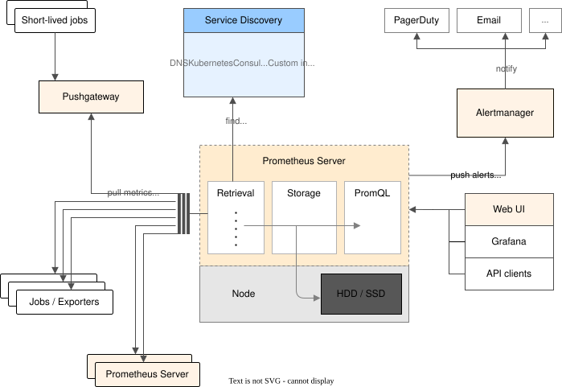
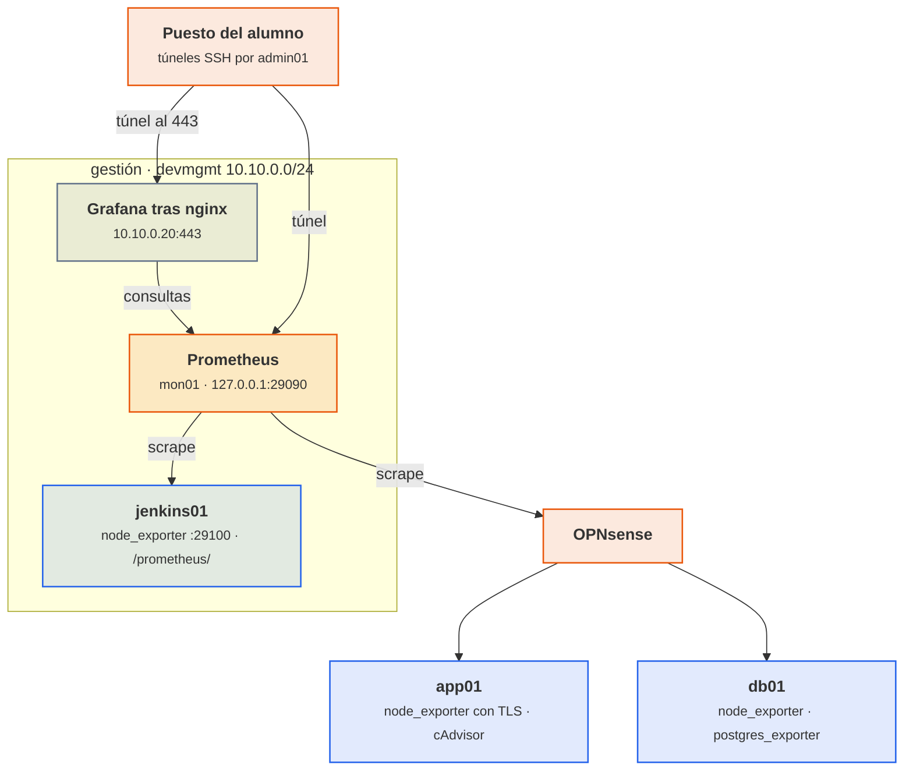
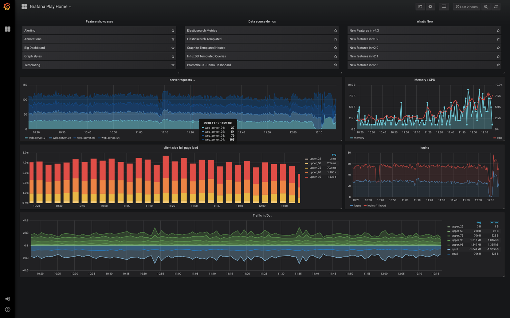

# UT7 · Monitorización del entorno

<p class="ut-meta">4 h en el centro + 12 h en la formación en empresa · Sesiones 39 y 40 · RA4 CE i, j, k</p>

Última unidad del centro. En la UT6 quedó Jenkins construyendo y desplegando el servicio, pero nadie vigila todavía la plataforma que lo hace: la pila de Mantenimiento mira el servicio y sus máquinas, no `jenkins01` ni lo que pasa dentro de Jenkins. Esta unidad no monta otra pila: trabaja sobre la que ya corre en `mon01` (Prometheus, Alertmanager y Grafana) y en el mismo repositorio `monitoring`, y le añade lo propio del despliegue: la elección justificada del gestor de ingesta, los targets generados con Ansible desde el inventario, las métricas de Jenkins, un panel de KPI con sus alertas y la seguridad de lo que se añade.

Son dos sesiones, en el orden en que viajan los datos: la del 12 de marzo los recoge y la del 17 los convierte en un panel y en alertas, y cierra lo que se abrió para recogerlos. La práctica evaluable recoge lo que dejan las dos hojas y se entrega por Aules antes del examen del 24 de marzo de 2027. Las 12 horas de monitorización avanzada se hacen en la empresa, y los logs quedan para el módulo 5169.

!!! otra "Cómo se reparte la monitorización entre las dos asignaturas"
    El módulo 5169 ya explicó el instrumental: PromQL y `rate` el [12 de noviembre](https://victor-educ.github.io/apuntes-5169/ut/ut2-alarmas/#rate-increase-y-la-ventana), las [reglas de alerta](https://victor-educ.github.io/apuntes-5169/ut/ut2-alarmas/#reglas-de-alerta) el 17, [Alertmanager](https://victor-educ.github.io/apuntes-5169/ut/ut2-alarmas/#alertmanager) el 19, Grafana [desde octubre](https://victor-educ.github.io/apuntes-5169/ut/ut1-observabilidad/) y la [seguridad de la pila](https://victor-educ.github.io/apuntes-5169/ut/ut3-seguridad-monitorizacion/) entre el 26 de noviembre y el 3 de diciembre. Aquí eso es repaso. Lo que se evalúa en esta unidad es el despliegue: elegir el gestor de ingesta, sacar los targets del inventario, recoger las métricas de Jenkins, construir el panel y las alertas, y asegurar lo que se añade.

## Sesión 39 · Ingesta de métricas

<p class="ut-meta" markdown>12 de marzo · Teoría y práctica · <span class="dur" tabindex="0" aria-label="Monitorización y observabilidad · 5 min&#10;Elegir el gestor de ingesta · 5 min&#10;La pila del curso en mon01 · 5 min&#10;A7.1 Ingesta · 95 min" data-dur="Monitorización y observabilidad · 5 min&#10;Elegir el gestor de ingesta · 5 min&#10;La pila del curso en mon01 · 5 min&#10;A7.1 Ingesta · 95 min">:material-school:<i class="dur-barra" style="--teoria:14%"></i>:material-flask:</span></p>

Si los pipelines empiezan a fallar, si `jenkins01` se queda sin disco o si una máquina nueva no entra en la lista de Prometheus, hoy no se entera nadie. Esta sesión mete la plataforma en la pila de `mon01`. Primero se decide qué datos se recogen y con qué herramienta; después se ve cómo es la pila, qué se le añade y por qué la lista de máquinas vigiladas pasa a salir del inventario de Ansible. La hoja monta la ingesta de las cuatro máquinas de dev, de los contenedores de `app01` y de Jenkins, y deja la elección por escrito.

### Monitorización y observabilidad

**Para qué sirve.** Monitorizar es recoger datos del sistema de forma continua para saber si funciona y avisar cuando deja de hacerlo. Sin ello, los fallos los descubre quien usa la plataforma. **Observabilidad** es la palabra que más se oye en la empresa: poder preguntarle al sistema por qué va mal sin desplegar nada nuevo para averiguarlo.

**Los tres tipos de datos.** Cada uno responde a una pregunta distinta:

- **Métricas**: números en el tiempo (CPU, memoria, peticiones por segundo). Ocupan poco, se agregan bien y son la base de gráficos y alertas. Dicen "cuánto" y "cuándo".
- **Logs**: líneas de texto de lo que pasó. Dicen "qué" pasó en una petición concreta.
- **Trazas**: el recorrido de una petición por varios servicios, con el tiempo en cada uno. Sirven cuando una petición cruza muchos servicios, que no es el caso del servicio del curso.

La unidad se queda con las métricas porque son las que sostienen las alertas. Los logs ya los recoge Loki en la misma pila.

**El vocabulario de la cadena.** Todos estos términos salieron ya en Mantenimiento; la tercera columna dice dónde aparecen en esta unidad:

| Término | Qué es | En esta unidad |
|----|----|----|
| Exporter | Programa que publica las métricas de algo en una página `/metrics` | node_exporter en las cuatro VM, cAdvisor en `app01` y el plugin de Jenkins |
| Target | Cada dirección de la que Prometheus lee (`host:puerto/ruta`) | `10.10.2.10:29100` o `jenkins.lab:443/prometheus/` |
| Scrape | La lectura periódica de cada target | Cada 15 s |
| Serie temporal | Una métrica con un juego concreto de etiquetas | `up{job="node",host="db01"}`, que vale 1 mientras el exporter de `db01` responde |
| KPI | Indicador clave: el número que resume si algo va bien | Los tres del panel `KPI plataforma` |
| Umbral | Valor a partir del cual una métrica se considera anómala | El `> 3` de `JenkinsBuildsFailing` |
| Alerta | Regla que se activa cuando un umbral se supera durante un tiempo | `JenkinsDown` y `JenkinsBuildsFailing`, que llegan a Mailpit |

### Elegir el gestor de ingesta

**Qué se decide.** El **gestor de ingesta** es la herramienta que recoge los datos de todas las fuentes y los guarda para consultarlos. Se elige antes de instalar nada, y el CE 4i pide que la elección quede justificada. Estas son las cuatro opciones más habituales:

|  | Prometheus + Grafana | Zabbix | Elastic / OpenSearch | Servicios de nube (CloudWatch, Azure Monitor) |
|----|----|----|----|----|
| Cómo recoge | Prometheus va a buscar los datos a los exporters | Un agente propio en cada máquina | Agentes que envían logs y métricas | Integrado en la plataforma |
| Punto fuerte | Estándar en contenedores | Todo en uno, plantillas para hardware | Logs | Lo básico, sin instalar nada |
| Punto débil | Guardar meses de datos pide piezas extra | Menos natural con contenedores | Pesado | Coste y dependencia del proveedor |

**El criterio.** Los CE 4i y 4j piden dos cosas: **recolectar** de hosts, contenedores y orquestador, y **visualizar**. Prometheus + Grafana cumple las dos y es el estándar en contenedores: casi cualquier imagen seria (nginx, PostgreSQL, Jenkins, Docker) publica métricas en su formato o tiene un exporter mantenido. En el laboratorio, además, la pila ya existe en `mon01`, y otra herramienta obligaría a mantener dos. Zabbix es razonable en un centro de datos clásico con hardware físico, sobre todo si la empresa ya lo tiene; los servicios de nube atan la monitorización al proveedor.

**Prometheus va a buscar los datos (*pull*).** Cada 15 s hace un GET a `/metrics` de cada target. Eso tiene dos ventajas: si un target no responde, se sabe al momento (`up == 0`), y desde `mon01` un `curl` al `/metrics` de un exporter enseña exactamente lo que ve Prometheus. El precio es que Prometheus tiene que llegar por red a cada target, así que cada puerto que se abre para él hay que protegerlo. Para trabajos que duran unos segundos y no están vivos cuando Prometheus pregunta existe **Pushgateway**, donde el trabajo deja sus métricas; solo para eso.

<figure markdown="span">
  { width="640" }
  <figcaption>Arquitectura de Prometheus: el servidor lee de los exporters y de Pushgateway, evalúa reglas, envía a Alertmanager y sirve datos a Grafana. Fuente: Proyecto Prometheus, Apache 2.0.</figcaption>
</figure>

### La pila del curso en mon01

**Lo que ya existe.** La pila la montó el módulo 5169 en `mon01` (`10.10.0.20`, VNet `devmgmt`), en `/opt/monitoring`, que es la copia de trabajo del repositorio `monitoring`. Prometheus, Alertmanager y Mailpit escuchan solo en `127.0.0.1` de `mon01`; Grafana está detrás de un nginx en `10.10.0.20:443`. En el mismo compose corre MinIO, y Mantenimiento la sigue usando hasta su examen del 23 de marzo. Por eso **nunca se hace `docker compose down`**: se añaden ficheros y, como mucho, se recrea un solo servicio.

**Cómo se llega a ella.** Por túnel SSH desde el puesto del alumno, con el puesto de administración como salto. Cada servicio usa en el puesto el mismo puerto que en `mon01`, el de la [franja del curso](../laboratorio.md#puertos):

```bash
# Prometheus (29090), Alertmanager (29093) y Mailpit (28025)
ssh -L 29090:127.0.0.1:29090 -L 29093:127.0.0.1:29093 -L 28025:127.0.0.1:28025 \
    -J ops@<IP de admin01 en la red del laboratorio> ops@10.10.0.20
# Grafana, por el 443 de mon01
ssh -L 28443:10.10.0.20:443 ops@<IP de admin01 en la red del laboratorio>
```

Mientras siguen abiertos, Prometheus queda en `http://localhost:29090` y Grafana en `https://grafana.lab:28443`, con la línea `127.0.0.1 grafana.lab` en el fichero hosts del puesto y la CA del curso importada en el navegador. Las órdenes completas están en el [laboratorio de Mantenimiento](https://victor-educ.github.io/apuntes-5169/laboratorio/).

**Qué se vigila.** Lo que ya se lee y lo que añade esta unidad:

- **node_exporter** (29100) viene en la plantilla de las VM: no se instala nada. Lo que cambia es de dónde sale la lista de targets.
- **cAdvisor** (`app01`, 28081) y **postgres_exporter** (`db01`, 29187) ya los lee la pila de Mantenimiento. No se tocan.
- **Jenkins** publica `/prometheus/` con el plugin **Prometheus metrics**, que se añade en esta unidad al `plugins.txt` de su imagen con la versión fijada. Como Jenkins va detrás de su nginx, la ruta es `https://jenkins.lab/prometheus/`.



<p class="pie" markdown>Los scrapes hacia `app01` y `db01` atraviesan el cortafuegos; el de `jenkins01` no, porque está en la misma subred que `mon01`, así que en `jenkins01` el filtro va en el propio host.</p>

#### Los targets, desde el inventario

**El problema.** Hasta hoy, los targets de node_exporter de dev están escritos a mano en `prometheus.yml`. La máquina que alguien olvida añadir no la vigila nadie. Con **`file_sd_configs`**, Prometheus lee la lista de targets de unos ficheros YAML y la vuelve a leer en cuanto cambian, sin reiniciar.

**Cómo se hace.** Esos ficheros los escribe un playbook de Ansible a partir del inventario de dev (`dev.ini`): vigilar una máquina más es añadir una línea al inventario y volver a lanzar el playbook. Son dos ficheros, `targets/ut7-node.yml` y `targets/ut7-node-tls.yml`, porque los leen dos jobs distintos (un *job* es el bloque de `prometheus.yml` que agrupa targets que se leen igual): `node`, por HTTP, y `node-tls`, para `app01`, el único exporter con TLS y contraseña. Los tres ficheros completos están en [Descubrimiento de targets](#descubrimiento-de-targets).

**El único cambio en el compose.** El servicio `prometheus` gana dos volúmenes, uno para los targets y otro para las reglas de la sesión 40:

```yaml
# /opt/monitoring/compose.yml, servicio prometheus: dos líneas más en volumes
    volumes:
      # ... los que ya tenía, sin tocarlos
      - ./targets:/etc/prometheus/targets:ro
      - ./rules:/etc/prometheus/rules:ro
```

Un volumen nuevo obliga a recrear el contenedor: `docker compose up -d --no-deps prometheus` recrea solo ese, y el histórico se conserva. Se lanza desde `/opt/monitoring` y **sin `-f`**, para que Compose junte el `compose.yml` con el `compose.override.yml` de Mantenimiento, que es el que monta la CA y la contraseña.

**La buena práctica.** La lista de lo que se vigila sale de la misma lista de máquinas que se administra, y no se mantiene aparte.

### Descubrimiento de targets

!!! consulta "Material de consulta"
    Son los tres ficheros que la hoja A7.1 copia tal cual.

**El inventario.** Vive en el repositorio `iac-lab` del puesto de administración. Cada grupo es el papel de la máquina y acaba en la etiqueta `rol`; `node_tls` marca el único exporter cifrado. `web01` no está porque las reglas del cortafuegos no dejan a `mon01` llegar a front:

```ini
# iac-lab/ansible/dev.ini: las máquinas de dev que vigila Prometheus
[gestion]
mon01     ansible_host=10.10.0.20

[ci]
jenkins01 ansible_host=10.10.0.10

[servicio]
app01     ansible_host=10.10.2.10 node_tls=true
db01      ansible_host=10.10.3.10

[all:vars]
ansible_user=ops
```

**El playbook.** Solo entra en `mon01`: de las demás máquinas le basta lo que dice el inventario.

```yaml
# iac-lab/ansible/ut7-targets.yml: escribe los targets de node_exporter en mon01
- name: Targets de Prometheus desde el inventario
  hosts: mon01
  become: true
  tasks:
    - name: Directorio de targets en la copia de trabajo de monitoring
      ansible.builtin.file: { path: /opt/monitoring/targets, state: directory, owner: ops, group: ops, mode: "0755" }
    - name: Un fichero para los exporters por HTTP y otro para los cifrados
      ansible.builtin.copy:
        dest: "/opt/monitoring/targets/ut7-{{ item.fichero }}.yml"
        owner: ops
        group: ops
        mode: "0644"
        content: |
          # Generado por ansible/ut7-targets.yml de iac-lab. No se edita a mano.
          
          - targets: ["{{ hostvars[h].ansible_host }}:29100"]
            labels: { host: {{ h }}, env: dev, rol: {{ hostvars[h].group_names | first }} }
          
      loop:
        - { fichero: node, tls: false }
        - { fichero: node-tls, tls: true }
```

- El `loop` repite la copia dos veces, una por fichero; `item` dice el nombre y si es el de los cifrados.
- `content` es una plantilla: el `` recorre las máquinas del inventario y se queda con las que tienen el `node_tls` de ese fichero.
- Cada máquina sale con su dirección, el puerto 29100 y tres etiquetas: `host`, `env` (fijo a `dev`) y `rol`.

**Los jobs.** En `prometheus.yml`, los de node_exporter de dev pasan a leer esos ficheros y se añade el de Jenkins:

```yaml
# prometheus.yml: jobs de esta unidad (sustituyen a los static_configs de dev de node_exporter)
  - job_name: node
    file_sd_configs:
      - files: [/etc/prometheus/targets/ut7-node.yml]
        refresh_interval: 1m
  - job_name: node-tls
    scheme: https
    tls_config:
      ca_file: /etc/prometheus/tls/ca.crt
    basic_auth:
      username: prometheus
      password_file: /etc/prometheus/secrets/node_exporter.pass
    file_sd_configs:
      - files: [/etc/prometheus/targets/ut7-node-tls.yml]
        refresh_interval: 1m
  - job_name: jenkins
    scheme: https                      # Jenkins solo se publica por su nginx, en el 443
    metrics_path: /prometheus/
    tls_config: { ca_file: /etc/prometheus/tls/ca.crt }
    static_configs:
      - targets: ["jenkins.lab:443"]
        labels: { host: jenkins01, env: dev, service: jenkins }
```

El `tls_config` y el `basic_auth` de `node-tls` son los que dejó la A3.2 de Mantenimiento: solo cambia de dónde sale el target. El job `jenkins` no sale del inventario porque no vigila una máquina sino un servicio: un único target fijo, con la ruta del plugin y la CA del curso. La etiqueta `env="dev"` separa lo de esta unidad de los targets de pre, que siguen en el job `node` hasta que Mantenimiento los retira, el 18 de marzo.

### A7.1 Ingesta (sesión 39)

<span class="et et-obj">Objetivo</span> Al terminar, la pila de `mon01` vigila la plataforma entera: las cuatro máquinas de dev, con sus targets generados por Ansible desde el inventario, los contenedores de `app01` y el propio Jenkins. Tienes todos los targets de dev en UP, una consulta con datos por cada fuente y la elección del gestor de ingesta justificada por escrito. Es la parte de la práctica evaluable del CE 4i, y los datos sobre los que la A7.2 construye el panel y las alertas.

<span class="et et-pre">Antes de empezar</span>

- Encendidas `mon01` (`10.10.0.20`), `jenkins01` (`10.10.0.10`), `app01` (`10.10.2.10`), `db01` (`10.10.3.10`), el puesto de administración (`10.10.0.50`), `gitea01` y `agent01`, con Jenkins arrancado.
- Entra en el puesto de administración con `ssh -A`: el playbook del paso 2 entra en `mon01` con tu clave, como en la A5.5.
- La pila de Mantenimiento en marcha en `/opt/monitoring` de `mon01`. No la pares en ningún momento.
- El túnel a Prometheus abierto desde tu puesto, con la orden de [La pila del curso en mon01](#la-pila-del-curso-en-mon01).
- `jenkins.lab` en el DNS de OPNsense desde la A6.1 (el contenedor de Prometheus no lee el `/etc/hosts` de `mon01`).
- Explicado en clase: [Elegir el gestor de ingesta](#elegir-el-gestor-de-ingesta), [La pila del curso en mon01](#la-pila-del-curso-en-mon01) y [Los targets, desde el inventario](#los-targets-desde-el-inventario). Para copiar: [Descubrimiento de targets](#descubrimiento-de-targets) y [Consultas del laboratorio](#consultas-del-laboratorio).

<span class="et et-pas">Pasos</span>

Empiezas por la imagen de Jenkins, que tarda en construirse, y mientras tanto generas los targets desde el puesto de administración, preparas `mon01` para leerlos y cambias los jobs. Con todo en UP consultas los datos y dejas la elección por escrito.

1. **Lanza primero lo que más tarda: Jenkins con el plugin.** Añade el plugin al `plugins.txt` con su versión fijada y reconstruye la imagen. Como `plugins.txt` cambia, Docker vuelve a descargar todos los plugins: sigue con el paso 2 mientras tanto. En `jenkins01`:

    ```bash
    cd ~/jenkins-config
    echo "prometheus:<versión del día en plugins.jenkins.io>" >> plugins.txt
    git add plugins.txt && git commit -m "UT7: plugin Prometheus metrics" && git push
    docker compose build jenkins && docker compose up -d jenkins
    ```

    Comprueba en Manage Jenkins → Plugins → Installed que aparece Prometheus metrics.

2. **Genera la lista de targets desde el inventario.** Copia `dev.ini` y `ut7-targets.yml` de [Descubrimiento de targets](#descubrimiento-de-targets) y lanza el playbook. En el puesto de administración:

    ```bash
    cd ~/iac-lab/ansible
    nano dev.ini              # el inventario, tal cual
    nano ut7-targets.yml      # el playbook, tal cual
    ansible-playbook -i dev.ini ut7-targets.yml
    git add dev.ini ut7-targets.yml && git commit -m "UT7: targets desde el inventario" && git push
    ssh ops@10.10.0.20 cat /opt/monitoring/targets/ut7-node.yml /opt/monitoring/targets/ut7-node-tls.yml
    ```

    Comprueba que cada máquina está en el fichero que le toca según su `node_tls` y con sus tres etiquetas.

3. **Prepara la pila de `mon01` para los ficheros de la unidad.** Crea los directorios de la unidad, añade los dos volúmenes de [Los targets, desde el inventario](#los-targets-desde-el-inventario) al servicio `prometheus` y recrea solo ese contenedor. `rules/` se monta ya, aunque esté vacío hasta el 17 de marzo, para recrear Prometheus una sola vez. En `mon01`:

    ```bash
    cd /opt/monitoring
    mkdir -p rules grafana/ut7 docs
    nano compose.yml                           # las dos líneas de volumes
    docker compose up -d --no-deps prometheus  # desde aquí y sin -f
    docker compose ps
    docker compose exec prometheus ls /etc/prometheus/targets
    ```

    Comprueba que el resto de la pila sigue en marcha y que el contenedor ve los dos ficheros de targets.

4. **Pasa los jobs de node_exporter a los ficheros y añade Jenkins.** En `prometheus.yml`, cambia los `static_configs` de dev de node_exporter por los `file_sd_configs` de [Descubrimiento de targets](#descubrimiento-de-targets) y añade el job `jenkins`. De `node-tls` solo cambia de dónde sale el target: su `scheme`, `tls_config` y `basic_auth` se quedan. Si `node` tiene un grupo con `env: pre`, déjalo. Valida y recarga sin reiniciar:

    ```bash
    nano prometheus.yml
    docker compose exec prometheus promtool check config /etc/prometheus/prometheus.yml
    curl -s -X POST http://localhost:29090/-/reload
    ```

    Al minuto, en `http://localhost:29090/targets`, los targets de dev de `node`, `node-tls`, `cadvisor` y `jenkins` tienen que estar en UP. Los de `env="pre"` pueden salir en DOWN (pre se destruyó el 11 de marzo) y no cuentan.

5. **Comprueba que llegan datos de las tres fuentes.** Un target en UP solo dice que Prometheus lee su página; que los datos sirvan se comprueba consultándolos. En Graph, lanza tres consultas de [Consultas del laboratorio](#consultas-del-laboratorio), una por fuente: CPU usada por host (node_exporter), memoria del contenedor de la API (cAdvisor) y ejecuciones correctas de Jenkins (el plugin). Captura el resultado de cada una.

    *Pista:* las series de Jenkins no existen hasta que termina la primera ejecución desde que arrancó con el plugin. Si sale vacía, lanza el pipeline de `servicio` sin `RUN_DEPLOY` y espera a que acabe.

6. **Justifica la elección y guarda el trabajo.** Escribe `docs/ut7.md` con cinco a diez líneas: los dos criterios del CE 4i de [Elegir el gestor de ingesta](#elegir-el-gestor-de-ingesta), por qué Prometheus los cumple aquí y cuándo elegirías Zabbix o un servicio de nube. Es la justificación que pide el primer criterio de la práctica evaluable. Después sube solo tus ficheros, porque esa copia de trabajo es también la de Mantenimiento:

    ```bash
    cd /opt/monitoring
    nano docs/ut7.md
    git add compose.yml prometheus.yml targets/ docs/ut7.md
    git commit -m "UT7: ingesta de la plataforma" && git push
    ```

    Comprueba en Gitea que el commit lleva esos cuatro elementos y nada más.

<span class="et et-com">Comprobación</span> En `http://localhost:29090/targets`, los jobs `node`, `node-tls`, `cadvisor` y `jenkins` sin ninguna fila de dev en DOWN, y la fila de `app01` en `node-tls` con un endpoint que empieza por `https://`. En Graph, `up{rol="ci"}` devuelve la serie de `jenkins01`, y las tres consultas del paso 5 devuelven datos. Los ficheros de `targets/` empiezan por la línea que dice que los genera Ansible.

<span class="et et-ent">Para practicar</span> Guarda en `A7.1` de `entregas-5166` la captura de la página Targets con los jobs de dev en UP, las de las tres consultas y el enlace al commit de `monitoring` con `targets/`, `prometheus.yml` y `docs/ut7.md`: lo pide la práctica evaluable.

<span class="et et-ext">Si te sobra tiempo</span> Lanza dos veces en Jenkins un job que falle a propósito y mira subir `increase(default_jenkins_builds_failed_build_count_total[1h])`, el núcleo de la consulta del panel de la A7.2. Fíjate en cuál de las dos ejecuciones hace subir el valor y explícalo con [Cómo se leen los contadores](#como-se-leen-los-contadores-y-la-duracion).

## Sesión 40 · Visualización, alertas y seguridad

<p class="ut-meta" markdown>17 de marzo · Teoría y práctica · <span class="dur" tabindex="0" aria-label="Métricas del orquestador: Jenkins en Prometheus · 10 min&#10;Seguridad de lo que añade la unidad · 5 min&#10;A7.2 Paneles, alertas y seguridad · 95 min" data-dur="Métricas del orquestador: Jenkins en Prometheus · 10 min&#10;Seguridad de lo que añade la unidad · 5 min&#10;A7.2 Paneles, alertas y seguridad · 95 min">:material-school:<i class="dur-barra" style="--teoria:14%"></i>:material-flask:</span></p>

Prometheus ya guarda los datos de las tres fuentes, pero un dato guardado solo sirve si alguien lo mira. Esta sesión los resume en un panel que se lee de un vistazo, los convierte en alertas que avisan solas y cierra las dos puertas que la unidad abrió en `jenkins01` para recogerlos. El [repaso](#repaso-promql-reglas-alertmanager-y-grafana) de lo que la hoja usa de PromQL, reglas y Grafana se lee antes de clase; la explicación va a lo que el módulo 5169 no toca: qué publica Jenkins y la seguridad de lo nuevo.

### Repaso: PromQL, reglas, Alertmanager y Grafana

!!! otra "Repaso"
    Está explicado entero en Mantenimiento: [PromQL](https://victor-educ.github.io/apuntes-5169/ut/ut2-alarmas/#rate-increase-y-la-ventana), [reglas de alerta](https://victor-educ.github.io/apuntes-5169/ut/ut2-alarmas/#reglas-de-alerta), [Alertmanager y su árbol de rutas](https://victor-educ.github.io/apuntes-5169/ut/ut2-alarmas/#el-arbol-de-rutas) y Grafana [desde octubre](https://victor-educ.github.io/apuntes-5169/ut/ut1-observabilidad/). La [chuleta de 5169](https://victor-educ.github.io/apuntes-5169/chuleta/) tiene las consultas sueltas. Este apartado se lee antes de la sesión.

**Lo que la hoja usa.** La A7.2 escribe tres consultas de panel y dos reglas, y hace llegar una alerta hasta el correo. Basta con tener frescas cuatro ideas:

| Idea | Qué conviene recordar | Dónde aparece |
|----|----|----|
| `rate(x[5m])` e `increase(x[1h])` | Se aplican a contadores (números que solo suben); la ventana tiene que contener varias muestras | Panel de ejecuciones fallidas y `JenkinsBuildsFailing` |
| `== bool 0` | `up == 0` deja solo las series que valen cero; `up == bool 0` devuelve 1 o 0 en todas, y por eso se pueden sumar | Panel de hosts caídos |
| Una consulta vacía no es un cero | Si la serie no existe, Grafana pinta «No data»; `or vector(0)` pone un 0 en su lugar | Panel de ejecuciones fallidas |
| Las etiquetas de una alerta | Son lo que mira Alertmanager para decidir a quién avisar: `severity`, `team`, `service`, `origen`, `env` | [Reglas de esta unidad](#reglas-de-esta-unidad) |

**El camino de una alerta.** Las reglas de la unidad van en un fichero propio y las entrega el Alertmanager de la pila. Una `warning` va al receptor `mail`, que entrega en Mailpit. Entre el fallo y el correo pasan el `for` de la regla y unos 30 s de espera de Alertmanager, así que nunca llega al instante; el correo de resolución (RESOLVED) puede tardar hasta 5 minutos.

**Lo que se ajusta en cada panel de Grafana.** La **unidad** (percent, bytes(IEC)), para que escriba 5,68 GiB y no 6.1e+09; los **umbrales** de color, que dicen lo mismo que la alerta; y la **leyenda** `{{host}}`, para que cada línea diga de qué máquina es. Conviene probar cada consulta antes en la pestaña Graph de Prometheus: lo que ahí no devuelve nada tampoco lo hará en Grafana.

### Consultas, reglas y panel de la unidad

!!! consulta "Material de consulta"
    Son las consultas que usan las hojas A7.1 y A7.2, el fichero de reglas que copia la A7.2 y cómo se guarda el panel en Git.

#### Consultas del laboratorio

Todas filtran por `env="dev"` o por `service="app"`, para no mezclar los targets de pre que siguen en el job `node`.

| Qué | Consulta |
|----|----|
| CPU usada (%) por host | `100 - avg by (host) (rate(node_cpu_seconds_total{mode="idle",env="dev"}[5m])) * 100` |
| Memoria disponible (%) | `node_memory_MemAvailable_bytes{env="dev"} / node_memory_MemTotal_bytes{env="dev"} * 100` |
| Disco libre (%) | `node_filesystem_avail_bytes{mountpoint="/",env="dev"} / node_filesystem_size_bytes{mountpoint="/",env="dev"} * 100` |
| Hosts caídos | `sum(up{job=~"node.*",env="dev"} == bool 0)` |
| CPU del contenedor de la API | `rate(container_cpu_usage_seconds_total{service="app"}[5m])` |
| Memoria del contenedor de la API | `container_memory_working_set_bytes{service="app"}` |
| Ejecuciones correctas de Jenkins | `default_jenkins_builds_success_build_count_total` |
| Ejecuciones fallidas de Jenkins en la última hora | `sum(increase(default_jenkins_builds_failed_build_count_total[1h])) or vector(0)` |

- **CPU por host.** `rate` del tiempo que la CPU pasa parada (`idle`) da la fracción de reposo; 100 menos eso es la CPU usada.
- **Contenedor de la API.** Se filtra por `service="app"`, la etiqueta que la pila copia del compose, y no por el nombre del contenedor, que cambia si se recrea. Para la memoria se usa el *working set*, la que el sistema no puede recuperar, que es la que cuenta frente al límite del contenedor.
- **Jenkins.** La serie de fallos no existe hasta el primer fallo desde que arrancó Jenkins, y por eso la del panel termina en `or vector(0)`: sin fallos, el panel enseña un 0 en verde.

**Los tres KPI del panel** son uno por fuente: hosts caídos, memoria del contenedor de la API y ejecuciones fallidas de Jenkins. Cada uno resume su fuente en un número y, si se sale de lo normal, pide hacer algo.

#### Reglas de esta unidad

Las reglas de Mantenimiento viven en su repositorio `alerting` y no se tocan. Las de esta unidad van en `rules/ut7-plataforma.yml`, que Prometheus carga con una entrada más en `rule_files` de `prometheus.yml`: `"rules/ut7-*.yml"`. Con el patrón, cualquier fichero de reglas nuevo de la unidad entra sin volver a tocar `prometheus.yml`.

```yaml
# rules/ut7-plataforma.yml
groups:
  - name: ut7-plataforma
    rules:
      - alert: JenkinsDown
        expr: up{job="jenkins"} == 0
        for: 1m
        labels: { severity: warning, team: ops, service: jenkins, origen: prometheus, env: dev }
        annotations:
          summary: "Prometheus no puede leer las métricas de Jenkins"
          description: "{{ $labels.instance }} lleva un minuto sin responder: Jenkins parado o su nginx caído."
      - alert: JenkinsBuildsFailing
        expr: sum(increase(default_jenkins_builds_failed_build_count_total[1h])) > 3
        for: 0m
        labels: { severity: warning, team: dev, service: jenkins, origen: prometheus, env: dev }
        annotations:
          summary: "Más de 3 ejecuciones fallidas de Jenkins en la última hora"
```

- **`JenkinsDown`** salta cuando Prometheus no puede leer `/prometheus/`. El `for: 1m` evita que un reinicio de diez segundos despierte a nadie. Es del equipo `ops` porque el problema está en la máquina.
- **`JenkinsBuildsFailing`** suma los fallos de todos los jobs en la última hora; la propia ventana ya filtra los fallos sueltos. Es del equipo `dev` porque lo que falla suele ser el código o sus pruebas.

Antes de recargar se valida con `promtool check config`, que revisa también las reglas. Una recarga con errores no tumba Prometheus, pero lo deja con la configuración anterior sin avisar en pantalla.

#### El panel en Grafana

<figure markdown="span">
  { width="640" }
  <figcaption>Un dashboard de Grafana con series temporales, gauges y stats de un host. Fuente: Joel Kennedy, dominio público, vía Wikimedia Commons.</figcaption>
</figure>

**Por qué el panel va a Git.** Lo que se hace clicando en Grafana vive en su base de datos: si se pierde el volumen, se pierde el panel. Por eso se exporta a JSON (**Export → Export as JSON**, con «Export the dashboard to use in another instance» activado) y se guarda en el repositorio, en `grafana/ut7/`.

**Que Grafana lo cargue solo** (*provisioning*). Grafana puede cargar al arrancar los dashboards de un directorio si se le da un fichero de proveedor:

```yaml
# grafana/provisioning/dashboards/ut7.yml
apiVersion: 1
providers:
  - name: ut7
    folder: UT7
    type: file
    allowUiUpdates: false
    options:
      path: /var/lib/grafana/dashboards/ut7
```

`allowUiUpdates: false` impide cambiar desde la interfaz un panel que viene de Git: el cambio se hace en el JSON. El JSON exportado lleva la fuente de datos como un hueco, `${DS_PROMETHEUS}`, que hay que cambiar por el uid de la fuente de Prometheus de `mon01` (aparece en la dirección de su página en Connections → Data sources). Montar el directorio obliga a recrear Grafana, así que en la hoja queda para cuando sobra tiempo, igual que una **variable** `$host` (`label_values(node_uname_info{env="dev"}, host)`), que pone en la cabecera un desplegable con los hosts para tener un solo panel para todos.

### Métricas del orquestador: Jenkins en Prometheus

**Para qué sirve.** El CE 4i pide recoger métricas del orquestador, y en el curso el orquestador es Jenkins. Una integración continua se degrada antes de caerse: los builds tardan cada vez más, la cola no se vacía, un agente se queda colgado. Nada de eso lo ve node_exporter, que mira la máquina y no lo que pasa dentro de Jenkins.

#### De dónde salen los números de Jenkins

**El plugin.** **Prometheus metrics** corre dentro de Jenkins, ve la cola, los ejecutores y el historial de cada job, y cada dos minutos deja sus métricas en `https://jenkins.lab/prometheus/`. Por eso una ejecución recién terminada tarda hasta dos minutos en verse.

**Los nombres.** Las métricas propias del plugin llevan el prefijo `default_`; las de la cola y los ejecutores van sin prefijo (`jenkins_queue_...`, `jenkins_executor_...`). Las de ejecuciones llevan el nombre del pipeline en la etiqueta `jenkins_job` (en Prometheus, `job="jenkins"` es el bloque de scrape, no el pipeline). Los nombres cambian algo entre versiones, así que lo primero es ver cuáles hay. En Graph:

```promql
count by (__name__) ({job="jenkins"})
```

Las que usa el curso:

| Métrica | Qué mide | Qué dice de la CI |
|----|----|----|
| `jenkins_queue_size_value` | Trabajos esperando en la cola | Si no vuelve a cero, faltan ejecutores o hay un job atascado |
| `jenkins_executor_count_value` y `jenkins_executor_in_use_value` | Ejecutores y cuántos están ocupados | Una ocupación sostenida por encima del 80 % anticipa cola |
| `default_jenkins_builds_duration_milliseconds_summary` | Duración de las últimas ejecuciones, por job | Una duración que crece semana a semana es un pipeline que se degrada |
| `default_jenkins_builds_success_build_count_total` y `default_jenkins_builds_failed_build_count_total` | Ejecuciones correctas y fallidas, por job | Con `increase(...[1h])`, cuántas han fallado en la última hora |
| `jenkins_health_check_score` | Fracción de las comprobaciones internas de Jenkins que pasan | Por debajo de 1 hay algo roto en el propio Jenkins |

#### Cómo se leen los contadores y la duración

Los contadores de ejecuciones tienen tres particularidades que explican casi todas las consultas que salen vacías:

- **Vuelven a cero cada vez que arranca Jenkins**, porque el plugin los lleva en memoria. `increase()` y `rate()` lo tratan como cualquier reinicio de contador.
- **La serie de un resultado no existe hasta la primera ejecución con ese resultado.** Hasta el primer fallo, la consulta de fallos no devuelve 0, sino nada. Y `increase()` no cuenta ese primer fallo, porque la serie nace valiendo ya 1.
- **El nombre acaba en `_total`**, la convención de Prometheus para los contadores.

La duración se lee dividiendo la suma entre el número de ejecuciones, que da la media en milisegundos:

```promql
default_jenkins_builds_duration_milliseconds_summary_sum
  / default_jenkins_builds_duration_milliseconds_summary_count
```

!!! empresa "Qué se mira en producción"
    Un panel de integración continua en una empresa no enseña CPU: enseña cuánto se tarda desde que se sube un cambio hasta que está desplegado, qué parte de las ejecuciones falla y cuánto se tarda en recuperarse de un despliegue malo. La cola y los ejecutores explican por qué sube el primero.

!!! ojo "El endpoint también es una puerta"
    `/prometheus/` publica nombres de jobs, ramas y agentes, que son información de la empresa. La A7.1 lo deja abierto para que el scrape funcione a la primera, y la A7.2 lo cierra a todos menos a `mon01`.

### Seguridad de lo que añade la unidad

!!! otra "Repaso"
    La seguridad de la pila la montó Mantenimiento entre el [26 de noviembre y el 3 de diciembre](https://victor-educ.github.io/apuntes-5169/ut/ut3-seguridad-monitorizacion/): exporters cerrados con cortafuegos, TLS y contraseña en el de `app01`, Grafana tras nginx y Prometheus solo por túnel. Sigue en pie; la hoja comprueba que esta unidad no la ha roto.

**Para qué sirve.** Cada puerto nuevo que se vigila entra con su protección. Esta unidad abre dos puertas en `jenkins01`: `/prometheus/` y el 29100 de su node_exporter. `jenkins01` está en la misma subred que `mon01`, así que ese tráfico no pasa por OPNsense y el filtro va en el propio host. En la hoja es obligatorio cerrar la primera, que publica información de la empresa; la segunda queda para cuando sobra tiempo.

**Las métricas de Jenkins.** Se cierran en su nginx con un `location` propio que solo deja pasar a `mon01`:

```nginx
# en el server de jenkins.lab del nginx.conf de jenkins-config
    location /prometheus/ {
        allow 10.10.0.20;          # mon01
        deny  all;
        proxy_pass http://jenkins:8080;
        proxy_set_header Host $host;
        proxy_set_header X-Forwarded-Proto https;
    }
```

- nginx elige el `location` más largo que coincide, así que este se lleva solo las peticiones de métricas y el resto de Jenkins sigue igual.
- `allow` y `deny` se leen de arriba abajo: `mon01` pasa y cualquier otro recibe un 403, que es la evidencia del cierre.
- Un `location` no hereda nada de otro: el `proxy_pass` y las cabeceras se repiten.

**El exporter de `jenkins01`.** Basta una regla de nftables que solo deje leer el 29100 a `mon01`:

```text
#!/usr/sbin/nft -f
# /etc/nftables.conf de jenkins01: solo mon01 lee el node_exporter
table inet fw
flush table inet fw

table inet fw {
    chain input {
        type filter hook input priority filter; policy accept;
        tcp dport 29100 ip saddr != 10.10.0.20 log prefix "mon-denegado: " drop
    }
}
```

Este fichero sustituye al `/etc/nftables.conf` de Debian, que empieza por `flush ruleset`: cargado tal cual, borraría también las reglas de Docker y dejaría a Jenkins sin publicar.

**Secretos y repositorio.** Nada de lo que añade la unidad lleva un secreto dentro: la contraseña de `node-tls` está en `secrets/`, que el `.gitignore` deja fuera, y la CA del curso es pública. Se comprueba con [gitleaks](ut5-iac.md#gitignore-y-pre-commit) sobre una copia recién clonada de Gitea, que es lo que se lleva cualquiera que descargue el repositorio. Un secreto que llegó al historial se cambia: borrarlo en un commit nuevo no lo saca de los anteriores ([Cuando gitleaks encuentra algo](ut5-iac.md#cuando-gitleaks-encuentra-algo)).

**La buena práctica.** La evidencia de un cierre es lo que ve otra máquina, no la configuración: se prueba desde fuera, y se comprueba a la vez que Prometheus sigue leyendo.

### A7.2 Paneles, alertas y seguridad (sesión 40)

<span class="et et-obj">Objetivo</span> Al terminar, los datos de la A7.1 se miran de un vistazo y avisan solos, y lo que la unidad abrió queda cerrado. Tienes el panel `KPI plataforma` guardado en Git, las reglas de la unidad cargadas, `JenkinsDown` llegada a Mailpit en FIRING y en RESOLVED, las métricas de Jenkins solo para `mon01`, lo de Mantenimiento todavía cerrado y el repositorio `monitoring` sin secretos y con la etiqueta de entrega. Es lo que la práctica evaluable recoge de los CE 4j y 4k.

<span class="et et-pre">Antes de empezar</span>

- Lo de la A7.1 en marcha: targets de dev en UP y su commit subido.
- Los dos túneles de [La pila del curso en mon01](#la-pila-del-curso-en-mon01) abiertos, y un usuario de Grafana que pueda crear paneles (Editor).
- Permiso para parar un par de minutos el nginx de Jenkins (avisa si compartes `jenkins01`).
- Leído antes de clase: el [repaso](#repaso-promql-reglas-alertmanager-y-grafana). Explicado en clase: [Métricas del orquestador](#metricas-del-orquestador-jenkins-en-prometheus) y [Seguridad de lo que añade la unidad](#seguridad-de-lo-que-anade-la-unidad). Para copiar: [Consultas del laboratorio](#consultas-del-laboratorio), [Reglas de esta unidad](#reglas-de-esta-unidad) y [El panel en Grafana](#el-panel-en-grafana).

<span class="et et-pas">Pasos</span>

Primero el panel, que te dice si las consultas devuelven lo que esperas; después las reglas, y una alerta provocada para ver la cadena entera hasta el correo. Con la alerta probada cierras `/prometheus/`: si el cierre deja fuera a Prometheus, la propia `JenkinsDown` te avisará. Al final dejas escritos los secretos, marcas la entrega y compruebas desde fuera que todo sigue cerrado.

1. **Resume la plataforma en un panel y guárdalo en Git.** En Grafana, crea la carpeta `UT7` y dentro el dashboard `KPI plataforma` con tres paneles y las consultas de [Consultas del laboratorio](#consultas-del-laboratorio):

    | Panel | Tipo | Ajustes |
    |----|----|----|
    | Hosts caídos | Stat | Verde 0, rojo desde 1 |
    | Memoria del contenedor de la API | Time series | Unidad bytes(IEC), leyenda `{{host}}` |
    | Ejecuciones fallidas de Jenkins (1 h) | Stat | Verde 0, naranja 1, rojo desde 4 |

    Los umbrales son los de las alertas, para que el panel y el correo digan lo mismo. Exporta el JSON (Export → Export as JSON, con «Export the dashboard to use in another instance») y súbelo a `mon01` desde tu puesto:

    ```bash
    scp -J ops@<IP de admin01 en la red del laboratorio> kpi-plataforma.json \
        ops@10.10.0.20:/opt/monitoring/grafana/ut7/kpi-plataforma.json
    ```

    Comprueba que los tres paneles muestran datos.

2. **Carga las reglas de la unidad.** Copia el fichero de [Reglas de esta unidad](#reglas-de-esta-unidad) y añade `"rules/ut7-*.yml"` a `rule_files` de `prometheus.yml`, sin quitar lo que ya tiene. En `mon01`:

    ```bash
    cd /opt/monitoring
    nano rules/ut7-plataforma.yml
    nano prometheus.yml        # una entrada más en rule_files
    docker compose exec prometheus promtool check config /etc/prometheus/prometheus.yml
    curl -s -X POST http://localhost:29090/-/reload
    ```

    En `http://localhost:29090/alerts` tienen que aparecer las dos reglas, en verde.

3. **Provoca `JenkinsDown` y síguela hasta el correo.** Parar el nginx de Jenkins es, para Prometheus, lo mismo que un Jenkins caído. En `jenkins01`:

    ```bash
    cd ~/jenkins-config
    date && docker compose stop nginx      # apunta la hora
    ```

    Sigue la alerta en Prometheus (de `pending` a `firing`), en Alertmanager (`http://localhost:29093`) y en Mailpit (`http://localhost:28025`) hasta que llegue el correo FIRING, y compara su hora con la tuya. Después vuelve a arrancarlo con `docker compose start nginx` y espera el RESOLVED. Captura los dos correos.

    *Pista:* el RESOLVED puede tardar hasta cinco minutos. Mientras llega, sigue con el paso 4, que es en la misma máquina.

4. **Cierra `/prometheus/` a todos menos a `mon01`.** Añade el bloque `location` de [Seguridad de lo que añade la unidad](#seguridad-de-lo-que-anade-la-unidad) dentro del `server` de `jenkins.lab` del `nginx.conf`. Reinicia nginx en lugar de recargarlo: el fichero está montado suelto y, si el editor lo reescribe, el contenedor sigue viendo el antiguo hasta que arranca otra vez.

    ```bash
    nano nginx.conf
    docker compose restart nginx
    git add nginx.conf && git commit -m "UT7: /prometheus/ solo para mon01" && git push
    ```

    Mira enseguida el target `jenkins` en Prometheus: tiene que seguir en UP, porque `mon01` es quien sí debe pasar.

5. **Deja escrito de dónde sale cada secreto y marca la entrega.** Añade a `docs/ut7.md` un apartado «Secretos» de dos o tres líneas: qué credencial usa lo de esta unidad, dónde está y por qué no llega al repositorio. Después sube tus ficheros y pon la etiqueta `entrega-5166-ut7`, que fija el estado que corrige la práctica evaluable. En `mon01`:

    ```bash
    cd /opt/monitoring
    nano docs/ut7.md
    git add prometheus.yml rules/ grafana/ut7/ docs/ut7.md
    git commit -m "UT7: panel, reglas y secretos" && git push
    git tag entrega-5166-ut7 && git push origin entrega-5166-ut7
    ```

    Comprueba en Gitea que la etiqueta aparece en el repositorio.

6. **Comprueba desde fuera que todo sigue cerrado.** Desde el puesto de administración, prueba la puerta nueva, una de las que cerró Mantenimiento (el 29100 de `db01`) y busca secretos en una copia recién clonada. Guarda la salida de las tres órdenes:

    ```bash
    curl -s -m 3 --cacert <ruta de ca.crt en el puesto> -o /dev/null -w '%{http_code}\n' https://jenkins.lab/prometheus/
    curl -s -m 3 http://10.10.3.10:29100/metrics; echo "código de salida: $?"
    git clone https://gitea.lab/ops/monitoring.git ~/monitoring-limpia && cd ~/monitoring-limpia && gitleaks detect -v
    ```

    `-m 3` pone un tiempo máximo: un puerto filtrado no contesta. Si gitleaks encuentra algo, corrígelo y mueve la etiqueta como dice la [práctica evaluable](#practica-evaluable). Con todo cerrado, los targets de dev tienen que seguir en UP.

<span class="et et-com">Comprobación</span> El dashboard `KPI plataforma` muestra datos en los tres paneles y su JSON está en `grafana/ut7/`; `http://localhost:29090/alerts` lista las dos reglas de la unidad; en Mailpit hay un FIRING y un RESOLVED de `JenkinsDown`; desde el puesto de administración, 403 en `/prometheus/` y tiempo agotado en el 29100 de `db01`, con todos los targets de dev en UP; gitleaks sin hallazgos y la etiqueta `entrega-5166-ut7` en Gitea.

<span class="et et-ent">Para practicar</span> Guarda en `A7.2` de `entregas-5166` las capturas del panel y de los dos correos, la salida del paso 6 y el enlace a la etiqueta `entrega-5166-ut7`, que ya lleva dentro `kpi-plataforma.json` y `rules/ut7-plataforma.yml`. Con la carpeta de la A7.1, es lo que pide la práctica evaluable.

<span class="et et-ext">Si te sobra tiempo</span> Cierra el 29100 de `jenkins01`: copia el fichero de nftables de [Seguridad de lo que añade la unidad](#seguridad-de-lo-que-anade-la-unidad) en `/etc/nftables.conf`, valídalo con `sudo nft -c -f /etc/nftables.conf`, cárgalo y deja habilitado el servicio `nftables`; comprueba desde el puesto de administración que el 29100 de `jenkins01` agota el tiempo mientras su target sigue en UP. Añade al dashboard el panel de CPU por host (percent; verde, naranja 70, rojo 85) con la variable `$host` de [El panel en Grafana](#el-panel-en-grafana). Y haz que Grafana cargue el panel desde el repositorio: el proveedor de ese apartado en `grafana/provisioning/dashboards/ut7.yml`, el hueco `${DS_PROMETHEUS}` cambiado por el uid, y `./grafana/ut7` montado en `/var/lib/grafana/dashboards/ut7` del servicio `grafana`, recreando solo ese servicio.

## Práctica evaluable

No tiene sesión propia ni pide trabajo nuevo: recoge lo que dejan las hojas A7.1 y A7.2 y se entrega por Aules **antes del examen del 24 de marzo**. Se entrega el enlace a la etiqueta `entrega-5166-ut7` del repositorio `monitoring` en Gitea y las carpetas `A7.1` y `A7.2` de `entregas-5166`. La etiqueta hace falta porque Mantenimiento sigue haciendo commits en el mismo repositorio: fija el estado exacto que se corrige. Si después de ponerla corriges algo, la mueves: `git tag -f entrega-5166-ut7 && git push -f origin entrega-5166-ut7`. El módulo 5169 corrige otra etiqueta del mismo repositorio (`entrega-5169-ut8`); aquí solo se mira lo que añade esta unidad.

Checklist de entrega:

- [ ] `docs/ut7.md` con la justificación del gestor de ingesta (de la A7.1, paso 6).
- [ ] Plugin de Jenkins con su versión fijada en el `plugins.txt` de `jenkins-config` (de la A7.1, paso 1).
- [ ] Targets de node_exporter generados con Ansible: `ansible/dev.ini` y `ansible/ut7-targets.yml` en `iac-lab`, y `targets/ut7-node.yml` y `targets/ut7-node-tls.yml` en `monitoring` (de la A7.1, pasos 2 y 6).
- [ ] Captura de Targets con `node`, `node-tls`, `cadvisor` y `jenkins` de dev en UP, y las capturas de las tres consultas (de la A7.1, pasos 4 y 5).
- [ ] `grafana/ut7/kpi-plataforma.json` con los tres paneles (de la A7.2, paso 1).
- [ ] `rules/ut7-plataforma.yml` cargado y los correos FIRING y RESOLVED de `JenkinsDown` (de la A7.2, pasos 2 y 3).
- [ ] `/prometheus/` de Jenkins solo para `mon01` y el exporter de `db01` todavía cerrado: la salida de los dos `curl` con todos los targets en UP (de la A7.2, pasos 4 y 6).
- [ ] Repositorio sin secretos: el apartado «Secretos» de `docs/ut7.md`, gitleaks sin hallazgos y la etiqueta `entrega-5166-ut7` (de la A7.2, pasos 5 y 6).

| Criterio | RA4 | Peso |
|----|----|----|
| Gestor de ingesta justificado; datos de hosts, contenedores y orquestador con targets que salen del inventario (A7.1) | i | 30 % |
| Panel de KPI de la plataforma y alertas que llegan por correo (A7.2, del panel a `JenkinsDown`) | j | 40 % |
| Métricas del orquestador solo para `mon01`, lo que dejó Mantenimiento comprobado y repositorio sin secretos (A7.2, del cierre de `/prometheus/` a gitleaks) | k | 30 % |

## Errores frecuentes en el laboratorio

- **Ansible no entra en `mon01` (`Permission denied (publickey)`)**. La sesión en el puesto de administración se abrió sin `-A`. Se sale y se vuelve a entrar con `ssh -A`.
- **Target en DOWN con "connection refused"**. El exporter no escucha en ese puerto o en esa interfaz. `sudo ss -ltnp | grep node_exporter` en el host dice dónde escucha. Si el error es "context deadline exceeded", el paquete se pierde por el camino, casi siempre en un cortafuegos.
- **Target en DOWN con "HTTP status 401" o `x509: certificate signed by unknown authority`**. Falta la contraseña o el `ca_file` en el job, o sobran.
- **Un target del job `node` en DOWN con "HTTP status 400"**. Ese exporter habla HTTPS: se marca con `node_tls=true` en `dev.ini` y se vuelve a lanzar el playbook.
- **El target de `jenkins` en DOWN con "no such host"**. `jenkins.lab` no está en el DNS de OPNsense. Se da de alta allí, no en `mon01`.
- **El target de `jenkins` en DOWN durante la A7.1 con un error HTTP**. Jenkins todavía no ha arrancado con la imagen que trae el plugin. Manage Jenkins → Plugins → Installed dice si está.
- **El target de `jenkins` en DOWN con "HTTP status 403" después de la A7.2**. El `allow` del `location /prometheus/` no coincide con la IP desde la que llega Prometheus. `docker compose logs nginx` en `jenkins01` enseña la IP denegada.
- **Jenkins deja de responder al activar nftables en `jenkins01`**. Se cargó un fichero que empieza por `flush ruleset` y se llevó las reglas de Docker. Se escribe el fichero de la unidad y `sudo systemctl restart docker` regenera las suyas.
- **Prometheus no encuentra `ca.crt` o `node_exporter.pass` después de recrearlo**. Se lanzó con `-f compose.yml` y Compose no leyó el `compose.override.yml`. Se vuelve a lanzar desde `/opt/monitoring`, sin `-f`.
- **Prometheus sigue con la configuración anterior después de recargar**. O hay un error (`docker compose logs prometheus | tail` lo enseña; `promtool check config` lo habría evitado), o el editor reescribió `prometheus.yml`, que está montado suelto, y el contenedor sigue viendo el antiguo: se recrea solo ese contenedor.
- **Las consultas de Jenkins salen vacías**. Por orden: el nombre (`count by (__name__) ({job="jenkins"})` dice cuáles hay), que no haya terminado ninguna ejecución con ese resultado desde que arrancó Jenkins, o que no hayan pasado los dos minutos que tarda el plugin en recalcular.
- **Consulta vacía en Grafana pero no en Prometheus**. Casi siempre es el rango de tiempo del dashboard o una variable `$host` sin valor. El Query inspector del panel muestra la consulta exacta que se envía.
- **El panel cargado con provisioning no encuentra `${DS_PROMETHEUS}`**. Falta cambiar ese hueco por el uid de la fuente de datos, como dice [El panel en Grafana](#el-panel-en-grafana).
- **Alerta que no llega**. Se recorre el camino: ¿está en firing en Prometheus? ¿Aparece en Alertmanager? Si aparece pero no notifica, en `mon01` `docker compose exec alertmanager amtool config routes test --config.file=/etc/alertmanager/alertmanager.yml severity=warning team=ops service=jenkins` dice a qué receptor iría.
- **Grafana avisa de "origin not allowed" por el túnel del 28443**. Afecta a las funciones en vivo, no a los paneles, y se puede ignorar.

Los enlaces para ampliar están en [Para ampliar](../ampliacion.md#ut7-monitorizacion-del-entorno).
