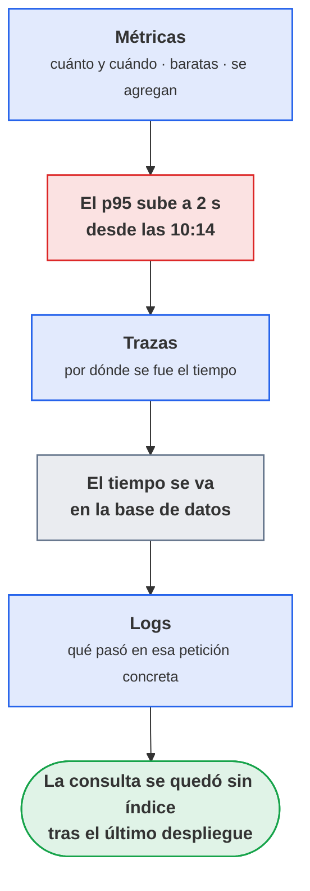
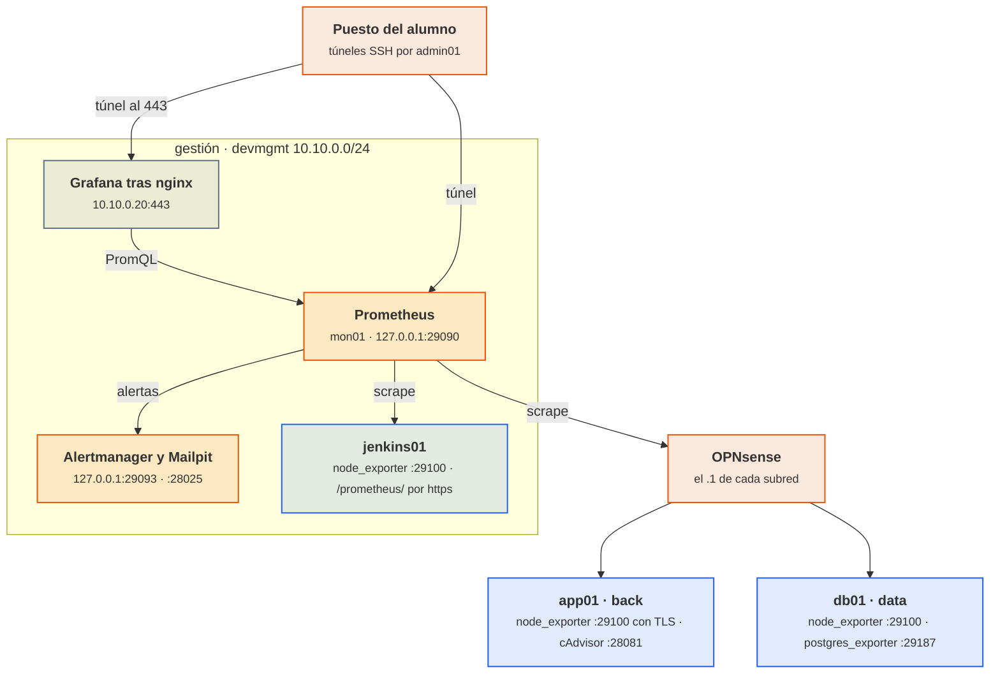
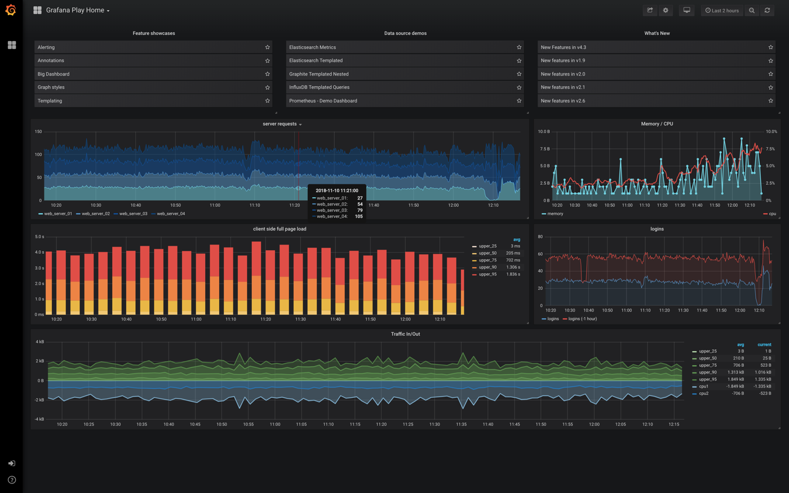

# UT7 · Monitorización del entorno

<p class="ut-meta">4 h en el centro + 12 h en la formación en empresa · Sesiones 39 y 40 · RA4 CE i, j, k</p>

Última unidad del centro. En la UT6 quedó Jenkins construyendo y desplegando el servicio, pero nadie vigila todavía la plataforma que lo hace: la pila de Mantenimiento mira el servicio y sus máquinas, no `jenkins01` ni lo que pasa dentro de Jenkins. Ahora toca cerrar el círculo: una plataforma que no se vigila no está desplegada, está abandonada. La pila de monitorización ya existe: Prometheus, Alertmanager y Grafana corren en la VM `mon01` desde octubre, montados y asegurados en el módulo 5169. Esta unidad no levanta otra. Trabaja sobre esa misma pila y en el mismo repositorio `monitoring`, y le añade lo que es propio del despliegue: la elección justificada del gestor de ingesta, los targets generados con Ansible desde el inventario, las métricas del orquestador de integración continua, el panel de KPI de la plataforma con sus alertas y la seguridad de todo lo que se añade. Son dos sesiones, en el orden en que viajan los datos: la primera, el 12 de marzo, los recoge, y la segunda, el 17, los convierte en un panel y en alertas y cierra lo que se ha abierto para recogerlos. La práctica evaluable no tiene sesión propia: recoge lo que dejan las dos hojas y se entrega por Aules antes del examen de la segunda evaluación, el 24 de marzo de 2027, que incluye esta unidad. Las 12 horas de monitorización avanzada se hacen en la empresa. Los logs quedan para el módulo 5169.

!!! otra "Cómo se reparte la monitorización entre las dos asignaturas"
    El módulo 5169 ya ha explicado a fondo el instrumental: PromQL y las ventanas de `rate` el [29 de octubre](https://victor-educ.github.io/apuntes-5169/ut/ut2-alarmas/#rate-increase-y-la-ventana); las [reglas de grabación](https://victor-educ.github.io/apuntes-5169/ut/ut2-alarmas/#agregacion-y-correlacion-recording-rules) el 5 de noviembre y las [reglas de alerta](https://victor-educ.github.io/apuntes-5169/ut/ut2-alarmas/#reglas-de-alerta) el 10; [Alertmanager entero](https://victor-educ.github.io/apuntes-5169/ut/ut2-alarmas/#alertmanager) el 12; Grafana [desde octubre](https://victor-educ.github.io/apuntes-5169/ut/ut1-observabilidad/); la [seguridad de la pila](https://victor-educ.github.io/apuntes-5169/ut/ut3-seguridad-monitorizacion/) entre el 26 de noviembre y el 3 de diciembre; y los [indicadores SLI, SLO y presupuesto de error](https://victor-educ.github.io/apuntes-5169/ut/ut4-kpi-pruebas/#indicadores-formulas-y-umbrales) el 17 de diciembre.
    Aquí todo eso es repaso: cada apartado abre con el enlace a la sesión donde se explicó y deja solo lo que su hoja de práctica necesita.
    Lo propio de esta unidad, y lo que se evalúa en ella, es el despliegue: elegir el gestor de ingesta y justificarlo, sacar los targets del inventario de Ansible con `file_sd`, recoger las métricas del orquestador de integración continua, construir el panel y las alertas de la plataforma, y asegurar lo que se añade a la pila (el endpoint de métricas de Jenkins y los secretos del repositorio).

## Sesión 39 · Ingesta de métricas

<p class="ut-meta" markdown>12 de marzo · Teoría y práctica · <span class="dur" tabindex="0" aria-label="Monitorización y observabilidad · 5 min&#10;Elegir el gestor de ingesta · 5 min&#10;La pila del curso en mon01 · 10 min&#10;A7.1 Ingesta · 90 min" data-dur="Monitorización y observabilidad · 5 min&#10;Elegir el gestor de ingesta · 5 min&#10;La pila del curso en mon01 · 10 min&#10;A7.1 Ingesta · 90 min">:material-school:<i class="dur-barra" style="--teoria:18%"></i>:material-flask:</span></p>

Jenkins ya despliega el servicio, pero la plataforma que lo despliega está fuera de la pila de `mon01`: si los pipelines empiezan a fallar, si `jenkins01` se queda sin disco o si una máquina nueva no entra en la lista de Prometheus, no se entera nadie. Esta sesión mete la plataforma en esa misma pila, sin montar otra. La teoría sigue el orden en que se decide: primero qué datos se recogen (métricas, logs o trazas) y con qué herramienta, que es la elección que la hoja pide justificar; después cómo es la pila de `mon01`, qué se le añade y por qué la lista de máquinas vigiladas deja de escribirse a mano y pasa a salir del inventario de Ansible. Al final, [Descubrimiento de targets](#descubrimiento-de-targets) recoge como material de consulta los tres ficheros que lo hacen. La hoja monta la ingesta de las cuatro máquinas de dev, de los contenedores de `app01` y de Jenkins, la comprueba con una consulta por fuente y deja la elección por escrito. El formato de `/metrics`, los tipos de métrica y la cardinalidad son repaso del módulo 5169.

### Monitorización y observabilidad

**Para qué hace falta.** Una plataforma que nadie vigila se entera de sus fallos por quien la usa: el pipeline lleva una semana fallando, el disco de `jenkins01` se llenó el viernes o la API tarda dos segundos en responder, y nadie lo sabe hasta que alguien protesta. **Monitorizar** es lo contrario: recoger datos del sistema de forma continua para saber si funciona y avisar cuando deja de hacerlo. La palabra **observabilidad**, más frecuente en la empresa, va un paso más allá: poder preguntarle al sistema por qué va mal sin desplegar código nuevo para averiguarlo.

**Los tres pilares.** Mantenimiento estudió la observabilidad con [los cuatro flujos que expone un contenedor](https://victor-educ.github.io/apuntes-5169/ut/ut1-observabilidad/#que-expone-un-contenedor). En la empresa se habla de tres tipos de datos, los llamados tres pilares, porque cada uno responde a una pregunta distinta:

- **Métricas**: números en el tiempo (CPU, memoria, peticiones por segundo, latencia). Ocupan poco (un par de bytes por muestra comprimida), se agregan bien y son la base de gráficos y alertas. Responden a "cuánto" y "cuándo".
- **Logs**: líneas de texto de lo que pasó, con marca de tiempo. Caras de guardar y buscar a gran volumen, pero son lo único que dice "qué" pasó en una petición concreta. Para diagnosticar.
- **Trazas**: recorrido de una petición por varios servicios, con el tiempo en cada uno. Para sistemas distribuidos donde una petición toca cinco microservicios y hay que saber cuál añadió los 800 ms.

**Cómo se combinan.** Una alerta de métricas dice que el p95 de latencia (el tiempo por debajo del cual queda el 95 % de las peticiones) ha subido de 200 ms a 2 s desde las 10:14; las trazas dicen que el tiempo se va en la base de datos; los logs de PostgreSQL enseñan la consulta que se quedó sin índice tras el último despliegue.



<p class="pie" markdown>Cada pilar responde a una pregunta distinta y ninguno sirve solo. La alerta avisa, la traza localiza y el log explica.</p>

**Por qué la unidad se queda con las métricas.** Son el pilar más barato y el que sostiene las alertas: un número cada 15 s ocupa poco, se agrega por máquina o por servicio y se compara con un umbral. Los logs ya los recoge Loki, en la misma pila. Las trazas exigen instrumentar cada servicio (con OpenTelemetry, el estándar abierto para hacerlo, y un almacén como Tempo o Jaeger) y compensan cuando una petición cruza muchos servicios, que no es el caso de la API del curso: quedan como mención.

**El vocabulario de la cadena.** Las dos sesiones recorren la cadena de las métricas de punta a punta, desde el programa que las publica hasta el aviso por correo, y cada eslabón tiene su nombre. Todos salieron ya en Mantenimiento; la tercera columna dice dónde aparece cada uno en esta unidad:

| Término | Qué es | En esta unidad |
|----|----|----|
| Exporter | Programa que publica las métricas de algo (el sistema, los contenedores, una base de datos) en una página `/metrics`, en el formato que lee Prometheus | node_exporter en las cuatro VM, cAdvisor en `app01` y el plugin de Jenkins, que hace de exporter del orquestador |
| Target | Cada dirección concreta de la que Prometheus lee (`host:puerto/ruta`) | `10.10.2.10:29100` o `jenkins.lab:443/prometheus/`; los de node_exporter salen del inventario de Ansible |
| Scrape | La lectura periódica de cada target | Cada 15 s, el `scrape_interval` de la pila |
| Serie temporal | Una métrica con un juego concreto de etiquetas, guardada como una sucesión de muestras | `up{job="node",host="db01"}`, que vale 1 mientras el node_exporter de `db01` responde |
| Muestra (*sample*) | Un valor con su marca de tiempo dentro de una serie | Cada scrape añade una a cada serie del target |
| KPI | Indicador clave: la métrica o fórmula que resume si algo va bien | Los tres del panel `KPI plataforma`: hosts caídos, memoria de la API y ejecuciones fallidas de Jenkins |
| Umbral | Valor a partir del cual una métrica se considera anómala | El rojo de cada panel y el `> 3` de `JenkinsBuildsFailing` |
| Alerta | Regla que se activa cuando un umbral se supera durante un tiempo | `JenkinsDown` y `JenkinsBuildsFailing`, que llegan a Mailpit |

### Elegir el gestor de ingesta

**Qué se decide.** El **gestor de ingesta** es la herramienta que recoge los datos de todas las fuentes y los guarda para consultarlos: la puerta de entrada de la monitorización. Se elige antes de instalar nada, porque de él dependen el formato de los datos, quién se conecta a quién para llevarlos y qué se puede hacer después con ellos, y el CE 4i pide además que la elección quede justificada. No hay una herramienta mejor en abstracto: depende de qué hay que vigilar (contenedores, servidores físicos, un servicio de nube) y de quién lo mantiene. La tabla resume las cuatro opciones más habituales en las empresas.

|  | Prometheus + Grafana | Zabbix | Elastic (ELK) / OpenSearch | Servicios en nube (CloudWatch, Azure Monitor) |
|----|----|----|----|----|
| Modelo | Pull: Prometheus lee a los exporters | Un agente propio en cada máquina, que envía o al que pregunta el servidor | Logs y métricas por Beats | Integrado en la plataforma |
| Punto fuerte | Estándar en contenedores y Kubernetes; PromQL | Todo en uno, plantillas para hardware | Logs | Lo básico, sin instalar nada |
| Punto débil | Retención larga requiere Thanos/Mimir | Menos natural con contenedores | Pesado | Coste y dependencia |

Para leerla: ELK son las iniciales de Elasticsearch, Logstash y Kibana, y OpenSearch es una bifurcación libre de Elasticsearch; Beats son los agentes ligeros con los que Elastic recoge y envía los datos; Thanos y Mimir guardan meses o años de métricas de Prometheus en un almacén de objetos, como se cuenta en [Retención y almacenamiento](../ampliacion.md#retencion-y-almacenamiento).

**El criterio del curso.** El CE 4i pide recolectar datos de hosts, contenedores y orquestador, y el CE 4j, construir paneles con ellos. De ahí salen los dos criterios con los que se elige: **recolectar** de todo el entorno y **visualizar**. Prometheus + Grafana cumple los dos y es el estándar en contenedores: cualquier imagen seria (nginx, PostgreSQL, Traefik, Jenkins, el propio Docker) expone métricas en su formato o tiene un exporter mantenido, y Grafana es la forma habitual de dibujarlas. En el laboratorio hay además una razón práctica: la pila ya existe en `mon01`, y elegir otra herramienta obligaría a mantener dos. Zabbix sigue siendo razonable en un centro de datos clásico con switches, sistemas de alimentación ininterrumpida y servidores físicos, y conviene no descartarlo si la empresa ya lo tiene. Los servicios de nube son cómodos hasta que llega la factura, y atan la monitorización al proveedor.

#### Pull frente a push, y cuándo usar Pushgateway

**Quién inicia la conversación.** Es la diferencia de diseño que más pesa entre esas herramientas. En *pull*, el servidor va a buscar los datos: Prometheus, cada `scrape_interval`, hace un GET a `/metrics` de cada target y guarda lo que le devuelven, como se vio en [scrape y remote_write](https://victor-educ.github.io/apuntes-5169/ut/ut1-observabilidad/#enviar-las-metricas-a-un-sistema-remoto-scrape-y-remote_write). En *push*, cada máquina envía sus datos por su cuenta a un servidor que espera, que es como Promtail lleva los logs a Loki. Que Prometheus sea pull tiene consecuencias prácticas:

- Si un target no responde, Prometheus lo sabe en el acto (`up == 0`). En un modelo push, un agente muerto deja de enviar y nadie se entera hasta que alguien mira.
- Desde `mon01` se puede pedir con `curl` el `/metrics` de un exporter y ver exactamente lo que Prometheus ve.
- Qué se vigila está en un solo sitio (`prometheus.yml`), no repartido en cien agentes, y el exporter no necesita credenciales para enviar ni saber dónde está el servidor.

**Lo que cuesta.** Prometheus tiene que llegar por red a cada target, lo que obliga a abrir puertos y a protegerlos, como hizo Mantenimiento con los exporters de `app01` y `db01`. Esta unidad abre una puerta en `jenkins01`, las métricas de Jenkins, y la cierra el 17 de marzo. Y hay cosas que no se pueden leer: un trabajo de cron que dura 20 segundos no está vivo cuando Prometheus pasa a preguntar.

**Pushgateway, solo para lotes cortos.** Para ese caso existe **Pushgateway**: el trabajo empuja sus métricas (`curl --data-binary @- http://pushgateway:9091/metrics/job/backup/instance/db01`) y Prometheus lee del gateway como de un exporter más. Usarlo como buzón general es un error clásico, porque el gateway nunca olvida (la métrica de un host que ya no existe sigue ahí) y se pierde la detección de caída por `up`.

<figure markdown="span">
  { width="640" }
  <figcaption>Arquitectura de Prometheus: el servidor lee de los exporters y de Pushgateway, evalúa reglas, envía a Alertmanager y sirve datos a Grafana. Fuente: Proyecto Prometheus, Apache 2.0.</figcaption>
</figure>

### La pila del curso en mon01

**Lo que ya existe.** La pila no se vuelve a montar. El módulo 5169 la levantó en octubre en `mon01` (`10.10.0.20`, en la VNet `devmgmt`), en `/opt/monitoring`, que es la copia de trabajo del repositorio `monitoring`, y la cerró a primeros de diciembre: Prometheus, Alertmanager y Mailpit escuchan solo en `127.0.0.1` de `mon01`, Grafana está detrás de un nginx en `10.10.0.20:443` y Loki pide certificado de cliente. En el mismo compose corre MinIO, con el estado de OpenTofu y las copias, y Mantenimiento la sigue usando hasta su examen del 23 de marzo. Por eso en esta unidad nunca se hace `docker compose down`: se añaden ficheros propios y, como mucho, se recrea un solo servicio.

!!! otra "Repaso"
    Cómo se montó la pila y qué hace cada contenedor está en [la unidad de observabilidad de Mantenimiento](https://victor-educ.github.io/apuntes-5169/ut/ut1-observabilidad/), que explica también el formato de `/metrics`, los cuatro tipos de métrica y la cardinalidad; cómo se cerró, en [la de seguridad de la monitorización](https://victor-educ.github.io/apuntes-5169/ut/ut3-seguridad-monitorizacion/). Lo que esos temas tienen de propio del despliegue está en Para ampliar: [la pila en un solo compose](../ampliacion.md#la-pila-en-un-solo-compose), [el formato de exposición](../ampliacion.md#el-formato-de-exposicion), [el modelo de datos y la cardinalidad](../ampliacion.md#modelo-de-datos-y-cardinalidad) y [los exporters más habituales](../ampliacion.md#exporters-mas-habituales).

**Cómo se llega a ella.** Como Prometheus, Alertmanager y Mailpit solo escuchan en `127.0.0.1` de `mon01`, a ellos se llega por túnel SSH desde el puesto del alumno, con el puesto de administración como salto. `ssh -L 29090:127.0.0.1:29090 -L 29093:127.0.0.1:29093 -L 28025:127.0.0.1:28025 -J ops@<IP de admin01 en la red del laboratorio> ops@10.10.0.20` deja Prometheus en `http://localhost:29090`, Alertmanager en el 29093 y Mailpit en el 28025 mientras esa sesión siga abierta; en el puesto, cada uno usa el mismo número que en `mon01`, el de la [franja del curso](../laboratorio.md#puertos). Grafana sí se publica, pero en la red de gestión, a la que el puesto del alumno no llega, así que va por otro túnel al 443, `ssh -L 28443:10.10.0.20:443 ops@<IP de admin01 en la red del laboratorio>`, con la línea `127.0.0.1 grafana.lab` en el fichero hosts del puesto y la CA del curso importada en el navegador: queda en `https://grafana.lab:28443`. Desde una shell en `mon01`, `curl http://localhost:29090/...` llega directo, y `amtool` se usa con `docker compose exec alertmanager`. Las órdenes completas están en el [laboratorio de Mantenimiento](https://victor-educ.github.io/apuntes-5169/laboratorio/).

**Qué se vigila y por dónde pasa cada scrape.** Los hosts vigilados no comparten red con `mon01`, salvo `jenkins01`: `app01` vive en `devback` (`10.10.2.10`) y `db01` en `devdata` (`10.10.3.10`), cada uno con una sola tarjeta, así que su scrape sale de gestión y **atraviesa el cortafuegos** con reglas que ya están abiertas para ellos. Lo que ya se lee y lo que añade esta unidad:

- **node_exporter** (puerto 29100) viene en la plantilla 9000 desde la A1.3, que lo deja escuchando en ese puerto: todas las VM llevan el paquete `prometheus-node-exporter` y no se instala nada. Lo que cambia es de dónde sale la lista de targets, como se explica en [Los targets, desde el inventario](#los-targets-desde-el-inventario).
- **cAdvisor** (`app01`, 28081) y **postgres_exporter** (`db01`, 29187) ya los lee la pila de Mantenimiento con sus jobs. No se tocan.
- **Jenkins** expone `/prometheus/` con el plugin **Prometheus metrics**, que todavía no está en su imagen: se añade en esta unidad al `plugins.txt` de la imagen propia con su versión fijada (`id:version`, como el resto del fichero). Como Jenkins va detrás de su nginx, la ruta es `https://jenkins.lab/prometheus/` y el 8080 del contenedor no se publica. Qué publica y cómo se leen sus números se explica el 17 de marzo, en [Métricas del orquestador](#metricas-del-orquestador-jenkins-en-prometheus).



<p class="pie" markdown>Prometheus va a buscar (*pull*): los scrapes salen de gestión hacia `app01` y `db01` atravesando el cortafuegos, y hacia `jenkins01` sin pasar por él, porque está en la misma subred; por eso en `jenkins01` el filtro va en el propio host. Desde el puesto solo se llega a la pila por túnel o por el 443 de Grafana.</p>

#### Los targets, desde el inventario

**El problema de la lista escrita a mano.** Hasta hoy, los targets de node_exporter de dev están escritos a mano en los `static_configs` de `prometheus.yml`, y eso obliga a editarlo cada vez que nace o muere una máquina. La que alguien se olvida de añadir no la vigila nadie, y la que se destruye sin quitarla deja un `HostDown` sonando hasta que alguien la retira. Con **`file_sd_configs`** (descubrimiento de targets a partir de ficheros), Prometheus lee la lista de uno o varios ficheros YAML y vuelve a leerla en cuanto cambian, sin reiniciar ni recargar.

**Por qué los escribe Ansible.** Quien escribe esos ficheros es Ansible, desde su inventario, y así la lista de lo vigilado sale de la misma lista de máquinas que se administra, en lugar de mantenerse aparte y desincronizarse. En pre el inventario salía del estado de OpenTofu; en dev no hay de dónde sacarlo, porque sus máquinas se clonaron a mano entre octubre y febrero y el `envs/dev` de la UT5 no llegó a aplicarse. Por eso se escribe a mano una sola vez, `dev.ini`, y desde ese momento vigilar una máquina más es añadir una línea al inventario y volver a lanzar el playbook.

**Dos ficheros y dos jobs.** En el laboratorio son dos ficheros, `targets/ut7-node.yml` y `targets/ut7-node-tls.yml`, y dos jobs que los leen (un *job* es el bloque de `prometheus.yml` que agrupa los targets que se leen de la misma forma): `node`, por HTTP, y `node-tls`, para `app01`, el único cuyo exporter exige TLS y contraseña. No caben en uno porque en Prometheus el esquema (`http` o `https`), la CA y las credenciales son de cada job y no de cada target, como se vio en [TLS y basic auth en los exporters](https://victor-educ.github.io/apuntes-5169/ut/ut3-seguridad-monitorizacion/#tls-y-basic-auth-en-los-exporters). Los ficheros completos están en [Descubrimiento de targets](#descubrimiento-de-targets).

**El único cambio en el compose.** Para que Prometheus vea esos ficheros y las reglas propias de la unidad, su servicio del `compose.yml` gana dos volúmenes. Es el único cambio en el compose que piden las hojas (cargar el panel en Grafana también lo toca, pero queda para cuando sobra tiempo):

```yaml
# /opt/monitoring/compose.yml, servicio prometheus: dos líneas más en volumes
    volumes:
      # ... los que ya tenía, sin tocarlos
      - ./targets:/etc/prometheus/targets:ro
      - ./rules:/etc/prometheus/rules:ro
```

Se montan los directorios y no cada fichero, por dos motivos: lo que se añada dentro (otro fichero de targets, otro de reglas) se ve sin tocar el compose, y Ansible no reescribe un fichero, sino que escribe uno nuevo y lo pone en lugar del viejo, así que un fichero montado suelto seguiría apuntando al antiguo. Un volumen nuevo no se aplica recargando: hay que recrear el contenedor, con `docker compose up -d --no-deps prometheus`, que recrea solo ese. Se lanza desde `/opt/monitoring` y sin `-f`, para que Compose junte el `compose.yml` con el `compose.override.yml` de Mantenimiento, que es el que monta `tls/` y `secrets/`. El histórico sigue en su volumen y el resto de la pila, MinIO incluido, no se entera. Las reglas no se escriben hasta el 17 de marzo, pero su directorio se monta ya, para recrear Prometheus una sola vez en toda la unidad.

### Descubrimiento de targets

!!! consulta "Material de consulta"
    Esto no se explica en clase más allá de lo dicho en el apartado anterior: son los tres ficheros que la hoja A7.1 copia tal cual.

**El inventario.** El inventario de dev vive en el repositorio `iac-lab` del puesto de administración. Cada grupo es el papel de la máquina en la plataforma y acaba en la etiqueta `rol`, y la variable `node_tls` marca el único exporter cifrado. `web01` no está porque la matriz de reglas no deja a `mon01` llegar a front:

```ini
# iac-lab/ansible/dev.ini: las máquinas de dev que vigila Prometheus
[gestion]
mon01     ansible_host=10.10.0.20

[ci]
jenkins01 ansible_host=10.10.0.10

[servicio]
app01     ansible_host=10.10.2.10 node_tls=true
db01      ansible_host=10.10.3.10

[all:vars]
ansible_user=ops
```

**El playbook.** Solo se conecta a `mon01`: de las demás máquinas le basta lo que dice el inventario, sin entrar en ellas. Crea el directorio `targets/` si no existe y escribe en él un fichero para los exporters por HTTP y otro para los cifrados:

```yaml
# iac-lab/ansible/ut7-targets.yml: escribe los targets de node_exporter en mon01
- name: Targets de Prometheus desde el inventario
  hosts: mon01
  become: true
  tasks:
    - name: Directorio de targets en la copia de trabajo de monitoring
      ansible.builtin.file: { path: /opt/monitoring/targets, state: directory, owner: ops, group: ops, mode: "0755" }
    - name: Un fichero para los exporters por HTTP y otro para los cifrados
      ansible.builtin.copy:
        dest: "/opt/monitoring/targets/ut7-{{ item.fichero }}.yml"
        owner: ops
        group: ops
        mode: "0644"
        content: |
          # Generado por ansible/ut7-targets.yml de iac-lab. No se edita a mano.
          
          - targets: ["{{ hostvars[h].ansible_host }}:29100"]
            labels: { host: {{ h }}, env: dev, rol: {{ hostvars[h].group_names | first }} }
          
      loop:
        - { fichero: node, tls: false }
        - { fichero: node-tls, tls: true }
```

Cómo se lee:

- `become: true` le da permisos de administrador en `mon01`, para crear el directorio y fijar su propietario.
- El `loop` repite la tarea de copia dos veces, una por fichero, e `item` es el elemento de cada vuelta: el nombre del fichero y si es el de los exporters cifrados.
- `content` no es texto fijo, sino una plantilla Jinja2, el lenguaje de plantillas de Ansible. El `` recorre todas las máquinas del inventario y se queda con las que tienen el `node_tls` que pide ese fichero: `default(false)` da por falso el que no está escrito, y `bool` convierte en booleano el texto `true` del INI.
- Por cada máquina sale un grupo de targets con su dirección y el puerto 29100, y tres etiquetas: `host`, con su nombre en el inventario; `env`, fijo a `dev`; y `rol`, su primer grupo.
- La primera línea del fichero avisa de que es generado: lo que se cambie a mano se pierde en la siguiente ejecución.

**Los jobs.** En `prometheus.yml`, los jobs de node_exporter de dev leen esos ficheros, y se añade el de Jenkins:

```yaml
# prometheus.yml: jobs de esta unidad (sustituyen a los static_configs de dev de node_exporter)
  - job_name: node
    file_sd_configs:
      - files: [/etc/prometheus/targets/ut7-node.yml]
        refresh_interval: 1m
  - job_name: node-tls
    scheme: https
    tls_config:
      ca_file: /etc/prometheus/tls/ca.crt
    basic_auth:
      username: prometheus
      password_file: /etc/prometheus/secrets/node_exporter.pass
    file_sd_configs:
      - files: [/etc/prometheus/targets/ut7-node-tls.yml]
        refresh_interval: 1m
  - job_name: jenkins
    scheme: https                      # Jenkins solo se publica por su nginx, en el 443
    metrics_path: /prometheus/
    tls_config: { ca_file: /etc/prometheus/tls/ca.crt }
    static_configs:
      - targets: ["jenkins.lab:443"]
        labels: { host: jenkins01, env: dev, service: jenkins }
```

El `tls_config` y el `basic_auth` de `node-tls` son los que dejó la A3.2 de Mantenimiento, con la contraseña en un fichero fuera del repositorio y la CA del curso montada en `/etc/prometheus/tls/`; aquí solo cambia de dónde sale el target. `refresh_interval` hace que, además de notar los cambios al momento, Prometheus relea los ficheros cada minuto. El job `jenkins` es distinto porque no lee una máquina sino un servicio, y por eso no sale del inventario: un solo target fijo, el nombre público de Jenkins con el 443, porque solo se publica por su nginx; la ruta del plugin en `metrics_path`; y la misma CA, porque el certificado de `jenkins.lab` lo firmó ella y el nombre del target es el que lleva el certificado.

Las etiquetas que pone el fichero de targets (`host`, `env`, `rol`) acaban en todas las series de esos hosts y viajan en sus alertas: sirven para filtrar en las consultas, y Alertmanager las usa para inhibir y silenciar. `env="dev"`, por ejemplo, separa lo de esta unidad de los targets de pre, que siguen en el job `node` hasta que Mantenimiento los retira, el 18 de marzo.

Prometheus también sabe descubrir contenedores preguntando al socket de Docker (`docker_sd_configs`); en el laboratorio se usa `file_sd`, y la alternativa está en [Para ampliar](../ampliacion.md#descubrimiento-con-docker_sd_configs).

### A7.1 Ingesta (sesión 39)

<span class="et et-obj">Objetivo</span> Que la plataforma entera, y no solo el servicio, quede vigilada por la pila de `mon01`: las cuatro máquinas de dev, con sus targets generados por Ansible desde el inventario en lugar de escritos a mano, los contenedores de `app01` y el propio Jenkins. Al terminar tienes todos los targets de dev en UP, una consulta con datos por cada fuente y la elección del gestor de ingesta justificada por escrito. Es la parte de la práctica evaluable que corresponde al CE 4i, y son los datos sobre los que la A7.2, el 17 de marzo, construye el panel y las alertas.

<span class="et et-pre">Antes de empezar</span>

- Encendidas `mon01` (`10.10.0.20`), `jenkins01` (`10.10.0.10`), `app01` (`10.10.2.10`), `db01` (`10.10.3.10`) y el puesto de administración (`10.10.0.50`), con Jenkins arrancado. node_exporter ya corre en todas: viene en la plantilla. También `gitea01`, donde subes los cambios, y `agent01`, por si el paso 5 necesita lanzar el pipeline.
- Entra en el puesto de administración con `ssh -A`, que le presta tu clave: el playbook del paso 2 entra con ella en `mon01`, como en la A5.5.
- La pila de Mantenimiento en marcha en `/opt/monitoring` de `mon01`, copia de trabajo del repositorio `monitoring`. No la pares en ningún momento: en ella viven también MinIO y lo que Mantenimiento necesita hasta su examen, el 23 de marzo.
- El túnel a Prometheus, Alertmanager y Mailpit abierto desde el puesto del alumno toda la sesión, con la orden de [La pila del curso en mon01](#la-pila-del-curso-en-mon01).
- `jenkins.lab` en el DNS de OPNsense desde la A6.1, porque el contenedor de Prometheus no lee el `/etc/hosts` de `mon01`. Si desde él no resuelve a `10.10.0.10`, dalo de alta como en la A6.1.
- Explicado en clase: [Elegir el gestor de ingesta](#elegir-el-gestor-de-ingesta) y [La pila del curso en mon01](#la-pila-del-curso-en-mon01), con [Los targets, desde el inventario](#los-targets-desde-el-inventario). Para copiar durante la práctica: los tres bloques de [Descubrimiento de targets](#descubrimiento-de-targets) y las consultas de [Consultas del laboratorio](#consultas-del-laboratorio).

<span class="et et-pas">Pasos</span>

Vas a meter en la pila lo que le falta de la plataforma (el node_exporter de `jenkins01` y las métricas del propio Jenkins) y a cambiar cómo se escribe la lista de máquinas, en un orden pensado para no esperar: empiezas por la imagen de Jenkins, que tarda en construirse, y mientras tanto generas los targets en el puesto de administración, preparas `mon01` para leerlos y cambias los jobs. Cada paso deja listo lo que necesita el siguiente: el playbook crea `targets/` antes de que se monte, el montaje existe antes de que los jobs lo lean, y solo con todo en UP tiene sentido consultar los datos. Al final pones por escrito la decisión con la que empieza la teoría.

1. **Lanza primero lo que más tarda: Jenkins con el plugin.** Añade el plugin **Prometheus metrics** al `plugins.txt` de `jenkins-config`, en `jenkins01`, con su versión fijada como el resto del fichero, súbelo y reconstruye la imagen; cuando termine, Jenkins tiene que arrancar con ella. Como `plugins.txt` cambia, Docker no puede reutilizar la capa de los plugins y los descarga todos otra vez, así que sigue con el paso 2 mientras tanto. Hasta que Jenkins arranque con el plugin, `/prometheus/` no existe y el job `jenkins` no puede estar en UP.

    *Pista:* el identificador del plugin es `prometheus`; la versión, la de ese día en plugins.jenkins.io.

2. **Genera la lista de targets desde el inventario.** En el repositorio `iac-lab` del puesto de administración, añade `ansible/dev.ini` y `ansible/ut7-targets.yml` de [Descubrimiento de targets](#descubrimiento-de-targets), súbelos y lanza el playbook, que escribe en `mon01` `targets/ut7-node.yml` y `targets/ut7-node-tls.yml`. Ábrelos antes de seguir: cada máquina tiene que estar en el fichero que le toca según su `node_tls`, y con sus tres etiquetas, porque eso es exactamente lo que va a leer Prometheus.

3. **Prepara la pila de `mon01` para los ficheros de la unidad.** Crea en `/opt/monitoring` los directorios `rules/`, `grafana/ut7/` y `docs/`, monta `targets/` y `rules/` en el servicio `prometheus` como en [Los targets, desde el inventario](#los-targets-desde-el-inventario) y recrea solo ese contenedor, con la orden de ese mismo apartado. `rules/` se monta ya, aunque esté vacío hasta el 17 de marzo, para recrear Prometheus una sola vez en toda la unidad. Comprueba que el resto de la pila sigue en marcha y que, dentro del contenedor, Prometheus ve los dos ficheros de targets.

    *Pista:* lanza la orden desde `/opt/monitoring` y sin `-f`: con `-f compose.yml`, Compose deja fuera el `compose.override.yml` de Mantenimiento, que es el que monta la CA y la contraseña de `node-tls`.

4. **Pasa los jobs de node_exporter a los ficheros y añade Jenkins.** Cambia en `prometheus.yml` los `static_configs` de dev de node_exporter por los `file_sd_configs` de [Descubrimiento de targets](#descubrimiento-de-targets) y añade el job `jenkins`; valida con `promtool` y recarga sin reiniciar, porque un cambio de configuración, al contrario que un volumen, sí se aplica recargando. Al minuto, los targets de dev de `node`, `node-tls`, `cadvisor` y `jenkins` tienen que estar en UP; los de `env="pre"` pueden salir en DOWN (pre se destruyó el 11 de marzo) y no cuentan.

    *Pista:* de `node-tls`, el job de la A3.2 de Mantenimiento, solo cambia de dónde sale el target: su `scheme`, su `tls_config` y su `basic_auth` se quedan. Si `node` tiene un grupo con `env: pre`, déjalo: lo retira Mantenimiento el 18 de marzo.

5. **Comprueba que llegan datos de las tres fuentes.** Un target en UP solo dice que Prometheus puede leer su página; que los datos sirvan se comprueba consultándolos. En Graph, lanza las consultas de CPU usada por host, memoria del contenedor de la API y ejecuciones correctas de Jenkins de [Consultas del laboratorio](#consultas-del-laboratorio), una por fuente (node_exporter, cAdvisor y el plugin), y captura el resultado de cada una.

    *Pista:* las series de ejecuciones no existen hasta que termina la primera desde que Jenkins arrancó con el plugin: si sale vacía, lanza el pipeline de `servicio` sin `RUN_DEPLOY` y espera a que acabe.

6. **Justifica la elección y guarda el trabajo.** Escribe `docs/ut7.md`, un fichero nuevo de `monitoring` que es solo de esta unidad: de cinco a diez líneas con los dos criterios del CE 4i de [Elegir el gestor de ingesta](#elegir-el-gestor-de-ingesta), por qué Prometheus los cumple aquí y cuándo elegirías Zabbix o un servicio de nube. Es la justificación que pide el primer criterio de la práctica evaluable. Haz commit en `/opt/monitoring` de `compose.yml`, `prometheus.yml`, `targets/` y `docs/ut7.md`, y súbelo.

    *Pista:* esa copia de trabajo es también la de Mantenimiento: añade al commit solo esos ficheros, nunca todo lo que aparezca cambiado.

<span class="et et-com">Comprobación</span> En `http://localhost:29090/targets`, los jobs `node`, `node-tls`, `cadvisor` y `jenkins` sin ninguna fila de dev en DOWN, y la fila de `app01` en `node-tls` con un endpoint que empieza por `https://`. En Graph, `up{rol="ci"}` devuelve una serie, la de `jenkins01`, y las tres consultas del paso 5 devuelven datos. Los ficheros de `targets/` empiezan por la línea que dice que los genera Ansible.

<span class="et et-ent">Para practicar</span> Guarda en `A7.1` de `entregas-5166` la captura de la página Targets con los jobs de dev en UP, las de las tres consultas y el enlace al commit de `monitoring` con `targets/`, `prometheus.yml` y `docs/ut7.md`: lo pide la práctica evaluable.

<span class="et et-ext">Si te sobra tiempo</span> Lanza dos veces en Jenkins un job que falle a propósito y mira subir `increase(default_jenkins_builds_failed_build_count_total[1h])`, el núcleo de la consulta del panel de la A7.2: la primera ejecución fallida crea la serie y la segunda es la que se ve subir, por lo que explica [Cómo se leen los contadores y la duración](#como-se-leen-los-contadores-y-la-duracion). Abre Status → TSDB Status y anota qué métrica tiene más series y por qué; lo que significa ese número está en [el modelo de datos y la cardinalidad](../ampliacion.md#modelo-de-datos-y-cardinalidad).

## Sesión 40 · Visualización, alertas y seguridad

<p class="ut-meta" markdown>17 de marzo · Teoría y práctica · <span class="dur" tabindex="0" aria-label="Métricas del orquestador: Jenkins en Prometheus · 10 min&#10;Seguridad de lo que añade la unidad · 10 min&#10;A7.2 Paneles, alertas y seguridad · 90 min" data-dur="Métricas del orquestador: Jenkins en Prometheus · 10 min&#10;Seguridad de lo que añade la unidad · 10 min&#10;A7.2 Paneles, alertas y seguridad · 90 min">:material-school:<i class="dur-barra" style="--teoria:18%"></i>:material-flask:</span></p>

Con la A7.1, Prometheus guarda cada 15 s los datos de las tres fuentes de la plataforma, pero un dato guardado solo sirve si alguien lo mira, y a las tres de la madrugada no mira nadie. Esta sesión hace dos cosas con ellos: los resume en un panel que se lee de un vistazo y los convierte en alertas que avisan solas. Y como para recogerlos la unidad ha abierto dos puertas nuevas en `jenkins01`, las cierra. El instrumental (PromQL, reglas, Alertmanager y Grafana) es el que el módulo 5169 explicó a fondo entre octubre y diciembre: el [repaso](#repaso-promql-reglas-alertmanager-y-grafana) recoge solo lo que la hoja A7.2 necesita, con el enlace al apartado donde está entero, se lee antes de la sesión y no ocupa minutos de clase; le siguen, como material de consulta, las consultas, las reglas y el panel que copia la hoja. La explicación son veinte minutos y va a lo que aquel módulo no toca. Diez, a qué publica el orquestador de integración continua y qué dicen esos números sobre la salud de la CI. Los otros diez, a la seguridad de lo nuevo: el endpoint de métricas de Jenkins, el exporter de `jenkins01` y los secretos del repositorio. La hoja sigue el mismo camino: el panel, las reglas, una alerta provocada hasta el correo, el cierre y la comprobación desde fuera.

### Repaso: PromQL, reglas, Alertmanager y Grafana

!!! otra "Repaso"
    PromQL se explicó a fondo en Mantenimiento el [29 de octubre](https://victor-educ.github.io/apuntes-5169/ut/ut2-alarmas/#rate-increase-y-la-ventana): selectores, `rate`, `increase`, cómo se elige la ventana y los operadores con etiquetas. Las [reglas de grabación](https://victor-educ.github.io/apuntes-5169/ut/ut2-alarmas/#agregacion-y-correlacion-recording-rules) se trabajaron el 5 de noviembre, las [reglas de alerta](https://victor-educ.github.io/apuntes-5169/ut/ut2-alarmas/#reglas-de-alerta) el 10, con sus estados, etiquetas y anotaciones, y [Alertmanager](https://victor-educ.github.io/apuntes-5169/ut/ut2-alarmas/#alertmanager) el 12, con el [árbol de rutas](https://victor-educ.github.io/apuntes-5169/ut/ut2-alarmas/#el-arbol-de-rutas), la agrupación, la inhibición y los silencios. Grafana se usa [desde octubre](https://victor-educ.github.io/apuntes-5169/ut/ut1-observabilidad/), y sus roles y el acceso detrás de nginx se vieron al [asegurar la pila](https://victor-educ.github.io/apuntes-5169/ut/ut3-seguridad-monitorizacion/), a primeros de diciembre. La [chuleta de comandos de 5169](https://victor-educ.github.io/apuntes-5169/chuleta/) tiene las consultas sueltas para copiar. Este apartado se lee antes de la sesión y no ocupa minutos de clase.

**Lo que la hoja usa de todo aquello.** La A7.2 escribe tres consultas de panel y dos reglas, y hace llegar una alerta hasta el correo. Para eso basta con tener frescas cuatro ideas, y conviene repasarlas antes de abrir Grafana:

| Lo que se usa hoy | Qué conviene recordar | Dónde aparece |
|----|----|----|
| `rate(x[5m])` e `increase(x[1h])` sobre contadores | La ventana tiene que contener al menos cuatro muestras: con scrape de 15 s, 5 m es lo habitual. `irate` sirve para mirar picos, no para alertar | Panel de ejecuciones fallidas y alerta `JenkinsBuildsFailing` |
| Comparaciones con y sin `bool` | `up == 0` filtra y devuelve solo las series que valen cero; `up == bool 0` devuelve 1 o 0 en todas, que es lo que permite sumarlas: `sum(up == bool 0)`. `count(up == bool 0)` contaría todas las series, caídas o no | Panel de hosts caídos, alerta `JenkinsDown` |
| Una consulta vacía no es un cero | Si la serie todavía no existe, la consulta no devuelve nada y Grafana pinta «No data»; `or vector(0)` pone un 0 en su lugar, como se vio en [Mantenimiento](https://victor-educ.github.io/apuntes-5169/ut/ut2-alarmas/#una-consulta-vacia-no-es-un-cero) | Panel de ejecuciones fallidas |
| Las etiquetas de una alerta | Son lo único que mira Alertmanager para decidir a quién avisar; en la pila del curso son cinco (`severity`, `team`, `service`, `origen`, `env`) | [Reglas de esta unidad](#reglas-de-esta-unidad) |

Conviene probar cada consulta en la pestaña Graph de Prometheus antes de llevarla a un panel: lo que no devuelve nada ahí tampoco lo hará en Grafana.

**El camino de una alerta de la unidad.** Las alertas de esta unidad no tocan nada de Mantenimiento: sus reglas van en un fichero propio y las entrega el Alertmanager de la pila con su árbol de rutas, que decide solo por las etiquetas. Una `warning` va al receptor `mail`, que entrega en Mailpit, aunque sea del equipo `dev`: la ruta de `warning` va antes que la de `dev` y no deja seguir buscando. `amtool config routes test` dice a qué receptor iría un conjunto de etiquetas sin provocar nada. Entre el fallo y el correo pasan el `for` de la regla, la siguiente evaluación y los 30 s de `group_wait`, así que una alerta nunca llega al instante; la notificación de resolución sale con el siguiente `group_interval`, que en ese árbol es de 5 minutos.

**Lo que se ajusta en cada panel.** De la interfaz de Grafana, la hoja pide tres cosas. La **unidad** de cada panel (percent, bytes(IEC), seconds) hace que Grafana escale los ejes y escriba 5,68 GiB en lugar de 6.1e+09. Los **umbrales** de color dicen lo mismo que dirá la alerta: el panel de ejecuciones fallidas se pone rojo desde 4, que es cuando salta `JenkinsBuildsFailing` (más de 3 en una hora). La **leyenda** se escribe como `{{host}}` y no como la serie entera, para que cada línea diga de qué máquina es.

### Consultas, reglas y panel de la unidad

!!! consulta "Material de consulta"
    Esto no se explica en clase: son las consultas que usan las hojas A7.1 y A7.2 y el fichero de reglas que copia la A7.2, con lo que hace falta para guardar el panel en Git.

#### Consultas del laboratorio

Una consulta por pregunta, todas sobre las series de dev. Las de máquina y de contenedor usan las métricas que la pila recoge desde octubre; las de Jenkins, las del plugin, que se explican en [Métricas del orquestador](#metricas-del-orquestador-jenkins-en-prometheus).

| Qué | Consulta |
|----|----|
| CPU usada (%) por host | `100 - avg by (host) (rate(node_cpu_seconds_total{mode="idle",env="dev"}[5m])) * 100` |
| Memoria disponible (%) | `node_memory_MemAvailable_bytes{env="dev"} / node_memory_MemTotal_bytes{env="dev"} * 100` |
| Disco libre (%) | `node_filesystem_avail_bytes{mountpoint="/",env="dev"} / node_filesystem_size_bytes{mountpoint="/",env="dev"} * 100` |
| Hosts caídos | `sum(up{job=~"node.*",env="dev"} == bool 0)` |
| CPU del contenedor de la API | `rate(container_cpu_usage_seconds_total{service="app"}[5m])` |
| Memoria del contenedor de la API | `container_memory_working_set_bytes{service="app"}` |
| Ejecuciones correctas de Jenkins | `default_jenkins_builds_success_build_count_total` |
| Ejecuciones fallidas de Jenkins en la última hora | `sum(increase(default_jenkins_builds_failed_build_count_total[1h])) or vector(0)` |
| Disco que se llena en 4 h | `predict_linear(node_filesystem_avail_bytes{mountpoint="/",env="dev"}[6h], 4*3600) < 0` |

**Las de máquina.** `node_cpu_seconds_total` cuenta los segundos que cada núcleo pasa en cada modo; su `rate` en el modo `idle` es la fracción del tiempo que está parado, así que 100 menos su media por host es la CPU usada. Las de memoria y disco dividen lo disponible entre el total, y `predict_linear` prolonga la tendencia de las últimas seis horas: la condición `< 0` dice si a ese ritmo el disco se llena antes de cuatro horas. Todas filtran por `env="dev"`, la etiqueta que pone el fichero de targets, para no mezclar el grupo de pre que sigue escrito en el job `node`.

**Las de contenedor.** Filtran por `service="app"` y no por el nombre del contenedor, que es `servicio-app-1` y cambia si se recrea con otro proyecto. El job `cadvisor` de la pila copia en el scrape la etiqueta de compose (`container_label_com_docker_compose_service`) a `service` y descarta las demás `container_label_*`, como se explica en [Etiquetas y cardinalidad](https://victor-educ.github.io/apuntes-5169/ut/ut1-observabilidad/#etiquetas-y-cardinalidad): un filtro por la etiqueta larga devuelve vacío. `rate(container_cpu_usage_seconds_total[5m])` devuelve núcleos usados (0,5 = medio núcleo). Para la memoria se usa el working set, la memoria que el kernel no puede recuperar, y no `container_memory_usage_bytes`, que incluye caché de ficheros que el kernel suelta en cuanto le hace falta: el working set es la mejor medida de cuánto le queda al contenedor antes de su límite ([Memory usage frente a working set](https://victor-educ.github.io/apuntes-5169/ut/ut1-observabilidad/#memory-usage-frente-a-working-set)).

**Las de Jenkins.** Los contadores del plugin acaban en `_total`, y la serie de fallos no existe hasta el primer fallo desde que arrancó Jenkins, como se explica en [Cómo se leen los contadores y la duración](#como-se-leen-los-contadores-y-la-duracion). Por eso la del panel de fallos termina en `or vector(0)`: sin fallos, en lugar de «No data», el panel enseña un 0 en verde, que es la respuesta correcta. La regla de [Reglas de esta unidad](#reglas-de-esta-unidad) no lo necesita, porque una consulta vacía es una alerta que no salta.

**Los tres KPI del panel.** Salen de esta tabla, uno por cada fuente que vigila la unidad: hosts caídos, memoria del contenedor de la API y ejecuciones fallidas de Jenkins. Son KPI porque cada uno resume en un número cómo está su fuente y, si se sale de lo normal, pide hacer algo. La CPU por host es el primer panel que se añade cuando sobra tiempo.

#### Reglas de esta unidad

Las reglas de Mantenimiento, entre ellas `HostDown`, viven en su repositorio `alerting` y no se tocan. Las de esta unidad van en su propio fichero, `rules/ut7-plataforma.yml`, que Prometheus carga con una entrada más en `rule_files` de `prometheus.yml` (`rules/ut7-*.yml`). Se escribe con un patrón y no con el nombre del fichero para que cualquier fichero de reglas que añada la unidad entre en la siguiente recarga sin volver a tocar `prometheus.yml`. Son dos, y las dos sobre el orquestador, que es lo único que la pila no vigilaba:

```yaml
# rules/ut7-plataforma.yml
groups:
  - name: ut7-plataforma
    rules:
      - alert: JenkinsDown
        expr: up{job="jenkins"} == 0
        for: 1m
        labels: { severity: warning, team: ops, service: jenkins, origen: prometheus, env: dev }
        annotations:
          summary: "Prometheus no puede leer las métricas de Jenkins"
          description: "{{ $labels.instance }} lleva un minuto sin responder: Jenkins parado o su nginx caído."
      - alert: JenkinsBuildsFailing
        expr: sum(increase(default_jenkins_builds_failed_build_count_total[1h])) > 3
        for: 0m
        labels: { severity: warning, team: dev, service: jenkins, origen: prometheus, env: dev }
        annotations:
          summary: "Más de 3 ejecuciones fallidas de Jenkins en la última hora"
```

- **`JenkinsDown`** salta cuando Prometheus no puede leer `/prometheus/`: Jenkins parado, su nginx caído o el endpoint cerrado por error. El `for: 1m` evita que un reinicio de diez segundos despierte a nadie, y es del equipo `ops` porque el problema está en la máquina, no en el código.
- **`JenkinsBuildsFailing`** suma los fallos de todos los jobs en la última hora. Lleva `for: 0m` porque la ventana de una hora ya hace de filtro: un fallo suelto no la dispara. Es del equipo `dev` porque lo que falla, casi siempre, es el código o sus pruebas.
- Las cinco etiquetas son las de la tabla de [etiquetas y anotaciones](https://victor-educ.github.io/apuntes-5169/ut/ut2-alarmas/#etiquetas-y-anotaciones) de Mantenimiento; `service: jenkins` es un valor nuevo de esa tabla. La descripción de `JenkinsDown` usa `{{ $labels.instance }}`, que en este job es `jenkins.lab:443`.

Antes de recargar conviene validar con `promtool check config`, que revisa también los ficheros de `rule_files`. Una recarga con un error no tumba Prometheus, pero lo deja con la configuración anterior sin que se note en las páginas de consulta: solo lo dicen su log y la métrica `prometheus_config_last_reload_successful`, que pasa a 0, como se vio en [el fichero rules.yml](https://victor-educ.github.io/apuntes-5169/ut/ut2-alarmas/#el-fichero-rulesyml) de Mantenimiento.

#### El panel en Grafana

<figure markdown="span">
  { width="640" }
  <figcaption>Un dashboard de Grafana con series temporales, gauges y stats de un host. Fuente: Joel Kennedy, dominio público, vía Wikimedia Commons.</figcaption>
</figure>

**Por qué el panel va a Git.** Todo lo que se hace clicando en Grafana vive en su base de datos, dentro de su volumen: si el volumen se pierde, o el panel hace falta en otra instancia, no queda nada de él. Por eso se exporta a JSON desde **Export → Export as JSON**, con el interruptor «Export the dashboard to use in another instance» activado: la fuente de datos queda como un hueco (`${DS_PROMETHEUS}`) que el importador de la otra instancia rellena con la suya, y el fichero sirve fuera de `mon01`. Se guarda en el repositorio, en `grafana/ut7/`.

**Que Grafana lo cargue solo.** El paso siguiente es el *provisioning*: Grafana lee al arrancar unos ficheros de proveedor que le dicen de qué directorio cargar dashboards. La pila mínima ya monta `grafana/provisioning/`, que es de donde Grafana saca su fuente de datos de Prometheus; falta el proveedor y el directorio de los JSON montado en el contenedor de Grafana.

```yaml
# grafana/provisioning/dashboards/ut7.yml
apiVersion: 1
providers:
  - name: ut7
    folder: UT7
    type: file
    allowUiUpdates: false
    options:
      path: /var/lib/grafana/dashboards/ut7
```

`allowUiUpdates: false` impide guardar desde la interfaz un panel que viene de Git: el cambio se hace en el JSON, que es la versión buena. Y el JSON exportado para otra instancia no sirve tal cual: el provisioning no pregunta por la fuente de datos, así que el hueco se queda sin rellenar y los paneles avisan de que no encuentran `${DS_PROMETHEUS}`. Para cargarlo así, el hueco se cambia por el identificador (uid) de la fuente de Prometheus de `mon01`, que aparece en la dirección de su página en Connections → Data sources.

**Lo que queda para cuando sobra tiempo.** Montar el directorio obliga a recrear Grafana, así que en la hoja queda para cuando sobra tiempo, igual que una **variable** `$host` definida con `label_values(node_uname_info{env="dev"}, host)`: un desplegable en la cabecera del dashboard con los hosts, que convierte un panel por host en uno solo para todos (las consultas pasan a ser `...{host=~"$host"}`). El dashboard 1860 se importa por su identificador (Dashboards → New → Import) y sirve de cantera de consultas: tiene más de cuarenta paneles y nadie mira cuarenta paneles. Por qué las alertas de la unidad viven en Prometheus y no en el motor de alertas de Grafana está en [Para ampliar](../ampliacion.md#grafana-alerting-o-reglas-de-prometheus).

**Del indicador al compromiso.** Un KPI dice cómo va algo; cuando además se acuerda un objetivo para él, aparecen tres siglas que se confunden a diario y que el módulo 5169 trabajó enteras el [17 de diciembre](https://victor-educ.github.io/apuntes-5169/ut/ut4-kpi-pruebas/#indicadores-formulas-y-umbrales):

| Término | Qué es | En el entorno del curso |
|----|----|----|
| SLI (indicador de nivel de servicio) | La medición: una consulta que devuelve una fracción de éxito | `avg_over_time(up{job="app"}[30d])`, la fracción del tiempo en que la API ha respondido a Prometheus |
| SLO (objetivo de nivel de servicio) | El objetivo interno que se asume para ese SLI en una ventana | 99,5 % en 30 días |
| SLA (acuerdo de nivel de servicio) | El contrato con el cliente, con penalización si no se cumple | Siempre más laxo que el SLO interno: en el servicio del curso, el 99 % |

El presupuesto de error, con los minutos de caída que permite cada objetivo y las alertas por ritmo de consumo (*burn rate*), está en [Para ampliar](../ampliacion.md#error-budget-y-burn-rate).

### Métricas del orquestador: Jenkins en Prometheus

**Por qué vigilar el orquestador.** El criterio de evaluación 4i no habla solo de hosts y contenedores: pide recoger métricas del **orquestador**, y el orquestador es Jenkins. Es la parte más propia de esta asignatura, porque la otra vigila el servicio y aquí se vigila la máquina que lo despliega. Una integración continua se degrada mucho antes de caerse: los builds tardan cada vez más, la cola no se vacía entre ejecuciones, un agente se queda colgado y nadie lo nota hasta que alguien espera cuarenta minutos por un despliegue. Nada de eso aparece en `node_exporter`, que ve la máquina pero no lo que pasa dentro de Jenkins.

#### De dónde salen los números de Jenkins

**El plugin, por dentro de Jenkins.** Jenkins no publica métricas por sí mismo. El plugin **Prometheus metrics** que se instaló en la A7.1 corre dentro del controlador, así que ve todo lo que Jenkins sabe (la cola, los ejecutores, el historial de cada job), y cada dos minutos, su valor por defecto, recalcula las métricas y deja el resultado en `https://jenkins.lab/prometheus/` para el siguiente scrape. Ese periodo explica que una ejecución recién terminada tarde hasta dos minutos en verse en Prometheus.

**Dos familias de nombres.** Lo que publica el plugin sale de dos sitios. Sus métricas propias llevan el prefijo `default_`, que es su espacio de nombres y se puede cambiar en su configuración: las de ejecuciones, `default_jenkins_builds_...`, llevan una serie por job, con el nombre del job en la etiqueta `jenkins_job`. Ojo con la palabra *job*: en Prometheus, `job="jenkins"` es el bloque de scrape, y el job de Jenkins, el pipeline, va en `jenkins_job`. Además, el plugin vuelve a publicar, sin prefijo, las del plugin **Metrics**, que se instala con él como dependencia: `jenkins_queue_...` para la cola, `jenkins_executor_...` para los ejecutores, `jenkins_health_check_...` para las comprobaciones internas y `vm_...` para la máquina virtual de Java del controlador. Los nombres cambian algo entre versiones de los dos plugins, así que lo primero es ver qué hay en el Jenkins propio. Esta consulta, en la pestaña Graph de Prometheus, devuelve una fila por cada métrica que publica el job, con cuántas series tiene:

```promql
count by (__name__) ({job="jenkins"})
```

De todas ellas, el curso usa estas:

| Métrica | Qué mide | Qué dice de la salud de la CI |
|----|----|----|
| `jenkins_queue_size_value` | Trabajos esperando en la cola | Si no vuelve a cero entre ejecuciones, faltan ejecutores o hay un job atascado |
| `jenkins_queue_buildable_value` | De la cola, los que ya podrían arrancar y solo esperan un ejecutor libre | Distingue esperar porque algo lo impide (otra ejecución del mismo pipeline en marcha, por el `disableConcurrentBuilds` del Jenkinsfile) de esperar por sitio; lo segundo se arregla con más ejecutores |
| `jenkins_executor_count_value` y `jenkins_executor_in_use_value` | Ejecutores de los nodos conectados (el controlador, que en el curso tiene 0, y los agentes), y cuántos están ocupados | Una ocupación sostenida por encima del 80 % anticipa la cola de la primera fila |
| `default_jenkins_builds_duration_milliseconds_summary` | Duración de las ejecuciones que guarda el historial, por job | Una duración que crece semana a semana es el síntoma más barato de un pipeline que se degrada |
| `default_jenkins_builds_success_build_count_total` y `default_jenkins_builds_failed_build_count_total` | Ejecuciones terminadas con éxito y con fallo, por job, desde que arrancó Jenkins | Con `increase(...[1h])` sale cuántas han fallado en la última hora, el número que mira el equipo de desarrollo |
| `jenkins_health_check_score` | Fracción de las comprobaciones internas de Jenkins que pasan: espacio en disco y temporal del controlador, plugins que no han arrancado e hilos bloqueados entre sí | Por debajo de 1 hay algo roto en el propio Jenkins, no en los pipelines |

#### Cómo se leen los contadores y la duración

**Los contadores de ejecuciones.** Son contadores, pero con tres particularidades que explican casi todas las consultas de Jenkins que salen vacías:

- **Empiezan en cero cada vez que arranca Jenkins**, porque el plugin los lleva en memoria. `increase()` y `rate()` lo tratan como el reinicio de cualquier contador ([Tipos de métrica](https://victor-educ.github.io/apuntes-5169/ut/ut1-observabilidad/#tipos-de-metrica)).
- **La serie de un resultado no existe hasta la primera ejecución con ese resultado.** Hasta el primer fallo desde que arrancó Jenkins, la consulta de fallos no devuelve un 0, sino nada ([Una consulta vacía no es un cero](https://victor-educ.github.io/apuntes-5169/ut/ut2-alarmas/#una-consulta-vacia-no-es-un-cero)). Y ese primer fallo no lo cuenta `increase()`, porque la serie nace valiendo ya 1 y no hay un valor anterior con el que compararlo.
- **El nombre acaba en `_total`.** El plugin los llama `..._build_count`, y la librería con la que publica añade `_total` a todo contador, que es la convención de [Nombres y etiquetas](https://victor-educ.github.io/apuntes-5169/ut/ut1-observabilidad/#nombres-y-etiquetas-convenciones) de Mantenimiento.

**La duración no es un contador.** El *summary* de duración tampoco se comporta como uno corriente: el plugin lo vuelve a calcular cada vez con las ejecuciones que guarda el historial del job, que en el pipeline del servicio son las 20 últimas, por el `buildDiscarder` de su Jenkinsfile. Su `_count` no crece sin fin, así que aplicarle `rate()` no tiene sentido; en cambio, su `_sum` entre su `_count` da directamente la duración media de esas ejecuciones.

Las tres consultas que se llevan a un panel:

```promql
jenkins_queue_size_value
jenkins_executor_in_use_value / jenkins_executor_count_value
default_jenkins_builds_duration_milliseconds_summary_sum
  / default_jenkins_builds_duration_milliseconds_summary_count
```

La primera es la cola tal cual; la segunda, la ocupación de los ejecutores, entre 0 y 1; y la tercera, la duración media de las últimas ejecuciones de cada job, en milisegundos, que es la que hay que mirar semana a semana. La alerta `JenkinsBuildsFailing` de [Reglas de esta unidad](#reglas-de-esta-unidad) es la traducción a notificación de la fila de los contadores.

!!! empresa "Qué se mira en producción"
    Un panel de integración continua en una empresa no enseña CPU: enseña cuánto se tarda desde que alguien sube un cambio hasta que está desplegado, qué parte de las ejecuciones falla y cuánto se tarda en recuperarse de un despliegue malo. Las métricas del plugin son la materia prima de esos tres números, y la cola y los ejecutores son lo que explica por qué el primero sube.

!!! ojo "El endpoint también es una puerta"
    `/prometheus/` publica nombres de jobs, de ramas y de agentes, que son información de la empresa. Por eso va detrás del nginx de Jenkins, sin publicar el 8080 del contenedor. La A7.1 lo deja abierto para que el scrape funcione a la primera, y la A7.2 lo cierra a todos menos a `mon01` con el bloque de [Seguridad de lo que añade la unidad](#seguridad-de-lo-que-anade-la-unidad).

### Seguridad de lo que añade la unidad

!!! otra "Repaso"
    La seguridad de la pila se explicó y se evaluó en Mantenimiento, del [26 de noviembre al 3 de diciembre](https://victor-educ.github.io/apuntes-5169/ut/ut3-seguridad-monitorizacion/): exporters en la IP de su zona y cerrados con nftables en cada host y con OPNsense, TLS y basic auth en el node_exporter de `app01`, Grafana detrás de nginx con usuarios nominales, Prometheus y Alertmanager solo por túnel, y una política de protección con cinco reglas. Aquí no se repite: sigue en pie, y la hoja comprueba que los cambios de esta unidad no la han roto.

**Dos puertas nuevas, y dónde se cierran.** Manda la quinta regla de aquella política: cualquier puerto nuevo que se vigila entra con su protección. Esta unidad añade dos puertas, las dos en `jenkins01`: el endpoint `/prometheus/` del plugin y el 29100 de su node_exporter, que hasta hoy no leía nadie. Las dos están en la subred de gestión, la misma que `mon01`, y ese tráfico no pasa por OPNsense, así que el filtro va en el propio host. El orden importa: primero las métricas del orquestador, que publican información de la empresa y que ninguna protección anterior cubre; después el exporter, que solo alcanza quien ya está en la subred de gestión, la zona más cerrada del laboratorio. En la A7.2 lo primero es obligatorio y lo segundo queda para cuando sobra tiempo.

**Las métricas del orquestador.** Se cierran en el nginx de Jenkins, que ya está delante, con un `location` propio que solo deja pasar a `mon01`:

```nginx
# en el server de jenkins.lab del nginx.conf de jenkins-config
    location /prometheus/ {
        allow 10.10.0.20;          # mon01
        deny  all;
        proxy_pass http://jenkins:8080;
        proxy_set_header Host $host;
        proxy_set_header X-Forwarded-Proto https;
    }
```

Tres decisiones del bloque:

- **Un `location` nuevo, sin tocar el de `/`.** Con prefijos, nginx elige el `location` más largo que coincide con la ruta pedida, así que este se lleva solo las peticiones de métricas y el resto de Jenkins sigue igual.
- **`allow` y `deny`, en ese orden.** nginx los comprueba de arriba abajo y se queda con el primero que coincide: `mon01` pasa por la primera línea, y cualquier otro origen cae en `deny all`, que le devuelve un 403.
- **`proxy_pass` y las cabeceras, repetidos.** Un `location` no hereda nada de otro: lo que el de `/` lleva dentro hay que volver a escribirlo en este, o nginx buscaría `/prometheus/` entre sus propios ficheros en lugar de pasárselo a Jenkins.

El 403 que devuelve a cualquier otro origen es la evidencia. En producción se añade una segunda capa: el plugin exige autenticación en el endpoint (Manage Jenkins → System → Prometheus), Prometheus se presenta con un usuario de Jenkins que solo tiene los permisos de lectura y de métricas, y su token va en un `password_file`, igual que la contraseña de `node-tls`.

**El exporter de `jenkins01`.** El 29100 escucha en todas las interfaces y cualquiera de la subred de gestión lo lee. Basta una regla en la tabla `inet fw`, la misma que ya usan `app01` y `mon01`:

```text
#!/usr/sbin/nft -f
# /etc/nftables.conf de jenkins01: solo mon01 lee el node_exporter
table inet fw
flush table inet fw

table inet fw {
    chain input {
        type filter hook input priority filter; policy accept;
        tcp dport 29100 ip saddr != 10.10.0.20 log prefix "mon-denegado: " drop
    }
}
```

Aquí la política es `accept` a propósito: en `jenkins01` lo único que escucha como servicio del propio host, aparte de SSH, es node_exporter, y el 443 de Jenkins lo publica Docker por la cadena `forward`, que esta tabla no toca. Cerrar el host entero con política `drop`, como `app01`, es lo que se haría en producción, pero no cambia nada de lo que hay que proteger hoy. Las dos primeras líneas crean la tabla si no existe y la vacían, así que el fichero se puede recargar sin duplicar reglas. Sustituye al `/etc/nftables.conf` de Debian, que empieza por `flush ruleset`: cargado tal cual, borraría también las reglas de Docker y dejaría a Jenkins sin publicar.

**Secretos y repositorio.** Nada de lo que añade la unidad lleva un secreto dentro: la contraseña de `node-tls` está en `secrets/node_exporter.pass` de `/opt/monitoring`, un directorio que el `.gitignore` deja fuera del repositorio desde que se aseguró la pila, y el job la lee con `password_file` en `/etc/prometheus/secrets/` del contenedor; la CA del curso es pública. Lo que se comprueba es que siga así en todo el historial, con [gitleaks](ut5-iac.md#gitignore-y-pre-commit) sobre una copia recién clonada de Gitea: es lo que se lleva cualquiera que descargue el repositorio, el historial publicado entero y nada de lo que la copia de trabajo de `mon01` tenga sin subir o ignorado. Y que `docs/ut7.md` diga de dónde sale cada secreto, para que quien herede la pila no tenga que buscarlo. Un secreto que llegó al historial se cambia: borrarlo en un commit nuevo no lo saca de los anteriores, como se explica en [Cuando gitleaks encuentra algo](ut5-iac.md#cuando-gitleaks-encuentra-algo).

TLS y basic auth en Prometheus y en los exporters, y los permisos, la retención y las copias de los volúmenes de la pila, no cambian nada de lo que se hace en esta unidad y se desarrollan en Para ampliar: [TLS y basic auth en Prometheus y los exporters](../ampliacion.md#tls-y-basic-auth-en-prometheus-y-los-exporters) y [el repositorio de datos de la pila](../ampliacion.md#el-repositorio-de-datos-de-la-pila).

### A7.2 Paneles, alertas y seguridad (sesión 40)

<span class="et et-obj">Objetivo</span> Que los datos de la A7.1 sirvan sin que nadie tenga que estar mirándolos, y que lo que la unidad ha abierto para recogerlos quede cerrado. Al terminar tienes el panel `KPI plataforma`, que resume la plataforma en tres números (hosts, contenedor de la API y Jenkins), guardado en Git; las reglas de la unidad cargadas y `JenkinsDown` llegada a Mailpit en FIRING y en RESOLVED; las métricas de Jenkins solo para `mon01`, lo que dejó Mantenimiento todavía cerrado y el repositorio `monitoring` sin secretos y con la etiqueta de entrega puesta. Es lo que la práctica evaluable recoge de los CE 4j y 4k.

<span class="et et-pre">Antes de empezar</span>

- Lo de la A7.1 en marcha: targets de dev en UP y su commit subido.
- Los dos túneles de [La pila del curso en mon01](#la-pila-del-curso-en-mon01) abiertos desde el puesto del alumno: el de Prometheus, Alertmanager y Mailpit, y el de Grafana en `https://grafana.lab:28443`, con un usuario de Grafana que pueda crear paneles (Editor).
- Permiso para parar un par de minutos el nginx de Jenkins (avisa si compartes `jenkins01`).
- Leído antes de clase: el [repaso](#repaso-promql-reglas-alertmanager-y-grafana). Explicado en clase: las [métricas del orquestador](#metricas-del-orquestador-jenkins-en-prometheus) y la [seguridad de lo que añade la unidad](#seguridad-de-lo-que-anade-la-unidad). Para copiar durante la práctica: [Consultas del laboratorio](#consultas-del-laboratorio), [Reglas de esta unidad](#reglas-de-esta-unidad), cómo se exporta el panel en [El panel en Grafana](#el-panel-en-grafana) y el bloque `location` del apartado de seguridad.

<span class="et et-pas">Pasos</span>

Vas a convertir los datos de la A7.1 en algo que se mira de un vistazo y en algo que avisa solo, y después a cerrar lo que la unidad ha abierto. El orden sigue al dato: primero el panel, que te dice si las consultas devuelven lo que esperas; después las reglas, que vigilan esas mismas series; y luego provocas una alerta de verdad para ver la cadena entera hasta el correo. Con la alerta probada cierras `/prometheus/`, y no antes: si el cierre deja fuera a Prometheus, la propia `JenkinsDown` te avisará. Al final dejas escritos los secretos, marcas la entrega y compruebas desde fuera que todo sigue cerrado.

1. **Resume la plataforma en un panel y guárdalo en Git.** Crea en Grafana, en una carpeta `UT7`, el dashboard `KPI plataforma` con un panel por fuente y las consultas de [Consultas del laboratorio](#consultas-del-laboratorio): «Hosts caídos» (Stat; verde 0 y rojo desde 1), «Memoria del contenedor de la API» (Time series; bytes(IEC) y leyenda `{{host}}`) y «Ejecuciones fallidas de Jenkins (1 h)» (Stat; verde 0, naranja 1 y rojo desde 4). Los umbrales son los de las alertas, para que el panel y el correo digan lo mismo. Exporta su JSON y déjalo en `mon01` como `/opt/monitoring/grafana/ut7/kpi-plataforma.json`, porque lo que solo está en Grafana se pierde con su volumen.

    *Pista:* al exportar, activa «Export the dashboard to use in another instance». A `mon01` se llega con salto por el puesto de administración, igual que con el túnel: `scp -J`.

2. **Carga las reglas de la unidad.** Crea `/opt/monitoring/rules/ut7-plataforma.yml` con el fichero de [Reglas de esta unidad](#reglas-de-esta-unidad) y añade `"rules/ut7-*.yml"` a la lista `rule_files` de `prometheus.yml` sin quitar lo que ya tiene: las reglas de Mantenimiento siguen en `alerting`, y las de esta unidad van aparte para que ninguna asignatura toque las de la otra. Valida con `promtool` y recarga. En la página de alertas de Prometheus tienen que aparecer las dos, en verde.

    *Pista:* las dos reglas son `warning`, que el árbol de rutas de Mantenimiento manda a Mailpit. Si el tuyo es distinto, [Errores frecuentes](#errores-frecuentes-en-el-laboratorio) dice cómo saber a dónde irán.

3. **Provoca `JenkinsDown` y síguela hasta el correo.** Para el nginx de `jenkins-config` en `jenkins01` y apunta la hora: para Prometheus es lo mismo que un Jenkins caído, porque deja de poder leer `/prometheus/`. Sigue la alerta en Prometheus (de `pending` a `firing`), en Alertmanager y en Mailpit hasta que llegue el correo FIRING, y compara su hora con la tuya: la diferencia son el `for` de la regla y los tiempos del árbol de rutas del [repaso](#repaso-promql-reglas-alertmanager-y-grafana). Después vuelve a arrancar nginx y espera el RESOLVED. Captura los dos correos.

    *Pista:* el RESOLVED puede tardar hasta cinco minutos, el `group_interval` del árbol. Mientras llega, sigue con el paso 4, que es en la misma máquina.

4. **Cierra `/prometheus/` a todos menos a `mon01`.** Añade al `nginx.conf` de `jenkins-config`, dentro del `server` de `jenkins.lab`, el bloque `location` de [Seguridad de lo que añade la unidad](#seguridad-de-lo-que-anade-la-unidad), aplícalo y sube el cambio. Mira enseguida el target `jenkins`: tiene que seguir en UP, porque `mon01` es justo quien sí debe pasar; si cae, [Errores frecuentes](#errores-frecuentes-en-el-laboratorio) dice por qué.

    *Pista:* reinicia nginx en vez de recargarlo: `nginx.conf` está montado como fichero suelto y, si el editor lo reescribe, el contenedor sigue viendo el antiguo hasta que vuelve a arrancar.

5. **Deja escrito de dónde sale cada secreto y marca la entrega.** Añade a `docs/ut7.md` un apartado «Secretos» de dos o tres líneas que diga qué credencial usa lo de esta unidad, dónde está y por qué no llega al repositorio, con lo que explica [Seguridad de lo que añade la unidad](#seguridad-de-lo-que-anade-la-unidad). Haz commit en `/opt/monitoring` de `prometheus.yml`, `rules/`, `grafana/ut7/` y `docs/ut7.md`, súbelo y ponle la etiqueta `entrega-5166-ut7`, que marca el estado exacto que corrige la práctica evaluable.

    *Pista:* la etiqueta no viaja con el `git push` del commit: se sube aparte, por su nombre.

6. **Comprueba desde fuera que todo sigue cerrado.** La evidencia de un cierre es lo que ve otra máquina, no la configuración. Desde el puesto de administración, guarda la salida de un `curl` a la puerta nueva (`https://jenkins.lab/prometheus/`) y otro a una de las que cerró Mantenimiento (el 29100 de `db01`), y la de gitleaks sobre una copia de `monitoring` recién clonada de Gitea, que es lo que se lleva cualquiera que la descargue. Si gitleaks encuentra algo, corrígelo y mueve la etiqueta como dice la [práctica evaluable](#practica-evaluable). Con todo cerrado, los targets de dev tienen que seguir en UP: un cierre que deja fuera a Prometheus no está terminado.

    *Pista:* ponle a `curl` un tiempo máximo (`-m 3`): un puerto filtrado no contesta y la orden se quedaría esperando.

<span class="et et-com">Comprobación</span> El dashboard `KPI plataforma` muestra datos en los tres paneles y su JSON está en `grafana/ut7/`; `http://localhost:29090/alerts` lista las dos reglas de la unidad; en Mailpit hay un FIRING y un RESOLVED de `JenkinsDown`; desde el puesto de administración, 403 en `/prometheus/` y tiempo agotado en el 29100 de `db01`, con todos los targets de dev en UP; gitleaks sin hallazgos y la etiqueta `entrega-5166-ut7` en Gitea.

<span class="et et-ent">Para practicar</span> Guarda en `A7.2` de `entregas-5166` las capturas del panel y de los dos correos, la salida del paso 6 y el enlace a la etiqueta `entrega-5166-ut7`, que ya lleva dentro `kpi-plataforma.json` y `rules/ut7-plataforma.yml`. Con la carpeta de la A7.1, es lo que pide la práctica evaluable.

<span class="et et-ext">Si te sobra tiempo</span> Cierra el 29100 de `jenkins01` al resto de la subred de gestión: escribe `/etc/nftables.conf` copiando el fichero de `jenkins01` de [Seguridad de lo que añade la unidad](#seguridad-de-lo-que-anade-la-unidad) sin cambiar nada, valídalo con `nft -c` antes de cargarlo, deja habilitado el servicio `nftables` y comprueba desde el puesto de administración que el 29100 de `jenkins01` agota el tiempo mientras su target sigue en UP. Añade al dashboard el panel de CPU por host de [Consultas del laboratorio](#consultas-del-laboratorio) (percent; verde, naranja 70, rojo 85) con la variable `$host` de [El panel en Grafana](#el-panel-en-grafana) (Multi-value e Include All), y otro con la cola o la ocupación de los ejecutores de [Métricas del orquestador](#metricas-del-orquestador-jenkins-en-prometheus). Importa el dashboard 1860 (fuente Prometheus), localiza su panel de CPU y mira con Edit la consulta que usa. Y haz que Grafana cargue el panel desde el repositorio, con el JSON preparado como dice [El panel en Grafana](#el-panel-en-grafana): el proveedor de ese apartado en `grafana/provisioning/dashboards/ut7.yml` y `./grafana/ut7` montado en `/var/lib/grafana/dashboards/ut7` del servicio `grafana`, recreando solo ese servicio.

## Práctica evaluable

La práctica evaluable de la unidad no tiene sesión propia ni pide trabajo nuevo: recoge lo que dejan las hojas A7.1 y A7.2 y se entrega por Aules **antes del examen del 24 de marzo**. Se entrega el enlace a la etiqueta `entrega-5166-ut7` del repositorio `monitoring` en Gitea, más las carpetas `A7.1` y `A7.2` de `entregas-5166` con las evidencias de las dos hojas. La etiqueta existe porque el repositorio no se queda quieto: Mantenimiento sigue haciendo commits en él, como el del 18 de marzo que retira los targets de pre, y la etiqueta fija el estado exacto que se corrige. Si después de ponerla corriges algo, la mueves: `git tag -f entrega-5166-ut7 && git push -f origin entrega-5166-ut7`. El módulo 5169 corrige otra etiqueta del mismo repositorio (`entrega-5169-ut8`); aquí solo se mira lo que añade esta unidad.

Checklist de entrega:

- [ ] `docs/ut7.md` con la justificación del gestor de ingesta (de la A7.1, paso 6).
- [ ] Plugin de Jenkins con su versión fijada en el `plugins.txt` de `jenkins-config` (de la A7.1, paso 1).
- [ ] Targets de node_exporter generados con Ansible: `ansible/dev.ini` y `ansible/ut7-targets.yml` en `iac-lab`, y `targets/ut7-node.yml` y `targets/ut7-node-tls.yml` en `monitoring` (de la A7.1, pasos 2 y 6).
- [ ] Captura de Targets con `node`, `node-tls`, `cadvisor` y `jenkins` de dev en UP, y las capturas de las tres consultas (de la A7.1, pasos 4 y 5).
- [ ] `grafana/ut7/kpi-plataforma.json` con los tres paneles (de la A7.2, paso 1).
- [ ] `rules/ut7-plataforma.yml` cargado y los correos FIRING y RESOLVED de `JenkinsDown` (de la A7.2, pasos 2 y 3).
- [ ] `/prometheus/` de Jenkins solo para `mon01` y el exporter de `db01` todavía cerrado: la salida de los dos `curl` con todos los targets en UP (de la A7.2, pasos 4 y 6).
- [ ] Repositorio sin secretos: el apartado «Secretos» de `docs/ut7.md`, gitleaks sin hallazgos y la etiqueta `entrega-5166-ut7` (de la A7.2, pasos 5 y 6).

| Criterio | RA4 | Peso |
|----|----|----|
| Gestor de ingesta justificado; datos de hosts, contenedores y orquestador con targets que salen del inventario (A7.1) | i | 30 % |
| Panel de KPI de la plataforma y alertas que llegan por correo (A7.2, del panel a `JenkinsDown`) | j | 40 % |
| Métricas del orquestador solo para `mon01`, lo que dejó Mantenimiento comprobado y repositorio sin secretos (A7.2, del cierre de `/prometheus/` a gitleaks) | k | 30 % |

## Errores frecuentes en el laboratorio

- **Ansible no entra en `mon01` (`Permission denied (publickey)`)**. La sesión en el puesto de administración se abrió sin `-A`, y las VM de dev no tienen autorizada ninguna clave de ese puesto: el playbook entra con la del puesto del alumno, prestada. Se sale y se vuelve a entrar con `ssh -A`.
- **Target en DOWN con "connection refused"**. El exporter no escucha en ese puerto o en esa interfaz: escucha en `127.0.0.1`, o sigue en su puerto de fábrica porque a la línea `ARGS` de `/etc/default/prometheus-node-exporter` le falta el `--web.listen-address=:29100` que deja la plantilla. `sudo ss -ltnp | grep node_exporter` en el host dice dónde escucha. Si es "context deadline exceeded", no contesta nadie: el paquete se pierde por el camino, casi siempre en un cortafuegos (y en el paso 6 de la A7.2, eso es justo lo que se busca ver desde el puesto de administración, no desde `mon01`).
- **Target en DOWN por "server returned HTTP status 401"**. Hay basic auth en el exporter y no en el `scrape_config`, o al revés. Lo mismo con `x509: certificate signed by unknown authority`: falta el `ca_file`, o el certificado no es de la CA del curso.
- **Un target del job `node` en DOWN con "server returned HTTP status 400"**. Ese exporter habla HTTPS: en Mantenimiento se cifró algo más que el de `app01`. Se marca con `node_tls=true` en `dev.ini` y se vuelve a lanzar el playbook: pasa a `ut7-node-tls.yml` y lo lee `node-tls`, siempre que su certificado lleve la IP entre sus nombres alternativos (SAN) y el usuario sea el mismo `prometheus`; si no, necesita un job cifrado propio.
- **El target de `jenkins` en DOWN con "no such host"**. `jenkins.lab` no está en el DNS de OPNsense: el contenedor de Prometheus no lee el `/etc/hosts` de `mon01`. Se da de alta el nombre en OPNsense, no en `mon01`.
- **El target de `jenkins` en DOWN durante la A7.1 con un error HTTP**. Jenkins todavía no ha arrancado con la imagen que trae el plugin, y `/prometheus/` no existe. Manage Jenkins → Plugins → Installed dice si el plugin está; si no está, falta reconstruir la imagen o recrear Jenkins con ella.
- **El target de `jenkins` en DOWN con "server returned HTTP status 403" después de la A7.2**. El `allow` del `location /prometheus/` no coincide con la dirección desde la que llega Prometheus. `docker compose logs nginx` en `jenkins01` enseña la IP que se ha denegado.
- **Jenkins deja de responder en el 443 al activar nftables en `jenkins01`**. Se cargó un fichero que empieza por `flush ruleset`, el de Debian por defecto, y se llevó las reglas de Docker. Se escribe el fichero de la unidad y `sudo systemctl restart docker` regenera las suyas.
- **`docker compose logs prometheus` dice que no encuentra `ca.crt` o `node_exporter.pass` después de recrearlo**. La orden se lanzó con `-f compose.yml`, y con `-f` Compose no lee el `compose.override.yml` de Mantenimiento, que es el que monta `tls/` y `secrets/`. Se vuelve a lanzar desde `/opt/monitoring`, sin `-f`.
- **Prometheus sigue con la configuración anterior después de recargar, sin ningún error**. `prometheus.yml` está montado como fichero suelto: si el editor lo guarda escribiendo un fichero nuevo, el contenedor sigue viendo el antiguo, y `promtool` dentro del contenedor revisa también el antiguo. `docker compose exec prometheus cat /etc/prometheus/prometheus.yml` lo confirma; se arregla recreando solo ese contenedor.
- **Las consultas de Jenkins salen vacías**. Por orden: el nombre (los contadores del plugin acaban en `_total`, y solo sus métricas propias llevan `default_`; `count by (__name__) ({job="jenkins"})` dice cuáles hay); que no haya terminado ninguna ejecución con ese resultado desde que arrancó Jenkins; o que no hayan pasado los dos minutos que tarda el plugin en recalcular.
- **Prometheus no recarga las reglas**. `rules/ut7-plataforma.yml` tiene un error de sintaxis y Prometheus sigue con la configuración anterior sin que se note en las páginas de consulta. `docker compose logs prometheus | tail` lo enseña, `prometheus_config_last_reload_successful` vale 0, y `promtool check config` antes de recargar lo habría evitado.
- **El panel cargado con provisioning avisa de que no encuentra `${DS_PROMETHEUS}`**. El JSON se exportó para otra instancia y el provisioning no rellena el hueco de la fuente de datos: se cambia por su uid, como dice [El panel en Grafana](#el-panel-en-grafana).
- **Consulta vacía en Grafana pero funciona en Prometheus**. Casi siempre es el rango de tiempo del dashboard o una variable `$host` sin valor. El inspector del panel (Query inspector) muestra la consulta exacta que se envía.
- **`rate()` devuelve vacío**. La ventana tiene menos de dos muestras (`[15s]` con scrape de 15 s), y `rate()` necesita al menos dos. El error contrario no deja rastro: `rate()` sobre un gauge sí devuelve un número, pero no significa nada; para gauges, `delta` o `deriv`.
- **Alerta que no llega**. Conviene recorrer el camino: en Prometheus, Alerts, ¿está en firing? En Alertmanager, ¿aparece? Si aparece pero no notifica, el árbol de rutas dice a qué receptor ha ido: en `mon01`, `docker compose exec alertmanager amtool config routes test --config.file=/etc/alertmanager/alertmanager.yml severity=warning team=ops service=jenkins` lo contesta sin provocar nada, y `docker compose logs alertmanager` dice si el receptor la ha rechazado. El RESOLVED tarda más que el FIRING: sale con el siguiente `group_interval`.
- **Grafana avisa de "origin not allowed" por el túnel del 28443**. La URL pública de Grafana es `https://grafana.lab/` y el navegador llega por otro puerto; afecta a las funciones en vivo, no a los paneles, y se puede ignorar.
- **La memoria de Prometheus crece sin parar**. Cardinalidad. En Status → TSDB Status se ve qué etiqueta tiene miles de valores; se deja de exponer o se elimina con `metric_relabel_configs` (`action: labeldrop`).

Los enlaces para ampliar y los apartados que van más allá de lo que se hace en clase están en [Para ampliar](../ampliacion.md#ut7-monitorizacion-del-entorno).
